# 🏢 ผังสายงานการอนุมัติกิจกรรม (Approval Hierarchy)

> **เอกสารอ้างอิงข้อมูลบุคลากรและสายการอนุมัติตามสายงานจริงในระบบ (Production Data Reference)**  
> วันที่อัปเดตข้อมูลล่าสุด: 2 พฤศจิกายน 2026  
> แหล่งข้อมูล: ฐานข้อมูล CRM ตาราง `Employee` เฉพาะสถานะ **ใช้งาน (`ACTIVE`)** จำนวน 29 รายการ (อ้างอิงฟิลด์ `managerId`)

---

## 📌 1. ภาพรวมโครงสร้างสายงานในฐานข้อมูลปัจจุบัน

ในการอนุมัติตามสายงาน (`PENDING_LINE_APPROVAL`) ระบบจะใช้ฟิลด์ `managerId` ของพนักงานแต่ละคนเป็นเกณฑ์หลักในการระบุตัวผู้อนุมัติขั้นถัดไป จนถึง **ผู้จัดการแผนกบริหารงานขาย (คุณธีระยุทธ)** ก่อนส่งต่อไปยังขั้นตอนอนุมัติงบประมาณและอนุมัติขั้นสุดท้ายโดย **ผู้จัดการฝ่ายขาย (คุณนวีณ)**

```mermaid
flowchart TD
    subgraph EXEC ["ระดับผู้จัดการฝ่ายขาย (อนุมัติงบประมาณ / ขั้นสุดท้าย)"]
        FINAL["ผู้จัดการฝ่ายขาย<br/>นางสาว นวีณ มงคลธรรมากุล<br/>naveen@intercrop.co.th"]
    end

    subgraph TOP ["ระดับบริหารงานขายสูงสุด (สิ้นสุดสายอนุมัติขั้นต้น)"]
        DIR["ผู้จัดการแผนกบริหารงานขาย<br/>นาย ธีระยุทธ ธณศักดิ์กุล (หนึ่ง)<br/>ck_08@hotmail.co.th"]
    end

    DIR -.->|"ส่งต่ออนุมัติงบประมาณ / Final"| FINAL

    subgraph CHAIN_OHM ["สายงาน: คุณบรรพต พรมตัน (โอม - ผจก.ภาคกลาง)"]
        OHM["ผู้จัดการภาค (ภาคกลาง)<br/>นาย บรรพต พรมตัน (โอม)"] --> DIR
        SUNISA["พนักงานขาย (ภาคตะวันตก)<br/>นางสาว สุนิสา อ้อนเรือน (อ้อม)"] --> OHM
        AEOW["พนักงานขาย (ภาคอีสาน)<br/>นางสาว คัทลียา เดชแพง (แอ๋ว)"] --> OHM
        KOI["พนักงานส่งเสริมการขาย<br/>นส. นิธินาถ อริยมงคลชัย (ก้อย)"] --> SUNISA
    end

    subgraph CHAIN_TOP ["สายงาน: คุณเจตน์สกฤษฎิ์ อาจฤทธิ์ (ท็อป - ผจก.ภาคตะวันออก)"]
        TOP_MGR["ผู้จัดการภาค (ภาคตะวันออก)<br/>นาย เจตน์สกฤษฎิ์ อาจฤทธิ์ (ท็อป)"] --> DIR
        NOOK["พนักงานส่งเสริมการขาย<br/>นางสาว วราภรณ์ บุญอ้อย (นุ๊ก)"] --> TOP_MGR
        NAME["พนักงานส่งเสริมการขาย<br/>นาย วิษณุลักษณ์ โปธิ (เนม)"] --> TOP_MGR
        MIEW["พนักงานส่งเสริมการขาย<br/>นางสาว ชุติมา หลงสอน (หมิว)"] --> TOP_MGR
        NON["พนักงานส่งเสริมการขาย<br/>นาย ปิยวัฒน์ ยอดทองดี (นนท์)"] --> TOP_MGR
    end

    subgraph CHAIN_JANE_F ["สายงาน: คุณศิริลักษณ์ วิชัย (เจน - พนักงานขาย ภาคเหนือ)"]
        JANE_F["พนักงานขาย (ภาคเหนือ)<br/>นางสาว ศิริลักษณ์ วิชัย (เจน)"] --> DIR
        JOB["พนักงานส่งเสริมการขาย<br/>นาย ศรัณย์ โพธิดอกไม้ (จ๊อบ)"] --> JANE_F
    end

    subgraph CHAIN_NUM ["สายงาน: คุณศรสวรรค์ คชปัญญา (นุ่ม - พนักงานขาย ภาคเหนือ)"]
        NUM["พนักงานขาย (ภาคเหนือ)<br/>นางสาว ศรสวรรค์ คชปัญญา (นุ่ม)"] --> DIR
        MUEANFAN["พนักงานส่งเสริมการขาย<br/>นางสาว เหมือนฝัน การปรีชา (ปลาย)"] --> NUM
    end

    subgraph CHAIN_PLUG ["สายงาน: คุณภาณุ ธนธำรงกุล (ปลั๊กไฟ - พนักงานฝ่ายขาย ภาคเหนือ)"]
        PLUG["พนักงานฝ่ายขาย (ภาคเหนือ)<br/>นาย ภาณุ ธนธำรงกุล (ปลั๊กไฟ)"] --> DIR
        MART["พนักงานส่งเสริมการขาย<br/>นาย ธีระวัฒน์ วงค์ใหญ่ (มาร์ท)"] --> PLUG
    end

    subgraph CHAIN_TUM ["สายงาน: คุณวุฒิชัย ชูสุข (ตุ้ม - พนักงานขาย ภาคเหนือ)"]
        TUM["พนักงานขาย (ภาคเหนือ)<br/>นาย วุฒิชัย ชูสุข (ตุ้ม)"] --> DIR
        JANE_M["พนักงานส่งเสริมการขาย<br/>นาย จักรพงษ์ คุณนากาล (เจน)"] --> TUM
    end

    subgraph CHAIN_POP ["สายงาน: คุณสิริชัย สายทอง (ป๊อป - พนักงานขาย ภาคใต้)"]
        POP["พนักงานขาย (ภาคใต้)<br/>นาย สิริชัย สายทอง (ป๊อป)"] --> DIR
        BIG["พนักงานส่งเสริมการขาย<br/>นาย ธนภัทร แย้มใหม่ (บิ๊ก)"] --> POP
        TAEN["พนักงานส่งเสริมการขาย<br/>นางสาว สุกัญญา ทนุโวหา (แตน)"] --> POP
    end
```

---

## 📋 2. รายชื่อพนักงานที่มีสถานะใช้งาน (`ACTIVE`) และสายอนุมัติจริงใน Database

### 2.1 สายอนุมัติ 4 ระดับ (4-Tier Chain: ผู้จัดทำ $\rightarrow$ พนักงานขาย $\rightarrow$ ผู้จัดการภาค $\rightarrow$ ผจก.แผนกบริหารงานขาย)

| รหัส | พนักงานผู้จัดทำแผน | หัวหน้างานขั้นที่ 1 (พนักงานขาย) | หัวหน้างานขั้นที่ 2 (ผู้จัดการภาค) | หัวหน้างานขั้นที่ 3 (ผจก.แผนกบริหารงานขาย) |
| :--- | :--- | :--- | :--- | :--- |
| `6900023` | **นส. นิธินาถ อริยมงคลชัย (ก้อย)** (พนักงานส่งเสริมการขาย-กิจกรรม) `koiijai14@gmail.com` | **นางสาว สุนิสา อ้อนเรือน (อ้อม)** (พนักงานขาย-กิจกรรม / ภาคตะวันตก) `sunisaaonruan@gmail.com` | **นาย บรรพต พรมตัน (โอม)** (ผู้จัดการภาค-กิจกรรม / ภาคกลาง) `ohm.bunput@yahoo.co.th` | **นาย ธีระยุทธ ธณศักดิ์กุล (หนึ่ง)** (ผู้จัดการแผนกบริหารงานขาย-กิจกรรม) `ck_08@hotmail.co.th` |

---

### 2.2 สายอนุมัติ 3 ระดับ (3-Tier Chain: ผู้จัดทำ $\rightarrow$ หัวหน้างานสายตรง $\rightarrow$ ผจก.แผนกบริหารงานขาย)

| รหัส | พนักงานผู้จัดทำแผน | หัวหน้างานขั้นที่ 1 | หัวหน้างานขั้นที่ 2 (ผจก.แผนกบริหารงานขาย) |
| :--- | :--- | :--- | :--- |
| `6900013` | **นางสาว สุนิสา อ้อนเรือน (อ้อม)** (พนักงานขาย-กิจกรรม / ภาคตะวันตก) `sunisaaonruan@gmail.com` | **นาย บรรพต พรมตัน (โอม)** (ผู้จัดการภาค-กิจกรรม / ภาคกลาง) `ohm.bunput@yahoo.co.th` | **นาย ธีระยุทธ ธณศักดิ์กุล (หนึ่ง)** (ผู้จัดการแผนกบริหารงานขาย-กิจกรรม) `ck_08@hotmail.co.th` |
| `6900016` | **นางสาว คัทลียา เดชแพง (แอ๋ว)** (พนักงานขาย-กิจกรรม / ภาคอีสาน) `katthaleya.aeow@gmail.com` | **นาย บรรพต พรมตัน (โอม)** (ผู้จัดการภาค-กิจกรรม / ภาคกลาง) `ohm.bunput@yahoo.co.th` | **นาย ธีระยุทธ ธณศักดิ์กุล (หนึ่ง)** (ผู้จัดการแผนกบริหารงานขาย-กิจกรรม) `ck_08@hotmail.co.th` |
| `6900023` | **นางสาว วราภรณ์ บุญอ้อย (นุ๊ก)** (พนักงานส่งเสริมการขาย-กิจกรรม) `warapornboonaoi1@gmail.com` | **นาย เจตน์สกฤษฎิ์ อาจฤทธิ์ (ท็อป)** (ผู้จัดการภาค-กิจกรรม / ภาคตะวันออก) `topten_mju@hotmail.com` | **นาย ธีระยุทธ ธณศักดิ์กุล (หนึ่ง)** (ผู้จัดการแผนกบริหารงานขาย-กิจกรรม) `ck_08@hotmail.co.th` |
| `6900024` | **นาย วิษณุลักษณ์ โปธิ (เนม)** (พนักงานส่งเสริมการขาย-กิจกรรม) `no_name_mufc@hotmail.com` | **นาย เจตน์สกฤษฎิ์ อาจฤทธิ์ (ท็อป)** (ผู้จัดการภาค-กิจกรรม / ภาคตะวันออก) `topten_mju@hotmail.com` | **นาย ธีระยุทธ ธณศักดิ์กุล (หนึ่ง)** (ผู้จัดการแผนกบริหารงานขาย-กิจกรรม) `ck_08@hotmail.co.th` |
| `6900025` | **นางสาว ชุติมา หลงสอน (หมิว)** (พนักงานส่งเสริมการขาย-กิจกรรม) `chu.matima@gmail.com` | **นาย เจตน์สกฤษฎิ์ อาจฤทธิ์ (ท็อป)** (ผู้จัดการภาค-กิจกรรม / ภาคตะวันออก) `topten_mju@hotmail.com` | **นาย ธีระยุทธ ธณศักดิ์กุล (หนึ่ง)** (ผู้จัดการแผนกบริหารงานขาย-กิจกรรม) `ck_08@hotmail.co.th` |
| `6900026` | **นาย ปิยวัฒน์ ยอดทองดี (นนท์)** (พนักงานส่งเสริมการขาย-กิจกรรม) `nonpiyawat11@gmail.com` | **นาย เจตน์สกฤษฎิ์ อาจฤทธิ์ (ท็อป)** (ผู้จัดการภาค-กิจกรรม / ภาคตะวันออก) `topten_mju@hotmail.com` | **นาย ธีระยุทธ ธณศักดิ์กุล (หนึ่ง)** (ผู้จัดการแผนกบริหารงานขาย-กิจกรรม) `ck_08@hotmail.co.th` |
| `6900023` | **นาย ศรัณย์ โพธิดอกไม้ (จ๊อบ)** (พนักงานส่งเสริมการขาย-กิจกรรม) `kangster.thekop@gmail.com` | **นางสาว ศิริลักษณ์ วิชัย (เจน)** (พนักงานขาย-กิจกรรม / ภาคเหนือ) `janeny_@hotmail.com` | **นาย ธีระยุทธ ธณศักดิ์กุล (หนึ่ง)** (ผู้จัดการแผนกบริหารงานขาย-กิจกรรม) `ck_08@hotmail.co.th` |
| `6900024` | **นางสาว เหมือนฝัน การปรีชา (ปลาย)** (พนักงานส่งเสริมการขาย-กิจกรรม) `mueanfan011199@gmail.com` | **นางสาว ศรสวรรค์ คชปัญญา (นุ่ม)** (พนักงานขาย-กิจกรรม / ภาคเหนือ) `sonsawan2532@gmail.com` | **นาย ธีระยุทธ ธณศักดิ์กุล (หนึ่ง)** (ผู้จัดการแผนกบริหารงานขาย-กิจกรรม) `ck_08@hotmail.co.th` |
| `6900021` | **นาย ธีระวัฒน์ วงค์ใหญ่ (มาร์ท)** (พนักงานส่งเสริมการขาย-กิจกรรม) `marchmellow2541@gmail.com` | **นาย ภาณุ ธนธำรงกุล (ปลั๊กไฟ)** (พนักงานขาย-กิจกรรม / ภาคเหนือ) `unplug_unplug@hotmail.com` | **นาย ธีระยุทธ ธณศักดิ์กุล (หนึ่ง)** (ผู้จัดการแผนกบริหารงานขาย-กิจกรรม) `ck_08@hotmail.co.th` |
| `6900022` | **นาย จักรพงษ์ คุณนากาล (เจน)** (พนักงานส่งเสริมการขาย-กิจกรรม) `j.khunnakal@gmail.com` | **นาย วุฒิชัย ชูสุข (ตุ้ม)** (พนักงานขาย-กิจกรรม / ภาคเหนือ) `tum6622@hotmail.com` | **นาย ธีระยุทธ ธณศักดิ์กุล (หนึ่ง)** (ผู้จัดการแผนกบริหารงานขาย-กิจกรรม) `ck_08@hotmail.co.th` |
| `6900027` | **นาย ธนภัทร แย้มใหม่ (บิ๊ก)** (พนักงานส่งเสริมการขาย-กิจกรรม) `thanapatyaemmai@gmail.com` | **นาย สิริชัย สายทอง (ป๊อป)** (พนักงานขาย-กิจกรรม / ภาคใต้) `sirichaisaythong2538@gmail.com` | **นาย ธีระยุทธ ธณศักดิ์กุล (หนึ่ง)** (ผู้จัดการแผนกบริหารงานขาย-กิจกรรม) `ck_08@hotmail.co.th` |
| `6900028` | **นางสาว สุกัญญา ทนุโวหา (แตน)** (พนักงานส่งเสริมการขาย-กิจกรรม) `sukanyatanuwoharn88@gmail.com` | **นาย สิริชัย สายทอง (ป๊อป)** (พนักงานขาย-กิจกรรม / ภาคใต้) `sirichaisaythong2538@gmail.com` | **นาย ธีระยุทธ ธณศักดิ์กุล (หนึ่ง)** (ผู้จัดการแผนกบริหารงานขาย-กิจกรรม) `ck_08@hotmail.co.th` |

---

### 2.3 สายอนุมัติ 2 ระดับ (2-Tier Chain: ผูกตรงไปยัง คุณธีระยุทธ ธณศักดิ์กุล)

| รหัส | พนักงานผู้จัดทำแผน | พื้นที่รับผิดชอบ | หัวหน้างานขั้นที่ 1 (ผจก.แผนกบริหารงานขาย) |
| :--- | :--- | :--- | :--- |
| `6900011` | **นาย บรรพต พรมตัน (โอม)** (ผู้จัดการภาค-กิจกรรม) `ohm.bunput@yahoo.co.th` | ภาคกลาง | **นาย ธีระยุทธ ธณศักดิ์กุล (หนึ่ง)** (ผู้จัดการแผนกบริหารงานขาย-กิจกรรม) `ck_08@hotmail.co.th` |
| `6900018` | **นาย เจตน์สกฤษฎิ์ อาจฤทธิ์ (ท็อป)** (ผู้จัดการภาค-กิจกรรม) `topten_mju@hotmail.com` | ภาคตะวันออก | **นาย ธีระยุทธ ธณศักดิ์กุล (หนึ่ง)** (ผู้จัดการแผนกบริหารงานขาย-กิจกรรม) `ck_08@hotmail.co.th` |
| `6900010` | **นางสาว ศิริลักษณ์ วิชัย (เจน)** (พนักงานขาย-กิจกรรม) `janeny_@hotmail.com` | ภาคเหนือ | **นาย ธีระยุทธ ธณศักดิ์กุล (หนึ่ง)** (ผู้จัดการแผนกบริหารงานขาย-กิจกรรม) `ck_08@hotmail.co.th` |
| `6900007` | **นางสาว ศรสวรรค์ คชปัญญา (นุ่ม)** (พนักงานขาย-กิจกรรม) `sonsawan2532@gmail.com` | ภาคเหนือ | **นาย ธีระยุทธ ธณศักดิ์กุล (หนึ่ง)** (ผู้จัดการแผนกบริหารงานขาย-กิจกรรม) `ck_08@hotmail.co.th` |
| `6900012` | **นาย ภาณุ ธนธำรงกุล (ปลั๊กไฟ)** (พนักงานฝ่ายขาย / พนักงานขาย-กิจกรรม) `unplug_unplug@hotmail.com` | ภาคเหนือ | **นาย ธีระยุทธ ธณศักดิ์กุล (หนึ่ง)** (ผู้จัดการแผนกบริหารงานขาย-กิจกรรม) `ck_08@hotmail.co.th` |
| `6900015` | **นาย วุฒิชัย ชูสุข (ตุ้ม)** (พนักงานขาย-กิจกรรม) `tum6622@hotmail.com` | ภาคเหนือ | **นาย ธีระยุทธ ธณศักดิ์กุล (หนึ่ง)** (ผู้จัดการแผนกบริหารงานขาย-กิจกรรม) `ck_08@hotmail.co.th` |
| `6900014` | **นาย สิริชัย สายทอง (ป๊อป)** (พนักงานขาย-กิจกรรม) `sirichaisaythong2538@gmail.com` | ภาคใต้ | **นาย ธีระยุทธ ธณศักดิ์กุล (หนึ่ง)** (ผู้จัดการแผนกบริหารงานขาย-กิจกรรม) `ck_08@hotmail.co.th` |

---

### 2.4 บุคลากรที่มีสถานะใช้งาน (`ACTIVE`) ที่ไม่มีหัวหน้างานสายตรง (`managerId = null`)

1. **ระดับผู้บริหาร / หัวหน้าแผนกสูงสุด (3 ราย):**
   * **นางสาว นวีณ มงคลธรรมากุล** (`6900001`) — ผู้จัดการฝ่ายขาย / ผู้จัดการฝ่ายขาย-กิจกรรม (`naveen@intercrop.co.th`)
   * **นาย ธีระยุทธ ธณศักดิ์กุล (หนึ่ง)** (`6900005`) — ผู้จัดการแผนกบริหารงานขาย / ผู้จัดการแผนกบริหารงานขาย-กิจกรรม (`ck_08@hotmail.co.th`)
   * **นาย คมสัน อ่อนช้อย (หนูหนึ่ง)** (`6900020`) — ผู้จัดการแผนกการตลาด / ผู้จัดการแผนกการตลาด-กิจกรรม (`komsan@cropsciences.co.th`)
2. **ธุรการและฝ่ายสนับสนุนการขาย (2 ราย):**
   * **นางสาว แก้วตา แสงอิ่น** (`6900006`) — ธุรการขาย แผนกธุรการขาย (`kaewta@demo.com`)
   * **นาง ออฟฟิศ -** (`6900019`) — พนักงานฝ่ายขาย (`office@gmail.com`)
3. **ฝ่าย IT / ผู้ดูแลระบบ (Admin) (4 ราย):**
   * **นาย ประวิทย์ บงแก้ว** (`6900002`) — พนักงานฝ่ายไอที / Admin (`prawit@agforepax.co.th`)
   * **นาย อรรถพล มงคล** (`6900003`) — พนักงานฝ่ายไอที / Admin (`atthpol@gmail.com`)
   * **นาย ทีน โรงงาน** (`6900008`) — พนักงานฝ่ายไอที / Admin (`tttt@gmail.com`)
   * **นาย แฮม สนง.** (`6900009`) — พนักงานฝ่ายไอที / Admin (`hhhhh@gmail.com`)

---

## 🔗 เอกสารและโค้ดที่เกี่ยวข้อง
* **คู่มือการทำงานของ Approval Engine:** [`modules/activity/domain/approval/README.md`](file:///d:/code/crm-bank/modules/activity/domain/approval/README.md)
* **ตรรกะการประมวลผลสายงาน:** [`modules/activity/application/activity-plan-flow.ts`](file:///d:/code/crm-bank/modules/activity/application/activity-plan-flow.ts) (ฟังก์ชัน `resolveNextLineApprover`)
