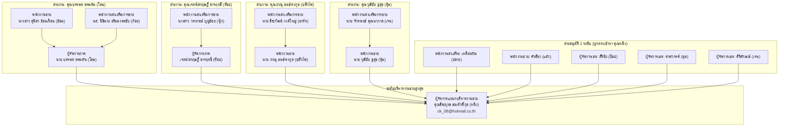

# 🏢 ผังสายงานการอนุมัติกิจกรรม (Approval Hierarchy)

> **เอกสารอ้างอิงข้อมูลบุคลากรและสายการอนุมัติตามสายงานจริงในระบบ (Production Data Reference)**  
> วันที่อัปเดตข้อมูลล่าสุด: 30 ตุลาคม 2026  
> แหล่งข้อมูล: ฐานข้อมูล CRM ตาราง `Employee` (ฟิลด์ `managerId`)

---

## 📌 1. ภาพรวมโครงสร้างสายงานในฐานข้อมูลปัจจุบัน

ในการอนุมัติตามสายงาน (`PENDING_LINE_APPROVAL`) ระบบจะใช้ฟิลด์ `managerId` ของพนักงานแต่ละคนเป็นเกณฑ์หลักในการระบุตัวผู้อนุมัติขั้นถัดไป

---

## 📋 2. รายชื่อพนักงานและสายอนุมัติจริงใน Database

### 2.1 สายอนุมัติ 3 ระดับ (3-Tier Chain: ผู้จัดทำ $\rightarrow$ หัวหน้างานสายตรง $\rightarrow$ ผจก.แผนกบริหารงานขาย)

| พนักงานผู้จัดทำแผน | หัวหน้างานขั้นที่ 1 | หัวหน้างานขั้นที่ 2 |
| :--- | :--- | :--- |
| **นาย ธีระวัฒน์ วงค์ใหญ่ (มาร์ท)** (พนักงานส่งเสริมการขาย-กิจกรรม) marchmellow2541@gmail.com | **นาย ภาณุ ธนธำรงกุล (ปลั๊กไฟ)** (พนักงานขาย-กิจกรรม) unplug_unplug@hotmail.com | **ธีระยุทธ ธณศักดิ์กุล (หนึ่ง)** (ผู้จัดการแผนกบริหารงานขาย-กิจกรรม) ck_08@hotmail.co.th |
| **นาย จักรพงษ์ คุณนากาล (เจน)** (พนักงานส่งเสริมการขาย-กิจกรรม) j.khunnakal@gmail.com | **นาย วุฒิชัย ชูสุข (ตุ้ม)** (พนักงานขาย-กิจกรรม) tum6622@hotmail.com | **ธีระยุทธ ธณศักดิ์กุล (หนึ่ง)** (ผู้จัดการแผนกบริหารงานขาย-กิจกรรม) ck_08@hotmail.co.th |
| **นางสาว วราภรณ์ บุญอ้อย (นุ๊ก)** (พนักงานส่งเสริมการขาย-กิจกรรม) warapornboonaoi1@gmail.com | **เจตน์สกฤษฎิ์ อาจฤทธิ์ (ท็อป)** (ผู้จัดการภาค-กิจกรรม) topten_mju@hotmail.com | **ธีระยุทธ ธณศักดิ์กุล (หนึ่ง)** (ผู้จัดการแผนกบริหารงานขาย-กิจกรรม) ck_08@hotmail.co.th |
| **นส. นิธินาถ อริยมงคลชัย (ก้อย)** (พนักงานส่งเสริมการขาย-กิจกรรม) koiijai14@gmail.com | **นาย บรรพต พรมตัน (โอม)** (ผู้จัดการภาค-กิจกรรม) ohm.bunput@yahoo.co.th | **ธีระยุทธ ธณศักดิ์กุล (หนึ่ง)** (ผู้จัดการแผนกบริหารงานขาย-กิจกรรม) ck_08@hotmail.co.th |
| **นางสาว สุนิสา อ้อนเรือน (อ้อม)** (พนักงานขาย-กิจกรรม) sunisaaonruan@gmail.com | **นาย บรรพต พรมตัน (โอม)** (ผู้จัดการภาค-กิจกรรม) ohm.bunput@yahoo.co.th | **ธีระยุทธ ธณศักดิ์กุล (หนึ่ง)** (ผู้จัดการแผนกบริหารงานขาย-กิจกรรม) ck_08@hotmail.co.th |

---

### 2.2 สายอนุมัติ 2 ระดับ (ผูกตรงไปยัง คุณธีระยุทธ ธณศักดิ์กุล)

| พนักงานผู้จัดทำแผน | หัวหน้างานขั้นที่ 1 (ผจก.แผนกบริหารงานขาย) |
| :--- | :--- |
| **เหมือนฝัน การปรีชา (ปลาย)** (พนักงานส่งเสริมการขาย-กิจกรรม) mueanfan011199@gmail.com | **ธีระยุทธ ธณศักดิ์กุล (หนึ่ง)** (ผู้จัดการแผนกบริหารงานขาย-กิจกรรม) ck_08@hotmail.co.th |
| **นางสาว คัทลียา เดชแพง (แอ๋ว)** (พนักงานขาย-กิจกรรม) katthaleya.aeow@gmail.com | **ธีระยุทธ ธณศักดิ์กุล (หนึ่ง)** (ผู้จัดการแผนกบริหารงานขาย-กิจกรรม) ck_08@hotmail.co.th |
| **นาย ภาณุ ธนธำรงกุล (ปลั๊กไฟ)** (พนักงานขาย-กิจกรรม) unplug_unplug@hotmail.com | **ธีระยุทธ ธณศักดิ์กุล (หนึ่ง)** (ผู้จัดการแผนกบริหารงานขาย-กิจกรรม) ck_08@hotmail.co.th |
| **นาย วุฒิชัย ชูสุข (ตุ้ม)** (พนักงานขาย-กิจกรรม) tum6622@hotmail.com | **ธีระยุทธ ธณศักดิ์กุล (หนึ่ง)** (ผู้จัดการแผนกบริหารงานขาย-กิจกรรม) ck_08@hotmail.co.th |
| **นาย สิริชัย สายทอง (ป๊อป)** (พนักงานฝ่ายขาย / ผู้จัดการเขต) sirichaisaythong2538@gmail.com | **ธีระยุทธ ธณศักดิ์กุล (หนึ่ง)** (ผู้จัดการแผนกบริหารงานขาย-กิจกรรม) ck_08@hotmail.co.th |
| **นางสาว ศรสวรรค์ คชปัญญา (นุ่ม)** (พนักงานฝ่ายขาย / ผู้จัดการเขต) sonsawan2532@gmail.com | **ธีระยุทธ ธณศักดิ์กุล (หนึ่ง)** (ผู้จัดการแผนกบริหารงานขาย-กิจกรรม) ck_08@hotmail.co.th |
| **นางสาว ศิริลักษณ์ วิชัย (เจน)** (พนักงานฝ่ายขาย / ผู้จัดการเขต) janeny_@hotmail.com | **ธีระยุทธ ธณศักดิ์กุล (หนึ่ง)** (ผู้จัดการแผนกบริหารงานขาย-กิจกรรม) ck_08@hotmail.co.th |
| **นาย บรรพต พรมตัน (โอม)** (ผู้จัดการภาค-กิจกรรม) ohm.bunput@yahoo.co.th | **ธีระยุทธ ธณศักดิ์กุล (หนึ่ง)** (ผู้จัดการแผนกบริหารงานขาย-กิจกรรม) ck_08@hotmail.co.th |
| **เจตน์สกฤษฎิ์ อาจฤทธิ์ (ท็อป)** (ผู้จัดการภาค-กิจกรรม) topten_mju@hotmail.com | **ธีระยุทธ ธณศักดิ์กุล (หนึ่ง)** (ผู้จัดการแผนกบริหารงานขาย-กิจกรรม) ck_08@hotmail.co.th |

---

### 2.3 บุคลากรที่ไม่มีหัวหน้างาน (`managerId = null`)

1. **ระดับผู้บริหาร / หัวหน้าแผนกสูงสุด:**
   * **ธีระยุทธ ธณศักดิ์กุล (หนึ่ง)** — ผู้จัดการแผนกบริหารงานขาย-กิจกรรม (`ck_08@hotmail.co.th`)
   * **คมสัน อ่อนช้อย (หนูหนึ่ง)** — ผู้จัดการแผนกการตลาด-กิจกรรม (`komsan@cropsciences.co.th`)
   * **นางสาว นวีณ มงคลธรรมากุล** — ผู้บริหาร (`naveen@intercrop.co.th`)
   * **นางสาว ปาจรีย์ พิณทอง** — ผู้บริหาร (`100009@email.com`)
2. **ธุรการและฝ่ายอื่นๆ:**
   * **นางสาว แก้วตา แสงอิ่น** — ธุรการขาย (`kaewta@demo.com`)
   * **นาย พนักงาน การตลาด** — พนักงานการตลาด (`mk_cs@gmail.com`)
3. **ฝ่าย IT / ผู้ดูแลระบบ (Admin):**
   * นาย อรรถพล มงคล (`atthapol@gmail.com`, `atthpol@gmail.com`)
   * นาย ประวิทย์ บงแก้ว (`prawit@agforepax.co.th`)
   * นาย ทีน โรงงาน (`tttt@gmail.com`)
   * นาย แฮม สนง. (`hhhhh@gmail.com`)
4. **บัญชีทดสอบในระบบ:** `100001@email.com` ถึง `100008@email.com` และ `office@gmail.com`

---

## 🎯 3. ตัวอย่างการขยายเป็น 4 ระดับ (Target 4-Tier Progression)

หากต้องการให้พนักงานส่งเสริมการขาย วิ่งครบ 4 ระดับ (ส่งเสริม $\rightarrow$ พนักงานขาย $\rightarrow$ ผจก.ภาค $\rightarrow$ ผจก.แผนกบริหารงานขาย) เช่น:
* **นาย ธีระวัฒน์ (มาร์ท)** $\longrightarrow$ **นาย ภาณุ (ปลั๊กไฟ)** $\longrightarrow$ *(หากตั้งคุณภาณุให้ชี้ไปที่ คุณบรรพต โอม)* $\longrightarrow$ **คุณธีระยุทธ (หนึ่ง)**

---

## 🔗 เอกสารและโค้ดที่เกี่ยวข้อง
* **คู่มือการทำงานของ Approval Engine:** [`modules/activity/domain/approval/README.md`](file:///d:/code/crm-bank/modules/activity/domain/approval/README.md)
* **ตรรกะการประมวลผลสายงาน:** [`modules/activity/application/activity-plan-flow.ts`](file:///d:/code/crm-bank/modules/activity/application/activity-plan-flow.ts) (ฟังก์ชัน `resolveNextLineApprover`)
