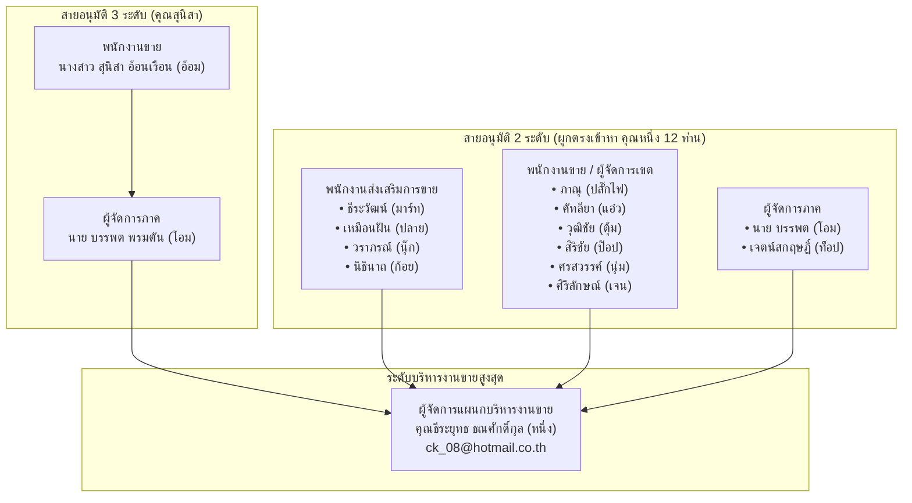

# 🏢 ผังสายงานการอนุมัติกิจกรรม (Approval Hierarchy)

> **เอกสารอ้างอิงข้อมูลบุคลากรและสายการอนุมัติตามสายงานจริงในระบบ (Production Data Reference)**
> วันที่อัปเดตข้อมูลล่าสุด: 30 ตุลาคม 2026
> แหล่งข้อมูล: ฐานข้อมูล CRM ตาราง `Employee` (ฟิลด์ `managerId`)

---

## 📌 1. ภาพรวมโครงสร้างสายงานในฐานข้อมูลปัจจุบัน

ในการอนุมัติตามสายงาน (`PENDING_LINE_APPROVAL`) ระบบจะใช้ฟิลด์ `managerId` ของพนักงานแต่ละคนเป็นเกณฑ์หลักในการระบุตัวผู้อนุมัติขั้นถัดไป



---

## 📋 2. รายชื่อพนักงานและสายอนุมัติจริงใน Database

### 2.1 สายอนุมัติ 3 ระดับ (3-Tier Chain)

| พนักงานผู้จัดทำแผน | ตำแหน่ง | อีเมล | หัวหน้างานขั้นที่ 1 (Direct Manager) | หัวหน้างานขั้นที่ 2 (Terminal Manager) |
| :--- | :--- | :--- | :--- | :--- |
| **นางสาว สุนิสา อ้อนเรือน (อ้อม)** | พนักงานขาย-กิจกรรม | `sunisaaonruan@gmail.com` | **นาย บรรพต พรมตัน (โอม)**<br/>*(ผู้จัดการภาค-กิจกรรม)* | **ธีระยุทธ ธณศักดิ์กุล (หนึ่ง)**<br/>*(ผู้จัดการแผนกบริหารงานขาย)* |

---

### 2.2 สายอนุมัติ 2 ระดับ (ผูกตรงไปยัง คุณธีระยุทธ ธณศักดิ์กุล)

#### 🔹 กลุ่มพนักงานส่งเสริมการขาย (Promoter)
| พนักงานผู้จัดทำแผน | ตำแหน่งในระบบ | อีเมล | ผู้อนุมัติสายตรงใน DB (`managerId`) |
| :--- | :--- | :--- | :--- |
| **นาย ธีระวัฒน์ วงค์ใหญ่ (มาร์ท)** | พนักงานส่งเสริมการขาย-กิจกรรม | `marchmellow2541@gmail.com` | **ธีระยุทธ ธณศักดิ์กุล (หนึ่ง)** |
| **เหมือนฝัน การปรีชา (ปลาย)** | พนักงานส่งเสริมการขาย-กิจกรรม | `mueanfan011199@gmail.com` | **ธีระยุทธ ธณศักดิ์กุล (หนึ่ง)** |
| **วราภรณ์ บุญอ้อย (นุ๊ก)** | พนักงานส่งเสริมการขาย | `warapornboonaoi1@gmail.com` | **ธีระยุทธ ธณศักดิ์กุล (หนึ่ง)** |
| **นส. นิธินาถ อริยมงคลชัย (ก้อย)** | พนักงานส่งเสริมการขาย-กิจกรรม | `koiijai14@gmail.com` | **ธีระยุทธ ธณศักดิ์กุล (หนึ่ง)** |

#### 🔹 กลุ่มพนักงานขายและผู้จัดการเขต (Sales & District Manager)
| พนักงานผู้จัดทำแผน | ตำแหน่งในระบบ | อีเมล | ผู้อนุมัติสายตรงใน DB (`managerId`) |
| :--- | :--- | :--- | :--- |
| **นาย ภาณุ ธนธำรงกุล (ปลั๊กไฟ)** | พนักงานขาย-กิจกรรม | `unplug_unplug@hotmail.com` | **ธีระยุทธ ธณศักดิ์กุล (หนึ่ง)** |
| **นางสาว คัทลียา เดชแพง (แอ๋ว)** | พนักงานฝ่ายขาย | `katthaleya.aeow@gmail.com` | **ธีระยุทธ ธณศักดิ์กุล (หนึ่ง)** |
| **นาย วุฒิชัย ชูสุข (ตุ้ม)** | พนักงานฝ่ายขาย | `tum6622@hotmail.com` | **ธีระยุทธ ธณศักดิ์กุล (หนึ่ง)** |
| **นาย สิริชัย สายทอง (ป๊อป)** | พนักงานฝ่ายขาย (ผู้จัดการเขต) | `sirichaisaythong2538@gmail.com` | **ธีระยุทธ ธณศักดิ์กุล (หนึ่ง)** |
| **นางสาว ศรสวรรค์ คชปัญญา (นุ่ม)** | พนักงานฝ่ายขาย (ผู้จัดการเขต) | `sonsawan2532@gmail.com` | **ธีระยุทธ ธณศักดิ์กุล (หนึ่ง)** |
| **นางสาว ศิริลักษณ์ วิชัย (เจน)** | พนักงานฝ่ายขาย (ผู้จัดการเขต) | `janeny_@hotmail.com` | **ธีระยุทธ ธณศักดิ์กุล (หนึ่ง)** |

#### 🔹 กลุ่มผู้จัดการภาค (Area Manager)
| พนักงานผู้จัดทำแผน | ตำแหน่งในระบบ | อีเมล | ผู้อนุมัติสายตรงใน DB (`managerId`) |
| :--- | :--- | :--- | :--- |
| **นาย บรรพต พรมตัน (โอม)** | ผู้จัดการภาค-กิจกรรม | `ohm.bunput@yahoo.co.th` | **ธีระยุทธ ธณศักดิ์กุล (หนึ่ง)** |
| **เจตน์สกฤษฎิ์ อาจฤทธิ์ (ท็อป)** | ผู้จัดการภาค-กิจกรรม | `topten_mju@hotmail.com` | **ธีระยุทธ ธณศักดิ์กุล (หนึ่ง)** |

---

### 2.3 บุคลากรที่ไม่มีหัวหน้างาน (`managerId = null`)

1. **ระดับผู้บริหาร / หัวหน้าแผนกสูงสุด:**
   * **ธีระยุทธ ธณศักดิ์กุล (หนึ่ง)** — ผู้จัดการแผนกบริหารงานขาย-กิจกรรม (`ck_08@hotmail.co.th`)
   * **คมสัน อ่อนช้อย (หนูหนึ่ง)** — ผู้จัดการแผนกการตลาด-กิจกรรม (`komsan@cropsciences.co.th`)
   * **นางสาว นวีณ มงคลธรรมากุล** — ผู้บริหาร (`naveen@intercrop.co.th`)
   * **นางสาว ปาจรีย์ พิณทอง** — ผู้บริหาร (`100009@email.com`)
2. **ธุรการและฝ่ายอื่นๆ:**
   * **นางสาว แก้วตา แสงอิ่น** — ธุรการขาย (`kaewta@demo.com`)
   * **นาย พนักงาน การตลาด** — พนักงานการตลาด (`mk_cs@gmail.com`)
3. **ฝ่าย IT / ผู้ดูแลระบบ (Admin):**
   * นาย อรรถพล มงคล (`atthapol@gmail.com`, `atthpol@gmail.com`)
   * นาย ประวิทย์ บงแก้ว (`prawit@agforepax.co.th`)
   * นาย ทีน โรงงาน (`tttt@gmail.com`)
   * นาย แฮม สนง. (`hhhhh@gmail.com`)
4. **บัญชีทดสอบในระบบ:** `100001@email.com` ถึง `100008@email.com` และ `office@gmail.com`

---

## 🎯 3. โครงสร้างสายอนุมัติเป้าหมาย 4 ระดับ (Target Design)

หากในอนาคตต้องการปรับให้โครงสร้างสายงานมีความเป็นลำดับขั้น 4 ระดับ (Promoter $\rightarrow$ Sales $\rightarrow$ Area Manager $\rightarrow$ Sales Admin Manager) สามารถปรับค่า `managerId` ของพนักงานแต่ละคนให้ชี้ไปตามโครงสร้างนี้:

```text
[ระดับ 1: พนักงานส่งเสริม] ──(managerId)──> [ระดับ 2: พนักงานขาย] ──(managerId)──> [ระดับ 3: ผู้จัดการภาค] ──(managerId)──> [ระดับ 4: ผจก.แผนกบริหารงานขาย]
```

### ตัวอย่างเช่น:
* **นาย ธีระวัฒน์ (มาร์ท)** $\longrightarrow$ ตั้ง `managerId` ชี้ไปที่ **นาย ภาณุ (ปลั๊กไฟ)**
* **นาย ภาณุ (ปลั๊กไฟ)** $\longrightarrow$ ตั้ง `managerId` ชี้ไปที่ **นาย บรรพต (โอม)**
* **นาย บรรพต (โอม)** $\longrightarrow$ ตั้ง `managerId` ชี้ไปที่ **ธีระยุทธ ธณศักดิ์กุล (หนึ่ง)**

---

## 🔗 เอกสารและโค้ดที่เกี่ยวข้อง
* **คู่มือการทำงานของ Approval Engine:** [`modules/activity/domain/approval/README.md`](file:///d:/code/crm-bank/modules/activity/domain/approval/README.md)
* **ตรรกะการประมวลผลสายงาน:** [`modules/activity/application/activity-plan-flow.ts`](file:///d:/code/crm-bank/modules/activity/application/activity-plan-flow.ts) (ฟังก์ชัน `resolveNextLineApprover`)

