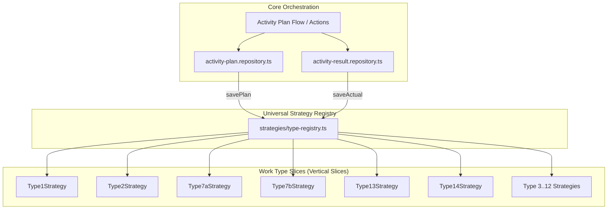

# Activity Plans (Trip Plan) Data & Feature Architecture Specification

> **Document Version:** 4.0.0 (Vertical Slice Architecture & Universal Strategy Pattern)  
> **Status:** ACTIVE STANDARD (ADOPTED SINGLE SOURCE OF TRUTH)  
> **Target Scope:** Module `modules/activity-plans/` and database models `Activity*`

---

## 1. System Overview & Architectural Paradigm

ระบบ Activity Plans (Trip Plan) ถูกออกแบบสำหรับบันทึก วางแผน อนุมัติ และติดตามผลการปฏิบัติงานของพนักงานขายและทีมส่งเสริมการเกษตร (Field Sales / Agronomists) ครอบคลุมงาน 14 ประเภทงาน (**Work Types 1–14**)

ระบบใช้สถาปัตยกรรม **Vertical Slice Architecture** ควบคู่กับ **Universal Strategy Pattern** และ **Normalized Relational Data Architecture**:
1. **Vertical Slice Architecture**: แต่ละประเภทงาน (TYPE 1 – 14) ถูกแยกเป็น Feature Slice ที่สมบูรณ์และอิสระในตัวเอง มี Domain Types, Validation Layer, UI Components, State Hooks, และ Strategy ประจำตัว
2. **Universal Strategy Pattern**: จัดเก็บและเรียกใช้ Business Logic และการบันทึกฐานข้อมูล (`savePlan`, `saveActual`, `validatePlan`) ผ่าน Strategy Registry กลาง (`WorkTypeStrategy`)
3. **Decoupled Plan vs Result**: ข้อมูลแผนงาน (`ActivityPlan*`) และข้อมูลผลการปฏิบัติงานจริง (`ActivityResult*`) แยกความสัมพันธ์และโมเดลกันอย่างชัดเจน
4. **Dedicated Domain Integration**: รองรับกระบวนการเฉพาะทาง เช่น ระบบแปลงสาธิต (General Demo Plots & Hattack Plots), ทัวร์ (Tour - No Dedicated Actual), การฉีดแปลงหลายแปลง (TYPE 13 Multi-plot Spraying), และการติดตามแปลงหลายรอบ (TYPE 14 Multi-round Follow-up)
5. **Clean Infrastructure Separation**: แยก Core Plan Repository ออกจากการจัดการ Lookup และ Include Relation Tree เพื่อความกระชับและ Type Inference สูงสุด

---

## 2. Work Type Matrix & Configuration (SSOT)

ตารางประเภทงานทั้ง 14 ประเภทงาน (14 Work Types) ที่กำหนดเป็น Single Source of Truth ในระบบ:

| Work Type Code | รหัสประเภทงาน | ชื่อประเภทงาน | Has Actual | Requires Approval | Key Data Relations / Models | Dedicated Features & Workflows |
|:---|:---|:---|:---:|:---:|:---|:---|
| `TYPE_1` | TYPE 1 | เข้าพบร้านค้า / Key Farmer | **Yes** | **Yes** | `activity_plan_type_1_stores`, `type1Result` | Dedicated Multi-target Store/Farmer, Unregistered Farmer Support |
| `TYPE_2` | TYPE 2 | ติดตามผลการใช้สินค้า | **Yes** | **Yes** | `activity_plan_type_2_targets`, products | Product Observation & Usage Feedback |
| `TYPE_3` | TYPE 3 | ร่วมกิจกรรมร้านค้า | **Yes** | **Yes** | `activity_plan_type_3_targets`, products | Store Co-activity, Target Sales vs Actual Sales |
| `TYPE_4` | TYPE 4 | สำรวจสินค้าคงคลังร้านค้า | **Yes** | **Yes** | `activity_plan_type_4_targets`, `type4Result` | Dedicated Stock Inventory Count, Low Stock Tracking |
| `TYPE_5` | TYPE 5 | แก้ไขปัญหาสินค้า | **Yes** | **Yes** | `activity_plan_type_5_targets`, `ActivityAttachment` | Product Issue Resolution, Investigation, Resolution Photos |
| `TYPE_6` | TYPE 6 | จัดเรียงสินค้า / ติดป้าย / โฆษณา | **Yes** | **Yes** | `activity_plan_type_6_targets`, `ActivityAttachment` | Store Merchandising, Display Photos, Advertising Banners |
| `TYPE_7A` | TYPE 7A | ทำแปลงสาธิต (เปิดแปลงใหม่) | **Yes** | **Yes** | `DemoPlot`, `type7aPlots`, `DemoPlotVisit` | **DemoPlot Registration**, GPS Coordinates, Treatment/Control, Drug Withdrawal |
| `TYPE_7B` | TYPE 7B | ติดตามแปลงสาธิต (แปลงเดิม) | **Yes** | **Yes** | `activity_plan_type_7b`, `DemoPlotVisit` | **DemoPlotVisit Record**, Originating Plan Linkage, Crop Age, Spray Rounds |
| `TYPE_8` | TYPE 8 | ประชุมกลุ่มเกษตรกร | **Yes** | **Yes** | `ActivityPlanItem`, Target Attendees | Meeting Topics, Target Attendees vs Actual Attendees |
| `TYPE_9` | TYPE 9 | ส่งเสริมการขายร่วมกับร้านค้า | **Yes** | **Yes** | `ActivityPlanStore`, `ActivityPlanProduct` | Store Promotion, Target Sales vs Actual Sales, Freebies |
| `TYPE_10` | TYPE 10 | จัดงาน Field Day | **Yes** | **Yes** | `DemoPlot`, `type10SoldProducts`, Attendees | Farmer Gathering, Demonstration, Booth Sales, Sold Product Items |
| `TYPE_11` | TYPE 11 | งาน Event / นิทรรศการ / ประชุมสัมมนา | **Yes** | **Yes** | `ActivityPlanItem`, Exhibited Products | Event Participation, Booth Showcase, Exhibition Products |
| `TYPE_12` | TYPE 12 | **ทัวร์ (Tour)** | **No** | **Yes** | `ActivityPlanTour` (Central / Store Tour) | **No Dedicated Actual**, Target Destination/Store, Country, Tour Size |
| `TYPE_13` | TYPE 13 | ฉีดแปลงแฮตแทค (Multi-plot) | **Yes** | **Yes** | `activity_plan_type_13`, plots, products | **Multi-plot Spraying (1–10 plots)**, Tank Mix, Spray Method, Formula, Drug Withdrawal |
| `TYPE_14` | TYPE 14 | ติดตามแปลงแฮทแทค (Multi-round) | **Yes** | **Yes** | `activity_plan_type_14`, plots, trackings | **Multi-round Evaluation**, History linkage (from TYPE 13), Supplemental Drug Withdrawal |

---

## 3. Vertical Slice Architecture (v4.0.0)

แต่ละประเภทงาน (`features/type-1/` ถึง `features/type-14/`) ถูกจัดเรียงตามสถาปัตยกรรม **Vertical Slice Architecture** ที่มี 4 เลเยอร์หลัก:

```text
modules/activity-plans/features/type-[N]/
├── application/
│   ├── validation.ts               # Pure Validation functions & Zod Schemas
│   ├── mapper.ts                   # Domain <-> Form State Mappers
│   └── type[N].strategy.ts         # Universal Strategy Pattern Handler (WorkTypeStrategy)
├── components/
│   ├── type[N]-plan-card.tsx       # Summary Plan Overview Card
│   ├── type[N]-plan-form.tsx       # Create/Edit Plan Form Section
│   ├── type[N]-actual-form.tsx     # Actual Result Entry Form Section
│   ├── type[N]-detail-view.tsx     # Read-only Detail View Section
│   └── type[N]-approval-card.tsx   # Approver Decision Summary Card
├── hooks/
│   ├── use-type[N]-form.ts         # React hook for Plan Form State
│   └── use-type[N]-actual-state.ts # React hook for Actual Execution State
├── types/
│   └── index.ts                    # Consolidated Domain, DTO, Props & State Types
├── index.ts                        # Client-Safe Public Barrel Export (Isolates Server Strategy)
└── README.md                       # Comprehensive Slice Guide with Inbound & Outbound Mappings
```

### Pure Validation Layer Contract
- ไฟล์ `application/validation.ts` ในแต่ละ Slice เป็น **Pure Functions 100%**
- มี Zod Schemas ประจำตัวของแต่ละ Type โดยถูก Re-export สู่ `modules/activity-plans/application/validations.ts`
- รับ Form State / Item Payload เป็น Input และคืนค่า `ValidationResult` (`{ isValid: boolean; error?: string }`)
- **ห้าม** ผูกกับ React Hooks (`useState`, `useEffect`) หรือ DOM
- ทำให้สามารถเรียกใช้ข้ามระหว่าง Client Component, React Hook Form, Server Actions, และ Automated Tests ได้อย่างสมบูรณ์

---

## 4. Universal Strategy Pattern & Orchestration

ระบบใช้ **Strategy Pattern** ในการประสานงานระหว่าง Core Workflow กับ Work Type ต่างๆ อย่างยืดหยุ่น:



### Strategy Contract (`WorkTypeStrategy`):
- `savePlan(tx, planId, data)`: บันทึกข้อมูลแผนงานเฉพาะประเภทลงฐานข้อมูลใน Atomic Transaction
- `saveActual(tx, planId, resultId, actualData)`: บันทึกผลการปฏิบัติงานจริงเฉพาะประเภท
- `validatePlan(data)`: ตรวจสอบความถูกต้องของแผนงาน
- `validateActual(actualData)`: ตรวจสอบความถูกต้องของผลการปฏิบัติงานจริง

---

## 5. Planned vs Unplanned Architecture

ระบบรองรับสองกระบวนการหลักของการบันทึกกิจกรรม:

```mermaid
graph TD
    subgraph "Planned Flow (วางแผนล่วงหน้า)"
        P1[Planned Entry Point] --> P2[Create / Multi-Type Selection]
        P2 --> P3[Draft / Pending Approval]
        P3 --> P4[Manager / Sales Promotion Approval]
        P4 --> P5[Approved Plan]
        P5 --> P6[Record Actual Result]
        P6 --> P7[Plan & Result Completed]
    end

    subgraph "Unplanned Flow (กิจกรรมด่วน / นอกแผน)"
        U1[Unplanned Entry Point] --> U2[Quick Execution / Single Type Form]
        U2 --> U3[Simultaneous Plan & Actual Creation]
        U3 --> U4[Direct Submission / Auto-Recorded]
        U4 --> U5[Unplanned Completed Record]
    end
```



---

## 6. Infrastructure Layer Architecture

โครงสร้างโฟลเดอร์ `modules/activity-plans/infrastructure/` ได้รับการจัดระเบียบให้มีขนาดกะทัดรัดและแยกความรับผิดชอบอย่างชัดเจน:

1. **`activity-plan.repository.ts`**: Core CRUD และ State Machine Transitions ของแผนงาน
2. **`activity-plan-include.ts`**: รวมศูนย์ Prisma Relation Include Tree ทั้งหมดในที่เดียว (`ACTIVITY_PLAN_FULL_INCLUDE`)
3. **`activity-result.repository.ts`**: Core CRUD สำหรับผลการปฏิบัติงานจริง
4. **`activity-approval.repository.ts`**: จัดการประวัติการอนุมัติและ Audit Trail
5. **`demo-plot.repository.ts`**: จัดการ Master Demo Plots และ Hattack Plots
6. **`employee-lookup.repository.ts`**: จัดการค้นหาและผูก Employee Profile
7. **`product-category.repository.ts`**: จัดการ Master Categories
8. **`promotional-material.repository.ts`**: จัดการสื่อส่งเสริมการขาย

---

## 7. Architectural Integrity & Safety Rules

1. **Strict Slice Decoupling:** การแก้ไข UI หรือ Logic ใน Type ใด ต้องไม่กระทบ Type อื่น (`features/type-[N]/` แยกขอบเขตชัดเจน)
2. **Pure Validation:** ทุกการตรวจสอบความถูกต้องของข้อมูล Form Input ต้องอยู่ใน `application/validation.ts` ของ Slice นั้นๆ
3. **Server Bundle Isolation:** ไฟล์ `index.ts` ที่เป็น Public Barrel ของแต่ละ Slice ต้องเป็น Client-Safe เสมอ (ห้าม export Strategy หรือ DB Repository)
4. **Single Source of Truth Types:** Type Definition ทั้งหมดของแต่ละประเภทงานต้องรวมอยู่ที่ `types/index.ts` ประจำ Slice
5. **Zero Legacy Shims:** ห้ามมี Proxy Shims หรือ Legacy Folders ตกค้างในระบบ
