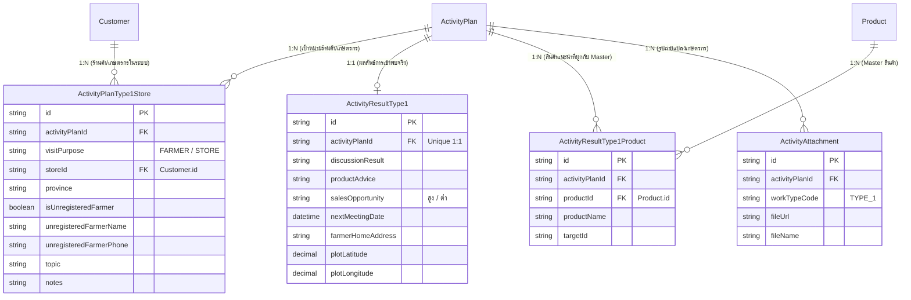

# TYPE 1: เข้าพบร้านค้า / Key Farmer (Work Type Module Guide)

> **Module Path**: `modules/activity-plans/features/type-1/`  
> **Work Type Code**: `TYPE_1`  
> **Thai Label**: `เข้าพบร้านค้า / Key Farmer` (หรือ `เข้าพบเกษตรกร`)  
> **Architecture Pattern**: Self-Contained Feature Slice with Sub-slices (Planned, Unplanned, Actual, Shared) & Single Source of Truth Database

---

## 📌 1. ภาพรวม (Overview)

ประเภทงาน **`TYPE_1` (เข้าพบร้านค้า / Key Farmer)** ใช้สำหรับบันทึกแผนงานและผลการเข้าพบลูกค้าในรูปแบบ **Multi-Target (1 Plan : N ร้านค้า/เกษตรกร เช่น 1 แผน เข้าพบ 4 ร้านค้า)** โดยแต่ละเป้าหมายรองรับ 2 วัตถุประสงค์หลัก:

1. **เข้าพบเกษตรกร (FARMER)**:
   - **เกษตรกรในระบบ (Registered)**: เลือกจังหวัด $\rightarrow$ เลือกลูกค้าจากตาราง `Customer` ที่มี `customerType = 'FARMER'`
   - **เกษตรกรนอกระบบ (Unregistered)**: ติ๊ก "ไม่มีในระบบ" $\rightarrow$ ระบุชื่อ-สกุล และเบอร์โทรศัพท์ (9-10 หลัก)
2. **เข้าพบร้านค้า (STORE)**:
   - เลือกร้านค้าตัวแทนจำหน่ายจากตาราง `Customer` ที่มี `customerType` เป็น `'DEALER'` หรือ `'SUBDEALER'` เท่านั้น (ไม่อนุญาตให้เลือกลูกค้านอกระบบ)
3. **การเพิ่ม/ลบเป้าหมาย (Dynamic Targets)**:
   - สามารถกดปุ่ม **"+ เพิ่มร้านค้า / เกษตรกร"** เพื่อเพิ่มเป้าหมายได้ตามต้องการ (เช่น 4 ร้านค้าในวันเดียว) และมีปุ่มลบถังขยะสำหรับแต่ละรายการ (คงไว้อย่างน้อย 1 เป้าหมาย)
4. **การแยกขาดระหว่าง In-Plan และ Unplanned**:
   - กิจกรรม **ในแผน (Planned)** และ **นอกแผน (Unplanned)** ถูกแยก Sub-slices และฟอร์มออกจากกันอย่างเด็ดขาดเพื่อแก้ปัญหา *"แก้ในแผนแล้วนอกแผนพัง"*

---

## 📂 2. โครงสร้างโฟลเดอร์ล่าสุด (Refactored Sub-slice Architecture)

สถาปัตยกรรมได้รับการจัดระเบียบตาม Module Architecture Contract และหลักการ **Separation of Concerns**:

```text
modules/activity-plans/features/type-1/
├── planned/                             # 🎯 กิจกรรมในแผน (In-Plan Targets Section)
│   ├── components/
│   │   └── type1-planned-form.tsx       # ฟอร์มวางแผนเป้าหมายล่วงหน้า (สะอาด ไม่มีฟิลด์ผลจริง/GPS ปะปน)
│   ├── hooks/
│   │   └── use-type1-planned-form.ts    # State & Handlers เฉพาะการวางแผนเป้าหมาย
│   ├── types.ts                         # Type definitions สำหรับ Planned Item & Props
│   └── validation.ts                    # Zod validation schema สำหรับ Planned Targets
│
├── unplanned/                           # ⚡ กิจกรรมนอกแผน (Unplanned All-In-One Unified Form)
│   ├── components/
│   │   └── type1-unplanned-form.tsx     # การ์ด All-In-One (เป้าหมาย + ผลการเข้าพบ + GPS + สินค้าแนะนำ + รูปถ่าย)
│   ├── hooks/
│   │   └── use-type1-unplanned-form.ts  # State & Handlers สำหรับ Unplanned Item
│   ├── types.ts                         # Type definitions สำหรับ Unplanned Item & Props
│   └── validation.ts                    # Zod validation schema สำหรับ Unplanned Flow
│
├── actual/                              # 📝 ผลงานจริงของกิจกรรมในแผน (In-Plan Actual Stage)
│   ├── components/
│   │   └── type1-actual-form.tsx        # UI บันทึกผลงานจริง (รับ actualState จาก Orchestrator โดยตรง)
│   ├── hooks/
│   │   └── use-type1-actual.ts          # Forwarder / Hook สำหรับจัดการ Actual State
│   └── types.ts                         # Type definitions สำหรับ Actual View
│
├── shared/                              # 🤝 โมเดลกลางและ Options ที่ใช้ร่วมกัน
│   └── types.ts                         # VISIT_TOPICS, CustomerOption, ProductOption, Type1ImageFile ฯลฯ
│
├── components/                          # 🖥️ คอมโพเนนต์แสดงผลส่วนกลางของโมดูล
│   ├── type1-actual-form.tsx            # ฟอร์มผลงานจริงหลัก (รองรับ Multi-Target)
│   ├── type1-detail-view.tsx            # หน้าแสดงรายละเอียดผลการปฏิบัติงาน (Read-only Detail View)
│   ├── type1-approval-card.tsx          # การ์ดแสดงผลในหน้าอนุมัติ (Approval Card)
│   └── type1-plan-card.tsx              # การ์ดสรุปเป้าหมายแผนงานเดิม (Auto-hides in Unplanned mode)
│
├── application/                         # 🧠 Business Logic, Mappers & Persistence Strategy
│   ├── mapper.ts                        # Single Source of Truth แปลง DB Data <-> UI Form State
│   ├── type1.strategy.ts                # WorkTypeStrategy บันทึก/โหลดตรงกับ Dedicated Tables 100%
│   └── validation.ts                    # Core schemas สำหรับ Type 1
│
├── hooks/                               # 🪝 Encapsulated Hooks รวม
│   ├── use-type1-form.ts                # Adapter Hook รวมสำหรับรองรับการเรียกใช้งานระดับโมดูล
│   └── use-type1-actual.ts              # Core Hook สำหรับจัดการ Actual Data, Photos, Products
│
├── types/                               # 📐 Type Definitions รวมศูนย์
│   └── index.ts                         # Single Source of Truth รวบรวม Type ทุกส่วนของ Type 1
│
├── index.ts                             # 📦 Public Barrel Export สำหรับทั้งโมดูล
└── README.md                            # 📖 เอกสารกำกับ Type 1 (ไฟล์นี้)
```

---

## 🗄️ 3. สถาปัตยกรรมฐานข้อมูลแบบ Single Source of Truth

ข้อมูลของ Type 1 ทั้งหมดถูกจัดเก็บลงใน **Dedicated Tables** โดยตรง **100%**:
- **ยกเลิก Dual-Writing** (ไม่มีการเขียนข้อมูลซ้ำซ้อนลง `activity_plan_stores` หรือ monolithic columns ใน `activity_results`)
- **ยกเลิก Legacy Fallback** (ฐานข้อมูลถูกคลีนใหม่หมดจด โค้ดไม่อ่าน fallback จากตารางเก่า ทำให้โค้ดกระชับ รวดเร็ว และไม่มีบั๊กเรื่องข้อมูลไม่ตรงกัน)



---

### 3.1 ตาราง `activity_plan_type_1_stores` (เป้าหมายแผนงาน Type 1)

จัดเก็บเป้าหมายร้านค้า/เกษตรกรที่วางแผนจะเข้าพบ (1 แผน มีได้หลายเป้าหมาย):

| คอลัมน์ (Column)            | ชนิดข้อมูล (Type)    | Nullable            | ความหมายและรายละเอียด                                                |
| --------------------------- | -------------------- | ------------------- | -------------------------------------------------------------------- |
| `id`                        | `VARCHAR(30)` (cuid) | No                  | Primary Key                                                          |
| `activity_plan_id`          | `VARCHAR(30)`        | No                  | Foreign Key อ้างอิง `activity_plans.id` (Cascade Delete)             |
| `visit_purpose`             | `TEXT`               | No                  | วัตถุประสงค์การเข้าพบ: `'FARMER'` (เกษตรกร) หรือ `'STORE'` (ร้านค้า) |
| `store_id`                  | `VARCHAR(30)`        | Yes                 | Foreign Key อ้างอิง `Customer.id` (เป็น null หากเป็นเกษตรกรนอกระบบ)  |
| `province`                  | `TEXT`               | No                  | จังหวัดเป้าหมาย                                                      |
| `is_unregistered_farmer`    | `BOOLEAN`            | No (default: false) | แฟล็กระบุว่าเป็นเกษตรกรนอกระบบหรือไม่                                |
| `unregistered_farmer_name`  | `TEXT`               | Yes                 | ชื่อ-สกุล ของเกษตรกรนอกระบบ                                          |
| `unregistered_farmer_phone` | `TEXT`               | Yes                 | เบอร์โทรศัพท์ของเกษตรกรนอกระบบ                                       |
| `topic`                     | `TEXT`               | Yes                 | หัวข้อหลักในการเข้าพบ                                                |
| `notes`                     | `TEXT`               | Yes                 | รายละเอียดเพิ่มเติมในการเข้าพบ                                       |

---

### 3.2 ตาราง `activity_result_type_1` (ผลการเข้าพบจริง Type 1)

จัดเก็บผลการเข้าพบจริง สัมพันธ์แบบ **1:1** กับ `activity_plans`:

| คอลัมน์ (Column)      | ชนิดข้อมูล (Type)    | Nullable | ความหมายและรายละเอียด                      |
| --------------------- | -------------------- | -------- | ------------------------------------------ |
| `id`                  | `VARCHAR(30)` (cuid) | No       | Primary Key                                |
| `activity_plan_id`    | `VARCHAR(30)`        | No       | Foreign Key อ้างอิง `activity_plans.id`    |
| `discussion_result`   | `TEXT`               | Yes      | สรุปผลการพูดคุยกับเกษตรกรหรือร้านค้า       |
| `product_advice`      | `TEXT`               | Yes      | รายชื่อสินค้าที่ให้คำแนะนำ (ข้อความสรุป)   |
| `sales_opportunity`   | `TEXT`               | Yes      | การประเมินโอกาสการขาย: `'สูง'` หรือ `'ต่ำ'` |
| `next_meeting_date`   | `TIMESTAMP`          | Yes      | วันที่นัดหมายครั้งถัดไป                    |
| `farmer_home_address` | `TEXT`               | Yes      | ที่อยู่บ้านเกษตรกร                         |
| `plot_latitude`       | `DECIMAL(10, 7)`     | Yes      | พิกัดละติจูดของแปลงเกษตรกร (-90 ถึง 90)    |
| `plot_longitude`      | `DECIMAL(10, 7)`     | Yes      | พิกัดลองจิจูดของแปลงเกษตรกร (-180 ถึง 180) |

---

### 3.3 ตาราง `activity_result_type_1_products` (สินค้าแนะนำผูก Master)

จัดเก็บรายการสินค้าที่ให้คำแนะนำแบบแยกแถว (Normalized) ผูกกับตาราง `Product` โดยตรง:

| คอลัมน์ (Column)   | ชนิดข้อมูล (Type)    | Nullable | ความหมายและรายละเอียด                                          |
| ------------------ | -------------------- | -------- | -------------------------------------------------------------- |
| `id`               | `VARCHAR(30)` (cuid) | No       | Primary Key                                                    |
| `activity_plan_id` | `VARCHAR(30)`        | No       | Foreign Key อ้างอิง `activity_plans.id` (Cascade Delete)      |
| `target_id`        | `VARCHAR(30)`        | Yes      | รหัสเป้าหมายที่ได้รับคำแนะนำ (เกษตรกร หรือร้านค้า)             |
| `product_id`       | `VARCHAR(30)`        | No       | Foreign Key อ้างอิง `Product.id` (เชื่อม Master สินค้าโดยตรง)  |
| `product_name`     | `TEXT`               | Yes      | ชื่อสินค้า ณ ขณะบันทึก (Snapshot เพื่อความเร็วในการ Query)     |

---

### 3.4 ตาราง `activity_attachments` (รูปถ่ายแปลงเกษตรกร)

จัดเก็บไฟล์รูปถ่ายจากการเข้าพบจริง:

| คอลัมน์ (Column)   | ชนิดข้อมูล (Type)    | Nullable | ความหมายและรายละเอียดสำหรับ Type 1                               |
| ------------------ | -------------------- | -------- | ---------------------------------------------------------------- |
| `id`               | `VARCHAR(30)` (cuid) | No       | Primary Key                                                      |
| `activity_plan_id` | `VARCHAR(30)`        | No       | Foreign Key อ้างอิง `activity_plans.id`                          |
| `work_type_code`   | `VARCHAR(50)`        | Yes      | ระบุเป็น `'TYPE_1'`                                              |
| `category`         | `ENUM`               | No       | กำหนดเป็น `'GENERAL'`                                            |
| `file_url`         | `TEXT`               | No       | URL รูปภาพแปลงเกษตรกรที่อัปโหลดขึ้น Cloud Storage (สูงสุด 5 รูป) |
| `file_name`        | `TEXT`               | No       | ชื่อไฟล์รูปภาพ                                                   |

---

## 🖥️ 4. Data Mapping & UI Specification

### 4.1 แผนงานล่วงหน้า (Planned Sub-slice)
- **Component**: [planned/components/type1-planned-form.tsx](file:///d:/code/crm-bank/modules/activity-plans/features/type-1/planned/components/type1-planned-form.tsx)
- **Hook**: [planned/hooks/use-type1-planned-form.ts](file:///d:/code/crm-bank/modules/activity-plans/features/type-1/planned/hooks/use-type1-planned-form.ts)
- **หน้าที่**: สำหรับผู้ใช้สร้างหรือแก้ไขแผนงานล่วงหน้า โดยมุ่งเน้นการวางเป้าหมายร้านค้า/เกษตรกร **ไม่มีฟิลด์ผลการเข้าพบจริง พิกัด GPS หรือรูปถ่ายปะปน**
- **พฤติกรรม**:
  - เลือกวัตถุประสงค์ `FARMER` หรือ `STORE`
  - สลับวัตถุประสงค์จะล้างค่าเฉพาะของอีกโหมดทันที
  - เพิ่ม/ลบเป้าหมายได้อย่างอิสระ (อย่างน้อย 1 เป้าหมาย)

---

### 4.2 กิจกรรมนอกแผน (Unplanned Sub-slice: Unified All-In-One Form)
- **Component**: [unplanned/components/type1-unplanned-form.tsx](file:///d:/code/crm-bank/modules/activity-plans/features/type-1/unplanned/components/type1-unplanned-form.tsx)
- **Hook**: [unplanned/hooks/use-type1-unplanned-form.ts](file:///d:/code/crm-bank/modules/activity-plans/features/type-1/unplanned/hooks/use-type1-unplanned-form.ts)
- **หน้าที่**: สำหรับการลงพื้นที่จริงโดยไม่ได้วางแผนล่วงหน้า (บันทึกย้อนหลัง)
- **คุณสมบัติสำคัญ**:
  1. **All-In-One Form:** รวมการกรอกเป้าหมาย + ผลการพูดคุย + สินค้าแนะนำ + โอกาสการขาย + ที่อยู่ + พิกัด GPS + รูปถ่าย ไว้ในการ์ดของแต่ละเป้าหมายใน Section 2
  2. **Auto Synchronization:** มี `useEffect` คอยซิงก์ข้อมูลจาก Form State เข้าสู่ `actualOrchestrator.typeHooks.type1` อัตโนมัติในเบื้องหลัง เพื่อให้ระบบบันทึก `ActivityResult` และ `activity_result_type_1` ได้ทันทีเมื่อกดบันทึก
  3. **Section 7 Clean:** ซ่อนช่องกรอกผลลัพธ์ของ Type 1 ใน Section 7 ทำให้ผู้ใช้กรอกข้อมูลรอบเดียว ไม่ซ้ำซ้อน

---

### 4.3 ผลการปฏิบัติงานจริงในแผน (Actual Result Sub-slice)
- **Component**: [actual/components/type1-actual-form.tsx](file:///d:/code/crm-bank/modules/activity-plans/features/type-1/actual/components/type1-actual-form.tsx)
- **Hook**: [actual/hooks/use-type1-actual.ts](file:///d:/code/crm-bank/modules/activity-plans/features/type-1/actual/hooks/use-type1-actual.ts)
- **หน้าที่**: สำหรับเปิดบันทึกผลการเข้าพบจริงตามแผนงานที่ได้รับการอนุมัติแล้ว
- **Decoupled Architecture**: Component รับ `actualState?: ReturnType<typeof useType1Actual>` เข้าไปจัดการภายในตัวมันเองโดยตรง ทำให้ [activity-result-section.tsx](file:///d:/code/crm-bank/modules/activity-plans/features/shared/actual-view/components/activity-result-section.tsx) ของส่วนกลางไม่ต้อง unpack ตัวแปร 20 กว่าบรรทัดอีกต่อไป

---

### 4.4 หน้าแสดงรายละเอียด (Detail View)
- **Component**: [components/type1-detail-view.tsx](file:///d:/code/crm-bank/modules/activity-plans/features/type-1/components/type1-detail-view.tsx)
- **Card**: [components/type1-plan-card.tsx](file:///d:/code/crm-bank/modules/activity-plans/features/type-1/components/type1-plan-card.tsx)
- **การดึงข้อมูล**:
  - ดึงข้อมูลร้านค้าจาก `plan.type1Stores` โดยตรง 100%
  - ดึงผลงานจริงจาก `plan.type1Result` และสินค้าแนะนำจาก `plan.type1Products`
  - หากเป็นแผนนอกแผน (Unplanned) ระบบจะซ่อน Card แผนงานเดิม และแสดงผลลัพธ์จริงที่ครบถ้วนทันที

---

### 4.5 หน้าจออนุมัติ (Approval Card)
- **Component**: [components/type1-approval-card.tsx](file:///d:/code/crm-bank/modules/activity-plans/features/type-1/components/type1-approval-card.tsx)
- แสดงสรุปเป้าหมายร้านค้า/เกษตรกรที่เสนอขออนุมัติอย่างกระชับและชัดเจนสำหรับ Approver

---

## 🔄 5. จุดเชื่อมโยงกับระบบส่วนกลาง (Central Integrations)

| ส่วนกลางที่เกี่ยวข้อง | ไฟล์ที่เชื่อมต่อ | หน้าที่และสัญญากลาง |
| :--- | :--- | :--- |
| **Strategy Pattern** | `application/strategies/type-registry.ts` | ลงทะเบียน `Type1Strategy` เข้ากับ Core Registry |
| **Prisma Eager Loading** | `infrastructure/activity-plan-include.ts` | กำหนด `type1Stores`, `type1Result`, `type1Products` ใน `ACTIVITY_PLAN_FULL_INCLUDE` |
| **Plan Repository** | `infrastructure/activity-plan.repository.ts` | บันทึกเฉพาะเป้าหมาย Type อื่นลง `activity_plan_stores` โดยข้าม `TYPE_1` ให้ Strategy จัดการตาราง dedicated |
| **Actual Repository** | `infrastructure/activity-result.repository.ts` | ปล่อย legacy columns ใน `activity_results` เป็น `null` และ delegate ให้ `Type1Strategy.saveActual` บันทึกตาราง dedicated |
| **Form Renderer** | `features/shared/form/plan-work-type-renderer.tsx` | เรนเดอร์ `<Type1UnplannedForm />` เมื่อเป็นนอกแผน และ `<Type1PlannedForm />` เมื่อเป็นในแผน |
| **Detail Mapper** | `features/shared/detail-view/utils.ts` | อ่านตรงจาก `plan.type1Stores` แปลงเป็น Section Data |

---

## 📦 6. Public API (`index.ts`)

ภายนอกสามารถเรียกใช้ Type 1 ผ่าน `@/modules/activity-plans/features/type-1` โดยมี Public Export สำคัญดังนี้:

```typescript
// 🟢 โซน "ในแผน" (Planned Sub-slice)
export { Type1PlannedForm, useType1PlannedForm, validateType1PlannedItem } from "@/modules/activity-plans/features/type-1";

// 🟡 โซน "นอกแผน" (Unplanned Sub-slice)
export { Type1UnplannedForm, useType1UnplannedForm, validateType1UnplannedItem } from "@/modules/activity-plans/features/type-1";

// 🔵 โซน "บันทึกผลงานจริง" (Actual Sub-slice)
export { Type1ActualForm, ActualType1Visit, useType1Actual } from "@/modules/activity-plans/features/type-1";

// ⚪ Detail & Approval Components
export { Type1DetailView, DetailType1Visit, Type1ApprovalCard, ApprovalType1Visit, Type1PlanCard } from "@/modules/activity-plans/features/type-1";

// 🧠 Strategy & Mappers
export { Type1Strategy, mapType1PlanDbToForm, hydrateType1PlannedData, hydrateType1UnplannedData } from "@/modules/activity-plans/features/type-1";
```
