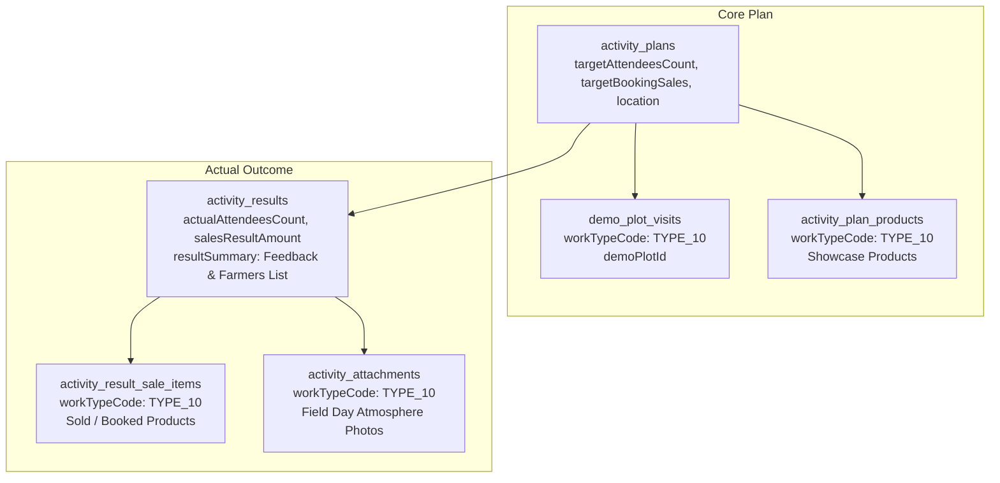

# Type 10 Feature Module: จัดงาน Field Day (Field Day)

> **Work Type Code:** `TYPE_10`  
> **Label:** จัดงาน Field Day (Field Day Event)  
> **Status:** ✅ Relational Strategy Pattern, Multi-Target UI State, Clean Architecture

---

## 1. Overview & Architecture

Feature Module `type-10` รับผิดชอบกระบวนการวางแผนและบันทึกผลจริงของกิจกรรมจัดงาน Field Day ในแปลงสาธิต:



---

## 2. Directory Structure

```
modules/activity-plans/features/type-10/
├── types/
│   └── index.ts               # Domain types, UI Props, and form validation interfaces
├── application/
│   ├── mapper.ts              # Pure mappers (extractType10PlanTargets, parseType10ActualResult, mapType10ToSectionItems)
│   ├── validation.ts          # Pure form validation functions
│   └── type10.strategy.ts    # Server-only WorkTypeStrategy implementation
├── components/
│   ├── type10-plan-card.tsx  # Planned Field Day display card component (supports PLANNED/UNPLANNED)
│   ├── type10-plan-form.tsx  # Create/Edit form component
│   ├── type10-actual-form.tsx # Actual result execution form & product sales
│   ├── type10-detail-view.tsx # Read-only result view with Lightbox modal
│   └── type10-approval-card.tsx# Approval view rendering Type10PlanCard(s)
├── hooks/
│   ├── use-type10-form.ts     # React hook for creation/edit form state & payload mapping
│   └── use-type10-actual.ts   # React hook for actual state & gallery uploads
├── index.ts                   # Public Feature Barrel Export (pure components, hooks, mappers & types; NO server strategies)
└── README.md                  # This documentation
```

---

## 3. Data Schema & Persistence

### 3.1 Database Tables

| Table | Prisma Model | Purpose |
|---|---|---|
| `activity_plans` | `ActivityPlan` | เป้าหมายจำนวนผู้เข้าร่วมงาน (`targetAttendeesCount`), เป้าหมายยอดขาย/ยอดจอง (`targetBookingSales`), สถานที่จัดงาน (`location`) |
| `demo_plot_visits` | `DemoPlotVisit` | เชื่อมโยงแปลงสาธิตที่ใช้จัดงาน Field Day (`demoPlotId`, `workTypeCode: "TYPE_10"`) |
| `activity_plan_products` | `ActivityPlanProduct` | สินค้าโชว์/เป้าหมายในงาน Field Day (`workTypeCode: "TYPE_10"`) |
| `activity_results` | `ActivityResult` | ผู้เข้าร่วมงานจริง (`actualAttendeesCount`), ยอดขายหรือยอดจองจริง (`salesResultAmount`), สรุปผลความสนใจเกษตรกรและรายชื่อเกษตรกรเป้าหมาย (`resultSummary`) |
| `activity_result_sale_items` | `ActivityResultSaleItem` | รายการสินค้าที่ขายได้หรือจองในงานจริง (`workTypeCode: "TYPE_10"`, `actualQuantity`, `actualUnitPrice`, `actualTotal`) |
| `activity_attachments` | `ActivityAttachment` | ภาพถ่ายบรรยากาศงาน Field Day (`workTypeCode: "TYPE_10"`) |

---

## 4. Strategy & Mapper API

### 4.1 Application Mapper (`application/mapper.ts`)
- **`extractType10PlanTargets(plan, prevTarget)`**: ดึงข้อมูลเป้าหมายแปลงสาธิตและสินค้าโชว์จาก `plan.demoPlotVisits`, `plan.demoPlot`, และ `plan.products` พร้อมรองรับโครงสร้างแบบหลายเป้าหมาย (`targets.t10` และ `targets.t10List`)
- **`parseType10ActualResult(resData)`**: แกะข้อมูลผลจริงจากการบันทึก: ยอดขายสินค้ารายตัวจาก `saleResults`, ภาพถ่ายงานจาก `attachments`, และข้อมูลความสนใจเกษตรกร/รายชื่อเป้าหมายจาก `resultSummary`
- **`mapType10ToSectionItems(plan, objectiveLines)`**: แปลงข้อมูลเป้าหมายงาน Field Day เป็น Section Detail Items แสดงผลในหน้าข้อมูลสรุปแผน

### 4.2 Strategy (`application/type10.strategy.ts`)
- **`code: "TYPE_10"`**
- **`validatePlan(planData, db)`**: ตรวจสอบว่ามีการระบุแปลงสาธิตหรือสถานที่จัดงาน
- **`savePlan(tx, activityPlanId, planData)`**: บันทึก/อัปเดตการเชื่อมโยงแปลงสาธิตใน `DemoPlotVisit`
- **`saveActual(tx, resultId, actualData)`**: บันทึกรายการยอดขายสินค้าในงาน Field Day ลงใน `ActivityResultSaleItem`
- **`loadPlan(db, activityPlanId)`**: Query ข้อมูลแผนจัดงาน Field Day พร้อม relations `demoPlotVisits` และ `products`

---

## 5. Multi-Target UI State

Type 10 รองรับการจัดงาน Field Day ที่มีหลายแปลงเป้าหมายภายในหนึ่งแผนงาน:
- `targets.t10`: รายการแปลงเป้าหมายแรกสำหรับ fallback
- `targets.t10List`: รายการแปลงเป้าหมาย Field Day ทั้งหมด
- ส่วนประกอบ UI ทั้งหมด (`ActualType10FieldDay`, `DetailType10FieldDay`, `ApprovalType10FieldDay`) รองรับ prop `targets?: Type10TargetItem[]` เพื่อแสดงการ์ดเป้าหมายอย่างครบถ้วนทุกแปลง
