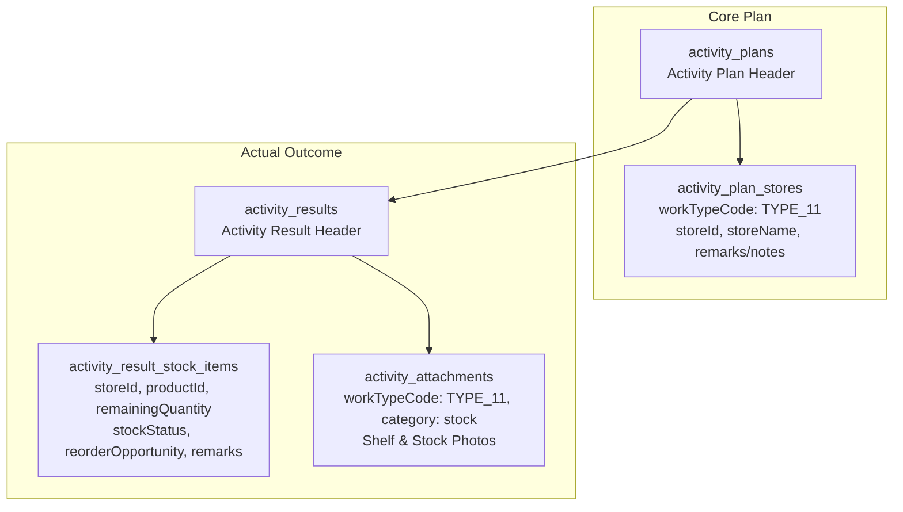

# Type 11 Feature Module: ตรวจเช็กสต็อกหน้าร้าน (Stock Check)

> **Work Type Code:** `TYPE_11`  
> **Label:** ตรวจเช็กสต็อกหน้าร้าน (Store Stock Check)  
> **Status:** ✅ Vertical Slice Architecture, Relational Strategy Pattern, Clean Architecture

---

## 1. Overview & Architecture

Feature Module `type-11` รับผิดชอบกระบวนการวางแผนและบันทึกผลจริงของกิจกรรมตรวจเช็กสต็อกสินค้าคงเหลือหน้าร้านตัวแทนจำหน่าย:



---

## 2. Directory Structure (Vertical Slice Architecture)

```
modules/activity-plans/features/type-11/
├── types/
│   └── index.ts                 # Consolidated domain types, props & validation contracts
├── application/
│   ├── mapper.ts                # Pure mappers (extractType11PlanTargets, parseType11ActualResult, mapType11ToSectionItems)
│   ├── validation.ts            # Pure validation functions (validateType11FormItems, validateType11Actual)
│   └── type11.strategy.ts      # Server-only WorkTypeStrategy implementation (validatePlan, savePlan, saveActual, loadPlan)
├── components/
│   ├── type11-plan-card.tsx     # Plan overview card
│   ├── type11-plan-form.tsx     # Plan/Edit creation form (Type11PlanForm / Type11Stock)
│   ├── type11-actual-form.tsx   # Actual result entry form (Type11ActualForm / ActualType11Stock)
│   ├── type11-detail-view.tsx   # Detail view (Type11DetailView / DetailType11Stock)
│   └── type11-approval-card.tsx # Approval view (Type11ApprovalCard / ApprovalType11Stock)
├── hooks/
│   ├── use-type11-form.ts       # React hook for plan form state & payload mapping
│   └── use-type11-actual.ts     # React hook for actual execution state & file upload
├── index.ts                     # Public Feature Barrel Export (Client-safe, NO server strategy)
└── README.md                    # This documentation
```

---

## 3. Public API & Isolation Guard

- **Client Components & Hooks:** สามารถ import ตรงจาก `@/modules/activity-plans/features/type-11`
- **Strategy Isolation:** `type11Strategy` อยู่ใน `application/type11.strategy.ts` เท่านั้น และไม่ได้ re-export ผ่าน `index.ts` เพื่อป้องกัน Server bundle รั่วไหล
