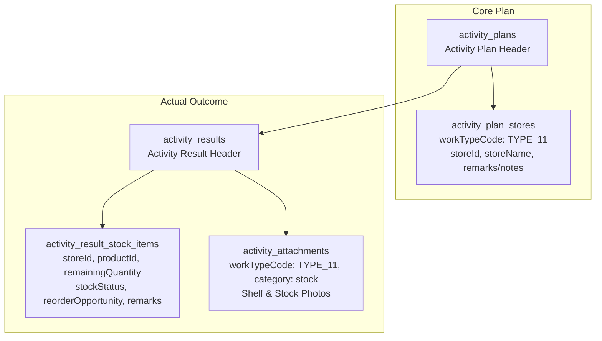

# Type 11 Feature Module: ตรวจเช็คสต๊อกหน้าร้าน (Stock Check)

> **Work Type Code:** `TYPE_11`  
> **Label:** ตรวจเช็คสต๊อกหน้าร้าน (Store Stock Check)  
> **Status:** ✅ Vertical Slice Architecture, Relational Strategy Pattern, Clean Architecture

---

## 1. Overview & Architecture

Feature Module `type-11` รับผิดชอบกระบวนการวางแผนและบันทึกผลจริงของกิจกรรมตรวจเช็กสต็อกสินค้าคงเหลือหน้าร้านตัวแทนจำหน่าย:



---

## 2. Directory Structure (Vertical Slice Architecture)

```
modules/activity-plans/features/type-11/
├── types/
│   └── index.ts                 # Consolidated domain types, props & validation contracts
├── application/
│   ├── mapper.ts                # Pure mappers (extractType11PlanTargets, parseType11ActualResult, mapType11ToSectionItems)
│   ├── validation.ts            # Pure validation functions (validateType11FormItems, validateType11Actual)
│   └── type11.strategy.ts      # Server-only WorkTypeStrategy implementation (validatePlan, savePlan, saveActual, loadPlan)
├── components/
│   ├── type11-plan-card.tsx     # Plan overview card
│   ├── type11-plan-form.tsx     # Plan/Edit creation form (Type11PlanForm / Type11Stock)
│   ├── type11-actual-form.tsx   # Actual result entry form (Type11ActualForm / ActualType11Stock)
│   ├── type11-detail-view.tsx   # Detail view (Type11DetailView / DetailType11Stock)
│   └── type11-approval-card.tsx # Approval view (Type11ApprovalCard / ApprovalType11Stock)
├── hooks/
│   ├── use-type11-form.ts       # React hook for plan form state & payload mapping
│   └── use-type11-actual.ts     # React hook for actual execution state & file upload
├── index.ts                     # Public Feature Barrel Export (Client-safe, NO server strategy)
└── README.md                    # This documentation
```

---

## 3. Public API & Isolation Guard

- **Client Components & Hooks:** สามารถ import ตรงจาก `@/modules/activity-plans/features/type-11`
- **Strategy Isolation:** `type11Strategy` อยู่ใน `application/type11.strategy.ts` เท่านั้น และไม่ได้ re-export ผ่าน `index.ts` เพื่อป้องกัน Server bundle รั่วไหล

## 🔗 ความเชื่อมโยงกับระบบส่วนกลาง (Dependencies & External Functions Mapping)

### 1. ฟังก์ชันและโมดูลที่ Slice นี้เรียกใช้งาน (Inbound Dependencies)

| หมวดหมู่              | ฟังก์ชัน / โมดูลที่เรียกใช้                                     | ที่อยู่ไฟล์ (File Path)                                                                                                                                                  | วัตถุประสงค์การใช้งาน                                  |
| --------------------- | --------------------------------------------------------------- | ------------------------------------------------------------------------------------------------------------------------------------------------------------------------ | ------------------------------------------------------ |
| **Infrastructure**    | `db (PrismaClient)`                                             | [`lib/db.ts`](file:///lib/db.ts)                                                                                                                                         | ประมวลผล Transaction บันทึกเป้าหมายงาน Event และสินค้า |
| **Application**       | `WorkTypeStrategy, PrismaTransaction, StrategyValidationResult` | [`modules/activity-plans/application/strategies/work-type-strategy.interface.ts`](file:///modules/activity-plans/application/strategies/work-type-strategy.interface.ts) | สัญญากลางสำหรับ Strategy Pattern                       |
| **Shared UI / Utils** | `uploadActivityPlanImageGroup, collectPermanentUrls`            | [`modules/activity-plans/features/shared/actual-view/utils/index.ts`](file:///modules/activity-plans/features/shared/actual-view/utils/index.ts)                         | อัปโหลดรูปภาพงาน Event และบูธ                          |
| **External Module**   | `listProductsAction`                                            | [`modules/products/server/actions.ts`](file:///modules/products/server/actions.ts)                                                                                       | ค้นหาสินค้าที่นำไปจัดแสดง                              |

### 2. จุดที่ระบบส่วนกลางเรียกใช้งาน Slice นี้ (Outbound Integration Points)

| ส่วนกลางที่เรียกใช้   | ไฟล์ที่เรียกใช้ (Caller Path)                                                                                                                                                      | สิ่งที่นำไปใช้ (Export / Function) | วัตถุประสงค์                                |
| --------------------- | ---------------------------------------------------------------------------------------------------------------------------------------------------------------------------------- | ---------------------------------- | ------------------------------------------- |
| **Strategy Registry** | [`modules/activity-plans/application/strategies/type-registry.ts`](file:///modules/activity-plans/application/strategies/type-registry.ts)                                         | `Type11Strategy`                   | ลงทะเบียน Handler สำหรับ Type 11            |
| **Detail Mapper**     | [`modules/activity-plans/features/shared/detail-view/utils.ts`](file:///modules/activity-plans/features/shared/detail-view/utils.ts)                                               | `mapType11ToSectionItems`          | แปลงข้อมูลงาน Event เพื่อแสดงใน Detail View |
| **Approval Queue**    | [`modules/activity-plans/features/shared/approve-view/components/work-types/index.ts`](file:///modules/activity-plans/features/shared/approve-view/components/work-types/index.ts) | `Type11ApprovalCard`               | การ์ดแสดงผลในหน้าอนุมัติ                    |
| **Actual Form**       | [`modules/activity-plans/features/shared/actual-view/components/work-types/index.ts`](file:///modules/activity-plans/features/shared/actual-view/components/work-types/index.ts)   | `Type11ActualForm`                 | ฟอร์มบันทึกผลงาน Event                      |
