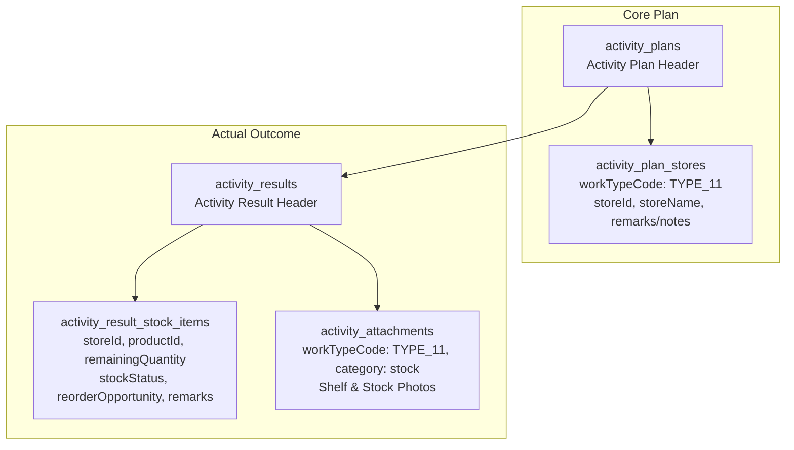

# Type 11 Feature Module: ตรวจเช็กสต็อกหน้าร้าน (Stock Check)

> **Work Type Code:** `TYPE_11`  
> **Label:** ตรวจเช็กสต็อกหน้าร้าน (Store Stock Check)  
> **Status:** ✅ Relational Strategy Pattern, Multi-Target UI State, Clean Architecture

---

## 1. Overview & Architecture

Feature Module `type-11` รับผิดชอบกระบวนการวางแผนและบันทึกผลจริงของกิจกรรมตรวจเช็กสต็อกสินค้าคงเหลือหน้าร้านตัวแทนจำหน่าย:



---

## 2. Directory Structure

```
modules/activity-plans/features/type-11/
├── types/
│   └── index.ts               # Domain types (Type11TargetItem, Type11StockItem, Type11PlanItem, Type11ActualRecord, Props)
├── application/
│   ├── mapper.ts              # Pure mappers (extractType11PlanTargets, parseType11ActualResult, mapType11ToSectionItems)
│   └── type11.strategy.ts    # Server-only WorkTypeStrategy implementation (validatePlan, savePlan, saveActual, loadPlan)
├── shared/
│   ├── types.ts               # Legacy shared models (Type11StoreItem, CustomerOption, ProductOption)
│   └── type11-plan-card.tsx  # Planned Stock Check display card component
├── create/                    # Create form components & validation
├── edit/                      # Edit form components
├── actual/
│   ├── types.ts               # Re-exports domain types
│   ├── actual-type11-stock.tsx # Actual result execution form & per-store stock tables
│   ├── use-type11-actual.ts   # React hook for actual state, hydration & uploads
│   └── validation.ts          # Actual result validation logic
├── detail/
│   └── detail-type11-stock.tsx # Read-only result view with grouped store tables
├── approval/
│   └── approval-type11-stock.tsx # Approval view rendering Type11PlanCard(s)
├── hooks/
│   └── use-type11-form.ts     # React hook for creation/edit form state & payload mapping
├── index.ts                   # Public Feature Barrel Export (pure mappers & types, NO server strategies)
└── README.md                  # This documentation
```

---

## 3. Data Schema & Persistence

### 3.1 Database Tables

| Table | Prisma Model | Purpose |
|---|---|---|
| `activity_plans` | `ActivityPlan` | Header แผนงานกิจกรรม |
| `activity_plan_stores` | `ActivityPlanStore` | ร้านค้าเป้าหมายสำหรับการตรวจเช็กสต็อก (`workTypeCode: "TYPE_11"`, `storeId`, `remarks/notes`) |
| `activity_results` | `ActivityResult` | Header ผลการปฏิบัติงานจริง |
| `activity_result_stock_items` | `ActivityResultStockItem` | รายการสต็อกสินค้าคงเหลือจริงแต่ละร้าน (`storeId`, `productId`, `remainingQuantity`, `stockStatus`, `reorderOpportunity`, `remarks`) |
| `activity_attachments` | `ActivityAttachment` | ภาพถ่ายสต็อกสินค้าและชั้นวาง (`workTypeCode: "TYPE_11"`, `category: "stock"`) |

---

## 4. Strategy & Mapper API

### 4.1 Application Mapper (`application/mapper.ts`)
- **`extractType11PlanTargets(plan, prevTarget)`**: ดึงข้อมูลร้านค้าเป้าหมายจาก `plan.stores` (`workTypeCode === "TYPE_11"`) พร้อมรองรับโครงสร้างแบบหลายเป้าหมาย (`targets.t11` และ `targets.t11List`)
- **`parseType11ActualResult(resData)`**: แกะข้อมูลผลจริงจากการบันทึก: รายการตรวจเช็กสต็อกจากตารางลูก `stockResults`, ภาพถ่ายจาก `attachments`, และ fallback จากข้อความ `resultSummary`
- **`mapType11ToSectionItems(type11Stores, objectiveLines)`**: แปลงข้อมูลร้านค้าเป้าหมายเป็น Section Detail Items แสดงผลในหน้าข้อมูลสรุปแผน

### 4.2 Strategy (`application/type11.strategy.ts`)
- **`code: "TYPE_11"`**
- **`validatePlan(planData, db)`**: ตรวจสอบว่ามีการระบุร้านค้าเป้าหมายสำหรับการตรวจเช็กสต็อก
- **`savePlan(tx, activityPlanId, planData)`**: Sync บันทึกร้านค้าเป้าหมายลงใน `ActivityPlanStore` (`workTypeCode: "TYPE_11"`)
- **`saveActual(tx, resultId, actualData)`**: Sync บันทึกรายการสต็อกคงเหลือแต่ละสินค้าและร้านค้าลงใน `ActivityResultStockItem`
- **`loadPlan(db, activityPlanId)`**: Query ข้อมูลแผนตรวจเช็กสต็อกพร้อม relation `stores`

---

## 5. Multi-Target UI State

Type 11 รองรับการตรวจเช็กสต็อกหลายร้านค้าภายในหนึ่งแผนงาน:
- `targets.t11`: รายการเป้าหมายสรุปภาพรวม
- `targets.t11List`: รายการร้านค้าเป้าหมายทั้งหมดแยกเป็นรายร้าน
- ส่วนประกอบ UI ทั้งหมด (`ActualType11Stock`, `DetailType11Stock`, `ApprovalType11Stock`) รองรับ prop `targets?: Type11TargetItem[]` เพื่อแสดงการ์ดเป้าหมายทุกร้านอย่างครบถ้วน
