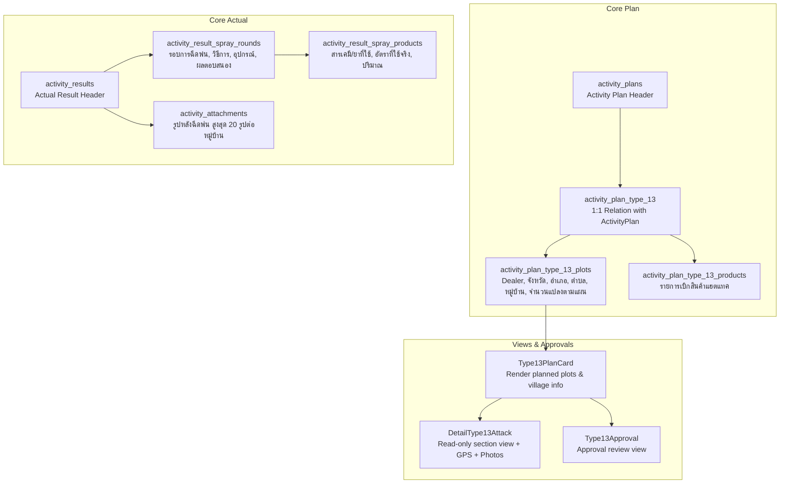

# Type 13 Feature Module: ฉีดแปลงแฮตแทค (Hattack Spraying)

> **Work Type Code:** `TYPE_13`  
> **Label:** ฉีดแปลงแฮตแทค (Hattack Spraying)  
> **hasActual:** `true` (มีการบันทึกผลงานจริง Actual Outcome + รอบการฉีดพ่น + พิกัด GPS + รูปถ่ายหลังฉีดพ่น)  
> **Status:** ✅ Relational Strategy Pattern, Multi-Target UI State, Clean Architecture

---

## 1. Overview & Architecture

Feature Module `type-13` รับผิดชอบกระบวนการวางแผนและบันทึกผลการปฏิบัติงานสำหรับกิจกรรม **ฉีดแปลงแฮตแทค (Hattack Spraying)**:



---

## 2. Directory Structure

```
modules/activity-plans/features/type-13/
├── types/
│   └── index.ts                 # Domain types (Type13PlotItem, Type13PlotActualState, Type13SprayingRound, etc.)
├── application/
│   ├── mapper.ts                # Pure mappers (extractType13PlanTargets, mapType13ToSectionItems)
│   └── type13.strategy.ts      # Server-only WorkTypeStrategy implementation (validatePlan, savePlan, loadPlan)
├── shared/
│   ├── types.ts                 # Re-exports domain types for backward compatibility
│   └── type13-plan-card.tsx    # Planned plots display card component with village & target count
├── create/                      # Create form components & validation
│   ├── type13-create.tsx        # Plan creation form with subdistrict, village, and planned plots count
│   ├── types.ts
│   └── validation.ts
├── edit/                        # Edit form components
│   ├── type13-edit.tsx
│   └── types.ts
├── actual/                      # Actual outcome execution components
│   ├── type13-actual.tsx        # Actual view with actual plots count, application rate, and max 20 photos
│   ├── types.ts
│   ├── use-type13-actual-state.ts # React hook for actual state & photo management (max 20)
│   └── validation.ts
├── detail/                      # Read-only Detail view
│   ├── type13-detail.tsx
│   ├── detail-type13-attack.tsx
│   └── types.ts
├── approval/                    # Approval view
│   ├── type13-approval.tsx
│   └── types.ts
├── hooks/
│   └── use-type13-form.ts       # React hook for plan form state & payload mapping
├── index.ts                     # Public API barrel export
└── README.md                    # Documentation
```

---

## 3. Data Specification & Features

### 3.1 สร้างแผนงาน (Trip Plan)
1. **เลือก ตำบล (`subdistrict`):** ใช้ `ActivityAddressSelect` แบบ `levels="province-district-subdistrict"` เลือก จังหวัด -> อำเภอ -> ตำบล โดยไม่บังคับรหัสไปรษณีย์
2. **ช่องกรอก หมู่บ้าน (`village`):** ช่องกรอกข้อความสำหรับระบุชื่อหรือหมู่ที่ของหมู่บ้าน (เช่น "บ้านหนองบัว หมู่ 3")
3. **ช่องกรอกจำนวนแปลงที่ฉีดในหมู่บ้านนั้น (`plannedPlotsCount`):** ช่องกรอกตัวเลขจำนวนแปลงเป้าหมายที่วางแผนฉีดในหมู่บ้านนั้น

### 3.2 บันทึกผลการปฏิบัติงาน (Trip Plan Actual)
1. **จำนวนแปลงที่ฉีดจริง (`actualPlotsCount`):** ช่องกรอกตัวเลขจำนวนแปลงที่ปฏิบัติงานฉีดจริงในหมู่บ้านนั้น
2. **ช่องกรอก อัตราการใช้ (`applicationRate`):** ช่องกรอกข้อความสำหรับระบุอัตราการใช้สารเคมี/ผลิตภัณฑ์ (เช่น "20-30 ซีซี ต่อน้ำ 20 ลิตร" หรือ "50 ซีซี/ไร่")
3. **ใส่รูป ไม่เกิน 20 รูป ต่อหมู่บ้าน (`afterSprayImages`):** ขยายขีดจำกัดการอัปโหลดรูปภาพหลังฉีดพ่นจาก 5 รูป เป็น **สูงสุด 20 รูป ต่อหมู่บ้าน/แปลง** พร้อม Drag & Drop Dropzone, badge แสดงความคืบหน้า `รูป X/20` และการจำกัดขนาดไฟล์ไม่เกิน 20MB

---

## 4. Integration & Registration

- **Type Strategy:** ลงทะเบียนใน `modules/activity-plans/application/strategies/type-registry.ts` (`code: "TYPE_13"`).
- **Validation:** ตรวจสอบผ่าน `validateType13FormValues` และ Zod Schema ใน `validations.ts` (`type13PlotItemSchema`, `type13PlotsActual`, `type13NewPlots`).
- **Zero Errors:** ผ่านการตรวจสอบ TypeScript Compiler (`npx tsc --noEmit`) 100%.
