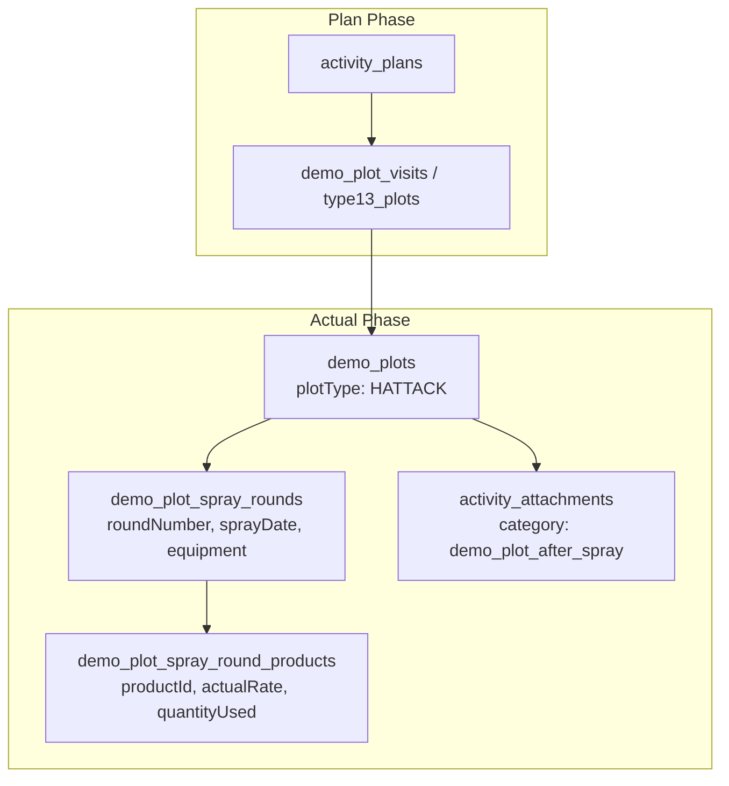

# Type 13 Feature Module: ฉีดแปลงแฮตแทค (Hattack Spraying)

> **Work Type Code:** `TYPE_13`  
> **Label:** ฉีดแปลงแฮตแทค (Hattack Spraying)  
> **Status:** ✅ Vertical Slice Architecture, Relational Strategy Pattern, Multi-Plot Workflow

---

## 1. Overview & Architecture

Feature Module `type-13` รับผิดชอบกระบวนการวางแผนและบันทึกผลการปฏิบัติงานสำหรับกิจกรรม **ฉีดแปลงแฮตแทค (Hattack Spraying)**:



---

## 2. Directory Structure (Vertical Slice Architecture)

```
modules/activity-plans/features/type-13/
├── types/
│   └── index.ts                 # Consolidated domain types, props & validation contracts
├── application/
│   ├── mapper.ts                # Pure mappers (extractType13PlanTargets, mapType13ToSectionItems)
│   ├── validation.ts            # Pure validation functions (validateType13FormValues, validateType13Actual)
│   └── type13.strategy.ts      # Server-only WorkTypeStrategy implementation
├── components/
│   ├── type13-plan-card.tsx     # Plan overview card
│   ├── type13-plan-form.tsx     # Plan/Edit creation form (Type13PlanForm / Type13Create / Type13Edit)
│   ├── type13-actual-form.tsx   # Actual result entry form (Type13ActualForm / Type13Actual)
│   ├── type13-detail-view.tsx   # Detail view (Type13DetailView / Type13Detail / DetailType13Attack)
│   └── type13-approval-card.tsx # Approval view (Type13ApprovalCard / Type13Approval)
├── hooks/
│   ├── use-type13-form.ts       # React hook for plan form state & payload mapping
│   ├── use-type13-actual-state.ts # React hook for actual multi-plot spraying execution
│   └── use-type13-actual.ts     # Re-export / alias for useType13ActualState
├── index.ts                     # Public Feature Barrel Export (Client-safe, NO server strategy)
└── README.md                    # This documentation
```

---

## 3. Public API & Isolation Guard

- **Client Components & Hooks:** สามารถ import ตรงจาก `@/modules/activity-plans/features/type-13`
- **Strategy Isolation:** `type13Strategy` อยู่ใน `application/type13.strategy.ts` เท่านั้น และไม่ได้ re-export ผ่าน `index.ts` เพื่อป้องกัน Server bundle รั่วไหล

## 🔗 ความเชื่อมโยงกับระบบส่วนกลาง (Dependencies & External Functions Mapping)

### 1. ฟังก์ชันและโมดูลที่ Slice นี้เรียกใช้งาน (Inbound Dependencies)
| หมวดหมู่ | ฟังก์ชัน / โมดูลที่เรียกใช้ | ที่อยู่ไฟล์ (File Path) | วัตถุประสงค์การใช้งาน |
|---|---|---|---|
| **Infrastructure** | `db (PrismaClient)` | [`lib/db.ts`](file:///lib/db.ts) | ประมวลผล Transaction บันทึกข้อมูล activity_plan_type_13, plots, products |
| **Infrastructure** | `generateDemoPlotCode` | [`modules/activity-plans/infrastructure/demo-plot.repository.ts`](file:///modules/activity-plans/infrastructure/demo-plot.repository.ts) | สร้างรหัสแปลงสาธิตแฮตแทค (DP-YYMM-XXXX) |
| **Application** | `WorkTypeStrategy, PrismaTransaction, StrategyValidationResult` | [`modules/activity-plans/application/strategies/work-type-strategy.interface.ts`](file:///modules/activity-plans/application/strategies/work-type-strategy.interface.ts) | สัญญากลางสำหรับ Strategy Pattern |
| **Application** | `type13ProductLineSchema, type13PlotItemSchema, type13PlanInputSchema` | [`modules/activity-plans/features/type-13/application/validation.ts`](file:///modules/activity-plans/features/type-13/application/validation.ts) | Zod Validation Schema ของ Type 13 |
| **Shared UI / Utils** | `uploadActivityPlanImageGroup, collectPermanentUrls` | [`modules/activity-plans/features/shared/actual-view/utils/index.ts`](file:///modules/activity-plans/features/shared/actual-view/utils/index.ts) | อัปโหลดรูปภาพก่อนและหลังฉีดพ่น |
| **External Module** | `listCustomersAction, ActivityCustomerSelect` | [`modules/customers/server/actions.ts / components/activity`](file:///modules/customers/server/actions.ts / components/activity) | ค้นหาร้านค้า Dealer ประจำแต่ละแปลง |

### 2. จุดที่ระบบส่วนกลางเรียกใช้งาน Slice นี้ (Outbound Integration Points)
| ส่วนกลางที่เรียกใช้ | ไฟล์ที่เรียกใช้ (Caller Path) | สิ่งที่นำไปใช้ (Export / Function) | วัตถุประสงค์ |
|---|---|---|---|
| **Strategy Registry** | [`modules/activity-plans/application/strategies/type-registry.ts`](file:///modules/activity-plans/application/strategies/type-registry.ts) | `Type13Strategy` | ลงทะเบียน Handler สำหรับ Type 13 |
| **Plan Repository** | [`modules/activity-plans/infrastructure/activity-plan.repository.ts`](file:///modules/activity-plans/infrastructure/activity-plan.repository.ts) | `getTypeStrategy("TYPE_13").savePlan` | บันทึกแปลงและสินค้าแฮตแทค |
| **Validation Layer** | [`modules/activity-plans/application/validations.ts`](file:///modules/activity-plans/application/validations.ts) | `type13PlanInputSchema, type13PlotItemSchema` | นำเข้า Zod Schema เพื่อตรวจสอบความถูกต้องในระดับภาพรวม |
| **Repository Query** | [`modules/activity-plans/infrastructure/activity-plan-include.ts`](file:///modules/activity-plans/infrastructure/activity-plan-include.ts) | `type13` | Eager load ข้อมูลแปลงและสินค้าฉีดพ่นใน findActivityPlanById |
| **Approval Queue** | [`modules/activity-plans/features/shared/approve-view/components/work-types/index.ts`](file:///modules/activity-plans/features/shared/approve-view/components/work-types/index.ts) | `Type13ApprovalCard` | การ์ดแสดงผลในหน้าอนุมัติ |
| **Actual Form** | [`modules/activity-plans/features/shared/actual-view/components/work-types/index.ts`](file:///modules/activity-plans/features/shared/actual-view/components/work-types/index.ts) | `Type13ActualForm, Type13Actual` | ฟอร์มบันทึกผลการฉีดพ่นแฮตแทค |

