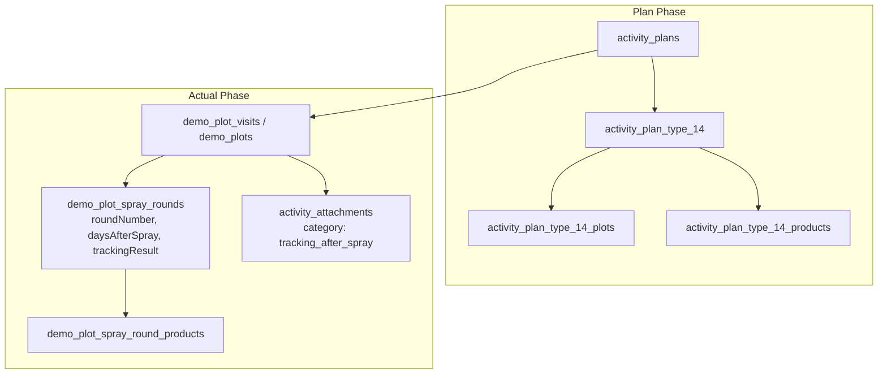

# Type 14 Feature Module: ติดตามแปลงแฮทแทค (Hattack Follow-up)

> **Work Type Code:** `TYPE_14`  
> **Label:** ติดตามแปลงแฮทแทค (Hattack Follow-up)  
> **Status:** ✅ Vertical Slice Architecture, Relational Multi-Plot Tracking, Clean Architecture

---

## 1. Overview & Architecture

Feature Module `type-14` รับผิดชอบกระบวนการวางแผนและบันทึกผลการปฏิบัติงานสำหรับกิจกรรม **ติดตามแปลงแฮทแทค (Hattack Follow-up)**:
- ตรวจติดตามแปลงเดิมที่เคยผ่านกิจกรรมฉีดแปลงแฮตแทค (TYPE_13) หรือแปลงใหม่
- บันทึกรอบการติดตามผล (Follow-up Rounds), จำนวนวันหลังฉีดพ่น (Days after spray), การตอบสนองของพืช
- สนับสนุนกระบวนการเบิกสินค้าเพิ่มเติมสำหรับรอบติดตาม (Product Withdrawal)



---

## 2. Directory Structure (Vertical Slice Architecture)

```
modules/activity-plans/features/type-14/
├── types/
│   └── index.ts                 # Consolidated domain types, props & validation contracts
├── application/
│   └── validation.ts            # Pure validation functions (validateType14FormValues, validateType14Actual)
├── components/
│   ├── type14-plan-card.tsx     # Plan overview card
│   ├── type14-plan-form.tsx     # Plan/Edit creation form (Type14PlanForm / Type14Create / Type14Edit)
│   ├── type14-actual-form.tsx   # Actual result entry form (Type14ActualForm / Type14Actual)
│   ├── type14-detail-view.tsx   # Detail view (Type14DetailView / Type14Detail)
│   └── type14-approval-card.tsx # Approval view (Type14ApprovalCard / Type14Approval)
├── hooks/
│   ├── use-type14-form.ts       # React hook for plan form state & payload mapping
│   ├── use-type14-actual-state.ts # React hook for actual tracking execution state
│   └── use-type14-actual.ts     # Re-export / alias for useType14ActualState
├── index.ts                     # Public Feature Barrel Export (Client-safe, NO server strategy)
└── README.md                    # This documentation
```

---

## 3. Public API & Isolation Guard

- **Client Components & Hooks:** สามารถ import ตรงจาก `@/modules/activity-plans/features/type-14`
- **Server Bundle Isolation:** ฟังก์ชัน database / repository อยู่ใน infrastructure layer ไม่ถูก export ผ่าน `index.ts`
