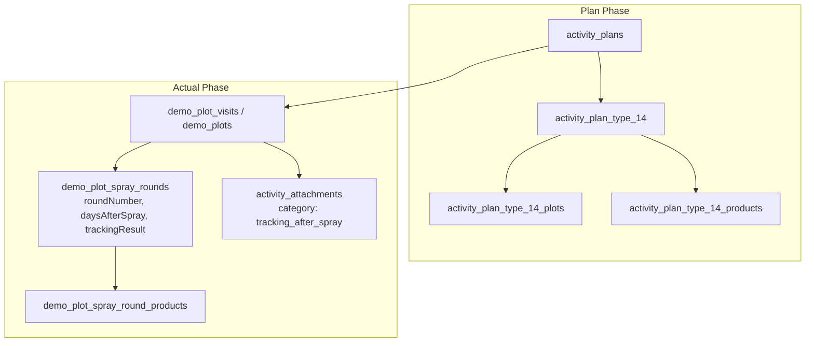

# Type 14 Feature Module: ติดตามแปลงแฮทแทค (Hattack Follow-up)

> **Work Type Code:** `TYPE_14`  
> **Label:** ติดตามแปลงแฮทแทค (Hattack Follow-up)ติดตามแปลงแฮทแทค (Hattack Follow-up)  
> **Status:** ✅ Vertical Slice Architecture, Relational Multi-Plot Tracking, Clean Architecture

---

## 1. Overview & Architecture

Feature Module `type-14` รับผิดชอบกระบวนการวางแผนและบันทึกผลการปฏิบัติงานสำหรับกิจกรรม **ติดตามแปลงแฮทแทค (Hattack Follow-up)**:
- ตรวจติดตามแปลงเดิมที่เคยผ่านกิจกรรมฉีดแปลงแฮตแทค (TYPE_13) หรือแปลงใหม่
- บันทึกรอบการติดตามผล (Follow-up Rounds), จำนวนวันหลังฉีดพ่น (Days after spray), การตอบสนองของพืช
- สนับสนุนกระบวนการเบิกสินค้าเพิ่มเติมสำหรับรอบติดตาม (Product Withdrawal)



---

## 2. Directory Structure (Vertical Slice Architecture)

```
modules/activity-plans/features/type-14/
├── types/
│   └── index.ts                 # Consolidated domain types, props & validation contracts
├── application/
│   └── validation.ts            # Pure validation functions (validateType14FormValues, validateType14Actual)
├── components/
│   ├── type14-plan-card.tsx     # Plan overview card
│   ├── type14-plan-form.tsx     # Plan/Edit creation form (Type14PlanForm / Type14Create / Type14Edit)
│   ├── type14-actual-form.tsx   # Actual result entry form (Type14ActualForm / Type14Actual)
│   ├── type14-detail-view.tsx   # Detail view (Type14DetailView / Type14Detail)
│   └── type14-approval-card.tsx # Approval view (Type14ApprovalCard / Type14Approval)
├── hooks/
│   ├── use-type14-form.ts       # React hook for plan form state & payload mapping
│   ├── use-type14-actual-state.ts # React hook for actual tracking execution state
│   └── use-type14-actual.ts     # Re-export / alias for useType14ActualState
├── index.ts                     # Public Feature Barrel Export (Client-safe, NO server strategy)
└── README.md                    # This documentation
```

---

## 3. Public API & Isolation Guard

- **Client Components & Hooks:** สามารถ import ตรงจาก `@/modules/activity-plans/features/type-14`
- **Server Bundle Isolation:** ฟังก์ชัน database / repository อยู่ใน infrastructure layer ไม่ถูก export ผ่าน `index.ts`

## 🔗 ความเชื่อมโยงกับระบบส่วนกลาง (Dependencies & External Functions Mapping)

### 1. ฟังก์ชันและโมดูลที่ Slice นี้เรียกใช้งาน (Inbound Dependencies)
| หมวดหมู่ | ฟังก์ชัน / โมดูลที่เรียกใช้ | ที่อยู่ไฟล์ (File Path) | วัตถุประสงค์การใช้งาน |
|---|---|---|---|
| **Infrastructure** | `db (PrismaClient)` | [`lib/db.ts`](file:///lib/db.ts) | ประมวลผล Transaction บันทึกข้อมูล activity_plan_type_14, plots, trackings |
| **Infrastructure** | `findHattackFollowUpDemoPlots, findHattackFollowUpActivityPlans, findHattackPlotContext` | [`modules/activity-plans/infrastructure/demo-plot.repository.ts`](file:///modules/activity-plans/infrastructure/demo-plot.repository.ts) | ดึงแปลงแฮตแทคและแผนต้นทาง TYPE_13 เพื่อนำมาติดตามผล |
| **Application** | `WorkTypeStrategy, PrismaTransaction, StrategyValidationResult` | [`modules/activity-plans/application/strategies/work-type-strategy.interface.ts`](file:///modules/activity-plans/application/strategies/work-type-strategy.interface.ts) | สัญญากลางสำหรับ Strategy Pattern |
| **Application** | `type14TrackingItemSchema, type14PlanInputSchema` | [`modules/activity-plans/features/type-14/application/validation.ts`](file:///modules/activity-plans/features/type-14/application/validation.ts) | Zod Validation Schema ของ Type 14 |
| **Server Actions** | `getHattackFollowUpPlansWithPlotsAction, getHattackPlotContextAction` | [`modules/activity-plans/server/actions.ts`](file:///modules/activity-plans/server/actions.ts) | Action ดึงแปลงแฮตแทคต้นทางสำหรับฟอร์ม |
| **Shared UI / Utils** | `uploadActivityPlanImageGroup, collectPermanentUrls` | [`modules/activity-plans/features/shared/actual-view/utils/index.ts`](file:///modules/activity-plans/features/shared/actual-view/utils/index.ts) | อัปโหลดรูปภาพผลการติดตามแฮตแทค |

### 2. จุดที่ระบบส่วนกลางเรียกใช้งาน Slice นี้ (Outbound Integration Points)
| ส่วนกลางที่เรียกใช้ | ไฟล์ที่เรียกใช้ (Caller Path) | สิ่งที่นำไปใช้ (Export / Function) | วัตถุประสงค์ |
|---|---|---|---|
| **Strategy Registry** | [`modules/activity-plans/application/strategies/type-registry.ts`](file:///modules/activity-plans/application/strategies/type-registry.ts) | `Type14Strategy` | ลงทะเบียน Handler สำหรับ Type 14 |
| **Plan Repository** | [`modules/activity-plans/infrastructure/activity-plan.repository.ts`](file:///modules/activity-plans/infrastructure/activity-plan.repository.ts) | `getTypeStrategy("TYPE_14").savePlan` | บันทึกข้อมูลการติดตามแปลงแฮตแทค |
| **Validation Layer** | [`modules/activity-plans/application/validations.ts`](file:///modules/activity-plans/application/validations.ts) | `type14PlanInputSchema, type14TrackingItemSchema` | นำเข้า Zod Schema เพื่อตรวจสอบความถูกต้องในระดับภาพรวม |
| **Repository Query** | [`modules/activity-plans/infrastructure/activity-plan-include.ts`](file:///modules/activity-plans/infrastructure/activity-plan-include.ts) | `type14` | Eager load ข้อมูลแปลงติดตามใน findActivityPlanById |
| **Approval Queue** | [`modules/activity-plans/features/shared/approve-view/components/work-types/index.ts`](file:///modules/activity-plans/features/shared/approve-view/components/work-types/index.ts) | `Type14ApprovalCard` | การ์ดแสดงผลในหน้าอนุมัติ |
| **Actual Form** | [`modules/activity-plans/features/shared/actual-view/components/work-types/index.ts`](file:///modules/activity-plans/features/shared/actual-view/components/work-types/index.ts) | `Type14ActualForm, Type14Actual` | ฟอร์มบันทึกผลการติดตามแปลงแฮทแทค |

