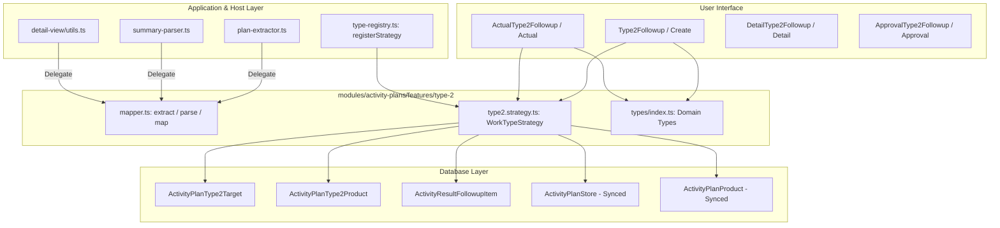

# TYPE 2: ติดตามผลการใช้สินค้า (Work Type Module Guide)

> **Module Path**: `modules/activity-plans/features/type-2/`  
> **Work Type Code**: `TYPE_2`  
> **Thai Label**: `ติดตามผลการใช้สินค้า` (Product Follow-up)  
> **Architecture Pattern**: Self-Contained Feature Slice with Centralized Components, Mapper, Strategy & Types

---

## 📌 1. ภาพรวม (Overview)

ประเภทงาน **`TYPE_2` (ติดตามผลการใช้สินค้า)** ใช้สำหรับวางแผนและบันทึกผลการติดตามการใช้งานผลิตภัณฑ์เกษตรของลูกค้า ทั้งในรูปแบบ **ร้านค้าตัวแทนจำหน่าย (STORE)** และ **เกษตรกร (FARMER)** โดยรองรับความสัมพันธ์แบบ **Multi-Target (1 Plan : N ร้านค้า/เกษตรกร และในแต่ละเป้าหมายสามารถมี N รายการสินค้าที่ติดตาม)**

### วัตถุประสงค์หลักในการติดตาม:
1. **เข้าพบเกษตรกร (FARMER)**:
   - **เกษตรกรในระบบ**: เลือกลูกค้าจากตาราง `Customer` ที่มีประเภทเป็นเกษตรกร
   - **เกษตรกรนอกระบบ (ไม่ได้ลงทะเบียน)**: ติ๊กเลือกเกษตรกรนอกระบบ พร้อมระบุชื่อ-สกุล และเบอร์โทรศัพท์
2. **เข้าพบร้านค้า (STORE)**:
   - เลือกร้านค้าตัวแทนจำหน่าย/ผู้แทนจำหน่ายย่อยจากระบบ
3. **รายการสินค้าที่ติดตาม (Follow-up Products)**:
   - ในแต่ละเป้าหมาย สามารถเลือกสินค้าจาก Product Catalog ได้มากกว่า 1 รายการ
   - สามารถระบุบันทึกหรือข้อสังเกตเฉพาะแต่ละสินค้าได้
4. **บันทึกผลการปฏิบัติงานจริง (Actual Outcome)**:
   - ผลการใช้สินค้า: `"ลูกค้าพึงพอใจ"` หรือ `"พบปัญหา"`
   - รายละเอียดความพึงพอใจ หรือรายละเอียดปัญหาที่พบ
   - สามารถเพิ่มรายการสินค้าที่ติดตามเพิ่มเติมหน้างานได้ (`isAdditional = true`)
   - แนบรูปภาพผลการใช้สินค้า/สภาพแปลงพืช

---

## 📂 2. โครงสร้างโฟลเดอร์ (Directory Structure)

```text
modules/activity-plans/features/type-2/
├── application/                      # 🧠 Business Logic, Mappers & Strategy
│   ├── mapper.ts                     # Single Source of Truth สำหรับสกัดและแปลงข้อมูล Form State <-> DB
│   └── type2.strategy.ts             # WorkTypeStrategy Handler (Validation & Persistence)
│
├── types/                            # 📐 Type Definitions กลางของ Type 2
│   └── index.ts                      # Domain Types: Type2TargetItem, Type2ProductFollowupItem, FollowupProductItem, Type2ImageFile
│
├── create/                           # 🖥️ UI สำหรับสร้างแผนงาน
│   ├── type2-followup.tsx            # แบบฟอร์มเพิ่มเป้าหมายและรายการสินค้าติดตาม
│   ├── types.ts                      # Props Interfaces ของ Form
│   └── validation.ts                 # Validation Schemas
│
├── edit/                             # 🖥️ UI สำหรับแก้ไขแผนงาน
│   └── edit-type2.tsx                # คอมโพเนนต์แก้ไขข้อมูลแผนงาน Type 2
│
├── detail/                           # 🖥️ UI หน้ารายละเอียดแผนงาน (Read-only)
│   └── detail-type2-followup.tsx     # แสดงผลรายละเอียดเป้าหมายและผลการปฏิบัติงานจริง
│
├── approval/                         # 🖥️ UI หน้าคิวอนุมัติ (Read-only)
│   └── approval-type2-followup.tsx   # แสดงผลเป้าหมายในหน้าพิจารณาอนุมัติ
│
├── actual/                           # 🖥️ UI & Hook บันทึกผลจริง
│   ├── actual-type2-followup.tsx     # หน้าจอบันทึกผลการติดตามสินค้าและแนบรูปภาพ
│   ├── types.ts                      # Props ของ Actual
│   └── use-type2-actual.ts           # Hook จัดการ State ของผลจริง
│
├── shared/                           # 🧩 คอมโพเนนต์และ Type ที่ใช้ร่วมกันภายใน Type 2
│   ├── type2-plan-card.tsx           # การ์ดแสดงข้อมูลเป้าหมายตามแผน (Plan Target Card)
│   └── types.ts                      # Re-export จาก types/index.ts เพื่อ Backward Compatibility
│
├── hooks/                            # 🪝 Form Hook สำหรับ Plan
│   └── use-type2-form.ts             # จัดการ State เพิ่ม/ลด/แก้ไขแถวเป้าหมายและสินค้า
│
└── index.ts                          # 🚪 Barrel Export (Public API) สำหรับภายนอกเรียกใช้
```

---

## 🔄 3. การไหลของข้อมูล (Data Flow & Strategy Integration)



---

## 🗄️ 4. รายละเอียดตารางฐานข้อมูลที่เกี่ยวข้อง (Database Tables Deep Dive)

ในสถาปัตยกรรมใหม่ Type 2 มี **Dedicated Relational Tables** ของตนเองโดยตรง เพื่อแยกความเป็นเจ้าของข้อมูล (Data Ownership) ให้ชัดเจน ป้องกันการปะปนกับ Type อื่น และทำงานควบคู่กับการ Dual-Write Sync ไปยังตาราง Generic เพื่อรองรับ Backward Compatibility:

### 4.1 ตารางเฉพาะ `activity_plan_type_2_targets` (Dedicated Type 2 Plan Targets)
ตารางระดับเป้าหมาย (1 แผน : N เป้าหมาย) เก็บข้อมูลร้านค้า หรือเกษตรกรที่จะเข้าพบเพื่อติดตามผล:

| คอลัมน์ (Column) | ชนิดข้อมูล (Type) | Nullable | ความหมายและรายละเอียด |
|---|---|---|---|
| `id` | `VARCHAR(30)` (cuid) | No | Primary Key |
| `activity_plan_id` | `VARCHAR(30)` | No | Foreign Key อ้างอิง `activity_plans.id` (Cascade Delete) |
| `visit_purpose` | `TEXT` | No | วัตถุประสงค์การเข้าพบ: `'FARMER'` (เกษตรกร) หรือ `'STORE'` (ร้านค้า) |
| `store_id` | `VARCHAR(30)` | Yes | Foreign Key อ้างอิง `customers.id` (เป็น null หากเป็นเกษตรกรนอกระบบ) |
| `province` | `TEXT` | No | จังหวัดเป้าหมาย |
| `is_unregistered_farmer` | `BOOLEAN` | No (default: false) | แฟล็กระบุว่าเป็นเกษตรกรนอกระบบหรือไม่ |
| `unregistered_farmer_name` | `TEXT` | Yes | ชื่อ-สกุล ของเกษตรกรนอกระบบ |
| `unregistered_farmer_phone` | `TEXT` | Yes | เบอร์โทรศัพท์ของเกษตรกรนอกระบบ |
| `notes` | `TEXT` | Yes | รายละเอียดหรือข้อสังเกตเพิ่มเติมของเป้าหมาย |
| `created_at` / `updated_at` | `TIMESTAMP` | No | วันที่และเวลาสร้าง/แก้ไขล่าสุด |

---

### 4.2 ตารางเฉพาะ `activity_plan_type_2_products` (Dedicated Type 2 Plan Products)
ตารางรายการสินค้าที่ติดตามของแต่ละเป้าหมาย (1 เป้าหมาย : N สินค้า):

| คอลัมน์ (Column) | ชนิดข้อมูล (Type) | Nullable | ความหมายและรายละเอียด |
|---|---|---|---|
| `id` | `VARCHAR(30)` (cuid) | No | Primary Key |
| `target_id` | `VARCHAR(30)` | No | Foreign Key อ้างอิง `activity_plan_type_2_targets.id` (Cascade Delete) |
| `activity_plan_id` | `VARCHAR(30)` | No | Foreign Key อ้างอิง `activity_plans.id` (Cascade Delete) |
| `product_id` | `VARCHAR(30)` | No | Foreign Key อ้างอิง `products.id` (Restrict Delete) |
| `notes` | `TEXT` | Yes | บันทึกเฉพาะเกี่ยวกับสินค้านี้ เช่น จุดที่ต้องการสังเกต |
| `created_at` / `updated_at` | `TIMESTAMP` | No | วันที่และเวลาสร้าง/แก้ไขล่าสุด |

---

### 4.3 ตารางเฉพาะ `activity_result_followup_items` (Dedicated Type 2 Actual Follow-up Outcomes)
ตารางเก็บผลการติดตามสินค้าตามการปฏิบัติงานจริง สัมพันธ์กับ `activity_results`:

| คอลัมน์ (Column) | ชนิดข้อมูล (Type) | Nullable | ความหมายและรายละเอียด |
|---|---|---|---|
| `id` | `VARCHAR(30)` (cuid) | No | Primary Key |
| `activity_result_id` | `VARCHAR(30)` | No | Foreign Key อ้างอิง `activity_results.id` (Cascade Delete) |
| `store_id` | `VARCHAR(30)` | Yes | Foreign Key อ้างอิง `customers.id` (ร้านค้า/เกษตรกร) |
| `product_id` | `VARCHAR(30)` | No | Foreign Key อ้างอิง `products.id` |
| `product_name` | `TEXT` | Yes | ชื่อสินค้า (Denormalized Snapshot เพื่อความเร็ว) |
| `usage_result` | `TEXT` | Yes | ผลการใช้งาน: `'ลูกค้าพึงพอใจ'` หรือ `'พบปัญหา'` |
| `followup_detail` | `TEXT` | Yes | รายละเอียดการติดตามผล (บันทึกเมื่อลูกค้าพึงพอใจ) |
| `problem_detail` | `TEXT` | Yes | รายละเอียดปัญหาที่พบ (บันทึกเมื่อพบปัญหา) |
| `is_additional` | `BOOLEAN` | No (default: false) | `false` = สินค้าตามแผนงานเดิม, `true` = สินค้าที่ติดตามเพิ่มเติมหน้างาน |

---

### 4.4 ตาราง `activity_attachments` (รูปภาพประกอบผลงานจริง)
จัดเก็บรูปภาพสภาพพืช ผลผลิต หรือแปลงทดลองจากการติดตามผล:

| คอลัมน์ (Column) | ชนิดข้อมูล (Type) | Nullable | ความหมายและรายละเอียดสำหรับ Type 2 |
|---|---|---|---|
| `id` | `VARCHAR(30)` (cuid) | No | Primary Key |
| `activity_plan_id` | `VARCHAR(30)` | No | Foreign Key อ้างอิง `activity_plans.id` |
| `activity_result_id` | `VARCHAR(30)` | Yes | Foreign Key อ้างอิง `activity_results.id` |
| `work_type_code` | `VARCHAR(50)` | Yes | ระบุเป็น `'TYPE_2'` |
| `category` | `ENUM` | No | กำหนดเป็น `'GENERAL'` |
| `file_url` | `TEXT` | No | URL ที่เก็บไฟล์รูปภาพ |

---

### 4.5 ตารางส่วนกลางที่ Sync คู่ขนาน (Dual-Write Legacy Compatibility)
ระบบของ `type2Strategy.savePlan` จะบันทึกข้อมูลคู่ขนานไปยังตารางส่วนกลางเดิมเสมอ เพื่อให้ Report เก่าและระบบภายนอกยังคงทำงานได้:
- **`activity_plan_stores`**: บันทึกเป้าหมายโดยระบุ `work_type_code = 'TYPE_2'`
- **`activity_plan_products`**: บันทึกสินค้าโดยระบุ `work_type_code = 'TYPE_2'` และผูก `store_id`

---

## 🛡️ 5. สัญญาการใช้งานร่วมกับภายนอก (Public API Contract)

ไฟล์ภายนอกโฟลเดอร์ `modules/activity-plans/features/type-2/` ต้องเรียกใช้งานผ่าน `index.ts` เท่านั้น:

```typescript
import {
  Type2Followup,               // Form สร้าง/แก้ไขแผน
  DetailType2Followup,         // View รายละเอียด
  ApprovalType2Followup,       // View หน้าอนุมัติ
  ActualType2Followup,         // Form บันทึกผลจริง
  Type2PlanCard,               // การ์ดแสดงเป้าหมาย
  extractType2PlanTargets,     // ดึงข้อมูลเป้าหมาย Multi-Target
  parseType2ActualResult,      // แกะผลลัพธ์จาก DB
  mapType2ToSectionItems,      // แปลงข้อมูลสำหรับ Section Card
  type Type2TargetItem,        // ประเภทข้อมูลเป้าหมายหลัก
  type FollowupProductItem,    // รายการสินค้าติดตาม
} from "@/modules/activity-plans/features/type-2";
```
