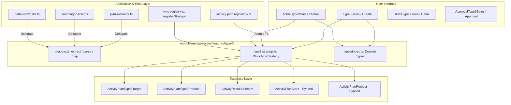

# TYPE 3: เสนอขายสินค้า (Work Type Module Guide)

> **Module Path**: `modules/activity-plans/features/type-3/`  
> **Work Type Code**: `TYPE_3`  
> **Thai Label**: `เสนอขายสินค้า` (Sales Proposal / Product Offering)  
> **Architecture Pattern**: Self-Contained Feature Slice with Centralized Components, Mapper, Strategy & Domain Types

---

## 📌 1. ภาพรวม (Overview)

ประเภทงาน **`TYPE_3` (เสนอขายสินค้า)** ใช้สำหรับวางแผนและบันทึกผลการเข้าพบเพื่อนำเสนอขายสินค้าให้แก่ร้านค้าตัวแทนจำหน่าย ทั้งในรูปแบบ **ร้านค้าตัวแทนจำหน่ายหลัก (Dealer)** และ **ผู้แทนจำหน่ายย่อย (Sub-Dealer)** โดยรองรับความสัมพันธ์แบบ **Multi-Target (1 Plan : N ร้านค้า/ผู้แทนจำหน่ายย่อย และในแต่ละเป้าหมายสามารถมี N รายการสินค้าที่เสนอขาย)**

### วัตถุประสงค์หลักในการวางแผนและบันทึกผล:
1. **ร้านค้าเป้าหมาย (Target Stores)**:
   - **ร้านค้าตัวแทนจำหน่ายหลัก (Dealer)**: เลือกร้านค้าจากระบบ (`Customer`)
   - **ผู้แทนจำหน่ายย่อย (Sub-Dealer)**: ระบุเป็นผู้แทนจำหน่ายย่อย พร้อมระบุชื่อร้านค้าตัวแทนจำหน่ายย่อย และเชื่อมโยงร้านค้าหลัก
2. **รายการสินค้าที่เสนอขาย (Proposed Products)**:
   - ในแต่ละเป้าหมาย สามารถเลือกสินค้าจากแคตตาล็อกสินค้า (`Product`) ได้มากกว่า 1 รายการ
   - กำหนดจำนวนเป้าหมาย (`targetQuantity`), ราคาต่อหน่วย (`unitPrice`), และยอดขายเป้าหมาย (`targetAmount`)
   - ระบุบันทึกหรือข้อสังเกตเฉพาะแต่ละสินค้าได้ (`notes`)
3. **บันทึกผลการปฏิบัติงานจริง (Actual Sales Outcome)**:
   - บันทึกจำนวนที่ปิดการขายได้จริง (`actualQuantity`)
   - บันทึกราคาขายต่อหน่วยจริง (`actualUnitPrice`) และยอดขายรวมจริง (`actualTotal`)
   - กรณีปิดการขายไม่ได้: ระบุเหตุผลที่ไม่สามารถปิดการขายได้ (`unclosedReason`)
   - รองรับการเสนอขายสินค้านอกแผนเพิ่มเติมหน้างาน (`isAdditional = true`)

---

## 📂 2. โครงสร้างโฟลเดอร์ (Directory Structure)

```text
modules/activity-plans/features/type-3/
├── application/                      # 🧠 Business Logic, Mappers & Strategy
│   ├── mapper.ts                     # Single Source of Truth สำหรับสกัดและแปลงข้อมูล Form State <-> DB
│   └── type3.strategy.ts             # WorkTypeStrategy Handler (Validation, Dedicated Persistence & Sync)
│
├── types/                            # 📐 Type Definitions กลางของ Type 3
│   └── index.ts                      # Domain Types: Type3SalesItem, Type3SalesProductLine, TargetProductItem, Type3ProductSaleDetail, Type3TargetItem
│
├── create/                           # 🖥️ UI สำหรับสร้างแผนงาน
│   ├── type3-sales.tsx               # แบบฟอร์มเพิ่มร้านค้าและรายการสินค้าเสนอขาย
│   ├── types.ts                      # Props Interfaces ของ Form
│   └── validation.ts                 # Validation Schemas
│
├── edit/                             # 🖥️ UI สำหรับแก้ไขแผนงาน
│   └── edit-type3.tsx                # คอมโพเนนต์แก้ไขข้อมูลแผนงาน Type 3
│
├── detail/                           # 🖥️ UI หน้ารายละเอียดแผนงาน (Read-only)
│   └── detail-type3-sales.tsx        # แสดงผลรายละเอียดเป้าหมายและผลการเสนอขายจริง
│
├── approval/                         # 🖥️ UI หน้าคิวอนุมัติ (Read-only)
│   └── approval-type3-sales.tsx      # แสดงผลเป้าหมายในหน้าพิจารณาอนุมัติ
│
├── actual/                           # 🖥️ UI & Hook บันทึกผลจริง
│   ├── actual-type3-sales.tsx        # หน้าจอบันทึกผลการปิดการขายและเหตุผลปิดการขายไม่ได้
│   ├── types.ts                      # Props ของ Actual
│   └── use-type3-actual.ts           # Hook จัดการ State ของผลจริง
│
├── shared/                           # 🧩 คอมโพเนนต์และ Type ที่ใช้ร่วมกันภายใน Type 3
│   ├── type3-plan-card.tsx           # การ์ดแสดงข้อมูลเป้าหมายตามแผน (Plan Target Card)
│   └── types.ts                      # Re-export จาก types/index.ts เพื่อ Backward Compatibility
│
├── hooks/                            # 🪝 Form Hook สำหรับ Plan
│   └── use-type3-form.ts             # จัดการ State เพิ่ม/ลด/แก้ไขร้านค้าและรายการสินค้า
│
├── README.md                         # 📖 เอกสารกำกับโมดูล Type 3 (ไฟล์นี้)
└── index.ts                          # 🚪 Barrel Export (Public API) สำหรับภายนอกเรียกใช้
```

---

## 🔄 3. การไหลของข้อมูล (Data Flow & Strategy Integration)



---

## 🗄️ 4. รายละเอียดตารางฐานข้อมูลที่เกี่ยวข้อง (Database Tables Deep Dive)

ในสถาปัตยกรรมใหม่ Type 3 มี **Dedicated Relational Tables** ของตนเองโดยตรง เพื่อแยกความเป็นเจ้าของข้อมูล (Data Ownership) ให้ชัดเจน ป้องกันการปะปนกับ Type อื่น และทำงานควบคู่กับการ Dual-Write Sync ไปยังตาราง Generic เพื่อรองรับ Backward Compatibility:

### 4.1 ตารางเฉพาะ `activity_plan_type_3_targets` (Dedicated Type 3 Plan Targets)
ตารางระดับเป้าหมายร้านค้า (1 แผน : N ร้านค้า/ผู้แทนจำหน่ายย่อย) เก็บข้อมูลร้านค้าที่จะเข้าพบเพื่อเสนอขาย:

| คอลัมน์ (Column) | ชนิดข้อมูล (Type) | Nullable | ความหมายและรายละเอียด |
|---|---|---|---|
| `id` | `VARCHAR(30)` (cuid) | No | Primary Key |
| `activity_plan_id` | `VARCHAR(30)` | No | Foreign Key อ้างอิง `activity_plans.id` (Cascade Delete) |
| `store_id` | `VARCHAR(30)` | Yes | Foreign Key อ้างอิง `customers.id` (ร้านค้าตัวแทนจำหน่าย) |
| `is_sub_dealer` | `BOOLEAN` | No (default: false) | แฟล็กระบุว่าเป็นผู้แทนจำหน่ายย่อยหรือไม่ |
| `sub_dealer_store` | `TEXT` | Yes | ชื่อร้านค้าผู้แทนจำหน่ายย่อย |
| `notes` | `TEXT` | Yes | รายละเอียดหรือข้อสังเกตเพิ่มเติมของเป้าหมาย |
| `created_at` / `updated_at` | `TIMESTAMP` | No | วันที่และเวลาสร้าง/แก้ไขล่าสุด |

---

### 4.2 ตารางเฉพาะ `activity_plan_type_3_products` (Dedicated Type 3 Plan Products)
ตารางรายการสินค้าที่เสนอขายของแต่ละเป้าหมาย (1 เป้าหมาย : N สินค้า):

| คอลัมน์ (Column) | ชนิดข้อมูล (Type) | Nullable | ความหมายและรายละเอียด |
|---|---|---|---|
| `id` | `VARCHAR(30)` (cuid) | No | Primary Key |
| `target_id` | `VARCHAR(30)` | No | Foreign Key อ้างอิง `activity_plan_type_3_targets.id` (Cascade Delete) |
| `activity_plan_id` | `VARCHAR(30)` | No | Foreign Key อ้างอิง `activity_plans.id` (Cascade Delete) |
| `product_id` | `VARCHAR(30)` | No | Foreign Key อ้างอิง `products.id` (Restrict Delete) |
| `target_quantity` | `INTEGER` | Yes | จำนวนเป้าหมายที่ต้องการเสนอขาย |
| `unit_price` | `DECIMAL(15,2)` | Yes | ราคาเสนอขายต่อหน่วย (บาท) |
| `target_amount` | `DECIMAL(15,2)` | Yes | ยอดขายเป้าหมายรวม (บาท) |
| `notes` | `TEXT` | Yes | บันทึกเฉพาะเกี่ยวกับสินค้านี้ |
| `created_at` / `updated_at` | `TIMESTAMP` | No | วันที่และเวลาสร้าง/แก้ไขล่าสุด |

---

### 4.3 ตารางเฉพาะ `activity_result_sale_items` (Dedicated Actual Sales Items)
ตารางเก็บผลการขายจริงตามการปฏิบัติงาน สัมพันธ์กับ `activity_results` โดยระบุ `work_type_code = 'TYPE_3'`:

| คอลัมน์ (Column) | ชนิดข้อมูล (Type) | Nullable | ความหมายและรายละเอียด |
|---|---|---|---|
| `id` | `VARCHAR(30)` (cuid) | No | Primary Key |
| `activity_result_id` | `VARCHAR(30)` | No | Foreign Key อ้างอิง `activity_results.id` (Cascade Delete) |
| `work_type_code` | `VARCHAR(50)` | No | ระบุเป็น `'TYPE_3'` |
| `store_id` | `VARCHAR(30)` | Yes | Foreign Key อ้างอิง `customers.id` (ร้านค้าที่ปิดการขาย) |
| `product_id` | `VARCHAR(30)` | No | Foreign Key อ้างอิง `products.id` |
| `product_name` | `TEXT` | Yes | ชื่อสินค้า (Denormalized Snapshot เพื่อความเร็ว) |
| `actual_quantity` | `INTEGER` | No | จำนวนสินค้าที่ปิดการขายได้จริง |
| `actual_unit_price` | `DECIMAL(15,2)` | No | ราคาขายต่อหน่วยจริง (บาท) |
| `actual_total` | `DECIMAL(15,2)` | No | ยอดขายรวมจริง (บาท) |
| `unclosedReason` | `TEXT` | Yes | เหตุผลที่ไม่สามารถปิดการขายได้ (กรณีขายไม่ได้) |
| `is_additional` | `BOOLEAN` | No (default: false) | `false` = สินค้าตามแผนงานเดิม, `true` = สินค้าเสนอนอกแผนหน้างาน |

---

### 4.4 ตารางส่วนกลางที่ Sync คู่ขนาน (Dual-Write Legacy Compatibility)
ระบบของ `type3Strategy.savePlan` จะบันทึกข้อมูลคู่ขนานไปยังตารางส่วนกลางเดิมเสมอ เพื่อให้ Report เก่าและระบบภายนอกยังคงทำงานได้:
- **`activity_plan_stores`**: บันทึกร้านค้าเป้าหมายโดยระบุ `work_type_code = 'TYPE_3'`
- **`activity_plan_products`**: บันทึกสินค้าเสนอขายโดยระบุ `work_type_code = 'TYPE_3'` พร้อมผูก `store_id`, `target_quantity`, `unit_price`, และ `target_amount`

---

## 🛡️ 5. สัญญาการใช้งานร่วมกับภายนอก (Public API Contract)

ไฟล์ภายนอกโฟลเดอร์ `modules/activity-plans/features/type-3/` ต้องเรียกใช้งานผ่าน `index.ts` เท่านั้น:

```typescript
import {
  Type3Sales,                  // Form สร้างแผนงาน (Create Stage)
  EditType3Sales,              // Form แก้ไขแผนงาน (Edit Stage)
  DetailType3Sales,            // View หน้ารายละเอียด (Detail Stage)
  ApprovalType3Sales,          // View หน้าพิจารณาอนุมัติ (Approval Stage)
  ActualType3Sales,            // Form บันทึกผลงานจริง (Actual Stage)
  Type3PlanCard,               // การ์ดแสดงเป้าหมายตามแผนงาน (Shared UI Card)
  extractType3PlanTargets,     // ฟังก์ชันสกัดเป้าหมาย Multi-Target จาก Plan Object
  parseType3ActualResult,      // ฟังก์ชันแกะผลลัพธ์การขายจริงจาก Result Payload
  mapType3ToSectionItems,      // ฟังก์ชันแปลงข้อมูลสำหรับ Section Card ในหน้ารายละเอียด
  useType3Form,                // Hook สำหรับจัดการ Form State ของ Plan
  useType3Actual,              // Hook สำหรับจัดการ Actual State
} from "@/modules/activity-plans/features/type-3";

// สำหรับ Server-side Registry / Repository:
import { type3Strategy } from "@/modules/activity-plans/features/type-3/application/type3.strategy";
```

---

## 📋 6. การทดสอบและการรับประกันคุณภาพ (Verification & Testing)

1. **Prisma Schema & Migrations**:
   - ซิงค์โครงสร้างตาราง `activity_plan_type_3_targets` และ `activity_plan_type_3_products` กับ PostgreSQL ด้วย `npx prisma db push`
   - รัน `npx prisma generate` พร้อม Prisma Client v7.2.0
2. **Type Safety & Decoupling**:
   - ผ่านการทดสอบ Type Checking ด้วย `npx tsc --noEmit` โดยไม่มีข้อผิดพลาด (Exit code 0)
   - โมดูล Type 3 ไม่มีการ Import ย้อนกลับไปยัง Shared Views (Zero Circular Dependency)
