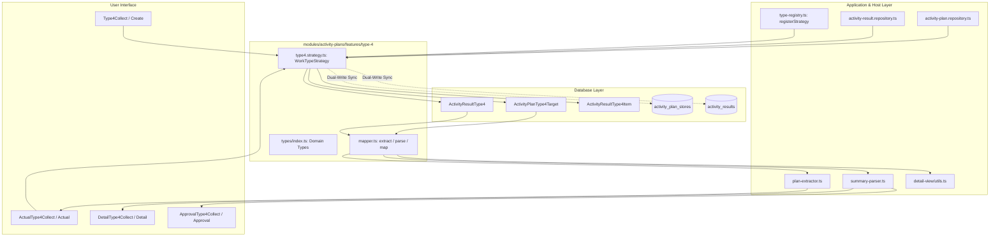

# TYPE 4: วางบิล / เก็บเงิน (Work Type Module Guide)

> **Module Path**: `modules/activity-plans/features/type-4/`  
> **Work Type Code**: `TYPE_4`  
> **Thai Label**: `วางบิล / เก็บเงิน` (Billing & Payment Collection)  
> **Architecture Pattern**: Self-Contained Feature Slice with Dedicated Relational Tables, Mapper, Strategy & Domain Types

---

## 📌 1. ภาพรวม (Overview)

ประเภทงาน **`TYPE_4` (วางบิล / เก็บเงิน)** ใช้สำหรับวางแผนและบันทึกผลการเข้าพบลูกค้าหรือร้านค้าตัวแทนจำหน่ายเพื่อส่งมอบเอกสารวางบิล หรือติดตามรับชำระเงินค่าสินค้า โดยรองรับความสัมพันธ์แบบ **Multi-Target (1 Plan : N ร้านค้า/บริษัทเป้าหมาย และในแต่ละเป้าหมายสามารถแยกประเภทการดำเนินการและบันทึกผลได้อิสระ)**

### วัตถุประสงค์หลักในการวางแผนและบันทึกผล:
1. **ร้านค้าและเป้าหมายตามแผน (Target Stores / Invoices)**:
   - เลือกร้านค้าคู่ค้าจากระบบ (`Customer`) หรือระบุชื่อบริษัท
   - กำหนดประเภทการดำเนินการ:
     - **`BILLING` (วางบิล)**: ส่งมอบเอกสารวางบิล ใบแจ้งหนี้ เพื่อรอรอบการจ่ายเงิน
     - **`COLLECT` (เก็บเงิน)**: ติดตามรับชำระเงินค่าสินค้าตามรอบบิล
   - กำหนดยอดเงินเป้าหมาย (`targetAmount`)
   - ระบุเลขที่บิล / ใบแจ้งหนี้ (`invoiceNo`)
   - บันทึกรายละเอียดหรือเงื่อนไขเฉพาะการเก็บเงิน (`notes`)
2. **บันทึกผลการปฏิบัติงานจริง (Actual Outcome)**:
   - **กรณีวางบิล (`BILLING`)**:
     - ระบุสถานะผลการวางบิล (`billingStatus`: "วางบิลสำเร็จ" | "วางบิลไม่สำเร็จ")
     - บันทึกรายละเอียดเพิ่มเติม เช่น รอบรับเช็ค วันที่นัดรับเงิน หรือเหตุผลที่วางบิลไม่สำเร็จ (`billingDetail`)
   - **กรณีเก็บเงิน (`COLLECT`)**:
     - บันทึกยอดเงินที่เก็บได้จริง (`receivedAmount`)
     - คำนวณยอดคงค้างอัตโนมัติ (`targetAmount - receivedAmount`) พร้อมแสดงสถานะชำระครบถ้วน
     - บันทึกรายละเอียดการรับชำระ เช่น ชำระเงินสด โอนเงิน หรือเช็ค (`collectDetail`)
   - **หลักฐานและเอกสารแนบ (`paymentImages`)**:
     - แนบภาพถ่ายใบเสร็จรับเงิน ใบเสร็จชั่วคราว สำเนาใบแจ้งหนี้ที่มีตราประทับรับ หรือสลิปหลักฐานการโอนเงิน
   - **รองรับ Multi-Target Breakdown**:
     - แยกบันทึกผลและคำนวณสรุปยอดรายบริษัท (`ActivityResultType4Item`) และสรุปรวมในระดับแผนงาน

---

## 📂 2. โครงสร้างโฟลเดอร์ (Directory Structure)

```text
modules/activity-plans/features/type-4/
├── application/                      # 🧠 Business Logic, Mappers & Strategy
│   ├── mapper.ts                     # Single Source of Truth สำหรับสกัดและแปลงข้อมูล Form State <-> DB
│   └── type4.strategy.ts             # WorkTypeStrategy Handler (Validation, Dedicated Persistence & Dual-Write Sync)
│
├── types/                            # 📐 Type Definitions กลางของ Type 4
│   └── index.ts                      # Domain Types: Type4CollectItem, TargetCollectCompanyItem, Type4TargetItem, Type4ImageFile
│
├── create/                           # 🖥️ UI สำหรับสร้างแผนงาน
│   ├── type4-collect.tsx             # แบบฟอร์มเพิ่มร้านค้าและเป้าหมายวางบิล/เก็บเงิน
│   ├── types.ts                      # Props Interfaces ของ Create Form
│   └── validation.ts                 # Validation Schemas
│
├── edit/                             # 🖥️ UI สำหรับแก้ไขแผนงาน
│   └── edit-type4.tsx                # คอมโพเนนต์แก้ไขข้อมูลแผนงาน Type 4
│
├── detail/                           # 🖥️ UI หน้ารายละเอียดแผนงาน (Read-only)
│   └── detail-type4-collect.tsx      # แสดงผลรายละเอียดเป้าหมายและผลการวางบิล/เก็บเงินจริง
│
├── approval/                         # 🖥️ UI หน้าคิวอนุมัติ (Read-only)
│   └── approval-type4-collect.tsx    # แสดงผลเป้าหมายในหน้าพิจารณาอนุมัติ
│
├── actual/                           # 🖥️ UI & Hook บันทึกผลจริง
│   ├── actual-type4-collect.tsx      # หน้าจอบันทึกผลการวางบิลและยอดเงินที่เก็บได้จริง
│   ├── types.ts                      # Props ของ Actual
│   └── use-type4-actual.ts           # Hook จัดการ State ของผลจริง
│
├── shared/                           # 🧩 คอมโพเนนต์และ Type ที่ใช้ร่วมกันภายใน Type 4
│   ├── type4-plan-card.tsx           # การ์ดแสดงข้อมูลเป้าหมายตามแผน (Plan Target Card)
│   └── types.ts                      # Re-export จาก types/index.ts เพื่อ Backward Compatibility
│
├── hooks/                            # 🪝 Form Hook สำหรับ Plan
│   └── use-type4-form.ts             # จัดการ State เพิ่ม/ลด/แก้ไขรายการวางบิลและเก็บเงิน
│
├── README.md                         # 📖 เอกสารกำกับโมดูล Type 4 (ไฟล์นี้)
└── index.ts                          # 🚪 Barrel Export (Public API) สำหรับ Client Components
```

---

## 🔄 3. การไหลของข้อมูล (Data Flow & Strategy Integration)



---

## 🗄️ 4. ตารางฐานข้อมูลที่เกี่ยวข้อง (Database Schema Deep Dive)

Type 4 ใช้งานตารางฐานข้อมูลเฉพาะกิจแบบ Fully-Relational (PostgreSQL ผ่าน Prisma ORM) ดังนี้:

### 4.1 ตารางเป้าหมายตามแผน: `activity_plan_type_4_targets` (`ActivityPlanType4Target`)
จัดเก็บรายการร้านค้าเป้าหมายที่ต้องไปวางบิลหรือเก็บเงินในแผนงานนั้นๆ (Multi-Target: 1 แผน มีได้หลายร้านค้า)

| ฟิลด์ (Field) | ชนิดข้อมูล (Type) | คำอธิบาย (Description) |
|---|---|---|
| `id` | `String @id @default(uuid())` | Primary Key |
| `activityPlanId` | `String` | Foreign Key เชื่อมโยง `ActivityPlan.id` (onDelete: Cascade) |
| `collectType` | `String @default("COLLECT")` | ประเภทงาน: `"BILLING"` (วางบิล) หรือ `"COLLECT"` (เก็บเงิน) |
| `storeId` | `String?` | Foreign Key เชื่อมโยง `Customer.id` (เลือกร้านค้าในระบบ) |
| `targetAmount` | `Decimal?(15, 2)` | ยอดเงินเป้าหมายที่ต้องเก็บหรือยอดตามบิล |
| `invoiceNo` | `String?` | เลขที่บิล / ใบแจ้งหนี้ |
| `notes` | `String?` | หมายเหตุ / รายละเอียดเพิ่มเติม |
| `createdAt` | `DateTime @default(now())` | วันเวลาที่สร้างข้อมูล |
| `updatedAt` | `DateTime @updatedAt` | วันเวลาที่แก้ไขข้อมูลล่าสุด |

### 4.2 ตารางสรุปผลปฏิบัติงานจริง: `activity_result_type_4` (`ActivityResultType4`)
จัดเก็บผลสรุปการวางบิลและเก็บเงินภาพรวมของแผนงาน

| ฟิลด์ (Field) | ชนิดข้อมูล (Type) | คำอธิบาย (Description) |
|---|---|---|
| `id` | `String @id @default(uuid())` | Primary Key |
| `activityPlanId` | `String @unique` | Foreign Key เชื่อมโยง `ActivityPlan.id` (1 Plan : 1 Type 4 Result) |
| `orderNo` | `String?` | เลขที่บิล / เอกสารอ้างอิงรวม |
| `billingStatus` | `String?` | สถานะการวางบิลภาพรวม (`"วางบิลสำเร็จ"` / `"วางบิลไม่สำเร็จ"`) |
| `receivedAmount` | `Decimal?(15, 2)` | ยอดเงินที่เก็บได้จริงรวม |
| `billingDetail` | `String?` | รายละเอียดผลการวางบิล |
| `collectDetail` | `String?` | รายละเอียดผลการเก็บเงิน |
| `notes` | `String?` | หมายเหตุเพิ่มเติม |
| `createdAt` | `DateTime @default(now())` | วันเวลาที่สร้างข้อมูล |
| `updatedAt` | `DateTime @updatedAt` | วันเวลาที่แก้ไขข้อมูลล่าสุด |

### 4.3 ตารางรายการผลจริงแยกตามร้านค้า: `activity_result_type_4_items` (`ActivityResultType4Item`)
จัดเก็บผลจริงแยกตามรายร้านค้า/บริษัท (รองรับกรณี Multi-Company ที่มีทั้งวางบิลและเก็บเงินหลายยอด)

| ฟิลด์ (Field) | ชนิดข้อมูล (Type) | คำอธิบาย (Description) |
|---|---|---|
| `id` | `String @id @default(uuid())` | Primary Key |
| `resultType4Id` | `String` | Foreign Key เชื่อมโยง `ActivityResultType4.id` (onDelete: Cascade) |
| `storeId` | `String?` | Foreign Key เชื่อมโยง `Customer.id` |
| `companyName` | `String?` | ชื่อร้านค้าหรือชื่อบริษัท |
| `collectType` | `String @default("COLLECT")` | ประเภทงาน: `"BILLING"` หรือ `"COLLECT"` |
| `targetAmount` | `Decimal?(15, 2)` | ยอดเป้าหมายตามแผนของร้านนี้ |
| `receivedAmount` | `Decimal?(15, 2)` | ยอดเงินที่เก็บได้จริงของร้านนี้ |
| `billingStatus` | `String?` | สถานะวางบิลของร้านนี้ (`"วางบิลสำเร็จ"` / `"วางบิลไม่สำเร็จ"`) |
| `billingDetail` | `String?` | รายละเอียดวางบิลของร้านนี้ |
| `collectDetail` | `String?` | รายละเอียดเก็บเงินของร้านนี้ |
| `notes` | `String?` | หมายเหตุ |
| `createdAt` | `DateTime @default(now())` | วันเวลาที่สร้างข้อมูล |
| `updatedAt` | `DateTime @updatedAt` | วันเวลาที่แก้ไขข้อมูลล่าสุด |

---

## 🛡️ 5. ความเข้ากันได้ย้อนหลัง (Dual-Write Sync Strategy)

เพื่อรองรับระบบรายงาน รายการค้นหา และหน้ารวมเดิมที่ยังอ่านข้อมูลจากตารางส่วนกลาง:
1. **การบันทึกแผน (`savePlan`)**:
   - บันทึกลงตารางเฉพาะ `activity_plan_type_4_targets`
   - ซิงค์แบบ Dual-Write ลงในตาราง `activity_plan_stores` ด้วย `workTypeCode = "TYPE_4"` และ `remarks = collectType` เพื่อให้ Query เดิมทำงานได้ตามปกติ
2. **การบันทึกผลจริง (`saveActual`)**:
   - บันทึกลงตารางเฉพาะ `activity_result_type_4` และ `activity_result_type_4_items`
   - ซิงค์ยอดเงินที่เก็บได้ลงในคอลัมน์ `activity_results.collect_result_amount` ของตารางผลกลาง
   - สร้างข้อความสรุปตามรูปแบบมาตรฐานใน `activity_results.actual_summary`

---

## 📦 6. Public API (`index.ts`) และ Bundle Boundary Safety

เพื่อป้องกันปัญหา Next.js Turbopack Bundle Error (`Module not found: Can't resolve '@prisma/client-runtime-utils'`) ในฝั่ง Client:

- **Client Barrel (`index.ts`)**: ส่งออกเฉพาะ Type definitions, UI Components (`Create`, `Edit`, `Detail`, `Approval`, `Actual`), Hooks, และ Pure Mapper Functions (`extractType4PlanTargets`, `parseType4ActualResult`, `mapType4ToSectionItems`)
- **Server Only Strategy (`type4.strategy.ts`)**: จะถูกเรียกใช้งานเฉพาะใน Server Files (`type-registry.ts`, `activity-plan.repository.ts`, `activity-result.repository.ts`) โดยตรงจาก path `./application/type4.strategy` เท่านั้น และ **ไม่ถูก Export** ออกทาง `index.ts`
