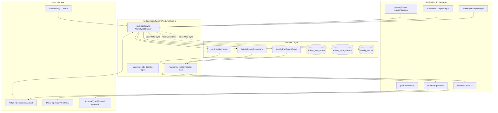

# TYPE 5: สำรวจตลาดของคู่แข่ง (Work Type Module Guide)

> **Module Path**: `modules/activity-plans/features/type-5/`  
> **Work Type Code**: `TYPE_5`  
> **Thai Label**: `สำรวจตลาดของคู่แข่ง` (Competitor Market Survey)  
> **Architecture Pattern**: Self-Contained Feature Slice with Dedicated Relational Tables, Pure Mappers, Server-Only Strategy & Domain Types

---

## 📌 1. ภาพรวม (Overview)

ประเภทงาน **`TYPE_5` (สำรวจตลาดของคู่แข่ง)** ใช้สำหรับวางแผนและบันทึกผลการลงพื้นที่สำรวจข้อมูลราคา โปรโมชั่น และผลิตภัณฑ์ของแบรนด์คู่แข่งในตลาด ณ ร้านค้าตัวแทนจำหน่าย โดยรองรับโครงสร้างแบบ **Multi-Target (1 Plan : N ร้านค้าเป้าหมายและสินค้าเปรียบเทียบ)**

### วัตถุประสงค์หลักในการวางแผนและบันทึกผล:
1. **ร้านค้าและสินค้าเป้าหมายตามแผน (Target Stores & Products)**:
   - เลือกร้านค้าตัวแทนจำหน่ายเป้าหมาย (`Customer`) หรือระบุชื่อร้านค้า
   - เลือกผลิตภัณฑ์ของบริษัทที่ต้องการนำมาเปรียบเทียบ (`Product`)
   - ระบุรายละเอียดหรือประเด็นที่ต้องการสำรวจ (`detail`)
2. **บันทึกผลการสำรวจจริง (Actual Survey Results)**:
   - **ข้อมูลแบรนด์และสินค้าคู่แข่ง**: ระบุแบรนด์คู่แข่ง (`competitorBrand`) และชื่อผลิตภัณฑ์คู่แข่ง (`competitorProduct`)
   - **โครงสร้างราคา 4 ระดับ (4-Tier Pricing Structure)**:
     - ราคาขายปลีก (`pricePerUnit` / Retail Price)
     - ราคาขายส่ง (`wholesalePrice` / Wholesale Price)
     - ราคาหน้าร้าน (`retailPrice` / Storefront Price)
     - ราคาโปรโมชั่น (`specialPrice` / Promotional Price)
   - **รายการส่งเสริมการขาย (`promotions`)**: บันทึกของแถม ส่วนลด หรือแคมเปญส่งเสริมการขายของคู่แข่ง
   - **ภาพถ่ายหลักฐานในพื้นที่ (`attachments`)**:
     - ภาพถ่ายตัวอย่างขวด/บรรจุภัณฑ์ของคู่แข่ง (`SURVEY_BOTTLE`)
     - ภาพถ่ายสื่อสิ่งพิมพ์ / ป้ายโปรโมชั่น / ชั้นวางสินค้า (`SURVEY_PROMO_MATERIAL`)
3. **รองรับ Multi-Target Breakdown**:
   - แยกบันทึกผลสำรวจรายร้านค้าและรายสินค้าคู่แข่งอย่างอิสระ (`ActivityResultSurveyItem`) พร้อมสรุปข้อมูลภาพรวมระดับแผนงาน

---

## 📂 2. โครงสร้างโฟลเดอร์ (Directory Structure)

```text
modules/activity-plans/features/type-5/
├── application/                      # 🧠 Business Logic, Mappers & Strategy
│   ├── mapper.ts                     # Single Source of Truth สำหรับสกัดและแปลงข้อมูล Form State <-> DB
│   └── type5.strategy.ts             # WorkTypeStrategy Handler (Validation, Dedicated Persistence & Dual-Write Sync)
│
├── types/                            # 📐 Type Definitions กลางของ Type 5
│   └── index.ts                      # Domain Types: Type5SurveyItem, Type5TargetItem, TargetSurveyItem, Type5SurveyRecord, Type5ImageFile
│
├── create/                           # 🖥️ UI สำหรับสร้างแผนงาน
│   ├── type5-survey.tsx              # แบบฟอร์มเพิ่มร้านค้าและสินค้าเป้าหมายสำรวจ
│   ├── types.ts                      # Props Interfaces ของ Create Form
│   └── validation.ts                 # Validation Schemas
│
├── edit/                             # 🖥️ UI สำหรับแก้ไขแผนงาน
│   └── edit-type5.tsx                # คอมโพเนนต์แก้ไขข้อมูลแผนงาน Type 5
│
├── detail/                           # 🖥️ UI หน้ารายละเอียดแผนงาน (Read-only)
│   └── detail-type5-survey.tsx       # แสดงผลรายละเอียดเป้าหมายและผลสำรวจราคา/รูปภาพคู่แข่ง
│
├── approval/                         # 🖥️ UI หน้าคิวอนุมัติ (Read-only)
│   └── approval-type5-survey.tsx     # แสดงผลข้อมูลแผนและผลสำรวจในหน้าพิจารณาอนุมัติ
│
├── actual/                           # 🖥️ UI & Hook บันทึกผลจริง
│   ├── actual-type5-survey.tsx       # หน้าจอบันทึกผลสำรวจราคา 4 ระดับ โปรโมชั่น และแนบรูปภาพ
│   ├── types.ts                      # Props ของ Actual Components
│   └── use-type5-actual.ts           # Hook จัดการ State ของผลการสำรวจ
│
├── shared/                           # 🧩 คอมโพเนนต์และ Type ที่ใช้ร่วมกันภายใน Type 5
│   ├── type5-plan-card.tsx           # การ์ดแสดงข้อมูลเป้าหมายตามแผน (Plan Target Card)
│   └── types.ts                      # Re-export จาก types/index.ts เพื่อ Backward Compatibility
│
├── hooks/                            # 🪝 Form Hook สำหรับ Plan
│   └── use-type5-form.ts             # จัดการ State เพิ่ม/ลด/แก้ไขรายการเป้าหมายสำรวจ
│
├── README.md                         # 📖 เอกสารกำกับโมดูล Type 5 (ไฟล์นี้)
└── index.ts                          # 🚪 Barrel Export (Public API) สำหรับ Client Components
```

---

## 🔄 3. การไหลของข้อมูล (Data Flow & Strategy Integration)



---

## 🗄️ 4. ตารางฐานข้อมูลที่เกี่ยวข้อง (Database Schema Deep Dive)

Type 5 ใช้งานตารางฐานข้อมูลเฉพาะกิจแบบ Fully-Relational (PostgreSQL ผ่าน Prisma ORM) ดังนี้:

### 4.1 ตารางเป้าหมายตามแผน: `activity_plan_type_5_targets` (`ActivityPlanType5Target`)
จัดเก็บรายการร้านค้าและสินค้าเป้าหมายที่กำหนดไว้ล่วงหน้าตามแผน (รองรับ Multi-Target: 1 แผนมีได้หลายเป้าหมาย)

| ฟิลด์ (Field) | ชนิดข้อมูล (Type) | คำอธิบาย (Description) |
|---|---|---|
| `id` | `String @id @default(uuid())` | Primary Key |
| `activityPlanId` | `String` | Foreign Key เชื่อมโยง `ActivityPlan.id` (onDelete: Cascade) |
| `storeId` | `String?` | Foreign Key เชื่อมโยง `Customer.id` (ร้านค้าตัวแทนจำหน่าย) |
| `productId` | `String?` | Foreign Key เชื่อมโยง `Product.id` (สินค้าของบริษัทที่ใช้เปรียบเทียบ) |
| `detail` | `String?` | รายละเอียดหรือประเด็นเฉพาะที่ต้องการสำรวจ |
| `createdAt` | `DateTime @default(now())` | วันเวลาที่สร้างข้อมูล |
| `updatedAt` | `DateTime @updatedAt` | วันเวลาที่แก้ไขข้อมูลล่าสุด |

### 4.2 ตารางผลการสำรวจคู่แข่งจริง: `activity_result_survey_items` (`ActivityResultSurveyItem`)
จัดเก็บผลการลงพื้นที่สำรวจจริง โดยเก็บราคา 4 ระดับ แบรนด์และสินค้าคู่แข่ง โปรโมชั่น และเชื่อมโยงรูปภาพถ่ายจริง

| ฟิลด์ (Field) | ชนิดข้อมูล (Type) | คำอธิบาย (Description) |
|---|---|---|
| `id` | `String @id @default(uuid())` | Primary Key |
| `activityResultId` | `String` | Foreign Key เชื่อมโยง `ActivityResult.id` (onDelete: Cascade) |
| `storeId` | `String?` | Foreign Key เชื่อมโยง `Customer.id` (ร้านค้าที่ลงสำรวจ) |
| `productId` | `String?` | Foreign Key เชื่อมโยง `Product.id` (สินค้าของบริษัทที่เปรียบเทียบ) |
| `competitorBrand` | `String?` | ชื่อแบรนด์คู่แข่ง |
| `competitorProduct` | `String?` | ชื่อสินค้าคู่แข่งที่สำรวจ |
| `pricePerUnit` | `Decimal?(15, 2)` | ราคาขายปลีก (Retail Price) |
| `wholesalePrice` | `Decimal?(15, 2)` | ราคาขายส่ง (Wholesale Price) |
| `specialPrice` | `Decimal?(15, 2)` | ราคาโปรโมชั่น (Promotional Price) |
| `retailPrice` | `Decimal?(15, 2)` | ราคาหน้าร้าน (Storefront Price) |
| `promotions` | `String?` | รายละเอียดโปรโมชั่น / ของแถม |
| `detail` | `String?` | รายละเอียดและข้อสังเกตเพิ่มเติม |
| `createdAt` | `DateTime @default(now())` | วันเวลาที่สร้างข้อมูล |
| `updatedAt` | `DateTime @updatedAt` | วันเวลาที่แก้ไขข้อมูลล่าสุด |

### 4.3 ตารางไฟล์แนบและรูปถ่ายสำรวจ: `activity_attachments` (`ActivityAttachment`)
รูปภาพที่แนบในการสำรวจจะเชื่อมโยงกับ `surveyItemId` โดยมีประเภทไฟล์ (`fileCategory`):
- `SURVEY_BOTTLE`: ภาพถ่ายตัวอย่างขวด/สินค้าคู่แข่ง
- `SURVEY_PROMO_MATERIAL`: ภาพถ่ายป้ายโปรโมชั่น / สื่อส่งเสริมการขาย / เชลฟ์วางสินค้า

---

## 🛡️ 5. ความเข้ากันได้ย้อนหลัง (Dual-Write Sync Strategy)

เพื่อรองรับระบบรายงาน และแดชบอร์ดสรุปผลเดิมที่ยังอ่านข้อมูลจากตารางส่วนกลาง:
1. **การบันทึกแผน (`savePlan`)**:
   - บันทึกลงตารางเฉพาะ `activity_plan_type_5_targets`
   - ซิงค์แบบ Dual-Write ลงในตาราง `activity_plan_stores` (เก็บร้านค้า) และ `activity_plan_products` (เก็บสินค้า) ด้วย `workTypeCode = "TYPE_5"` เพื่อให้ View หรือ Query แบบรวมทำงานได้ต่อเนื่อง
2. **การบันทึกผลจริง (`saveActual`)**:
   - บันทึกลงตารางเฉพาะ `activity_result_survey_items` พร้อมจัดการรูปถ่ายใน `activity_attachments`
   - สร้างข้อความสรุปมาตรฐานในคอลัมน์ `activity_results.actual_summary` (เช่น `แบรนด์: X, สินค้าคู่แข่ง: Y, ราคา: Z บาท`)

---

## 📦 6. Public API (`index.ts`) และ Bundle Boundary Safety

เพื่อป้องกันปัญหา Next.js Turbopack Bundle Error (`Module not found: Can't resolve '@prisma/client-runtime-utils'`) ในฝั่ง Client:

- **Client Barrel (`index.ts`)**: ส่งออกเฉพาะ Type definitions, UI Components (`Create`, `Edit`, `Detail`, `Approval`, `Actual`), Hooks, และ Pure Mapper Functions (`extractType5PlanTargets`, `parseType5ActualResult`, `mapType5ToSectionItems`)
- **Server Only Strategy (`type5.strategy.ts`)**: ถูกเรียกใช้งานเฉพาะใน Server Files (`type-registry.ts`, `activity-plan.repository.ts`, `activity-result.repository.ts`) โดยตรงจาก path `./application/type5.strategy` เท่านั้น และ **ห้าม Export** ออกทาง `index.ts`
