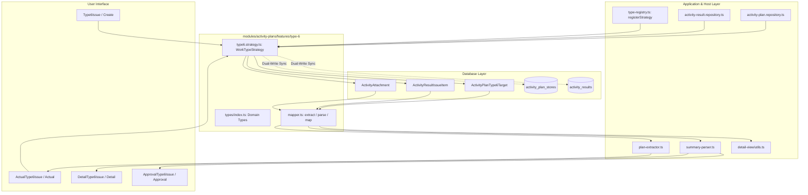

# TYPE 6: ตรวจสอบเรื่องร้องเรียน / แก้ปัญหา (Work Type Module Guide)

> **Module Path**: `modules/activity-plans/features/type-6/`  
> **Work Type Code**: `TYPE_6`  
> **Thai Label**: `ตรวจสอบเรื่องร้องเรียน / แก้ปัญหา` (Complaint & Issue Investigation)  
> **Architecture Pattern**: Self-Contained Feature Slice with Dedicated Relational Tables, Pure Mappers, Server-Only Strategy & Domain Types

---

## 📌 1. ภาพรวม (Overview)

ประเภทงาน **`TYPE_6` (ตรวจสอบเรื่องร้องเรียน / แก้ปัญหา)** ใช้สำหรับวางแผนและบันทึกผลการเข้าตรวจสอบข้อร้องเรียน ปัญหาคุณภาพสินค้า บรรจุภัณฑ์ชำรุด หรือความเสียหายที่เกิดขึ้นหลังจากการใช้สินค้า โดยรองรับโครงสร้างแบบ **Multi-Target (1 Plan : N เป้าหมายร้านค้าหรือเกษตรกรผู้ร้องเรียน)**

### วัตถุประสงค์หลักในการวางแผนและบันทึกผล:
1. **เป้าหมายตามแผน (Target Complaints / Issues)**:
   - เลือกร้านค้าตัวแทนจำหน่ายจากระบบ (`Customer`) หรือระบุชื่อลูกค้า/เกษตรกรทั่วไป (`isManualCustomer`)
   - ระบุประเภทปัญหา (`issueType`):
     - `"สินค้าหรือบรรจุภัณฑ์ชำรุด / เสียหาย"`
     - `"เกิดความเสียหายหลังการใช้สินค้า"`
     - `"อื่นๆ ระบุ"`
   - บันทึกรายละเอียดของข้อร้องเรียน (`detail`)
2. **บันทึกผลการตรวจสอบจริง (Actual Outcome)**:
   - **ช่องทางการซื้อสินค้า (`purchaseChannel`)**: `"ร้านค้าตัวแทนจำหน่าย"` หรือ `"ออนไลน์"`
   - **ร้านค้าที่ซื้อ (`storeId` / `storeName`)**: กรณีซื้อจากร้านค้าตัวแทนจำหน่าย
   - **สินค้าที่พบปัญหา (`productId` / `productName`)**: เชื่อมโยงสินค้าในระบบ
   - **หมายเลข Lot การผลิต (`lotNumber`)**: ระบุ Lot เพื่อการตรวจสอบย้อนกลับ (Traceability)
   - **รายละเอียดและแนวทางแก้ไข (`detail` / `initialSolution`)**: สรุปสาเหตุและแนวทางแก้ไข
   - **สถานะการแก้ไขปัญหา (`status`)**: `"เสร็จสิ้น"` หรือ `"รอติดตาม"`
   - **รูปภาพหลักฐาน (`images` / `attachments`)**: ภาพถ่ายสินค้าที่มีปัญหา สภาพแปลง หรือเอกสารที่เกี่ยวข้อง
3. **รองรับ Multi-Target Breakdown**:
   - แยกบันทึกผลตามรายการเรื่องร้องเรียนแต่ละรายการ (`ActivityResultIssueItem`)

---

## 📂 2. โครงสร้างโฟลเดอร์ (Directory Structure)

```text
modules/activity-plans/features/type-6/
├── components/                       # 🖥️ UI Components (Vertical Slice)
│   ├── type6-plan-form.tsx           # แบบฟอร์มเพิ่มร้านค้า/ลูกค้าเป้าหมายและประเภทเรื่องร้องเรียน (alias: Type6Issue)
│   ├── type6-actual-form.tsx         # หน้าจอบันทึกผลการตรวจสอบ Lot Number ช่องทางการซื้อ และรูปภาพ (alias: ActualType6Issue)
│   ├── type6-detail-view.tsx         # แสดงผลรายละเอียดเป้าหมายและผลการตรวจสอบเรื่องร้องเรียนจริง (alias: DetailType6Issue)
│   ├── type6-approval-card.tsx       # แสดงผลข้อมูลแผนและผลการตรวจสอบในหน้าพิจารณาอนุมัติ (alias: ApprovalType6Issue)
│   └── type6-plan-card.tsx           # การ์ดแสดงข้อมูลเป้าหมายตามแผน (Plan Target Card, hides in UNPLANNED)
│
├── hooks/                            # 🪝 React Hooks
│   ├── use-type6-form.ts             # จัดการ State เพิ่ม/ลด/แก้ไขรายการเป้าหมายเรื่องร้องเรียน
│   └── use-type6-actual.ts           # Hook จัดการ State ของผลการตรวจสอบ
│
├── application/                      # 🧠 Business Logic, Mappers & Strategy
│   ├── mapper.ts                     # Single Source of Truth สำหรับสกัดและแปลงข้อมูล Form State <-> DB
│   ├── type6.strategy.ts             # WorkTypeStrategy Handler (Validation, Dedicated Persistence & Dual-Write Sync)
│   └── validation.ts                 # Pure Validation Functions (validateType6FormItems, validateType6Actual)
│
├── types/                            # 📐 Type Definitions กลางของ Type 6
│   └── index.ts                      # Domain Types: Type6IssueItem, Type6TargetItem, TargetIssueItem, Type6IssueRecord, Type6ImageFile
│
├── README.md                         # 📖 เอกสารกำกับโมดูล Type 6 (ไฟล์นี้)
└── index.ts                          # 🚪 Barrel Export (Public API) สำหรับ Vertical Slice และ Backward Compatibility
```

---

## 🔄 3. การไหลของข้อมูล (Data Flow & Strategy Integration)



---

## 🗄️ 4. ตารางฐานข้อมูลที่เกี่ยวข้อง (Database Schema Deep Dive)

Type 6 ใช้งานตารางฐานข้อมูลเฉพาะกิจแบบ Fully-Relational (PostgreSQL ผ่าน Prisma ORM) ดังนี้:

### 4.1 ตารางเป้าหมายตามแผน: `activity_plan_type_6_targets` (`ActivityPlanType6Target`)
จัดเก็บรายการร้านค้า/ลูกค้าเป้าหมายและประเภทเรื่องร้องเรียนที่ระบุไว้ล่วงหน้าตามแผน (รองรับ Multi-Target: 1 แผนมีได้หลายเป้าหมาย)

| ฟิลด์ (Field) | ชนิดข้อมูล (Type) | คำอธิบาย (Description) |
|---|---|---|
| `id` | `String @id @default(cuid())` | Primary Key |
| `activityPlanId` | `String` | Foreign Key เชื่อมโยง `ActivityPlan.id` (onDelete: Cascade) |
| `storeId` | `String?` | Foreign Key เชื่อมโยง `Customer.id` (กรณีเลือกร้านค้าในระบบ) |
| `customerName` | `String?` | ชื่อลูกค้า / ร้านค้า / เกษตรกร |
| `isManualCustomer` | `Boolean @default(false)` | ระบุว่าเป็นลูกค้ากรอกเองนอกระบบหรือไม่ |
| `issueType` | `String @default("...")` | ประเภทปัญหา (`สินค้าชำรุด`, `เสียหายหลังใช้`, `อื่นๆ`) |
| `detail` | `String?` | รายละเอียดข้อร้องเรียนที่ได้รับแจ้ง |
| `createdAt` | `DateTime @default(now())` | วันเวลาที่สร้างข้อมูล |
| `updatedAt` | `DateTime @updatedAt` | วันเวลาที่แก้ไขข้อมูลล่าสุด |

### 4.2 ตารางผลการตรวจสอบเรื่องร้องเรียนจริง: `activity_result_issue_items` (`ActivityResultIssueItem`)
จัดเก็บผลการลงพื้นที่ตรวจสอบข้อร้องเรียนจริง โดยบันทึกช่องทางการซื้อ, สินค้า, Lot Number, สรุปผล, สถานะ และรูปถ่ายแนบ

| ฟิลด์ (Field) | ชนิดข้อมูล (Type) | คำอธิบาย (Description) |
|---|---|---|
| `id` | `String @id @default(cuid())` | Primary Key |
| `activityResultId` | `String` | Foreign Key เชื่อมโยง `ActivityResult.id` (onDelete: Cascade) |
| `productId` | `String?` | Foreign Key เชื่อมโยง `Product.id` (สินค้าที่มีปัญหา) |
| `productName` | `String?` | ชื่อสินค้าที่มีปัญหา |
| `lotNumber` | `String?` | หมายเลข Lot การผลิต |
| `purchaseChannel` | `String` | ช่องทางการซื้อ (`ร้านค้าตัวแทนจำหน่าย` / `ออนไลน์`) |
| `storeId` | `String?` | Foreign Key เชื่อมโยง `Customer.id` (ร้านค้าที่ซื้อ) |
| `storeName` | `String?` | ชื่อร้านค้าที่ซื้อ |
| `issueType` | `String` | ประเภทปัญหา |
| `detail` | `String?` | รายละเอียดผลการตรวจสอบและแนวทางแก้ไข |
| `status` | `String @default("เสร็จสิ้น")` | สถานะการแก้ไขปัญหา (`เสร็จสิ้น` / `รอติดตาม`) |

### 4.3 ตารางไฟล์แนบและรูปถ่ายปัญหา: `activity_attachments` (`ActivityAttachment`)
รูปภาพหลักฐานและสภาพปัญหาจะเชื่อมโยงกับ `issueItemId` โดยตรง (Category: `ISSUE` หรือ `GENERAL`)

---

## 🛡️ 5. ความเข้ากันได้ย้อนหลัง (Dual-Write Sync Strategy)

เพื่อรองรับรายงานและแดชบอร์ดสรุปผลเดิมที่ยังอ่านข้อมูลจากตารางส่วนกลาง:
1. **การบันทึกแผน (`savePlan`)**:
   - บันทึกลงตารางเฉพาะ `activity_plan_type_6_targets`
   - ซิงค์แบบ Dual-Write ลงในตาราง `activity_plan_stores` ด้วย `workTypeCode = "TYPE_6"`, `remarks = issueType`, และ `notes = detail` เพื่อให้ Query เดิมทำงานได้ตามปกติ
2. **การบันทึกผลจริง (`saveActual`)**:
   - บันทึกลงตารางเฉพาะ `activity_result_issue_items` พร้อมจัดการรูปถ่ายใน `activity_attachments`
   - สร้างข้อความสรุปมาตรฐานในคอลัมน์ `activity_results.actual_summary` (เช่น `ปัญหาลูกค้าร้องเรียน: X, สถานะ: Y`)

---

## 📦 6. Public API (`index.ts`) และ Bundle Boundary Safety

เพื่อป้องกันปัญหา Next.js Turbopack Bundle Error (`Module not found: Can't resolve '@prisma/client-runtime-utils'`) ในฝั่ง Client:

- **Client Barrel (`index.ts`)**: ส่งออกเฉพาะ Type definitions, UI Components (`Create`, `Edit`, `Detail`, `Approval`, `Actual`), Hooks, และ Pure Mapper Functions (`extractType6PlanTargets`, `parseType6ActualResult`, `mapType6ToSectionItems`)
- **Server Only Strategy (`type6.strategy.ts`)**: ถูกเรียกใช้งานเฉพาะใน Server Files (`type-registry.ts`, `activity-plan.repository.ts`, `activity-result.repository.ts`) โดยตรงจาก path `./application/type6.strategy` เท่านั้น และ **ห้าม Export** ออกทาง `index.ts`

## 🔗 ความเชื่อมโยงกับระบบส่วนกลาง (Dependencies & External Functions Mapping)

### 1. ฟังก์ชันและโมดูลที่ Slice นี้เรียกใช้งาน (Inbound Dependencies)
| หมวดหมู่ | ฟังก์ชัน / โมดูลที่เรียกใช้ | ที่อยู่ไฟล์ (File Path) | วัตถุประสงค์การใช้งาน |
|---|---|---|---|
| **Infrastructure** | `db (PrismaClient)` | [`lib/db.ts`](file:///lib/db.ts) | ประมวลผล Transaction บันทึกข้อมูล activity_plan_type_6_targets |
| **Application** | `WorkTypeStrategy, PrismaTransaction, StrategyValidationResult` | [`modules/activity-plans/application/strategies/work-type-strategy.interface.ts`](file:///modules/activity-plans/application/strategies/work-type-strategy.interface.ts) | สัญญากลางสำหรับ Strategy Pattern |
| **Shared UI / Utils** | `uploadActivityPlanImageGroup, collectPermanentUrls` | [`modules/activity-plans/features/shared/actual-view/utils/index.ts`](file:///modules/activity-plans/features/shared/actual-view/utils/index.ts) | อัปโหลดรูปภาพการจัดเรียงหน้าร้าน |
| **External Module** | `listCustomersAction` | [`modules/customers/server/actions.ts`](file:///modules/customers/server/actions.ts) | ค้นหาร้านค้าเป้าหมายจัดเรียงสินค้า |

### 2. จุดที่ระบบส่วนกลางเรียกใช้งาน Slice นี้ (Outbound Integration Points)
| ส่วนกลางที่เรียกใช้ | ไฟล์ที่เรียกใช้ (Caller Path) | สิ่งที่นำไปใช้ (Export / Function) | วัตถุประสงค์ |
|---|---|---|---|
| **Strategy Registry** | [`modules/activity-plans/application/strategies/type-registry.ts`](file:///modules/activity-plans/application/strategies/type-registry.ts) | `Type6Strategy` | ลงทะเบียน Handler สำหรับ Type 6 |
| **Repository Query** | [`modules/activity-plans/infrastructure/activity-plan-include.ts`](file:///modules/activity-plans/infrastructure/activity-plan-include.ts) | `type6Targets` | Eager load ข้อมูลร้านค้าใน findActivityPlanById |
| **Detail Mapper** | [`modules/activity-plans/features/shared/detail-view/utils.ts`](file:///modules/activity-plans/features/shared/detail-view/utils.ts) | `mapType6ToSectionItems` | แปลงข้อมูลเพื่อแสดงใน Detail View |
| **Approval Queue** | [`modules/activity-plans/features/shared/approve-view/components/work-types/index.ts`](file:///modules/activity-plans/features/shared/approve-view/components/work-types/index.ts) | `Type6ApprovalCard` | การ์ดแสดงผลในหน้าอนุมัติ |
| **Actual Form** | [`modules/activity-plans/features/shared/actual-view/components/work-types/index.ts`](file:///modules/activity-plans/features/shared/actual-view/components/work-types/index.ts) | `Type6ActualForm` | ฟอร์มบันทึกผลการจัดเรียงป้ายโฆษณา |

