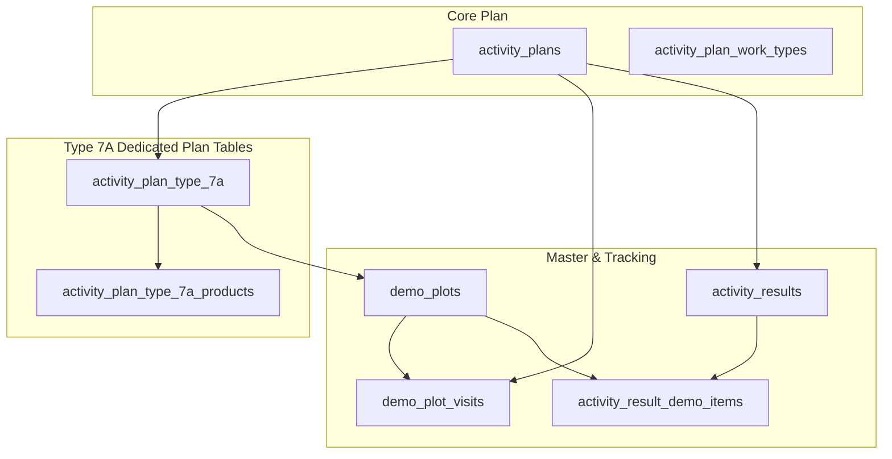

# Type 7A Feature Module: ทำแปลงสาธิต (เริ่มทำแปลงใหม่) (New Demo Plot)

> **Work Type Code:** `TYPE_7A`  
> **Status:** ✅ Dedicated Relational Tables (`ActivityPlanType7a`, `ActivityPlanType7aProduct`, `DemoPlot`, `DemoPlotVisit`), Encapsulated Strategy Pattern, Multi-Target UI State

---

## 1. Overview & Architecture

Feature Module `type-7a` รับผิดชอบขั้นตอนการวางแผนและบันทึกผลการทำแปลงสาธิตใหม่ (เริ่มต้นทำแปลง) โดยเชื่อมโยงข้อมูลระหว่าง:
1. ข้อมูลธุรกรรมแผนงาน (`ActivityPlan`)
2. ข้อมูลแปลงสาธิตเฉพาะตามแผน (`ActivityPlanType7a` และผลิตภัณฑ์ที่เบิกใช้สาธิต `ActivityPlanType7aProduct`)
3. ทะเบียนแปลงสาธิตหลัก (`DemoPlot`) ที่ใช้ติดตามต่อเนื่องระยะยาวตลอดฤดูกาล
4. บันทึกการเข้าเยี่ยมรอบแรก (`DemoPlotVisit`) และผลการสาธิต (`activity_results` / `activity_result_demo_items`)



---

## 2. Directory Structure

```
modules/activity-plans/features/type-7a/
├── types/
│   └── index.ts               # Domain types, UI Props, and form validation interfaces
├── application/
│   ├── mapper.ts              # Pure mappers (extractType7aPlanTargets, parseType7aActualResult, mapType7aToSectionItems)
│   ├── validation.ts          # Pure form & actual validation functions
│   └── type7a.strategy.ts     # Server-only WorkTypeStrategy implementation
├── components/
│   ├── type7a-plan-card.tsx   # Plan detail card component (supports PLANNED/UNPLANNED)
│   ├── type7a-plan-form.tsx   # Plan create/edit form row
│   ├── type7a-actual-form.tsx # Actual result execution form
│   ├── type7a-detail-view.tsx # Readonly detail view
│   └── type7a-approval-card.tsx# Approval card component
├── hooks/
│   ├── use-type7a-form.ts     # Plan form state management hook
│   └── use-type7a-actual.ts   # Actual form state management hook
├── index.ts                   # Public Feature Barrel Export (pure components, hooks, mappers & types; NO server strategies)
└── README.md                  # This documentation
```

---

## 3. Data Schema & Persistence

### 3.1 Database Tables

| Table | Prisma Model | Purpose |
|---|---|---|
| `activity_plan_type_7a` | `ActivityPlanType7a` | ข้อมูลแปลงสาธิตที่ระบุไว้ในแผนงาน (1:N กับ ActivityPlan) |
| `activity_plan_type_7a_products` | `ActivityPlanType7aProduct` | ผลิตภัณฑ์และจำนวนที่ขอเบิกเพื่อนำไปสาธิตในแปลง |
| `demo_plots` | `DemoPlot` | ทะเบียนแปลงสาธิตหลัก (เก็บพิกัด, พืช, เจ้าของ, วันที่เริ่ม) |
| `demo_plot_visits` | `DemoPlotVisit` | รอบการเข้าเยี่ยมบันทึกผลการทำแปลง (Visit #1 สำหรับ 7A) |
| `activity_result_demo_items` | `ActivityResultDemoItem` | รายการผลการสาธิต (ยาที่วางแผน vs ยาที่ใช้จริง) |

---

## 4. Strategy & Mapper API

### 4.1 Application Mapper (`application/mapper.ts`)
- **`extractType7aPlanTargets(plan, prevTarget)`**: ดึงข้อมูลเป้าหมายแปลงสาธิตจาก `plan.type7aPlots` (พร้อม relations: `store`, `demoPlot`, `products`) และ fallback ไปยัง `demoPlotVisits` หากเป็นข้อมูลเก่า
- **`parseType7aActualResult(resData)`**: แกะข้อมูลผลการทำแปลงจริง (พิกัด, เกษตรกร, พืช, ผลิตภัณฑ์ที่ใช้จริง, ฯลฯ)
- **`mapType7aToSectionItems(plots)`**: แปลงข้อมูลแปลงสาธิตเป็น Section Items สำหรับแสดงผลใน Activity Plan Detail View

### 4.2 Strategy (`application/type7a.strategy.ts`)
- **`code: "TYPE_7A"`**
- **`validatePlan(planData, db)`**: ตรวจสอบความครบถ้วนของข้อมูลแปลงสาธิต
- **`savePlan(tx, activityPlanId, planData)`**: Sync ข้อมูลลงใน `ActivityPlanType7a` และ `DemoPlot`
- **`saveActual(tx, resultId, actualData)`**: บันทึกผลการทำแปลงสาธิตลงใน `ActivityResultDemoItem`
- **`loadPlan(db, activityPlanId)`**: ดึงข้อมูลแปลงสาธิตพร้อม relations ผ่าน `findType7aByPlanId`

---

## 5. Security & Bundling Guardrails

> [!IMPORTANT]
> **Server Bundle Isolation:** ห้าม Export `type7aStrategy` หรือโมดูลที่เรียก Prisma Client ออกมาจาก `modules/activity-plans/features/type-7a/index.ts` โดยเด็ดขาด เพื่อป้องกันไม่ให้ Client Component Bundle ดึง `@prisma/client-runtime-utils` เข้าไปในเบราว์เซอร์

## 🔗 ความเชื่อมโยงกับระบบส่วนกลาง (Dependencies & External Functions Mapping)

### 1. ฟังก์ชันและโมดูลที่ Slice นี้เรียกใช้งาน (Inbound Dependencies)
| หมวดหมู่ | ฟังก์ชัน / โมดูลที่เรียกใช้ | ที่อยู่ไฟล์ (File Path) | วัตถุประสงค์การใช้งาน |
|---|---|---|---|
| **Infrastructure** | `db (PrismaClient)` | [`lib/db.ts`](file:///lib/db.ts) | ประมวลผล Transaction สร้างแปลงสาธิตใหม่และ DemoPlotVisit |
| **Infrastructure** | `generateDemoPlotCode, createDemoPlotForPlan` | [`modules/activity-plans/infrastructure/demo-plot.repository.ts`](file:///modules/activity-plans/infrastructure/demo-plot.repository.ts) | สร้างรหัสแปลงสาธิต (เช่น DP-YYMM-XXXX) และจัดการความสัมพันธ์แปลง |
| **Application** | `WorkTypeStrategy, PrismaTransaction, StrategyValidationResult` | [`modules/activity-plans/application/strategies/work-type-strategy.interface.ts`](file:///modules/activity-plans/application/strategies/work-type-strategy.interface.ts) | สัญญากลางสำหรับ Strategy Pattern |
| **Application** | `type7aPlotProductSchema, type7aPlotItemSchema, type7aDemoPlotInputSchema` | [`modules/activity-plans/features/type-7a/application/validation.ts`](file:///modules/activity-plans/features/type-7a/application/validation.ts) | Zod Validation Schema ของ Type 7A |
| **Shared UI / Utils** | `uploadActivityPlanImageGroup, collectPermanentUrls` | [`modules/activity-plans/features/shared/actual-view/utils/index.ts`](file:///modules/activity-plans/features/shared/actual-view/utils/index.ts) | อัปโหลดรูปภาพแปลงสาธิตเริ่มต้น |
| **External Module** | `listCustomersAction, listProductsAction` | [`modules/customers/server/actions.ts, modules/products/server/actions.ts`](file:///modules/customers/server/actions.ts, modules/products/server/actions.ts) | ค้นหาร้านค้า Dealer, เกษตรกร และยาที่ใช้สาธิต |

### 2. จุดที่ระบบส่วนกลางเรียกใช้งาน Slice นี้ (Outbound Integration Points)
| ส่วนกลางที่เรียกใช้ | ไฟล์ที่เรียกใช้ (Caller Path) | สิ่งที่นำไปใช้ (Export / Function) | วัตถุประสงค์ |
|---|---|---|---|
| **Strategy Registry** | [`modules/activity-plans/application/strategies/type-registry.ts`](file:///modules/activity-plans/application/strategies/type-registry.ts) | `Type7aStrategy` | ลงทะเบียน Handler สำหรับ Type 7A |
| **Plan Repository** | [`modules/activity-plans/infrastructure/activity-plan.repository.ts`](file:///modules/activity-plans/infrastructure/activity-plan.repository.ts) | `getTypeStrategy("TYPE_7A").savePlan` | สร้างแปลงสาธิตและผูก relation กับแผนงาน |
| **Validation Layer** | [`modules/activity-plans/application/validations.ts`](file:///modules/activity-plans/application/validations.ts) | `type7aDemoPlotInputSchema, type7aPlotItemSchema` | นำเข้า Zod Schema เพื่อตรวจสอบความถูกต้องในระดับภาพรวม |
| **Repository Query** | [`modules/activity-plans/infrastructure/activity-plan-include.ts`](file:///modules/activity-plans/infrastructure/activity-plan-include.ts) | `type7aPlots, demoPlotVisits` | Eager load ข้อมูลแปลงสาธิตใน findActivityPlanById |
| **Detail Mapper** | [`modules/activity-plans/features/shared/detail-view/utils.ts`](file:///modules/activity-plans/features/shared/detail-view/utils.ts) | `mapType7aToSectionItems` | แปลงข้อมูลแปลงสาธิตเพื่อแสดงใน Detail View |
| **Approval Queue** | [`modules/activity-plans/features/shared/approve-view/components/work-types/index.ts`](file:///modules/activity-plans/features/shared/approve-view/components/work-types/index.ts) | `Type7aApprovalCard` | การ์ดแสดงผลแปลงสาธิตในหน้าอนุมัติ |
| **Actual Form** | [`modules/activity-plans/features/shared/actual-view/components/work-types/index.ts`](file:///modules/activity-plans/features/shared/actual-view/components/work-types/index.ts) | `Type7aActualForm` | ฟอร์มบันทึกผลการทำแปลงสาธิต |

