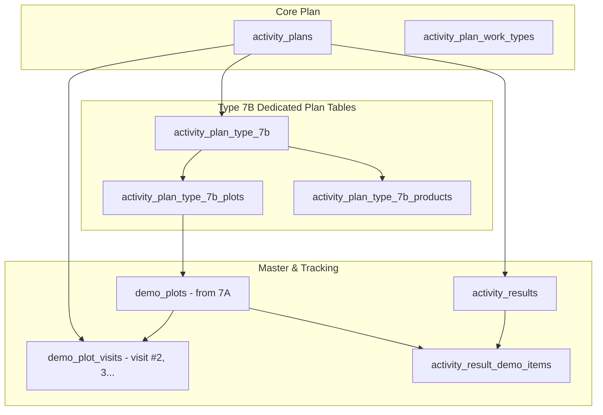

# Type 7B Feature Module: ติดตามแปลงสาธิต (Follow-up Demo Plot)

> **Work Type Code:** `TYPE_7B`  
> **Status:** ✅ Dedicated Relational Tables (`ActivityPlanType7b`, `ActivityPlanType7bPlot`, `ActivityPlanType7bProduct`, `DemoPlot`, `DemoPlotVisit`), Encapsulated Strategy Pattern, Multi-Target UI State

---

## 1. Overview & Architecture

Feature Module `type-7b` รับผิดชอบขั้นตอนการวางแผนและบันทึกผลการติดตามแปลงสาธิตเดิม (Follow-up Demo Plot) โดยเชื่อมโยงข้อมูลระหว่าง:
1. ข้อมูลธุรกรรมแผนงานติดตาม (`ActivityPlan`)
2. ข้อมูลแปลงสาธิตที่เลือกมาติดตาม (`ActivityPlanType7b` และรายการแปลง `ActivityPlanType7bPlot`, ผลิตภัณฑ์ที่เบิกเพิ่มเติม `ActivityPlanType7bProduct`)
3. ทะเบียนแปลงสาธิตหลัก (`DemoPlot`) ที่สร้างขึ้นมาจากรอบ 7A
4. บันทึกการเข้าเยี่ยมติดตามรอบถัดไป (`DemoPlotVisit`) และผลการติดตาม/ประเมินผลสัมฤทธิ์ (`activity_results` / `activity_result_demo_items`)



---

## 2. Directory Structure

```
modules/activity-plans/features/type-7b/
├── types/
│   └── index.ts               # Domain types (Type7bTargetItem, Type7bPlanItem, Type7bPlotInput, Type7bDataInput, Type7bActualRecord, etc.)
├── application/
│   ├── mapper.ts              # Pure mappers (extractType7bPlanTargets, parseType7bActualResult, mapType7bToSectionItems)
│   └── type7b.strategy.ts     # Server-only WorkTypeStrategy implementation (validatePlan, savePlan, saveActual, loadPlan)
├── shared/
│   ├── types.ts               # Re-exports from ../types
│   └── type7b-plan-card.tsx   # Plan detail card component
├── create/                    # Create form components & validation
├── edit/                      # Edit form components
├── actual/                    # Actual outcome execution components & hooks (actual-type7-follow-up, demo-plot-history-modal)
├── detail/                    # Detail view components (detail-type7-follow-up)
├── approval/                  # Approval preview components (approval-type7b-demo)
├── hooks/                     # Custom React hooks (useType7bForm, etc.)
├── index.ts                   # Public Feature Barrel Export (pure mappers & types, NO server strategies)
└── README.md                  # This documentation
```

---

## 3. Data Schema & Persistence

### 3.1 Database Tables

| Table | Prisma Model | Purpose |
|---|---|---|
| `activity_plan_type_7b` | `ActivityPlanType7b` | ข้อมูลหัวข้อการติดตามแปลงสาธิต (1:1 กับ ActivityPlan, เชื่อมโยง sourceActivityPlanId) |
| `activity_plan_type_7b_plots` | `ActivityPlanType7bPlot` | รายการแปลงสาธิตที่ระบุติดตามในแผน (เชื่อมโยง demoPlotId ของ DemoPlot) |
| `activity_plan_type_7b_products` | `ActivityPlanType7bProduct` | ผลิตภัณฑ์และจำนวนที่ขอเบิกเพิ่มเติมสำหรับรอบติดตาม |
| `demo_plots` | `DemoPlot` | ทะเบียนแปลงสาธิตหลัก |
| `demo_plot_visits` | `DemoPlotVisit` | บันทึกรอบการเข้าเยี่ยมติดตาม (Visit #2, #3, ...) |
| `activity_result_demo_items` | `ActivityResultDemoItem` | รายการผลการใช้สาร/ผลิตภัณฑ์จริงในแปลง |

---

## 4. Strategy & Mapper API

### 4.1 Application Mapper (`application/mapper.ts`)
- **`extractType7bPlanTargets(plan, prevTarget)`**: ดึงข้อมูลแปลงสาธิตที่ติดตามจาก `plan.type7b` (พร้อม relations: `plots`, `products`, `demoPlot`) และ fallback ไปยัง `demoPlotVisits`
- **`parseType7bActualResult(resData)`**: แกะข้อมูลผลการติดตามจริง (จำนวนวันหลังฉีดพ่น, วิธีการฉีดพ่น, อุปกรณ์, อาการพืช, ผลผลิต, ความพึงพอใจ, รูปภาพสภาพแปลง)
- **`mapType7bToSectionItems(type7b, demoVisits)`**: แปลงข้อมูลแปลงสาธิตติดตามเป็น Section Items สำหรับแสดงผลใน Activity Plan Detail View

### 4.2 Strategy (`application/type7b.strategy.ts`)
- **`code: "TYPE_7B"`**
- **`validatePlan(planData, db)`**: ตรวจสอบว่ามีการระบุแปลงสาธิตที่ต้องการติดตามอย่างน้อย 1 แปลง
- **`savePlan(tx, activityPlanId, planData)`**: Sync ข้อมูลลงใน `ActivityPlanType7b`, `ActivityPlanType7bPlot`, `ActivityPlanType7bProduct` และสร้าง `DemoPlotVisit`
- **`saveActual(tx, resultId, actualData)`**: บันทึกผลการติดตามลงใน `ActivityResultDemoItem`
- **`loadPlan(db, activityPlanId)`**: ดึงข้อมูล 7B พร้อม relations ผ่าน `findType7bByPlanId`

---

## 5. UI & State Integration

- **Multi-Target State Support**: รองรับการติดตามแปลงสาธิตทั้งแบบเดี่ยวและกลุ่ม (`targets.t7b` และ `targets.t7bList`)
- **Host Pages Wiring**:
  - `actual-result-section.tsx`: ส่ง `target={targets.t7b || targets.t7}` และ `targets={targets.t7bList}` เข้าสู่ `ActualType7Demo` (`mode="TYPE_7B"`)
  - `detail-activity-result-section.tsx`: ส่ง `targets={targets.t7bList}` เข้าสู่ `DetailType7Demo` (`mode="TYPE_7B"`)
  - `activity-plan-detail-view.tsx`: ส่ง `targets={targets.t7bList}` เข้าสู่ `ApprovalType7Demo` สำหรับ TYPE_7B
  - `activity-plan-approval-detail-view.tsx`: ส่ง `targets={targets.t7bList}` เข้าสู่ `ApprovalType7Demo` สำหรับ TYPE_7B
