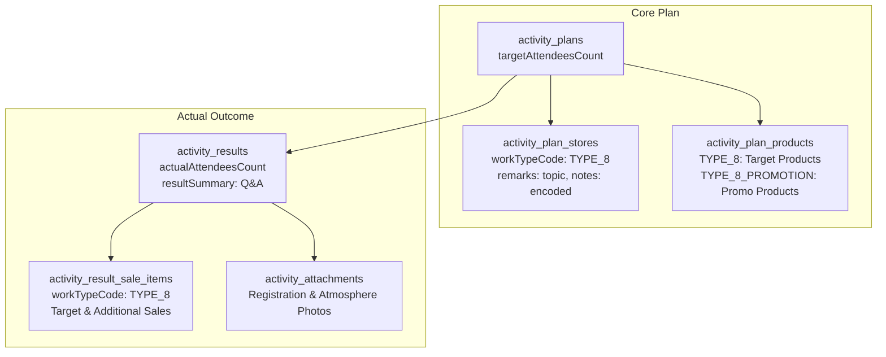

# Type 8 Feature Module: จัดประชุม (Meeting)

> **Work Type Code:** `TYPE_8`  
> **Label:** จัดประชุม / จัดประชุมการเกษตร / ดีลเลอร์ / ซับดีลเลอร์  
> **Status:** ✅ Relational Strategy Pattern, Multi-Target UI State, Clean Architecture

---

## 1. Overview & Architecture

Feature Module `type-8` รับผิดชอบกระบวนการวางแผนและบันทึกผลจริงของกิจกรรมการจัดประชุม (Meeting) ทั้งการประชุมเกษตรกร, การประชุมกลุ่มร้านค้าดีลเลอร์ และซับดีลเลอร์



---

## 2. Directory Structure

```
modules/activity-plans/features/type-8/
├── types/
│   └── index.ts               # Domain types, UI Props, and form validation interfaces
├── application/
│   ├── mapper.ts              # Pure mappers (extractType8PlanTargets, parseType8ActualResult, mapType8ToSectionItems)
│   ├── validation.ts          # Pure form & actual validation functions
│   ├── notes.ts               # Storage encoding/decoding utilities (encodeType8StoreNotes, decodeType8StoreNotes)
│   └── type8.strategy.ts     # Server-only WorkTypeStrategy implementation
├── components/
│   ├── type8-plan-card.tsx   # Planned meeting display card component (supports PLANNED/UNPLANNED)
│   ├── type8-plan-form.tsx   # Create/Edit form component
│   ├── type8-actual-form.tsx # Actual result execution form & image upload
│   ├── type8-detail-view.tsx # Read-only result view with Lightbox modal
│   └── type8-approval-card.tsx# Approval view rendering Type8PlanCard(s)
├── hooks/
│   ├── use-type8-form.ts     # Plan form state management hook
│   └── use-type8-actual.ts   # Actual form state management hook
├── index.ts                   # Public Feature Barrel Export (pure components, hooks, mappers & types; NO server strategies)
└── README.md                  # This documentation
```

---

## 3. Data Schema & Persistence

### 3.1 Database Tables

| Table | Prisma Model | Purpose |
|---|---|---|
| `activity_plans` | `ActivityPlan` | เก็บ `targetAttendeesCount` (เป้าหมายจำนวนผู้เข้าร่วมประชุม) |
| `activity_plan_stores` | `ActivityPlanStore` | เก็บสถานที่/ร้านค้าที่จัดประชุม (`workTypeCode: "TYPE_8"`), หัวข้อประชุม (`remarks`), รายละเอียดและโปรโมชันย่อ (`notes` ผ่าน `encodeType8StoreNotes`) |
| `activity_plan_products` | `ActivityPlanProduct` | สินค้าเป้าหมายที่จะนำเสนอ (`workTypeCode: "TYPE_8"`) และรายการสินค้าโปรโมชัน (`workTypeCode: "TYPE_8_PROMOTION"`) |
| `activity_results` | `ActivityResult` | เก็บ `actualAttendeesCount` (จำนวนผู้เข้าร่วมจริง) และ `resultSummary` (ข้อเสนอแนะ / Q&A) |
| `activity_result_sale_items` | `ActivityResultSaleItem` | ยอดขายสินค้าเป้าหมายและสินค้านอกเหนือเป้าหมาย (`workTypeCode: "TYPE_8"`, `actualQuantity`, `actualUnitPrice`, `actualTotal`, `isAdditional`) |
| `activity_attachments` | `ActivityAttachment` | ภาพถ่ายบรรยากาศการประชุม และภาพถ่ายใบลงทะเบียนผู้เข้าร่วมงาน |

---

## 4. Strategy & Mapper API

### 4.1 Application Mapper (`application/mapper.ts`)
- **`extractType8PlanTargets(plan, prevTarget)`**: ดึงข้อมูลเป้าหมายการจัดประชุมจาก `plan.stores` และ `plan.products` พร้อมรองรับโครงสร้างแบบหลายเป้าหมาย (`targets.t8` และ `targets.t8List`)
- **`parseType8ActualResult(resData)`**: แกะข้อมูลผลจริงจากการบันทึก: จำนวนผู้เข้าร่วมจริง, ยอดขายสินค้าเป้าหมาย/เพิ่มเติม, ข้อเสนอแนะ Q&A, และรูปภาพลงทะเบียน/บรรยากาศ
- **`mapType8ToSectionItems(target)`**: แปลงข้อมูลเป้าหมายการประชุมเป็น Section Detail Items แสดงผลในหน้าข้อมูลสรุปแผน

### 4.2 Strategy (`application/type8.strategy.ts`)
- **`code: "TYPE_8"`**
- **`validatePlan(planData, db)`**: ตรวจสอบความถูกต้องของสถานที่หรือร้านค้าที่จัดประชุม
- **`savePlan(tx, activityPlanId, planData)`**: Sync บันทึกร้านค้าและสินค้าเป้าหมาย/โปรโมชัน
- **`saveActual(tx, resultId, actualData)`**: บันทึกรายการยอดขายจากการประชุมลงใน `ActivityResultSaleItem`
- **`loadPlan(db, activityPlanId)`**: Query ข้อมูลแผนการจัดประชุมพร้อม relations `stores` และ `products`

---

## 5. Multi-Target UI State

Type 8 รองรับการจัดประชุมหลายสถานที่หรือหลายหัวข้อภายในหนึ่งแผนงาน:
- `targets.t8`: รายการเป้าหมายแรกสำหรับ fallback
- `targets.t8List`: รายการเป้าหมายการจัดประชุมทั้งหมด
- ส่วนประกอบ UI ทั้งหมด (`ActualType8Meeting`, `DetailType8Meeting`, `ApprovalType8Meeting`) รองรับ prop `targets?: Type8TargetItem[]` เพื่อแสดงการ์ดเป้าหมายอย่างครบถ้วนทุกรายการ
