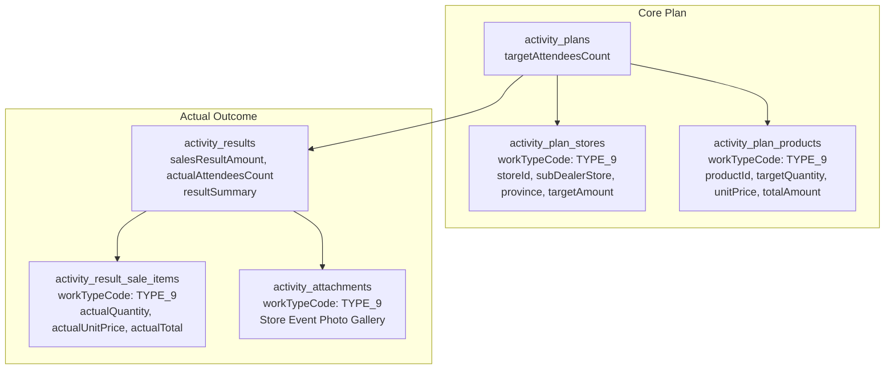

# Type 9 Feature Module: จัดกิจกรรมส่งเสริมการขายหน้าร้าน (Store Event)

> **Work Type Code:** `TYPE_9`  
> **Label:** จัดกิจกรรมส่งเสริมการขายหน้าร้าน (Store Event / Sales Promotion)  
> **Status:** ✅ Relational Strategy Pattern, Multi-Target UI State, Clean Architecture

---

## 1. Overview & Architecture

Feature Module `type-9` รับผิดชอบกระบวนการวางแผนและบันทึกผลจริงของกิจกรรมส่งเสริมการขายหน้าร้าน (Store Event / Event Promotion) ร่วมกับร้านค้า Dealer และร้านค้าย่อย Sub-dealer:



---

## 2. Directory Structure

```
modules/activity-plans/features/type-9/
├── types/
│   └── index.ts               # Domain types, UI Props, and form validation interfaces
├── application/
│   ├── mapper.ts              # Pure mappers (extractType9PlanTargets, parseType9ActualResult, mapType9ToSectionItems)
│   ├── validation.ts          # Pure form validation functions
│   └── type9.strategy.ts     # Server-only WorkTypeStrategy implementation
├── components/
│   ├── type9-plan-card.tsx   # Planned store event display card component (supports PLANNED/UNPLANNED)
│   ├── type9-plan-form.tsx   # Create/Edit form component
│   ├── type9-actual-form.tsx # Actual result execution form & image upload
│   ├── type9-detail-view.tsx # Read-only result view with Lightbox modal
│   └── type9-approval-card.tsx# Approval view rendering Type9PlanCard(s)
├── hooks/
│   ├── use-type9-form.ts      # React hook for creation/edit form state & payload mapping
│   └── use-type9-actual.ts    # React hook for actual state & gallery uploads
├── index.ts                   # Public Feature Barrel Export (pure components, hooks, mappers & types; NO server strategies)
└── README.md                  # This documentation
```

---

## 3. Data Schema & Persistence

### 3.1 Database Tables

| Table | Prisma Model | Purpose |
|---|---|---|
| `activity_plans` | `ActivityPlan` | เป้าหมายจำนวนผู้เข้าร่วมกิจกรรมหน้าร้าน (`targetAttendeesCount`) |
| `activity_plan_stores` | `ActivityPlanStore` | ร้านค้าหลัก Dealer (`storeId`), ชื่อร้านค้าย่อย Sub-dealer (`subDealerStore`), จังหวัด (`province`), และยอดขายเป้าหมายรวม (`targetAmount`) |
| `activity_plan_products` | `ActivityPlanProduct` | สินค้าเป้าหมายที่จะจัดกิจกรรมส่งเสริมการขาย (`workTypeCode: "TYPE_9"`), จำนวนเป้าหมายลัง (`targetQuantity`), ราคาต่อลัง (`unitPrice`), ยอดเงินรวม (`totalAmount`) |
| `activity_results` | `ActivityResult` | ยอดขายจริงรวม (`salesResultAmount`), จำนวนผู้เข้าร่วมจริง (`actualAttendeesCount`), ข้อความสรุปผล (`resultSummary`) |
| `activity_result_sale_items` | `ActivityResultSaleItem` | ยอดขายสินค้าจริงรายตัว (`workTypeCode: "TYPE_9"`, `actualQuantity`, `actualUnitPrice`, `actualTotal`) |
| `activity_attachments` | `ActivityAttachment` | ภาพถ่ายการจัดกิจกรรมส่งเสริมการขายหน้าร้าน (`workTypeCode: "TYPE_9"`) |

---

## 4. Strategy & Mapper API

### 4.1 Application Mapper (`application/mapper.ts`)
- **`extractType9PlanTargets(plan, prevTarget)`**: ดึงข้อมูลเป้าหมายการจัดกิจกรรมหน้าร้านจาก `plan.stores` และ `plan.products` พร้อมรองรับโครงสร้างแบบหลายเป้าหมาย (`targets.t9` และ `targets.t9List`)
- **`parseType9ActualResult(resData)`**: แกะข้อมูลผลจริงจากการบันทึก: ยอดขายสินค้ารายตัวจาก `saleResults`, ภาพถ่ายหน้าร้านจาก `attachments`, และข้อมูล fallback จาก `resultSummary`
- **`mapType9ToSectionItems(type9Stores, type9Products, objectiveLines)`**: แปลงข้อมูลเป้าหมายกิจกรรมหน้าร้านเป็น Section Detail Items แสดงผลในหน้าข้อมูลสรุปแผน

### 4.2 Strategy (`application/type9.strategy.ts`)
- **`code: "TYPE_9"`**
- **`validatePlan(planData, db)`**: ตรวจสอบความถูกต้องของร้านค้าหลักหรือร้าน Sub-dealer
- **`savePlan(tx, activityPlanId, planData)`**: Sync บันทึกร้านค้าและสินค้าเป้าหมาย
- **`saveActual(tx, resultId, actualData)`**: บันทึกรายการยอดขายสินค้าหน้าร้านจริงลงใน `ActivityResultSaleItem`
- **`loadPlan(db, activityPlanId)`**: Query ข้อมูลแผนการจัดกิจกรรมหน้าร้านพร้อม relations `stores` และ `products`

---

## 5. Multi-Target UI State

Type 9 รองรับการจัดกิจกรรมหน้าร้านหลายสาขา/ร้านค้าภายในหนึ่งแผนงาน:
- `targets.t9`: รายการเป้าหมายแรกสำหรับ fallback
- `targets.t9List`: รายการเป้าหมายกิจกรรมหน้าร้านทั้งหมด
- ส่วนประกอบ UI ทั้งหมด (`ActualType9Store`, `DetailType9Store`, `ApprovalType9Store`) รองรับ prop `targets?: Type9TargetItem[]` เพื่อแสดงการ์ดเป้าหมายอย่างครบถ้วนทุกร้านค้า
