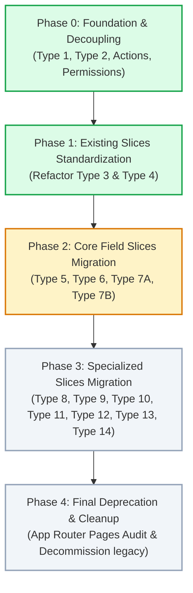

# 🗺️ Roadmap แผนงานและขั้นตอนการพัฒนา Activity Module

เอกสารนี้ระบุแผนงาน (Roadmap), สถานะปัจจุบัน (Current Status), ลำดับขั้นตอนการทำงาน (Milestones), และเกณฑ์มาตรฐานการตรวจรับงาน (Quality Gates) สำหรับการปรับปรุงและ Migrate ทุก Activity Type Slice เข้าสู่สถาปัตยกรรมมาตรฐานของ **`modules/activity/`** อย่างเป็นระบบและต่อเนื่อง

---

## 📊 1. ภาพรวมสถานะปัจจุบัน (Current Status Overview)

| ลำดับงานหลัก | สถานะ | รายละเอียด |
| :--- | :---: | :--- |
| **สถาปัตยกรรมแม่แบบ (Master Blueprint)** | ✅ เสร็จสมบูรณ์ | เอกสาร [`TYPE_SLICE_BLUEPRINT.md`](./TYPE_SLICE_BLUEPRINT.md) กำหนดมาตรฐาน 24-Artifact และกฎเหล็กการ Refactor ครบถ้วน |
| **การตัดขาดจากโมดูลเก่า (Decoupling)** | ✅ เสร็จสมบูรณ์ | โมดูล `modules/activity/` ตัดขาดจาก `@/modules/activity-plans` 100% (Native Server Actions, Repositories, Domain, Application Services) |
| **ระบบรวมศูนย์สิทธิ์ (Centralized Permissions)** | ✅ เสร็จสมบูรณ์ | รวมศูนย์ไว้ที่ [`domain/permissions/activity-permissions.ts`](../domain/permissions/activity-permissions.ts) และเชื่อมโยงทั้ง Server Actions และ UI Views ครบถ้วน |
| **Type Check & Compilation** | ✅ เสร็จสมบูรณ์ | คำสั่ง `npx tsc --noEmit` ผ่านสมบูรณ์ (Exit Code 0 ไม่มีข้อผิดพลาด) |
| **Type 1 (Gold Standard Slice)** | ✅ เสร็จสมบูรณ์ | โครงสร้าง 24 Artifacts, Strict Naming (`type1-planned-form.tsx`, `use-type1-planned-form.ts`), Native Strategy |
| **Type 2 (Gold Standard Slice)** | ✅ เสร็จสมบูรณ์ | Refactor ตามพิมพ์เขียว Type 1, ลบ Shim/Legacy files, Clean Barrel |
| **Type 3 (เสนอขายสินค้า / Sales)** | ✅ เสร็จสมบูรณ์ | โครงสร้าง 24 Artifacts, Strict Naming (`type3-planned-form.tsx`, `use-type3-planned-form.ts`), Clean Barrel |
| **Type 4 (วางบิล / เก็บเงิน)** | ✅ เสร็จสมบูรณ์ | โครงสร้าง 24 Artifacts, Strict Naming (`type4-planned-form.tsx`, `use-type4-planned-form.ts`), Clean Barrel |
| **Type 5 – 14** | ⏳ **รอการ Migrate** | ยังอยู่ในโมดูลเก่า `modules/activity-plans/features/` รอการย้ายเข้ามาตามลำดับ |

---

## 🗓️ 2. แผนงานแบ่งตามระยะ (Phased Execution Plan)

---

### 🔹 Phase 1: จัดระเบียบ Slice ที่มีอยู่แล้วให้ตรงตามมาตรฐาน (Completed ✅)

เป้าหมาย: ทำให้ `type-3` และ `type-4` สอดคล้องกับ [TYPE_SLICE_BLUEPRINT.md](./TYPE_SLICE_BLUEPRINT.md) 100% เช่นเดียวกับ Type 1 และ Type 2

#### งานที่ 1.1: Refactor `features/type-3/` (เสนอขายสินค้า - Product Sales)
- [x] ตรวจสอบชื่อไฟล์ให้ตรงตามข้อกำหนดสากล:
  - เปลี่ยน `type3-plan-form.tsx` ➔ `type3-planned-form.tsx` (พร้อม alias `Type3PlanForm`, `Type3Sales`)
  - เปลี่ยน `use-type3-form.ts` ➔ `use-type3-planned-form.ts` (พร้อม alias `useType3Form`)
- [x] ตรวจสอบโครงสร้าง 24 Artifacts (Planned, Unplanned, Shared)
- [x] ตรวจสอบและทำความสะอาด Barrel exports (ลบ `types/index.ts` ย่อยที่ไม่จำเป็นออก)
- [x] ตรวจสอบการผูก Strategies ใน [`infrastructure/strategy.registry.ts`](../infrastructure/strategy.registry.ts)
- [x] อัปเดตเอกสาร [`features/type-3/README.md`](../features/type-3/README.md)
- [x] รัน Type Check: `npx tsc --noEmit` ผ่าน 0 errors

#### งานที่ 1.2: Refactor `features/type-4/` (วางบิล / เก็บเงิน - Billing & Collection)
- [x] ตรวจสอบชื่อไฟล์ให้ตรงตามข้อกำหนดสากล:
  - เปลี่ยน `type4-plan-form.tsx` ➔ `type4-planned-form.tsx` (พร้อม alias `Type4PlanForm`, `Type4Collect`)
  - เปลี่ยน `use-type4-form.ts` ➔ `use-type4-planned-form.ts` (พร้อม alias `useType4Form`)
- [x] ปรับปรุง `ActivityCustomerSelect` ให้ตรงตาม Standard Props ของโมดูล
- [x] ตรวจสอบโครงสร้าง 24 Artifacts ครบถ้วน
- [x] ทำความสะอาด Barrel exports และผูก Strategies
- [x] อัปเดตเอกสาร [`features/type-4/README.md`](../features/type-4/README.md)
- [x] รัน Type Check: `npx tsc --noEmit` ผ่าน 0 errors

---

### 🔹 Phase 2: ย้ายกิจกรรมภาคสนามและแปลงสาธิต (Core Field Slices Migration)

เป้าหมาย: ย้ายกิจกรรมกลุ่มการตลาดและงานแปลงสาธิตจาก `modules/activity-plans/features/` เข้ามาเป็น Native ภายใน `modules/activity/features/`

| Type | กิจกรรม | ความสำคัญ | สิ่งที่ต้องระวังเป็นพิเศษ |
| :---: | :--- | :---: | :--- |
| **Type 5** | ส่งเสริมการขาย / ออกบูธ (Sales Promotion) | สูง | มีรายการสื่อส่งเสริมการขาย, งบประมาณการตลาด |
| **Type 6** | ประชุมกลุ่มเกษตรกร (Farmer Meeting) | สูง | จำนวนผู้เข้าร่วมประชุม, ข้อมูลค่าใช้จ่ายจัดงาน |
| **Type 7A** | จัดทำแปลงสาธิต (Demo Plot Establishment) | วิกฤต | เชื่อมต่อกับ Master `DemoPlot`, การเบิกสินค้าตัวอย่าง, พิกัดแปลง |
| **Type 7B** | ติดตามแปลงสาธิต (Demo Plot Follow-up) | วิกฤต | ต้องดึงเฉพาะแปลง 7A ที่ Approved มาประเมินผลการเจริญเติบโต |

**ขั้นตอนการทำงานของแต่ละ Type ใน Phase 2:**
1. สร้างโฟลเดอร์ `features/type-X/` ตามมาตรฐาน 24 Artifacts
2. พอร์ต Planned, Unplanned, Shared components และ hooks
3. สร้าง Native Strategies (Planned & Actual) และผูกใน `strategy.registry.ts`
4. ผูกฟังก์ชัน Permission ผ่าน `domain/permissions/activity-permissions.ts`
5. ทดสอบ `npx tsc --noEmit` จนกว่าจะผ่าน 0 errors

---

### 🔹 Phase 3: ย้ายกิจกรรมเฉพาะทางและวิชาการ (Specialized & Academic Slices Migration)

เป้าหมาย: นำเข้ากิจกรรมวิชาการและการสำรวจที่เหลือทั้งหมด

- [ ] **Type 8:** สัมมนาวิชาการ (Academic Seminar)
- [ ] **Type 9:** คลินิกพืชเคลื่อนที่ (Plant Clinic / Mobile Consultation)
- [ ] **Type 10:** วันจัดแสดงแปลง Field Day (Field Day)
- [ ] **Type 11:** การสำรวจตลาด (Market Survey)
- [ ] **Type 12:** ประชุมภายใน / อบรม (Internal Meeting / Training)
- [ ] **Type 13:** จัดทำแปลงแฮทแทค (Hattack Demo Establishment)
- [ ] **Type 14:** ติดตามแปลงแฮทแทค (Hattack Follow-up)

---

### 🔹 Phase 4: ทำความสะอาดและปลดระวางโมดูลเก่า (Deprecation & Final Decommission)

เป้าหมาย: ปลดระวาง `modules/activity-plans/` อย่างปลอดภัยและสมบูรณ์แบบ

- [ ] **App Router Audit:** ตรวจสอบ Route Handlers และ Pages ใน `src/app/(crm)/activity-plans/*` ว่าทุก Page เรียกใช้ Views จาก `@/modules/activity` ทั้งหมด
- [ ] **Legacy Reference Audit:** ตรวจสอบทั้งโปรเจกต์ว่าไม่มีการ Import ข้ามไปยัง `@/modules/activity-plans/` หลงเหลืออยู่
- [ ] **Decommission:** ย้ายโมดูลเก่าออกจากระบบ หรือลบโฟลเดอร์ `modules/activity-plans/` อย่างปลอดภัย
- [ ] **Production Build Check:** รัน `npm run build` ตรวจสอบสถานะการ Build สำหรับ Production

---

## 🛡️ 3. เกณฑ์มาตรฐานการตรวจรับงานแต่ละ Slice (Quality Gates)

ทุกครั้งที่เริ่มทำหรือ Refactor Activity Type Slice ใดๆ **ต้องผ่าน 5 ข้อบังคับนี้เสมอ**:

1. **โครงสร้าง 24 Artifacts ครบถ้วน:**
   - โครงสร้างโฟลเดอร์แบ่งตาม `planned/`, `unplanned/`, `shared/`
   - ไม่มีไฟล์ Shim เก่าตกค้าง
2. **Strict File Naming Contract:**
   - ฟอร์มแผนงาน: `type{X}-planned-form.tsx`
   - Hook แผนงาน: `use-type{X}-planned-form.ts`
   - การ์ดสรุปแผนงาน: `type{X}-plan-card.tsx`
   - ฟอร์มผลงานจริง: `type{X}-actual-form.tsx`
   - Hook ผลงานจริง: `use-type{X}-actual-form.ts`
   - การ์ดสรุปผลงาน: `type{X}-actual-card.tsx`
3. **No Internal Sub-barrel Files:**
   - ภายใน sub-folder (`planned/types/`, `shared/types/`) ห้ามมีไฟล์ `index.ts` ย่อย ให้ส่งออกผ่าน `features/type-{X}/index.ts` จุดเดียวเท่านั้น
4. **Boundary Isolation Check (Zero Legacy Imports):**
   - ห้ามมี Import ใดๆ เรียกข้ามไปยัง `@/modules/activity-plans`
   - สิทธิ์ต้องเรียกผ่าน `@/modules/activity/domain/permissions`
   - Actions ต้องเรียกผ่าน `@/modules/activity/server/actions`
5. **Zero TypeScript Errors Gate:**
   - ต้องรัน `npx tsc --noEmit` ผ่านสมบูรณ์ (Exit Code 0) ก่อนปิดงานแต่ละ Type เสมอ

---

## 📝 4. บันทึกความคืบหน้า (Progress Changelog)

| วันที่ | เวอร์ชัน | รายละเอียดการดำเนินงาน | ผู้รับผิดชอบ |
| :---: | :---: | :--- | :--- |
| **2026-10-20** | 1.0.0 | สร้างเอกสาร Roadmap รวมขั้นตอน Phase 1 - 4 | Antigravity AI |
| **2026-10-20** | 0.9.0 | รวมศูนย์ระบบตรวจสอบสิทธิ์ไว้ที่ `domain/permissions/activity-permissions.ts` และปรับปรุง Server Actions & Views ทั้งหมด | Antigravity AI |
| **2026-10-20** | 0.8.0 | ตัดขาดโมดูล `activity` ออกจาก `activity-plans` 100% (Native repositories, demo plots, calendar, approval actions) | Antigravity AI |
| **2026-10-20** | 0.7.0 | Refactor `features/type-2/` ให้เป็น Gold Standard ตามแม่แบบ Type 1 | Antigravity AI |
| **2026-10-20** | 0.6.0 | ปรับปรุงเอกสารแม่แบบ `TYPE_SLICE_BLUEPRINT.md` สรุปมาตรฐาน 24 Artifacts | Antigravity AI |
