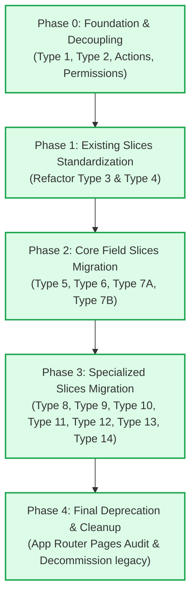

# 🗺️ Roadmap แผนงานและขั้นตอนการพัฒนา Activity Module

เอกสารนี้ระบุแผนงาน (Roadmap), สถานะปัจจุบัน (Current Status), ลำดับขั้นตอนการทำงาน (Milestones), และเกณฑ์มาตรฐานการตรวจรับงาน (Quality Gates) สำหรับการปรับปรุงและ Migrate ทุก Activity Type Slice เข้าสู่สถาปัตยกรรมมาตรฐานของ **`modules/activity/`** อย่างเป็นระบบและต่อเนื่อง

---

## 📊 1. ภาพรวมสถานะปัจจุบัน (Current Status Overview)

| ลำดับงานหลัก                                     |        สถานะ         | รายละเอียด                                                                                                                                                        |
| :----------------------------------------------- | :------------------: | :---------------------------------------------------------------------------------------------------------------------------------------------------------------- |
| **สถาปัตยกรรมแม่แบบ (Master Blueprint)**         |   ✅ เสร็จสมบูรณ์    | เอกสาร [`TYPE_SLICE_BLUEPRINT.md`](./TYPE_SLICE_BLUEPRINT.md) กำหนดมาตรฐาน 24-Artifact และกฎเหล็กการ Refactor ครบถ้วน                                             |
| **การตัดขาดจากโมดูลเก่า (Decoupling)**           |   ✅ เสร็จสมบูรณ์    | โมดูล `modules/activity/` ตัดขาดจาก `@/modules/activity-plans` 100% (Native Server Actions, Repositories, Domain, Application Services)                           |
| **ระบบรวมศูนย์สิทธิ์ (Centralized Permissions)** |   ✅ เสร็จสมบูรณ์    | รวมศูนย์ไว้ที่ [`domain/permissions/activity-permissions.ts`](../domain/permissions/activity-permissions.ts) และเชื่อมโยงทั้ง Server Actions และ UI Views ครบถ้วน |
| **Type Check & Compilation**                     |   ✅ เสร็จสมบูรณ์    | คำสั่ง `npx tsc --noEmit` ผ่านสมบูรณ์ (Exit Code 0 ไม่มีข้อผิดพลาด)                                                                                               |
| **Type 1 (Gold Standard Slice)**                 |   ✅ เสร็จสมบูรณ์    | โครงสร้าง 24 Artifacts, Strict Naming (`type1-planned-form.tsx`, `use-type1-planned-form.ts`), Native Strategy                                                    |
| **Type 2 (Gold Standard Slice)**                 |   ✅ เสร็จสมบูรณ์    | Refactor ตามพิมพ์เขียว Type 1, ลบ Shim/Legacy files, Clean Barrel                                                                                                 |
| **Type 3 (เสนอขายสินค้า / Sales)**               |   ✅ เสร็จสมบูรณ์    | โครงสร้าง 24 Artifacts, Strict Naming (`type3-planned-form.tsx`, `use-type3-planned-form.ts`), Clean Barrel                                                       |
| **Type 4 (วางบิล / เก็บเงิน)**                   |   ✅ เสร็จสมบูรณ์    | โครงสร้าง 24 Artifacts, Strict Naming (`type4-planned-form.tsx`, `use-type4-planned-form.ts`), Clean Barrel                                                       |
| **Type 5 (สำรวจตลาดของคู่แข่ง)**                 |   ✅ เสร็จสมบูรณ์    | โครงสร้างตามพิมพ์เขียว Gold Standard, Native Strategy, Full View Integration                                                                                      |
| **Type 7A – 7B (งานแปลงสาธิต)**                  |   ✅ เสร็จสมบูรณ์    | โครงสร้าง 24 Artifacts, Dual-Mode, เชื่อมต่อ Master DemoPlot, Full View Integration                                                                              |
| **Type 8 – 12 (กิจกรรมเฉพาะทางและทัวร์)**      |   ✅ เสร็จสมบูรณ์    | โครงสร้าง 24 Artifacts, Dual-Mode, Unified Activity UI Inputs, Native Strategies & Registries                                                                     |
| **Type 13 – 14 (กลุ่มงานแปลงแฮตแทค)**           |   ✅ เสร็จสมบูรณ์    | กิจกรรมฉีดแปลงแฮตแทคและติดตามแปลงแฮทแทค โครงสร้าง 24 Artifacts, Dual-Mode, Multi-Plot/Round, Unified UI Inputs, Views & Registries (ปิด Phase 3 สมบูรณ์)           |
| **การปลดระวางโมดูลเก่า (Final Decommission)**    |   ✅ เสร็จสมบูรณ์    | ลบโฟลเดอร์ `modules/activity-plans/` ออกจากระบบ 100%, ปรับปรุง Client-Safe Barrels, และผ่าน Next.js Production Build 100% (ปิด Phase 4 สมบูรณ์)                    |

---

## 🗓️ 2. แผนงานแบ่งตามระยะ (Phased Execution Plan)

---

### 🔹 Phase 1: จัดระเบียบ Slice ที่มีอยู่แล้วให้ตรงตามมาตรฐาน (Completed ✅)

เป้าหมาย: ทำให้ `type-3` และ `type-4` สอดคล้องกับ [TYPE_SLICE_BLUEPRINT.md](./TYPE_SLICE_BLUEPRINT.md) 100% เช่นเดียวกับ Type 1 และ Type 2

#### งานที่ 1.1: Refactor `features/type-3/` (เสนอขายสินค้า - Product Sales)

- [x] ตรวจสอบชื่อไฟล์ให้ตรงตามข้อกำหนดสากล:
  - เปลี่ยน `type3-plan-form.tsx` ➔ `type3-planned-form.tsx` (พร้อม alias `Type3PlanForm`, `Type3Sales`)
  - เปลี่ยน `use-type3-form.ts` ➔ `use-type3-planned-form.ts` (พร้อม alias `useType3Form`)
- [x] ตรวจสอบโครงสร้าง 24 Artifacts (Planned, Unplanned, Shared)
- [x] ตรวจสอบและทำความสะอาด Barrel exports (ลบ `types/index.ts` ย่อยที่ไม่จำเป็นออก)
- [x] ตรวจสอบการผูก Strategies ใน [`infrastructure/strategy.registry.ts`](../infrastructure/strategy.registry.ts)
- [x] อัปเดตเอกสาร [`features/type-3/README.md`](../features/type-3/README.md)
- [x] รัน Type Check: `npx tsc --noEmit` ผ่าน 0 errors

#### งานที่ 1.2: Refactor `features/type-4/` (วางบิล / เก็บเงิน - Billing & Collection)

- [x] ตรวจสอบชื่อไฟล์ให้ตรงตามข้อกำหนดสากล:
  - เปลี่ยน `type4-plan-form.tsx` ➔ `type4-planned-form.tsx` (พร้อม alias `Type4PlanForm`, `Type4Collect`)
  - เปลี่ยน `use-type4-form.ts` ➔ `use-type4-planned-form.ts` (พร้อม alias `useType4Form`)
- [x] ปรับปรุง `ActivityCustomerSelect` ให้ตรงตาม Standard Props ของโมดูล
- [x] ตรวจสอบโครงสร้าง 24 Artifacts ครบถ้วน
- [x] ทำความสะอาด Barrel exports และผูก Strategies
- [x] อัปเดตเอกสาร [`features/type-4/README.md`](../features/type-4/README.md)
- [x] รัน Type Check: `npx tsc --noEmit` ผ่าน 0 errors

---

### 🔹 Phase 2: ย้ายกิจกรรมภาคสนามและแปลงสาธิต (Core Field Slices Migration)

เป้าหมาย: ย้ายกิจกรรมกลุ่มการตลาดและงานแปลงสาธิตจาก `modules/activity-plans/features/` เข้ามาเป็น Native ภายใน `modules/activity/features/`

|    Type     | กิจกรรม                                             |      สถานะ      | สิ่งที่ต้องระวังเป็นพิเศษ                                            |
| :---------: | :-------------------------------------------------- | :-------------: | :------------------------------------------------------------------- |
| **Type 5**  | สำรวจตลาดของคู่แข่ง (Competitor Market Survey)      | ✅ เสร็จสมบูรณ์ | ราคา 4 ระดับ (POS, Dealer, Subdealer, Farmer), แยกอัปโหลดรูปขวด/สื่อ |
| **Type 6**  | ตรวจสอบเรื่องร้องเรียน / แก้ปัญหา (Issue Complaint) | ✅ เสร็จสมบูรณ์ | รายละเอียดเรื่องร้องเรียน, แนวทางแก้ไข, รูปถ่ายหลักฐานปัญหา          |
| **Type 7A** | จัดทำแปลงสาธิต (Demo Plot Establishment)            | ✅ เสร็จสมบูรณ์ | เชื่อมต่อกับ Master `DemoPlot`, การเบิกสินค้าตัวอย่าง, พิกัดแปลง     |
| **Type 7B** | ติดตามแปลงสาธิต (Demo Plot Follow-up)               | ✅ เสร็จสมบูรณ์ | ต้องดึงเฉพาะแปลง 7A ที่ Approved มาประเมินผลการเจริญเติบโต           |

#### งานที่ 2.1: Migrate `features/type-5/` (สำรวจตลาดของคู่แข่ง — Completed ✅)

- [x] สร้างโครงสร้าง Planned ตามมาตรฐาน 24 Artifacts (Planned, Shared)
- [x] พอร์ต Planned Components (`Type5PlannedForm`, `Type5PlanCard`) พร้อม aliases
- [x] พอร์ต Hooks (`useType5PlannedForm`, `useType5Actual`) ตัดขาดจากโมดูลเก่า 100%
- [x] พอร์ต Actual, Detail View, และ Approval Card Components
- [x] สร้าง Native Strategy (`type5PlannedStrategy`) พร้อม Dual Persistence Sync
- [x] ผูกเข้ากับ `strategy.registry.ts` และ `plan-targets-registry.ts`
- [x] เชื่อมต่อเข้ากับ Views (`planned-activity-form.tsx`, `actual-work-type-list.tsx`, `detail-work-type-list.tsx`, `approval-work-type-list.tsx`)
- [x] สร้างโครงสร้าง Unplanned Slice (`features/type-5/unplanned/`):
  - [x] `types/unplanned.types.ts`, `application/unplanned-validation.ts`, `unplanned-mapper.ts`
  - [x] `useType5UnplannedForm` Hook
  - [x] `Type5UnplannedForm` Component (ใช้ Unified Activity UI Inputs)
  - [x] `type5UnplannedStrategy` เชื่อมต่อเข้ากับ `strategy.registry.ts` และ `unplanned-activity-form.tsx`
- [x] จัดทำเอกสาร [`features/type-5/README.md`](../features/type-5/README.md)
- [x] รัน Type Check: `npx tsc --noEmit` ผ่าน 0 errors

#### งานที่ 2.2: Migrate `features/type-6/` (ตรวจสอบเรื่องร้องเรียน / แก้ปัญหา — Completed ✅)

- [x] สร้างโครงสร้าง Planned ตามมาตรฐาน 24 Artifacts (Planned, Shared)
- [x] พอร์ต Planned Components (`Type6PlannedForm`, `Type6PlanCard`) พร้อม aliases
- [x] พอร์ต Hooks (`useType6PlannedForm`, `useType6Actual`) ตัดขาดจากโมดูลเก่า 100%
- [x] พอร์ต Actual (`Type6ActualForm`), Detail View (`Type6DetailView`), Approval Card (`Type6ApprovalCard`)
- [x] สร้าง Native Strategy (`type6PlannedStrategy`) พร้อม Dual Persistence Sync
- [x] ผูกเข้ากับ `strategy.registry.ts` และ `plan-targets-registry.ts`
- [x] เชื่อมต่อเข้ากับ Views (`planned-activity-form.tsx`, `actual-work-type-list.tsx`, `detail-work-type-list.tsx`, `approval-work-type-list.tsx`)
- [x] สร้างโครงสร้าง Unplanned Slice (`features/type-6/unplanned/`):
  - [x] `types/unplanned.types.ts`, `application/unplanned-validation.ts`, `unplanned-mapper.ts`
  - [x] `useType6UnplannedForm` Hook
  - [x] `Type6UnplannedForm` Component (ใช้ Unified Activity UI Inputs)
  - [x] `type6UnplannedStrategy` เชื่อมต่อเข้ากับ `strategy.registry.ts` และ `unplanned-activity-form.tsx`
- [x] จัดทำเอกสาร [`features/type-6/README.md`](../features/type-6/README.md)
- [x] รัน Type Check: `npx tsc --noEmit` ผ่าน 0 errors

#### งานที่ 2.3: Migrate `features/type-7a/` (จัดทำแปลงสาธิต — Dual-Mode Planned + Unplanned — Completed ✅)

- [x] สร้างโฟลเดอร์ `features/type-7a/` ตามมาตรฐาน 24 Artifacts ครบทั้ง `planned/`, `unplanned/`, และ `shared/`
- [x] เชื่อมต่อกับระบบแปลงสาธิต (`DemoPlot` Repository Native ใน `modules/activity`)
- [x] ใช้ Unified Activity UI Inputs จาก `@/modules/activity/ui` ทั้งหมด
- [x] สร้าง Native Strategies (`type7aPlannedStrategy`, `type7aUnplannedStrategy`)
- [x] เชื่อมโยงเข้าสู่ Registries และ Views ทั้งหมด (`strategy.registry.ts`, `plan-targets-registry.ts`, `planned-activity-form.tsx`, `unplanned-activity-form.tsx`, `actual-work-type-list.tsx`, `activity-plan-actual-view.tsx`, `detail-work-type-list.tsx`, `approval-work-type-list.tsx`)
- [x] จัดทำเอกสาร [`features/type-7a/README.md`](../features/type-7a/README.md)
- [x] รัน Type Check: `npx tsc --noEmit` ผ่าน 0 errors

#### งานที่ 2.4: Migrate `features/type-7b/` (ติดตามแปลงสาธิต — Dual-Mode Planned + Unplanned — Completed ✅)

- [x] สร้างโฟลเดอร์ `features/type-7b/` ตามมาตรฐาน 24 Artifacts ครบทั้ง `planned/`, `unplanned/`, และ `shared/`
- [x] เชื่อมต่อกับระบบติดตามแปลงสาธิต (`DemoPlot` & `ActivityPlan` Repository Native ใน `modules/activity`)
- [x] ใช้ Unified Activity UI Inputs จาก `@/modules/activity/ui` ทั้งหมด
- [x] สร้าง Native Strategies (`type7bPlannedStrategy`, `type7bUnplannedStrategy`)
- [x] เชื่อมโยงเข้าสู่ Registries และ Views ทั้งหมด (`strategy.registry.ts`, `plan-targets-registry.ts`, `result-summary-parser.ts`, `planned-activity-form.tsx`, `unplanned-activity-form.tsx`, `actual-work-type-list.tsx`, `activity-plan-actual-view.tsx`, `detail-work-type-list.tsx`, `approval-work-type-list.tsx`)
- [x] จัดทำเอกสาร [`features/type-7b/README.md`](../features/type-7b/README.md)
- [x] ตัดขาดจากโมดูลเก่า `@/modules/activity-plans/` 100% (Zero Legacy Imports)
- [x] รัน Type Check: `npx tsc --noEmit` ผ่าน 0 errors (Exit Code 0)

---

### 🔹 Phase 3: ย้ายกิจกรรมเฉพาะทางและวิชาการ (Specialized & Academic Slices Migration — Completed ✅)

เป้าหมาย: นำเข้ากิจกรรมวิชาการและการสำรวจที่เหลือทั้งหมด โดยทุก Type ต้องมีทั้ง **Planned** และ **Unplanned** ครบถ้วนเสมอ

- [x] **Type 8:** จัดประชุม (Meeting) — Planned & Unplanned
- [x] **Type 9:** จัดกิจกรรมส่งเสริมการขายหน้าร้าน (Store Event / Sales Promotion) — Planned & Unplanned
- [x] **Type 10:** จัดงาน Field Day (Field Day Event) — Planned & Unplanned
- [x] **Type 11:** ตรวจเช็คสต๊อกหน้าร้าน (Store Stock Check) — Planned & Unplanned
- [x] **Type 12:** ทัวร์ (Tour) — Planned & Unplanned
- [x] **Type 13:** ฉีดแปลงแฮตแทค (Hattack Spraying) — Planned & Unplanned
- [x] **Type 14:** ติดตามแปลงแฮทแทค (Hattack Follow-up) — Planned & Unplanned

#### งานที่ 3.2: Migrate `features/type-9/` (จัดกิจกรรมส่งเสริมการขายหน้าร้าน — Dual-Mode Planned + Unplanned — Completed ✅)

- [x] สร้างโฟลเดอร์ `features/type-9/` ตามมาตรฐาน 24 Artifacts ครบทั้ง `planned/`, `unplanned/`, และ `shared/`
- [x] ใช้ Unified Activity UI Inputs จาก `@/modules/activity/ui` ทั้งหมด (`ActivityCustomerSelect`, `ActivityProductSelect`, `ActivityAddressSelect`, `ActivityInput`, `ActivityPhotoUpload`)
- [x] สร้าง Native Strategies (`type9PlannedStrategy`, `type9UnplannedStrategy`) พร้อม Dual Persistence Sync
- [x] เชื่อมโยงเข้าสู่ Registries (`strategy.registry.ts`, `plan-targets-registry.ts`, `result-summary-parser.ts`)
- [x] เชื่อมโยงเข้าสู่ Views ทั้งหมด (`planned-activity-form.tsx`, `unplanned-activity-form.tsx`, `actual-work-type-list.tsx`, `activity-plan-actual-view.tsx`, `detail-work-type-list.tsx`, `approval-work-type-list.tsx`)
- [x] จัดทำเอกสาร [`features/type-9/README.md`](../features/type-9/README.md)
- [x] ตัดขาดจากโมดูลเก่า `@/modules/activity-plans/` 100% (Zero Legacy Imports)
- [x] รัน Type Check: `npx tsc --noEmit` ผ่านสมบูรณ์ 0 errors (Exit Code 0)

#### งานที่ 3.3: Migrate `features/type-10/` (จัดงาน Field Day — Dual-Mode Planned + Unplanned — Completed ✅)

- [x] สร้างโฟลเดอร์ `features/type-10/` ตามมาตรฐาน 24 Artifacts ครบทั้ง `planned/`, `unplanned/`, และ `shared/`
- [x] ใช้ Unified Activity UI Inputs จาก `@/modules/activity/ui` ทั้งหมด (`ActivityCombobox`, `ActivityInput`, `ActivityProductSelect`, `ActivityPhotoUpload`)
- [x] สร้าง Native Strategies (`type10PlannedStrategy`, `type10UnplannedStrategy`) พร้อมรองรับ DemoPlotVisits, SoldProducts และ Atmosphere Images
- [x] เชื่อมโยงเข้าสู่ Registries (`strategy.registry.ts`, `plan-targets-registry.ts`, `result-summary-parser.ts`)
- [x] เชื่อมโยงเข้าสู่ Views ทั้งหมด (`planned-activity-form.tsx`, `unplanned-activity-form.tsx`, `actual-work-type-list.tsx`, `activity-plan-actual-view.tsx`, `detail-work-type-list.tsx`, `approval-work-type-list.tsx`)
- [x] จัดทำเอกสาร [`features/type-10/README.md`](../features/type-10/README.md)
- [x] ตัดขาดจากโมดูลเก่า `@/modules/activity-plans/` 100% (Zero Legacy Imports)
- [x] รัน Type Check: `npx tsc --noEmit` ผ่านสมบูรณ์ 0 errors (Exit Code 0)

#### งานที่ 3.4: Migrate `features/type-11/` (ตรวจเช็คสต๊อกหน้าร้าน — Dual-Mode Planned + Unplanned — Completed ✅)

- [x] สร้างโฟลเดอร์ `features/type-11/` ตามมาตรฐาน 24 Artifacts ครบทั้ง `planned/`, `unplanned/`, และ `shared/`
- [x] ใช้ Unified Activity UI Inputs จาก `@/modules/activity/ui` ทั้งหมด (`ActivityCustomerSelect`, `ActivityProductSelect`, `ActivityInput`, `ActivityCombobox`, `ActivityPhotoUpload`)
- [x] สร้าง Native Strategies (`type11PlannedStrategy`, `type11UnplannedStrategy`) พร้อมรองรับการบันทึกรายการสต็อกหน้าร้าน (`stockResults` / `t11StockItems`)
- [x] เชื่อมโยงเข้าสู่ Registries (`strategy.registry.ts`, `plan-targets-registry.ts`, `result-summary-parser.ts`)
- [x] เชื่อมโยงเข้าสู่ Views ทั้งหมด (`planned-activity-form.tsx`, `unplanned-activity-form.tsx`, `actual-work-type-list.tsx`, `activity-plan-actual-view.tsx`, `detail-work-type-list.tsx`, `approval-work-type-list.tsx`)
- [x] จัดทำเอกสาร [`features/type-11/README.md`](../features/type-11/README.md)
- [x] ตัดขาดจากโมดูลเก่า `@/modules/activity-plans/` 100% (Zero Legacy Imports)
- [x] รัน Type Check: `npx tsc --noEmit` ผ่านสมบูรณ์ 0 errors (Exit Code 0)

#### งานที่ 3.5: Migrate `features/type-12/` (พาลูกค้าศึกษาดูงาน / Tour — Dual-Mode Planned + Unplanned — Completed ✅)

- [x] สร้างโฟลเดอร์ `features/type-12/` ตามมาตรฐาน 24 Artifacts ครบทั้ง `planned/`, `unplanned/`, และ `shared/`
- [x] ใช้ Unified Activity UI Inputs จาก `@/modules/activity/ui` ทั้งหมด (`ActivityCustomerSelect`, `ActivityInput`, `ActivityTextarea`, `ActivityPhotoUpload`)
- [x] สร้าง Native Strategies (`type12PlannedStrategy`, `type12UnplannedStrategy`) พร้อมรองรับการบันทึกทัวร์กลาง (Central Tour) และทัวร์ร้านค้า (Store Tour)
- [x] เชื่อมโยงเข้าสู่ Registries (`strategy.registry.ts`, `plan-targets-registry.ts`, `result-summary-parser.ts`, `summary/types.ts`)
- [x] เชื่อมโยงเข้าสู่ Views ทั้ง 6 (`planned-activity-form.tsx`, `unplanned-activity-form.tsx`, `actual-work-type-list.tsx`, `activity-plan-actual-view.tsx`, `detail-work-type-list.tsx`, `approval-work-type-list.tsx`)
- [x] จัดทำเอกสาร [`features/type-12/README.md`](../features/type-12/README.md)
- [x] ตัดขาดจากโมดูลเก่า `@/modules/activity-plans/` 100% (Zero Legacy Imports)
- [x] รัน Type Check: `npx tsc --noEmit` ผ่านสมบูรณ์ 0 errors (Exit Code 0)

#### งานที่ 3.6: Migrate `features/type-13/` (ฉีดแปลงแฮตแทค / Hattack Spraying — Dual-Mode Planned + Unplanned — Completed ✅)

- [x] สร้างโฟลเดอร์ `features/type-13/` ตามมาตรฐาน 24 Artifacts ครบทั้ง `planned/`, `unplanned/`, และ `shared/`
- [x] รองรับ Multi-Plot (1–10 แปลง) พร้อมการบันทึกรอบฉีดพ่น (Spraying Rounds), อุปกรณ์ฉีดพ่น, และผลการตอบสนองสินค้า
- [x] รองรับการอัปโหลดรูปภาพหลังฉีดพ่น (After-Spray Photos) สูงสุด 20 รูปต่อหมู่บ้าน หมวดหมู่ `AFTER_SPRAY`
- [x] ใช้ Unified Activity UI Inputs จาก `@/modules/activity/ui` ทั้งหมด (`ActivityCustomerSelect`, `ActivityAddressSelect`, `ActivityInput`, `ActivityGpsPicker`, `ActivityProductSelect`, `ActivityPhotoUpload`)
- [x] สร้าง Native Strategies (`type13PlannedStrategy`, `type13UnplannedStrategy`) พร้อม Dual Persistence Sync (`ActivityPlanType13`, `ActivityPlanType13Plot`, `ActivityPlanType13Product`, `DemoPlotVisit`)
- [x] เชื่อมโยงเข้าสู่ Registries (`strategy.registry.ts`, `plan-targets-registry.ts`, `result-summary-parser.ts`, `summary/types.ts`)
- [x] เชื่อมโยงเข้าสู่ Views ทั้ง 6 (`planned-activity-form.tsx`, `unplanned-activity-form.tsx`, `actual-work-type-list.tsx`, `activity-plan-actual-view.tsx`, `detail-work-type-list.tsx`, `approval-work-type-list.tsx`)
- [x] จัดทำเอกสาร [`features/type-13/README.md`](../features/type-13/README.md)
- [x] ตัดขาดจากโมดูลเก่า `@/modules/activity-plans/` 100% (Zero Legacy Imports)
- [x] รัน Type Check: `npx tsc --noEmit` ผ่านสมบูรณ์ 0 errors (Exit Code 0)

#### งานที่ 3.7: Migrate `features/type-14/` (ติดตามแปลงแฮทแทค / Hattack Follow-up — Dual-Mode Planned + Unplanned — Completed ✅)

- [x] สร้างโฟลเดอร์ `features/type-14/` ตามมาตรฐาน 24 Artifacts ครบทั้ง `planned/`, `unplanned/`, และ `shared/`
- [x] รองรับ Multi-Plot และ Multi-Round Tracking (การติดตามผลต่อเนื่องหลายรอบ, วันหลังฉีดพ่น, และการตอบสนองสินค้า)
- [x] รองรับการเลือกแปลงติดตามทั้งจากประวัติแผนฉีดเดิม (`EXISTING_PLOT`) หรือกรอกข้อมูลแปลงใหม่ (`NEW_PLOT`)
- [x] รองรับการเบิกสินค้าในแผนงาน (Toggle Withdrawn Product Lines พร้อมเลือกสินค้าและจำนวน)
- [x] รองรับการอัปโหลดรูปภาพติดตามผล (Follow-up Photos) สูงสุด 20 รูปต่อหมู่บ้าน หมวดหมู่ `AFTER_SPRAY`
- [x] ใช้ Unified Activity UI Inputs จาก `@/modules/activity/ui` ทั้งหมด (`ActivityCustomerSelect`, `ActivityAddressSelect`, `ActivityInput`, `ActivityGpsPicker`, `ActivityProductSelect`, `ActivityPhotoUpload`)
- [x] สร้าง Native Strategies (`type14PlannedStrategy`, `type14UnplannedStrategy`) พร้อม Dual Persistence Sync (`ActivityPlanType14`, `ActivityPlanType14Plot`, `ActivityPlanType14Product`, `DemoPlotVisit`)
- [x] เชื่อมโยงเข้าสู่ Registries (`strategy.registry.ts`, `plan-targets-registry.ts`, `result-summary-parser.ts`, `summary/types.ts`)
- [x] เชื่อมโยงเข้าสู่ Views ทั้ง 6 (`planned-activity-form.tsx`, `unplanned-activity-form.tsx`, `actual-work-type-list.tsx`, `activity-plan-actual-view.tsx`, `detail-work-type-list.tsx`, `approval-work-type-list.tsx`)
- [x] จัดทำเอกสาร [`features/type-14/README.md`](../features/type-14/README.md)
- [x] ตัดขาดจากโมดูลเก่า `@/modules/activity-plans/` 100% (Zero Legacy Imports)
- [x] รัน Type Check: `npx tsc --noEmit` ผ่านสมบูรณ์ 0 errors (Exit Code 0)

---

### 🔹 Phase 4: ทำความสะอาดและปลดระวางโมดูลเก่า (Deprecation & Final Decommission — Completed ✅)

เป้าหมาย: ปลดระวาง `modules/activity-plans/` อย่างปลอดภัยและสมบูรณ์แบบ

- [x] **App Router Audit:** ตรวจสอบ Route Handlers และ Pages ใน `app/(main)/activity-plans/*` และ `app/api/activity-plans/*` ว่าทุก Page/Route เรียกใช้ Views และ Server Actions จาก `@/modules/activity` ทั้งหมด
- [x] **Legacy Reference Audit:** ตรวจสอบทั้งโปรเจกต์ว่าไม่มีการ Import ข้ามไปยัง `@/modules/activity-plans/` หลงเหลืออยู่ (0 legacy imports across entire codebase)
- [x] **Client-Safe Barrel Optimization:** ปรับแต่ง Barrel Exports ของทุก Type Slice (Type 1–12) ให้แยก Server Strategy/Repository ออกจาก Client Component Bundles ป้องกันการ Bundling Leak ของ Node modules (`pg`, `fs`, `net`, `tls`)
- [x] **Decommission:** ลบโฟลเดอร์โมดูลเก่า `modules/activity-plans/` (466 ไฟล์) ออกจากระบบอย่างสมบูรณ์แบบ
- [x] **Production Build Check:** รัน `npm run build` ตรวจสอบสถานะการ Build สำหรับ Production ผ่านสมบูรณ์ 100% (ทุกเส้นทาง 112/112 static & dynamic routes ถูกคอมไพล์สำเร็จ)

---

## 🛡️ 3. เกณฑ์มาตรฐานการตรวจรับงานแต่ละ Slice (Quality Gates)

ทุกครั้งที่เริ่มทำหรือ Refactor Activity Type Slice ใดๆ **ต้องผ่าน 7 ข้อบังคับนี้เสมอ**:

1. **โครงสร้าง 24 Artifacts ครบถ้วน:**
   - โครงสร้างโฟลเดอร์แบ่งตาม `planned/`, `unplanned/`, `shared/`
   - ไม่มีไฟล์ Shim เก่าตกค้าง
2. **Strict File Naming Contract:**
   - ฟอร์มแผนงาน: `type{X}-planned-form.tsx`
   - Hook แผนงาน: `use-type{X}-planned-form.ts`
   - การ์ดสรุปแผนงาน: `type{X}-plan-card.tsx`
   - ฟอร์มผลงานจริง: `type{X}-actual-form.tsx`
   - Hook ผลงานจริง: `use-type{X}-actual-form.ts`
   - การ์ดสรุปผลงาน: `type{X}-actual-card.tsx`
   - ฟอร์มนอกแผน: `type{X}-unplanned-form.tsx`
   - Hook นอกแผน: `use-type{X}-unplanned-form.ts`
   - กลยุทธ์นอกแผน: `type{X}-unplanned.strategy.ts`
3. **No Internal Sub-barrel Files:**
   - ภายใน sub-folder (`planned/types/`, `shared/types/`) ห้ามมีไฟล์ `index.ts` ย่อย ให้ส่งออกผ่าน `features/type-{X}/index.ts` จุดเดียวเท่านั้น
4. **Boundary Isolation Check (Zero Legacy Imports):**
   - ห้ามมี Import ใดๆ เรียกข้ามไปยัง `@/modules/activity-plans`
   - สิทธิ์ต้องเรียกผ่าน `@/modules/activity/domain/permissions`
   - Actions ต้องเรียกผ่าน `@/modules/activity/server/actions`
5. **Full Dual-Mode Requirement (Planned + Unplanned Mandatory):**
   - **ทุก Activity Type (Type 1 ถึง Type 14) ต้องรองรับทั้งสองโหมด:**
     1. กิจกรรมตามแผน (Planned Activity): มีฟอร์มสร้างแผน, บันทึกผลจริง, แสดงรายละเอียด, อนุมัติ
     2. กิจกรรมนอกแผน (Unplanned Activity): มีฟอร์มสร้างกิจกรรมนอกแผน, Hook, Strategy, และผูกเข้ากับ `unplanned-activity-form.tsx`
   - **ห้ามข้ามไปทำ Type ถัดไปหาก Type ปัจจุบันยังทำ Unplanned ไม่สมบูรณ์**
6. **Unified Activity UI Component Standard:**
   - **ห้ามใช้ Raw Input หรือ Ad-hoc Elements ในแต่ละ Slice เด็ดขาด** ทุกแบบฟอร์มต้องใช้ Component กลางจาก `@/modules/activity/ui` หรือ `@/modules/activity/ui/inputs`:
     - `ActivityInput` - ช่องกรอกข้อความทั่วไป/ตัวเลข (Themed & Standard Touch Targets)
     - `ActivityTextarea` - ช่องกรอกข้อความยาว/หมายเหตุ พร้อม Label ในตัว
     - `ActivityCombobox` - ช่องค้นหาและเลือก Dropdown ตัวเลือก
     - `ActivityCustomerSelect` - สำหรับเลือกลูกค้า (ร้านค้า/เกษตรกร)
     - `ActivityProductSelect` - สำหรับเลือกรายการสินค้า
     - `ActivityPhotoUpload` - สำหรับถ่ายภาพ/อัปโหลดภาพพร้อมลายน้ำพิกัด
     - `ActivityGpsPicker` - สำหรับปักหมุดและระบุพิกัด GPS
     - `ActivityAddressSelect` - สำหรับระบุที่อยู่ จังหวัด/อำเภอ/ตำบล
   - **Extensibility Rule:** หากมีประเภทช่องกรอกที่ยังไม่มีในชุดนี้ ให้พัฒนาขึ้นมาเป็น Component กลางไว้ที่ `modules/activity/ui/inputs/` ก่อน แล้วจึงนำไปใช้งานใน Slice
7. **Zero TypeScript Errors Gate:**
   - ต้องรัน `npx tsc --noEmit` ผ่านสมบูรณ์ (Exit Code 0) ก่อนปิดงานแต่ละ Type เสมอ

---

## 📝 4. บันทึกความคืบหน้า (Progress Changelog)

|     วันที่     | เวอร์ชัน | รายละเอียดการดำเนินงาน                                                                                                                                                              | ผู้รับผิดชอบ   |
| :------------: | :------: | :---------------------------------------------------------------------------------------------------------------------------------------------------------------------------------- | :------------- |
| **2026-10-20** |  2.0.0   | สำเร็จ Phase 4: ปลดระวางโมดูลเก่า `modules/activity-plans/` ถาวร, ปรับ Route Handlers และ Client-Safe Barrels, และผ่าน `npm run build` (Next.js Production Build) 100% | Antigravity AI |
| **2026-10-20** |  1.8.0   | Migrate `features/type-14/` (ติดตามแปลงแฮทแทค / Hattack Follow-up) ครบ 24 Artifacts, Multi-Plot/Round, Dual-Mode, Unified Inputs, เชื่อมโยง Views และ Registries ทั้งหมด และผ่าน Type Check 0 errors (ปิด Phase 3 สมบูรณ์) | Antigravity AI |
| **2026-10-20** |  1.7.0   | Migrate `features/type-13/` (ฉีดแปลงแฮตแทค / Hattack Spraying) ครบ 24 Artifacts, Multi-Plot, Dual-Mode, Unified Inputs, เชื่อมโยง Views และ Registries ทั้งหมด และผ่าน Type Check 0 errors | Antigravity AI |
| **2026-10-20** |  1.6.0   | Migrate `features/type-12/` (พาลูกค้าศึกษาดูงาน / Tour) ครบ 24 Artifacts, Dual-Mode, Unified Inputs, เชื่อมโยง Views และ Registries ทั้งหมด และผ่าน Type Check 0 errors         | Antigravity AI |
| **2026-10-20** |  1.5.0   | Migrate `features/type-11/` (ตรวจเช็คสต๊อกหน้าร้าน) ครบ 24 Artifacts, Dual-Mode, Unified Inputs, เชื่อมโยง Views และ Registries ทั้งหมด และผ่าน Type Check 0 errors | Antigravity AI |
| **2026-10-20** |  1.4.0   | Migrate `features/type-10/` (จัดงาน Field Day) ครบ 24 Artifacts, Dual-Mode, Unified Inputs, เชื่อมโยง Views และ Registries ทั้งหมด และผ่าน Type Check 0 errors                    | Antigravity AI |
| **2026-10-20** |  1.3.0   | Migrate `features/type-9/` (จัดกิจกรรมส่งเสริมการขายหน้าร้าน) ครบ 24 Artifacts, Dual-Mode, Unified Inputs, เชื่อมโยง Views และ Registries ทั้งหมด และผ่าน Type Check 0 errors         | Antigravity AI |
| **2026-10-20** |  1.2.0   | Migrate `features/type-8/` (จัดประชุม) ครบ 24 Artifacts, Dual-Mode, Unified Inputs, เชื่อมโยง Views และ Registries ทั้งหมด และผ่าน Type Check 0 errors                               | Antigravity AI |
| **2026-10-20** |  1.1.0   | เพิ่มเกณฑ์มาตรฐานข้อ 5 (Dual-Mode Planned + Unplanned บังคับทุก Type) และข้อ 6 (Unified Activity UI Inputs Standard) พร้อม Component กลาง `ActivityTextarea` และ `ActivityCombobox` | Antigravity AI |
| **2026-10-20** |  1.0.0   | สร้างเอกสาร Roadmap รวมขั้นตอน Phase 1 - 4                                                                                                                                          | Antigravity AI |
| **2026-10-20** |  0.9.0   | รวมศูนย์ระบบตรวจสอบสิทธิ์ไว้ที่ `domain/permissions/activity-permissions.ts` และปรับปรุง Server Actions & Views ทั้งหมด                                                             | Antigravity AI |
| **2026-10-20** |  0.8.0   | ตัดขาดโมดูล `activity` ออกจาก `activity-plans` 100% (Native repositories, demo plots, calendar, approval actions)                                                                   | Antigravity AI |
| **2026-10-20** |  0.7.0   | Refactor `features/type-2/` ให้เป็น Gold Standard ตามแม่แบบ Type 1                                                                                                                  | Antigravity AI |
| **2026-10-20** |  0.6.0   | ปรับปรุงเอกสารแม่แบบ `TYPE_SLICE_BLUEPRINT.md` สรุปมาตรฐาน 24 Artifacts                                                                                                             | Antigravity AI |
