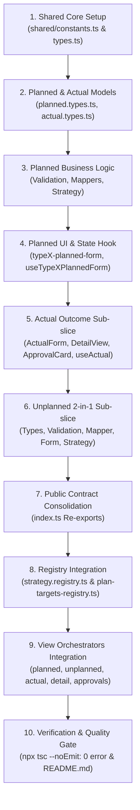

# 🏛️ Vertical Slice Architecture Blueprint: Type 1 Master Template
> **คู่มือมาตรฐานการสร้างและปรับแต่งประเภทงาน (Work Type Slice 1–14) โดยใช้ Type 1 เป็น Gold Standard**  
> ตำแหน่งไฟล์: `modules/activity/docs/TYPE_SLICE_BLUEPRINT.md`  
> ใช้เป็น **Single Source of Truth** สำหรับการสร้างใหม่ (Scaffold), การปรับปรุงโครงสร้าง (Refactor), และการตรวจสอบ (Audit) ทุก Work Type ในโมดูล Activity

---

## 📌 1. ภาพรวมสถาปัตยกรรมระดับโมดูล (Module-Level Architecture)

โมดูล `modules/activity/` ถูกออกแบบด้วย **Vertical Slice Architecture** ร่วมกับ **Domain-Driven Design (DDD)** โดยแบ่งความรับผิดชอบออกเป็นระดับโมดูล (Core Infrastructure & Orchestration) และระดับฟีเจอร์ (Feature Slices):

```text
modules/activity/
├── application/                      # 🔄 บริการและตรรกะระดับโมดูล
│   ├── filters/
│   │   └── activity-filter-matcher.ts# ตรรกะค้นหาและกรองกิจกรรม (Status, Type, Date, Search)
│   └── media/
│       └── image-uploader.ts         # Service อัปโหลดรูปภาพกิจกรรมเข้าสู่ Cloud Storage / S3
│
├── domain/                           # 🧠 กฎเกณฑ์ทางธุรกิจและโดเมนหลัก (Business Rules)
│   ├── approval/
│   │   ├── can-approve.ts            # กฎสิทธิ์การอนุมัติ (RBAC Rule: ใครอนุมัติแผน/ผลงานได้บ้าง)
│   │   ├── operator-resolver.ts      # ตรวจสอบและระบุตัวตนผู้กระทำรายการ
│   │   └── index.ts                  # Domain Approval Public API
│   └── summary/
│       ├── constants.ts              # ค่าคงที่สำหรับสรุปเป้าหมายและผลงาน
│       ├── plan-extractor.ts         # Utility ดึงข้อมูลหัวแผนงาน (Header Details)
│       ├── plan-summary-extractor.ts # สรุปเป้าหมายของทั้งแผน (Aggregated Targets Summary)
│       ├── plan-targets-registry.ts  # ⭐️ ศูนย์รวม Target Extractors ของทุกประเภทงาน (Type 1-14)
│       └── index.ts                  # Domain Summary Public API
│
├── features/                         # 🍕 Vertical Feature Slices (แยกอิสระตามประเภทงาน 1-14)
│   ├── type-1/                       # ⭐️ Type 1 Gold Standard (เข้าพบร้านค้า / Key Farmer)
│   ├── type-2/                       # ติดตามผลการใช้สินค้า (Target Follow-up)
│   ├── type-3/                       # เสนอขายสินค้า (Sales Pitch & Promotion)
│   ├── type-4/                       # สาธิตสินค้า / จัดแปลงทดลอง (Field Demo & Plot Tracking)
│   └── type-X/                       # ประเภทงานอื่น ๆ ในอนาคต (Type 5 ถึง 14)
│
├── infrastructure/                   # 💾 การเชื่อมต่อฐานข้อมูลส่วนกลาง (Database Repositories)
│   ├── prisma-activity-repository.ts # จัดการตาราง Header หลัก (ActivityPlan, ActivityResult, Approvals)
│   └── strategy.registry.ts          # ⭐️ Central Strategy Registry ผูก WorkTypeCode กับ Strategy
│
├── server/                           # 🛡️ Next.js 16 Server Actions (Gatekeeper & RBAC Validation)
│   ├── planned.actions.ts            # "use server" บันทึก/แก้ไขแผนงานปกติ
│   ├── unplanned.actions.ts          # "use server" บันทึกกิจกรรมนอกแผน 2-in-1
│   ├── actual.actions.ts             # "use server" บันทึกผลการปฏิบัติงานจริง
│   ├── approval.actions.ts           # "use server" อนุมัติ / ปฏิเสธ / ขอแก้ไขแผนงาน
│   ├── promotional.actions.ts        # "use server" จัดการสื่อส่งเสริมการขาย
│   ├── index.ts                      # Re-export actions สำหรับเรียกใช้ภายนอก (ไม่มี "use server")
│   └── actions.ts                    # Re-export actions สำหรับความเข้ากันได้ย้อนหลัง
│
├── types/                            # 📐 Types และ Data Contracts ส่วนกลางระดับโมดูล
│   ├── index.ts                      # Type Definition รวม
│   ├── strategy.interface.ts         # Interface สัญญามาตรฐานของ WorkTypeStrategy
│   └── schema.types.ts               # Types ที่แมปกับ Prisma Models
│
├── ui/                               # 🎨 Design System & Shared Presentation Components
│   ├── badges/                       # Badge แสดงสถานะและประเภทงาน
│   ├── cards/                        # การ์ดมาตรฐาน (Header Info, Notes, Team)
│   ├── inputs/                       # ⭐️ รวมศูนย์ Shared Activity Inputs ห้ามสร้างซ้ำใน Slice!
│   │   ├── activity-customer-select.tsx # ดรอปดาวน์เลือกลูกค้า/ร้านค้า/เกษตรกร
│   │   ├── activity-product-select.tsx  # ดรอปดาวน์เลือกสินค้า/สารเคมี/ปุ๋ย
│   │   ├── activity-address-select.tsx  # ดรอปดาวน์เลือกที่อยู่แปลง/ร้านค้า
│   │   ├── activity-photo-upload.tsx    # คอมโพเนนต์อัปโหลดรูปภาพกิจกรรม
│   │   ├── activity-gps-picker.tsx      # บันทึกพิกัดตำแหน่ง GPS
│   │   ├── activity-input.tsx           # Text input พร้อม Label และ Error helper
│   │   ├── use-activity-customers.ts    # Hook ดึงข้อมูลลูกค้า
│   │   └── use-activity-addresses.ts    # Hook ดึงข้อมูลที่อยู่
│   ├── layout/                       # โครงสร้าง Layout และ Header ของฟอร์ม
│   ├── sections/                     # ส่วนประกอบระดับ Section (Location, Budget, Team)
│   └── index.ts                      # Public Export Barrel สำหรับ UI ทั้งหมด
│
├── views/                            # 📱 Main Page Orchestrators (หน้าจอหลักที่ประกอบแต่ละ Slice)
│   ├── list/                         # หน้ารายการแผนงาน (Data Table, Filters, Badges)
│   ├── planned/                      # หน้าสร้าง/แก้ไขแผนงานในแผน (/activity-plans/new, /edit)
│   ├── unplanned/                    # หน้าสร้างกิจกรรมนอกแผน 2-in-1 (/unplanned/new)
│   ├── actual/                       # หน้าบันทึกผลงานจริง (/activity-plans/[id]/actual)
│   ├── detail/                       # หน้าดูรายละเอียดแผนงานและผลงาน Read-Only (/activity-plans/[id])
│   ├── approvals/                    # หน้าพิจารณาอนุมัติสำหรับหัวหน้างาน (/approvals/[id])
│   └── promotional-materials/        # หน้าจัดการเบิกจ่ายสื่อส่งเสริมการขาย
│
├── constants.ts                      # ค่าคงที่ระดับโมดูล (WORK_TYPE_CONFIG, STATUS_CONFIG)
└── index.ts                          # Public Entry Point ประจำโมดูล Activity
```

---

## 🏛️ 2. โครงสร้างมาตรฐานระดับ Type Slice (The 24 Canonical Artifacts)

ทุกประเภทงาน (Type 1 ถึง Type 14) ต้องมีโครงสร้างภายในตรงตาม **Type 1 Master Template** อย่างครบถ้วน โดยแบ่งออกเป็น **4 โซนหลัก**:
1. `shared/`: ข้อมูลร่วม ค่าคงที่ และ Interfaces ภายในประเภทงาน
2. `planned/`: โซนงานในแผน (บันทึกเป้าหมาย, แสดงผลการ์ด, บันทึกผลงานจริง, หน้ารายละเอียด, การ์ดอนุมัติ)
3. `unplanned/`: โซนงานนอกแผน 2-in-1 (บันทึกเป้าหมายพร้อมผลงานจริงใน Atomic Transaction เดียวกัน)
4. `index.ts` & `README.md`: Public API Contract ประจำประเภทงานและเอกสารกำกับ

```text
modules/activity/features/type-X/
│
├── index.ts                                # ⭐️ 1. Public API Contract (จุดเข้าถึงจุดเดียวของ Slice)
├── README.md                               # ⭐️ 2. คู่มือเฉพาะทางประจำ Slice (Documentation & Schema Mapping)
│
├── shared/                                 # ⭐️ 3. Shared Constants & Types ประจำ Slice
│   ├── constants.ts                        # ค่าคงที่, Dropdown Options, Badges config
│   └── types.ts                            # CustomerOption, ProductOption, ImageFile, Base Interfaces
│
├── planned/                                # ⭐️ 4. Planned Sub-slice (งานในแผน & ผลงานจริง)
│   ├── types/
│   │   ├── planned.types.ts                # Type ของฟอร์มในแผน (TypeXPlannedItem, TypeXPlanFormProps, TypeXTargetItem)
│   │   └── actual.types.ts                 # Type ของฟอร์มผลงานจริง (TypeXActualData, TypeXActualFormProps, TargetItem)
│   │   ⚠️ กฎเหล็ก: ห้ามมี index.ts ใน types/ ให้ Re-export ผ่าน root index.ts เท่านั้น
│   │
│   ├── application/
│   │   ├── planned-validation.ts           # Zod Schema & Validate Function ฝั่งฟอร์มในแผน
│   │   ├── planned-mapper.ts               # Map Form State <-> Database Payload (Hydration & Target Extraction)
│   │   ├── actual-validation.ts            # Zod Schema & Validate Function ฝั่งผลงานจริง
│   │   └── actual-mapper.ts                # Map Actual Form <-> Database Outcome Records
│   │
│   ├── components/
│   │   ├── typeX-planned-form.tsx          # ⭐️ UI ฟอร์มบันทึกเป้าหมายในแผน (แทนชื่อเดิม typeX-plan-form.tsx)
│   │   ├── typeX-plan-card.tsx             # UI การ์ดสรุปเป้าหมายตามแผน (แสดงในการ์ด Actual, Detail, Approvals)
│   │   ├── typeX-actual-form.tsx           # UI ฟอร์มบันทึกผลการปฏิบัติงานจริง
│   │   ├── typeX-detail-view.tsx           # UI แสดงผลงานจริงแบบ Read-Only สำหรับหน้ารายละเอียด
│   │   └── typeX-approval-card.tsx         # UI การ์ดแสดงผลงานจริงสำหรับหัวหน้างานพิจารณาอนุมัติ
│   │
│   ├── hooks/
│   │   ├── use-typeX-planned-form.ts       # ⭐️ Hook จัดการ State ฟอร์มในแผน (แทนชื่อเดิม use-typeX-form.ts)
│   │   └── use-typeX-actual.ts             # Hook จัดการ State ผลการปฏิบัติงานจริง (รูปภาพ, พิกัด, ผลลัพธ์)
│   │
│   └── infrastructure/
│       └── typeX-planned.strategy.ts       # Server Strategy บันทึก/อ่านข้อมูลลงตารางเฉพาะใน DB ผ่าน Prisma Transaction
│
└── unplanned/                              # ⭐️ 5. Unplanned Sub-slice (กิจกรรมนอกแผน 2-in-1)
    ├── types/
    │   └── unplanned.types.ts              # Type ของฟอร์มนอกแผน (TypeXUnplannedItem, TypeXUnplannedFormProps)
    │   ⚠️ กฎเหล็ก: ห้ามมี index.ts ใน types/
    │
    ├── application/
    │   ├── unplanned-validation.ts         # Zod Schema & Validate Function ของกิจกรรมนอกแผน
    │   └── unplanned-mapper.ts             # Map Unplanned Form <-> Database Payload
    │
    ├── components/
    │   └── typeX-unplanned-form.tsx        # UI ฟอร์มบันทึกกิจกรรมนอกแผน 2-in-1 (สร้างเป้าหมายพร้อมบันทึกผลเสร็จในหน้าเดียว)
    │
    ├── hooks/
    │   └── use-typeX-unplanned-form.ts     # Hook จัดการ State กิจกรรมนอกแผน
    │
    └── infrastructure/
        └── typeX-unplanned.strategy.ts     # Server Strategy บันทึกเป้าหมายและผลลัพธ์ใน 1 Atomic Transaction
```

---

## 📋 3. ตารางสรุปชื่อไฟล์มาตรฐาน (Strict Naming Conventions)

เพื่อความเป็นเอกภาพทั่วทั้งโปรเจกต์ ห้ามใช้รูปแบบชื่อไฟล์แบบเก่า (Legacy Naming) โดยให้ใช้ชื่อมาตรฐานตามตารางนี้:

| หมวดหมู่ | ❌ รูปแบบเดิมที่ห้ามใช้ (Legacy) | ✅ รูปแบบมาตรฐานใหม่ (Gold Standard) | สัญลักษณ์ / Export Name |
| :--- | :--- | :--- | :--- |
| **Planned Form** | `typeX-plan-form.tsx` | `typeX-planned-form.tsx` | `TypeXPlannedForm` (ให้ alias `TypeXPlanForm` ใน `index.ts` เพื่อความเข้ากันได้) |
| **Planned Hook** | `use-typeX-form.ts` | `use-typeX-planned-form.ts` | `useTypeXPlannedForm` (ให้ alias `useTypeXForm` ใน `index.ts`) |
| **Plan Card** | - | `typeX-plan-card.tsx` | `TypeXPlanCard` |
| **Actual Form** | - | `typeX-actual-form.tsx` | `TypeXActualForm` |
| **Actual Hook** | - | `use-typeX-actual.ts` | `useTypeXActual` |
| **Detail View** | - | `typeX-detail-view.tsx` | `TypeXDetailView` |
| **Approval Card** | - | `typeX-approval-card.tsx` | `TypeXApprovalCard` |
| **Unplanned Form** | - | `typeX-unplanned-form.tsx` | `TypeXUnplannedForm` |
| **Unplanned Hook** | - | `use-typeX-unplanned-form.ts` | `useTypeXUnplannedForm` |
| **Planned Strategy**| - | `typeX-planned.strategy.ts` | `typeXPlannedStrategy` |
| **Unplanned Strategy**| - | `typeX-unplanned.strategy.ts`| `typeXUnplannedStrategy` |
| **Types Barrel** | `types/index.ts` (ซ้ำซ้อน) | ❌ **ลบออก (Delete)** | ส่งออก Type ตรงจาก `planned.types.ts`, `actual.types.ts`, `unplanned.types.ts` ใน root `index.ts` |

---

## 🧩 4. ข้อกำหนดการใช้งาน Shared UI (`@/modules/activity/ui`)

> ⚠️ **กฎเหล็กเรื่อง UI Component:**  
> ห้ามสร้าง Dropdown ลูกค้า, Dropdown สินค้า, Dropdown ที่อยู่, หรือชุดอัปโหลดรูปภาพขึ้นมาเองภายใน Slice โดยเด็ดขาด ทุก Slice ต้องเรียกใช้ Shared UI Inputs จาก `@/modules/activity/ui` เท่านั้น

### รายการ Shared UI Inputs ที่ต้องใช้:

1. **`ActivityCustomerSelect`** (`@/modules/activity/ui`):
   - ใช้เลือกเกษตรกร, ร้านค้า, หรือเป้าหมายลูกค้า
   - มาพร้อมการค้นหาและ Badges แสดงประเภทลูกค้า
2. **`ActivityProductSelect`** (`@/modules/activity/ui`):
   - ใช้เลือกสินค้า, ยา, ปุ๋ย, หรือสารเคมี
   - รองรับ Multi-select และ Badge แสดงรายการสินค้า
3. **`ActivityAddressSelect`** (`@/modules/activity/ui`):
   - ใช้เลือกแปลงปลูกหรือที่อยู่ของลูกค้า
4. **`ActivityPhotoUpload` / `ImageGroupUpload` / `uploadActivityPlanImageGroup`**:
   - ใช้ในฟอร์มบันทึกผลงานจริง (`typeX-actual-form.tsx`) และฟอร์มนอกแผน (`typeX-unplanned-form.tsx`)
   - บริหารจัดการรูปภาพหลายกลุ่ม (เช่น หน้าร้าน, แปลงปลูก, ปัญหาที่พบ)
5. **`ActivityGpsPicker`** (`@/modules/activity/ui`):
   - ใช้บันทึกพิกัดจริงขณะเช็คอินปฏิบัติงาน
6. **`ActivityInput`** (`@/modules/activity/ui`):
   - Text Input มาตรฐานพร้อม Label และข้อความแจ้งเตือน Error

---

## 🔌 5. จุดเชื่อมต่อระบบส่วนกลาง (The 3 Integration Gateways)

เมื่อสร้างหรือปรับปรุง Work Type Slice ใด ๆ ต้องทำการลงทะเบียนใน 3 จุดนี้เสมอเพื่อให้ระบบส่วนกลางทำงานได้สมบูรณ์:

### Gateway 1: Strategy Registry (`infrastructure/strategy.registry.ts`)
ลงทะเบียน WorkTypeStrategy สำหรับการบันทึกข้อมูลแบบ Transactional ในฐานข้อมูล:
```typescript
import { typeXPlannedStrategy, typeXUnplannedStrategy } from "../features/type-X";

export const WORK_TYPE_STRATEGY_REGISTRY: Record<string, WorkTypeStrategyRegistration> = {
  // ...
  TYPE_X: {
    code: "TYPE_X",
    name: "ชื่อประเภทงานภาษาไทย",
    planned: typeXPlannedStrategy,
    unplanned: typeXUnplannedStrategy,
    hasData: (rawData: any): boolean =>
      Boolean(
        (rawData.workTypeCodes && rawData.workTypeCodes.includes("TYPE_X")) ||
        (rawData.typeXTargets && rawData.typeXTargets.length > 0) ||
        (rawData.typeXUnplannedItems && rawData.typeXUnplannedItems.length > 0)
      ),
  },
};
```

### Gateway 2: Target Registry (`domain/summary/plan-targets-registry.ts`)
ลงทะเบียน Target Extractor สำหรับสรุปเป้าหมายในการ์ดและการตรวจสอบย้อนหลัง (Audit Log):
```typescript
import { extractTypeXPlanTargets } from "../../features/type-X";

const TARGET_EXTRACTORS: Record<string, TargetExtractorFn> = {
  // ...
  TYPE_X: (p, prev) => extractTypeXPlanTargets(p, prev),
};
```

### Gateway 3: View Orchestrators (`modules/activity/views/`)
นำ Components และ Hooks ของ Type X ไปต่อเข้ากับ 5 หน้ารวมศูนย์:
1. `views/planned/components/planned-activity-form.tsx`: เพิ่มการแสดงผลฟอร์มเป้าหมายในแผน
2. `views/unplanned/components/unplanned-activity-form.tsx`: เพิ่มการแสดงผลฟอร์มกิจกรรมนอกแผน 2-in-1
3. `views/actual/components/actual-work-type-list.tsx`: เพิ่มการแสดงผลฟอร์มบันทึกผลงานจริง
4. `views/detail/components/detail-work-type-list.tsx`: เพิ่มการแสดงผลหน้ารายละเอียดแบบ Read-Only
5. `views/approvals/components/approval-work-type-list.tsx`: เพิ่มการแสดงผลการ์ดพิจารณาอนุมัติ

---

## 📜 6. ตัวอย่าง Public API Contract มาตรฐาน (`index.ts`)

ไฟล์ `index.ts` ที่ Root ของแต่ละ Slice ต้องจัดระเบียบการส่งออกเป็นหมวดหมู่ตาม Type 1 ดังนี้:

```typescript
// =============================================================================
// TYPE X: [ชื่อประเภทงาน] - Public API Contract
// =============================================================================

// 🟢 โซน "ในแผน" (Planned Sub-slice)
export { TypeXPlannedForm, TypeXPlannedForm as TypeXPlanForm } from "./planned/components/typeX-planned-form";
export { useTypeXPlannedForm, useTypeXPlannedForm as useTypeXForm } from "./planned/hooks/use-typeX-planned-form";
export {
  validateTypeXPlannedItem,
  typeXPlannedSchema,
} from "./planned/application/planned-validation";
export {
  mapTypeXPlannedItemToDb,
  hydrateTypeXPlannedData,
  extractTypeXPlanTargets,
} from "./planned/application/planned-mapper";
export {
  mapTypeXActualFormToDb,
  parseTypeXActualResult,
} from "./planned/application/actual-mapper";
export {
  validateTypeXActual,
} from "./planned/application/actual-validation";
export { typeXPlannedStrategy } from "./planned/infrastructure/typeX-planned.strategy";
export type {
  TypeXPlannedItem,
  TypeXPlannedFormProps,
  TypeXTargetItem,
  TypeXPlanCardProps,
  TypeXDetailViewProps,
  TypeXApprovalCardProps,
} from "./planned/types/planned.types";

// 🔵 โซน "ผลงานจริงในแผน" (Actual Result Sub-slice)
export { TypeXActualForm } from "./planned/components/typeX-actual-form";
export { useTypeXActual } from "./planned/hooks/use-typeX-actual";
export { TypeXDetailView } from "./planned/components/typeX-detail-view";
export { TypeXApprovalCard } from "./planned/components/typeX-approval-card";
export { TypeXPlanCard } from "./planned/components/typeX-plan-card";
export type {
  TypeXActualFormProps,
  TypeXActualData,
} from "./planned/types/actual.types";

// 🟡 โซน "นอกแผน" (Unplanned Sub-slice 2-in-1)
export { TypeXUnplannedForm } from "./unplanned/components/typeX-unplanned-form";
export { useTypeXUnplannedForm } from "./unplanned/hooks/use-typeX-unplanned-form";
export {
  validateTypeXUnplannedItem,
  typeXUnplannedSchema,
} from "./unplanned/application/unplanned-validation";
export {
  hydrateTypeXUnplannedData,
  mapTypeXUnplannedToPayload,
} from "./unplanned/application/unplanned-mapper";
export { typeXUnplannedStrategy } from "./unplanned/infrastructure/typeX-unplanned.strategy";
export type {
  TypeXUnplannedItem,
  TypeXUnplannedFormProps,
} from "./unplanned/types/unplanned.types";

// ⚪ ชิ้นส่วนที่ใช้ร่วมกันภายใน Type X (Shared)
export { TYPE_X_CONSTANTS } from "./shared/constants";
export type {
  CustomerOption,
  ProductOption,
  TypeXImageFile,
} from "./shared/types";
```

---

## 🛠️ 7. ขั้นตอนการปรับปรุงหรือสร้าง Slice (Universal 10-Step Pipeline)

เมื่อต้องการปรับปรุง Slice ที่มีอยู่เดิม (เช่น Type 2, Type 3, Type 4) หรือสร้าง Slice ใหม่ (Type 5 ถึง 14) ให้ดำเนินการตาม 10 ขั้นตอนนี้:



### รายละเอียดขั้นตอน:

1. **Step 1: ตั้งค่า Shared Core (`shared/`)**
   - สร้าง `constants.ts` (ตัวเลือกสถานะ, หัวข้อ, Dropdown Options, สี Badge)
   - สร้าง `types.ts` (CustomerOption, ProductOption, รูปภาพ)
2. **Step 2: กำหนด Data Models ใน Planned (`planned/types/`)**
   - สร้าง `planned.types.ts` และ `actual.types.ts` (ลบ `types/index.ts` ออกถ้ามี)
3. **Step 3: สร้าง Business Logic และ Strategy (`planned/application/` & `infrastructure/`)**
   - เขียน Zod Schema ใน `planned-validation.ts` และ `actual-validation.ts`
   - เขียนฟังก์ชันแปลงข้อมูล Hydration & Target Extraction ใน `planned-mapper.ts` และ `actual-mapper.ts`
   - พัฒนา `typeX-planned.strategy.ts` เชื่อมต่อ Prisma Transaction
4. **Step 4: สร้างฟอร์มในแผนและ State Hook (`planned/components/` & `hooks/`)**
   - ตั้งชื่อไฟล์ `typeX-planned-form.tsx` (ใช้ Shared Inputs จาก `@/modules/activity/ui`)
   - ตั้งชื่อไฟล์ `use-typeX-planned-form.ts` คืนค่า `items`, `addItem`, `updateItem`, `deleteItem`
   - สร้าง `typeX-plan-card.tsx` แสดงผลสรุปเป้าหมาย
5. **Step 5: สร้างชิ้นส่วนบันทึกผลงานจริงและหน้ารายละเอียด**
   - พัฒนา `use-typeX-actual.ts`
   - พัฒนา `typeX-actual-form.tsx` (ใช้ `uploadActivityPlanImageGroup` และ `ActivityGpsPicker`)
   - พัฒนา `typeX-detail-view.tsx` และ `typeX-approval-card.tsx`
6. **Step 6: สร้างกิจกรรมนอกแผน Unplanned 2-in-1 (`unplanned/`)**
   - พัฒนา `unplanned.types.ts`, `unplanned-validation.ts`, `unplanned-mapper.ts`
   - พัฒนา `typeX-unplanned-form.tsx` และ `use-typeX-unplanned-form.ts`
   - พัฒนา `typeX-unplanned.strategy.ts` บันทึกทั้ง Target และ Result ใน 1 Atomic Transaction
7. **Step 7: รวมศูนย์ Public API Contract ใน `index.ts`**
   - ส่งออก Components, Hooks, Mappers, Types ครบถ้วน
   - ผูก Alias ชื่อเดิมไว้เพื่อไม่ให้โค้ดส่วนอื่นพัง (Backward Compatibility)
8. **Step 8: ลงทะเบียนใน Registries ส่วนกลาง**
   - เพิ่มใน `infrastructure/strategy.registry.ts`
   - เพิ่มใน `domain/summary/plan-targets-registry.ts`
9. **Step 9: เชื่อมโยงเข้ากับ View Orchestrators**
   - ตรวจสอบการเรียกใช้ใน `views/planned/`, `views/unplanned/`, `views/actual/`, `views/detail/`, `views/approvals/`
10. **Step 10: ตรวจสอบความถูกต้องและจัดทำเอกสาร (Quality Gate)**
    - รัน `npx tsc --noEmit` ต้องผ่าน **Exit code 0** ไม่มี Error ใด ๆ
    - ปรับปรุง `README.md` ประจำ Slice อธิบาย Schema Mapping และคู่มือการใช้งาน

---

## 💬 8. แม่แบบคำสั่ง Prompt (Prompt Templates for AI Delegation)

เมื่อต้องการสั่งให้ AI ดำเนินการเกี่ยวกับ Type อื่น ๆ สามารถคัดลอกข้อความด้านล่างนี้ไปสั่งการได้ทันที:

### 🎯 สำหรับปรับปรุง Type เดิมให้ตรงตามมาตรฐาน (เช่น Type 2, Type 3, Type 4):
```text
ช่วย Refactor ปรับปรุงโมดูล `modules/activity/features/type-X/` ให้ตรงตามพิมพ์เขียว Type 1 Gold Standard (ตามเอกสาร modules/activity/docs/TYPE_SLICE_BLUEPRINT.md) ดังนี้:
1. ปรับเปลี่ยนชื่อไฟล์ให้เป็นมาตรฐาน:
   - เปลี่ยน `typeX-plan-form.tsx` เป็น `typeX-planned-form.tsx` (พร้อม export alias TypeXPlanForm ไว้เพื่อความปลอดภัย)
   - เปลี่ยน `use-typeX-form.ts` เป็น `use-typeX-planned-form.ts` (พร้อม export alias useTypeXForm)
   - ลบ `types/index.ts` ที่ซ้ำซ้อนออก แล้วส่งออก types ผ่าน root index.ts แทน
2. ตรวจสอบให้ทุก Form เรียกใช้ Shared UI Inputs จาก `@/modules/activity/ui` เท่านั้น
3. ตรวจสอบ Public API Contract ใน `index.ts` และการลงทะเบียนใน `infrastructure/strategy.registry.ts` และ `domain/summary/plan-targets-registry.ts`
4. ตรวจสอบความเข้ากันได้กับ View Orchestrators ใน `modules/activity/views/`
5. ทดสอบด้วยคำสั่ง `npx tsc --noEmit` ให้ผ่าน 0 error
```

### 🎯 สำหรับสร้าง Type ใหม่จากศูนย์ (เช่น Type 5 ถึง Type 14):
```text
ช่วยสร้าง Vertical Slice สำหรับ Type X ใน `modules/activity/features/type-X/` โดยใช้พิมพ์เขียว Type 1 Gold Standard จาก `modules/activity/docs/TYPE_SLICE_BLUEPRINT.md` เป็นต้นแบบ 100%:
1. สร้างโครงสร้าง 24 artifacts ครบทั้ง shared, planned, unplanned, index.ts และ README.md
2. พัฒนา Validation, Mappers, Hooks, Components, และ Strategies
3. ใช้ Shared UI Inputs จาก `@/modules/activity/ui`
4. ลงทะเบียนเข้าสู่ `strategy.registry.ts` และ `plan-targets-registry.ts`
5. ผูกเข้ากับ View Orchestrators ทั้ง 5 หน้าใน `modules/activity/views/`
6. ทดสอบผ่านคำสั่ง `npx tsc --noEmit`
```
