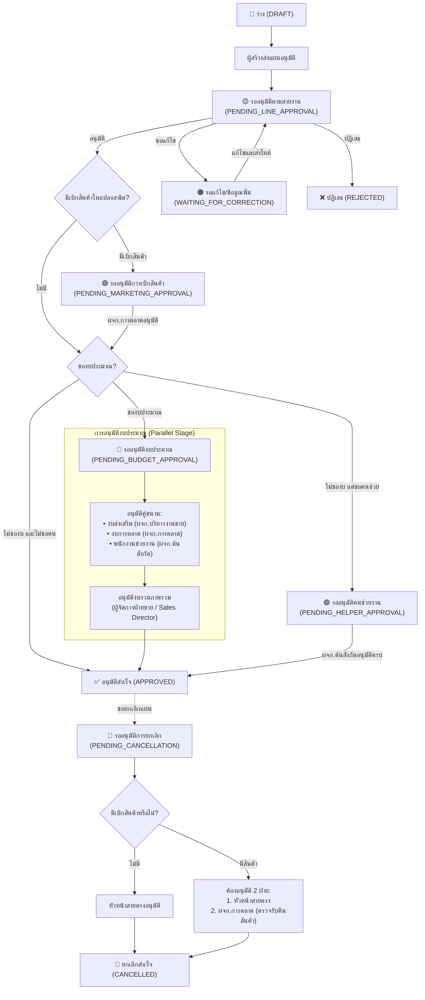
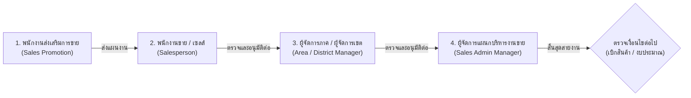

# 🛡️ Activity Approval Workflow Engine

> **เอกสารคู่มือระบบการอนุมัติแผนกิจกรรม (Activity Approval Domain)**  
> ตำแหน่งโฟลเดอร์: `modules/activity/domain/approval/`  
> สถาปัตยกรรม: **Domain Layer (Clean Architecture & Pure Business Logic)**

---

## 📌 1. ภาพรวมของระบบ (Overview)

ระบบการอนุมัติกิจกรรมใน CRM ถูกออกแบบตามหลัก **Domain-Driven Design (DDD)** โดยเป็นอิสระจาก UI และฐานข้อมูล (Database-agnostic) มีหน้าที่หลัก 2 ประการ:
1. **สิทธิ์ในการอนุมัติ (`can-approve.ts`)**: ประเมินว่าผู้ใช้งานที่กำลัง Login มีสิทธิ์กดอนุมัติ/ปฏิเสธ/ส่งกลับแก้ไข แผนกิจกรรมในสถานะปัจจุบันหรือไม่
2. **การระบุผู้รับผิดชอบ (`operator-resolver.ts`)**: คำนวณว่าแผนงานในขั้นตอนปัจจุบันอยู่ในการดูแลของใคร (Current Operator) พร้อมคำอธิบายขั้นตอนสำหรับแสดงผลบน Badge และตารางงาน

---

## 🔄 2. แผนผังลำดับขั้นตอนการอนุมัติ (Approval Lifecycle)



---

## 🌲 3. โครงสร้างและลำดับสายอนุมัติตามสายงาน (Line Approval Hierarchy)

ในขั้นตอนการอนุมัติตามสายงาน (`PENDING_LINE_APPROVAL`) ระบบจะส่งต่อแผนงานขึ้นไปตามลำดับชั้นบังคับบัญชาตามสายงาน จนถึงหัวหน้างานระดับแผนกบริหารงานขาย (Sales Admin Manager) ตามลำดับดังนี้:

### 3.1 แผนผังลำดับขั้นสายงานในเชิงทฤษฎี (Target Hierarchy Design)



> [!NOTE]
> * **กรณีผู้สร้างแผนเป็นพนักงานขาย (Sales):** แผนงานจะเริ่มต้นส่งให้ **ผู้จัดการภาค/เขต** โดยอัตโนมัติ (ข้ามระดับ 1 และ 2)
> * **กรณีผู้สร้างแผนเป็นผู้จัดการภาค (Area Manager):** แผนงานจะเริ่มต้นส่งให้ **ผู้จัดการแผนกบริหารงานขาย** ทันที

### 3.2 กฎการค้นหาผู้อนุมัติขั้นถัดไปในระบบ (Next Approver Resolution Logic)

การส่งต่อสายงานในระบบถูกควบคุมโดยฟังก์ชัน `resolveNextLineApprover()` ใน [`activity-plan-flow.ts`](file:///d:/code/crm-bank/modules/activity/application/activity-plan-flow.ts) โดยมีลำดับความสำคัญ (Priority):

1. **ลำดับแรก (Priority 1: Direct `managerId` ในฐานข้อมูล):**
   - ระบบจะตรวจดูฟิลด์ `managerId` ของพนักงานคนปัจจุบันในตาราง `Employee`
   - หากมีการผูกรหัสหัวหน้างานไว้ แผนจะถูกส่งตรงไปยังหัวหน้าคนนั้นทันที
2. **ลำดับสำรอง (Priority 2: Dynamic Position-based Lookup):**
   - หากพนักงานคนดังกล่าวไม่มี `managerId` (เป็น `null`) ระบบจะค้นหาหัวหน้างานขั้นถัดไปตามตำแหน่งและฝ่ายที่สังกัด:
     - **พนักงานส่งเสริมการขาย (Promoter)** $\rightarrow$ ส่งต่อให้ **พนักงานขาย (Salesperson)** ในฝ่ายเดียวกัน
     - **พนักงานขาย (Salesperson)** $\rightarrow$ ส่งต่อให้ **ผู้จัดการภาค (Area Manager)** ในฝ่ายเดียวกัน
     - **ผู้จัดการภาค (Area Manager)** $\rightarrow$ ส่งต่อให้ **ผู้จัดการแผนกบริหารงานขาย (Sales Admin Manager)**
     - **ผู้จัดการแผนกบริหารงานขาย (Sales Admin Manager)** $\rightarrow$ ถือเป็นจุดสิ้นสุดของสายงาน (Terminal Line Manager) ระบบจะปรับเข้าสู่ขั้นตอนถัดไป (เช่น เบิกสินค้า หรือ อนุมัติงบประมาณ)

### 3.3 ข้อมูลสายอนุมัติจริงในฐานข้อมูลปัจจุบัน (Current Database State)

> [!NOTE]
> รายชื่อพนักงาน โครงสร้างสายบังคับบัญชา และคู่สายการอนุมัติตามฐานข้อมูลจริง (Production Data) ถูกแยกเก็บไว้ในเอกสารเฉพาะ เพื่อความเป็นระเบียบและง่ายต่อการอัปเดต:
> 
> 👉 **ดูรายชื่อและผังสายอนุมัติจริงทั้งหมดได้ที่:** [`docs/approval-hierarchy.md`](file:///d:/code/crm-bank/docs/approval-hierarchy.md)
> 
> *สรุปสถานะปัจจุบัน:* พนักงานส่วนใหญ่ถูกผูก `managerId` ตรงไปยัง **ผู้จัดการแผนกบริหารงานขาย (คุณธีระยุทธ ธณศักดิ์กุล)** โดยตรง (มีเพียงคุณสุนิสา อ้อนเรือน ที่มีสาย 3 ระดับผ่าน คุณบรรพต พรมตัน)

---

## 👥 4. ตารางบทบาทและอำนาจการอนุมัติ (Role & Authority Matrix)

| บทบาท (Role / Position) | ขั้นตอนที่รับผิดชอบ | คำอธิบายอำนาจหน้าที่ |
| :--- | :--- | :--- |
| **ผู้สร้างแผน (Creator)** | `WAITING_FOR_CORRECTION` | แก้ไขข้อมูลตามที่ผู้อนุมัติร้องขอ แล้วส่งกลับเข้ากระบวนการใหม่ |
| **หัวหน้างานสายตรง (Line Approver)**<br/>*(พนักงานขาย, ผู้จัดการเขต DM, ผู้จัดการภาค AM)* | `PENDING_LINE_APPROVAL`<br/>`PENDING_CANCELLATION` | ตรวจสอบความสมเหตุสมผลของแผนงานในสายงาน และอนุมัติการขอยกเลิกแผน |
| **ผู้จัดการแผนกการตลาด (Marketing Manager)** | `PENDING_MARKETING_APPROVAL`<br/>`PENDING_BUDGET_APPROVAL`<br/>`PENDING_CANCELLATION` | • อนุมัติการเบิกสินค้าในแปลงสาธิต (Demo Plots)<br/>• อนุมัติงบประมาณการตลาด<br/>• ตรวจรับคืนสินค้าเข้าสต็อกเมื่อมีการยกเลิกแผน |
| **ผู้จัดการแผนกบริหารงานขาย (Sales Admin Manager)** | `PENDING_BUDGET_APPROVAL` | อนุมัติงบประมาณส่งเสริมการขาย (Sales Promotion Budget) |
| **ผู้จัดการฝ่ายขาย (Sales Director)** | `PENDING_BUDGET_APPROVAL` *(Final Stage)* | อนุมัติภาพรวมของงบประมาณทั้งหมด หลังจากงบย่อยได้รับการอนุมัติครบแล้ว |
| **ผู้จัดการต้นสังกัดของผู้ช่วยงาน (Department Manager)** | `PENDING_HELPER_APPROVAL` | อนุมัติการส่งพนักงานในสังกัดของตนไปช่วยงานในกิจกรรม |
| **ผู้ดูแลระบบ (Admin)** | ทุกขั้นตอน | มีสิทธิ์อนุมัติ/แทรกแซง (Bypass) ได้ทุกขั้นตอนในกรณีฉุกเฉิน |

---

## 📁 5. โครงสร้างไฟล์และการทำงาน (Module Architecture)

```text
modules/activity/domain/approval/
├── can-approve.ts          # สิทธิ์การอนุมัติและ Action Scopes
├── operator-resolver.ts    # การคำนวณผู้รับผิดชอบในแต่ละขั้นตอน (Step Resolvers)
├── index.ts                # จุด Export รวมสำหรับเรียกใช้งานภายนอก
└── README.md               # เอกสารฉบับนี้
```

### 1) [`can-approve.ts`](file:///d:/code/crm-bank/modules/activity/domain/approval/can-approve.ts)
* **`canUserPerformApproval(plan, user)`**: ฟังก์ชันหลักในการคืนค่า `true/false` ว่าผู้ใช้รายนี้สามารถกดอนุมัติแผนนี้ได้หรือไม่
* **`getPlanActionScopes(plan, user)`**: คืนค่าเป็น `ActionScopeBadge[]` บอกรายละเอียดว่าผู้ใช้รายนี้มีสิทธิ์กดปุ่ม action ใดบ้าง เช่น `"งบส่งเสริมการขาย 5,000 บาท"`, `"ผู้ช่วยฝ่ายขาย 2 คน"` สำหรับแสดงในแถบรายการอนุมัติ
* **Granular Role Checkers**:
  - `isUserAdmin(user)`
  - `isUserSalesAdminManager(user)`
  - `isUserMarketingManager(user)`
  - `isUserSalesDirector(user)`
  - `isSalesHelperEmployee(helper)`, `isMarketingHelperEmployee(helper)`

### 2) [`operator-resolver.ts`](file:///d:/code/crm-bank/modules/activity/domain/approval/operator-resolver.ts)
แยกฟังก์ชันย่อยตามขั้นตอนทางธุรกิจ (Single Responsibility Principle):
* **`resolveCreatorOperator(plan)`**: ระบุชื่อผู้สร้างเมื่ออยู่ในสถานะรอแก้ไข
* **`resolveLineApprover(plan)`**: ระบุหัวหน้างานสายตรง (District/Area Manager)
* **`resolveMarketingWithdrawalApprover()`**: ระบุผู้จัดการแผนกการตลาด
* **`resolveCancellationApprover(plan)`**: รองรับ Dual Approval (สายตรง + ผจก.การตลาด) พร้อมแสดงข้อความว่ารอฝ่ายใด
* **`resolveBudgetApprover(plan, directory)`**: ระบุผู้อนุมัติงบประมาณตามลำดับความคืบหน้า (Stage 1 คู่ขนาน / Stage 2 ผจก.ฝ่ายขาย)
* **`resolveHelperApprover(plan, directory)`**: ระบุผู้จัดการต้นสังกัดของผู้ช่วย
* **`resolveCurrentOperator(plan, directory)`**: Main Facade สำหรับ UI เรียกใช้

---

## 💻 6. ตัวอย่างการนำไปใช้งาน (Usage Examples)

### ตัวอย่างที่ 1: ตรวจสอบสิทธิ์ก่อนแสดงปุ่มอนุมัติในหน้า View
```tsx
import { canUserPerformApproval, getPlanActionScopes } from "@/modules/activity/domain/approval";

function ApprovalActions({ plan, currentUser }) {
  // 1. ตรวจสอบสิทธิ์ภาพรวม
  const canApprove = canUserPerformApproval(plan, currentUser);
  if (!canApprove) return null;

  // 2. ดึงรายละเอียดของ Action ที่ต้องทำ
  const actionScopes = getPlanActionScopes(plan, currentUser);

  return (
    <div className="flex gap-2">
      {actionScopes.map((scope) => (
        <Badge key={scope.id} variant={scope.variant}>
          {scope.label}
        </Badge>
      ))}
      <Button onClick={handleApprove}>อนุมัติแผนงาน</Button>
    </div>
  );
}
```

### ตัวอย่างที่ 2: ดึงชื่อผู้รับผิดชอบปัจจุบันไปแสดงบน UI Badge
```tsx
import { resolveCurrentOperator } from "@/modules/activity/domain/approval";
import { useApproverDirectory } from "@/modules/activity/hooks/use-approver-directory";

function PlanOperatorLabel({ plan }) {
  const directory = useApproverDirectory();
  const operator = resolveCurrentOperator(plan, directory);

  if (!operator) return <span>-</span>;

  return (
    <div className="text-xs">
      <span className="text-muted-foreground">ผู้ดำเนินการ: </span>
      <span className="font-semibold text-primary">{operator.operatorName}</span>
      <p className="text-[10px] text-slate-500">{operator.stepDescription}</p>
    </div>
  );
}
```

---

## ⚠️ 7. กฎทางธุรกิจและเงื่อนไขพิเศษ (Critical Rules & Edge Cases)

1. **การป้องกันการอนุมัติตนเอง (Self-Approval Restriction)**:
   - ผู้สร้างแผนงาน หรือผู้ขอให้ยกเลิกแผน **ไม่มีสิทธิ์** อนุมัติแผนของตนเองในทุกกรณี (ยกเว้นผู้ใช้งานที่เป็นระดับ `Admin`)
   - พนักงานระดับปฏิบัติการ (พนักงานขาย, พนักงานส่งเสริม, พนักงานการตลาด) **ไม่มีสิทธิ์** อนุมัติการยกเลิกแผนงาน
2. **การอนุมัติการยกเลิกแบบสองฝ่าย (Dual Cancellation Approval)**:
   - หากกิจกรรมมี **การเบิกสินค้าในแปลงสาธิต** (เช่น Type 7A, 7B, 13, 14 หรือมี `hasProductWithdrawal = true`) แผนงานจะถูกยกเลิกสำเร็จก็ต่อเมื่อ:
     1. หัวหน้าสายตรงอนุมัติ (`lineCancellationApproved = true`) **และ**
     2. ผจก.การตลาดตรวจรับคืนสินค้าเข้าสต็อก (`mktCancellationApproved = true`)
3. **การอนุมัติงบประมาณแบบ 2 จังหวะ (Two-Stage Budget Approval)**:
   - **Stage 1 (คู่ขนาน)**: ผจก.แผนกบริหารงานขายตรวจงบส่งเสริม และ ผจก.แผนกการตลาดตรวจงบการตลาด
   - **Stage 2 (สรุปรวม)**: ผู้จัดการฝ่ายขาย (Sales Director) จะมองเห็นและกดอนุมัติงบรวมได้ก็ต่อเมื่อ Stage 1 ผ่านครบทุกสายแล้วเท่านั้น
