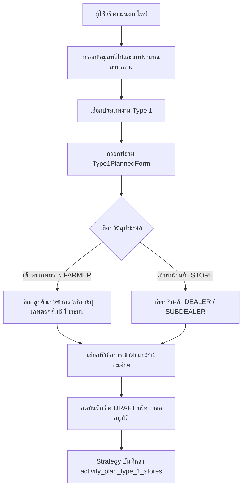
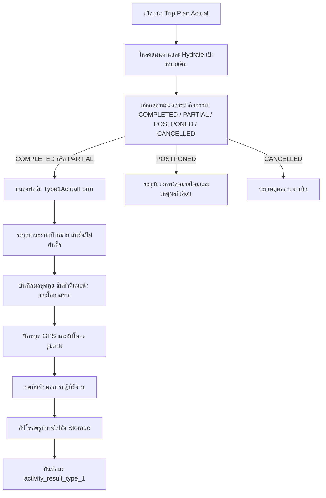

# Activity Type 1 — เข้าพบร้านค้า / Key Farmer (README)

> **Feature Slice**: `modules/activity/features/type-1`  
> **Gold Standard Reference**: ต้นแบบ Vertical Slice Architecture สำหรับประเภทงานอื่น (Work Types 2 - 14)  
> **Parent Module**: `modules/activity`  
> **Status**: Production Ready / Active Reference

---

## 1. Overview

### 1.1 วัตถุประสงค์ของ Type 1
**Type 1 (เข้าพบร้านค้า / Key Farmer)** มีวัตถุประสงค์เพื่อรองรับการปฏิบัติงานของพนักงานสนาม (Sales / Technical Reps / Promoters) ในการเดินทางเข้าพบลูกค้ากลุ่มเป้าหมายเพื่อ:
1. แจ้งข้อมูลข่าวสาร แคมเปญ หรือโปรโมชั่น
2. ให้คำแนะนำทางเทคนิคการใช้ผลิตภัณฑ์เคมีเกษตรและปุ๋ย
3. แนะนำสินค้าใหม่หรือผลักดันยอดขาย
4. ติดตามความสัมพันธ์และสำรวจความต้องการของร้านค้าและเกษตรกรชั้นนำ

### 1.2 ขอบเขตของ Type 1
- **กลุ่มเป้าหมายที่รองรับ:**
  - **ร้านค้า (STORE):** ตัวแทนจำหน่ายหลัก (`DEALER`) และตัวแทนจำหน่ายย่อย (`SUBDEALER`)
  - **เกษตรกร (FARMER):** เกษตรกรที่มีประวัติในฐานข้อมูลลูกค้า (Registered Customer) และเกษตรกรรายใหม่ที่ยังไม่ได้ลงทะเบียนในระบบ (Unregistered Farmer)
- **การจัดเก็บข้อมูล:**
  - วางแผนเป้าหมายล่วงหน้า (Planned Targets): กำหนดสถานที่, บุคคลที่เข้าพบ, หัวข้อการเข้าพบ และรายละเอียด
  - บันทึกผลการปฏิบัติงานจริง (Actual Outcome): ระบุผลการเข้าพบรายเป้าหมาย (สำเร็จ/ไม่สำเร็จ), ผลการพูดคุย, สินค้าที่แนะนำ, โอกาสการขาย, แผนดำเนินการต่อ, วันนัดหมายครั้งถัดไป, พิกัด GPS และรูปถ่ายแปลง/หน้าร้าน

### 1.3 รูปแบบการทำงานที่รองรับ
1. **Planned (ในแผนงาน):** วางแผนการเดินทางเข้าพบล่วงหน้า ส่งขออนุมัติตามสายงานก่อนออกปฏิบัติงานจริง
2. **Planned Actual (บันทึกผลงานตามแผน):** เมื่อแผนได้รับอนุมัติ นำแผนเดิมมารายงานผลการลงพื้นที่จริงและอัปโหลดหลักฐานรูปภาพ
3. **Unplanned (กิจกรรมนอกแผน 2-in-1):** รองรับกรณีเข้าพบลูกค้ากะทันหันโดยไม่ได้วางแผนล่วงหน้า สามารถระบุเป้าหมายพร้อมบันทึกผลการเข้าพบจบในฟอร์มเดียว

---

## 2. Business Flows

### 2.1 Planned (สร้างและแก้ไขแผนงาน)


### 2.2 Planned Actual (บันทึกผลการปฏิบัติงานตามแผน)


### 2.3 Unplanned (กิจกรรมนอกแผน 2-in-1)
- ผู้ใช้งานเข้าหน้า `/activity-plans/unplanned/new`
- ฟอร์มจะผสานทั้งการระบุเป้าหมาย (ลูกค้า/ร้านค้า) และการบันทึกผลการปฏิบัติงาน (ผลพูดคุย/สินค้า/รูปภาพ/GPS) เข้าด้วยกัน
- เมื่อกดบันทึก ระบบจะสร้าง `ActivityPlan` ที่มีสถานะเสร็จสิ้นทันที พร้อมบันทึกเป้าหมายและผลงานพร้อมกันผ่าน `type1UnplannedStrategy`

### 2.4 Detail and Approval (ดูรายละเอียดและพิจารณาอนุมัติ)
- **Detail View:** แสดงการ์ด `Type1PlanCard` สำหรับข้อมูลเป้าหมายตามแผน และแสดง `Type1DetailView` เพื่อดูผลการปฏิบัติงานจริงและรูปภาพถ่ายสถานที่
- **Approval View:** แสดง `Type1ApprovalCard` สรุปร้านค้า/เกษตรกรที่วางแผนเข้าพบ เพื่อให้หัวหน้างานพิจารณาอนุมัติแผนงาน

---

## 3. Architecture

### 3.1 Folder Structure
```text
modules/activity/features/type-1/
├── index.ts                              # Unified Public API Contract (ส่งออกเฉพาะสิ่งที่ภายนอกต้องใช้)
├── README.md                             # เอกสารคู่มือทางเทคนิค (ไฟล์นี้)
│
├── planned/                              # Sub-slice: กิจกรรมในแผนงาน
│   ├── application/                      # Business Logic, Validation, Mappers
│   │   ├── actual-mapper.ts              # แปลงผลการปฏิบัติงานจริง Form <-> DB/Payload
│   │   ├── planned-mapper.ts             # แปลงเป้าหมายในแผน Form <-> DB / Hydration
│   │   └── planned-validation.ts         # Zod schemas สำหรับตรวจสอบความถูกต้อง
│   ├── components/                       # UI Components ประจำ Type 1 ในแผน
│   │   ├── type1-planned-form.tsx        # ฟอร์มกรอกเป้าหมายเข้าพบ (Create / Edit)
│   │   ├── type1-actual-form.tsx         # ฟอร์มบันทึกผลจริงรายเป้าหมาย + GPS + รูปภาพ
│   │   ├── type1-plan-card.tsx           # การ์ดสรุปเป้าหมายตามแผนงาน
│   │   ├── type1-detail-view.tsx         # คอมโพเนนต์แสดงผลเต็มรูปแบบในหน้ารายละเอียด
│   │   └── type1-approval-card.tsx       # การ์ดสรุปสำหรับหน้าพิจารณาอนุมัติ
│   ├── hooks/                            # Custom State Hooks
│   │   ├── use-type1-planned-form.ts     # จัดการ State รายการเป้าหมายตามแผน
│   │   └── use-type1-actual.ts           # จัดการ State ผลการปฏิบัติงานจริงและรูปภาพ
│   ├── infrastructure/                   # Database Strategies
│   │   └── type1-planned.strategy.ts     # บันทึก/โหลดข้อมูล ActivityPlanType1Store & Result
│   └── types/                            # Type Definitions ในแผน
│       ├── planned.types.ts              # Type1PlannedItem, Type1TargetItem, Props
│       └── actual.types.ts               # Type1TargetActualItem, Type1ActualData
│
├── unplanned/                            # Sub-slice: กิจกรรมนอกแผน (2-in-1)
│   ├── application/                      # Logic และ Mappers กิจกรรมนอกแผน
│   │   ├── unplanned-mapper.ts           # Hydration และ Data mapping นอกแผน
│   │   └── unplanned-validation.ts       # Zod validation กิจกรรมนอกแผน
│   ├── components/                       # UI Components กิจกรรมนอกแผน
│   │   └── type1-unplanned-form.tsx      # ฟอร์ม 2-in-1 (ระบุเป้าหมาย + ผลการเข้าพบ)
│   ├── hooks/                            # Custom State Hooks
│   │   └── use-type1-unplanned-form.ts   # จัดการ State รายการนอกแผน
│   ├── infrastructure/                   # Database Strategies นอกแผน
│   │   └── type1-unplanned.strategy.ts   # บันทึกกิจกรรมนอกแผนลง Prisma
│   └── types/                            # Type Definitions นอกแผน
│       └── unplanned.types.ts            # Type1UnplannedItem, Props
│
└── shared/                               # ชิ้นส่วนที่ใช้ร่วมกันภายใน Feature Type 1
    ├── constants.ts                      # VISIT_TOPICS (หัวข้อการเข้าพบมาตรฐาน)
    └── types.ts                          # CustomerOption, ProductOption, Type1ImageFile
```

### 3.2 Type 1 vs Shared Activity
| ความรับผิดชอบ | จัดการที่ Type 1 Feature (`features/type-1`) | จัดการที่ Activity ส่วนกลาง (`ui/`, `views/`) |
| :--- | :--- | :--- |
| **ข้อมูลทั่วไป** | - | ชื่องาน, วันที่เริ่ม-สิ้นสุด, วัตถุประสงค์หลัก |
| **พื้นที่ & ทีมงาน** | - | จังหวัด, อำเภอ, ตำบล, พนักงานร่วมเดินทาง |
| **งบประมาณ** | - | งบเบิกสินค้าสาธิต, ของแถม, ค่าใช้จ่ายเดินทาง |
| **ข้อมูลเป้าหมาย** | เลือกร้านค้า, เกษตรกรใน/นอกระบบ, หัวข้อเข้าพบ | - |
| **ผลการเข้าพบจริง** | ผลพูดคุย, สินค้าที่แนะนำ, โอกาสขาย, วันนัดถัดไป, GPS, รูปภาพ | ผลสรุปภาพรวมแผน (สำเร็จ/เลื่อน/ยกเลิก) |
| **Database Persistence** | ตาราง `activity_plan_type_1_stores`, `activity_result_type_1` | ตารางหลัก `ActivityPlan`, `ActivityPlanApprovalLog` |

### 3.3 Dependency and Import Map
- **ทิศทางการเรียกใช้ (Allowed):**
  - `views/` ➔ เรียกใช้ ➔ `features/type-1` (ผ่าน `index.ts` เท่านั้น)
  - `features/type-1` ➔ เรียกใช้ ➔ `ui/` ส่วนกลาง (เช่น `DatePicker`, `ActivityPhotoUpload`, `ActivityGpsPicker`)
  - `features/type-1` ➔ เรียกใช้ ➔ `@/modules/activity/constants`
- **สิ่งต้องห้าม (Strictly Forbidden):**
  - ❌ ภายนอก Import เจาะลึกเข้าไปในโฟลเดอร์ย่อย เช่น `features/type-1/planned/components/...`
  - ❌ `features/type-1` เรียกใช้ข้อมูลข้ามไปยัง `features/type-2` ถึง `type-14`
  - ❌ Import ย้อนกลับไปยังโมดูลเก่า `@/modules/activity-plans/...`

### 3.4 Entry Points and Public Exports
ไฟล์ [modules/activity/features/type-1/index.ts](file:///d:/code/crm-bank/modules/activity/features/type-1/index.ts) ทำหน้าที่เป็น **Single Public API Contract** ส่งออกเฉพาะ:
- **Components:** `Type1PlannedForm`, `Type1PlanCard`, `Type1ActualForm`, `Type1DetailView`, `Type1ApprovalCard`, `Type1UnplannedForm`
- **Hooks:** `useType1PlannedForm`, `useType1Actual`, `useType1UnplannedForm`
- **Mappers & Hydrators:** `hydrateType1PlannedData`, `extractType1PlanTargets`, `hydrateType1UnplannedData`
- **Strategies:** `type1PlannedStrategy`, `type1UnplannedStrategy`
- **Types:** `Type1PlannedItem`, `Type1TargetItem`, `Type1ActualData`, `Type1UnplannedItem`

---

## 4. File Responsibilities

### 4.1 Planned
- **`use-type1-planned-form.ts`:** จัดการ State ของรายการเป้าหมาย (Array of `Type1PlannedItem`) มีฟังก์ชัน `addItem`, `updateItem`, `deleteItem`, และ `hydrateItems`
- **`type1-planned-form.tsx`:** เรนเดอร์การ์ดเป้าหมายแต่ละรายการ สลับ UI ตาม `visitPurpose` (ร้านค้า vs เกษตรกร)
- **`planned-mapper.ts`:**
  - `mapType1PlannedItemToDb`: แปลงข้อมูลจาก Form ไปเป็น Payload บันทึก DB
  - `mapType1DbStoreToPlannedItem`: แปลงข้อมูลจาก Store Record ไปเป็น Form Item
  - `hydrateType1PlannedData`: กู้คืนข้อมูลแผนเดิมเมื่อเข้าสู่หน้าแก้ไข (`edit-view.tsx`)
  - `extractType1PlanTargets`: แปลงข้อมูลแผนงานเดิมเพื่อเตรียมเป็นเป้าหมายในหน้า Actual และ Detail
- **`planned-validation.ts`:** ตรวจสอบความถูกต้องของข้อมูลร้านค้า/เกษตรกรก่อนบันทึก
- **`type1-planned.strategy.ts`:** ตรวจสอบสิทธิ์และประเภทลูกค้าใน DB และบันทึกลงตาราง `activity_plan_type_1_stores`

### 4.2 Unplanned
- **`use-type1-unplanned-form.ts`:** จัดการ State กิจกรรมนอกแผนที่มีทั้งเป้าหมายและผลการปฏิบัติงาน
- **`type1-unplanned-form.tsx`:** ฟอร์ม 2-in-1 แสดงทั้งส่วนเลือกลูกค้า ผลพูดคุย สินค้า และกล้องถ่ายรูป/พิกัด GPS
- **`unplanned-mapper.ts`:** จัดการ Hydrate ข้อมูลเดิมเมื่อเปิดหน้าแก้ไขกิจกรรมนอกแผน
- **`type1-unplanned.strategy.ts`:** บันทึกทั้งเป้าหมายและผลการเข้าพบของกิจกรรมนอกแผน

### 4.3 Shared Types and Constants
- **`shared/constants.ts`:** กำหนด `VISIT_TOPICS` เช่น "แจ้งข่าวสาร / แคมเปญ", "ให้คำแนะนำการใช้สินค้า", "สำรวจความต้องการ", "แนะนำสินค้าใหม่"
- **`shared/types.ts`:** กำหนดประเภทข้อมูลรูปภาพ (`Type1ImageFile`), ตัวเลือกร้านค้า (`CustomerOption`), ตัวเลือกสินค้า (`ProductOption`)

### 4.4 Shared UI and Views
- `ActualWorkTypeList` และ `DetailWorkTypeList` ในโฟลเดอร์ `views/` ทำหน้าที่เป็น Orchestrator เรียกใช้ Component ของ Type 1 ตามเงื่อนไขการตรวจจับประเภทงาน

---

## 5. Data Flow

### 5.1 Create Planned (สร้างแผนใหม่)
1. `create-view.tsx` เรียกใช้ `useType1PlannedForm()`
2. ผู้ใช้ระบุเป้าหมายใน `Type1PlannedForm`
3. ผู้ใช้กดส่งข้อมูล ➔ รัน `validateType1PlannedItem`
4. Form Orchestrator รวม Type 1 payload ➔ ส่ง Server Action ➔ เรียก `type1PlannedStrategy.savePlan()`
5. Prisma บันทึกลงตาราง `activity_plan_type_1_stores`

### 5.2 Edit Planned (แก้ไขแผนงานเดิม)
1. `edit-view.tsx` ดึงข้อมูลแผนจากฐานข้อมูล (`plan`)
2. เรียก `hydrateType1PlannedData(plan)` เพื่อแปลงข้อมูลจาก `type1Stores` หรือ fallback `stores`
3. ส่งข้อมูลที่ hydrate เข้า `useType1PlannedForm({ initialItems })`
4. ข้อมูลแสดงบนฟอร์มพร้อมให้แก้ไขและบันทึกกลับ

### 5.3 Save Actual (บันทึกผลการปฏิบัติงานจริง)
1. `activity-plan-actual-view.tsx` รัน `handleSubmit`
2. เรียก `type1Actual.uploadImages(id)` เพื่ออัปโหลดไฟล์ภาพไปยัง Storage ได้ URLs กลับมา
3. เรียก `type1Actual.getPayload(cleanImages)` รวบรวมผลการเข้าพบทุกเป้าหมาย
4. ส่ง Payload เข้า `recordActivityResultAction(id, payload)`
5. `type1PlannedStrategy.saveActual()` ลบผลงานเก่าแล้วสร้างระเบียนใหม่ลงตาราง `activity_result_type_1`

### 5.4 Load Actual (โหลดผลงานเดิมมาแสดงในหน้าบันทึกผล)
1. `useActualPlanLoader` โหลดแผนและข้อมูล `plan.result`
2. `extractType1PlanTargets(plan)` แปลงเป้าหมายและผลงานเดิมเข้าสู่ `targets`
3. `type1Actual.hydrate(plan.result)` กู้คืนผลพูดคุย สินค้า และรูปภาพเดิม
4. ฟอร์มแสดงข้อมูลเดิมพร้อมให้แก้ไขเพิ่มเติม

### 5.5 Create/Edit Unplanned (กิจกรรมนอกแผน)
1. ผู้ใช้กรอกฟอร์ม `Type1UnplannedForm`
2. ข้อมูลเป้าหมายและผลงานถูกตรวจสอบพร้อมกันด้วย `type1UnplannedSchema`
3. `type1UnplannedStrategy.savePlan()` บันทึกเป้าหมายและผลงานจริงในทรานแซกชันเดียวกัน

### 5.6 Detail and Approval (การแสดงผลหน้ารายละเอียดและพิจารณาอนุมัติ)
1. โหลดข้อมูลแผนงานผ่าน `useDetailPlanLoader` หรือ `useApprovalDetailLoader`
2. ระบบตรวจจับประเภทงานว่าเป็น Type 1
3. เรนเดอร์ `<Type1PlanCard />` (เป้าหมายตามแผน)
4. หากมีผลงานจริง (`hasActualData`) เรนเดอร์ `<Type1DetailView />` พร้อมพิกัดและรูปถ่าย

---

## 6. Data Models and Mapping

### 6.1 Planned Types (`planned.types.ts`)
```typescript
export interface Type1PlannedItem {
  id: string;
  visitPurpose: "FARMER" | "STORE";
  storeId?: string;
  customerName?: string;
  isUnregisteredFarmer?: boolean;
  unregisteredFarmerName?: string;
  unregisteredFarmerPhone?: string;
  topic?: string;
  detail?: string;
  province?: string;
}
```

### 6.2 Actual Types (`actual.types.ts`)
```typescript
export interface Type1TargetActualItem {
  targetId: string;
  storeId?: string;
  customerName: string;
  isMet: boolean;               // ผลการเข้าพบ: สำเร็จ หรือ ไม่สำเร็จ
  unmetReason?: string;         // สาเหตุที่เข้าพบไม่สำเร็จ
  discussionResult?: string;
  productAdvice?: string;
  salesOpportunity?: string;
  nextAction?: string;
  nextMeetingDate?: string;
  farmerHomeAddress?: string;
  plotLatitude?: string;
  plotLongitude?: string;
  plotImages?: Type1ImageFile[];
}
```

### 6.3 Unplanned Types (`unplanned.types.ts`)
```typescript
export interface Type1UnplannedItem extends Type1PlannedItem {
  isMet: boolean;
  discussionResult?: string;
  productAdvice?: string;
  salesOpportunity?: string;
  plotLatitude?: string;
  plotLongitude?: string;
  plotImages?: Type1ImageFile[];
}
```

### 6.4 Form-to-Database Mapping
| ฟิลด์บนฟอร์ม Type 1 | ฟิลด์ในตาราง DB (`activity_plan_type_1_stores`) | ฟิลด์ในตาราง DB (`activity_result_type_1`) |
| :--- | :--- | :--- |
| `visitPurpose` | `visit_purpose` ("FARMER" / "STORE") | - |
| `storeId` | `store_id` (FK ➔ Customer.id) | `store_id` |
| `customerName` | อ่านจาก `store.name` | `customer_name` |
| `isUnregisteredFarmer` | `is_unregistered_farmer` (Boolean) | - |
| `unregisteredFarmerName`| `unregistered_farmer_name` (String) | - |
| `topic` | `topic` (String) | - |
| `detail` | `notes` (String) | - |
| `discussionResult` | - | `discussion_result` |
| `productAdvice` | - | `product_advice` |
| `salesOpportunity` | - | `sales_opportunity` |
| `nextMeetingDate` | - | `next_meeting_date` (DateTime) |
| `plotLatitude` / `Lng` | - | `plot_latitude` / `plot_longitude` |
| `plotImages` | - | ตารางลูก `activity_result_type_1_images` |

### 6.5 Database Tables and Relations
1. **`ActivityPlan` (ตารางหลัก):** เชื่อมโยง 1-to-Many กับเป้าหมายและผลงาน
2. **`activity_plan_type_1_stores`:** เก็บรายการเป้าหมายตามแผนของ Type 1
   - `activityPlanId` (FK)
   - `storeId` (FK ➔ `Customer`, optional)
   - `visitPurpose`, `topic`, `notes`
3. **`activity_result_type_1`:** เก็บผลการปฏิบัติงานจริง
   - `activityPlanId` (FK)
   - `planStoreId` (FK ➔ `activity_plan_type_1_stores`, optional)
   - `discussionResult`, `salesOpportunity`, `plotLatitude`, `plotLongitude`
4. **`activity_result_type_1_products`:** เก็บรายการสินค้าที่แนะนำในการเข้าพบ
5. **`activity_result_type_1_images`:** เก็บ URL และ Metadata ของรูปภาพที่อัปโหลด

---

## 7. Business Rules

### 7.1 Validation Rules
- **กรณีเข้าพบร้านค้า (`STORE`):**
  - ต้องเลือกร้านค้าที่มีอยู่ในระบบเท่านั้น (`storeId` ห้ามว่าง)
  - ไม่อนุญาตให้เลือกเกษตรกรที่ไม่มีในระบบ
  - ร้านค้าต้องมีประเภทลูกค้าเป็น `DEALER` หรือ `SUBDEALER`
- **กรณีเข้าพบเกษตรกร (`FARMER`):**
  - หากเป็นเกษตรกรในระบบ: ลูกค้าต้องมีประเภทเป็น `FARMER`
  - หากไม่มีในระบบ (`isUnregisteredFarmer = true`): ต้องระบุชื่อเกษตรกร (`unregisteredFarmerName` ห้ามว่าง)
- **หัวข้อการเข้าพบ (`topic`):** ต้องเลือก 1 ในหัวข้อมาตรฐาน หรือระบุหัวข้ออื่น ๆ

### 7.2 Default Values
- `visitPurpose`: ค่าเริ่มต้นเป็น `"FARMER"`
- `topic`: ค่าเริ่มต้นเป็น `"แจ้งข่าวสาร"`
- `activityResultStatus`: ค่าเริ่มต้นเมื่อเปิดหน้าบันทึกผลเป็น `"COMPLETED"`
- `isMet`: ค่าเริ่มต้นผลการเข้าพบเป็น `true` (เข้าพบสำเร็จ)

### 7.3 Conditional Fields
- หากเลือกหัวข้อ **"ให้คำแนะนำการใช้สินค้า"**: ฟอร์มจะแสดงช่องกรอกคำแนะนำสินค้าและตัวเลือกสินค้าที่แนะนำ
- หากระบุ **"เข้าพบไม่สำเร็จ" (`isMet = false`)**: ฟอร์มจะแสดงช่องให้ระบุสาเหตุที่เข้าพบไม่สำเร็จ และซ่อนช่องบันทึกโอกาสการขายและพิกัดแปลง

### 7.4 Status and Approval Rules
- **การบันทึกผลงานจริง (Trip Plan Actual):** สามารถบันทึกได้เฉพาะเมื่อแผนมีสถานะเป็น `APPROVED` (อนุมัติแล้ว) เท่านั้น
- **สิทธิ์การบันทึกผล:** เฉพาะเจ้าของแผนงาน (Creator) และ Administrator เท่านั้น ผู้ช่วยงาน (Helper) ไม่สามารถบันทึกผลแทนได้
- **การแสดงผลฟอร์มจริง:** ฟอร์ม Type 1 Actual จะแสดงขึ้นมาให้กรอกเมื่อสถานะกิจกรรมเป็น **`COMPLETED` (ปฏิบัติงานแล้วเสร็จ)** หรือ **`PARTIAL` (สำเร็จบางส่วน)**

---

## 8. Shared Dependencies

โมดูล Type 1 ทำงานร่วมกับชิ้นส่วนส่วนกลางต่อไปนี้:
1. **`@/modules/activity/ui`:**
   - `DatePicker`: ปฏิทินเลือกวันนัดหมายครั้งถัดไป
   - `ActivityPhotoUpload`: คอมโพเนนต์อัปโหลดรูปภาพพร้อมบีบอัดไฟล์
   - `ActivityGpsPicker`: คอมโพเนนต์ดึงพิกัดปัจจุบันผ่านเบราว์เซอร์ Geolocation
   - `FormActionButtons`: ปุ่มยกเลิก / บันทึกร่าง / ส่งขออนุมัติ
2. **`@/modules/activity/views`:**
   - `ActualWorkTypeList`: ตัวกระจายฟอร์มผลการปฏิบัติงานจริง
   - `DetailWorkTypeList`: ตัวกระจายการ์ดแสดงผลในหน้ารายละเอียด
   - `ApprovalWorkTypeList`: ตัวกระจายการ์ดในหน้าพิจารณาอนุมัติ
3. **`@/modules/activity/constants`:**
   - `WORK_TYPE_CONFIG`: การตั้งค่าและรหัสประเภทงาน
   - `ACTIVITY_RESULT_STATUS_LABELS`: ป้ายแสดงสถานะผลกิจกรรม
4. **Server Actions ที่ใช้งานจริง:**
   - `getActivityPlanAction(id)`: โหลดข้อมูลแผนงาน
   - `recordActivityResultAction(id, payload)`: บันทึกผลการปฏิบัติงาน
   - `listProductsAction()`: ดึงรายการสินค้า Master Data
   - `getCustomersAction()`: ดึงรายชื่อร้านค้า/เกษตรกร

---

## 9. How to Modify Type 1

### 9.1 การเพิ่มฟิลด์ใหม่บนฟอร์ม (Add a Form Field)
1. เพิ่มฟิลด์ใน Type Definitions:
   - ฟอร์มในแผน: `planned/types/planned.types.ts` (`Type1PlannedItem`)
   - ฟอร์มผลจริง: `planned/types/actual.types.ts` (`Type1TargetActualItem`)
2. เพิ่ม Validation Schema ใน `planned-validation.ts`
3. เพิ่ม Input Field ใน UI Component:
   - ในแผน: `planned/components/type1-planned-form.tsx`
   - ผลจริง: `planned/components/type1-actual-form.tsx`
4. อัปเดต Mapper ใน `planned-mapper.ts` หรือ `actual-mapper.ts`
5. อัปเดต Strategy ใน `type1-planned.strategy.ts` เพื่อบันทึกฟิลด์ลง Database

### 9.2 การปรับแก้ Validation (Change Validation)
- แก้ไขที่ไฟล์ `planned/application/planned-validation.ts` หรือ `unplanned/application/unplanned-validation.ts` โดยปรับเงื่อนไข Zod schema หรือฟังก์ชัน `validateType1PlannedItem`

### 9.3 การปรับ Database Mapping (Change Database Mapping)
- หากมีการเปลี่ยนชื่อคอลัมน์หรือโครงสร้างความสัมพันธ์ใน Prisma ให้แก้ไขใน `planned/infrastructure/type1-planned.strategy.ts` ตรงฟังก์ชัน `savePlan`, `loadPlan`, และ `saveActual`

### 9.4 การปรับแก้ Actual Loading or Hydration
- ตรวจสอบฟังก์ชัน `hydrateType1PlannedData` และ `extractType1PlanTargets` ใน `planned/application/planned-mapper.ts` เพื่อให้รองรับ fallback ฟิลด์เดิมอย่างครอบคลุม

### 9.5 การแก้ไข Shared Components อย่างปลอดภัย
- หากต้องแก้ Component ใน `modules/activity/ui/` ให้ตรวจสอบว่าไม่กระทบประเภทงานอื่น และคง Props Interface เดิมไว้เสมอ

---

## 10. Troubleshooting (ปัญหาที่พบบ่อยและวิธีแก้ไข)

| อาการ | สาเหตุที่เป็นไปได้ | แนวทางแก้ไข |
| :--- | :--- | :--- |
| **ข้อมูลเป้าหมายไม่ขึ้นในหน้าแก้ไข** | `hydrateType1PlannedData` อ่านคีย์ไม่ตรงกับ Record ในฐานข้อมูล | ตรวจสอบว่า record ส่งมาเป็น `type1Stores`, `items`, หรือ `stores` ใน `planned-mapper.ts` |
| **หน้า Trip Plan Actual ไม่มีช่องให้กรอกข้อมูล** | สถานะเป็น `PARTIAL` แต่เงื่อนไขหน้าจอเช็คเฉพาะ `COMPLETED` | ตรวจสอบเงื่อนไขใน `activity-plan-actual-view.tsx` ให้รองรับทั้ง `COMPLETED` และ `PARTIAL` |
| **ข้อมูลหายหลังกด Reload หน้าเว็บ** | ขาดการ Hydrate State ใน `useEffect` หรือ `isHydrated` ถูกรีเซ็ต | ตรวจสอบ `useEffect` ใน `activity-plan-actual-view.tsx` และตรวจว่าเรียก `type1Actual.hydrate()` ครบถ้วน |
| **บันทึกแล้วข้อมูลโอกาสการขายไม่ลง DB** | ตอน submit ไม่ได้ดึง payload เมื่อเลือกสถานะสำเร็จบางส่วน | อัปเดต `handleSubmit` ใน `activity-plan-actual-view.tsx` ให้อัปโหลดรูปและส่ง payload ทั้ง `COMPLETED` และ `PARTIAL` |
| **ข้อมูล Planned ซ้อนกับ Unplanned** | ไม่ได้แยก `isUnplanned` flag หรือ Strategy บันทึกผิดตาราง | ตรวจสอบว่ากิจกรรมนอกแผนถูกส่งไปยัง `type1UnplannedStrategy` อย่างถูกต้อง |

---

## 11. Testing and Manual UAT

### แผนการทดสอบแบบครบวงจร (End-to-End Test Checklist):
- [ ] **TC-01 (Planned Create - Farmer):** สร้างแผนเข้าพบเกษตรกรในระบบและเกษตรกรนอกระบบ บันทึกร่างและส่งอนุมัติได้สำเร็จ
- [ ] **TC-02 (Planned Create - Store):** สร้างแผนเข้าพบร้านค้า โดยเลือกเฉพาะ Dealer/Subdealer
- [ ] **TC-03 (Planned Edit):** เข้าหน้าแก้ไข (`/activity-plans/[id]/edit`) ข้อมูลร้านค้าและเป้าหมายต้องแสดงครบทุกช่อง
- [ ] **TC-04 (Detail View):** เข้าหน้ารายละเอียด (`/activity-plans/[id]`) การ์ดเป้าหมาย Type 1 ต้องแสดงถูกต้อง
- [ ] **TC-05 (Actual - Completed):** บันทึกผลการปฏิบัติงานจริงแบบ "ปฏิบัติงานแล้วเสร็จ" พร้อมใส่ผลพูดคุย สินค้าที่แนะนำ ปักหมุด GPS และอัปโหลดภาพถ่าย
- [ ] **TC-06 (Actual - Partial):** บันทึกผลแบบ "สำเร็จบางส่วน" ตรวจสอบว่ามีช่องให้กรอกข้อมูลครบถ้วน และบันทึกผลได้จริง
- [ ] **TC-07 (Unplanned 2-in-1):** สร้างกิจกรรมนอกแผน ระบุร้านค้าพร้อมผลพูดคุยในหน้าเดียว บันทึกแล้วเสร็จสมบูรณ์ทันที
- [ ] **TC-08 (Approval View):** หัวหน้างานเข้าหน้าพิจารณาอนุมัติ ข้อมูลเป้าหมาย Type 1 ต้องแสดงในการ์ดอนุมัติอย่างถูกต้อง

---

## 12. Known Limitations and Important Notes

1. **Prisma Table Separation:**
   - Type 1 จัดเก็บเป้าหมายไว้ในตารางเฉพาะกิจ `activity_plan_type_1_stores` ไม่ได้เก็บปนในตารางรวม `activity_plan_stores` ของระบบเดิม
2. **รูปภาพและการบีบอัด:**
   - ก่อนส่ง Payload บันทึกผลจริง ระบบต้องเรียก `type1Actual.uploadImages()` เสมอ เพื่อแปลงไฟล์รูปภาพจาก `Blob/File` ให้กลายเป็น `URL String` ก่อนบันทึกลงฐานข้อมูล
3. **Decoupling Dependency:**
   - ต้องนำเข้าค่าคงที่และฟังก์ชันจาก `@/modules/activity/constants` เท่านั้น ห้ามนำเข้าจาก `@/modules/activity-plans` โดยเด็ดขาด

---

## 13. Change Log

| วันที่ | เวอร์ชัน | รายละเอียดการปรับปรุง | ผู้ดำเนินการ |
| :--- | :--- | :--- | :--- |
| **2026-10-15** | 1.0.0 | สร้างโมดูล Type 1 เป็น Gold Standard Vertical Slice แรกของระบบ | Antigravity AI |
| **2026-10-15** | 1.0.1 | แก้ไข Hydration ใน `planned-mapper.ts` และเชื่อมต่อข้อมูลในหน้าแก้ไข (`edit-view`) | Antigravity AI |
| **2026-10-15** | 1.0.2 | แก้ไขปัญหาหน้า Actual ซ่อนฟอร์มเมื่อสถานะเป็น `PARTIAL` และเพิ่ม Hydration สถานะเดิม | Antigravity AI |
| **2026-10-19** | 1.1.0 | ปลด Dependency ออกจากโฟลเดอร์เก่า สลับมาใช้ `@/modules/activity/constants` และลบ Mock Data (`DEMO_PRODUCTS`) | Antigravity AI |
| **2026-10-19** | 1.2.0 | จัดทำเอกสารคู่มือมาตรฐานฉบับสมบูรณ์สำหรับ Type 1 Feature (`README.md`) | Antigravity AI |
