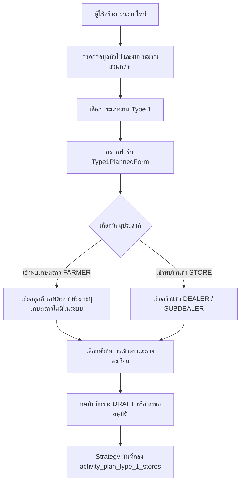
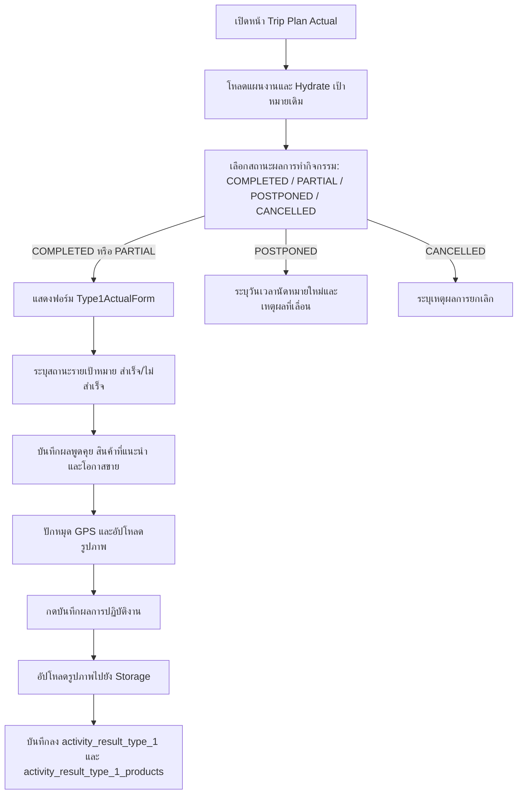
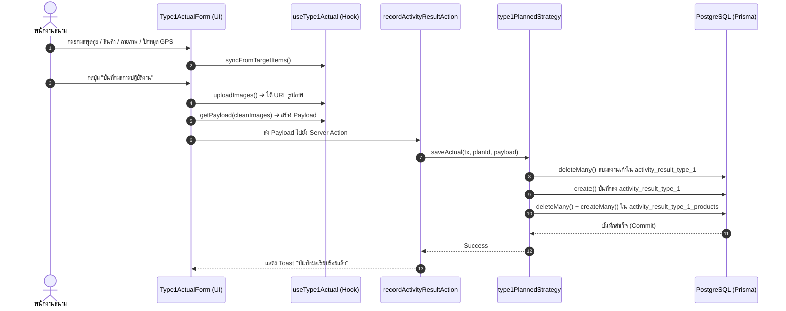

# Activity Type 1 — เข้าพบร้านค้า / Key Farmer (README)

> **Feature Slice**: `modules/activity/features/type-1`  
> **Gold Standard Reference**: ต้นแบบ Vertical Slice Architecture สำหรับประเภทงานอื่น (Work Types 2 - 14)  
> **Parent Module**: `modules/activity`  
> **Database Authority**: `prisma/schema.prisma` (`ActivityPlanType1Store`, `ActivityResultType1`, `ActivityResultType1Product`, `ActivityAttachment`)  
> **Status**: Production Ready / Active Reference

---

## 1. Overview

### 1.1 วัตถุประสงค์ของ Type 1
**Type 1 (เข้าพบร้านค้า / Key Farmer)** มีวัตถุประสงค์เพื่อรองรับการปฏิบัติงานของพนักงานสนาม (Sales / Technical Reps / Promoters) ในการเดินทางเข้าพบลูกค้ากลุ่มเป้าหมายเพื่อ:
1. แจ้งข้อมูลข่าวสาร แคมเปญ หรือสิทธิประโยชน์ทางการค้า
2. ให้คำแนะนำทางเทคนิคการใช้ผลิตภัณฑ์เคมีเกษตรและปุ๋ย
3. แนะนำสินค้าใหม่หรือผลักดันยอดขายหน้าร้านและแปลงเกษตรกร
4. ติดตามความสัมพันธ์และสำรวจความต้องการของร้านค้าและเกษตรกรชั้นนำ

### 1.2 ขอบเขตของ Type 1
- **กลุ่มเป้าหมายที่รองรับ:**
  - **ร้านค้า (STORE):** ตัวแทนจำหน่ายหลัก (`DEALER`) และตัวแทนจำหน่ายย่อย (`SUBDEALER`)
  - **เกษตรกร (FARMER):** เกษตรกรที่มีประวัติในฐานข้อมูลลูกค้า (Registered Customer) และเกษตรกรรายใหม่ที่ยังไม่ได้ลงทะเบียนในระบบ (Unregistered Farmer)
- **การจัดเก็บข้อมูล:**
  - **วางแผนเป้าหมายล่วงหน้า (Planned Targets):** กำหนดสถานที่, บุคคลที่เข้าพบ, หัวข้อการเข้าพบ และรายละเอียด
  - **บันทึกผลการปฏิบัติงานจริง (Actual Outcome):** ระบุผลการเข้าพบรายเป้าหมาย (สำเร็จ/ไม่สำเร็จ), ผลการพูดคุย, สินค้าที่แนะนำ, โอกาสการขาย, แผนดำเนินการต่อ, วันนัดหมายครั้งถัดไป, พิกัด GPS และรูปถ่ายแปลง/หน้าร้าน

### 1.3 รูปแบบการทำงานที่รองรับ
1. **Planned (ในแผนงาน):** วางแผนการเดินทางเข้าพบล่วงหน้า ส่งขออนุมัติตามสายงานก่อนออกปฏิบัติงานจริง
2. **Planned Actual (บันทึกผลงานตามแผน):** เมื่อแผนได้รับอนุมัติ นำแผนเดิมมารายงานผลการลงพื้นที่จริงและอัปโหลดหลักฐานรูปภาพ
3. **Unplanned (กิจกรรมนอกแผน 2-in-1):** รองรับกรณีเข้าพบลูกค้ากะทันหันโดยไม่ได้วางแผนล่วงหน้า สามารถระบุเป้าหมายพร้อมบันทึกผลการเข้าพบจบในฟอร์มเดียว

---

## 2. Business Flows

### 2.1 Planned (สร้างและแก้ไขแผนงาน)


### 2.2 Planned Actual (บันทึกผลการปฏิบัติงานตามแผน)


### 2.3 Unplanned (กิจกรรมนอกแผน 2-in-1)
- ผู้ใช้งานเข้าหน้า `/activity-plans/unplanned/new`
- ฟอร์มจะผสานทั้งการระบุเป้าหมาย (ลูกค้า/ร้านค้า) และการบันทึกผลการปฏิบัติงาน (ผลพูดคุย/สินค้า/รูปภาพ/GPS) เข้าด้วยกัน
- เมื่อกดบันทึก ระบบจะสร้าง `ActivityPlan` ที่มีสถานะเสร็จสิ้นทันที พร้อมบันทึกเป้าหมายและผลงานพร้อมกันผ่าน `type1UnplannedStrategy` ภายใน $transaction เดียวกัน

### 2.4 Detail and Approval (ดูรายละเอียดและพิจารณาอนุมัติ)
- **Detail View:** แสดงการ์ด `Type1PlanCard` สำหรับข้อมูลเป้าหมายตามแผน และแสดง `Type1DetailView` เพื่อดูผลการปฏิบัติงานจริง สินค้าที่แนะนำ และรูปถ่ายสถานที่
- **Approval View:** แสดง `Type1ApprovalCard` สรุปร้านค้า/เกษตรกรที่วางแผนเข้าพบ เพื่อให้หัวหน้างานพิจารณาอนุมัติแผนงาน

---

## 3. Architecture

### 3.1 Folder Structure
```text
modules/activity/features/type-1/
├── index.ts                              # Unified Public API Contract (ส่งออกเฉพาะสิ่งที่ภายนอกต้องใช้)
├── README.md                             # เอกสารคู่มือทางเทคนิค (ไฟล์นี้)
│
├── planned/                              # Sub-slice: กิจกรรมในแผนงานและบันทึกผลตามแผน
│   ├── application/                      # Business Logic, Validation, Mappers
│   │   ├── actual-mapper.ts              # แปลงผลการปฏิบัติงานจริง Form <-> DB/Payload
│   │   ├── actual-validation.ts          # ตรวจสอบความถูกต้องของผลการปฏิบัติงานจริง (validateType1Actual)
│   │   ├── planned-mapper.ts             # แปลงเป้าหมายในแผน Form <-> DB / Hydration
│   │   └── planned-validation.ts         # Zod schemas สำหรับตรวจสอบความถูกต้องของแผน
│   ├── components/                       # UI Components ประจำ Type 1 ในแผน
│   │   ├── type1-planned-form.tsx        # ฟอร์มกรอกเป้าหมายเข้าพบ (Create / Edit)
│   │   ├── type1-actual-form.tsx         # ฟอร์มบันทึกผลจริงรายเป้าหมาย + GPS + รูปภาพ
│   │   ├── type1-plan-card.tsx           # การ์ดสรุปเป้าหมายตามแผนงาน
│   │   ├── type1-detail-view.tsx         # คอมโพเนนต์แสดงผลเต็มรูปแบบในหน้ารายละเอียด
│   │   └── type1-approval-card.tsx       # การ์ดสรุปสำหรับหน้าพิจารณาอนุมัติ
│   ├── hooks/                            # Custom State Hooks
│   │   ├── use-type1-planned-form.ts     # จัดการ State รายการเป้าหมายตามแผน
│   │   └── use-type1-actual.ts           # จัดการ State ผลการปฏิบัติงานจริงและอัปโหลดรูปภาพรายเป้าหมาย
│   ├── infrastructure/                   # Database Strategies
│   │   └── type1-planned.strategy.ts     # บันทึก/โหลดข้อมูล ActivityPlanType1Store & Result & Products
│   └── types/                            # Type Definitions ในแผน
│       ├── planned.types.ts              # Type1PlannedItem, Type1TargetItem, Props
│       └── actual.types.ts               # Type1TargetActualItem, Type1ActualData
│
├── unplanned/                            # Sub-slice: กิจกรรมนอกแผน (2-in-1)
│   ├── application/                      # Logic และ Mappers กิจกรรมนอกแผน
│   │   ├── unplanned-mapper.ts           # Hydration และ Data mapping นอกแผน
│   │   └── unplanned-validation.ts       # Zod validation กิจกรรมนอกแผน
│   ├── components/                       # UI Components กิจกรรมนอกแผน
│   │   └── type1-unplanned-form.tsx      # ฟอร์ม 2-in-1 (ระบุเป้าหมาย + ผลการเข้าพบ)
│   ├── hooks/                            # Custom State Hooks
│   │   └── use-type1-unplanned-form.ts   # จัดการ State รายการนอกแผน
│   ├── infrastructure/                   # Database Strategies นอกแผน
│   │   └── type1-unplanned.strategy.ts   # บันทึกกิจกรรมนอกแผนลง Prisma
│   └── types/                            # Type Definitions นอกแผน
│       └── unplanned.types.ts            # Type1UnplannedItem, Props
│
└── shared/                               # ชิ้นส่วนที่ใช้ร่วมกันภายใน Feature Type 1
    ├── constants.ts                      # VISIT_TOPICS (หัวข้อการเข้าพบมาตรฐาน)
    └── types.ts                          # CustomerOption, ProductOption, Type1ImageFile, Type1AdviceProductItem
```

### 3.2 Type 1 vs Shared Activity
| ความรับผิดชอบ | จัดการที่ Type 1 Feature (`features/type-1`) | จัดการที่ Activity ส่วนกลาง (`ui/`, `views/`) |
| :--- | :--- | :--- |
| **ข้อมูลทั่วไป** | - | ชื่องาน, วันที่เริ่ม-สิ้นสุด, วัตถุประสงค์หลัก |
| **พื้นที่ & ทีมงาน** | - | จังหวัด, อำเภอ, ตำบล, พนักงานร่วมเดินทาง |
| **งบประมาณ** | - | งบเบิกสินค้าสาธิต, ของแถม, ค่าใช้จ่ายเดินทาง |
| **ข้อมูลเป้าหมาย** | เลือกร้านค้า, เกษตรกรใน/นอกระบบ, หัวข้อเข้าพบ | - |
| **ผลการเข้าพบจริง** | ผลพูดคุย, สินค้าที่แนะนำ, โอกาสขาย, วันนัดถัดไป, GPS, รูปภาพ | ผลสรุปภาพรวมแผน (สำเร็จ/เลื่อน/ยกเลิก) |
| **Database Persistence** | ตาราง `activity_plan_type_1_stores`, `activity_result_type_1`, `activity_result_type_1_products` | ตารางหลัก `ActivityPlan`, `ActivityPlanApprovalLog`, `ActivityAttachment` |

### 3.3 Dependency and Import Map
- **ทิศทางการเรียกใช้ (Allowed):**
  - `views/` ➔ เรียกใช้ ➔ `features/type-1` (ผ่าน `index.ts` เท่านั้น)
  - `features/type-1` ➔ เรียกใช้ ➔ `ui/` ส่วนกลาง (รวมถึง Shared Inputs: `ActivityInput`, `ActivityAddressSelect`, `ActivityCustomerSelect`, `ActivityProductSelect`, `ActivityPhotoUpload`, `ActivityGpsPicker`, `DatePicker`)
  - `features/type-1` ➔ เรียกใช้ ➔ `@/modules/activity/constants`
  - `features/type-1` ➔ เรียกใช้ ➔ `@/modules/activity/types/strategy.interface`
  - `features/type-1` ➔ เรียกใช้ ➔ `@/modules/activity/application/media/image-uploader`
- **Server Actions & Database Flow:**
  - `views/` ➔ ส่งข้อมูลไปยัง ➔ Server Actions ใน `@/modules/activity/server/`:
    - `planned.actions.ts` (`createActivityPlanAction`, `updateActivityPlanAction`, `getActivityPlanAction`)
    - `unplanned.actions.ts` (`createUnplannedActivityAction`, `updateUnplannedActivityAction`, `getUnplannedActivityAction`)
    - `actual.actions.ts` (`recordActivityResultAction`)
  - Server Actions ➔ ทำงานร่วมกับ ➔ `@/modules/activity/infrastructure/strategy.registry` ➔ เรียกใช้ `type1PlannedStrategy` / `type1UnplannedStrategy` บันทึกลงตาราง `activity_plan_type_1_stores` โดยตรง
- **สิ่งต้องห้าม (Strictly Forbidden):**
  - ❌ ภายนอก Import เจาะลึกเข้าไปในโฟลเดอร์ย่อย เช่น `features/type-1/planned/components/...`
  - ❌ `features/type-1` เรียกใช้ข้อมูลข้ามไปยัง `features/type-2` ถึง `type-14`
  - ❌ Import ย้อนกลับไปยังโมดูลเก่า `@/modules/activity-plans/...` โดยเด็ดขาด

### 3.4 Entry Points and Public Exports
ไฟล์ [modules/activity/features/type-1/index.ts](file:///d:/code/crm-bank/modules/activity/features/type-1/index.ts) ทำหน้าที่เป็น **Single Public API Contract** สำหรับฝั่ง UI / Application โดยส่งออกเฉพาะ:
- **Components:** `Type1PlannedForm`, `Type1PlanCard`, `Type1ActualForm` (`ActualType1Visit`), `Type1DetailView` (`DetailType1Visit`), `Type1ApprovalCard` (`ApprovalType1Visit`), `Type1UnplannedForm`
- **Hooks:** `useType1PlannedForm`, `useType1Actual`, `useType1UnplannedForm`
- **Mappers & Hydrators:** `mapType1PlannedItemToDb`, `mapType1DbStoreToPlannedItem`, `hydrateType1PlannedData`, `extractType1PlanTargets`, `mapType1StoresToSectionItems`, `mapType1ActualFormToDb`, `parseType1ActualResult`, `parseTargetText`, `aggregateType1TargetItems`, `hydrateType1UnplannedData`, `mapType1UnplannedItemToStore`
- **Validators & Schemas:** `validateType1PlannedItem`, `type1PlannedSchema`, `type1ActualResultSchema`, `validateType1Actual`, `validateType1UnplannedItem`, `type1UnplannedSchema`
- **Constants & Types:** `VISIT_TOPICS`, `Type1PlannedItem`, `Type1TargetItem`, `Type1TargetActualItem`, `Type1ActualData`, `Type1UnplannedItem`, `CustomerOption`, `ProductOption`, `Type1ImageFile`, `Type1AdviceProductItem`
- *(หมายเหตุ: `type1PlannedStrategy` และ `type1UnplannedStrategy` ถูกนำเข้าโดยตรงที่ `modules/activity/infrastructure/strategy.registry.ts` เพื่อแยกโค้ดฝั่ง Server/Database ออกจาก Client Bundle)*

---

## 4. File Responsibilities

### 4.1 Planned & Actual
- **`use-type1-planned-form.ts`:** จัดการ State ของรายการเป้าหมาย (Array of `Type1PlannedItem`) มีฟังก์ชัน `addItem`, `updateItem`, `deleteItem`, และ `hydrateItems`
- **`type1-planned-form.tsx`:** เรนเดอร์การ์ดเป้าหมายแต่ละรายการ สลับ UI ตาม `visitPurpose` (ร้านค้า vs เกษตรกร)
- **`type1-actual-form.tsx`:** ฟอร์มบันทึกผลการปฏิบัติงานจริงรายเป้าหมาย ใช้ `ActivityProductSelect`, `ActivityGpsPicker`, `ActivityPhotoUpload` จาก `@/modules/activity/ui` พร้อมระบบ Self-healing โหลดรายการสินค้าผ่าน `listProductsAction` หากไม่ได้ส่ง `products` ลงมา และผูก `targetId` กับรูปภาพแปลงของเกษตรกรแต่ละราย
- **`use-type1-actual.ts`:** จัดการ State ผลการปฏิบัติงานจริงรายเป้าหมาย และอัปโหลดรูปภาพแยกตามเป้าหมาย (`/uploads/activity-plans/{planId}/{target.id}/type1`)
- **`planned-mapper.ts`:**
  - `mapType1PlannedItemToDb`: แปลงข้อมูลจาก Form ไปเป็น Payload บันทึก DB (จัดเก็บเฉพาะฟิลด์มาตรฐาน `topic` และ `notes` ตามตาราง `activity_plan_type_1_stores` ไม่ใช้ `remarks`)
  - `mapType1DbStoreToPlannedItem`: แปลงข้อมูลจาก Store Record ไปเป็น Form Item
  - `hydrateType1PlannedData`: กู้คืนข้อมูลแผนเดิมเมื่อเข้าสู่หน้าแก้ไข (`edit-view.tsx`)
  - `extractType1PlanTargets`: แปลงข้อมูลแผนงานและผลงานเดิมรายเป้าหมาย (รวมถึงแยก `plotImages` ตาม `/${s.id}/` และ `advisedProducts` ตาม `targetId`) สำหรับหน้า Actual และ Detail
- **`actual-mapper.ts`:** แปลงข้อมูลฟอร์มบันทึกผลจริงเป็น Payload (`mapType1ActualFormToDb`), รวมผลรายเป้าหมาย (`aggregateType1TargetItems`), และแปลงข้อมูลผลลัพธ์สำหรับแสดงผล (`parseType1ActualResult`)
- **`planned-validation.ts` & `actual-validation.ts`:** ตรวจสอบความถูกต้องของข้อมูลเป้าหมายในแผน (`validateType1PlannedItem`) และผลการปฏิบัติงานจริงรายเป้าหมาย (`validateType1Actual`)
- **`type1-planned.strategy.ts`:** ตรวจสอบสิทธิ์และประเภทลูกค้าใน DB และบันทึกข้อมูลลงตาราง `activity_plan_type_1_stores`, `activity_result_type_1`, และ `activity_result_type_1_products` (โดยผูก `targetId` เข้ากับ `store.id` ของเป้าหมายจริงเสมอ)

### 4.2 Unplanned
- **`use-type1-unplanned-form.ts`:** จัดการ State กิจกรรมนอกแผนที่มีทั้งเป้าหมายและผลการปฏิบัติงาน
- **`type1-unplanned-form.tsx`:** ฟอร์ม 2-in-1 แสดงทั้งส่วนเลือกลูกค้า ผลพูดคุย เลือกสินค้าแนะนำผ่าน `ActivityProductSelect` (พร้อม Self-healing โหลดรายการสินค้า) และกล้องถ่ายรูป/พิกัด GPS
- **`unplanned-mapper.ts`:** จัดการ Hydrate ข้อมูลเดิมเมื่อเปิดหน้าแก้ไขกิจกรรมนอกแผน (`hydrateType1UnplannedData`) รองรับทั้งการจับคู่ `targetId === s.id` และ fallback สำหรับข้อมูลเดิม
- **`type1-unplanned.strategy.ts`:** บันทึกทั้งเป้าหมายและผลการเข้าพบของกิจกรรมนอกแผนผ่าน `type1PlannedStrategy.savePlan()` และ `type1PlannedStrategy.saveActual()`

### 4.3 Shared Types and Constants
- **`shared/constants.ts`:** กำหนด `VISIT_TOPICS` เช่น "แจ้งข่าวสาร", "ให้คำแนะนำการใช้สินค้า", "สำรวจความต้องการ", "แนะนำสินค้าใหม่"
- **`shared/types.ts`:** กำหนดประเภทข้อมูลรูปภาพ (`Type1ImageFile` รองรับ `targetId` และ `storeId`), สินค้าที่แนะนำ (`Type1AdviceProductItem`), ตัวเลือกร้านค้า (`CustomerOption`), ตัวเลือกสินค้า (`ProductOption`)

### 4.4 Shared UI and Views
- `ActualWorkTypeList` และ `DetailWorkTypeList` ในโฟลเดอร์ `views/` ทำหน้าที่เป็น Orchestrator เรียกใช้ Component ของ Type 1 ตามเงื่อนไขการตรวจจับประเภทงาน

---

## 5. Data Flow



### 5.1 Create Planned (สร้างแผนใหม่)
1. `create-view.tsx` เรียกใช้ `useType1PlannedForm()`
2. ผู้ใช้ระบุเป้าหมายใน `Type1PlannedForm` (เลือกหัวข้อ `topic` และกรอกรายละเอียดเป้าหมาย `notes`)
3. ผู้ใช้กดส่งข้อมูล ➔ รัน `validateType1PlannedItem`
4. Form Orchestrator รวม Type 1 payload ➔ ส่งไปยัง Server Action `@/modules/activity/server/actions` (`createActivityPlanAction`)
5. Server Action เรียก `type1PlannedStrategy.savePlan()` ภายใน `$transaction`
6. Prisma บันทึกเป้าหมายพร้อมฟิลด์ `topic` และ `notes` ลงตาราง `activity_plan_type_1_stores` โดยตรง (ไม่ผ่าน Zod stripping ของระบบเดิม)

### 5.2 Edit Planned (แก้ไขแผนงานเดิม)
1. `edit-view.tsx` ดึงข้อมูลแผนจากฐานข้อมูล (`plan`)
2. เรียก `hydrateType1PlannedData(plan)` เพื่อแปลงข้อมูลจาก `type1Stores` หรือ fallback `stores`
3. ส่งข้อมูลที่ hydrate เข้า `useType1PlannedForm({ initialItems })`
4. ข้อมูลแสดงบนฟอร์มพร้อมให้แก้ไขและบันทึกกลับ

### 5.3 Save Actual (บันทึกผลการปฏิบัติงานจริง)
1. `activity-plan-actual-view.tsx` รัน `handleSubmit`
2. เรียก `type1Actual.uploadImages(id)` เพื่ออัปโหลดไฟล์ภาพไปยัง Storage ได้ URLs กลับมา
3. เรียก `type1Actual.getPayload(cleanImages)` รวบรวมผลการเข้าพบทุกเป้าหมาย
4. ส่ง Payload เข้า `recordActivityResultAction(id, payload)`
5. `type1PlannedStrategy.saveActual()` ลบผลงานเก่าแล้วสร้างระเบียนใหม่ลงตาราง `activity_result_type_1` และบันทึกสินค้าแนะนำลง `activity_result_type_1_products`

### 5.4 Load Actual (โหลดผลงานเดิมมาแสดงในหน้าบันทึกผล)
1. `useActualPlanLoader` โหลดแผนและข้อมูล `plan.result`
2. `extractType1PlanTargets(plan)` แปลงเป้าหมายและผลงานเดิมเข้าสู่ `targets`
3. `type1Actual.hydrate(plan.result)` กู้คืนผลพูดคุย สินค้า และรูปภาพเดิม
4. ฟอร์มแสดงข้อมูลเดิมพร้อมให้แก้ไขเพิ่มเติม

### 5.5 Create/Edit Unplanned (กิจกรรมนอกแผน)
1. ผู้ใช้กรอกฟอร์ม `Type1UnplannedForm`
2. ข้อมูลเป้าหมายและผลงานถูกตรวจสอบพร้อมกันด้วย `type1UnplannedSchema`
3. `type1UnplannedStrategy.savePlan()` บันทึกเป้าหมายลง `activity_plan_type_1_stores` และผลงานลง `activity_result_type_1` ใน $transaction เดียวกัน

### 5.6 Detail and Approval (การแสดงผลหน้ารายละเอียดและพิจารณาอนุมัติ)
1. โหลดข้อมูลแผนงานผ่าน `useDetailPlanLoader` หรือ `useApprovalDetailLoader`
2. ระบบตรวจจับประเภทงานว่าเป็น Type 1
3. เรนเดอร์ `<Type1PlanCard />` (เป้าหมายตามแผน)
4. หากมีผลงานจริง (`hasActualData`) เรนเดอร์ `<Type1DetailView />` พร้อมพิกัดและรูปถ่าย

---

## 6. Data Models and Mapping

### 6.1 Database CRUD Matrix (สิทธิ์และการจัดการตารางในฐานข้อมูล)
| ตารางในฐานข้อมูล (`Prisma Model`) | Create (สร้าง) | Read (อ่าน/แสดงผล) | Update (แก้ไข) | Delete (ลบ) | หมายเหตุ |
| :--- | :--- | :--- | :--- | :--- | :--- |
| **`activity_plan_type_1_stores`**<br>(`ActivityPlanType1Store`) | `savePlan()`<br>ใน Planned/Unplanned | `loadPlan()`, `plan.type1Stores` ใน Detail / Edit / Actual | `deleteMany()` + `createMany()` ใน `savePlan()` | Cascade เมื่อลบ `ActivityPlan` | เก็บรายการเป้าหมายตามแผนงาน |
| **`activity_result_type_1`**<br>(`ActivityResultType1`) | `saveActual()`<br>ใน Actual/Unplanned | `plan.type1Stores[].result` หรือ `plan.result` | `deleteMany()` + `create()` ใน `saveActual()` | Cascade เมื่อลบ `ActivityPlan` หรือ `PlanStore` | เก็บผลการเข้าพบจริง พิกัด GPS ผลพูดคุย |
| **`activity_result_type_1_products`**<br>(`ActivityResultType1Product`) | `saveActual()` | `plan.type1Products` หรือ `target.advisedProducts` | `deleteMany()` + `createMany()` ใน `saveActual()` | Cascade เมื่อลบ `ActivityPlan` | เก็บสินค้าแนะนำที่ผูกกับเป้าหมาย |
| **`activity_attachments`**<br>(`ActivityAttachment`) | Storage Upload + `upsertActivityResult()` | `plan.attachments` (หมวดหมู่ GENERAL/PLOT) | ลบรายการเก่าและสร้างระเบียนใหม่ | Cascade เมื่อลบ `ActivityPlan` | เก็บล็อก URL ภาพถ่ายจริง |

### 6.2 Complete Field-to-Database Mapping (ตารางจับคู่ฟิลด์ครบถ้วนทุกจุด)
ไล่จาก **Form Field ➔ Type Field ➔ Mapper ➔ Prisma Model ➔ DB Column Name ➔ Data Type**:

| Form Field (UI) | TypeScript Type Field | Mapper Function (Write/Read) | Prisma Model | DB Column Name | Data Type | Nullable? | Default |
| :--- | :--- | :--- | :--- | :--- | :--- | :---: | :--- |
| **เป้าหมายเข้าพบ** | `visitPurpose` | `mapType1PlannedItemToDb` / `mapType1DbStoreToPlannedItem` | `ActivityPlanType1Store` | `visit_purpose` | `VARCHAR` | No | `"FARMER"` |
| **รหัสร้านค้า/ลูกค้า** | `storeId` | `mapType1PlannedItemToDb` | `ActivityPlanType1Store` | `store_id` | `VARCHAR (FK)` | Yes | `null` |
| **ชื่อลูกค้า/ร้านค้า** | `customerName` | `mapType1DbStoreToPlannedItem` (อ่านจาก `store.name` หรือ `unregisteredFarmerName`) | `Customer` / `Store` | `name` | `VARCHAR` | Yes | - |
| **จังหวัดของเป้าหมาย** | `province` | `mapType1PlannedItemToDb` | `ActivityPlanType1Store` | `province` | `VARCHAR` | No | `""` |
| **เกษตรกรไม่มีในระบบ**| `isUnregisteredFarmer`| `mapType1PlannedItemToDb` | `ActivityPlanType1Store` | `is_unregistered_farmer`| `BOOLEAN` | No | `false` |
| **ชื่อเกษตรกรนอกระบบ**| `unregisteredFarmerName`| `mapType1PlannedItemToDb` | `ActivityPlanType1Store` | `unregistered_farmer_name`| `VARCHAR` | Yes | `null` |
| **เบอร์โทรเกษตรกร** | `unregisteredFarmerPhone`| `mapType1PlannedItemToDb` | `ActivityPlanType1Store` | `unregistered_farmer_phone`| `VARCHAR` | Yes | `null` |
| **ประเด็นหลัก** | `topic` | `mapType1PlannedItemToDb` | `ActivityPlanType1Store` | `topic` | `VARCHAR` | Yes | `"แจ้งข่าวสาร"`|
| **รายละเอียดเพิ่มเติม** | `notes` | `mapType1PlannedItemToDb` / `mapType1DbStoreToPlannedItem` | `ActivityPlanType1Store` | `notes` | `TEXT` | Yes | `null` |
| **ผลการเข้าพบ (สำเร็จ?)**| `isMet` | `mapType1ActualFormToDb` | Form State Only | - | `BOOLEAN` | - | `true` |
| **คำแนะนำสินค้า** | `productAdvice` | `mapType1ActualFormToDb` | `ActivityResultType1` | `product_advice` | `TEXT` | Yes | `null` |
| **ผลการพูดคุย** | `discussionResult` | `mapType1ActualFormToDb` | `ActivityResultType1` | `discussion_result` | `TEXT` | Yes | `null` |
| **โอกาสการขาย** | `salesOpportunity` | `mapType1ActualFormToDb` | `ActivityResultType1` | `sales_opportunity` | `TEXT` | Yes | `null` |
| **การปฏิบัติการถัดไป**| `nextAction` | `mapType1ActualFormToDb` | `ActivityResultType1` | `next_action` | `TEXT` | Yes | `null` |
| **วันนัดหมายถัดไป** | `nextMeetingDate` | `mapType1ActualFormToDb` (`new Date()`) / `extractType1PlanTargets` (`split('T')[0]`) | `ActivityResultType1` | `next_meeting_date` | `TIMESTAMP` | Yes | `null` |
| **ที่อยู่เกษตรกรจริง**| `farmerHomeAddress` | `mapType1ActualFormToDb` | `ActivityResultType1` | `farmer_home_address` | `TEXT` | Yes | `null` |
| **พิกัดละติจูด (GPS)** | `plotLatitude` | `mapType1ActualFormToDb` (`Number(val)`) | `ActivityResultType1` | `plot_latitude` | `DECIMAL(10,7)`| Yes | `null` |
| **พิกัดลองจิจูด (GPS)**| `plotLongitude`| `mapType1ActualFormToDb` (`Number(val)`) | `ActivityResultType1` | `plot_longitude` | `DECIMAL(10,7)`| Yes | `null` |
| **รายการสินค้าแนะนำ**| `advisedProducts` | `mapType1ActualFormToDb` ➔ Array of `{ productId, productName, targetId }` | `ActivityResultType1Product`| `product_id`, `target_id` | `VARCHAR (FK)` | No | - |
| **รูปถ่ายสถานที่/แปลง**| `plotImages` | `uploadImages()` (แยก Path `/{planId}/{target.id}/type1`) ➔ URLs ➔ `ActivityAttachment` | `ActivityAttachment` | `file_url` | `TEXT` | No | - |

### 6.3 รายละเอียดตารางสินค้า รูปภาพ และความสัมพันธ์ (Relations & Schema)

```prisma
// 1. ตารางเก็บเป้าหมายเข้าพบ Type 1
model ActivityPlanType1Store {
  id                      String   @id @default(cuid())
  activityPlanId          String   @map("activity_plan_id")
  visitPurpose            String   @map("visit_purpose") // "FARMER" | "STORE"
  storeId                 String?  @map("store_id")
  province                String   @map("province")
  isUnregisteredFarmer    Boolean  @default(false) @map("is_unregistered_farmer")
  unregisteredFarmerName  String?  @map("unregistered_farmer_name")
  unregisteredFarmerPhone String?  @map("unregistered_farmer_phone")
  topic                   String?  @map("topic")
  notes                   String?  @map("notes")
  createdAt               DateTime @default(now()) @map("created_at")
  updatedAt               DateTime @updatedAt @map("updated_at")

  activityPlan            ActivityPlan         @relation(fields: [activityPlanId], references: [id], onDelete: Cascade)
  store                   Customer?            @relation(fields: [storeId], references: [id], onDelete: SetNull)
  result                  ActivityResultType1?

  @@index([activityPlanId])
  @@index([storeId])
  @@map("activity_plan_type_1_stores")
}

// 2. ตารางเก็บผลการเข้าพบจริง Type 1
model ActivityResultType1 {
  id                String    @id @default(cuid())
  activityPlanId    String    @map("activity_plan_id")
  planStoreId       String?   @unique @map("plan_store_id")
  productAdvice     String?   @map("product_advice")
  discussionResult  String?   @map("discussion_result")
  salesOpportunity  String?   @map("sales_opportunity")
  nextAction        String?   @map("next_action")
  nextMeetingDate   DateTime? @map("next_meeting_date")
  farmerHomeAddress String?   @map("farmer_home_address")
  plotLatitude      Decimal?  @map("plot_latitude") @db.Decimal(10, 7)
  plotLongitude     Decimal?  @map("plot_longitude") @db.Decimal(10, 7)
  createdAt         DateTime  @default(now()) @map("created_at")
  updatedAt         DateTime  @updatedAt @map("updated_at")

  activityPlan      ActivityPlan            @relation(fields: [activityPlanId], references: [id], onDelete: Cascade)
  planStore         ActivityPlanType1Store? @relation(fields: [planStoreId], references: [id], onDelete: Cascade)

  @@index([activityPlanId])
  @@index([planStoreId])
  @@map("activity_result_type_1")
}

// 3. ตารางเก็บสินค้าแนะนำประจำเป้าหมาย Type 1
model ActivityResultType1Product {
  id             String       @id @default(cuid())
  activityPlanId String       @map("activity_plan_id")
  targetId       String?      @map("target_id")
  productId      String       @map("product_id")
  productName    String?      @map("product_name")
  createdAt      DateTime     @default(now()) @map("created_at")
  updatedAt      DateTime     @updatedAt @map("updated_at")

  activityPlan   ActivityPlan @relation(fields: [activityPlanId], references: [id], onDelete: Cascade)
  product        Product      @relation(fields: [productId], references: [id], onDelete: Restrict)

  @@index([activityPlanId])
  @@index([productId])
  @@index([targetId])
  @@map("activity_result_type_1_products")
}
```

### 6.4 Transaction & Persistence Strategy (ขาเขียนและขาอ่าน)
- **การจัดการ Transaction (Isolation & Atomicity):**
  - ทุกการบันทึกของ Type 1 ดำเนินการภายใต้ `db.$transaction(async (tx) => { ... })`
  - หากการบันทึกภาพถ่าย หรือสินค้าแนะนำ หรือพิกัดล้มเหลว ระบบจะทำการ **Rollback ทั้งหมด** ไม่ปล่อยให้มีระเบียนกำพร้า (Orphaned records) ตกค้าง
- **ขาเขียน (Write Flow):**
  1. *Planned:* ลบระเบียนเดิมใน `activity_plan_type_1_stores` ที่ผูกกับ `activityPlanId` ออกทั้งหมด ➔ สร้างระเบียนเป้าหมายใหม่ด้วย `createMany()`
  2. *Actual:* อัปโหลดรูปแปลงแยกตามเป้าหมาย (`/uploads/activity-plans/{planId}/{target.id}/type1`) ➔ ลบระเบียนเดิมใน `activity_result_type_1` และ `activity_result_type_1_products` ➔ สร้างระเบียนผลงานใหม่รายเป้าหมายโดยผูก `planStoreId: store.id` และบันทึกสินค้าแนะนำโดยผูก `targetId: store.id`
  3. *Unplanned:* บันทึก `ActivityPlan` หลัก ➔ บันทึก `activity_plan_type_1_stores` ➔ บันทึก `activity_result_type_1` และ `activity_result_type_1_products` (โดยผูก `planStoreId` และ `targetId` เข้ากับ `store.id` ตัวใหม่ที่เพิ่งถูกสร้างใน Transaction เดียวกัน)
- **ขาอ่าน (Read / Hydration Flow):**
  1. *Planned Edit:* ดึง `plan.type1Stores` (พร้อม include `store`) ➔ ส่งผ่าน `hydrateType1PlannedData()` เพื่อเติมลงใน State ของฟอร์ม
  2. *Actual & Detail View:* ดึง `plan.type1Stores` + `result` + `type1Products` + `attachments` ➔ ส่งผ่าน `extractType1PlanTargets()` เพื่อกระจายข้อมูลรายเป้าหมาย (แยกรูปภาพตาม `/${s.id}/` และแยกสินค้าตาม `targetId`) และเรียก `type1Actual.hydrate(res)` เพื่อกู้คืนภาพถ่าย พิกัด และผลพูดคุย
  3. *Unplanned Edit:* ดึงข้อมูลแผนผ่าน `getActivityPlanAction` ➔ ส่งผ่าน `hydrateType1UnplannedData()` เพื่อกู้คืนทั้งข้อมูลเป้าหมาย ผลพูดคุย และรายการสินค้าแนะนำรายเป้าหมาย
- **การลบข้อมูล (Delete Policy):**
  - ใช้ **Cascade Delete** จาก `ActivityPlan`: เมื่อลบแผนงาน ระเบียนใน `activity_plan_type_1_stores`, `activity_result_type_1`, และ `activity_result_type_1_products` จะถูกลบออกอัตโนมัติ

---

## 7. Business Rules

### 7.1 Validation Rules
- **กรณีเข้าพบร้านค้า (`STORE`):**
  - ต้องเลือกร้านค้าที่มีอยู่ในระบบเท่านั้น (`storeId` ห้ามว่าง)
  - ไม่อนุญาตให้เลือกเกษตรกรที่ไม่มีในระบบ (`isUnregisteredFarmer` ต้องเป็น false)
  - ร้านค้าต้องมีประเภทลูกค้าเป็น `DEALER` หรือ `SUBDEALER`
- **กรณีเข้าพบเกษตรกร (`FARMER`):**
  - หากเป็นเกษตรกรในระบบ: ลูกค้าต้องมีประเภทเป็น `FARMER`
  - หากไม่มีในระบบ (`isUnregisteredFarmer = true`): ต้องระบุชื่อเกษตรกร (`unregisteredFarmerName` ห้ามว่าง)
- **หัวข้อการเข้าพบ (`topic`):** ต้องเลือก 1 ในหัวข้อมาตรฐาน หรือระบุหัวข้ออื่น ๆ

### 7.2 Default Values
- `visitPurpose`: ค่าเริ่มต้นเป็น `"FARMER"`
- `topic`: ค่าเริ่มต้นเป็น `"แจ้งข่าวสาร"`
- `activityResultStatus`: ค่าเริ่มต้นเมื่อเปิดหน้าบันทึกผลเป็น `"COMPLETED"`
- `isMet`: ค่าเริ่มต้นผลการเข้าพบเป็น `true` (เข้าพบสำเร็จ)

### 7.3 Conditional Fields
- **กรณีบันทึกผลตามแผน (`Type1ActualForm`):**
  - หากหัวข้อของเป้าหมายเป็น **"ให้คำแนะนำการใช้สินค้า"**: ฟอร์มจะแสดงตัวเลือกสินค้าที่ให้คำแนะนำ (`ActivityProductSelect`), ช่องคำแนะนำสินค้า และตัวเลือกประเมินโอกาสการขาย (`สูง` / `ต่ำ`)
  - หากระบุ **"เข้าพบไม่สำเร็จ" (`isMet = false`)**: ฟอร์มจะแสดงช่องให้ระบุสาเหตุที่เข้าพบไม่สำเร็จ และซ่อนช่องบันทึกผลการพูดคุย โอกาสการขาย และพิกัดแปลง
- **กรณีกิจกรรมนอกแผน (`Type1UnplannedForm`):**
  - แสดงตัวเลือกสินค้าที่ให้คำแนะนำ (`ActivityProductSelect`) และโอกาสการสั่งซื้อให้เลือกได้ทุกหัวข้อ โดยหากเลือกหัวข้อ **"ให้คำแนะนำการใช้สินค้า"** จะแสดงป้ายกำกับ `ตรงกับประเด็นหลัก` เพิ่มเติม
- **กรณีเป้าหมายเป็นเกษตรกร (`visitPurpose === "FARMER"`):**
  - แสดงส่วนกรอกที่อยู่บ้านเกษตรกร (`farmerHomeAddress`), พิกัดแปลง (`ActivityGpsPicker`), และอัปโหลดรูปแปลงเกษตรกรไม่เกิน 5 รูปต่อเป้าหมาย (`ActivityPhotoUpload`)

### 7.4 Status and Approval Rules
- **การบันทึกผลงานจริง (Trip Plan Actual):** สามารถบันทึกได้เฉพาะเมื่อแผนมีสถานะเป็น `APPROVED` (อนุมัติแล้ว) เท่านั้น
- **สิทธิ์การบันทึกผล:** เฉพาะเจ้าของแผนงาน (Creator) และ Administrator เท่านั้น ผู้ช่วยงาน (Helper) ไม่สามารถบันทึกผลแทนได้
- **การแสดงผลฟอร์มจริง:** ฟอร์ม Type 1 Actual จะแสดงขึ้นมาให้กรอกเมื่อสถานะกิจกรรมเป็น **`COMPLETED` (ปฏิบัติงานแล้วเสร็จ)** หรือ **`PARTIAL` (สำเร็จบางส่วน)**

---

## 8. Shared Dependencies

โมดูล Type 1 ทำงานร่วมกับชิ้นส่วนส่วนกลางต่อไปนี้:
1. **`@/modules/activity/ui`:**
   - `ActivityInput`: คอมโพเนนต์ Input มาตรฐานประจำโมดูล Activity
   - `ActivityAddressSelect`: คอมโพเนนต์เลือกจังหวัด อำเภอ ตำบล
   - `ActivityCustomerSelect`: คอมโพเนนต์เลือกร้านค้า/เกษตรกร
   - `ActivityProductSelect`: คอมโพเนนต์เลือกสินค้า
   - `ActivityPhotoUpload`: คอมโพเนนต์อัปโหลดรูปภาพพร้อมบีบอัดไฟล์
   - `ActivityGpsPicker`: คอมโพเนนต์ดึงพิกัดปัจจุบันผ่านเบราว์เซอร์ Geolocation
   - `DatePicker`: ปฏิทินเลือกวันนัดหมายครั้งถัดไป
   - `FormActionButtons`: ปุ่มยกเลิก / บันทึกร่าง / ส่งขออนุมัติ
2. **`@/modules/activity/views`:**
   - `ActualWorkTypeList`: ตัวกระจายฟอร์มผลการปฏิบัติงานจริง
   - `DetailWorkTypeList`: ตัวกระจายการ์ดแสดงผลในหน้ารายละเอียด
   - `ApprovalWorkTypeList`: ตัวกระจายการ์ดในหน้าพิจารณาอนุมัติ
3. **`@/modules/activity/constants`:**
   - `WORK_TYPE_CONFIG`: การตั้งค่าและรหัสประเภทงาน
   - `ACTIVITY_RESULT_STATUS_LABELS`: ป้ายแสดงสถานะผลกิจกรรม
4. **`@/modules/activity/infrastructure/strategy.registry`:**
   - `saveStrategiesForPlan`: จัดการบันทึกข้อมูล Type Strategies ตาม Work Type Codes
   - `getStrategyForWorkType`: ดึง Strategy ประจำประเภทงาน
   - `resolvePrimaryWorkTypeCode`: คำนวณ Work Type หลัก
5. **Server Actions ที่ใช้งานจริง (`@/modules/activity/server/`):**
   - **`planned.actions.ts`**:
     - `createActivityPlanAction(rawData)`: สร้างแผนงานใหม่
     - `updateActivityPlanAction(id, rawData)`: ปรับปรุงแผนงานเดิม
     - `getActivityPlanAction(id)`: โหลดข้อมูลแผนงานพร้อม Include ตารางเฉพาะ Type 1 ครบถ้วน
   - **`unplanned.actions.ts`**:
     - `createUnplannedActivityAction(rawData)`: สร้างกิจกรรมนอกแผน 2-in-1
     - `updateUnplannedActivityAction(id, rawData)`: แก้ไขกิจกรรมนอกแผน 2-in-1
     - `getUnplannedActivityAction(id)`: โหลดข้อมูลกิจกรรมนอกแผน
   - **`actual.actions.ts`**:
     - `recordActivityResultAction(id, payload)`: บันทึกผลการปฏิบัติงานจริง
   - **External Actions**:
     - `listProductsAction()`: ดึงรายการสินค้า Master Data จาก `@/modules/products/server/actions`
     - `getCustomersAction()`: ดึงรายชื่อร้านค้า/เกษตรกร จาก `@/modules/customers/server/actions`

---

## 9. How to Modify Type 1

### 9.1 การเพิ่มฟิลด์ใหม่บนฟอร์ม (Add a Form Field)
1. เพิ่มฟิลด์ใน Type Definitions:
   - ฟอร์มในแผน: `planned/types/planned.types.ts` (`Type1PlannedItem`)
   - ฟอร์มผลจริง: `planned/types/actual.types.ts` (`Type1TargetActualItem`)
2. เพิ่ม Validation Schema ใน `planned-validation.ts`
3. เพิ่ม Input Field ใน UI Component:
   - ในแผน: `planned/components/type1-planned-form.tsx`
   - ผลจริง: `planned/components/type1-actual-form.tsx`
4. อัปเดต Mapper ใน `planned-mapper.ts` หรือ `actual-mapper.ts`
5. อัปเดต Strategy ใน `type1-planned.strategy.ts` เพื่อบันทึกฟิลด์ลง Database

### 9.2 การปรับแก้ Validation (Change Validation)
- แก้ไขที่ไฟล์ `planned/application/planned-validation.ts` หรือ `unplanned/application/unplanned-validation.ts` โดยปรับเงื่อนไข Zod schema หรือฟังก์ชัน `validateType1PlannedItem`

### 9.3 การปรับ Database Mapping (Change Database Mapping)
- หากมีการเปลี่ยนชื่อคอลัมน์หรือโครงสร้างความสัมพันธ์ใน Prisma ให้แก้ไขใน `planned/infrastructure/type1-planned.strategy.ts` ตรงฟังก์ชัน `savePlan`, `loadPlan`, และ `saveActual`

### 9.4 การปรับแก้ Actual Loading or Hydration
- ตรวจสอบฟังก์ชัน `hydrateType1PlannedData` และ `extractType1PlanTargets` ใน `planned/application/planned-mapper.ts` เพื่อให้รองรับ fallback ฟิลด์เดิมอย่างครอบคลุม

### 9.5 การแก้ไข Shared Components อย่างปลอดภัย
- หากต้องแก้ Component ใน `modules/activity/ui/` ให้ตรวจสอบว่าไม่กระทบประเภทงานอื่น และคง Props Interface เดิมไว้เสมอ

---

## 10. Troubleshooting & Tracing Pipeline

### 10.1 Step-by-Step Tracing Pipeline (คู่มือการไล่โค้ดเมื่อพบปัญหา)

เมื่อพบว่าข้อมูลบางจุดไม่แสดงผล (เช่น `nextMeetingDate` ไม่แสดงหลัง Reload) ให้ไล่ตรวจสอบตาม 8 ขั้นตอนนี้ตามลำดับ:

```text
[Step 1: UI Field] ➔ Type1ActualForm.tsx (ตรวจว่า DatePicker ผูกกับ value={target.nextMeetingDate} หรือไม่)
        ↓
[Step 2: Hook State] ➔ use-type1-actual.ts (ตรวจว่า targetItems มี key "nextMeetingDate" หรือไม่)
        ↓
[Step 3: Save Mapper] ➔ actual-mapper.ts (ตรวจ mapType1ActualFormToDb ว่าดึง nextMeetingDate ใส่ payload หรือไม่)
        ↓
[Step 4: Server Action] ➔ recordActivityResultAction ➔ recordActivityResultUseCase
        ↓
[Step 5: Strategy Write] ➔ type1-planned.strategy.ts: saveActual()
                          (ตรวจว่าแปลง new Date(nextMeetingDate) บันทึกลง Prisma หรือไม่)
        ↓
[Step 6: Prisma Table] ➔ ActivityResultType1 (คอลัมน์ next_meeting_date ใน DB มีค่าจริงหรือไม่)
        ↓
[Step 7: Loader & Include] ➔ getActivityPlanAction (ตรวจว่า include type1Stores.result ครบถ้วนหรือไม่)
        ↓
[Step 8: Load Hydrator] ➔ planned-mapper.ts: extractType1PlanTargets()
                          (ตรวจว่าดึง result.nextMeetingDate แปลงกลับเป็น String "YYYY-MM-DD" หรือไม่)
```

### 10.2 ตารางวิเคราะห์ปัญหาที่พบบ่อย (Common Pitfalls)

| อาการ | จุดที่ต้องตรวจสอบ | ต้นตอและวิธีแก้ไข |
| :--- | :--- | :--- |
| **ข้อมูลเป้าหมายไม่ขึ้นในหน้าแก้ไข** | `planned-mapper.ts` ➔ `hydrateType1PlannedData` | Record ส่งมาเป็น `type1Stores` แต่โค้ดอ่าน `items` หรือ `stores` ให้เพิ่ม fallback ตรวจสอบให้ครบทั้ง 3 คีย์ |
| **หน้า Trip Plan Actual ไม่มีช่องให้กรอกข้อมูล** | `activity-plan-actual-view.tsx` บรรทัด 308 | สถานะตั้งต้นเป็น `PARTIAL` แต่ JSX เช็คแค่ `statusState.activityResultStatus === "COMPLETED"` ให้เปลี่ยนเป็น `=== "COMPLETED" \|\| === "PARTIAL"` |
| **วันนัดหมายถัดไป (`nextMeetingDate`) หายหลัง Reload** | `planned-mapper.ts` ➔ `extractType1PlanTargets` | ค่าใน DB ส่งมาเป็น `Date Object` หรือ `ISO String with Time` ให้ใช้ `.split("T")[0]` เพื่อตัดเวลาออกก่อนส่งให้ `<DatePicker />` |
| **บันทึกแล้วสินค้าที่แนะนำไม่ลง Database** | `type1-planned.strategy.ts` ➔ `saveActual` | อาเรย์ `advisedProducts` ขาดฟิลด์ `productId` ตรวจสอบว่า `ActivityProductSelect` ส่ง Product Object ที่มี `id` มาครบถ้วน |
| **สินค้าแนะนำในหน้า Unplanned บันทึกแล้วไม่แสดงตอนเปิดดูซ้ำ** | `type1-planned.strategy.ts` ➔ `saveActual` และ `unplanned-mapper.ts` | ตอนบันทึก Unplanned ตาราง `activity_plan_type_1_stores` จะสร้าง `store.id` ใหม่เสมอ ดังนั้นใน `saveActual` ต้องอัปเดต `p.targetId = store.id` ให้ตรงกับ ID ใหม่ของเป้าหมายก่อนบันทึกลง `activity_result_type_1_products` |
| **รูปแปลงเกษตรกรของหลายเป้าหมายมารวมกันที่เป้าหมายแรกหลัง Reload** | `use-type1-actual.ts` ➔ `uploadImages` และ `planned-mapper.ts` | ต้องอัปโหลดรูปภาพแยกโฟลเดอร์ตามเป้าหมาย (`{planId}/{target.id}/type1`) และรักษาค่า `img.targetId` ไว้ทั้งตอนอัปโหลดและตอน Hydrate ใน `extractType1PlanTargets` |
| **กดบันทึกแล้วแจ้งเตือนไม่มีสิทธิ์** | `recordActivityResultUseCase` ใน application | สิทธิ์การบันทึกผลเป็นของ Creator หรือ Super Admin เท่านั้น ตรวจสอบ `userId === plan.createdById` |

---

## 11. Testing and Manual UAT

### แผนการทดสอบแบบครบวงจร (End-to-End Test Checklist):
- [ ] **TC-01 (Planned Create - Farmer):** สร้างแผนเข้าพบเกษตรกรในระบบและเกษตรกรนอกระบบ บันทึกร่างและส่งอนุมัติได้สำเร็จ ตรวจสอบข้อมูลในตาราง `activity_plan_type_1_stores`
- [ ] **TC-02 (Planned Create - Store):** สร้างแผนเข้าพบร้านค้า โดยเลือกเฉพาะ Dealer/Subdealer ระบบต้องปฏิเสธหากเลือกลูกค้าที่เป็น Farmer
- [ ] **TC-03 (Planned Edit):** เข้าหน้าแก้ไข (`/activity-plans/[id]/edit`) ข้อมูลร้านค้าและเป้าหมายต้องแสดงครบทุกช่อง แก้ไขแล้วบันทึกสำเร็จ
- [ ] **TC-04 (Detail View):** เข้าหน้ารายละเอียด (`/activity-plans/[id]`) การ์ดเป้าหมาย Type 1 ต้องแสดงถูกต้อง
- [ ] **TC-05 (Actual - Completed):** บันทึกผลการปฏิบัติงานจริงแบบ "ปฏิบัติงานแล้วเสร็จ" พร้อมใส่ผลพูดคุย สินค้าที่แนะนำ ปักหมุด GPS และอัปโหลดภาพถ่าย ตรวจสอบว่าบันทึกลง `activity_result_type_1`
- [ ] **TC-06 (Actual - Partial):** บันทึกผลแบบ "สำเร็จบางส่วน" ตรวจสอบว่ามีช่องให้กรอกข้อมูลครบถ้วน และบันทึกผลได้จริง
- [ ] **TC-07 (Unplanned 2-in-1):** สร้างกิจกรรมนอกแผน ระบุร้านค้าพร้อมผลพูดคุยและสินค้าแนะนำในหน้าเดียว บันทึกแล้วเปิดแก้ไขซ้ำ ข้อมูลสินค้าแนะนำต้องแสดงครบถ้วน
- [ ] **TC-08 (Approval View):** หัวหน้างานเข้าหน้าพิจารณาอนุมัติ ข้อมูลเป้าหมาย Type 1 ต้องแสดงในการ์ดอนุมัติอย่างถูกต้อง
- [ ] **TC-09 (Reload Persistence Check):** หลังบันทึกผลจริงที่มีเกษตรกรหลายราย ให้กด F5 / Refresh หน้าจอ ข้อมูลผลการเข้าพบ วันนัดถัดไป พิกัด สินค้าแนะนำ และภาพถ่ายแปลงของเกษตรกรแต่ละรายต้องแยกกันถูกต้องครบ 100%

---

## 12. Known Limitations and Important Notes

1. **Prisma Table Separation:**
   - Type 1 จัดเก็บเป้าหมายไว้ในตารางเฉพาะกิจ `activity_plan_type_1_stores` ไม่ได้เก็บปนในตารางรวม `activity_plan_stores` ของระบบเดิม
2. **รูปภาพและการบีบอัด:**
   - ก่อนส่ง Payload บันทึกผลจริง ระบบต้องเรียก `type1Actual.uploadImages()` เสมอ เพื่อแปลงไฟล์รูปภาพจาก `Blob/File` ให้กลายเป็น `URL String` (ภายใต้ Path `/{planId}/{target.id}/type1`) ก่อนบันทึกลงฐานข้อมูล
3. **Decoupling Dependency:**
   - ต้องนำเข้าค่าคงที่และฟังก์ชันจาก `@/modules/activity/constants` เท่านั้น ห้ามนำเข้าจาก `@/modules/activity-plans` โดยเด็ดขาด

---

## 13. Change Log

| วันที่ | เวอร์ชัน | รายละเอียดการปรับปรุง | ผู้ดำเนินการ |
| :--- | :--- | :--- | :--- |
| **2026-10-15** | 1.0.0 | สร้างโมดูล Type 1 เป็น Gold Standard Vertical Slice แรกของระบบ | Antigravity AI |
| **2026-10-15** | 1.0.1 | แก้ไข Hydration ใน `planned-mapper.ts` และเชื่อมต่อข้อมูลในหน้าแก้ไข (`edit-view`) | Antigravity AI |
| **2026-10-15** | 1.0.2 | แก้ไขปัญหาหน้า Actual ซ่อนฟอร์มเมื่อสถานะเป็น `PARTIAL` และเพิ่ม Hydration สถานะเดิม | Antigravity AI |
| **2026-10-19** | 1.1.0 | ปลด Dependency ออกจากโฟลเดอร์เก่า สลับมาใช้ `@/modules/activity/constants` และลบ Mock Data (`DEMO_PRODUCTS`) | Antigravity AI |
| **2026-10-19** | 1.2.0 | จัดทำเอกสารคู่มือมาตรฐานฉบับสมบูรณ์สำหรับ Type 1 Feature (`README.md`) | Antigravity AI |
| **2026-10-19** | 1.3.0 | เติม Database CRUD Matrix, Field Mapping ครบทุกคอลัมน์, รายละเอียด Prisma Schema, Tracing Pipeline, และ Transaction Write/Read Flow | Antigravity AI |
| **2026-10-19** | 1.4.0 | แยกขาดจาก `activity-plans` 100%: สร้าง Standalone Server Actions (`@/modules/activity/server/actions`), แยก Infrastructure Repository ภายในโมดูล และตัดโค้ดตกค้าง `remarks` ออกจาก Mapper โดยบันทึกเฉพาะ `topic` และ `notes` ตาม Schema จริง | Antigravity AI |
| **2026-10-20** | 1.5.0 | Core Architecture Refactoring: สลับมาใช้ Shared Inputs จาก `@/modules/activity/ui` (`ActivityInput`, `ActivityAddressSelect`, `ActivityCustomerSelect`, `ActivityPhotoUpload`, `ActivityGpsPicker`), เชื่อมต่อเข้ากับ `strategy.registry.ts` ใน `infrastructure/`, และอัปเดตการเรียกใช้ Server Actions ที่แยกไฟล์ใหม่ (`planned.actions.ts`, `unplanned.actions.ts`, `actual.actions.ts`) | Antigravity AI |
| **2026-10-21** | 1.6.0 | อัปเดต `Type1UnplannedForm` ให้ใช้ `ActivityProductSelect` พร้อม Self-healing โหลดสินค้า, แยกการอัปโหลดและ Hydrate รูปแปลงเกษตรกร (`plotImages`) ตาม `targetId` รายเป้าหมายไม่ให้ปนกัน, และแก้ไขการผูก `targetId` ของ `advisedProducts` ใน `type1-planned.strategy.ts` กับ `unplanned-mapper.ts` | Antigravity AI |
