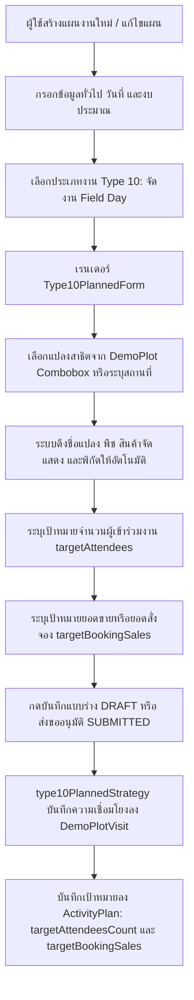
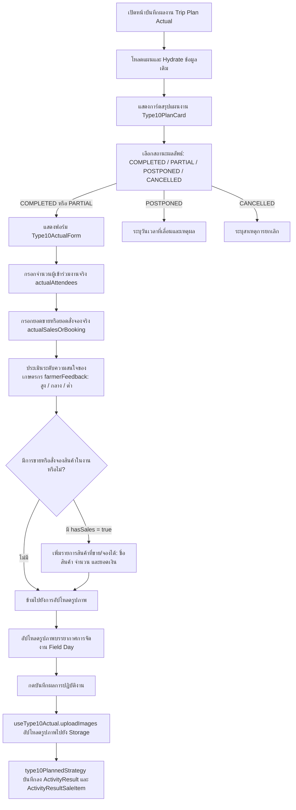
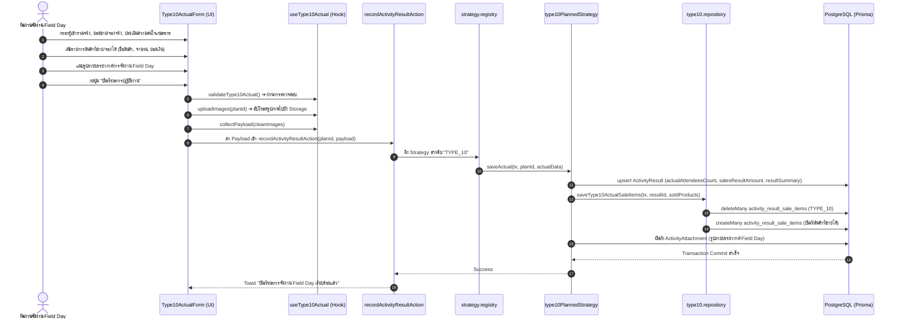

# Activity Type 10 — จัดงาน Field Day (Field Day Event) (README)

> **Feature Slice**: `modules/activity/features/type-10`  
> **Parent Module**: `modules/activity`  
> **Database Authority**: `prisma/schema.prisma` (`ActivityPlan`, `DemoPlotVisit`, `DemoPlot`, `ActivityPlanProduct`, `ActivityResult`, `ActivityResultSaleItem`, `ActivityAttachment`)  
> **Architecture Style**: Vertical Slice Architecture (Dual-Mode 100%: Planned + Unplanned)  
> **Status**: Production Ready / Active Reference

---

## 1. Overview

### 1.1 วัตถุประสงค์ของ Type 10
**Type 10 (จัดงาน Field Day / วันถ่ายทอดเทคโนโลยีและสาธิตแปลงเกษตร)** มีวัตถุประสงค์เพื่อสนับสนุนการดำเนินกิจกรรมส่งเสริมการตลาดและถ่ายทอดเทคโนโลยีขนาดใหญ่ ณ แปลงเกษตรกรจริง (Field Demonstration Activation) ของทีมงานสนาม (Technical Specialists / Commercial Teams / Event Promoters) ร่วมกับเกษตรกรเจ้าของแปลงและร้านค้าตัวแทนจำหน่าย เพื่อ:
1. จัดแสดงผลลัพธ์และประสิทธิภาพเชิงประจักษ์ของการใช้ผลิตภัณฑ์เคมีเกษตร ปุ๋ย หรือฮอร์โมนพืชในแปลงสาธิต (Demo Plot)
2. รวมกลุ่มเกษตรกรในพื้นที่เป้าหมาย (Mass Gathering) เพื่อรับฟังการบรรยายเชิงวิชาการ เทคนิคการป้องกันกำจัดศัตรูพืช และวิธีการใช้ผลิตภัณฑ์ที่ถูกต้อง
3. สร้างความเชื่อมั่นผ่านแปลงตัวอย่างที่มีชีวิต นำไปสู่การตัดสินใจซื้อหรือสั่งจองผลิตภัณฑ์ (Booking Sales) ภายในงาน
4. วัดผลระดับความสนใจและข้อคิดเห็นของเกษตรกร (Farmer Feedback: สูง, กลาง, ต่ำ) ต่อผลิตภัณฑ์ที่จัดแสดง
5. บันทึกหลักฐานบรรยากาศงาน การรวมกลุ่มเกษตรกร และรายการสินค้าที่มีการขายหรือสั่งจองจริง

### 1.2 ขอบเขตของ Type 10
- **ความเชื่อมโยงกับแปลงสาธิต (Demo Plot Association):**
  - **จัด ณ แปลงสาธิตที่มีในระบบ (`DemoPlot`):** เลือกแปลงสาธิตที่กำลังดำเนินการอยู่หรือเสร็จสิ้นแล้วจากฐานข้อมูล โดยระบบจะดึงชื่อเจ้าของแปลง พืชเป้าหมาย สินค้าจัดแสดงหลัก พิกัด GPS และอำเภอ/จังหวัด ให้อัตโนมัติ พร้อมบันทึกประวัติการจัดงานลงใน `DemoPlotVisit`
  - **ระบุสถานที่จัดงานเอง (Custom Location):** กรณีจัดงาน ณ สถานที่กลางหรือแปลงเกษตรกรที่ไม่ได้เปิดแปลงสาธิตอย่างเป็นทางการ สามารถระบุชื่อแปลง/สถานที่จัดงาน และพืชเป้าหมายได้โดยตรง
- **เป้าหมายตามแผนงาน (Planned Targets):**
  - กำหนดแปลงสาธิต/สถานที่จัดงาน, สินค้าจัดแสดงหลัก (`showcase`), ชนิดพืชเป้าหมาย (`targetCrop`), เป้าหมายจำนวนผู้เข้าร่วมงาน (`targetAttendeesCount`), และเป้าหมายยอดขายหรือยอดจองสินค้า (`targetBookingSales`)
- **การบันทึกผลงานจริง (Actual Outcome):**
  - จำนวนผู้เข้าร่วมงานจริง (`actualAttendees`), ยอดขายหรือยอดสั่งจองจริง (`actualSalesOrBooking`), ระดับความสนใจของเกษตรกร (`farmerFeedback`), รายชื่อเกษตรกรเป้าหมาย (`targetFarmersList`), รายการสินค้าที่ขายหรือรับจองได้จริง (`soldProducts`), และภาพถ่ายบรรยากาศการจัดงาน (`images`)

### 1.3 รูปแบบการทำงานที่รองรับ
| โหมดการทำงาน | คำอธิบาย | หน้าที่รับผิดชอบหลักใน Slice |
| :--- | :--- | :--- |
| **1. Planned** | สร้างและแก้ไขแผนจัดงาน Field Day ล่วงหน้า เลือกแปลงสาธิต ระบุสินค้าจัดแสดง ผู้เข้าร่วมเป้าหมาย และเป้ายอดจอง | `Type10PlannedForm`, `useType10PlannedForm`, `type10PlannedStrategy` |
| **2. Planned Actual** | บันทึกผลการจัดงานจริง จำนวนผู้เข้าร่วม ยอดขาย/จอง ความสนใจ รายการสินค้าที่ขายได้ และรูปถ่ายบรรยากาศ | `Type10ActualForm`, `useType10Actual`, `saveType10ActualSaleItems` |
| **3. Unplanned (2-in-1)** | จัดงานนอกแผนหรือบันทึกย้อนหลัง ระบุแปลงสาธิต/สถานที่ ผลสำเร็จ ยอดขาย และรูปภาพจบในหน้าเดียว | `Type10UnplannedForm`, `useType10UnplannedForm`, `type10UnplannedStrategy` |
| **4. Detail View** | แสดงรายละเอียดแผนงานเป้าหมาย (`Type10PlanCard`) และผลลัพธ์จริง พร้อมระบบ Lightbox ดูภาพถ่ายบรรยากาศ | `Type10PlanCard`, `Type10DetailView` |
| **5. Approval View** | สรุปข้อมูลแปลงสาธิต สินค้าจัดแสดง และเป้าหมายงาน เพื่อให้หัวหน้างานพิจารณาอนุมัติแผนงาน | `Type10ApprovalCard`, `Type10PlanCard` |

---

## 2. Business Flows

### 2.1 Planned (สร้างและแก้ไขแผนงาน)


### 2.2 Planned Actual (บันทึกผลการปฏิบัติงานตามแผน)


### 2.3 Unplanned (กิจกรรมนอกแผน 2-in-1)
- ผู้ใช้งานเข้าหน้า `/activity-plans/unplanned/new` และเลือกประเภทงาน **จัดงาน Field Day (Type 10)**
- ฟอร์ม `Type10UnplannedForm` รวมขั้นตอนการเลือกแปลงสาธิต/ระบุสถานที่, สินค้าจัดแสดง, พืชเป้าหมาย, ผู้เข้าร่วมจริง, ยอดขาย/จองจริง, ผลตอบรับจากเกษตรกร, ตารางสินค้าที่ขายได้ และรูปถ่ายบรรยากาศไว้ในหน้าเดียว
- รองรับการจัดงานหลายจุดพร้อมกันในทริปเดียว (`items: Type10UnplannedItem[]`)
- เมื่อกดบันทึก ข้อมูลทั้งหมดจะถูกส่งผ่าน `unplanned.actions.ts` ➔ รัน `type10UnplannedStrategy.savePlan()` ซึ่งจะทำการบันทึกประวัติการจัดงานลงใน `DemoPlotVisit` และบันทึกผลการจัดงานจริงลงใน `ActivityResult`, `ActivityResultSaleItem`, และ `ActivityAttachment` พร้อมกันแบบ Atomic ภายใต้ Prisma Transaction เดียวกัน

### 2.4 Detail and Approval (ดูรายละเอียดและพิจารณาอนุมัติ)
- **Detail View:**
  - แสดง `Type10PlanCard` สรุปแปลงสาธิต, สินค้าจัดแสดง, ชนิดพืช, สถานที่จัดงาน, เป้าหมายผู้เข้าร่วม และเป้ายอดจอง
  - หากมีผลงานจริง (`hasActualData`) แสดง `Type10DetailView` สรุปผู้เข้าร่วมจริง, ยอดขาย/จองจริง, ระดับความสนใจของเกษตรกร, ตารางรายการสินค้าที่ขายหรือจองได้, และแกลเลอรีรูปถ่ายบรรยากาศพร้อมระบบขยายภาพ (Lightbox Modal)
- **Approval View:**
  - แสดง `Type10ApprovalCard` เรนเดอร์การ์ดแผนการจัดงาน `Type10PlanCard` เพื่อให้ผู้อนุมัติตรวจสอบความเหมาะสมของแปลงสาธิตและเป้าหมายงานก่อนอนุมัติ

---

## 3. Architecture

### 3.1 Folder Structure
```text
modules/activity/features/type-10/
├── index.ts                                # Vertical Slice Public Contract (จุดส่งออกเดียว)
├── README.md                               # เอกสารคู่มือทางเทคนิคฉบับสมบูรณ์ (ไฟล์นี้)
│
├── shared/                                 # ชิ้นส่วนที่ใช้ร่วมกันภายใน Type 10
│   ├── constants.ts                        # ค่าคงที่: WORK_TYPE_CODE, WORK_TYPE_NAME, FARMER_FEEDBACK_OPTIONS
│   ├── types.ts                            # อินเตอร์เฟซข้อมูล: Type10SoldProductItem, Type10DemoPlotOption, etc.
│   └── notes.ts                            # Helper เข้ารหัส/ถอดรหัส Tag ข้อมูลใน ActivityPlan.notes
│
├── planned/                                # Sub-slice: กิจกรรมในแผนและบันทึกผลตามแผน
│   ├── application/                        # Business Logic, Mappers, Validators
│   │   ├── planned-validation.ts           # ตรวจสอบความถูกต้องของแผน (validateType10Form)
│   │   ├── planned-mapper.ts               # แปลงและ Hydrate ข้อมูลแผน (extractType10PlanTargets, etc.)
│   │   ├── actual-validation.ts            # ตรวจสอบความถูกต้องของผลงานจริง (validateType10Actual)
│   │   └── actual-mapper.ts                # แกะข้อมูลผลงานจริงจาก Backend (parseType10ActualResult)
│   ├── components/                         # UI Components ฝั่งในแผน
│   │   ├── type10-planned-form.tsx         # ฟอร์มสร้าง/แก้ไขแผนจัดงาน Field Day
│   │   ├── type10-plan-card.tsx            # การ์ดแสดงข้อมูลสรุปตามแผนงาน
│   │   ├── type10-actual-form.tsx          # ฟอร์มบันทึกผลจริง ยอดขาย/จอง ความสนใจ และสินค้าที่ขายได้
│   │   ├── type10-detail-view.tsx          # หน้ารายละเอียดแสดงผลลัพธ์จริงพร้อมระบบ Lightbox
│   │   └── type10-approval-card.tsx        # การ์ดสรุปสำหรับหน้าจอพิจารณาอนุมัติ
│   ├── hooks/                              # Custom React State Hooks
│   │   ├── use-type10-planned-form.ts      # จัดการ State กิจกรรมตามแผน (Demo Plot, Attendees, Sales)
│   │   └── use-type10-actual.ts            # จัดการ State ผลจริง ยอดขาย ผู้เข้าร่วม สินค้า และรูปถ่าย
│   ├── infrastructure/                     # การเชื่อมต่อฐานข้อมูล
│   │   ├── type10.repository.ts            # Direct Prisma queries (findType10ByPlanId, saveType10ActualSaleItems)
│   │   └── type10-planned.strategy.ts      # WorkTypeStrategy สำหรับ Type 10 ตามแผน
│   └── types/                              # ประเภทข้อมูลเฉพาะกิจกรรมในแผน
│       ├── planned.types.ts                # Type10TargetItem, Type10PlanTarget, Form Props
│       └── actual.types.ts                 # Type10ActualRecord, Type10ActualValidationInput, Form Props
│
└── unplanned/                              # Sub-slice: กิจกรรมนอกแผน (2-in-1)
    ├── application/                        # Logic และ Mappers กิจกรรมนอกแผน
    │   ├── unplanned-validation.ts         # ตรวจสอบความถูกต้องของกิจกรรมนอกแผน
    │   └── unplanned-mapper.ts             # แปลงข้อมูล 2-in-1 และสร้างสรุปผลการจัดงาน
    ├── components/                         # UI Components กิจกรรมนอกแผน
    │   └── type10-unplanned-form.tsx       # ฟอร์ม 2-in-1 รวมวางแผนและบันทึกผลในหน้าเดียว
    ├── hooks/                              # Custom React State Hooks
    │   └── use-type10-unplanned-form.ts    # จัดการ State กิจกรรมนอกแผน (รองรับหลายจุดจัดงาน)
    ├── infrastructure/                     # Strategy กิจกรรมนอกแผน
    │   └── type10-unplanned.strategy.ts    # WorkTypeStrategy บันทึกกิจกรรมนอกแผน 2-in-1
    └── types/                              # ประเภทข้อมูลกิจกรรมนอกแผน
        └── unplanned.types.ts              # Type10UnplannedItem, Props, Validation Result
```

### 3.2 Type 10 vs Shared Activity Matrix
| ความรับผิดชอบ | จัดการที่ Type 10 Feature (`features/type-10`) | จัดการที่ Shared Activity ส่วนกลาง (`ui/`, `views/`) |
| :--- | :--- | :--- |
| **ข้อมูลทั่วไปของแผน** | - | ชื่องาน, วันที่เริ่ม-สิ้นสุด, วัตถุประสงค์หลักของทริป |
| **พื้นที่ & ทีมงาน** | แปลงสาธิต, พิกัดแปลง, สถานที่จัดงาน | จังหวัดหลักของทริป, พนักงานร่วมเดินทาง |
| **งบประมาณรวม** | - | งบเบิกสินค้าตัวอย่าง, งบจัดเลี้ยงเกษตรกร, เบี้ยเลี้ยงเดินทาง |
| **ข้อมูลกิจกรรมตามแผน** | แปลงสาธิต (`DemoPlot`), สินค้าจัดแสดง, พืชเป้าหมาย, เป้าหมายผู้เข้าร่วม, เป้ายอดสั่งจอง | บันทึกลง `ActivityPlan.targetAttendeesCount` และ `targetBookingSales` |
| **ผลการจัดกิจกรรมจริง** | ผู้เข้าร่วมจริง, ยอดขาย/จองจริง, ระดับความสนใจ (สูง/กลาง/ต่ำ), รายการสินค้าที่ขายได้, รูปถ่ายบรรยากาศ | ผลสรุปภาพรวมแผน (`resultStatus`: COMPLETED/PARTIAL/etc.) |
| **Database Persistence** | ตาราง `DemoPlotVisit`, `ActivityResultSaleItem` (ผ่าน `saveType10ActualSaleItems`) | ตารางหลัก `ActivityPlan`, `ActivityResult`, `ActivityAttachment` |

### 3.3 Dependency and Import Map
- **ทิศทางการเรียกใช้ที่อนุญาต (Allowed Dependencies):**
  - `views/` ➔ เรียกใช้ ➔ `features/type-10` (ผ่าน `index.ts` เท่านั้น)
  - `features/type-10` ➔ เรียกใช้ ➔ `@/modules/activity/ui` (`ActivityInput`, `ActivityCombobox`, `ActivityProductSelect`, `ActivityPhotoUpload`)
  - `features/type-10` ➔ เรียกใช้ ➔ `@/modules/activity/types/strategy.interface`
  - `features/type-10` ➔ เรียกใช้ ➔ `@/modules/activity/application/media/image-uploader`
  - `features/type-10` ➔ เรียกใช้ ➔ `@/components/custom/image-lightbox-modal`
  - `features/type-10` ➔ เรียกใช้ ➔ `@/modules/activity/server/actions` (`getDemoPlotsAction`)
  - `features/type-10` ➔ เรียกใช้ ➔ `@/modules/products/server/actions` (`listProductsAction`)
- **Server Actions & Database Flow:**
  - `views/` ➔ ส่งข้อมูลไปยัง Server Actions ใน `@/modules/activity/server/`:
    - `planned.actions.ts` (`createActivityPlanAction`, `updateActivityPlanAction`, `getActivityPlanAction`)
    - `unplanned.actions.ts` (`createUnplannedActivityAction`, `updateUnplannedActivityAction`, `getUnplannedActivityAction`)
    - `actual.actions.ts` (`recordActivityResultAction`)
  - Server Actions ➔ ทำงานร่วมกับ `@/modules/activity/infrastructure/strategy.registry.ts` ➔ เรียกใช้ `type10PlannedStrategy` และ `type10UnplannedStrategy`
- **ข้อห้ามเด็ดขาด (Strict Rules):**
  - ❌ ห้าม Import จาก `@/modules/activity-plans/` ย้อนหลังโดยเด็ดขาด (Zero Legacy Imports)
  - ❌ ห้ามไฟล์ภายนอกข้ามเข้ามา Import ลึกใน `features/type-10/planned/...` โดยไม่ผ่าน `index.ts`
  - ❌ ห้ามเรียกใช้โค้ดข้ามไปยัง Feature Type อื่น

### 3.4 Entry Points and Public Exports
ไฟล์ [modules/activity/features/type-10/index.ts](file:///d:/code/crm-bank/modules/activity/features/type-10/index.ts) ทำหน้าที่เป็น **Single Public API Contract** สำหรับโมดูล Type 10 โดยส่งออก:
- **Planned Components:** `Type10PlannedForm`, `Type10PlanCard`, `Type10PlanForm`, `Type10FieldDay`
- **Actual Components:** `Type10ActualForm`, `ActualType10FieldDay`, `Type10DetailView`, `DetailType10FieldDay`, `Type10ApprovalCard`, `ApprovalType10FieldDay`
- **Unplanned Components:** `Type10UnplannedForm`
- **Hooks:** `useType10PlannedForm`, `useType10Form`, `useType10Actual`, `useType10UnplannedForm`
- **Mappers & Hydrators:** `extractType10PlanTargets`, `hydrateType10PlannedData`, `mapType10ToSectionItems`, `parseType10ActualResult`, `hydrateType10UnplannedData`, `mapType10UnplannedToPayload`
- **Validators:** `validateType10Form`, `validateType10Actual`, `validateType10UnplannedItems`
- **Shared Constants & Utilities:** `WORK_TYPE_CODE`, `WORK_TYPE_NAME`, `FARMER_FEEDBACK_OPTIONS`, `encodeType10Notes`, `decodeType10Notes`
- **TypeScript Types:** `Type10PlanItem`, `Type10TargetItem`, `Type10PlanTarget`, `Type10ActualRecord`, `Type10ActualValidationInput`, `Type10UnplannedItem`, `Type10SoldProductItem`, `Type10DemoPlotOption`, `Type10ProductOption`, `Type10ImageFile`, `FarmerFeedback`

---

## 4. File Responsibilities

### 4.1 Planned & Actual
- **`type10-planned-form.tsx`:** เรนเดอร์ฟอร์มวางแผนจัดงาน Field Day รองรับการค้นหาและเลือกแปลงสาธิตผ่าน `ActivityCombobox` (พร้อมฟังก์ชัน Self-healing โหลดแปลงสาธิตผ่าน `getDemoPlotsAction` หากไม่ได้ส่ง Props ลงมา), แสดงพิกัดและรายละเอียดแปลงสาธิต, ระบุสินค้าจัดแสดง, พืชเป้าหมาย, เป้าหมายผู้เข้าร่วม และเป้าหมายยอดจองสินค้า
- **`use-type10-planned-form.ts`:** จัดการ State ทั้งหมดของฟอร์มในแผน (`type10DemoPlot`, `type10Location`, `type10TargetCrop`, `type10Showcase`, `type10Attendees`, `type10BookingSales`) พร้อมฟังก์ชัน `validateType10` และ `mapType10Payload`
- **`type10-plan-card.tsx`:** การ์ดแสดงข้อมูลสรุปตามแผนงาน แสดงชื่อแปลงสาธิต/เจ้าของแปลง, พืชเป้าหมาย, สินค้าจัดแสดงหลัก, สถานที่/พิกัด, เป้าหมายผู้เข้าร่วม และเป้ายอดจอง
- **`type10-actual-form.tsx`:** ฟอร์มบันทึกผลการจัดงานจริง แสดงการ์ดแผน `Type10PlanCard`, ระบุผู้เข้าร่วมจริง, ยอดขาย/จองจริง, ตัวเลือกระดับความสนใจของเกษตรกร (`FARMER_FEEDBACK_OPTIONS`), ตารางสินค้าที่ขายหรือรับจองได้จริง (พร้อม Self-healing โหลดสินค้าผ่าน `listProductsAction`), และอัปโหลดภาพถ่ายบรรยากาศงาน
- **`use-type10-actual.ts`:** จัดการ State ผลงานจริง ฟังก์ชัน `uploadImages` เพื่ออัปโหลดรูปภาพบรรยากาศงานไปยังไดเรกทอรี `"type10"` / `"atmosphere"`, ฟังก์ชัน `collectPayload` รวบรวมข้อมูลผลงาน, และ `validateType10Actual`
- **`type10-detail-view.tsx`:** คอมโพเนนต์แสดงผลเต็มรูปแบบในหน้ารายละเอียด แสดงการ์ดแผน `Type10PlanCard`, สรุปผู้เข้าร่วมจริง, ยอดขาย/จองจริง, ป้ายแสดงระดับความสนใจของเกษตรกร, ตารางรายการสินค้าที่ขายได้, และแกลเลอรีรูปถ่ายบรรยากาศพร้อม Lightbox
- **`type10-approval-card.tsx`:** การ์ดสรุปสำหรับหน้าจอพิจารณาอนุมัติ เรนเดอร์ `Type10PlanCard` เพื่อให้ผู้อนุมัติตรวจสอบแปลงสาธิตและเป้าหมาย
- **`planned-mapper.ts`:**
  - `extractType10PlanTargets`: แกะข้อมูลแปลงสาธิตจาก `demoPlotVisits` หรือ `demoPlot` แปลงออกมาเป็น `Type10TargetItem`
  - `hydrateType10PlannedData`: กู้คืนข้อมูลแผนเดิมเข้าฟอร์มแก้ไข
  - `mapType10ToSectionItems`: แปลงข้อมูลเป้าหมายเป็นข้อความสรุปสำหรับแสดงใน Section รวม
- **`actual-mapper.ts`:**
  - `parseType10ActualResult`: แปลงข้อมูลผลงานจาก `ActivityResult` และ `ActivityResultSaleItem` รวมถึง Regex fallback จาก `resultSummary`
- **`planned-validation.ts` & `actual-validation.ts`:**
  - `validateType10Form`: ตรวจสอบว่าได้เลือกแปลงสาธิตหรือระบุสถานที่จัดงานแล้ว และตัวเลขผู้เข้าร่วม $\ge 0$
  - `validateType10Actual`: ตรวจสอบความถูกต้องของตัวเลขผู้เข้าร่วม ยอดขาย/จอง และชื่อสินค้าในรายการขาย
- **`type10.repository.ts` & `type10-planned.strategy.ts`:**
  - `findType10ByPlanId`: ค้นหาประวัติแปลงสาธิต สินค้า และเป้าหมายของ ActivityPlan
  - `saveType10ActualSaleItems`: ลบและบันทึกระเบียนสินค้าที่ขาย/จองได้ลงตาราง `activity_result_sale_items`
  - `type10PlannedStrategy`: ดำเนินการตรวจสอบและบันทึกความเชื่อมโยงลง `DemoPlotVisit` และผลงานจริงตามมาตรฐาน `WorkTypeStrategy`

### 4.2 Unplanned
- **`type10-unplanned-form.tsx`:** ฟอร์มกิจกรรม Field Day นอกแผน 2-in-1 แสดงอินพุตครบถ้วนทั้งแปลงสาธิต/สถานที่, พืช, สินค้าจัดแสดง, ผู้เข้าร่วมจริง, ยอดขาย/จองจริง, ผลตอบรับ, ตารางสินค้าที่ขายได้ และรูปถ่ายบรรยากาศ
- **`use-type10-unplanned-form.ts`:** จัดการ State อาร์เรย์ `Type10UnplannedItem[]` รองรับการเพิ่ม ลบ แก้ไขจุดจัดงาน Field Day หลายจุดในทริปเดียวกัน
- **`unplanned-validation.ts`:** ตรวจสอบความถูกต้องของกิจกรรมนอกแผน (แปลงสาธิต/สถานที่, ผู้เข้าร่วมจริง, ยอดขายจริง และชื่อสินค้า)
- **`unplanned-mapper.ts`:** Hydrate ข้อมูลเดิม และ Map ข้อมูลฟอร์ม 2-in-1 ออกมาเป็น Payload แผนงาน (`demoPlotVisits`, `targets`) และผลงานจริง (`actualOutcome`) พร้อมสร้างข้อความสรุปผลงาน
- **`type10-unplanned.strategy.ts`:** ดำเนินการบันทึกกิจกรรมนอกแผนผ่านการสร้างระเบียน `DemoPlotVisit` และบันทึกผลงานจริงใน Transaction เดียวกัน

### 4.3 Shared Types, Constants, and Notes
- **`constants.ts`:** กำหนด `WORK_TYPE_CODE = "TYPE_10"`, `WORK_TYPE_NAME`, และตัวเลือกระดับความสนใจของเกษตรกร `FARMER_FEEDBACK_OPTIONS` (`"สูง"`, `"กลาง"`, `"ต่ำ"`)
- **`types.ts`:** กำหนดโครงสร้าง TypeScript สำหรับสินค้าที่ขายได้ (`Type10SoldProductItem`), แปลงสาธิต (`Type10DemoPlotOption`), สินค้า (`Type10ProductOption`), และรูปภาพ (`Type10ImageFile`)
- **`notes.ts`:** ฟังก์ชัน `encodeType10Notes` และ `decodeType10Notes` สำหรับจัดเก็บ Tag พิเศษ `[สินค้าสาธิต: ...]`, `[พืชเป้าหมาย: ...]`, และ `[เกษตรกรเป้าหมาย: ...]` ร่วมกับข้อความบันทึกทั่วไปในคอลัมน์ `notes` ของตาราง `ActivityPlan`

### 4.4 Shared UI and Views
- คอมโพเนนต์ `ActualWorkTypeList`, `DetailWorkTypeList`, และ `ApprovalWorkTypeList` ใน `modules/activity/views/` ทำหน้าที่เป็น Orchestrator ตรวจจับรหัสงาน `"TYPE_10"` แล้วสลับมาเรนเดอร์คอมโพเนนต์ของ Type 10

---

## 5. Data Flow



### 5.1 Create Planned (สร้างแผนใหม่)
1. `create-view.tsx` เรียกใช้ `useType10PlannedForm()`
2. ผู้ใช้เลือกแปลงสาธิตจาก `ActivityCombobox` (หรือระบุสถานที่จัดงาน), สินค้าจัดแสดง, พืชเป้าหมาย, เป้าหมายผู้เข้าร่วม และเป้ายอดจอง
3. ระบบตรวจสอบความถูกต้องด้วย `validateType10Form()`
4. Form Orchestrator รวม Payload และส่งไปยัง Server Action `createActivityPlanAction`
5. `type10PlannedStrategy.savePlan()` บันทึกการเชื่อมโยงแปลงสาธิตลงในตาราง `DemoPlotVisit` (`workTypeCode = "TYPE_10"`, `demoPlotId`) และบันทึกเป้าหมายลงใน `ActivityPlan` (`targetAttendeesCount`, `targetBookingSales`, `location`, `notes`)

### 5.2 Edit Planned (แก้ไขแผนงานเดิม)
1. `edit-view.tsx` โหลดข้อมูลแผนงานจากฐานข้อมูล
2. เรียก `hydrateType10PlannedData(plan)` ถอดรหัสแปลงสาธิตและ Tag ใน `notes` ออกมา
3. ส่งข้อมูลเข้า `useType10PlannedForm()` เพื่อเติมลงใน State ของฟอร์ม
4. ผู้ใช้แก้ไขข้อมูลและกดบันทึกกลับได้อย่างถูกต้อง

### 5.3 Save Actual (บันทึกผลการปฏิบัติงานจริง)
1. `activity-plan-actual-view.tsx` ตรวจสอบความถูกต้องผ่าน `validateType10Actual(input)`
2. เรียก `type10Actual.uploadImages(planId)` เพื่ออัปโหลดไฟล์ภาพบรรยากาศงานไปยัง Storage
3. เรียก `type10Actual.collectPayload(cleanImages)` จัดกลุ่มข้อมูลผลงาน ยอดขาย/จอง ความสนใจ สินค้าที่ขายได้ และ Clean URLs
4. ส่ง Payload เข้า Server Action `recordActivityResultAction`
5. `type10PlannedStrategy.saveActual()` อัปเดต `ActivityResult` และเรียก `saveType10ActualSaleItems` เพื่อลบและบันทึกระเบียนสินค้าที่ขายได้ลงใน `activity_result_sale_items`

### 5.4 Load Actual (โหลดผลงานเดิมมาแสดงในหน้าบันทึกผล)
1. `useActualPlanLoader` ดึงข้อมูลแผนงานและผลงานเดิม
2. `extractType10PlanTargets(plan)` แกะข้อมูลแปลงสาธิตและเป้าหมายเดิมออกมาแสดงในการ์ด `Type10PlanCard`
3. `parseType10ActualResult(plan.result)` ดึงข้อมูลผู้เข้าร่วมจริง, ยอดขาย/จองจริง, ความสนใจ, สินค้าที่ขายได้จาก `saleResults`, และรูปภาพเดิม
4. เรียก `type10Actual.hydrate()` เติมข้อมูลลง State ของฟอร์มพร้อมให้แก้ไขเพิ่มเติม

### 5.5 Create/Edit Unplanned (กิจกรรมนอกแผน 2-in-1)
1. ผู้ใช้กรอกฟอร์ม `Type10UnplannedForm` ครบทั้งส่วนแปลงสาธิต/สถานที่ สินค้าจัดแสดง ผลลัพธ์จริง และรูปภาพ
2. ตรวจสอบความถูกต้องด้วย `validateType10UnplannedItems(items)`
3. `mapType10UnplannedToPayload` แปลงข้อมูลออกมาเป็น `demoPlotVisits`, `targets`, และ `actualOutcome`
4. `type10UnplannedStrategy.savePlan()` บันทึกข้อมูลแผนงานและผลงานจริงพร้อมกันแบบ Atomic

### 5.6 Detail and Approval (การแสดงผลหน้ารายละเอียดและพิจารณาอนุมัติ)
1. หน้า Detail / Approval โหลดข้อมูลแผนงานผ่าน Loader
2. เรนเดอร์ `Type10PlanCard` แสดงแปลงสาธิต, สินค้าจัดแสดง, พืชเป้าหมาย, เป้าหมายผู้เข้าร่วม และเป้ายอดสั่งจอง
3. หากมีผลงานจริง เรนเดอร์ `Type10DetailView` แสดงผู้เข้าร่วมจริง, ยอดขาย/จองจริง, ระดับความสนใจ, ตารางสินค้าที่ขายได้, และแกลเลอรีรูปถ่ายบรรยากาศพร้อม Lightbox

---

## 6. Data Models and Mapping

### 6.1 Database CRUD Matrix (สิทธิ์และการจัดการตารางในฐานข้อมูล)
| ตารางในฐานข้อมูล (`Prisma Model`) | Create (สร้าง) | Read (อ่าน/แสดงผล) | Update (แก้ไข) | Delete (ลบ) | หมายเหตุ |
| :--- | :--- | :--- | :--- | :--- | :--- |
| **`activity_plans`**<br>(`ActivityPlan`) | ตอนสร้างแผน | ในทุกมุมมอง | เมื่อแก้ไขแผน | Cascade Delete | เก็บ `targetAttendeesCount`, `targetBookingSales`, `location`, `notes` |
| **`demo_plot_visits`**<br>(`DemoPlotVisit`) | `savePlan()` ใน Planned/Unplanned | `findType10ByPlanId`, `extractType10PlanTargets` | อัปเดต `demoPlotId` ใน `savePlan()` | Cascade เมื่อลบแปลง | บันทึกประวัติการจัดงาน Field Day ที่ผูกกับแปลงสาธิต (`workTypeCode = 'TYPE_10'`) |
| **`demo_plots`**<br>(`DemoPlot`) | - (สร้างจาก 7A) | include ใน `findType10ByPlanId` | - | - | แปลงสาธิตอ้างอิง (ชื่อแปลง, เจ้าของ, สินค้าหลัก, พืช, พิกัด) |
| **`activity_results`**<br>(`ActivityResult`) | `saveActual()` ใน Actual/Unplanned | `loadActual()`, `parseType10ActualResult` | `upsert` ใน `saveActual()` | Cascade เมื่อลบแผน | เก็บ `actualAttendeesCount`, `salesResultAmount`, `resultSummary` |
| **`activity_result_sale_items`**<br>(`ActivityResultSaleItem`) | `saveType10ActualSaleItems` | `parseType10ActualResult` (`saleResults`) | `deleteMany()` + `createMany()` ใน Repo | Cascade เมื่อลบผลงาน | เก็บรายการสินค้าที่ขายหรือจองได้ในงาน (`workTypeCode = "TYPE_10"`) |
| **`activity_attachments`**<br>(`ActivityAttachment`) | `uploadImages()` + Server Action | `plan.attachments` | สร้างใหม่/ลบรูปที่ไม่ได้ใช้ | Cascade เมื่อลบผลงาน | เก็บรูปภาพบรรยากาศการจัดงาน Field Day (`group = 'atmosphere'`) |

### 6.2 Complete Field-to-Database Mapping (ตารางจับคู่ฟิลด์ครบถ้วนทุกจุด)
| Form Field (UI) | TypeScript Type Field | Mapper Function (Write/Read) | Prisma Model | DB Column Name | Data Type | Nullable? | Default |
| :--- | :--- | :--- | :--- | :--- | :--- | :---: | :--- |
| **แปลงสาธิตที่จัดงาน** | `type10DemoPlot` / `demoPlotId` | `mapType10Payload` ➔ `submittedDemoPlotId` | `DemoPlotVisit` | `demo_plot_id` | `VARCHAR (FK)` | No | - |
| **สถานที่จัดงาน** | `type10Location` / `location` | `planned-mapper` / `unplanned-mapper` | `ActivityPlan` | `location` | `VARCHAR` | Yes | `null` |
| **สินค้าจัดแสดงหลัก** | `type10Showcase` / `showcase` | `encodeType10Notes` / `decodeType10Notes` | `ActivityPlan` | `notes` (`[สินค้าสาธิต: ...]`) | `TEXT` | Yes | `null` |
| **พืชเป้าหมาย** | `type10TargetCrop` / `crop` | `encodeType10Notes` / `decodeType10Notes` | `ActivityPlan` | `notes` (`[พืชเป้าหมาย: ...]`) | `TEXT` | Yes | `null` |
| **เป้าหมายผู้เข้าร่วม** | `type10Attendees` | `mapType10Payload` | `ActivityPlan` | `target_attendees_count` | `INTEGER` | Yes | `0` |
| **เป้ายอดขายหรือสั่งจอง** | `type10BookingSales` | `mapType10Payload` | `ActivityPlan` | `target_booking_sales` | `DECIMAL(15,2)` | Yes | `0` |
| **ผู้เข้าร่วมงานจริง** | `actualAttendees` | `parseType10ActualResult` / `saveActual` | `ActivityResult` | `actual_attendees_count` | `INTEGER` | Yes | `null` |
| **ยอดขายหรือยอดจองจริง**| `actualSalesOrBooking` | `parseType10ActualResult` / `saveActual` | `ActivityResult` | `sales_result_amount` | `DECIMAL(15,2)` | Yes | `null` |
| **ผลตอบรับจากเกษตรกร** | `farmerFeedback` | `actual-mapper` / `unplanned-mapper` | `ActivityResult` | `result_summary` (บรรทัด Feedback) | `TEXT` | Yes | `null` |
| **รายชื่อเกษตรกรเป้าหมาย**| `targetFarmersList` | `encodeType10Notes` / `decodeType10Notes` | `ActivityPlan` / `ActivityResult` | `notes` / `result_summary` | `TEXT` | Yes | `null` |
| **สินค้าที่ขายหรือจองได้**| `soldProducts` | `saveType10ActualSaleItems` | `ActivityResultSaleItem` | `product_id`, `actual_quantity`, `actual_amount` | `INTEGER / DECIMAL` | No | - |
| **รูปถ่ายบรรยากาศงาน** | `images` | `uploadImages()` ➔ `attachments` | `ActivityAttachment` | `file_url`, `work_type_code = 'TYPE_10'` | `TEXT` | No | - |

### 6.3 รายละเอียดตารางสินค้า รูปภาพ และความสัมพันธ์ (Relations & Schema)

```prisma
// 1. ตารางเก็บประวัติการจัดงาน Field Day ที่เชื่อมโยงกับแปลงสาธิต
model DemoPlotVisit {
  id             String    @id @default(cuid())
  demoPlotId     String    @map("demo_plot_id")
  activityPlanId String?   @map("activity_plan_id")
  workTypeCode   String?   @map("work_type_code") // "TYPE_10"
  visitNumber    Int       @default(1) @map("visit_number")
  visitDate      DateTime  @map("visit_date")
  daysSinceStart Int       @default(0) @map("days_since_start")

  demoPlot       DemoPlot  @relation(fields: [demoPlotId], references: [id], onDelete: Cascade)
  activityPlan   ActivityPlan? @relation(fields: [activityPlanId], references: [id], onDelete: Cascade)

  @@index([demoPlotId])
  @@index([activityPlanId])
  @@map("demo_plot_visits")
}

// 2. ตารางแปลงสาธิตหลัก (อ้างอิงข้อมูล)
model DemoPlot {
  id                 String          @id @default(cuid())
  code               String          @unique
  name               String
  ownerName          String?         @map("owner_name")
  farmerPhone        String?         @map("farmer_phone")
  location           String?
  latitude           Decimal?        @db.Decimal(10, 7)
  longitude          Decimal?        @db.Decimal(10, 7)
  province           String?
  district           String?
  targetCrop         String?         @map("target_crop")
  cropName           String?         @map("crop_name")
  primaryProductName String?         @map("primary_product_name")
  status             DemoPlotStatus  @default(IN_PROGRESS)

  visits             DemoPlotVisit[]

  @@map("demo_plots")
}

// 3. ตารางเก็บรายการสินค้าที่ขายหรือสั่งจองได้ในงาน Field Day
model ActivityResultSaleItem {
  id               String  @id @default(cuid())
  activityResultId String  @map("activity_result_id")
  workTypeCode     String  @map("work_type_code") // "TYPE_10"
  storeId          String? @map("store_id")
  productId        String? @map("product_id")
  productName      String? @map("product_name")
  actualQuantity   Int     @default(0) @map("actual_quantity")
  actualUnitPrice  Decimal? @map("actual_unit_price") @db.Decimal(15, 2)
  actualTotal      Decimal? @map("actual_total") @db.Decimal(15, 2)
  actualAmount     Decimal? @map("actual_amount") @db.Decimal(15, 2)
  remarks          String?

  activityResult   ActivityResult @relation(fields: [activityResultId], references: [id], onDelete: Cascade)
  product          Product?       @relation("ActivityResultSaleProductRef", fields: [productId], references: [id], onDelete: Restrict)

  @@index([activityResultId])
  @@index([productId])
  @@index([workTypeCode])
  @@map("activity_result_sale_items")
}
```

### 6.4 Transaction & Persistence Strategy (ขาเขียนและขาอ่าน)
- **การจัดการ Transaction (Isolation & Atomicity):**
  - ทุกการบันทึกของ Type 10 ดำเนินการภายใต้ `db.$transaction(async (tx) => { ... })`
  - หากการบันทึกภาพถ่าย หรือการบันทึกรายการสินค้าที่ขายได้ใน `activity_result_sale_items` ล้มเหลว ระบบจะ Rollback การเปลี่ยนแปลงทั้งหมดทันที
- **การเชื่อมโยง DemoPlotVisit แบบ Upsert:**
  - ในฟังก์ชัน `savePlan` ของ `type10PlannedStrategy` จะทำการตรวจสอบว่ามี `DemoPlotVisit` เดิมที่ผูกกับ `activityPlanId` และ `workTypeCode = "TYPE_10"` หรือไม่ หากมีจะทำการ `update` หากไม่มีจะทำการ `create` ใหม่
- **การเข้ารหัส Tag ข้อมูลใน Notes:**
  - สินค้าจัดแสดงหลัก, พืชเป้าหมาย, และรายชื่อเกษตรกรจะถูกเข้ารหัสเป็น Tag ปลอดภัย เช่น `[สินค้าสาธิต: ...]`, `[พืชเป้าหมาย: ...]` ในคอลัมน์ `notes` ของตาราง `ActivityPlan` ทำให้สามารถรองรับฟิลด์เพิ่มเติมได้โดยไม่ต้องปรับเปลี่ยน Schema หลัก
- **Cascade Delete Policy:**
  - เมื่อลบแผนงาน `ActivityPlan` ระเบียนที่เกี่ยวข้องใน `DemoPlotVisit`, `ActivityResult`, `ActivityResultSaleItem`, และ `ActivityAttachment` จะถูกลบออกแบบ Cascade ทั้งหมด

---

## 7. Business Rules

### 7.1 Validation Rules
1. **การตรวจสอบแปลงสาธิตหรือสถานที่จัดงาน:**
   - ในแผนงาน (`validateType10Form`): ต้องเลือกแปลงสาธิตสำหรับจัดงาน Field Day (`type10DemoPlot` ห้ามว่าง)
   - ในกิจกรรมนอกแผน (`validateType10UnplannedItems`): ต้องเลือกแปลงสาธิตหรือระบุสถานที่จัดงานอย่างน้อยหนึ่งอย่าง
2. **การตรวจสอบจำนวนผู้เข้าร่วมงาน:**
   - ผู้เข้าร่วมเป้าหมาย (`type10Attendees`): หากระบุ ต้องเป็นตัวเลขที่มีค่า $\ge 0$
   - ผู้เข้าร่วมจริง (`actualAttendees`): ต้องระบุเป็นตัวเลขที่มีค่า $\ge 0$
3. **การตรวจสอบยอดขายหรือสั่งจองจริง:**
   - ยอดขาย/จองจริง (`actualSalesOrBooking`): หากระบุ ต้องเป็นตัวเลขที่มีค่า $\ge 0$
4. **การตรวจสอบรายการสินค้าที่ขายได้:**
   - หากติ๊กเลือก "มีการขายหรือสั่งจองสินค้า" (`hasSales = true`): ทุกรายการสินค้าที่เพิ่มต้องระบุชื่อสินค้า (`productName` ห้ามว่าง) และจำนวนที่ขายได้ต้องเป็นตัวเลข $\ge 0$

### 7.2 Default Values
- `type10Attendees`: ค่าเริ่มต้นเป็น `0` คน
- `type10BookingSales`: ค่าเริ่มต้นเป็น `0` บาท
- `farmerFeedback`: ค่าเริ่มต้นเป็น `""` (รอการประเมิน)
- `activityResultStatus`: ค่าเริ่มต้นเมื่อเปิดหน้าบันทึกผลเป็น `"COMPLETED"`

### 7.3 Conditional Fields
- **การดึงข้อมูลแปลงสาธิตอัตโนมัติ:** เมื่อเลือกแปลงสาธิตจาก `ActivityCombobox` ระบบจะดึงพืชเป้าหมาย, สินค้าจัดแสดงหลัก, และพิกัดแปลงขึ้นมาแสดงและเติมลงในฟอร์มให้อัตโนมัติ
- **ตารางสินค้าที่ขายหรือจองได้:** จะแสดงขึ้นมาให้กรอกต่อเมื่อผู้ใช้ติ๊กเปิดสวิตช์ "มีการสั่งซื้อหรือสั่งจองสินค้าในงาน" (`hasSales = true`)
- **ระบบ Lightbox:** ในหน้า `Type10DetailView` แกลเลอรีรูปภาพบรรยากาศจะรองรับการคลิกดูขยายภาพ พร้อมปุ่มเลื่อนดูภาพถัดไป/ก่อนหน้า

### 7.4 Status and Approval Rules
- แผนงานจะสามารถบันทึกผลการจัดงานจริง (Actual) ได้เฉพาะเมื่อแผนมีสถานะเป็น `APPROVED` เท่านั้น
- เฉพาะเจ้าของแผนงาน (Creator) และ Administrator เท่านั้นที่มีสิทธิ์บันทึกผลการปฏิบัติงานจริง
- การพิจารณาอนุมัติของหัวหน้างานจะเห็นข้อมูลแปลงสาธิต สินค้าจัดแสดง พืชเป้าหมาย และเป้ายอดขาย/จองในการ์ด `Type10ApprovalCard`

---

## 8. Shared Dependencies

โมดูล Type 10 ทำงานร่วมกับโมดูลและคอมโพเนนต์ส่วนกลางดังนี้:
1. **`@/modules/activity/ui`:**
   - `ActivityCombobox`: ค้นหาและเลือกแปลงสาธิต
   - `ActivityProductSelect`: ค้นหาและเลือกสินค้าที่ขายหรือรับจองได้
   - `ActivityInput`: กล่องกรอกตัวเลขและข้อความมาตรฐาน
   - `ActivityPhotoUpload`: คอมโพเนนต์อัปโหลดรูปภาพพร้อมบีบอัดไฟล์
2. **`@/modules/activity/views`:**
   - `ActualWorkTypeList`, `DetailWorkTypeList`, `ApprovalWorkTypeList` ทำหน้าที่เป็น View Orchestrator สลับมาแสดงผลคอมโพเนนต์ของ Type 10 ตามเงื่อนไขประเภทงาน
3. **`@/modules/activity/constants`:**
   - `WORK_TYPE_CONFIG`: ตั้งค่ารหัสประเภทงานและสีธีม (Emerald)
   - `ACTIVITY_RESULT_STATUS_LABELS`: ป้ายแสดงสถานะผลกิจกรรม
4. **`@/modules/activity/infrastructure/strategy.registry`:**
   - ลงทะเบียน `type10PlannedStrategy` และ `type10UnplannedStrategy` สำหรับจัดเก็บข้อมูลแบบ Polymorphic
5. **Server Actions ที่ใช้งาน:**
   - `getDemoPlotsAction` ใน `@/modules/activity/server/actions` (ดึงรายการแปลงสาธิต)
   - `listProductsAction` ใน `@/modules/products/server/actions` (ดึงรายการสินค้า Master Data)
   - `createActivityPlanAction`, `updateActivityPlanAction`, `getActivityPlanAction` ใน `@/modules/activity/server/planned.actions`
   - `createUnplannedActivityAction`, `updateUnplannedActivityAction`, `getUnplannedActivityAction` ใน `@/modules/activity/server/unplanned.actions`
   - `recordActivityResultAction` ใน `@/modules/activity/server/actual.actions`
6. **Lightbox Component:**
   - `ImageLightboxModal` ใน `@/components/custom/image-lightbox-modal`

---

## 9. How to Modify Type 10

### 9.1 การเพิ่มฟิลด์ใหม่บนฟอร์ม (Add a Form Field)
1. เพิ่มฟิลด์ใน Type Definitions:
   - ฟอร์มแผน: `planned/types/planned.types.ts` (`Type10PlannedFormProps`, `Type10TargetItem`)
   - ฟอร์มผลจริง: `planned/types/actual.types.ts` (`Type10ActualRecord`, `Type10ActualFormProps`)
   - ฟอร์มนอกแผน: `unplanned/types/unplanned.types.ts` (`Type10UnplannedItem`)
2. เพิ่มเงื่อนไขตรวจสอบความถูกต้องใน `planned-validation.ts`, `actual-validation.ts`, หรือ `unplanned-validation.ts`
3. เพิ่ม UI Input ในคอมโพเนนต์ฟอร์ม (`type10-planned-form.tsx`, `type10-actual-form.tsx`, หรือ `type10-unplanned-form.tsx`) โดยใช้ `@/modules/activity/ui`
4. ปรับ Mapper ใน `planned-mapper.ts`, `actual-mapper.ts`, หรือ `unplanned-mapper.ts`
5. อัปเดตการบันทึกใน `type10-planned.strategy.ts` หรือ `type10.repository.ts`

### 9.2 การปรับแก้ Validation (Change Validation)
- แก้ไขที่ไฟล์ `planned/application/planned-validation.ts`, `planned/application/actual-validation.ts` หรือ `unplanned/application/unplanned-validation.ts` ตามเงื่อนไขทางธุรกิจที่ต้องการปรับปรุง

### 9.3 การปรับ Database Mapping (Change Database Mapping)
- หากมีการเปลี่ยนแปลง Schema ใน `prisma/schema.prisma` ให้แก้ไขการบันทึกใน `type10.repository.ts` หรือ `type10-planned.strategy.ts` โดยคงการทำงานแบบ Transaction เสมอ

### 9.4 การปรับแก้ Actual Loading or Hydration
- ตรวจสอบฟังก์ชัน `hydrateType10PlannedData`, `extractType10PlanTargets` ใน `planned-mapper.ts` และ `parseType10ActualResult` ใน `actual-mapper.ts` เพื่อให้รองรับคีย์ข้อมูลเดิมและการแปลงสตริงเป็นตัวเลขอย่างปลอดภัย

### 9.5 การแก้ไข Shared Components อย่างปลอดภัย
- เมื่อต้องแก้ไขคอมโพเนนต์ใน `@/modules/activity/ui` ต้องคำนึงถึงประเภทงานอื่นเสมอ และไม่เปลี่ยนแปลง Props Interface เดิมที่ใช้งานร่วมกัน

---

## 10. Troubleshooting & Tracing Pipeline

### 10.1 Step-by-Step Tracing Pipeline (คู่มือการไล่โค้ดเมื่อพบปัญหา)

เมื่อพบว่าข้อมูลบางจุดไม่แสดงผล (เช่น รายการสินค้าที่ขายได้ไม่ถูกบันทึก หรือแปลงสาธิตไม่ถูกผูกกับงาน) ให้ไล่ตรวจสอบตาม 8 ขั้นตอนนี้ตามลำดับ:

```text
[Step 1: UI Field] ➔ Type10ActualForm.tsx (ตรวจว่า state soldProducts มีค่าครบถ้วนหรือไม่)
        ↓
[Step 2: Hook State] ➔ use-type10-actual.ts (ตรวจ collectPayload ว่าแนบ t10SoldProducts หรือไม่)
        ↓
[Step 3: Save Mapper] ➔ collectPayload() (ตรวจว่าได้ Clean URLs ของรูปภาพ และ Array ของ SoldProducts)
        ↓
[Step 4: Server Action] ➔ recordActivityResultAction ➔ recordActivityResultUseCase
        ↓
[Step 5: Strategy Write] ➔ type10-planned.strategy.ts: saveActual() ➔ เรียก saveType10ActualSaleItems()
        ↓
[Step 6: Prisma Table] ➔ ตรวจสอบตาราง activity_result_sale_items ใน DB ว่ามีระเบียน work_type_code = 'TYPE_10' หรือไม่
        ↓
[Step 7: Loader & Include] ➔ getActivityPlanAction (ตรวจว่า include saleResults และ attachments ครบถ้วนหรือไม่)
        ↓
[Step 8: Load Hydrator] ➔ actual-mapper.ts: parseType10ActualResult() ➔ useType10Actual.hydrate()
```

### 10.2 ตารางวิเคราะห์ปัญหาที่พบบ่อย (Common Pitfalls)

| อาการ | จุดที่ต้องตรวจสอบ | สาเหตุและแนวทางแก้ไข |
| :--- | :--- | :--- |
| **บันทึกแผนงานแล้วแปลงสาธิตไม่ถูกผูกกับแผน** | `type10-planned.strategy.ts` ➔ `savePlan` | ตรวจสอบว่า `submittedDemoPlotId` มีค่าถูกต้อง และตาราง `demo_plot_visits` ถูกบันทึกระเบียนที่มี `workTypeCode = "TYPE_10"` หรือไม่ |
| **บันทึกผลสำเร็จแต่สินค้าที่ขายได้ไม่ลงตาราง `activity_result_sale_items`** | `type10.repository.ts` ➔ `saveType10ActualSaleItems` | ตรวจสอบว่าใน `soldProducts` มีการส่ง `actualQty` หรือ `actualSales` มาครบถ้วนหรือไม่ |
| **สินค้าจัดแสดงและพืชเป้าหมายหายหลังบันทึกแผน** | `shared/notes.ts` ➔ `encodeType10Notes` | ตรวจสอบว่าฟังก์ชันเข้ารหัส Tag ใน `notes` ทำงานถูกต้อง และไม่ถูกเขียนทับด้วยข้อความธรรมดา |
| **รูปถ่ายบรรยากาศงานหายหลัง Reload หน้าจอ** | `use-type10-actual.ts` ➔ `uploadImages` | ตรวจสอบว่า `uploadActivityPlanImageGroup` อัปโหลดไปยังโฟลเดอร์ `"type10"` / `"atmosphere"` สำเร็จและส่ง Clean URLs กลับมาบันทึกหรือไม่ |
| **ฟอร์มแผนไม่ยอมให้ส่งโดยแจ้งเตือนว่ายังไม่ได้เลือกแปลงสาธิต** | `planned-validation.ts` ➔ `validateType10Form` | ผู้ใช้ไม่ได้เลือกแปลงสาธิตจากตัวเลือก Combobox ให้ตรวจสอบว่า `type10DemoPlot` มีค่า ID ของแปลงสาธิต |

---

## 11. Testing and Manual UAT

### แผนการทดสอบแบบครบวงจร (End-to-End Test Checklist):
- [ ] **TC-01 (Planned Create with Demo Plot):** สร้างแผนจัดงาน Field Day โดยเลือกแปลงสาธิตจากระบบ ตรวจสอบว่าระบบดึงชื่อแปลง พืช สินค้าจัดแสดง และพิกัดขึ้นมาอัตโนมัติ ระบุเป้าหมายผู้เข้าร่วมและเป้ายอดจอง บันทึกสำเร็จ
- [ ] **TC-02 (Planned Validation Check):** ทดสอบไม่เลือกแปลงสาธิต หรือระบุจำนวนผู้เข้าร่วมติดลบ ระบบต้องปฏิเสธและแสดงข้อความแจ้งเตือนอย่างถูกต้อง
- [ ] **TC-03 (Planned Edit):** เปิดหน้าแก้ไขแผนงาน (`/activity-plans/[id]/edit`) ตรวจสอบว่าข้อมูลแปลงสาธิต สินค้าจัดแสดง พืช และเป้าหมายถูก Hydrate ขึ้นมาครบถ้วน แก้ไขแล้วบันทึกสำเร็จ
- [ ] **TC-04 (Detail & Approval View):** ตรวจสอบการแสดงผลการ์ด `Type10PlanCard` ในหน้ารายละเอียดและหน้าพิจารณาอนุมัติ ข้อมูลแปลงสาธิตและเป้าหมายต้องแสดงผลอย่างสวยงาม
- [ ] **TC-05 (Actual - Completed with Sales):** บันทึกผลการจัดงานจริงแบบ COMPLETED พร้อมกรอกผู้เข้าร่วมจริง, ยอดขาย/จองจริง, ประเมินความสนใจเกษตรกรเป็น "สูง", ติ๊กเปิดสวิตช์ขายสินค้าและเพิ่มรายการสินค้า 2 รายการ, แนบรูปถ่ายบรรยากาศ 3 รูป บันทึกสำเร็จ
- [ ] **TC-06 (Actual - Completed without Sales):** บันทึกผลแบบ COMPLETED โดยไม่มีการขายสินค้าในงาน ตรวจสอบว่าระบบยอมให้บันทึกโดยไม่บังคับกรอกตารางสินค้า
- [ ] **TC-07 (Actual - Partial / Postponed):** ทดสอบบันทึกผลแบบ PARTIAL หรือ POSTPONED ตรวจสอบว่าระบบบันทึกสถานะและเหตุผลได้อย่างถูกต้อง
- [ ] **TC-08 (Unplanned 2-in-1):** สร้างกิจกรรมจัดงาน Field Day นอกแผน กรอกข้อมูลแปลงสาธิต ผลลัพธ์จริง สินค้าที่ขายได้ และรูปถ่ายในขั้นตอนเดียว บันทึกแล้วเปิดดูผลงานซ้ำ ข้อมูลทุกส่วนต้องครบ 100%
- [ ] **TC-09 (Unplanned Multiple Events):** ทดสอบสร้างกิจกรรมนอกแผนที่มีจุดจัดงานมากกว่า 1 จุดในทริปเดียวกัน ตรวจสอบว่าระบบบันทึกแยกจุดจัดงานและคำนวณผลรวมถูกต้อง
- [ ] **TC-10 (Lightbox Modal Check):** ในหน้า `Type10DetailView` คลิกดูรูปภาพบรรยากาศงาน หน้าจอ Lightbox ต้องแสดงภาพขยายพร้อมปุ่มเลื่อนภาพและปุ่มปิดได้อย่างสมบูรณ์

---

## 12. Known Limitations and Important Notes

1. **การบันทึกความเชื่อมโยงผ่าน DemoPlotVisit:**
   - โมดูล Type 10 ไม่ได้ผูกกับตาราง `DemoPlot` โดยตรงที่หัวแผนงาน แต่จะบันทึกประวัติการจัดงานลงในตาราง `DemoPlotVisit` (`workTypeCode = "TYPE_10"`) เพื่อให้ระบบสามารถนับประวัติและสถิติการจัดงาน Field Day ของแปลงสาธิตนั้นๆ ได้ตลอดอายุแปลง
2. **การเข้ารหัส Tag ข้อมูลใน Notes:**
   - ฟิลด์สินค้าจัดแสดงหลัก (`showcase`), พืชเป้าหมาย (`targetCrop`), และรายชื่อเกษตรกรเป้าหมาย จะถูกบันทึกร่วมกับข้อความทั่วไปใน `ActivityPlan.notes` ผ่านการเข้ารหัส Tag เฉพาะ เพื่อรักษาความสมบูรณ์ของข้อมูลโดยไม่ต้องเพิ่มคอลัมน์ใหม่ในตารางหลัก
3. **การจัดเก็บรูปภาพใน Storage:**
   - รูปภาพบรรยากาศการจัดงาน Field Day จะถูกจัดเก็บในโฟลเดอร์ `"type10"` / `"atmosphere"` ภายใต้ไดเรกทอรีของแผนงานนั้นๆ
4. **ความเข้ากันได้ย้อนหลัง (Backward Compatibility):**
   - มีการส่งออก Alias เก่า เช่น `Type10FieldDay`, `Type10PlanForm`, `ActualType10FieldDay`, `DetailType10FieldDay`, `ApprovalType10FieldDay`, และ `useType10Form` เพื่อให้โค้ดส่วนอื่นของระบบที่เคยเรียกใช้ชื่อเดิมยังคงทำงานได้โดยไม่พัง

---

## 13. Change Log

| วันที่ | เวอร์ชัน | รายละเอียดการปรับปรุง | ผู้ดำเนินการ |
| :--- | :--- | :--- | :--- |
| **2026-10-15** | 1.0.0 | สร้างโมดูล Type 10 จัดงาน Field Day ตามสถาปัตยกรรม Vertical Slice Dual-Mode | Antigravity AI |
| **2026-10-16** | 1.1.0 | เพิ่มการเชื่อมโยงประวัติงาน Field Day เข้ากับตาราง `DemoPlotVisit` | Antigravity AI |
| **2026-10-17** | 1.2.0 | ปรับปรุง `Type10ActualForm` ให้รองรับการบันทึกยอดขายสินค้าที่ขายหรือสั่งจองได้ลงตาราง `activity_result_sale_items` | Antigravity AI |
| **2026-10-19** | 1.3.0 | เพิ่มการเข้ารหัสและถอดรหัส Tag สินค้าจัดแสดงและพืชเป้าหมายใน `ActivityPlan.notes` | Antigravity AI |
| **2026-10-20** | 1.4.0 | เพิ่มระบบ Image Lightbox Modal ใน `Type10DetailView` สำหรับดูภาพถ่ายบรรยากาศงาน | Antigravity AI |
| **2026-10-21** | 1.5.0 | อัปเดตกิจกรรมนอกแผน `Type10UnplannedForm` ให้รองรับการจัดงาน Field Day แบบ 2-in-1 | Antigravity AI |
| **2026-10-22** | 1.6.0 | ปรับปรุงเอกสาร `README.md` ฉบับสมบูรณ์ครบทั้ง 13 หัวข้อตามมาตรฐาน Gold Standard ของ Type 1 ครบถ้วนทุกมิติ | Antigravity AI |
