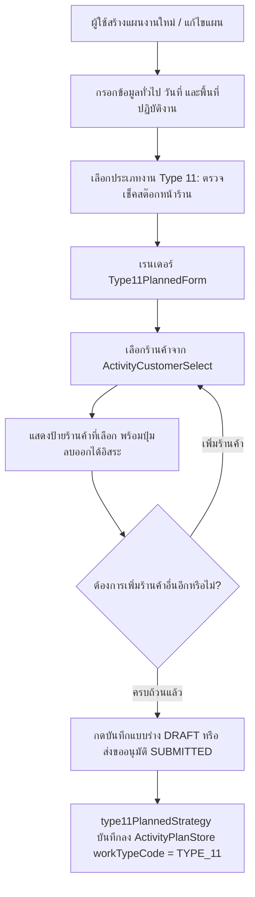
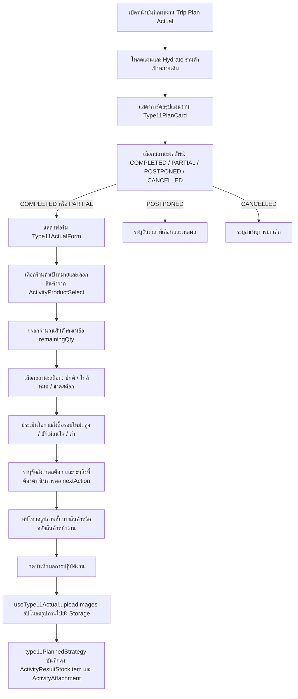
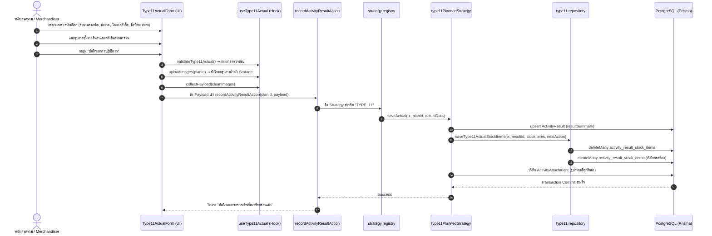

# Activity Type 11 — ตรวจเช็คสต๊อกหน้าร้าน (Store Stock Check) (README)

> **Feature Slice**: `modules/activity/features/type-11`  
> **Parent Module**: `modules/activity`  
> **Database Authority**: `prisma/schema.prisma` (`ActivityPlan`, `ActivityPlanStore`, `ActivityResult`, `ActivityResultStockItem`, `ActivityAttachment`)  
> **Architecture Style**: Vertical Slice Architecture (Dual-Mode 100%: Planned + Unplanned)  
> **Status**: Production Ready / Active Reference

---

## 1. Overview

### 1.1 วัตถุประสงค์ของ Type 11
**Type 11 (ตรวจเช็คสต๊อกหน้าร้าน / Store Stock Check & Shelf Audit)** มีวัตถุประสงค์เพื่อสนับสนุนการปฏิบัติงานของพนักงานสนาม (Sales Representatives / Merchandisers / Area Managers) ในการเข้าตรวจสอบสินค้าคงเหลือบนชั้นวางและในคลังสินค้าของร้านค้าตัวแทนจำหน่ายหลัก (Dealer) และร้านค้าตัวแทนจำหน่ายย่อย (Subdealer) เพื่อ:
1. สำรวจปริมาณสินค้าคงเหลือจริง (On-shelf / In-stock Quantity) เทียบกับอัตราการขายในพื้นที่
2. ประเมินสถานะความพร้อมของสินค้าหน้าร้าน (ปกติ / ใกล้หมด / ขาดสต็อก)
3. วิเคราะห์และค้นหาโอกาสในการสั่งซื้อซ้ำหรือเติมสต็อกรอบใหม่ (Reorder Opportunity: สูง / ยังไม่แน่ใจ / ต่ำ)
4. กำหนดแผนปฏิบัติการถัดไป (Next Action) เช่น นัดหมายเปิดบิลสั่งซื้อ, จัดเตรียมโปรโมชันกระตุ้นสินค้าที่ค้างสต็อก หรือแจ้งเตือนสินค้าใกล้หมดอายุ
5. บันทึกภาพถ่ายชั้นวางสินค้าและคลังสินค้าหน้าร้านเพื่อเป็นหลักฐานอ้างอิงเชิงประจักษ์

### 1.2 ขอบเขตของ Type 11
- **ร้านค้าเป้าหมาย (Target Stores):**
  - รองรับการวางแผนตรวจเช็คสต๊อกได้หลายร้านค้าพร้อมกันในแผนเดียว (`type11Stores: Type11StoreItem[]`)
  - เลือกร้านค้าจากระบบ Customer Master ได้ทั้งประเภท `DEALER` และ `SUBDEALER`
- **เป้าหมายตามแผนงาน (Planned Targets):**
  - กำหนดรายชื่อร้านค้าเป้าหมายที่ต้องการเข้าตรวจเช็คสต๊อกสินค้า
- **การบันทึกผลงานจริง (Actual Outcome):**
  - บันทึกรายการสินค้าที่ตรวจเช็คแยกตามร้านค้า (`stockItems: Type11StockItem[]`)
  - จำนวนสินค้าคงเหลือจริง (`remainingQuantity` / `remainingQty`)
  - สถานะสต็อก (`stockStatus`: `"ปกติ"`, `"ใกล้หมด"`, `"ขาดสต็อก"`)
  - โอกาสในการสั่งซื้อรอบใหม่ (`reorderOpportunity`: `"สูง"`, `"ยังไม่แน่ใจ"`, `"ต่ำ"`)
  - ข้อสังเกตสต็อกสินค้า (`remarks`) และสิ่งที่ต้องดำเนินการต่อ (`nextAction`)
  - ภาพถ่ายชั้นวางสินค้าหรือคลังสินค้าหน้าร้าน (`images`)

### 1.3 รูปแบบการทำงานที่รองรับ
| โหมดการทำงาน | คำอธิบาย | หน้าที่รับผิดชอบหลักใน Slice |
| :--- | :--- | :--- |
| **1. Planned** | สร้างและแก้ไขแผนงานระบุร้านค้าเป้าหมายที่ต้องการตรวจเช็คสต๊อก (รองรับ Multi-store) | `Type11PlannedForm`, `useType11PlannedForm`, `type11PlannedStrategy` |
| **2. Planned Actual** | บันทึกผลการตรวจนับสต็อกจริงแยกตามสินค้าและร้านค้า ประเมินสถานะ โอกาสสั่งซื้อ และรูปภาพ | `Type11ActualForm`, `useType11Actual`, `saveType11ActualStockItems` |
| **3. Unplanned (2-in-1)** | ตรวจเช็คสต๊อกนอกแผนกะทันหัน บันทึกทั้งร้านค้า สินค้าที่ตรวจนับ ผลประเมิน และรูปถ่ายจบในหน้าเดียว | `Type11UnplannedForm`, `useType11UnplannedForm`, `type11UnplannedStrategy` |
| **4. Detail View** | แสดงข้อมูลร้านค้าตามแผน (`Type11PlanCard`) และตารางผลลัพธ์การตรวจนับสต็อกจริงแยกตามร้านค้า พร้อม Lightbox | `Type11PlanCard`, `Type11DetailView` |
| **5. Approval View** | สรุปรายชื่อร้านค้าเป้าหมายที่วางแผนเข้าตรวจสต็อกเพื่อให้หัวหน้างานพิจารณาอนุมัติ | `Type11ApprovalCard`, `Type11PlanCard` |

---

## 2. Business Flows

### 2.1 Planned (สร้างและแก้ไขแผนงาน)


### 2.2 Planned Actual (บันทึกผลการปฏิบัติงานตามแผน)


### 2.3 Unplanned (กิจกรรมนอกแผน 2-in-1)
- ผู้ใช้งานเข้าหน้า `/activity-plans/unplanned/new` และเลือกประเภทงาน **ตรวจเช็คสต๊อกหน้าร้าน (Type 11)**
- ฟอร์ม `Type11UnplannedForm` รวมขั้นตอนการเลือกร้านค้า และตารางบันทึกผลการตรวจนับสต็อก (เลือกสินค้า, จำนวนคงเหลือ, สถานะ, โอกาสสั่งซื้อ, สิ่งที่ต้องทำต่อ) พร้อมช่องอัปโหลดรูปภาพหน้าร้านไว้ในหน้าเดียว
- รองรับการตรวจเช็คสต๊อกหลายร้านค้าพร้อมกันในทริปเดียว (`items: Type11UnplannedItem[]`)
- เมื่อกดบันทึก ข้อมูลทั้งหมดจะถูกส่งผ่าน `unplanned.actions.ts` ➔ รัน `type11UnplannedStrategy.savePlan()` บันทึกข้อมูลร้านค้าลงใน `ActivityPlanStore` และบันทึกผลตรวจนับสต็อกลงใน `ActivityResultStockItem` พร้อมรูปภาพใน `ActivityAttachment` ภายใต้ Prisma Transaction เดียวกัน

### 2.4 Detail and Approval (ดูรายละเอียดและพิจารณาอนุมัติ)
- **Detail View:**
  - แสดง `Type11PlanCard` สรุปรายชื่อร้านค้าเป้าหมายตามแผนงาน
  - หากมีผลงานจริง (`hasActualData`) แสดง `Type11DetailView` จัดกลุ่มตารางแสดงผลตามร้านค้า สรุปสินค้าที่ตรวจนับ จำนวนคงเหลือ ป้ายสถานะสต็อก โอกาสสั่งซื้อ ข้อสังเกต สิ่งที่ต้องทำต่อ และแกลเลอรีรูปถ่ายพร้อม Lightbox Modal
- **Approval View:**
  - แสดง `Type11ApprovalCard` เรนเดอร์การ์ดสรุปร้านค้าเป้าหมายเพื่อให้หัวหน้างานตรวจสอบก่อนอนุมัติ

---

## 3. Architecture

### 3.1 Folder Structure
```text
modules/activity/features/type-11/
├── index.ts                                # Vertical Slice Public Contract (จุดส่งออกเดียว)
├── README.md                               # เอกสารคู่มือทางเทคนิคฉบับสมบูรณ์ (ไฟล์นี้)
│
├── shared/                                 # ชิ้นส่วนที่ใช้ร่วมกันภายใน Type 11
│   ├── constants.ts                        # ค่าคงที่: WORK_TYPE_CODE, WORK_TYPE_NAME, STOCK_STATUS_OPTIONS, REORDER_OPPORTUNITY_OPTIONS
│   ├── types.ts                            # อินเตอร์เฟซข้อมูล: Type11StoreItem, Type11StockItem, Options
│   └── notes.ts                            # Helper จัดรูปแบบข้อความ Planned Notes และ Actual Summary
│
├── planned/                                # Sub-slice: กิจกรรมในแผนและบันทึกผลตามแผน
│   ├── application/                        # Business Logic, Mappers, Validators
│   │   ├── planned-validation.ts           # ตรวจสอบความถูกต้องของแผน (validateType11FormItems)
│   │   ├── planned-mapper.ts               # แปลงและ Hydrate ข้อมูลแผน (extractType11PlanTargets, etc.)
│   │   ├── actual-validation.ts            # ตรวจสอบความถูกต้องของผลงานจริง (validateType11Actual)
│   │   └── actual-mapper.ts                # แกะข้อมูลผลงานจริงจาก Backend (parseType11ActualResult)
│   ├── components/                         # UI Components ฝั่งในแผน
│   │   ├── type11-planned-form.tsx         # ฟอร์มเลือกหลายร้านค้าเป้าหมายตามแผน
│   │   ├── type11-plan-card.tsx            # การ์ดแสดงข้อมูลสรุปร้านค้าตามแผนงาน
│   │   ├── type11-actual-form.tsx          # ฟอร์มบันทึกผลการตรวจนับสต็อกจริงรายสินค้า
│   │   ├── type11-detail-view.tsx          # หน้ารายละเอียดแสดงผลลัพธ์จริงแยกตามร้านค้าพร้อม Lightbox
│   │   └── type11-approval-card.tsx        # การ์ดสรุปสำหรับหน้าจอพิจารณาอนุมัติ
│   ├── hooks/                              # Custom React State Hooks
│   │   ├── use-type11-planned-form.ts      # จัดการ State ร้านค้าตามแผน (Type11StoreItem[])
│   │   └── use-type11-actual.ts            # จัดการ State ผลจริง ตารางสต็อก ข้อสังเกต และรูปถ่าย
│   ├── infrastructure/                     # การเชื่อมต่อฐานข้อมูล
│   │   ├── type11.repository.ts            # Direct Prisma queries (findType11StoresByPlanId, saveType11ActualStockItems)
│   │   └── type11-planned.strategy.ts      # WorkTypeStrategy สำหรับ Type 11 ตามแผน
│   └── types/                              # ประเภทข้อมูลเฉพาะกิจกรรมในแผน
│       ├── planned.types.ts                # Type11TargetItem, Type11PlanTarget, Form Props
│       └── actual.types.ts                 # Type11ActualRecord, Type11ActualValidationInput, Form Props
│
└── unplanned/                              # Sub-slice: กิจกรรมนอกแผน (2-in-1)
    ├── application/                        # Logic และ Mappers กิจกรรมนอกแผน
    │   ├── unplanned-validation.ts         # ตรวจสอบความถูกต้องของกิจกรรมนอกแผน
    │   └── unplanned-mapper.ts             # แปลงข้อมูล 2-in-1 และ Hydrate ข้อมูลเดิม
    ├── components/                         # UI Components กิจกรรมนอกแผน
    │   └── type11-unplanned-form.tsx       # ฟอร์ม 2-in-1 รวมวางแผนร้านค้าและตรวจนับสต็อกในหน้าเดียว
    ├── hooks/                              # Custom React State Hooks
    │   └── use-type11-unplanned-form.ts    # จัดการ State กิจกรรมนอกแผน (รองรับหลายร้านค้า)
    ├── infrastructure/                     # Strategy กิจกรรมนอกแผน
    │   └── type11-unplanned.strategy.ts    # WorkTypeStrategy บันทึกกิจกรรมนอกแผน 2-in-1
    └── types/                              # ประเภทข้อมูลกิจกรรมนอกแผน
        └── unplanned.types.ts              # Type11UnplannedItem, Props, Validation Result
```

### 3.2 Type 11 vs Shared Activity Matrix
| ความรับผิดชอบ | จัดการที่ Type 11 Feature (`features/type-11`) | จัดการที่ Shared Activity ส่วนกลาง (`ui/`, `views/`) |
| :--- | :--- | :--- |
| **ข้อมูลทั่วไปของแผน** | - | ชื่องาน, วันที่เริ่ม-สิ้นสุด, วัตถุประสงค์หลักของทริป |
| **พื้นที่ & ทีมงาน** | รายชื่อร้านค้าที่ตรวจเช็คสต๊อก | จังหวัดหลักของทริป, พนักงานร่วมเดินทาง |
| **งบประมาณรวม** | - | งบประมาณเดินทาง, เบี้ยเลี้ยง |
| **ข้อมูลกิจกรรมตามแผน** | รายชื่อร้านค้าเป้าหมาย (`ActivityPlanStore` workTypeCode = `TYPE_11`) | ภาพรวมแผนงานและการจัดตารางเวลา |
| **ผลการตรวจนับสต็อกจริง** | ตารางสินค้าที่ตรวจนับ, จำนวนคงเหลือ, สถานะสต็อก, โอกาสสั่งซื้อ, ข้อสังเกต, สิ่งที่ต้องทำต่อ, รูปภาพ | ผลสรุปภาพรวมแผน (`resultStatus`: COMPLETED/PARTIAL/etc.) |
| **Database Persistence** | ตาราง `ActivityPlanStore`, `ActivityResultStockItem` (ผ่าน `saveType11ActualStockItems`) | ตารางหลัก `ActivityPlan`, `ActivityResult`, `ActivityAttachment` |

### 3.3 Dependency and Import Map
- **ทิศทางการเรียกใช้ที่อนุญาต (Allowed Dependencies):**
  - `views/` ➔ เรียกใช้ ➔ `features/type-11` (ผ่าน `index.ts` เท่านั้น)
  - `features/type-11` ➔ เรียกใช้ ➔ `@/modules/activity/ui` (`ActivityCustomerSelect`, `ActivityProductSelect`, `ActivityInput`, `ActivityCombobox`, `ActivityPhotoUpload`)
  - `features/type-11` ➔ เรียกใช้ ➔ `@/modules/activity/types/strategy.interface`
  - `features/type-11` ➔ เรียกใช้ ➔ `@/modules/activity/application/media/image-uploader`
  - `features/type-11` ➔ เรียกใช้ ➔ `@/components/custom/image-lightbox-modal`
  - `features/type-11` ➔ เรียกใช้ ➔ `@/modules/products/server/actions` (`listProductsAction`)
- **Server Actions & Database Flow:**
  - `views/` ➔ ส่งข้อมูลไปยัง Server Actions ใน `@/modules/activity/server/`:
    - `planned.actions.ts` (`createActivityPlanAction`, `updateActivityPlanAction`, `getActivityPlanAction`)
    - `unplanned.actions.ts` (`createUnplannedActivityAction`, `updateUnplannedActivityAction`, `getUnplannedActivityAction`)
    - `actual.actions.ts` (`recordActivityResultAction`)
  - Server Actions ➔ ทำงานร่วมกับ `@/modules/activity/infrastructure/strategy.registry.ts` ➔ เรียกใช้ `type11PlannedStrategy` และ `type11UnplannedStrategy`
- **ข้อห้ามเด็ดขาด (Strict Rules):**
  - ❌ ห้าม Import จาก `@/modules/activity-plans/` ย้อนหลังโดยเด็ดขาด (Zero Legacy Imports)
  - ❌ ห้ามไฟล์ภายนอกข้ามเข้ามา Import ลึกใน `features/type-11/planned/...` โดยไม่ผ่าน `index.ts`
  - ❌ ห้ามเรียกใช้โค้ดข้ามไปยัง Feature Type อื่น

### 3.4 Entry Points and Public Exports
ไฟล์ [modules/activity/features/type-11/index.ts](file:///d:/code/crm-bank/modules/activity/features/type-11/index.ts) ทำหน้าที่เป็น **Single Public API Contract** สำหรับโมดูล Type 11 โดยส่งออก:
- **Planned Components:** `Type11PlannedForm`, `Type11PlanCard`, `Type11PlanForm`, `Type11Stock`, `EditType11Stock`
- **Actual Components:** `Type11ActualForm`, `ActualType11Stock`, `Type11DetailView`, `DetailType11Stock`, `Type11ApprovalCard`, `ApprovalType11Stock`
- **Unplanned Components:** `Type11UnplannedForm`
- **Hooks:** `useType11PlannedForm`, `useType11Form`, `useType11Actual`, `useType11UnplannedForm`
- **Mappers & Hydrators:** `extractType11PlanTargets`, `hydrateType11PlannedData`, `mapType11ToSectionItems`, `parseType11ActualResult`, `hydrateType11UnplannedData`, `mapType11UnplannedToPayload`
- **Validators:** `validateType11FormItems`, `validateType11Actual`, `validateType11UnplannedItems`
- **Shared Constants & Utilities:** `WORK_TYPE_CODE`, `WORK_TYPE_NAME`, `STOCK_STATUS_OPTIONS`, `REORDER_OPPORTUNITY_OPTIONS`, `formatType11PlannedNotes`, `formatType11ActualSummary`
- **TypeScript Types:** `Type11PlanItem`, `Type11TargetItem`, `Type11PlanTarget`, `Type11TargetStoreItem`, `Type11ActualRecord`, `Type11ActualValidationInput`, `Type11UnplannedItem`, `Type11StoreItem`, `Type11StockItem`, `Type11CustomerOption`, `Type11ProductOption`, `Type11ImageFile`, `StockStatus`, `ReorderOpportunity`

---

## 4. File Responsibilities

### 4.1 Planned & Actual
- **`type11-planned-form.tsx`:** เรนเดอร์ฟอร์มเลือกหลายร้านค้าเป้าหมายผ่าน `ActivityCustomerSelect` แสดงป้ายร้านค้าที่เลือกพร้อมปุ่มกดลบออกได้
- **`use-type11-planned-form.ts`:** จัดการ State ร้านค้าตามแผน (`type11Stores: Type11StoreItem[]`), แปลงข้อมูลเดิมเข้าฟอร์ม, พร้อมฟังก์ชัน `validateType11` และ `mapType11Payload`
- **`type11-plan-card.tsx`:** การ์ดแสดงข้อมูลสรุปร้านค้าเป้าหมายตามแผนงาน
- **`type11-actual-form.tsx`:** ฟอร์มบันทึกผลการตรวจนับสต็อกจริง แสดงการ์ดแผน `Type11PlanCard`, เลือกร้านค้าและสินค้าผ่าน `ActivityProductSelect` (พร้อม Self-healing โหลดสินค้าผ่าน `listProductsAction`), กรอกจำนวนคงเหลือ, ป้ายสถานะสต็อก, โอกาสสั่งซื้อ, ข้อสังเกต, สิ่งที่ต้องทำต่อ, และอัปโหลดภาพถ่ายชั้นวางสินค้า
- **`use-type11-actual.ts`:** จัดการ State ผลงานจริง ฟังก์ชัน `uploadImages` เพื่ออัปโหลดรูปภาพไปยังไดเรกทอรี `"stock"` / `"general"`, ฟังก์ชัน `collectPayload` รวบรวมข้อมูลสต็อก, และ `validateType11Actual`
- **`type11-detail-view.tsx`:** คอมโพเนนต์แสดงผลเต็มรูปแบบในหน้ารายละเอียด จัดกลุ่มตารางผลลัพธ์แยกตามร้านค้า แสดงจำนวนคงเหลือ สถานะสต็อก โอกาสสั่งซื้อ สิ่งที่ต้องทำต่อ และรูปภาพพร้อมระบบ Lightbox
- **`type11-approval-card.tsx`:** การ์ดสรุปสำหรับหน้าจอพิจารณาอนุมัติ เรนเดอร์ `Type11PlanCard` ให้หัวหน้างานพิจารณา
- **`planned-mapper.ts`:**
  - `extractType11PlanTargets`: ดึงข้อมูลร้านค้าจาก `plan.stores` แปลงออกมาเป็น `Type11TargetItem`
  - `hydrateType11PlannedData`: กู้คืนข้อมูลร้านค้าเดิมเข้าฟอร์มแก้ไข
  - `mapType11ToSectionItems`: แปลงข้อมูลร้านค้าเป็นหัวข้อสำหรับแสดงใน Section รวม
- **`actual-mapper.ts`:**
  - `parseType11ActualResult`: แปลงข้อมูลผลงานจาก `ActivityResult` และ `stockResults` (`ActivityResultStockItem`) รวมถึง Regex fallback จาก `resultSummary`
- **`planned-validation.ts` & `actual-validation.ts`:**
  - `validateType11FormItems`: ตรวจสอบว่าเลือกร้านค้าเป้าหมายอย่างน้อย 1 ร้านค้า
  - `validateType11Actual`: ตรวจสอบว่าได้ระบุจำนวนคงเหลือและเลือกโอกาสการสั่งซื้อรอบใหม่ครบทุกแถวสินค้า
- **`type11.repository.ts` & `type11-planned.strategy.ts`:**
  - `findType11StoresByPlanId`: ค้นหาร้านค้า Type 11 ของแผนงาน
  - `saveType11ActualStockItems`: ลบและบันทึกระเบียนตรวจนับสต็อกลงตาราง `activity_result_stock_items`
  - `type11PlannedStrategy`: ดำเนินการตรวจสอบและบันทึกข้อมูลร้านค้าและผลงานจริงตามมาตรฐาน `WorkTypeStrategy`

### 4.2 Unplanned
- **`type11-unplanned-form.tsx`:** ฟอร์มกิจกรรมตรวจสต็อกนอกแผน 2-in-1 แสดงอินพุตเลือกร้านค้า และตารางบันทึกสินค้าคงเหลือ, สถานะ, โอกาสสั่งซื้อ, สิ่งที่ต้องทำต่อ และรูปภาพในหน้าเดียว
- **`use-type11-unplanned-form.ts`:** จัดการ State อาร์เรย์ `Type11UnplannedItem[]` รองรับการเพิ่ม ลบ แก้ไขร้านค้าและสินค้าที่ตรวจเช็คได้หลายร้านในทริปเดียว
- **`unplanned-validation.ts`:** ตรวจสอบความถูกต้องของกิจกรรมนอกแผน (ร้านค้า, ชื่อสินค้า, จำนวนคงเหลือ, โอกาสสั่งซื้อ)
- **`unplanned-mapper.ts`:** Hydrate ข้อมูลเดิม และ Map ข้อมูลฟอร์ม 2-in-1 ออกมาเป็น Payload แผนงาน (`planStores`) และผลงานจริง (`actualOutcome`)
- **`type11-unplanned.strategy.ts`:** ดำเนินการบันทึกกิจกรรมนอกแผนผ่านการบันทึก `ActivityPlanStore` และ `ActivityResultStockItem` ใน Transaction เดียวกัน

### 4.3 Shared Types, Constants, and Notes
- **`constants.ts`:** กำหนด `WORK_TYPE_CODE = "TYPE_11"`, `WORK_TYPE_NAME`, ตัวเลือกสถานะสต็อก `STOCK_STATUS_OPTIONS` (`"ปกติ"`, `"ใกล้หมด"`, `"ขาดสต็อก"`), และตัวเลือกโอกาสสั่งซื้อ `REORDER_OPPORTUNITY_OPTIONS` (`"สูง"`, `"ยังไม่แน่ใจ"`, `"ต่ำ"`)
- **`types.ts`:** กำหนดโครงสร้าง TypeScript สำหรับร้านค้า (`Type11StoreItem`), สินค้าตรวจนับ (`Type11StockItem`), และรูปภาพ (`Type11ImageFile`)
- **`notes.ts`:** ฟังก์ชัน `formatType11PlannedNotes` และ `formatType11ActualSummary` สำหรับจัดรูปแบบข้อความสรุปผลงาน

### 4.4 Shared UI and Views
- คอมโพเนนต์ `ActualWorkTypeList`, `DetailWorkTypeList`, และ `ApprovalWorkTypeList` ใน `modules/activity/views/` ทำหน้าที่เป็น Orchestrator ตรวจจับรหัสงาน `"TYPE_11"` แล้วสลับมาเรนเดอร์คอมโพเนนต์ของ Type 11

---

## 5. Data Flow



### 5.1 Create Planned (สร้างแผนใหม่)
1. `create-view.tsx` เรียกใช้ `useType11PlannedForm()`
2. ผู้ใช้เลือกร้านค้าเป้าหมายอย่างน้อย 1 ร้านค้าผ่าน `ActivityCustomerSelect`
3. ระบบตรวจสอบความถูกต้องด้วย `validateType11FormItems()`
4. Form Orchestrator รวม Payload และส่งไปยัง Server Action `createActivityPlanAction`
5. `type11PlannedStrategy.savePlan()` บันทึกร้านค้าลงในตาราง `ActivityPlanStore` (`workTypeCode = "TYPE_11"`, `storeId`, `storeName`, `remarks/notes`)

### 5.2 Edit Planned (แก้ไขแผนงานเดิม)
1. `edit-view.tsx` โหลดข้อมูลแผนงานจากฐานข้อมูล
2. เรียก `hydrateType11PlannedData(plan)` แปลงข้อมูลร้านค้าเดิมออกมาเป็น `Type11StoreItem[]`
3. ส่งข้อมูลเข้า `useType11PlannedForm()` เพื่อเติมลงใน State ของฟอร์ม
4. ผู้ใช้เพิ่มหรือลบร้านค้าเป้าหมายและกดบันทึกกลับได้อย่างถูกต้อง

### 5.3 Save Actual (บันทึกผลการปฏิบัติงานจริง)
1. `activity-plan-actual-view.tsx` ตรวจสอบความถูกต้องผ่าน `validateType11Actual(stockItems)`
2. เรียก `type11Actual.uploadImages(planId)` เพื่ออัปโหลดไฟล์ภาพชั้นวางสินค้าไปยัง Storage
3. เรียก `type11Actual.collectPayload(cleanImages)` จัดกลุ่มข้อมูลสต็อก ข้อสังเกต สิ่งที่ต้องทำต่อ และ Clean URLs
4. ส่ง Payload เข้า Server Action `recordActivityResultAction`
5. `type11PlannedStrategy.saveActual()` อัปเดต `ActivityResult` และเรียก `saveType11ActualStockItems` เพื่อลบและบันทึกระเบียนตรวจนับสต็อกใหม่ลงใน `activity_result_stock_items`

### 5.4 Load Actual (โหลดผลงานเดิมมาแสดงในหน้าบันทึกผล)
1. `useActualPlanLoader` ดึงข้อมูลแผนงานและผลงานเดิม
2. `extractType11PlanTargets(plan)` แกะข้อมูลร้านค้าเป้าหมายเดิมออกมาแสดงในการ์ด `Type11PlanCard`
3. `parseType11ActualResult(plan.result)` ดึงข้อมูลรายการสินค้าคงเหลือจาก `stockResults`, สิ่งที่ต้องทำต่อ, และรูปภาพเดิม
4. เรียก `type11Actual.hydrate()` เติมข้อมูลลง State ของฟอร์มพร้อมให้แก้ไขเพิ่มเติม

### 5.5 Create/Edit Unplanned (กิจกรรมนอกแผน 2-in-1)
1. ผู้ใช้กรอกฟอร์ม `Type11UnplannedForm` เลือกร้านค้าและกรอกตารางตรวจนับสต็อกพร้อมรูปถ่ายในหน้าเดียว
2. ตรวจสอบความถูกต้องด้วย `validateType11UnplannedItems(items)`
3. `mapType11UnplannedToPayload` แปลงข้อมูลออกมาเป็น `planStores` และ `actualOutcome`
4. `type11UnplannedStrategy.savePlan()` บันทึกข้อมูลร้านค้าและผลการตรวจนับสต็อกพร้อมกันแบบ Atomic

### 5.6 Detail and Approval (การแสดงผลหน้ารายละเอียดและพิจารณาอนุมัติ)
1. หน้า Detail / Approval โหลดข้อมูลแผนงานผ่าน Loader
2. เรนเดอร์ `Type11PlanCard` แสดงรายชื่อร้านค้าเป้าหมาย
3. หากมีผลงานจริง เรนเดอร์ `Type11DetailView` จัดกลุ่มแสดงตารางสินค้าที่ตรวจนับแยกตามร้านค้า แสดงจำนวนคงเหลือ สถานะสต็อก โอกาสสั่งซื้อ สิ่งที่ต้องทำต่อ และแกลเลอรีรูปถ่ายพร้อม Lightbox

---

## 6. Data Models and Mapping

### 6.1 Database CRUD Matrix (สิทธิ์และการจัดการตารางในฐานข้อมูล)
| ตารางในฐานข้อมูล (`Prisma Model`) | Create (สร้าง) | Read (อ่าน/แสดงผล) | Update (แก้ไข) | Delete (ลบ) | หมายเหตุ |
| :--- | :--- | :--- | :--- | :--- | :--- |
| **`activity_plans`**<br>(`ActivityPlan`) | ตอนสร้างแผน | ในทุกมุมมอง | เมื่อแก้ไขแผน | Cascade Delete | ตารางหลักของกิจกรรม |
| **`activity_plan_stores`**<br>(`ActivityPlanStore`) | `savePlan()` ใน Planned/Unplanned | `loadPlan()`, `extractType11PlanTargets` | `deleteMany()` + `createMany()` ใน `savePlan()` | Cascade เมื่อลบแผน | เก็บรหัสร้านค้าที่ตรวจเช็คสต๊อก (`workTypeCode = "TYPE_11"`) |
| **`activity_results`**<br>(`ActivityResult`) | `saveActual()` ใน Actual/Unplanned | `loadActual()`, `parseType11ActualResult` | `upsert` ใน `saveActual()` | Cascade เมื่อลบแผน | เก็บ `resultSummary` |
| **`activity_result_stock_items`**<br>(`ActivityResultStockItem`) | `saveType11ActualStockItems` | `parseType11ActualResult` (`stockResults`) | `deleteMany()` + `createMany()` ใน Repo | Cascade เมื่อลบผลงาน | ตารางเฉพาะเก็บผลการตรวจนับสต็อกหน้าร้าน |
| **`activity_attachments`**<br>(`ActivityAttachment`) | `uploadImages()` + Server Action | `plan.attachments` | สร้างใหม่/ลบรูปที่ไม่ได้ใช้ | Cascade เมื่อลบผลงาน | เก็บรูปภาพชั้นวางสินค้าและคลังสินค้าหน้าร้าน |

### 6.2 Complete Field-to-Database Mapping (ตารางจับคู่ฟิลด์ครบถ้วนทุกจุด)
| Form Field (UI) | TypeScript Type Field | Mapper Function (Write/Read) | Prisma Model | DB Column Name | Data Type | Nullable? | Default |
| :--- | :--- | :--- | :--- | :--- | :--- | :---: | :--- |
| **รหัสร้านค้าเป้าหมาย** | `storeId` | `planned-mapper` ➔ `type11Stores` | `ActivityPlanStore` | `store_id` | `VARCHAR (FK)` | No | - |
| **ชื่อร้านค้าเป้าหมาย** | `storeName` | `planned-mapper` ➔ `type11Stores` | `ActivityPlanStore` | `store_name` | `VARCHAR` | Yes | `null` |
| **วัตถุประสงค์ร้านค้า** | `remarks` / `notes` | `type11PlannedStrategy.savePlan` | `ActivityPlanStore` | `remarks`, `notes` | `TEXT` | Yes | `"ตรวจเช็คสต๊อกหน้าร้าน"` |
| **รหัสร้านค้าที่ตรวจนับจริง** | `storeId` (ใน `Type11StockItem`) | `saveType11ActualStockItems` | `ActivityResultStockItem` | `store_id` | `VARCHAR (FK)` | No | - |
| **รหัสสินค้าที่ตรวจนับ** | `productId` | `saveType11ActualStockItems` | `ActivityResultStockItem` | `product_id` | `VARCHAR (FK)` | No | - |
| **จำนวนคงเหลือจริง** | `remainingQty` / `remainingQuantity` | `saveType11ActualStockItems` | `ActivityResultStockItem` | `remaining_quantity` | `INTEGER` | No | `0` |
| **สถานะสต็อก** | `stockStatus` | `saveType11ActualStockItems` | `ActivityResultStockItem` | `stock_status` | `VARCHAR` | Yes | `null` |
| **โอกาสสั่งซื้อรอบใหม่** | `reorderOpportunity` | `saveType11ActualStockItems` | `ActivityResultStockItem` | `reorder_opportunity` | `VARCHAR` | Yes | `null` |
| **ข้อสังเกตสต็อก** | `remarks` (ใน `Type11StockItem`) | `saveType11ActualStockItems` | `ActivityResultStockItem` | `remarks` | `TEXT` | Yes | `null` |
| **สิ่งที่ต้องดำเนินการต่อ** | `nextAction` | `saveType11ActualStockItems` | `ActivityResultStockItem` | `next_action` | `TEXT` | Yes | `null` |
| **รูปถ่ายชั้นวางสินค้า** | `images` | `uploadImages()` ➔ `attachments` | `ActivityAttachment` | `file_url`, `work_type_code = 'TYPE_11'` | `TEXT` | No | - |

### 6.3 รายละเอียดตารางสินค้า รูปภาพ และความสัมพันธ์ (Relations & Schema)

```prisma
// 1. ตารางเก็บร้านค้าเป้าหมายที่เข้าตรวจเช็คสต๊อก
model ActivityPlanStore {
  id                      String   @id @default(cuid())
  activityPlanId          String   @map("activity_plan_id")
  workTypeCode            String   @map("work_type_code") // "TYPE_11"
  visitPurpose            String?  @map("visit_purpose")
  storeId                 String?  @map("store_id")
  storeName               String?  @map("store_name")
  remarks                 String?
  notes                   String?

  activityPlan            ActivityPlan @relation(fields: [activityPlanId], references: [id], onDelete: Cascade)
  store                   Customer?    @relation(fields: [storeId], references: [id], onDelete: SetNull)

  @@index([activityPlanId])
  @@index([storeId])
  @@map("activity_plan_stores")
}

// 2. ตารางเฉพาะกิจเก็บผลการตรวจนับสต็อกสินค้าหน้าร้าน
model ActivityResultStockItem {
  id                 String  @id @default(cuid())
  activityResultId   String  @map("activity_result_id")
  storeId            String  @map("store_id")
  productId          String  @map("product_id")
  remainingQuantity  Int     @default(0) @map("remaining_quantity")
  stockStatus        String? @map("stock_status") // "ปกติ", "ใกล้หมด", "ขาดสต็อก"
  reorderOpportunity String? @map("reorder_opportunity") // "สูง", "ยังไม่แน่ใจ", "ต่ำ"
  remarks            String? // ข้อสังเกตสต็อก
  nextAction         String? @map("next_action") // สิ่งที่ต้องทำต่อ

  activityResult     ActivityResult @relation(fields: [activityResultId], references: [id], onDelete: Cascade)
  store              Customer       @relation(fields: [storeId], references: [id], onDelete: Restrict)
  product            Product        @relation("ActivityResultStockProductRef", fields: [productId], references: [id], onDelete: Restrict)

  @@index([activityResultId])
  @@index([storeId])
  @@index([productId])
  @@map("activity_result_stock_items")
}
```

### 6.4 Transaction & Persistence Strategy (ขาเขียนและขาอ่าน)
- **การจัดการ Transaction (Isolation & Atomicity):**
  - ทุกการบันทึกของ Type 11 ดำเนินการภายใต้ `db.$transaction(async (tx) => { ... })`
  - หากการบันทึกภาพถ่าย หรือการบันทึกรายการตรวจนับสต็อกใน `activity_result_stock_items` ล้มเหลว ระบบจะ Rollback การเปลี่ยนแปลงทั้งหมดทันที
- **Persistence ขาเขียนรายการสต็อก (Stock Persistence):**
  - ในฟังก์ชัน `saveType11ActualStockItems` จะสั่ง `deleteMany` ระเบียนเดิมใน `activity_result_stock_items` ที่มี `activityResultId` นั้นๆ ก่อน แล้วทำการคัดกรองเฉพาะแถวที่มีทั้ง `storeId` และ `productId` ครบถ้วน เพื่อสร้างระเบียนใหม่ด้วย `createMany`
- **Cascade Delete Policy:**
  - เมื่อลบแผนงาน `ActivityPlan` ระเบียนที่เกี่ยวข้องใน `ActivityPlanStore`, `ActivityResult`, `ActivityResultStockItem`, และ `ActivityAttachment` จะถูกลบออกแบบ Cascade ทั้งหมด

---

## 7. Business Rules

### 7.1 Validation Rules
1. **การตรวจสอบร้านค้าในแผนงาน (`validateType11FormItems`):**
   - ต้องเลือกร้านค้าเป้าหมายอย่างน้อย 1 ร้านค้า (`type11Stores.length > 0`)
2. **การตรวจสอบผลการตรวจนับสต็อกจริง (`validateType11Actual`):**
   - ทุกแถวสินค้าที่บันทึก ต้องระบุจำนวนคงเหลือ (`remainingQty` ห้ามว่าง)
   - ต้องเลือกโอกาสการสั่งซื้อรอบใหม่ (`reorderOpportunity` ห้ามว่าง: สูง / ยังไม่แน่ใจ / ต่ำ)
3. **การตรวจสอบกิจกรรมนอกแผน (`validateType11UnplannedItems`):**
   - ต้องระบุข้อมูลร้านค้าอย่างน้อย 1 ร้านค้า
   - ทุกรายการตรวจนับสต็อกต้องระบุชื่อสินค้า จำนวนคงเหลือ และโอกาสสั่งซื้อครบถ้วน

### 7.2 Default Values
- `stockStatus`: ค่าเริ่มต้นเป็น `"ปกติ"`
- `reorderOpportunity`: ค่าเริ่มต้นเป็น `""` (บังคับให้ผู้ใช้ประเมิน)
- `activityResultStatus`: ค่าเริ่มต้นเมื่อเปิดหน้าบันทึกผลเป็น `"COMPLETED"`

### 7.3 Conditional Fields
- **การสลับร้านค้าในหน้า Actual:** เมื่อแผนงานมีร้านค้าเป้าหมายมากกว่า 1 ร้านค้า ฟอร์มจะแสดงช่องเลือกร้านค้าเพื่อระบุว่าสินค้าแถวนั้นกำลังตรวจนับ ณ ร้านค้าใด
- **การจัดกลุ่มแสดงผลในหน้ารายละเอียด:** คอมโพเนนต์ `Type11DetailView` จะจัดกลุ่มรายการสินค้าที่ตรวจนับตามร้านค้าอัตโนมัติ ทำให้ดูผลสรุปแยกตามร้านค้าได้อย่างเป็นระเบียบ
- **ระบบ Lightbox:** แกลเลอรีรูปภาพชั้นวางสินค้าในหน้า `Type11DetailView` รองรับการคลิกดูขยายภาพ พร้อมปุ่มเลื่อนภาพ

### 7.4 Status and Approval Rules
- แผนงานจะสามารถบันทึกผลการตรวจสต็อกจริง (Actual) ได้เฉพาะเมื่อแผนมีสถานะเป็น `APPROVED` เท่านั้น
- เฉพาะเจ้าของแผนงาน (Creator) และ Administrator เท่านั้นที่มีสิทธิ์บันทึกผลการปฏิบัติงานจริง
- การพิจารณาอนุมัติของหัวหน้างานจะเห็นรายชื่อร้านค้าเป้าหมายทั้งหมดในการ์ด `Type11ApprovalCard`

---

## 8. Shared Dependencies

โมดูล Type 11 ทำงานร่วมกับโมดูลและคอมโพเนนต์ส่วนกลางดังนี้:
1. **`@/modules/activity/ui`:**
   - `ActivityCustomerSelect`: ค้นหาและเลือกร้านค้าเป้าหมาย
   - `ActivityProductSelect`: ค้นหาและเลือกสินค้าที่ตรวจนับสต็อก
   - `ActivityInput`: กล่องกรอกตัวเลขจำนวนคงเหลือ
   - `ActivityCombobox`: ตัวเลือกสถานะสต็อกและโอกาสสั่งซื้อ
   - `ActivityPhotoUpload`: คอมโพเนนต์อัปโหลดรูปภาพพร้อมบีบอัดไฟล์
2. **`@/modules/activity/views`:**
   - `ActualWorkTypeList`, `DetailWorkTypeList`, `ApprovalWorkTypeList` ทำหน้าที่เป็น View Orchestrator สลับมาแสดงผลคอมโพเนนต์ของ Type 11 ตามเงื่อนไขประเภทงาน
3. **`@/modules/activity/constants`:**
   - `WORK_TYPE_CONFIG`: ตั้งค่ารหัสประเภทงานและสีธีม (Slate)
   - `ACTIVITY_RESULT_STATUS_LABELS`: ป้ายแสดงสถานะผลกิจกรรม
4. **`@/modules/activity/infrastructure/strategy.registry`:**
   - ลงทะเบียน `type11PlannedStrategy` และ `type11UnplannedStrategy` สำหรับจัดเก็บข้อมูลแบบ Polymorphic
5. **Server Actions ที่ใช้งาน:**
   - `listProductsAction` ใน `@/modules/products/server/actions` (ดึงรายการสินค้า Master Data)
   - `createActivityPlanAction`, `updateActivityPlanAction`, `getActivityPlanAction` ใน `@/modules/activity/server/planned.actions`
   - `createUnplannedActivityAction`, `updateUnplannedActivityAction`, `getUnplannedActivityAction` ใน `@/modules/activity/server/unplanned.actions`
   - `recordActivityResultAction` ใน `@/modules/activity/server/actual.actions`
6. **Lightbox Component:**
   - `ImageLightboxModal` ใน `@/components/custom/image-lightbox-modal`

---

## 9. How to Modify Type 11

### 9.1 การเพิ่มฟิลด์ใหม่บนฟอร์ม (Add a Form Field)
1. เพิ่มฟิลด์ใน Type Definitions:
   - ฟอร์มแผน: `planned/types/planned.types.ts` (`Type11StoreItem`)
   - ฟอร์มผลจริง: `planned/types/actual.types.ts` (`Type11StockItem`, `Type11ActualRecord`)
   - ฟอร์มนอกแผน: `unplanned/types/unplanned.types.ts` (`Type11UnplannedItem`)
2. เพิ่มเงื่อนไขตรวจสอบความถูกต้องใน `planned-validation.ts`, `actual-validation.ts`, หรือ `unplanned-validation.ts`
3. เพิ่ม UI Input ในคอมโพเนนต์ฟอร์ม (`type11-planned-form.tsx`, `type11-actual-form.tsx`, หรือ `type11-unplanned-form.tsx`) โดยใช้ `@/modules/activity/ui`
4. ปรับ Mapper ใน `planned-mapper.ts`, `actual-mapper.ts`, หรือ `unplanned-mapper.ts`
5. อัปเดตการบันทึกใน `type11-planned.strategy.ts` หรือ `type11.repository.ts`

### 9.2 การปรับแก้ Validation (Change Validation)
- แก้ไขที่ไฟล์ `planned/application/planned-validation.ts`, `planned/application/actual-validation.ts` หรือ `unplanned/application/unplanned-validation.ts` ตามเงื่อนไขทางธุรกิจที่ต้องการปรับปรุง

### 9.3 การปรับ Database Mapping (Change Database Mapping)
- หากมีการเปลี่ยนแปลง Schema ใน `prisma/schema.prisma` ให้แก้ไขการบันทึกใน `type11.repository.ts` หรือ `type11-planned.strategy.ts` โดยคงการทำงานแบบ Transaction เสมอ

### 9.4 การปรับแก้ Actual Loading or Hydration
- ตรวจสอบฟังก์ชัน `hydrateType11PlannedData`, `extractType11PlanTargets` ใน `planned-mapper.ts` และ `parseType11ActualResult` ใน `actual-mapper.ts` เพื่อให้รองรับคีย์ข้อมูลเดิมอย่างครอบคลุม

### 9.5 การแก้ไข Shared Components อย่างปลอดภัย
- เมื่อต้องแก้ไขคอมโพเนนต์ใน `@/modules/activity/ui` ต้องคำนึงถึงประเภทงานอื่นเสมอ และไม่เปลี่ยนแปลง Props Interface เดิมที่ใช้งานร่วมกัน

---

## 10. Troubleshooting & Tracing Pipeline

### 10.1 Step-by-Step Tracing Pipeline (คู่มือการไล่โค้ดเมื่อพบปัญหา)

เมื่อพบว่าข้อมูลบางจุดไม่แสดงผล (เช่น รายการสต็อกที่ตรวจนับไม่ถูกบันทึก หรือร้านค้าเป้าหมายหายไป) ให้ไล่ตรวจสอบตาม 8 ขั้นตอนนี้ตามลำดับ:

```text
[Step 1: UI Field] ➔ Type11ActualForm.tsx (ตรวจว่า state stockItems มีค่า storeId และ productId ครบหรือไม่)
        ↓
[Step 2: Hook State] ➔ use-type11-actual.ts (ตรวจ collectPayload ว่าแนบ t11StockItems หรือไม่)
        ↓
[Step 3: Save Mapper] ➔ collectPayload() (ตรวจว่าได้ Clean URLs ของรูปภาพ และ Array ของ StockItems)
        ↓
[Step 4: Server Action] ➔ recordActivityResultAction ➔ recordActivityResultUseCase
        ↓
[Step 5: Strategy Write] ➔ type11-planned.strategy.ts: saveActual() ➔ เรียก saveType11ActualStockItems()
        ↓
[Step 6: Prisma Table] ➔ ตรวจสอบตาราง activity_result_stock_items ใน DB ว่ามีระเบียนถูกสร้างจริงหรือไม่
        ↓
[Step 7: Loader & Include] ➔ getActivityPlanAction (ตรวจว่า include stockResults และ attachments ครบถ้วนหรือไม่)
        ↓
[Step 8: Load Hydrator] ➔ actual-mapper.ts: parseType11ActualResult() ➔ useType11Actual.hydrate()
```

### 10.2 ตารางวิเคราะห์ปัญหาที่พบบ่อย (Common Pitfalls)

| อาการ | จุดที่ต้องตรวจสอบ | สาเหตุและแนวทางแก้ไข |
| :--- | :--- | :--- |
| **บันทึกผลสำเร็จแต่รายการสต็อกไม่ลงตาราง `activity_result_stock_items`** | `type11.repository.ts` ➔ `saveType11ActualStockItems` | ฟังก์ชันมีการกรอง `filter((item) => Boolean(item.storeId && item.productId))` หากแถวใดไม่มี `storeId` หรือ `productId` จะถูกตัดทิ้ง ให้ตรวจสอบว่าส่ง ID มาครบถ้วน |
| **ร้านค้าเป้าหมายที่เลือกไว้หายไปหลังบันทึกแผน** | `type11-planned.strategy.ts` ➔ `savePlan` | ตรวจสอบว่า `type11Stores` ส่งมาใน Payload และมีฟิลด์ `storeId` หรือไม่ |
| **รูปถ่ายชั้นวางสินค้าหายหลัง Reload หน้าจอ** | `use-type11-actual.ts` ➔ `uploadImages` | ตรวจสอบว่า `uploadActivityPlanImageGroup` อัปโหลดไปยังโฟลเดอร์ `"stock"` / `"general"` สำเร็จและส่ง Clean URLs กลับมาบันทึกหรือไม่ |
| **ฟอร์มไม่ยอมให้บันทึกผลจริงโดยแจ้งเตือนจำนวนคงเหลือ** | `actual-validation.ts` ➔ `validateType11Actual` | ผู้ใช้ไม่ได้กรอกตัวเลขจำนวนคงเหลือ หรือปล่อยช่องว่างไว้ ให้ตรวจสอบการกรอก `remainingQty` |
| **ไม่สามารถเลือกร้านค้าซ้ำในหน้าวางแผนได้** | `type11-planned-form.tsx` | เป็นไปตาม Business Logic ที่กรองร้านค้าที่เลือกไปแล้วออกจากรายการตัวเลือกเพื่อป้องกันการสร้างระเบียนร้านค้าซ้ำซ้อน |

---

## 11. Testing and Manual UAT

### แผนการทดสอบแบบครบวงจร (End-to-End Test Checklist):
- [ ] **TC-01 (Planned Create - Single Store):** สร้างแผนตรวจเช็คสต๊อกโดยเลือกร้านค้า 1 ร้าน บันทึกแบบร่างและส่งขออนุมัติสำเร็จ ตรวจสอบระเบียนใน `activity_plan_stores`
- [ ] **TC-02 (Planned Create - Multiple Stores):** สร้างแผนโดยเลือกร้านค้า 3 ร้านพร้อมกัน ตรวจสอบว่าแสดงป้ายชื่อร้านค้าครบถ้วน และบันทึกสำเร็จ
- [ ] **TC-03 (Planned Validation Check):** ทดสอบไม่เลือกร้านค้าใดๆ เลยแล้วกดบันทึก ระบบต้องปฏิเสธและแสดงข้อความแจ้งเตือนอย่างถูกต้อง
- [ ] **TC-04 (Planned Edit):** เปิดหน้าแก้ไขแผนงาน (`/activity-plans/[id]/edit`) ตรวจสอบว่าร้านค้าเดิมถูก Hydrate ขึ้นมาครบถ้วน สามารถเพิ่มร้านใหม่หรือลบร้านเดิมออกได้ และบันทึกสำเร็จ
- [ ] **TC-05 (Detail & Approval View):** ตรวจสอบการแสดงผลการ์ด `Type11PlanCard` ในหน้ารายละเอียดและหน้าพิจารณาอนุมัติ รายชื่อร้านค้าต้องแสดงครบถ้วนสวยงาม
- [ ] **TC-06 (Actual - Completed with Stock Items):** บันทึกผลการตรวจนับสต็อกจริงแบบ COMPLETED เลือกสินค้า 3 รายการ กรอกจำนวนคงเหลือ เลือกสถานะสต็อก เลือกโอกาสสั่งซื้อ ระบุสิ่งที่ต้องทำต่อ และแนบรูปถ่ายชั้นวางสินค้า 2 รูป บันทึกสำเร็จ
- [ ] **TC-07 (Actual Validation Check):** บันทึกผลจริงโดยเว้นช่องจำนวนคงเหลือ หรือไม่เลือกโอกาสสั่งซื้อ ระบบต้องปฏิเสธและชี้จุดผิดพลาดอย่างชัดเจน
- [ ] **TC-08 (Actual - Partial / Postponed):** ทดสอบบันทึกผลแบบ PARTIAL หรือ POSTPONED ตรวจสอบว่าระบบบันทึกสถานะและเหตุผลได้อย่างถูกต้อง
- [ ] **TC-09 (Unplanned 2-in-1):** สร้างกิจกรรมตรวจสต็อกนอกแผน เลือกร้านค้าและบันทึกรายการสต็อกพร้อมรูปถ่ายในขั้นตอนเดียว บันทึกแล้วเปิดดูผลงานซ้ำ ข้อมูลทุกส่วนต้องครบ 100%
- [ ] **TC-10 (Lightbox Modal Check):** ในหน้า `Type11DetailView` คลิกดูรูปภาพชั้นวางสินค้า หน้าจอ Lightbox ต้องแสดงภาพขยายพร้อมปุ่มเลื่อนภาพและปุ่มปิดได้อย่างสมบูรณ์

---

## 12. Known Limitations and Important Notes

1. **ตารางเฉพาะกิจ ActivityResultStockItem:**
   - Type 11 มีตารางจัดเก็บข้อมูลผลงานจริงเฉพาะตัวคือ `activity_result_stock_items` ซึ่งเก็บความสัมพันธ์ระหว่างร้านค้า (`storeId`), สินค้า (`productId`), และผลการตรวจนับสต็อก ทำให้สามารถสืบค้นประวัติสต็อกย้อนหลังรายร้านค้าได้อย่างมีประสิทธิภาพ
2. **เงื่อนไขบังคับ StoreId และ ProductId:**
   - การบันทึกผลงานลงฐานข้อมูลจะบันทึกเฉพาะรายการที่มี `storeId` และ `productId` ที่สมบูรณ์เท่านั้น รายการที่เป็นข้อความอิสระที่ไม่ได้ผูกกับรหัสสินค้าจะถูกบันทึกไว้ในข้อความสรุป `resultSummary`
3. **การจัดเก็บรูปภาพใน Storage:**
   - รูปภาพชั้นวางสินค้าและคลังสินค้าจะถูกจัดเก็บในโฟลเดอร์ `"stock"` / `"general"` ภายใต้ไดเรกทอรีของแผนงานนั้นๆ
4. **ความเข้ากันได้ย้อนหลัง (Backward Compatibility):**
   - มีการส่งออก Alias เก่า เช่น `Type11Stock`, `EditType11Stock`, `Type11PlanForm`, `ActualType11Stock`, `DetailType11Stock`, `ApprovalType11Stock`, และ `useType11Form` เพื่อให้โค้ดส่วนอื่นของระบบที่เคยเรียกใช้ชื่อเดิมยังคงทำงานได้โดยไม่พัง

---

## 13. Change Log

| วันที่ | เวอร์ชัน | รายละเอียดการปรับปรุง | ผู้ดำเนินการ |
| :--- | :--- | :--- | :--- |
| **2026-10-15** | 1.0.0 | สร้างโมดูล Type 11 ตรวจเช็คสต๊อกหน้าร้าน ตามสถาปัตยกรรม Vertical Slice Dual-Mode | Antigravity AI |
| **2026-10-16** | 1.1.0 | เชื่อมโยงผลการตรวจนับสต็อกเข้ากับตารางเฉพาะกิจ `ActivityResultStockItem` | Antigravity AI |
| **2026-10-17** | 1.2.0 | ปรับปรุง `Type11PlannedForm` ให้รองรับการเลือกร้านค้าเป้าหมายได้หลายร้านพร้อมกัน (Multi-store Badges) | Antigravity AI |
| **2026-10-19** | 1.3.0 | เพิ่มเงื่อนไขตรวจสอบ Validation บังคับระบุจำนวนคงเหลือและโอกาสสั่งซื้อรอบใหม่ | Antigravity AI |
| **2026-10-20** | 1.4.0 | ปรับปรุง `Type11DetailView` ให้จัดกลุ่มตารางแสดงผลแยกตามร้านค้าพร้อมระบบ Lightbox | Antigravity AI |
| **2026-10-21** | 1.5.0 | อัปเดตกิจกรรมนอกแผน `Type11UnplannedForm` ให้รองรับการตรวจนับสต็อกแบบ 2-in-1 หลายร้านค้า | Antigravity AI |
| **2026-10-22** | 1.6.0 | ปรับปรุงเอกสาร `README.md` ฉบับสมบูรณ์ครบทั้ง 13 หัวข้อตามมาตรฐาน Gold Standard ของ Type 1 ครบถ้วนทุกมิติ | Antigravity AI |
