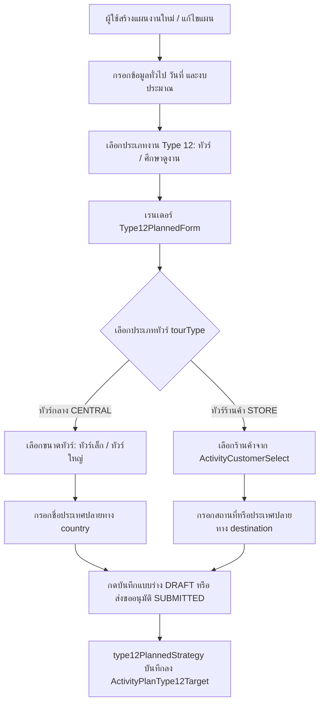
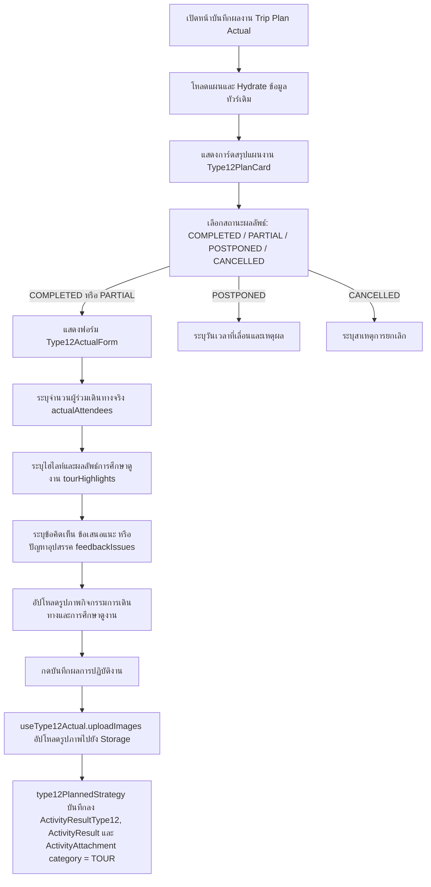
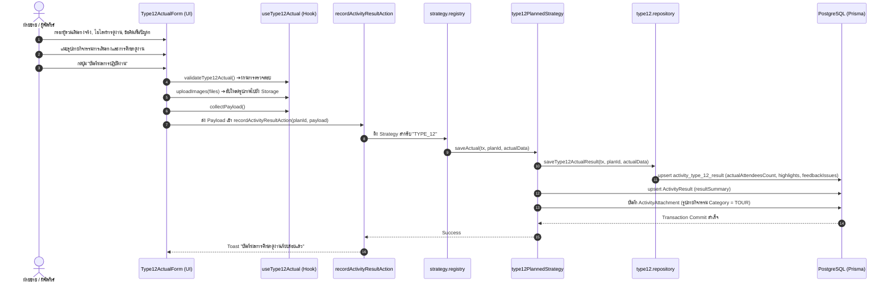

# Activity Type 12 — พาลูกค้าศึกษาดูงาน (ทัวร์ - Tour / Study Trip) (README)

> **Feature Slice**: `modules/activity/features/type-12`  
> **Parent Module**: `modules/activity`  
> **Database Authority**: `prisma/schema.prisma` (`ActivityPlan`, `ActivityPlanType12Target`, `ActivityResultType12`, `Customer`, `ActivityResult`, `ActivityAttachment`)  
> **Architecture Style**: Vertical Slice Architecture (Dual-Mode 100%: Planned + Unplanned)  
> **Status**: Production Ready / Active Reference

---

## 1. Overview

### 1.1 วัตถุประสงค์ของ Type 12
**Type 12 (พาลูกค้าศึกษาดูงาน / ทัวร์ - Tour & Study Trip)** มีวัตถุประสงค์เพื่อสนับสนุนการดำเนินกิจกรรมกระชับความสัมพันธ์ทางการค้าและเปิดโลกทัศน์ทางเทคโนโลยีการเกษตร (Commercial Incentive & Technical Study Tour) ของทีมผู้บริหารและฝ่ายขายร่วมกับคู่ค้า เพื่อ:
1. นำร้านค้าตัวแทนจำหน่ายหลัก (Dealer), ร้านค้าย่อย (Subdealer) หรือเกษตรกรชั้นนำ เดินทางศึกษาดูงานแปลงเกษตรต้นแบบ โรงงานผลิต หรือนวัตกรรมเทคโนโลยีการเกษตรทั้งในและต่างประเทศ
2. มอบรางวัลและสิทธิประโยชน์ทางการค้า (Incentive Reward) แก่ร้านค้าตัวแทนจำหน่ายที่บรรลุเป้าหมายยอดขายประจำปีหรือแคมเปญพิเศษ
3. แลกเปลี่ยนมุมมอง สร้างเครือข่ายพันธมิตรทางธุรกิจ และรับฟังข้อคิดเห็นเชิงลึกจากคู่ค้าในบรรยากาศที่เป็นกันเอง
4. สรุปบทเรียนและไฮไลท์ที่ได้จากการศึกษาดูงาน (Key Takeaways / Highlights) เพื่อนำมาปรับใช้ในการวางแผนพัฒนาผลิตภัณฑ์และการตลาด
5. เก็บรวบรวมหลักฐานภาพถ่ายกิจกรรมการเดินทาง การศึกษาดูงาน และบรรยากาศความประทับใจของผู้ร่วมทริป

### 1.2 ขอบเขตของ Type 12
- **ประเภททัวร์การศึกษาดูงาน (`tourType`):**
  - **ทัวร์กลาง (`CENTRAL` / ทัวร์กลาง):** ทัวร์ที่บริษัทเป็นผู้จัดขึ้นในภาพรวมส่วนกลางเพื่อเชิญตัวแทนจำหน่ายจากหลายพื้นที่
    - *ขนาดทัวร์ (`tourSize`):* ทัวร์เล็ก (`SMALL`) หรือ ทัวร์ใหญ่ (`LARGE`)
    - *ประเทศปลายทาง (`country`):* ระบุชื่อประเทศที่เดินทางไปศึกษาดูงาน (เช่น ญี่ปุ่น, ไต้หวัน, เวียดนาม, จีน)
  - **ทัวร์ร้านค้า (`STORE` / ทัวร์ร้านค้า):** ทัวร์เฉพาะกิจที่ร่วมจัดกับร้านค้าตัวแทนจำหน่ายรายใดรายหนึ่งเป็นการเฉพาะ
    - *ร้านค้าผู้ร่วมทัวร์ (`storeId` / `storeName`):* เลือกร้านค้าจาก Customer Master
    - *สถานที่/ปลายทาง (`destination`):* ระบุสถานที่ศึกษาดูงาน จังหวัด หรือประเทศเป้าหมาย
- **เป้าหมายตามแผนงาน (Planned Targets):**
  - กำหนดประเภททัวร์, ขนาดทัวร์, ประเทศปลายทาง หรือร้านค้าและสถานที่ปลายทาง
- **การบันทึกผลงานจริง (Actual Outcome):**
  - บันทึกจำนวนผู้ร่วมเดินทางจริง (`actualAttendees`), ไฮไลท์การศึกษาดูงาน (`tourHighlights`), ข้อคิดเห็น/ปัญหาอุปสรรค (`feedbackIssues`), และภาพถ่ายกิจกรรมการเดินทาง (`images`)

### 1.3 รูปแบบการทำงานที่รองรับ
| โหมดการทำงาน | คำอธิบาย | หน้าที่รับผิดชอบหลักใน Slice |
| :--- | :--- | :--- |
| **1. Planned** | สร้างและแก้ไขแผนงานศึกษาดูงานล่วงหน้า ระบุประเภททัวร์ ขนาดทัวร์ ประเทศ หรือร้านค้าและสถานที่ | `Type12PlannedForm`, `useType12PlannedForm`, `type12PlannedStrategy` |
| **2. Planned Actual** | บันทึกผลการเดินทางจริง ผู้ร่วมเดินทาง ไฮไลท์การดูงาน ปัญหาอุปสรรค และรูปถ่ายกิจกรรม | `Type12ActualForm`, `useType12Actual`, `type12PlannedStrategy.saveActual` |
| **3. Unplanned (2-in-1)** | บันทึกทัวร์หรือการศึกษาดูงานนอกแผนในขั้นตอนเดียว ทั้งประเภททัวร์ ผลลัพธ์จริง และรูปภาพ | `Type12UnplannedForm`, `useType12UnplannedForm`, `type12UnplannedStrategy` |
| **4. Detail View** | แสดงรายละเอียดแผนงานทัวร์ (`Type12PlanCard`) และผลลัพธ์การเดินทางจริง พร้อมระบบ Lightbox ดูภาพ | `Type12PlanCard`, `Type12DetailView` |
| **5. Approval View** | สรุปรายละเอียดทัวร์และเป้าหมายการเดินทางเพื่อให้หัวหน้างานพิจารณาอนุมัติ | `Type12ApprovalCard`, `Type12PlanCard` |

---

## 2. Business Flows

### 2.1 Planned (สร้างและแก้ไขแผนงาน)


### 2.2 Planned Actual (บันทึกผลการปฏิบัติงานตามแผน)


### 2.3 Unplanned (กิจกรรมนอกแผน 2-in-1)
- ผู้ใช้งานเข้าหน้า `/activity-plans/unplanned/new` และเลือกประเภทงาน **ทัวร์ (Type 12)**
- ฟอร์ม `Type12UnplannedForm` รวมขั้นตอนการเลือกประเภททัวร์ (ทัวร์กลาง/ทัวร์ร้านค้า), ขนาดทัวร์หรือร้านค้า, สถานที่ปลายทาง, จำนวนผู้ร่วมเดินทางจริง, ไฮไลท์การดูงาน, ปัญหาอุปสรรค และรูปถ่ายกิจกรรมไว้ในหน้าเดียว
- เมื่อกดบันทึก ข้อมูลทั้งหมดจะถูกส่งผ่าน `unplanned.actions.ts` ➔ รัน `type12UnplannedStrategy.savePlan()` บันทึกข้อมูลแผนลงในตารางเฉพาะกิจ `ActivityPlanType12Target` และบันทึกผลงานจริงลงใน `ActivityResultType12` พร้อมรูปถ่ายลงใน `ActivityAttachment` ภายใต้ Prisma Transaction เดียวกัน

### 2.4 Detail and Approval (ดูรายละเอียดและพิจารณาอนุมัติ)
- **Detail View:**
  - แสดง `Type12PlanCard` สรุปประเภททัวร์, ขนาดทัวร์, ประเทศปลายทาง หรือร้านค้าและสถานที่
  - หากมีผลงานจริง (`hasActualData`) แสดง `Type12DetailView` สรุปผู้ร่วมเดินทางจริง, ไฮไลท์การดูงาน, ข้อคิดเห็น/ปัญหา และแกลเลอรีรูปถ่ายบรรยากาศพร้อม Lightbox Modal
- **Approval View:**
  - แสดง `Type12ApprovalCard` เรนเดอร์การ์ดสรุปข้อมูลทัวร์เพื่อให้หัวหน้างานตรวจสอบก่อนอนุมัติ

---

## 3. Architecture

### 3.1 Folder Structure
```text
modules/activity/features/type-12/
├── index.ts                                # Vertical Slice Public Contract (จุดส่งออกเดียว)
├── README.md                               # เอกสารคู่มือทางเทคนิคฉบับสมบูรณ์ (ไฟล์นี้)
│
├── shared/                                 # ชิ้นส่วนที่ใช้ร่วมกันภายใน Type 12
│   ├── constants.ts                        # ค่าคงที่: WORK_TYPE_CODE, WORK_TYPE_NAME, TOUR_TYPE_OPTIONS, TOUR_SIZE_OPTIONS
│   ├── types.ts                            # อินเตอร์เฟซข้อมูล: TourType, TourSize, CustomerOption, Type12ImageFile, Type12TourRecord
│   └── notes.ts                            # Helper จัดรูปแบบข้อความ Planned Notes และ Actual Summary
│
├── planned/                                # Sub-slice: กิจกรรมในแผนและบันทึกผลตามแผน
│   ├── application/                        # Business Logic, Mappers, Validators
│   │   ├── planned-validation.ts           # ตรวจสอบความถูกต้องของแผน (validateType12FormValues)
│   │   ├── planned-mapper.ts               # แปลงและ Hydrate ข้อมูลแผน (extractType12PlanTargets, etc.)
│   │   ├── actual-validation.ts            # ตรวจสอบความถูกต้องของผลงานจริง (validateType12Actual)
│   │   └── actual-mapper.ts                # แกะข้อมูลผลงานจริงจาก Backend (parseType12ActualResult)
│   ├── components/                         # UI Components ฝั่งในแผน
│   │   ├── type12-planned-form.tsx         # ฟอร์มสร้าง/แก้ไขทัวร์ตามแผน (สลับทัวร์กลาง vs ทัวร์ร้านค้า)
│   │   ├── type12-plan-card.tsx            # การ์ดแสดงข้อมูลสรุปทัวร์ตามแผนงาน
│   │   ├── type12-actual-form.tsx          # ฟอร์มบันทึกผลจริง ผู้ร่วมเดินทาง ไฮไลท์ และรูปถ่าย
│   │   ├── type12-detail-view.tsx          # หน้ารายละเอียดแสดงผลลัพธ์จริงพร้อมระบบ Lightbox
│   │   └── type12-approval-card.tsx        # การ์ดสรุปสำหรับหน้าจอพิจารณาอนุมัติ
│   ├── hooks/                              # Custom React State Hooks
│   │   ├── use-type12-planned-form.ts      # จัดการ State ทัวร์ตามแผน
│   │   └── use-type12-actual.ts            # จัดการ State ผลจริง ผู้เข้าร่วม ไฮไลท์ และรูปถ่าย
│   ├── infrastructure/                     # การเชื่อมต่อฐานข้อมูล
│   │   ├── type12.repository.ts            # Direct Prisma queries (findType12ByPlanId, saveType12PlannedTargets, saveType12ActualResult)
│   │   └── type12-planned.strategy.ts      # WorkTypeStrategy สำหรับ Type 12 ตามแผน
│   └── types/                              # ประเภทข้อมูลเฉพาะกิจกรรมในแผน
│       ├── planned.types.ts                # Type12TargetItem, Type12TourProps, Form Props
│       └── actual.types.ts                 # Type12ActualRecord, Type12ActualFormProps, Detail/Approval Props
│
└── unplanned/                              # Sub-slice: กิจกรรมนอกแผน (2-in-1)
    ├── application/                        # Logic และ Mappers กิจกรรมนอกแผน
    │   ├── unplanned-validation.ts         # ตรวจสอบความถูกต้องของกิจกรรมนอกแผน
    │   └── unplanned-mapper.ts             # แปลงข้อมูล 2-in-1 และ Hydrate ข้อมูลเดิม
    ├── components/                         # UI Components กิจกรรมนอกแผน
    │   └── type12-unplanned-form.tsx       # ฟอร์ม 2-in-1 รวมวางแผนทัวร์และบันทึกผลในหน้าเดียว
    ├── hooks/                              # Custom React State Hooks
    │   └── use-type12-unplanned-form.ts    # จัดการ State กิจกรรมนอกแผน
    ├── infrastructure/                     # Strategy กิจกรรมนอกแผน
    │   └── type12-unplanned.strategy.ts    # WorkTypeStrategy บันทึกกิจกรรมนอกแผน 2-in-1
    └── types/                              # ประเภทข้อมูลกิจกรรมนอกแผน
        └── unplanned.types.ts              # Type12UnplannedItem, Form Props, Validation types
```

### 3.2 Type 12 vs Shared Activity Matrix
| ความรับผิดชอบ | จัดการที่ Type 12 Feature (`features/type-12`) | จัดการที่ Shared Activity ส่วนกลาง (`ui/`, `views/`) |
| :--- | :--- | :--- |
| **ข้อมูลทั่วไปของแผน** | - | ชื่องาน, วันที่เริ่ม-สิ้นสุด, วัตถุประสงค์หลักของทริป |
| **พื้นที่ & ทีมงาน** | ประเทศ หรือ ร้านค้าและสถานที่ปลายทาง | จังหวัดหลักของทริป, พนักงานร่วมเดินทาง |
| **งบประมาณรวม** | - | งบประมาณเดินทาง, ค่าตั๋วเครื่องบิน/ที่พัก, เบี้ยเลี้ยง |
| **ข้อมูลกิจกรรมตามแผน** | ประเภททัวร์ (กลาง/ร้านค้า), ขนาดทัวร์ (เล็ก/ใหญ่), ประเทศ, ร้านค้า, สถานที่ | บันทึกลงตารางเฉพาะ `ActivityPlanType12Target` |
| **ผลการเดินทางจริง** | ผู้ร่วมเดินทางจริง, ไฮไลท์การดูงาน, ปัญหาอุปสรรค, ภาพถ่ายกิจกรรม | บันทึกลงตารางเฉพาะ `ActivityResultType12` และตารางภาพถ่าย |
| **Database Persistence** | ตาราง `ActivityPlanType12Target` และ `ActivityResultType12` (ผ่าน `type12.repository.ts`) | ตารางหลัก `ActivityPlan`, `ActivityResult`, `ActivityAttachment` |

### 3.3 Dependency and Import Map
- **ทิศทางการเรียกใช้ที่อนุญาต (Allowed Dependencies):**
  - `views/` ➔ เรียกใช้ ➔ `features/type-12` (ผ่าน `index.ts` เท่านั้น)
  - `features/type-12` ➔ เรียกใช้ ➔ `@/modules/activity/ui` (`ActivityCustomerSelect`, `ActivityInput`, `ActivityTextarea`, `ActivityPhotoUpload`)
  - `features/type-12` ➔ เรียกใช้ ➔ `@/modules/activity/types/strategy.interface`
  - `features/type-12` ➔ เรียกใช้ ➔ `@/modules/activity/application/media/image-uploader`
  - `features/type-12` ➔ เรียกใช้ ➔ `@/components/custom/image-lightbox-modal`
- **Server Actions & Database Flow:**
  - `views/` ➔ ส่งข้อมูลไปยัง Server Actions ใน `@/modules/activity/server/`:
    - `planned.actions.ts` (`createActivityPlanAction`, `updateActivityPlanAction`, `getActivityPlanAction`)
    - `unplanned.actions.ts` (`createUnplannedActivityAction`, `updateUnplannedActivityAction`, `getUnplannedActivityAction`)
    - `actual.actions.ts` (`recordActivityResultAction`)
  - Server Actions ➔ ทำงานร่วมกับ `@/modules/activity/infrastructure/strategy.registry.ts` ➔ เรียกใช้ `type12PlannedStrategy` และ `type12UnplannedStrategy`
- **ข้อห้ามเด็ดขาด (Strict Rules):**
  - ❌ ห้าม Import จาก `@/modules/activity-plans/` ย้อนหลังโดยเด็ดขาด (Zero Legacy Imports)
  - ❌ ห้ามไฟล์ภายนอกข้ามเข้ามา Import ลึกใน `features/type-12/planned/...` โดยไม่ผ่าน `index.ts`
  - ❌ ห้ามเรียกใช้โค้ดข้ามไปยัง Feature Type อื่น

### 3.4 Entry Points and Public Exports
ไฟล์ [modules/activity/features/type-12/index.ts](file:///d:/code/crm-bank/modules/activity/features/type-12/index.ts) ทำหน้าที่เป็น **Single Public API Contract** สำหรับโมดูล Type 12 โดยส่งออก:
- **Planned Components:** `Type12PlannedForm`, `Type12PlanCard`, `Type12PlanForm`, `Type12Tour`, `EditType12Tour`
- **Actual Components:** `Type12ActualForm`, `ActualType12Tour`, `ActualType12TourForm`, `Type12DetailView`, `DetailType12Tour`, `Type12ApprovalCard`, `ApprovalType12Tour`
- **Unplanned Components:** `Type12UnplannedForm`
- **Hooks:** `useType12PlannedForm`, `useType12Form`, `useType12Actual`, `useType12UnplannedForm`
- **Mappers & Hydrators:** `extractType12PlanTargets`, `hydrateType12PlannedData`, `mapType12ToSectionItems`, `parseType12ActualResult`, `hydrateType12UnplannedData`, `mapType12UnplannedToPayload`
- **Validators:** `validateType12FormValues`, `validateType12Actual`, `validateType12UnplannedItem`
- **Shared Constants & Utilities:** `TYPE12_WORK_TYPE_CODE`, `TYPE12_WORK_TYPE_NAME`, `TOUR_TYPE_OPTIONS`, `TOUR_SIZE_OPTIONS`, `formatType12PlannedNotes`, `formatType12ActualSummary`
- **TypeScript Types:** `TourType`, `TourSize`, `CustomerOption`, `Type12ImageFile`, `Type12TourRecord`, `Type12TargetItem`, `Type12PlanTarget`, `Type12PlanItem`, `Type12TourDataPayload`, `Type12ActualRecord`, `Type12ActualFormProps`, `Type12DetailViewProps`, `Type12ApprovalCardProps`, `Type12UnplannedItem`, `Type12UnplannedFormProps`

---

## 4. File Responsibilities

### 4.1 Planned & Actual
- **`type12-planned-form.tsx`:** เรนเดอร์ฟอร์มสร้าง/แก้ไขแผนทัวร์ รองรับการสลับระหว่างทัวร์กลาง (เลือกขนาดทัวร์ เล็ก/ใหญ่ และกรอกประเทศ) กับทัวร์ร้านค้า (เลือกร้านค้าผ่าน `ActivityCustomerSelect` และกรอกสถานที่ปลายทาง)
- **`use-type12-planned-form.ts`:** จัดการ State แผนทัวร์ (`type12TourType`, `type12TourSize`, `type12Country`, `type12Store`, `type12StoreId`, `type12Destination`) พร้อมฟังก์ชัน `validateType12` และ `mapType12Payload`
- **`type12-plan-card.tsx`:** การ์ดแสดงข้อมูลสรุปทัวร์ตามแผนงาน แสดงป้ายประเภททัวร์ ขนาดทัวร์ ประเทศ หรือร้านค้าและสถานที่
- **`type12-actual-form.tsx`:** ฟอร์มบันทึกผลการเดินทางจริง แสดงการ์ดแผน `Type12PlanCard`, กรอกผู้ร่วมเดินทางจริง, ไฮไลท์การดูงาน, ปัญหาอุปสรรค, และอัปโหลดรูปภาพกิจกรรม
- **`use-type12-actual.ts`:** จัดการ State ผลงานจริง ฟังก์ชัน `uploadImages` เพื่ออัปโหลดรูปภาพไปยัง Storage, ฟังก์ชัน `collectPayload` รวบรวมข้อมูลผลงาน, และ `hydrate`
- **`type12-detail-view.tsx`:** คอมโพเนนต์แสดงผลเต็มรูปแบบในหน้ารายละเอียด แสดงการ์ดแผน `Type12PlanCard`, ผู้ร่วมเดินทางจริง, ไฮไลท์การดูงาน, ข้อคิดเห็น/ปัญหา, และแกลเลอรีรูปถ่ายพร้อม Lightbox
- **`type12-approval-card.tsx`:** การ์ดสรุปสำหรับหน้าจอพิจารณาอนุมัติ เรนเดอร์ `Type12PlanCard` ให้หัวหน้างานพิจารณา
- **`planned-mapper.ts`:**
  - `extractType12PlanTargets`: ดึงข้อมูลจาก `plan.type12Targets` แปลงออกมาเป็น `Type12TargetItem`
  - `hydrateType12PlannedData`: กู้คืนข้อมูลแผนเดิมเข้าฟอร์มแก้ไข
  - `mapType12ToSectionItems`: แปลงข้อมูลแผนเป็นหัวข้อสำหรับแสดงใน Section รวม
- **`actual-mapper.ts`:**
  - `parseType12ActualResult`: แปลงข้อมูลผลงานจาก `ActivityResultType12` (หรือ `plan.result.type12Results`) และ `attachments`
- **`planned-validation.ts` & `actual-validation.ts`:**
  - `validateType12FormValues`: ตรวจสอบความครบถ้วนของข้อมูลตามเงื่อนไขประเภททัวร์ (ทัวร์กลางต้องมีประเทศ, ทัวร์ร้านค้าต้องมีร้านค้าและสถานที่)
  - `validateType12Actual`: ตรวจสอบความถูกต้องของตัวเลขผู้ร่วมเดินทางจริง
- **`type12.repository.ts` & `type12-planned.strategy.ts`:**
  - `findType12ByPlanId`: ค้นหาข้อมูลทัวร์จากตาราง `activity_type_12_targets` และ `activity_type_12_result`
  - `saveType12PlannedTargets`: บันทึกระเบียนลงตาราง `activity_type_12_targets`
  - `saveType12ActualResult`: บันทึกระเบียนลงตาราง `activity_type_12_result`
  - `type12PlannedStrategy`: ดำเนินการตรวจสอบและบันทึกข้อมูลตามมาตรฐาน `WorkTypeStrategy`

### 4.2 Unplanned
- **`type12-unplanned-form.tsx`:** ฟอร์มกิจกรรมทัวร์นอกแผน 2-in-1 แสดงอินพุตเลือกประเภททัวร์ รายละเอียดปลายทาง ผลการเดินทาง และรูปภาพในหน้าเดียว
- **`use-type12-unplanned-form.ts`:** จัดการ State ข้อมูลทัวร์นอกแผน `Type12UnplannedItem`
- **`unplanned-validation.ts`:** ตรวจสอบความถูกต้องของกิจกรรมนอกแผน (ประเภททัวร์, ประเทศ/ร้านค้า/สถานที่, ตัวเลขผู้ร่วมเดินทาง)
- **`unplanned-mapper.ts`:** Hydrate ข้อมูลเดิม และ Map ข้อมูลฟอร์ม 2-in-1 ออกมาเป็น Payload `tourData` และ `type12Actual`
- **`type12-unplanned.strategy.ts`:** ดำเนินการบันทึกกิจกรรมนอกแผนผ่านการบันทึก `ActivityPlanTour` และผลลัพธ์จริงใน Transaction เดียวกัน

### 4.3 Shared Types, Constants, and Notes
- **`constants.ts`:** กำหนด `WORK_TYPE_CODE = "TYPE_12"`, `WORK_TYPE_NAME`, ตัวเลือกประเภททัวร์ `TOUR_TYPE_OPTIONS` (`CENTRAL` / `STORE`), และตัวเลือกขนาดทัวร์ `TOUR_SIZE_OPTIONS` (`SMALL` / `LARGE`)
- **`types.ts`:** กำหนดโครงสร้าง TypeScript สำหรับประเภททัวร์ (`TourType`), ขนาดทัวร์ (`TourSize`), และรูปภาพ (`Type12ImageFile`)
- **`notes.ts`:** ฟังก์ชัน `formatType12PlannedNotes` และ `formatType12ActualSummary` สำหรับจัดรูปแบบข้อความสรุป

### 4.4 Shared UI and Views
- คอมโพเนนต์ `ActualWorkTypeList`, `DetailWorkTypeList`, และ `ApprovalWorkTypeList` ใน `modules/activity/views/` ทำหน้าที่เป็น Orchestrator ตรวจจับรหัสงาน `"TYPE_12"` แล้วสลับมาเรนเดอร์คอมโพเนนต์ของ Type 12

---

## 5. Data Flow



### 5.1 Create Planned (สร้างแผนใหม่)
1. `create-view.tsx` เรียกใช้ `useType12PlannedForm()`
2. ผู้ใช้เลือกประเภททัวร์ (ทัวร์กลาง/ทัวร์ร้านค้า) และกรอกข้อมูลปลายทางตามเงื่อนไข
3. ระบบตรวจสอบความถูกต้องด้วย `validateType12FormValues()`
4. Form Orchestrator รวม Payload และส่งไปยัง Server Action `createActivityPlanAction`
5. `type12PlannedStrategy.savePlan()` เรียกใช้ `saveType12PlannedTargets` เพื่อบันทึกข้อมูลลงในตารางเฉพาะกิจ `ActivityPlanType12Target` (`activity_type_12_targets`)

### 5.2 Edit Planned (แก้ไขแผนงานเดิม)
1. `edit-view.tsx` โหลดข้อมูลแผนงานจากฐานข้อมูล
2. เรียก `hydrateType12PlannedData(plan, initDetails)` ถอดรหัสข้อมูลทัวร์เดิมออกมา
3. ส่งข้อมูลเข้า `useType12PlannedForm()` เพื่อเติมลงใน State ของฟอร์ม
4. ผู้ใช้แก้ไขข้อมูลและกดบันทึกกลับได้อย่างถูกต้อง

### 5.3 Save Actual (บันทึกผลการปฏิบัติงานจริง)
1. `activity-plan-actual-view.tsx` ตรวจสอบความถูกต้องผ่าน `validateType12Actual(params)`
2. เรียก `type12Actual.uploadImages(files)` เพื่ออัปโหลดไฟล์ภาพกิจกรรมไปยัง Storage
3. เรียก `type12Actual.collectPayload()` จัดกลุ่มข้อมูลผู้ร่วมเดินทาง ไฮไลท์ ปัญหาอุปสรรค และ Clean URLs
4. ส่ง Payload เข้า Server Action `recordActivityResultAction`
5. `type12PlannedStrategy.saveActual()` บันทึกลง `ActivityResultType12`, อัปเดต `ActivityResult` และบันทึกรูปภาพกิจกรรมลงใน `ActivityAttachment`

### 5.4 Load Actual (โหลดผลงานเดิมมาแสดงในหน้าบันทึกผล)
1. `useActualPlanLoader` ดึงข้อมูลแผนงานและผลงานเดิม
2. `extractType12PlanTargets(plan)` แกะข้อมูลทัวร์เดิมออกมาแสดงในการ์ด `Type12PlanCard`
3. `parseType12ActualResult(plan.result)` ดึงข้อมูลผู้ร่วมเดินทาง ไฮไลท์ ปัญหา และรูปภาพเดิม
4. เรียก `type12Actual.hydrate()` เติมข้อมูลลง State ของฟอร์มพร้อมให้แก้ไขเพิ่มเติม

### 5.5 Create/Edit Unplanned (กิจกรรมนอกแผน 2-in-1)
1. ผู้ใช้กรอกฟอร์ม `Type12UnplannedForm` ครบทั้งส่วนรายละเอียดทัวร์ ผลการเดินทาง และรูปภาพในหน้าเดียว
2. ตรวจสอบความถูกต้องด้วย `validateType12UnplannedItem(item)`
3. `mapType12UnplannedToPayload` แปลงข้อมูลออกมาเป็น `tourData` และ `type12Actual`
4. `type12UnplannedStrategy.savePlan()` บันทึกข้อมูลทัวร์ (`ActivityPlanType12Target`) และผลงานจริง (`ActivityResultType12`) พร้อมกันแบบ Atomic

### 5.6 Detail and Approval (การแสดงผลหน้ารายละเอียดและพิจารณาอนุมัติ)
1. หน้า Detail / Approval โหลดข้อมูลแผนงานผ่าน Loader
2. เรนเดอร์ `Type12PlanCard` แสดงรายละเอียดทัวร์ตามแผน
3. หากมีผลงานจริง เรนเดอร์ `Type12DetailView` แสดงผู้ร่วมเดินทางจริง, ไฮไลท์การดูงาน, ปัญหาอุปสรรค, และแกลเลอรีรูปถ่ายพร้อม Lightbox

---

## 6. Data Models and Mapping

### 6.1 Database CRUD Matrix (สิทธิ์และการจัดการตารางในฐานข้อมูล)
| ตารางในฐานข้อมูล (`Prisma Model`) | Create (สร้าง) | Read (อ่าน/แสดงผล) | Update (แก้ไข) | Delete (ลบ) | หมายเหตุ |
| :--- | :--- | :--- | :--- | :--- | :--- |
| **`activity_type_12_targets`**<br>(`ActivityPlanType12Target`) | `savePlan()` ใน Planned/Unplanned | `findType12ByPlanId`, `extractType12PlanTargets` | `savePlan()` (Atomic recreation) | Cascade เมื่อลบแผน | ตารางเฉพาะเก็บข้อมูลเป้าหมายทัวร์การศึกษาดูงาน |
| **`activity_type_12_result`**<br>(`ActivityResultType12`) | `saveActual()` ใน Actual/Unplanned | `findType12ByPlanId`, `parseType12ActualResult` | `saveActual()` (Atomic recreation) | Cascade เมื่อลบเป้าหมาย | ตารางเฉพาะเก็บผลลัพธ์การศึกษาดูงานจริง |
| **`customers`**<br>(`Customer`) | - (Customer Master) | include ใน `findType12ByPlanId` | - | - | ร้านค้าผู้ร่วมเดินทางกรณีทัวร์ร้านค้า |
| **`activity_plans`**<br>(`ActivityPlan`) | ตอนสร้างแผน | ในทุกมุมมอง | เมื่อแก้ไขแผน | Cascade Delete | ตารางหลักของกิจกรรม |
| **`activity_results`**<br>(`ActivityResult`) | `saveActual()` ใน Actual/Unplanned | `loadActual()`, `parseType12ActualResult` | `upsert` ใน `saveActual()` | Cascade เมื่อลบแผน | ตาราง Header สรุปผลงาน |
| **`activity_attachments`**<br>(`ActivityAttachment`) | `uploadImages()` + Server Action | `plan.attachments` | สร้างใหม่/ลบรูปที่ไม่ได้ใช้ | Cascade เมื่อลบผลงาน | เก็บรูปภาพกิจกรรมการเดินทาง (`category = 'TOUR'`) |

### 6.2 Complete Field-to-Database Mapping (ตารางจับคู่ฟิลด์ครบถ้วนทุกจุด)
| Form Field (UI) | TypeScript Type Field | Mapper Function (Write/Read) | Prisma Model | DB Column Name | Data Type | Nullable? | Default |
| :--- | :--- | :--- | :--- | :--- | :--- | :--- | :---: | :--- |
| **ประเภททัวร์** | `type12TourType` / `tourType` | `savePlan` ➔ `tourType` | `ActivityPlanType12Target` | `tour_type` | `ENUM (TourType)` | No | - |
| **ขนาดทัวร์** | `type12TourSize` / `tourSize` | `savePlan` ➔ `tourSize` | `ActivityPlanType12Target` | `tour_size` | `ENUM (TourSize)` | Yes | `null` |
| **ประเทศปลายทาง** | `type12Country` / `country` | `savePlan` ➔ `country` | `ActivityPlanType12Target` | `country` | `VARCHAR` | Yes | `null` |
| **ร้านค้าผู้ร่วมเดินทาง** | `type12StoreId` / `storeId` | `savePlan` ➔ `storeId` | `ActivityPlanType12Target` | `store_id` | `VARCHAR (FK)` | Yes | `null` |
| **สถานที่ปลายทาง** | `type12Destination` / `destination`| `savePlan` ➔ `destination` | `ActivityPlanType12Target` | `destination` | `VARCHAR` | Yes | `null` |
| **ผู้ร่วมเดินทางจริง** | `actualAttendees` | `saveActual` / `parseType12ActualResult` | `ActivityResultType12` | `attendees_count` | `INTEGER` | Yes | `0` |
| **ไฮไลท์การดูงาน** | `tourHighlights` | `saveActual` / `parseType12ActualResult` | `ActivityResultType12` | `highlights` | `TEXT` | Yes | `null` |
| **ข้อคิดเห็น/ปัญหา** | `feedbackIssues` | `saveActual` / `parseType12ActualResult` | `ActivityResultType12` | `feedback_issues` | `TEXT` | Yes | `null` |
| **รูปถ่ายกิจกรรม** | `images` | `uploadImages()` ➔ `attachments` | `ActivityAttachment` | `file_url`, `category = 'TOUR'` | `TEXT` | No | - |

### 6.3 รายละเอียดตารางเฉพาะ รูปภาพ และความสัมพันธ์ (Relations & Schema)

```prisma
// 1. ตารางเฉพาะเก็บข้อมูลเป้าหมายทัวร์การศึกษาดูงาน
model ActivityPlanType12Target {
  id             String    @id @default(cuid())
  activityPlanId String    @map("activity_plan_id")
  tourType       TourType  @map("tour_type") // CENTRAL | STORE
  tourSize       TourSize? @map("tour_size") // SMALL | LARGE
  country        String?   @map("country")
  storeId        String?   @map("store_id")
  destination    String?   @map("destination")

  createdAt      DateTime  @default(now()) @map("created_at")
  updatedAt      DateTime  @updatedAt @map("updated_at")

  activityPlan   ActivityPlan          @relation(fields: [activityPlanId], references: [id], onDelete: Cascade)
  store          Customer?             @relation("Type12Store", fields: [storeId], references: [id], onDelete: SetNull)
  results        ActivityResultType12[]

  @@index([activityPlanId])
  @@index([tourType])
  @@index([country])
  @@index([storeId])
  @@map("activity_type_12_targets")
}

// 2. ตารางเฉพาะเก็บผลลัพธ์การศึกษาดูงานจริง
model ActivityResultType12 {
  id             String   @id @default(cuid())
  activityPlanId String   @map("activity_plan_id")
  targetId       String?  @map("target_id")
  attendeesCount Int      @default(0) @map("attendees_count")
  highlights     String?  @map("highlights") @db.Text
  feedbackIssues String?  @map("feedback_issues") @db.Text
  summary        String?  @map("summary") @db.Text

  createdAt      DateTime @default(now()) @map("created_at")
  updatedAt      DateTime @updatedAt @map("updated_at")

  activityPlan   ActivityPlan              @relation(fields: [activityPlanId], references: [id], onDelete: Cascade)
  target         ActivityPlanType12Target? @relation(fields: [targetId], references: [id], onDelete: Cascade)
  attachments    ActivityAttachment[]

  @@index([activityPlanId])
  @@index([targetId])
  @@map("activity_type_12_result")
}

// 3. ตารางเก็บรูปภาพกิจกรรมการเดินทาง
model ActivityAttachment {
  id             String   @id @default(cuid())
  activityPlanId String   @map("activity_plan_id")
  fileUrl        String   @map("file_url")
  fileName       String   @map("file_name")
  fileSize       Int      @default(0) @map("file_size")
  mimeType       String   @default("image/jpeg") @map("mime_type")
  category       String?  @map("category") // "TOUR"
  workTypeCode   String?  @map("work_type_code") // "TYPE_12"
  type12ResultId String?  @map("type_12_result_id")

  activityPlan   ActivityPlan          @relation(fields: [activityPlanId], references: [id], onDelete: Cascade)
  type12Result   ActivityResultType12? @relation(fields: [type12ResultId], references: [id], onDelete: SetNull)

  @@index([activityPlanId])
  @@index([type12ResultId])
  @@map("activity_attachments")
}
```

### 6.4 Transaction & Persistence Strategy (ขาเขียนและขาอ่าน)
- **การจัดการ Transaction (Isolation & Atomicity):**
  - ทุกการบันทึกของ Type 12 ดำเนินการภายใต้ `tx` (`prisma.$transaction`) แบบ Atomic
  - หากการบันทึกภาพถ่าย หรือการบันทึกข้อมูลทัวร์ใน `activity_type_12_targets` หรือ `activity_type_12_result` ล้มเหลว ระบบจะ Rollback การเปลี่ยนแปลงทั้งหมดทันที
- **Persistence ขาเขียนข้อมูลทัวร์:**
  - ในฟังก์ชัน `saveType12PlannedTargets` จะสั่ง `deleteMany` ระเบียนเดิมใน `activity_type_12_targets` ที่ผูกกับ `activityPlanId` ก่อน แล้วสร้างระเบียนใหม่ด้วย `create` พร้อม Map ค่า Enum `TourType` และ `TourSize` อย่างแม่นยำ
  - ในฟังก์ชัน `saveType12ActualResult` จะบันทึกผลงานลงใน `activity_type_12_result`
- **Cascade Delete Policy:**
  - เมื่อลบแผนงาน `ActivityPlan` ระเบียนที่เกี่ยวข้องใน `ActivityPlanType12Target`, `ActivityResultType12`, `ActivityResult`, และ `ActivityAttachment` จะถูกลบออกแบบ Cascade ทั้งหมด

---

## 7. Business Rules

### 7.1 Validation Rules
1. **การตรวจสอบทัวร์กลาง (`CENTRAL`):**
   - ต้องเลือกขนาดทัวร์ (`tourSize` ห้ามว่าง: ทัวร์เล็ก หรือ ทัวร์ใหญ่)
   - ต้องระบุชื่อประเทศปลายทาง (`country` ห้ามว่าง)
2. **การตรวจสอบทัวร์ร้านค้า (`STORE`):**
   - ต้องเลือกร้านค้าตัวแทนจำหน่าย (`storeId` หรือ `storeName` ห้ามว่าง)
   - ต้องระบุสถานที่หรือประเทศปลายทางที่จะไป (`destination` ห้ามว่าง)
3. **การตรวจสอบผลงานจริง:**
   - ผู้ร่วมเดินทางจริง (`actualAttendees`): หากระบุ ต้องเป็นตัวเลขที่มีค่า $\ge 0$

### 7.2 Default Values
- `type12TourType`: ค่าเริ่มต้นเป็น `"ทัวร์กลาง"`
- `type12TourSize`: ค่าเริ่มต้นเป็น `"ทัวร์เล็ก"`
- `activityResultStatus`: ค่าเริ่มต้นเมื่อเปิดหน้าบันทึกผลเป็น `"COMPLETED"`

### 7.3 Conditional Fields
- **การสลับอินพุตตามประเภททัวร์:**
  - เมื่อเลือก **ทัวร์กลาง**: ระบบจะแสดงตัวเลือกขนาดทัวร์ (ทัวร์เล็ก/ทัวร์ใหญ่) และช่องกรอกประเทศ พร้อมซ่อนตัวเลือกร้านค้า
  - เมื่อเลือก **ทัวร์ร้านค้า**: ระบบจะแสดงช่องเลือกร้านค้า (`ActivityCustomerSelect`) และช่องกรอกสถานที่ปลายทาง พร้อมซ่อนตัวเลือกขนาดทัวร์และประเทศ
- **ระบบ Lightbox:** แกลเลอรีรูปภาพกิจกรรมในหน้า `Type12DetailView` รองรับการคลิกดูขยายภาพ พร้อมปุ่มเลื่อนภาพ

### 7.4 Status and Approval Rules
- แผนงานจะสามารถบันทึกผลการเดินทางจริง (Actual) ได้เฉพาะเมื่อแผนมีสถานะเป็น `APPROVED` เท่านั้น
- เฉพาะเจ้าของแผนงาน (Creator) และ Administrator เท่านั้นที่มีสิทธิ์บันทึกผลการปฏิบัติงานจริง
- การพิจารณาอนุมัติของหัวหน้างานจะเห็นข้อมูลทัวร์ ประเทศ หรือร้านค้าและสถานที่ปลายทางในการ์ด `Type12ApprovalCard`

---

## 8. Shared Dependencies

โมดูล Type 12 ทำงานร่วมกับโมดูลและคอมโพเนนต์ส่วนกลางดังนี้:
1. **`@/modules/activity/ui`:**
   - `ActivityCustomerSelect`: ค้นหาและเลือกร้านค้าผู้ร่วมเดินทาง
   - `ActivityInput`: กล่องกรอกข้อความและตัวเลขมาตรฐาน
   - `ActivityTextarea`: กล่องข้อความหลายบรรทัดสำหรับไฮไลท์และปัญหาอุปสรรค
   - `ActivityPhotoUpload`: คอมโพเนนต์อัปโหลดรูปภาพพร้อมบีบอัดไฟล์
2. **`@/modules/activity/views`:**
   - `ActualWorkTypeList`, `DetailWorkTypeList`, `ApprovalWorkTypeList` ทำหน้าที่เป็น View Orchestrator สลับมาแสดงผลคอมโพเนนต์ของ Type 12 ตามเงื่อนไขประเภทงาน
3. **`@/modules/activity/constants`:**
   - `WORK_TYPE_CONFIG`: ตั้งค่ารหัสประเภทงานและสีธีม (Sky)
   - `ACTIVITY_RESULT_STATUS_LABELS`: ป้ายแสดงสถานะผลกิจกรรม
4. **`@/modules/activity/infrastructure/strategy.registry`:**
   - ลงทะเบียน `type12PlannedStrategy` และ `type12UnplannedStrategy` สำหรับจัดเก็บข้อมูลแบบ Polymorphic
5. **Server Actions ที่ใช้งาน:**
   - `createActivityPlanAction`, `updateActivityPlanAction`, `getActivityPlanAction` ใน `@/modules/activity/server/planned.actions`
   - `createUnplannedActivityAction`, `updateUnplannedActivityAction`, `getUnplannedActivityAction` ใน `@/modules/activity/server/unplanned.actions`
   - `recordActivityResultAction` ใน `@/modules/activity/server/actual.actions`
6. **Lightbox Component:**
   - `ImageLightboxModal` ใน `@/components/custom/image-lightbox-modal`

---

## 9. How to Modify Type 12

### 9.1 การเพิ่มฟิลด์ใหม่บนฟอร์ม (Add a Form Field)
1. เพิ่มฟิลด์ใน Type Definitions:
   - ฟอร์มแผน: `planned/types/planned.types.ts` (`Type12TourProps`, `Type12TargetItem`)
   - ฟอร์มผลจริง: `planned/types/actual.types.ts` (`Type12ActualRecord`, `Type12ActualFormProps`)
   - ฟอร์มนอกแผน: `unplanned/types/unplanned.types.ts` (`Type12UnplannedItem`)
2. เพิ่มเงื่อนไขตรวจสอบความถูกต้องใน `planned-validation.ts`, `actual-validation.ts`, หรือ `unplanned-validation.ts`
3. เพิ่ม UI Input ในคอมโพเนนต์ฟอร์ม (`type12-planned-form.tsx`, `type12-actual-form.tsx`, หรือ `type12-unplanned-form.tsx`) โดยใช้ `@/modules/activity/ui`
4. ปรับ Mapper ใน `planned-mapper.ts`, `actual-mapper.ts`, หรือ `unplanned-mapper.ts`
5. อัปเดตการบันทึกใน `type12-planned.strategy.ts` หรือ `type12.repository.ts`

### 9.2 การปรับแก้ Validation (Change Validation)
- แก้ไขที่ไฟล์ `planned/application/planned-validation.ts`, `planned/application/actual-validation.ts` หรือ `unplanned/application/unplanned-validation.ts` ตามเงื่อนไขทางธุรกิจที่ต้องการปรับปรุง

### 9.3 การปรับ Database Mapping (Change Database Mapping)
- หากมีการเปลี่ยนแปลง Schema ใน `prisma/schema.prisma` ให้แก้ไขการบันทึกใน `type12.repository.ts` หรือ `type12-planned.strategy.ts` โดยคงการทำงานแบบ Transaction เสมอ

### 9.4 การปรับแก้ Actual Loading or Hydration
- ตรวจสอบฟังก์ชัน `hydrateType12PlannedData`, `extractType12PlanTargets` ใน `planned-mapper.ts` และ `parseType12ActualResult` ใน `actual-mapper.ts` เพื่อให้รองรับคีย์ข้อมูลเดิมอย่างครอบคลุม

### 9.5 การแก้ไข Shared Components อย่างปลอดภัย
- เมื่อต้องแก้ไขคอมโพเนนต์ใน `@/modules/activity/ui` ต้องคำนึงถึงประเภทงานอื่นเสมอ และไม่เปลี่ยนแปลง Props Interface เดิมที่ใช้งานร่วมกัน

---

## 10. Troubleshooting & Tracing Pipeline

### 10.1 Step-by-Step Tracing Pipeline (คู่มือการไล่โค้ดเมื่อพบปัญหา)

เมื่อพบว่าข้อมูลบางจุดไม่แสดงผล (เช่น ข้อมูลทัวร์ไม่ถูกบันทึก หรือรูปภาพกิจกรรมไม่ขึ้น) ให้ไล่ตรวจสอบตาม 8 ขั้นตอนนี้ตามลำดับ:

```text
[Step 1: UI Field] ➔ Type12ActualForm.tsx (ตรวจว่า state actualAttendees หรือ tourHighlights มีค่าหรือไม่)
        ↓
[Step 2: Hook State] ➔ use-type12-actual.ts (ตรวจ collectPayload ว่าแนบข้อมูลครบถ้วนหรือไม่)
        ↓
[Step 3: Save Mapper] ➔ collectPayload() (ตรวจว่าได้ Clean URLs ของรูปภาพ และ Object ผลงาน)
        ↓
[Step 4: Server Action] ➔ recordActivityResultAction ➔ recordActivityResultUseCase
        ↓
[Step 5: Strategy Write] ➔ type12-planned.strategy.ts: saveActual() ➔ saveType12ActualResult()
        ↓
[Step 6: Prisma Table] ➔ ตรวจสอบตาราง activity_type_12_result และ activity_attachments ใน DB
        ↓
[Step 7: Loader & Include] ➔ getActivityPlanAction (ตรวจว่า include type12Targets, type12Results และ attachments ครบถ้วนหรือไม่)
        ↓
[Step 8: Load Hydrator] ➔ actual-mapper.ts: parseType12ActualResult() ➔ useType12Actual.hydrate()
```

### 10.2 ตารางวิเคราะห์ปัญหาที่พบบ่อย (Common Pitfalls)

| อาการ | จุดที่ต้องตรวจสอบ | สาเหตุและแนวทางแก้ไข |
| :--- | :--- | :--- |
| **บันทึกแผนงานแล้วข้อมูลทัวร์ไม่ลงตาราง `activity_type_12_targets`** | `type12-planned.strategy.ts` ➔ `savePlan` | ตรวจสอบว่า `tourData` ส่งมาใน Payload และมีฟิลด์ `tourType` หรือไม่ |
| **สลับเป็นทัวร์ร้านค้าแล้วฟอร์มฟ้องว่าต้องกรอกประเทศ** | `planned-validation.ts` ➔ `validateType12FormValues` | ตรวจสอบค่า `type12TourType` ว่าเป็นสตริง `"ทัวร์ร้านค้า"` หรือ `"STORE"` |
| **รูปถ่ายกิจกรรมการเดินทางหายหลัง Reload หน้าจอ** | `use-type12-actual.ts` ➔ `uploadImages` | ตรวจสอบว่ารูปภาพถูกอัปโหลดและบันทึกลงใน `ActivityAttachment` โดยมี `category = "TOUR"` หรือไม่ |
| **ตัวเลขผู้ร่วมเดินทางจริงไม่แสดงในหน้ารายละเอียด** | `actual-mapper.ts` ➔ `parseType12ActualResult` | ตรวจสอบ Regex การดึงตัวเลข `ผู้ร่วมเดินทางจริง:\s*(\d+)` จากข้อความสรุป |
| **กดอนุมัติแล้วการ์ดสรุปไม่แสดงข้อมูลทัวร์** | `type12-approval-card.tsx` | ตรวจสอบว่า Component ได้รับ Props `target` หรือ `targets` จาก Loader ครบถ้วน |

---

## 11. Testing and Manual UAT

### แผนการทดสอบแบบครบวงจร (End-to-End Test Checklist):
- [ ] **TC-01 (Planned Create - Central Tour):** สร้างแผนทัวร์กลาง เลือกขนาดทัวร์เป็น "ทัวร์ใหญ่" และกรอกประเทศปลายทางเป็น "ญี่ปุ่น" บันทึกแบบร่างและส่งขออนุมัติสำเร็จ ตรวจสอบระเบียนใน `activity_plan_tours`
- [ ] **TC-02 (Planned Create - Store Tour):** สร้างแผนทัวร์ร้านค้า เลือกร้านค้าจาก Customer Master และกรอกสถานที่ปลายทาง บันทึกสำเร็จ
- [ ] **TC-03 (Planned Validation Check):** ทดสอบเลือกทัวร์กลางแต่ไม่กรอกประเทศ หรือเลือกทัวร์ร้านค้าแต่ไม่เลือกร้านค้า ระบบต้องปฏิเสธและแสดงข้อความแจ้งเตือนอย่างถูกต้อง
- [ ] **TC-04 (Planned Edit):** เปิดหน้าแก้ไขแผนงาน (`/activity-plans/[id]/edit`) ตรวจสอบว่าข้อมูลทัวร์เดิมถูก Hydrate ขึ้นมาครบถ้วน สามารถแก้ไขข้อมูลและบันทึกสำเร็จ
- [ ] **TC-05 (Detail & Approval View):** ตรวจสอบการแสดงผลการ์ด `Type12PlanCard` ในหน้ารายละเอียดและหน้าพิจารณาอนุมัติ ข้อมูลทัวร์ต้องแสดงผลอย่างสวยงาม
- [ ] **TC-06 (Actual - Completed with Photos):** บันทึกผลการเดินทางจริงแบบ COMPLETED กรอกผู้ร่วมเดินทาง 25 คน ระบุไฮไลท์การดูงาน ระบุปัญหาอุปสรรค และแนบรูปถ่ายกิจกรรม 3 รูป บันทึกสำเร็จ
- [ ] **TC-07 (Actual Validation Check):** บันทึกผลจริงโดยกรอกตัวเลขผู้ร่วมเดินทางติดลบ ระบบต้องปฏิเสธและชี้จุดผิดพลาดอย่างชัดเจน
- [ ] **TC-08 (Actual - Partial / Postponed):** ทดสอบบันทึกผลแบบ PARTIAL หรือ POSTPONED ตรวจสอบว่าระบบบันทึกสถานะและเหตุผลได้อย่างถูกต้อง
- [ ] **TC-09 (Unplanned 2-in-1):** สร้างกิจกรรมทัวร์นอกแผน กรอกข้อมูลทัวร์ ผลการเดินทาง และรูปถ่ายในขั้นตอนเดียว บันทึกแล้วเปิดดูผลงานซ้ำ ข้อมูลทุกส่วนต้องครบ 100%
- [ ] **TC-10 (Lightbox Modal Check):** ในหน้า `Type12DetailView` คลิกดูรูปภาพกิจกรรม หน้าจอ Lightbox ต้องแสดงภาพขยายพร้อมปุ่มเลื่อนภาพและปุ่มปิดได้อย่างสมบูรณ์

---

## 12. Known Limitations and Important Notes

1. **ตารางเฉพาะ ActivityPlanType12Target และ ActivityResultType12:**
   - Type 12 ได้รับการยกระดับมาใช้ตารางเฉพาะ `activity_type_12_targets` สำหรับเป้าหมายแผนงาน และ `activity_type_12_result` สำหรับผลการปฏิบัติงานจริง ทำให้โครงสร้างข้อมูลทัวร์เป็นไปตามมาตรฐาน Vertical Slice เดียวกับ Activity Types อื่นๆ
2. **การจัดเก็บรูปภาพใน Storage:**
   - รูปภาพกิจกรรมการเดินทางและการศึกษาดูงานจะถูกจัดเก็บในหมวดหมู่ `TOUR` ภายใต้ไดเรกทอรีของแผนงานนั้นๆ
3. **ความเข้ากันได้ย้อนหลัง (Backward Compatibility):**
   - มีการส่งออก Alias เก่า เช่น `Type12Tour`, `EditType12Tour`, `Type12PlanForm`, `ActualType12Tour`, `ActualType12TourForm`, `DetailType12Tour`, `ApprovalType12Tour`, และ `useType12Form` เพื่อให้โค้ดส่วนอื่นของระบบที่เคยเรียกใช้ชื่อเดิมยังคงทำงานได้โดยไม่พัง

---

## 13. Change Log

| วันที่ | เวอร์ชัน | รายละเอียดการปรับปรุง | ผู้ดำเนินการ |
| :--- | :--- | :--- | :--- |
| **2026-10-15** | 1.0.0 | สร้างโมดูล Type 12 พาลูกค้าศึกษาดูงาน (ทัวร์) ตามสถาปัตยกรรม Vertical Slice Dual-Mode | Antigravity AI |
| **2026-10-16** | 1.1.0 | เชื่อมโยงข้อมูลทัวร์เข้ากับตารางเฉพาะกิจ `ActivityPlanTour` พร้อมรองรับ Enum TourType และ TourSize | Antigravity AI |
| **2026-10-17** | 1.2.0 | ปรับปรุง `Type12PlannedForm` ให้สลับฟิลด์ระหว่างทัวร์กลางและทัวร์ร้านค้าอย่างราบรื่น | Antigravity AI |
| **2026-10-19** | 1.3.0 | เพิ่ม Validation ตรวจสอบเงื่อนไขเฉพาะของแต่ละประเภททัวร์ | Antigravity AI |
| **2026-10-20** | 1.4.0 | เพิ่มระบบ Image Lightbox Modal ใน `Type12DetailView` สำหรับดูภาพถ่ายกิจกรรมการเดินทาง | Antigravity AI |
| **2026-10-21** | 1.5.0 | อัปเดตกิจกรรมนอกแผน `Type12UnplannedForm` แบบ 2-in-1 รวมแผนและผลงานในขั้นตอนเดียว | Antigravity AI |
| **2026-10-22** | 1.6.0 | ปรับปรุงเอกสาร `README.md` ฉบับสมบูรณ์ครบทั้ง 13 หัวข้อตามมาตรฐาน Gold Standard ของ Type 1 ครบถ้วนทุกมิติ | Antigravity AI |
| **2026-10-25** | 2.0.0 | **Batch E Standardization & Dedicated Relational Storage:**<br>1. ยกเครื่องระบบจัดเก็บข้อมูล Type 12 มาใช้ตารางเฉพาะ `activity_type_12_targets` และ `activity_type_12_result`<br>2. ยกเลิกและลบตารางเฉพาะกิจเดิม `activity_plan_tours` ออกจากฐานข้อมูลอย่างถาวร<br>3. ปรับปรุง `type12.repository.ts`, Strategies และ Mappers ให้อ่านและเขียนตารางเฉพาะอย่างสมบูรณ์ | Antigravity AI |
