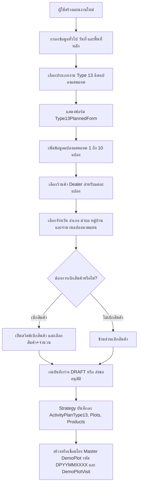
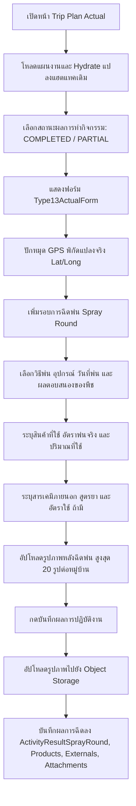
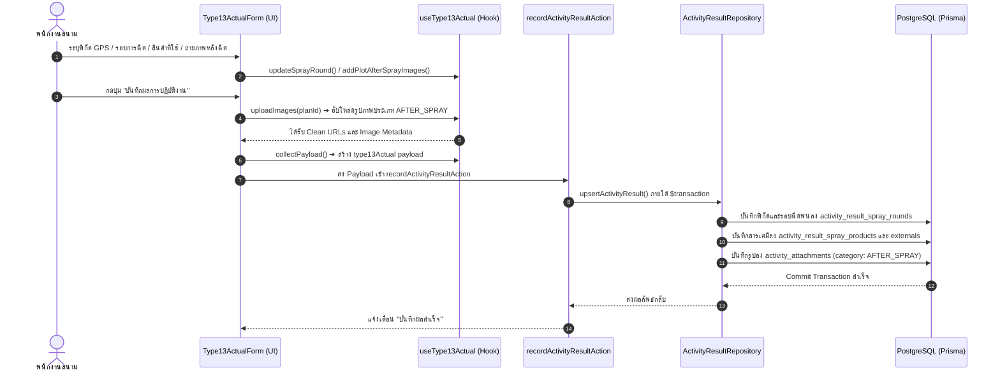

# Activity Type 13 — ฉีดแปลงแฮตแทค (README)

> **Feature Slice**: `modules/activity/features/type-13`  
> **Work Type Code**: `TYPE_13`  
> **Work Type Name**: ฉีดแปลงแฮตแทค (Hattack Spraying)  
> **Parent Module**: `modules/activity`  
> **Database Authority**: `prisma/schema.prisma` (`ActivityPlanType13Target`, `ActivityPlanType13Product`, `ActivityResultType13`, `ActivityResultType13SprayRound`, `ActivityResultType13SprayProduct`, `ActivityResultType13SprayExternal`, `DemoPlot`, `DemoPlotVisit`, `ActivityAttachment`)  
> **Status**: Production Ready / Active Reference

---

## 1. Overview

### 1.1 วัตถุประสงค์ของ Type 13
**Type 13 (ฉีดแปลงแฮตแทค - Hattack Spraying)** มีวัตถุประสงค์เพื่อรองรับการปฏิบัติงานภาคสนามของพนักงานขายและเจ้าหน้าที่เทคนิคเกษตร (Sales / Technical Reps / Promoters) ในการดำเนินงานฉีดพ่นสารเคมีและสาธิตผลิตภัณฑ์แฮตแทคในแปลงเกษตรกรของตัวแทนจำหน่าย (Dealer):
1. วางแผนลงพื้นที่แปลงสาธิตแฮตแทครายตัวแทนจำหน่าย (Dealer Multi-Plot 1–10 แปลง)
2. วางแผนเบิกผลิตภัณฑ์หรือสารเคมีสาธิตเพื่อนำไปใช้ในการฉีดพ่นภาคสนาม
3. บันทึกผลการฉีดพ่นจริง พิกัด GPS ของแปลง รอบการฉีดพ่น (Spray Rounds) วิธีการฉีด (เดี่ยว / ผสมถัง) อุปกรณ์ที่ใช้ และการตอบสนองของพืช
4. บันทึกข้อมูลผลิตภัณฑ์ของบริษัทและสารเคมีภายนอก (External Chemical Products / Formulas) ที่ใช้ร่วมในการพ่น
5. จัดเก็บภาพถ่ายหลักฐานหลังการฉีดพ่น (สูงสุด 20 ภาพต่อหมู่บ้าน) เพื่อยืนยันผลสัมฤทธิ์

### 1.2 ขอบเขตของ Type 13
- **กลุ่มเป้าหมายและการจัดสรรแปลง (Multi-Plot Scope):**
  - ตัวแทนจำหน่ายหลัก (`DEALER`) และร้านค้าร่วมโครงการ
  - รองรับการกำหนดแปลงสาธิตแฮตแทคได้ตั้งแต่ 1 ถึง 10 แปลงต่อหนึ่งแผนงาน
  - แต่ละแปลงเชื่อมโยงกับฐานข้อมูลแปลงสาธิตหลัก (`DemoPlot`) อัตโนมัติ พร้อมรหัสแปลงแบบอัตโนมัติ (`DPYYMMXXXX`)
- **การเบิกสินค้าสาธิต (Product Withdrawal):**
  - สวิตช์เปิด-ปิดการเบิกสินค้าสำหรับฉีดแปลงแฮตแทค พร้อมระบุรายการสินค้า จำนวน และหน่วย
- **การบันทึกผลการปฏิบัติงานจริง (Actual Outcome Scope):**
  - พิกัดแปลงจริง (Latitude, Longitude) ผ่าน Geolocation
  - รอบการฉีดพ่น (Spray Rounds: รอบที่ 1, 2, 3...)
  - วิธีการฉีดพ่น: `SINGLE` (พ่นเดี่ยว) หรือ `TANK_MIXED` (ผสมถังร่วมกับสารอื่น)
  - อุปกรณ์ที่ใช้: เครื่องยนต์พ่นยา, โดรนพ่นยา, เครื่องสะพายหลัง, ปั๊มลากสาย หรือระบุเอง
  - การตอบสนองของพืช/ปัญหาที่พบ: ปกติ, ใบไหม้, ยอดหงิก, ตกตะกอน, ยาไม่ละลาย
  - สารเคมีภายนอกที่ผสมร่วม: บริษัท, ชื่อสารเคมี, สารออกฤทธิ์, สูตรยา (`SL`, `SC`, `EC`, `EW`, `ZC`, `OD`, `WP`, `WG`, `อื่นๆ`), และอัตราการใช้
  - ภาพถ่ายหลังฉีดพ่น: จัดเก็บแยกรายแปลง/หมู่บ้าน สูงสุด 20 ภาพ

### 1.3 รูปแบบการทำงานที่รองรับ
1. **Planned (ในแผนงาน):** วางแผนแปลงแฮตแทค 1–10 แปลง เลือกร้านค้าตัวแทนจำหน่าย ระบุที่อยู่แปลง และเลือกเบิกผลิตภัณฑ์ล่วงหน้า
2. **Planned Actual (บันทึกผลงานตามแผน):** นำแผนเดิมมารายงานผลการฉีดพ่น ปักหมุด GPS ระบุรอบการฉีด สารเคมีที่ใช้ และอัปโหลดภาพถ่ายหลังฉีดพ่น
3. **Unplanned (กิจกรรมนอกแผน 2-in-1):** รองรับการออกปฏิบัติงานฉีดพ่นกะทันหัน สามารถระบุข้อมูลตัวแทนจำหน่าย พิกัดแปลง พร้อมผลการฉีดพ่นเสร็จสิ้นในฟอร์มเดียว
4. **Detail View:** แสดงข้อมูลแปลงแฮตแทคตามแผน พร้อมแท็บสลับดูรายละเอียดผลการฉีดพ่น พิกัดแผนที่ และระบบ Lightbox แสดงภาพถ่ายหลังการฉีดพ่น
5. **Approval View:** สรุปรายการแปลงแฮตแทคและรายการเบิกสินค้าเพื่อให้หัวหน้างานพิจารณาอนุมัติ

---

## 2. Business Flows

### 2.1 Planned (สร้างและแก้ไขแผนงาน)


### 2.2 Planned Actual (บันทึกผลการปฏิบัติงานตามแผน)


### 2.3 Unplanned (กิจกรรมนอกแผน 2-in-1)
- ผู้ใช้งานเข้าหน้า `/activity-plans/unplanned/new` แล้วเลือกประเภทงาน **ฉีดแปลงแฮตแทค (Type 13)**
- ฟอร์ม `Type13UnplannedForm` ผสานทั้งข้อมูลร้านค้า Dealer, ชื่อแปลง, ที่อยู่แปลง, พิกัด GPS, วันที่พ่น, อุปกรณ์, ผลการฉีดพ่น, สินค้าที่ใช้ และกล้องถ่ายรูป/อัปโหลดภาพหลังฉีดพ่น
- เมื่อกดบันทึก ระบบจะสร้าง `ActivityPlan` ที่มีสถานะสำเร็จ พร้อมบันทึก `ActivityPlanType13`, `ActivityPlanType13Plot`, `DemoPlot` และผลการฉีดพ่นในคราวเดียวผ่าน `type13UnplannedStrategy`

### 2.4 Detail and Approval (ดูรายละเอียดและพิจารณาอนุมัติ)
- **Detail View:** เรนเดอร์ `<Type13PlanCard />` สำหรับสรุปแปลงแฮตแทคตามแผน และเรนเดอร์ `<Type13DetailView />` มีแท็บสลับดูแต่ละแปลง พิกัดพร้อมลิงก์ Google Maps ตารางรอบการฉีดพ่น สารเคมีที่ผสม และแกลเลอรีรูปภาพพร้อม Image Lightbox
- **Approval View:** เรนเดอร์ `<Type13ApprovalCard />` แสดงจำนวนแปลงแฮตแทค ร้านค้าตัวแทนจำหน่าย และสรุปรายการเบิกสินค้า เพื่อให้ผู้มีอำนาจอนุมัติสามารถตรวจสอบยอดเบิกและขอบเขตงานได้ทันที

---

## 3. Architecture

### 3.1 Folder Structure (24-Artifact Standard)
```text
modules/activity/features/type-13/
├── index.ts                              # Unified Public API Contract (Client-Safe Barrel Export)
├── README.md                             # เอกสารคู่มือทางเทคนิคฉบับสมบูรณ์ (ไฟล์นี้)
│
├── planned/                              # Sub-slice: กิจกรรมในแผนงานและบันทึกผลตามแผน
│   ├── application/                      # Business Logic, Validation, Mappers
│   │   ├── actual-mapper.ts              # แกะผลการฉีดพ่นจาก resultSummary / payload
│   │   ├── actual-validation.ts          # ตรวจสอบความถูกต้องของผลจริง (validateType13Actual, Zod schemas)
│   │   ├── planned-mapper.ts             # แปลงแปลงแฮตแทค Form <-> DB / Hydration / Section items
│   │   └── planned-validation.ts         # ตรวจสอบฟอร์มแผนงาน (validateType13FormValues, Zod schemas)
│   ├── components/                       # UI Components ประจำ Type 13 ในแผน
│   │   ├── type13-planned-form.tsx       # ฟอร์มแปลง 1-10 แปลง + เบิกสินค้า (Create / Edit)
│   │   ├── type13-actual-form.tsx        # ฟอร์มบันทึกผลฉีดพ่น รอบการฉีด อุปกรณ์ รูปภาพ และ GPS
│   │   ├── type13-plan-card.tsx          # การ์ดสรุปแปลงแฮตแทคตามแผนงาน
│   │   ├── type13-detail-view.tsx        # หน้ารายละเอียดเต็มรูปแบบ แท็บแปลง รอบการฉีด และ Lightbox
│   │   └── type13-approval-card.tsx      # การ์ดสรุปแปลงและรายการเบิกสินค้าสำหรับหน้าอนุมัติ
│   ├── hooks/                            # Custom State Hooks
│   │   ├── use-type13-planned-form.ts    # จัดการ State รายการแปลงแฮตแทคและการเบิกสินค้า
│   │   └── use-type13-actual.ts          # จัดการ State ผลการฉีดพ่น รอบการพ่น สารเคมี และรูปภาพ
│   ├── infrastructure/                   # Database Strategies & Repositories
│   │   ├── type13.repository.ts          # จัดการ CRUD ตาราง Type 13, DemoPlot Code Generator (Advisory Lock)
│   │   └── type13-planned.strategy.ts    # WorkTypeStrategy สำหรับ Type 13 ในแผนงาน (Server only)
│   └── types/                            # Type Definitions ในแผน
│       ├── planned.types.ts              # Type13PlanFormProps, ValidateType13Params, Card Props
│       └── actual.types.ts               # Type13PlotActualState, Type13ActualProps, Detail Types
│
├── unplanned/                            # Sub-slice: กิจกรรมนอกแผน (2-in-1)
│   ├── application/                      # Logic และ Mappers กิจกรรมนอกแผน
│   │   ├── unplanned-mapper.ts           # Hydration และ Data mapping นอกแผน (mapType13UnplannedToPayload)
│   │   └── unplanned-validation.ts       # Zod validation กิจกรรมนอกแผน (validateType13UnplannedItem)
│   ├── components/                       # UI Components กิจกรรมนอกแผน
│   │   └── type13-unplanned-form.tsx     # ฟอร์ม 2-in-1 (ข้อมูลแปลง + ผลการฉีดพ่น + GPS + รูปภาพ)
│   ├── hooks/                            # Custom State Hooks
│   │   └── use-type13-unplanned-form.ts  # จัดการ State รายการนอกแผน
│   ├── infrastructure/                   # Database Strategies นอกแผน
│   │   └── type13-unplanned.strategy.ts  # WorkTypeStrategy สำหรับกิจกรรมนอกแผน (Server only)
│   └── types/                            # Type Definitions นอกแผน
│       └── unplanned.types.ts            # Type13UnplannedItem, Type13UnplannedFormProps
│
└── shared/                               # ชิ้นส่วนที่ใช้ร่วมกันภายใน Feature Type 13
    ├── constants.ts                      # WORK_TYPE_CODE, SPRAY_EQUIPMENT_OPTIONS, PRODUCT_RESPONSE_OPTIONS, FORMULAS
    ├── types.ts                          # Type13PlotItem, Type13SprayingRound, Type13ImageFile, DealerOption
    └── notes.ts                          # formatType13PlannedNotes, formatType13ActualSummary
```

### 3.2 Type 13 vs Shared Activity
| ความรับผิดชอบ | จัดการที่ Type 13 Feature (`features/type-13`) | จัดการที่ Activity ส่วนกลาง (`ui/`, `views/`) |
| :--- | :--- | :--- |
| **ข้อมูลทั่วไป** | - | ชื่องาน, วันที่เริ่ม-สิ้นสุด, ประเภทกิจกรรมหลัก |
| **พื้นที่ & ทีมงาน** | จังหวัด อำเภอ ตำบล หมู่บ้าน และพิกัดของแต่ละแปลงสาธิต | จังหวัดหลักของทริป, พนักงานร่วมเดินทาง |
| **งบประมาณ** | รายการสินค้าที่ขอเบิกเพื่อฉีดพ่นสาธิต (`withdrawnProducts`) | งบเบิกสินค้าสาธิตส่วนกลาง, เบี้ยเลี้ยง, ค่ายานพาหนะ |
| **ข้อมูลแปลงสาธิต** | รายการแปลง 1–10 แปลง, ร้านค้า Dealer, เจ้าของแปลง, จำนวนแปลงตามแผน | - |
| **ผลการฉีดพ่นจริง** | รอบการฉีดพ่น, วิธีพ่น, อุปกรณ์, การตอบสนองของพืช, รายการสารเคมีผสม, รูปหลังฉีดพ่น 20 รูป/หมู่บ้าน, พิกัด GPS แปลง | ผลสรุปภาพรวมแผน (สำเร็จ/เลื่อน/ยกเลิก) |
| **Database Persistence** | ตาราง `activity_plan_type_13`, `activity_plan_type_13_plots`, `activity_plan_type_13_products`, `demo_plots`, `demo_plot_visits`, `activity_result_spray_rounds` | ตารางหลัก `ActivityPlan`, `ActivityPlanApprovalLog`, `ActivityAttachment` |

### 3.3 Dependency and Import Map
- **ทิศทางการเรียกใช้ (Allowed):**
  - `views/` ➔ เรียกใช้ ➔ `features/type-13` (ผ่าน `index.ts` เท่านั้น)
  - `features/type-13` ➔ เรียกใช้ ➔ `@/modules/activity/ui` (`ActivityInput`, `ActivityAddressSelect`, `ActivityCustomerSelect`, `ActivityProductSelect`, `ActivityPhotoUpload`, `ActivityGpsPicker`)
  - `features/type-13` ➔ เรียกใช้ ➔ `@/modules/activity/types/strategy.interface`
  - `features/type-13` ➔ เรียกใช้ ➔ `@/modules/activity/application/media/image-uploader` (`uploadActivityPlanImageGroup`, `collectPermanentUrls`)
- **Server Actions & Database Flow:**
  - `views/` ➔ ส่งข้อมูลไปยัง ➔ Server Actions ใน `@/modules/activity/server/`:
    - `planned.actions.ts` (`createActivityPlanAction`, `updateActivityPlanAction`, `getActivityPlanAction`)
    - `unplanned.actions.ts` (`createUnplannedActivityAction`, `updateUnplannedActivityAction`, `getUnplannedActivityAction`)
    - `actual.actions.ts` (`recordActivityResultAction`)
  - Server Actions ➔ ทำงานร่วมกับ ➔ `@/modules/activity/infrastructure/strategy.registry` ➔ เรียกใช้ `type13PlannedStrategy` / `type13UnplannedStrategy` บันทึกลงตาราง Type 13 และ DemoPlot โดยตรง
- **สิ่งต้องห้าม (Strictly Forbidden):**
  - ❌ ภายนอก Import เจาะลึกเข้าไปในโฟลเดอร์ย่อย เช่น `features/type-13/planned/components/...`
  - ❌ `features/type-13` เรียกใช้ข้ามไปยัง `features/type-1` ถึง `type-12` หรือ `type-14`
  - ❌ Import ย้อนกลับไปยังโมดูลเก่า `@/modules/activity-plans/...` โดยเด็ดขาด

### 3.4 Entry Points and Public Exports
ไฟล์ [modules/activity/features/type-13/index.ts](file:///d:/code/crm-bank/modules/activity/features/type-13/index.ts) ทำหน้าที่เป็น **Single Public API Contract** สำหรับฝั่ง UI / Application โดยส่งออกเฉพาะ:
- **Components:** `Type13PlannedForm`, `Type13PlanCard`, `Type13ActualForm`, `Type13DetailView`, `Type13ApprovalCard`, `Type13UnplannedForm`
- **Hooks:** `useType13PlannedForm` (`useType13Form`), `useType13Actual` (`useType13ActualState`), `useType13UnplannedForm`
- **Mappers & Hydrators:** `extractType13PlanTargets`, `hydrateType13PlannedData`, `mapType13ToSectionItems`, `parseType13ActualResult`, `hydrateType13UnplannedData`, `mapType13UnplannedToPayload`
- **Validators & Schemas:** `validateType13FormValues`, `type13PlanInputSchema`, `validateType13Actual`, `type13PlotActualSchema`, `type13SprayingRoundSchema`, `validateType13UnplannedItem`
- **Constants & Types:** `WORK_TYPE_CODE`, `WORK_TYPE_NAME`, `SPRAY_EQUIPMENT_OPTIONS`, `PRODUCT_RESPONSE_OPTIONS`, `FORMULA_OPTIONS`, `TYPE13_MAX_IMAGES_PER_VILLAGE`, `Type13PlotItem`, `Type13SprayingRound`, `Type13PlotActualState`, `Type13UnplannedItem`
- *(หมายเหตุ: `type13PlannedStrategy` และ `type13UnplannedStrategy` ถูกนำเข้าโดยตรงที่ `modules/activity/infrastructure/strategy.registry.ts` เพื่อแยกโค้ดฝั่ง Server/Database ออกจาก Client Bundle)*

---

## 4. File Responsibilities

### 4.1 Planned & Actual
- **`use-type13-planned-form.ts`:** จัดการ State รายการแปลงแฮตแทค (`type13Plots` สูงสุด 10 แปลง) และการเบิกสินค้า (`withdrawnProducts`), มีฟังก์ชัน `validateType13()` และ `mapType13Payload()` แปลงเป็น Payload พร้อมลงตาราง
- **`type13-planned-form.tsx`:** ฟอร์มสร้าง/แก้ไขแปลงแฮตแทค ใช้ `ActivityCustomerSelect` เลือกร้านค้า Dealer, `ActivityAddressSelect` เลือกที่อยู่แปลง, และสวิตช์เบิกสินค้าด้วย `ActivityProductSelect`
- **`type13-actual-form.tsx`:** ฟอร์มบันทึกผลการปฏิบัติงานจริง บันทึกพิกัดแปลง (`ActivityGpsPicker`), เพิ่มรอบการฉีดพ่น (`sprayRounds`), ระบุอุปกรณ์และผลลัพธ์ของพืช, สินค้าที่ใช้และสารเคมีภายนอก, พร้อมอัปโหลดภาพหลังฉีดพ่นสูงสุด 20 ภาพต่อหมู่บ้าน
- **`use-type13-actual.ts`:** Custom Hook จัดการ State ผลจริง รองรับหลายแปลง (`plotsActual`), การเพิ่ม/ลบรอบฉีดพ่น, การจัดการสารเคมี และฟังก์ชัน `uploadImages()` แยกหมวดหมู่อัปโหลด `type13/after_spray`
- **`type13-detail-view.tsx`:** คอมโพเนนต์แสดงผลในหน้ารายละเอียด มีแท็บเลือกแปลง แสดงพิกัดพร้อมลิงก์ Google Maps ตารางรอบการฉีดพ่น ผลิตภัณฑ์ที่ผสม และแกลเลอรีรูปภาพพร้อม Image Lightbox ขยายดูภาพเต็มจอ
- **`type13-plan-card.tsx` & `type13-approval-card.tsx`:** การ์ดสรุปแปลงแฮตแทค ข้อมูลร้านค้า Dealer และสรุปรายการขอเบิกสินค้าสำหรับหน้าดูรายละเอียดและหน้าพิจารณาอนุมัติ
- **`planned-mapper.ts` & `actual-mapper.ts`:** ทำหน้าที่ดึงข้อมูลแปลง (`extractType13PlanTargets`), Hydrate ข้อมูลเดิมเมื่อเปิดหน้าแก้ไข, และสกัดข้อมูลรอบการฉีดพ่นจาก `resultSummary`
- **`planned-validation.ts` & `actual-validation.ts`:** ตรวจสอบความถูกต้องของแผนงาน (ต้องมี 1–10 แปลง, เลือกร้านค้าและที่อยู่ครบ) และผลจริง (ต้องมีพิกัด Lat/Long และระบุรอบฉีดพ่น)
- **`type13.repository.ts` & `type13-planned.strategy.ts`:** Logic จัดการฐานข้อมูล สร้างรหัสแปลง `generateDemoPlotCode()` ด้วย Advisory Lock, สร้างและซิงค์ `ActivityPlanType13`, `ActivityPlanType13Plot`, `ActivityPlanType13Product`, `DemoPlot` และ `DemoPlotVisit`

### 4.2 Unplanned
- **`use-type13-unplanned-form.ts`:** จัดการ State สำหรับฟอร์มนอกแผน 2-in-1 (ข้อมูลแปลง + ผลการฉีดพ่น + รูปภาพ + GPS)
- **`type13-unplanned-form.tsx`:** ฟอร์ม 2-in-1 แสดงส่วนเลือกร้านค้า Dealer, ข้อมูลแปลง, พิกัด GPS, การเลือกอุปกรณ์, วันที่พ่น, ผลการตอบสนองของพืช, สินค้าที่ใช้ และกล้องถ่ายรูป/อัปโหลดภาพ
- **`unplanned-mapper.ts`:** แปลง Form Item เป็น Payload สำหรับบันทึกทั้งส่วน Plan และ Actual พร้อมกัน (`mapType13UnplannedToPayload`) และ Hydrate ข้อมูลเดิม (`hydrateType13UnplannedData`)
- **`type13-unplanned.strategy.ts`:** บันทึกข้อมูลกิจกรรมนอกแผนลงในฐานข้อมูลผ่าน `syncType13Data`

### 4.3 Shared Types and Constants
- **`shared/constants.ts`:** ค่าคงที่ระบบ เช่น `WORK_TYPE_CODE = "TYPE_13"`, `SPRAY_EQUIPMENT_OPTIONS` (เครื่องยนต์พ่นยา, โดรนพ่นยา, ปั๊มลากสาย), `PRODUCT_RESPONSE_OPTIONS` (ปกติ, ใบไหม้, ยาไม่ละลาย), และ `EXTERNAL_CHEMICAL_FORMULAS` (`SL`, `SC`, `EC`, `EW`, `ZC`, `OD`, `WP`, `WG`, `อื่นๆ`)
- **`shared/types.ts`:** Interfaces สำคัญ เช่น `Type13PlotItem`, `Type13SprayingRound`, `Type13SprayingProduct`, `Type13ExternalProduct`, `Type13ImageFile`
- **`shared/notes.ts`:** ฟังก์ชันจัดรูปแบบข้อความสรุป `formatType13PlannedNotes` และ `formatType13ActualSummary`

### 4.4 Shared UI and Views
- `ActualWorkTypeList`, `DetailWorkTypeList`, และ `ApprovalWorkTypeList` ใน `views/` ทำหน้าที่เป็น Orchestrator ตรวจจับรหัสประเภทงาน `TYPE_13` หรือการมีอยู่ของ `type13Plots` เพื่อเรนเดอร์คอมโพเนนต์ของ Type 13 ให้ถูกต้อง

---

## 5. Data Flow



### 5.1 Create Planned (สร้างแผนใหม่)
1. `create-view.tsx` เรียกใช้ `useType13PlannedForm()`
2. ผู้ใช้เพิ่มแปลง (1 ถึง 10 แปลง) เลือกร้านค้า Dealer และระบุที่อยู่แปลงใน `Type13PlannedForm`
3. หากต้องการเบิกสินค้า ผู้ใช้เปิดสวิตช์และเลือกสินค้าพร้อมจำนวน
4. เมื่อกดส่งข้อมูล ระบบจะรัน `validateType13()`
5. Form Orchestrator เรียก `mapType13Payload()` เพื่อจัดโครงสร้าง `type13Data`, `type13Plots`, `planStores`, และ `planProducts`
6. ส่ง Payload ไปยัง `createActivityPlanAction` ➔ เรียกใช้ `type13PlannedStrategy.savePlan()`
7. `createType13Data` บันทึกลง `ActivityPlanType13`, `ActivityPlanType13Plot`, `ActivityPlanType13Product`, พร้อมสร้างระเบียน `DemoPlot` รหัส `DPYYMMXXXX` (Advisory Lock) และ `DemoPlotVisit` ภายใต้ Transaction เดียวกัน

### 5.2 Edit Planned (แก้ไขแผนงานเดิม)
1. `edit-view.tsx` ดึงข้อมูลแผนงาน (`plan`) ผ่าน `getActivityPlanAction`
2. เรียก `hydrateType13PlannedData(plan)` หรือดึงจาก `plan.type13`
3. ข้อมูลถูกเซ็ตลงใน `useType13PlannedForm({ initial })`
4. แปลงแฮตแทคและรายการเบิกสินค้าแสดงผลบนฟอร์มพร้อมให้ปรับปรุงและบันทึกซ้ำผ่าน `updateActivityPlanAction`

### 5.3 Save Actual (บันทึกผลการปฏิบัติงานจริง)
1. `activity-plan-actual-view.tsx` รันการตรวจสอบความถูกต้องผ่าน `validateType13Actual()`
2. เรียก `type13Actual.uploadImages(planId)` เพื่ออัปโหลดภาพถ่ายหลังฉีดพ่นไปยัง Storage ได้ URLs กลับมา
3. ดึง Payload ผ่าน `type13Actual.collectPayload()` ได้โครงสร้าง `type13Actual` ที่มีทั้งรอบฉีดพ่น สารเคมีที่ผสม และพิกัดแปลง
4. ส่ง Payload เข้า `recordActivityResultAction(planId, payload)`
5. บันทึกลงตารางผลงานหลัก `ActivityResult`, `ActivityResultSprayRound`, ผลิตภัณฑ์ที่พ่น, และตาราง `ActivityAttachment`

### 5.4 Load Actual (โหลดผลงานเดิมมาแสดงในหน้าบันทึกผล)
1. โหลดข้อมูลแผนและผลการปฏิบัติงานจริงจากฐานข้อมูล
2. เรียก `type13Actual.hydrate(plan, parsedResult)`
3. Custom Hook ทำการจับคู่รอบการฉีดพ่นและรูปภาพหลังการฉีดพ่นเข้ากับแต่ละแปลงสาธิต
4. ฟอร์มแสดงผลข้อมูลรอบการฉีดเดิม พิกัด GPS และรูปภาพ ให้ผู้ใช้แก้ไขเพิ่มเติมได้ทันที

### 5.5 Create/Edit Unplanned (กิจกรรมนอกแผน)
1. ผู้ใช้กรอกฟอร์ม `Type13UnplannedForm` ระบุร้านค้า Dealer, ชื่อแปลง, พิกัด GPS, ผลการฉีดพ่น และอัปโหลดรูปภาพ
2. ตรวจสอบความถูกต้องด้วย `validateType13UnplannedItem`
3. อัปโหลดรูปภาพและแปลงข้อมูลด้วย `mapType13UnplannedToPayload`
4. บันทึกผ่าน `createUnplannedActivityAction` ➔ เรียก `type13UnplannedStrategy.savePlan()` สร้างระเบียนแผนงานและผลการฉีดพ่นพร้อมกัน

### 5.6 Detail and Approval (การแสดงผลหน้ารายละเอียดและพิจารณาอนุมัติ)
1. หน้ารายละเอียดเรียกใช้ `mapType13ToSectionItems` เพื่อสรุปรายการแปลงในแถบสรุป
2. เรนเดอร์ `<Type13PlanCard />` สำหรับสรุปแปลงตามแผน
3. หากมีผลการปฏิบัติงานจริง เรนเดอร์ `<Type13DetailView />` มีแท็บสลับดูแต่ละแปลง พิกัดพร้อมลิงก์ Google Maps ตารางรอบการฉีด และ Image Lightbox
4. หน้าอนุมัติเรนเดอร์ `<Type13ApprovalCard />` แสดงสรุปแปลงและรายการขอเบิกสินค้า

---

## 6. Data Models and Mapping

### 6.1 Database CRUD Matrix (สิทธิ์และการจัดการตารางในฐานข้อมูล)
| ตารางในฐานข้อมูล (`Prisma Model`) | Create (สร้าง) | Read (อ่าน/แสดงผล) | Update (แก้ไข) | Delete (ลบ) | หมายเหตุ |
| :--- | :--- | :--- | :--- | :--- | :--- |
| **`activity_type_13_targets`**<br>(`ActivityPlanType13Target`) | `savePlan()` ใน Planned/Unplanned | `findType13ByPlanId()`, `plan.type13Targets` | ลบและสร้างใหม่ใน `syncType13Data()` | Cascade เมื่อลบ `ActivityPlan` | เก็บรายการแปลงแฮตแทค 1–10 แปลง พร้อมรหัส Dealer และเชื่อมโยง DemoPlot |
| **`activity_type_13_products`**<br>(`ActivityPlanType13Product`) | `savePlan()` เมื่อมีการเบิกสินค้า | `plan.type13Products` ใน Edit / Detail / Approval | ลบและสร้างใหม่ใน `syncType13Data()` | Cascade เมื่อลบ `ActivityPlan` | เก็บรายการสินค้าและจำนวนที่ขอเบิกสำหรับฉีดพ่น |
| **`activity_type_13_results`**<br>(`ActivityResultType13`) | `saveActual()` ใน Actual/Unplanned | `plan.type13Results` ใน Detail / Actual | ลบและสร้างใหม่ใน `saveActual()` | Cascade เมื่อลบ `ActivityPlan` | ผลการปฏิบัติงานจริงรายแปลง พร้อมพิกัด GPS จริง |
| **`activity_type_13_spray_rounds`**<br>(`ActivityResultType13SprayRound`) | `saveActual()` | `result.sprayRounds` | ลบและสร้างใหม่ใน `saveActual()` | Cascade เมื่อลบ `ActivityResultType13` | เก็บรอบการฉีดพ่น วิธีพ่น อุปกรณ์ และผลการตอบสนองของพืช |
| **`activity_type_13_spray_products`**<br>(`ActivityResultType13SprayProduct`) | `saveActual()` | `sprayRound.sprayProducts` | ลบและสร้างใหม่ใน `saveActual()` | Cascade เมื่อลบ `ActivityResultType13SprayRound` | เก็บสินค้าของบริษัทที่ใช้ อัตราพ่นจริง และจำนวนที่ใช้ |
| **`activity_type_13_spray_externals`**<br>(`ActivityResultType13SprayExternal`) | `saveActual()` | `sprayRound.sprayExternals` | ลบและสร้างใหม่ใน `saveActual()` | Cascade เมื่อลบ `ActivityResultType13SprayRound` | เก็บสารเคมีภายนอก บริษัท สูตรยา และอัตราการใช้ |
| **`demo_plots`**<br>(`DemoPlot`) | สร้างอัตโนมัติหากยังไม่มีแปลง (`generateDemoPlotCode`) | `plan.demoPlotVisits.demoPlot` | ปรับปรุงพิกัดและข้อมูลแปลง | Cascade เมื่อลบ Customer หรือตามนโยบายระบบ | เก็บข้อมูล Master แปลงสาธิต รหัส `DPYYMMXXXX` ประเภท `HATTACK` |
| **`demo_plot_visits`**<br>(`DemoPlotVisit`) | สร้างอัตโนมัติคู่กับ `DemoPlot` | `plan.demoPlotVisits` | - | Cascade เมื่อลบ `ActivityPlan` หรือ `DemoPlot` | บันทึกประวัติการเข้าปฏิบัติงานในแปลงสาธิต |
| **`activity_attachments`**<br>(`ActivityAttachment`) | อัปโหลดภาพหลังฉีดพ่น ➔ `saveActual()` | `actualData.attachments` (หมวดหมู่ PLOT) | ลบและสร้างใหม่ | Cascade เมื่อลบ `ActivityPlan` | เก็บรูปภาพหลังฉีดพ่น สูงสุด 20 ภาพต่อแปลง |

### 6.2 Complete Field-to-Database Mapping (ตารางจับคู่ฟิลด์ครบถ้วนทุกจุด)

| Form Field (UI) | TypeScript Type Field | Mapper Function (Write/Read) | Prisma Model | DB Column Name | Data Type | Nullable? | Default |
| :--- | :--- | :--- | :--- | :--- | :--- | :---: | :--- |
| **มีเบิกสินค้าหรือไม่** | `hasProductWithdrawal` | `mapType13Payload` | `ActivityPlanType13` | `has_products` | `BOOLEAN` | No | `false` |
| **บันทึกแผนงาน Type 13**| `notes` | `mapType13Payload` / `notes.ts` | `ActivityPlanType13` | `notes` | `TEXT` | Yes | `null` |
| **ลำดับแปลง** | `plotIndex` | `mapType13Payload` | `ActivityPlanType13Plot` | `plot_index` | `INTEGER` | No | `1` |
| **ชื่อแปลงแฮตแทค** | `name` / `plotName` | `mapType13Payload` / `extractType13PlanTargets` | `ActivityPlanType13Plot` | `plot_name` | `VARCHAR` | No | `"แปลงที่ X"` |
| **รหัสร้านค้า Dealer** | `storeId` | `mapType13Payload` | `ActivityPlanType13Plot` | `store_id` | `VARCHAR (FK)` | Yes | `null` |
| **ชื่อร้านค้า Dealer** | `dealerName` | `mapType13Payload` / `extractType13PlanTargets` | `ActivityPlanType13Plot` | `dealer_name` | `VARCHAR` | Yes | `null` |
| **ชื่อเจ้าของแปลง** | `ownerName` | `mapType13Payload` | `ActivityPlanType13Plot` | `owner_name` | `VARCHAR` | Yes | `null` |
| **จังหวัดของแปลง** | `province` | `mapType13Payload` | `ActivityPlanType13Plot` | `province` | `VARCHAR` | Yes | `null` |
| **อำเภอของแปลง** | `district` | `mapType13Payload` | `ActivityPlanType13Plot` | `district` | `VARCHAR` | Yes | `null` |
| **รหัสแปลงสาธิตหลัก** | `demoPlotId` | `createType13Data` / `generateDemoPlotCode` | `ActivityPlanType13Plot` | `demo_plot_id` | `VARCHAR (FK)` | Yes | `null` |
| **พิกัดละติจูด (แผน/จริง)**| `latitude` | `mapType13Payload` / `type13Actual.collectPayload` | `ActivityPlanType13Plot` / `DemoPlot` | `latitude` | `DECIMAL(10,7)`| Yes | `null` |
| **พิกัดลองจิจูด (แผน/จริง)**| `longitude` | `mapType13Payload` / `type13Actual.collectPayload` | `ActivityPlanType13Plot` / `DemoPlot` | `longitude` | `DECIMAL(10,7)`| Yes | `null` |
| **สินค้าที่ขอเบิก** | `productId` | `mapType13Payload` | `ActivityPlanType13Product`| `product_id` | `VARCHAR (FK)` | No | - |
| **จำนวนสินค้าที่เบิก** | `quantity` | `mapType13Payload` (`Number(quantity)`) | `ActivityPlanType13Product`| `quantity` | `DECIMAL(10,2)`| No | `1.00` |
| **หน่วยนับสินค้าที่เบิก** | `unit` | `mapType13Payload` | `ActivityPlanType13Product`| `unit` | `VARCHAR` | Yes | `"ขวด"` |
| **รอบการฉีดพ่น** | `roundNumber` | `type13Actual.collectPayload` | `ActivityResultSprayRound` | `round_number` | `INTEGER` | No | `1` |
| **วันที่ฉีดพ่นรอบนี้** | `sprayDate` | `type13Actual.collectPayload` (`new Date(sprayDate)`) | `ActivityResultSprayRound` | `spray_date` | `TIMESTAMP` | No | `now()` |
| **วิธีการฉีดพ่น** | `sprayMethod` | `type13Actual.collectPayload` | `ActivityResultSprayRound` | `spray_method` | `VARCHAR` | No | `"SINGLE"` |
| **อุปกรณ์ที่ใช้พ่น** | `sprayEquipment` | `type13Actual.collectPayload` | `ActivityResultSprayRound` | `spray_equipment` | `VARCHAR` | No | `"เครื่องยนต์พ่นยา"` |
| **อุปกรณ์กรณีอื่นๆ** | `otherEquipment` | `type13Actual.collectPayload` | `ActivityResultSprayRound` | `other_equipment` | `VARCHAR` | Yes | `null` |
| **การตอบสนองของพืช** | `productResponse` | `type13Actual.collectPayload` | `ActivityResultSprayRound` | `product_response` | `VARCHAR` | No | `"ปกติ"` |
| **รายละเอียดปัญหา** | `problemDetail` | `type13Actual.collectPayload` | `ActivityResultSprayRound` | `problem_detail` | `TEXT` | Yes | `null` |
| **สินค้าที่ใช้ฉีดพ่น** | `productId` (ในรอบพ่น) | `type13Actual.collectPayload` | `ActivityResultSprayProduct`| `product_id` | `VARCHAR (FK)` | No | - |
| **อัตราพ่นจริง** | `actualRate` | `type13Actual.collectPayload` | `ActivityResultSprayProduct`| `actual_rate` | `VARCHAR` | No | - |
| **จำนวนยาที่ใช้จริง** | `quantityUsed` | `type13Actual.collectPayload` (`Decimal`) | `ActivityResultSprayProduct`| `quantity_used` | `DECIMAL(10,2)`| No | `0.00` |
| **บริษัทสารเคมีภายนอก** | `company` | `type13Actual.collectPayload` | `ActivityResultSprayExternal`| `company` | `VARCHAR` | No | - |
| **ชื่อสารเคมีภายนอก** | `productName` | `type13Actual.collectPayload` | `ActivityResultSprayExternal`| `product_name` | `VARCHAR` | No | - |
| **สูตรสารเคมีภายนอก** | `formula` | `type13Actual.collectPayload` | `ActivityResultSprayExternal`| `formula` | `VARCHAR` | No | `"SL"` |
| **อัตราใช้สารเคมีนอก** | `applicationRate` | `type13Actual.collectPayload` | `ActivityResultSprayExternal`| `application_rate` | `VARCHAR` | No | - |
| **ภาพถ่ายหลังฉีดพ่น** | `afterSprayImages` | `uploadImages()` ➔ URLs ➔ `ActivityAttachment` | `ActivityAttachment` | `file_url` | `TEXT` | No | - |

### 6.3 รายละเอียด Schema ตารางที่เกี่ยวข้อง (Prisma Definitions)

```prisma
// 1. ตารางหลักสำหรับ Type 13
model ActivityPlanType13 {
  id             String                      @id @default(cuid())
  activityPlanId String                      @unique @map("activity_plan_id")
  hasProducts    Boolean                     @default(false) @map("has_products")
  notes          String?                     @map("notes") @db.Text
  createdAt      DateTime                    @default(now()) @map("created_at")
  updatedAt      DateTime                    @updatedAt @map("updated_at")

  activityPlan   ActivityPlan                @relation(fields: [activityPlanId], references: [id], onDelete: Cascade)
  plots          ActivityPlanType13Plot[]
  products       ActivityPlanType13Product[]

  @@index([activityPlanId])
  @@map("activity_plan_type_13")
}

// 2. ตารางแปลงแฮตแทค 1-10 แปลง
model ActivityPlanType13Plot {
  id          String             @id @default(cuid())
  type13Id    String             @map("type_13_id")
  plotIndex   Int                @default(1) @map("plot_index")
  plotName    String             @map("plot_name")
  storeId     String?            @map("store_id")
  dealerName  String?            @map("dealer_name")
  ownerName   String?            @map("owner_name")
  province    String?            @map("province")
  district    String?            @map("district")
  latitude    Decimal?           @map("latitude") @db.Decimal(10, 7)
  longitude   Decimal?           @map("longitude") @db.Decimal(10, 7)
  demoPlotId  String?            @map("demo_plot_id")
  createdAt   DateTime           @default(now()) @map("created_at")

  type13      ActivityPlanType13 @relation(fields: [type13Id], references: [id], onDelete: Cascade)
  store       Customer?          @relation("Type13DealerStore", fields: [storeId], references: [id], onDelete: SetNull)
  demoPlot    DemoPlot?          @relation(fields: [demoPlotId], references: [id], onDelete: SetNull)

  @@index([type13Id])
  @@index([storeId])
  @@index([demoPlotId])
  @@map("activity_plan_type_13_plots")
}

// 3. ตารางเบิกสินค้าสาธิต Type 13
model ActivityPlanType13Product {
  id          String             @id @default(cuid())
  type13Id    String             @map("type_13_id")
  productId   String             @map("product_id")
  productName String?            @map("product_name")
  quantity    Decimal            @default(1) @map("quantity") @db.Decimal(10, 2)
  unit        String?            @map("unit")
  sortOrder   Int                @default(0) @map("sort_order")
  createdAt   DateTime           @default(now()) @map("created_at")

  type13      ActivityPlanType13 @relation(fields: [type13Id], references: [id], onDelete: Cascade)
  product     Product            @relation(fields: [productId], references: [id], onDelete: Restrict)

  @@index([type13Id])
  @@index([productId])
  @@map("activity_plan_type_13_products")
}

// 4. ตารางรอบการฉีดพ่นจริง
model ActivityResultSprayRound {
  id               String   @id @default(cuid())
  activityResultId String   @map("activity_result_id")
  demoPlotId       String   @map("demo_plot_id")
  roundNumber      Int      @map("round_number")
  sprayDate        DateTime @default(now()) @map("spray_date")
  sprayMethod      String   @map("spray_method") // SINGLE / TANK_MIXED
  sprayEquipment   String   @map("spray_equipment")
  otherEquipment   String?  @map("other_equipment")
  productResponse  String   @map("product_response")
  problemDetail    String?  @map("problem_detail")
  workTypeCode     String?  @map("work_type_code") // "TYPE_13"
  createdAt        DateTime @default(now()) @map("created_at")

  activityResult   ActivityResult                @relation(fields: [activityResultId], references: [id], onDelete: Cascade)
  demoPlot         DemoPlot                      @relation(fields: [demoPlotId], references: [id], onDelete: Cascade)
  products         ActivityResultSprayProduct[]
  externalProducts ActivityResultSprayExternal[]
  attachments      ActivityAttachment[]

  @@index([activityResultId])
  @@index([demoPlotId])
  @@index([roundNumber])
  @@index([workTypeCode])
  @@map("activity_result_spray_rounds")
}
```

### 6.4 Transaction & Persistence Strategy (ขาเขียนและขาอ่าน)
- **การจัดการ Transaction (Isolation & Atomicity):**
  - ทุกการบันทึกของ Type 13 ดำเนินการภายใต้ `tx: PrismaTransaction`
  - มีการใช้ PostgreSQL Advisory Lock: `SELECT pg_advisory_xact_lock(hashtext(prefix))` ในการรันหมายเลขรหัสแปลง `generateDemoPlotCode()` ป้องกันรหัสแปลงซ้ำกันกรณีสร้างพร้อมกันหลายรายการ
- **ขาเขียน (Write Flow):**
  1. *Planned:* ลบระเบียนเดิมใน `ActivityPlanType13` ออกทั้งหมด (`deleteMany`) ➔ สร้างระเบียนหลักใหม่ ➔ สร้างหรือจับคู่ `DemoPlot` และ `DemoPlotVisit` ➔ สร้างแปลงใน `ActivityPlanType13Plot` ➔ สร้างรายการเบิกสินค้าใน `ActivityPlanType13Product`
  2. *Actual:* อัปโหลดรูปภาพประเภท `AFTER_SPRAY` ➔ บันทึกผลรอบฉีดพ่นลง `ActivityResultSprayRound` ➔ บันทึกผลิตภัณฑ์บริษัทลง `ActivityResultSprayProduct` ➔ บันทึกสารเคมีนอกลง `ActivityResultSprayExternal` ➔ บันทึกรูปภาพลง `ActivityAttachment`
  3. *Unplanned:* บันทึก `ActivityPlan` หลัก ➔ เรียก `syncType13Data()` ➔ บันทึกผลการฉีดพ่นและภาพถ่ายใน $transaction เดียวกัน
- **ขาอ่าน (Read / Hydration Flow):**
  1. *Planned Edit:* ดึงข้อมูลผ่าน `findType13ByPlanId` (include `plots` + `store` + `products` + `demoPlot`) ➔ นำเข้า `hydrateType13PlannedData()`
  2. *Actual & Detail View:* ดึง `plan.type13.plots` หรือ `plan.demoPlotVisits` ➔ ดึง `sprayRounds` และ `attachments` ➔ แมปเข้าตาม `demoPlotId` หรือ `clientPlotId`
- **การลบข้อมูล (Delete Policy):**
  - ใช้ **Cascade Delete** จาก `ActivityPlan` ไปยัง `ActivityPlanType13` และตารางลูกทั้งหมด สำหรับ `DemoPlot` จะใช้การเชื่อมโยงแบบ `SetNull` เพื่อคงข้อมูลประวัติแปลงไว้ในฐานข้อมูล

---

## 7. Business Rules

### 7.1 Validation Rules
- **จำนวนแปลงแฮตแทค:** ต้องมีอย่างน้อย 1 แปลง และไม่เกิน 10 แปลงต่อแผนงาน
- **ร้านค้า Dealer:** ทุกแปลงต้องเลือกร้านค้า Dealer (`storeId` ห้ามว่าง)
- **ที่อยู่แปลง:** ทุกแปลงต้องระบุจังหวัดและอำเภออย่างน้อย (`province`, `district` ห้ามว่าง)
- **การเบิกสินค้า (`hasProductWithdrawal = true`):**
  - ต้องมีรายการสินค้าอย่างน้อย 1 รายการ
  - สินค้าต้องถูกเลือก (`productId` ห้ามว่าง)
  - จำนวนสินค้าต้องมากกว่า 0 (`quantity > 0`)
- **การบันทึกผลจริง (Actual):**
  - ต้องระบุพิกัด GPS ละติจูดและลองจิจูดของแปลงอย่างครบถ้วน
  - ต้องระบุรอบการฉีดพ่นอย่างน้อย 1 รอบ
  - รูปภาพหลังการฉีดพ่นต้องไม่เกิน 20 รูปต่อหมู่บ้าน (`TYPE13_MAX_IMAGES_PER_VILLAGE = 20`)

### 7.2 Default Values
- `hasProducts`: ค่าเริ่มต้นเป็น `false`
- `plotIndex`: ค่าเริ่มต้นรันจาก 1 ถึง N
- `sprayMethod`: ค่าเริ่มต้นเป็น `"SINGLE"`
- `sprayEquipment`: ค่าเริ่มต้นเป็น `"เครื่องยนต์พ่นยา"`
- `productResponse`: ค่าเริ่มต้นเป็น `"ปกติ"`
- `quantity`: ค่าเริ่มต้นสินค้าที่เบิกเป็น `1`

### 7.3 Conditional Fields
- **การสลับเปิด/ปิดเบิกสินค้า:** หากเปิดสวิตช์เบิกสินค้า จะแสดงตารางเลือกสินค้า จำนวน และหน่วยนับ
- **อุปกรณ์ฉีดพ่นกรณี "อื่นๆ ระบุ":** ฟอร์มจะแสดงช่องกรอก `otherEquipment` ให้ระบุอุปกรณ์เพิ่มเติม
- **การตอบสนองของพืชกรณีพบปัญหา:** หากเลือกผลที่ไม่ใช่ "ปกติ" เช่น ใบไหม้ หรือยาไม่ละลาย ฟอร์มจะแสดงช่องกรอกรายละเอียดปัญหา `problemDetail`
- **สูตรสารเคมีภายนอกกรณี "อื่นๆ":** หากเลือกสูตรยาเป็น "อื่นๆ" ฟอร์มจะแสดงช่องกรอกสูตรระบุเอง `customFormula`

### 7.4 Status and Approval Rules
- **การบันทึกผลงานจริง:** สามารถบันทึกได้เฉพาะเมื่อแผนงานมีสถานะเป็น `APPROVED` (อนุมัติแล้ว) เท่านั้น
- **สิทธิ์การบันทึกผล:** เฉพาะผู้สร้างแผนงาน (Creator) และ Administrator เท่านั้น
- **สถานะผลกิจกรรมที่รองรับ:** ฟอร์ม Actual จะแสดงขึ้นมาให้บันทึกผลเมื่อเลือกสถานะกิจกรรมเป็น `COMPLETED` หรือ `PARTIAL`

---

## 8. Shared Dependencies

โมดูล Type 13 ทำงานร่วมกับชิ้นส่วนส่วนกลางต่อไปนี้:
1. **`@/modules/activity/ui`:**
   - `ActivityInput`: กล่องกรอกข้อมูลมาตรฐาน
   - `ActivityAddressSelect`: คอมโพเนนต์เลือกจังหวัด อำเภอ ตำบล
   - `ActivityCustomerSelect`: คอมโพเนนต์ค้นหาและเลือกร้านค้า Dealer
   - `ActivityProductSelect`: คอมโพเนนต์ค้นหาและเลือกสินค้าเบิกหรือยาที่ฉีดพ่น
   - `ActivityGpsPicker`: คอมโพเนนต์ดึงพิกัด Geolocation ปัจจุบันพร้อมแสดงค่า Lat/Long
   - `ActivityPhotoUpload`: คอมโพเนนต์อัปโหลดรูปภาพพร้อมบีบอัดไฟล์
2. **`@/modules/activity/views`:**
   - `ActualWorkTypeList`: ตัวกระจายฟอร์มผลการปฏิบัติงานจริง
   - `DetailWorkTypeList`: ตัวกระจายการ์ดและแท็บแสดงผลในหน้ารายละเอียด
   - `ApprovalWorkTypeList`: ตัวกระจายการ์ดสรุปในหน้าพิจารณาอนุมัติ
3. **`@/modules/activity/constants`:**
   - `WORK_TYPE_CONFIG`: การตั้งค่าและรหัสประเภทงาน
   - `ACTIVITY_RESULT_STATUS_LABELS`: ป้ายแสดงสถานะผลกิจกรรม
4. **`@/modules/activity/infrastructure/strategy.registry`:**
   - `saveStrategiesForPlan`: จัดการบันทึกข้อมูล Type Strategies ตาม Work Type Codes
   - `getStrategyForWorkType`: ดึง `type13PlannedStrategy` และ `type13UnplannedStrategy`
5. **Server Actions ที่ใช้งานจริง (`@/modules/activity/server/`):**
   - **`planned.actions.ts`**: `createActivityPlanAction`, `updateActivityPlanAction`, `getActivityPlanAction`
   - **`unplanned.actions.ts`**: `createUnplannedActivityAction`, `updateUnplannedActivityAction`, `getUnplannedActivityAction`
   - **`actual.actions.ts`**: `recordActivityResultAction`
6. **Media Service (`@/modules/activity/application/media/image-uploader`):**
   - `uploadActivityPlanImageGroup`: จัดการอัปโหลดไฟล์ภาพไปยัง Object Storage ภายใต้ไดเรกทอรี `type13/after_spray`

---

## 9. How to Modify Type 13

### 9.1 การเพิ่มฟิลด์ใหม่บนฟอร์ม (Add a Form Field)
1. เพิ่มฟิลด์ใน Type Definitions:
   - แปลงตามแผน: `shared/types.ts` (`Type13PlotItem`) หรือ `planned/types/planned.types.ts`
   - ผลการฉีดพ่นจริง: `planned/types/actual.types.ts` (`Type13PlotActualState`)
2. เพิ่มเงื่อนไขตรวจสอบใน Validation Schema:
   - แผน: `planned/application/planned-validation.ts` (`type13PlotItemSchema`)
   - ผลจริง: `planned/application/actual-validation.ts` (`type13SprayingRoundSchema`)
3. เพิ่มช่อง Input ใน UI Component:
   - แผน: `planned/components/type13-planned-form.tsx`
   - ผลจริง: `planned/components/type13-actual-form.tsx`
4. ปรับแก้ Mapper และ Hook:
   - `planned-mapper.ts`, `use-type13-planned-form.ts`, `use-type13-actual.ts`
5. อัปเดต Strategy ใน `type13.repository.ts` เพื่อบันทึกลงตารางที่เกี่ยวข้อง

### 9.2 การปรับแก้ Validation (Change Validation)
- ปรับแก้เงื่อนไขจำนวนแปลง หรือการตรวจสอบร้านค้า Dealer ได้ที่ `planned/application/planned-validation.ts` ตรงฟังก์ชัน `validateType13FormValues`

### 9.3 การปรับ Database Mapping (Change Database Mapping)
- หากมีการเปลี่ยนแปลงคอลัมน์ใน Prisma Schema ให้แก้ไขที่ `planned/infrastructure/type13.repository.ts` ตรงฟังก์ชัน `createType13Data` และ `findType13ByPlanId`

### 9.4 การปรับแก้ Actual Loading or Hydration
- ตรวจสอบฟังก์ชัน `hydrate` ภายใน `planned/hooks/use-type13-actual.ts` เพื่อให้รองรับการจับคู่แปลงทั้งผ่าน `demoPlotId` และ fallback ผ่าน `clientPlotId`

### 9.5 การแก้ไข Shared Components อย่างปลอดภัย
- คอมโพเนนต์ใน `@/modules/activity/ui` ถูกใช้ร่วมกันทั่วทั้งระบบ ควรคง Props เดิมไว้เสมอและไม่ใส่ Logic เฉพาะของ Type 13 ลงไปใน Shared UI

---

## 10. Troubleshooting & Tracing Pipeline

### 10.1 Step-by-Step Tracing Pipeline (คู่มือการไล่โค้ดเมื่อพบปัญหา)

เมื่อพบปัญหาข้อมูลรอบฉีดพ่นหรือพิกัดแปลงไม่บันทึก ให้ไล่ตรวจสอบตาม 8 ขั้นตอนนี้ตามลำดับ:

```text
[Step 1: UI Form] ➔ Type13ActualForm.tsx (ตรวจการเรียก addSprayingRound และปุ่มบันทึก)
        ↓
[Step 2: Hook State] ➔ use-type13-actual.ts (ตรวจ plotsActual และ sprayRounds ใน State)
        ↓
[Step 3: Image Upload] ➔ uploadImages() (ตรวจว่ารูปภาพถูกอัปโหลดและได้ URL ถาวรกลับมาหรือไม่)
        ↓
[Step 4: Payload Collect] ➔ collectPayload() (ตรวจโครงสร้าง type13Actual ใน Payload)
        ↓
[Step 5: Server Action] ➔ recordActivityResultAction ➔ ตรวจการส่ง payload เข้า upsertActivityResult
        ↓
[Step 6: Transaction Write] ➔ activity-result.repository.ts / upsertActivityResult
                            (ตรวจการบันทึกลง ActivityResultSprayRound และ ActivityAttachment)
        ↓
[Step 7: Database Table] ➔ ตรวจสอบตาราง activity_result_spray_rounds และ demo_plots ใน DB
        ↓
[Step 8: Load Hydrator] ➔ use-type13-actual.ts: hydrate() ➔ ตรวจสอบการจับคู่ demoPlotId กับ sprayRounds
```

### 10.2 ตารางวิเคราะห์ปัญหาที่พบบ่อย (Common Pitfalls)

| อาการ | จุดที่ต้องตรวจสอบ | ต้นตอและวิธีแก้ไข |
| :--- | :--- | :--- |
| **บันทึกแผนงานแล้วแปลงไม่บันทึก** | `planned-validation.ts` | ฟิลด์ `storeId`, `province` หรือ `district` ของแปลงใดแปลงหนึ่งว่างอยู่ ให้กรอกให้ครบทุกแปลง |
| **สร้างรหัส DemoPlot ชนกันกรณีส่งพร้อมกัน** | `type13.repository.ts` ➔ `generateDemoPlotCode` | ระบบใช้ `pg_advisory_xact_lock` หากเชื่อมต่อฐานข้อมูลที่ไม่รองรับ ให้ตรวจสอบลำดับการรัน offset ใน loop |
| **รอบการฉีดพ่นหายหลัง Reload หน้าจอ** | `use-type13-actual.ts` ➔ `hydrate` | `demoPlotId` ไม่ตรงกัน ให้ตรวจว่าตอนบันทึกส่ง `demoPlotId` ของแปลงที่แท้จริงกลับมาด้วยหรือไม่ |
| **รูปถ่ายหลังฉีดพ่นเกิน 20 รูป** | `type13-actual-form.tsx` | ระบบจำกัด 20 รูปต่อหมู่บ้าน ให้ใช้ `availableSlots = 20 - images.length` ก่อนอนุญาตให้อัปโหลด |
| **รายการสินค้าที่เบิกไม่แสดงในการ์ดอนุมัติ** | `type13-plan-card.tsx` | ตรวจสอบว่า `ActivityPlanType13Product` ถูก include มาในฟังก์ชัน `findType13ByPlanId` หรือไม่ |
| **กิจกรรมนอกแผน (Unplanned) ไม่สร้างแปลงสาธิต** | `type13-unplanned.strategy.ts` | ตรวจสอบว่าได้ส่ง `startDate` และ `employeeId` เข้า `syncType13Data` ครบถ้วนหรือไม่ |

---

## 11. Testing and Manual UAT

### แผนการทดสอบแบบครบวงจร (End-to-End Test Checklist):
- [ ] **TC-01 (Planned Create Single Plot):** สร้างแผนงาน Type 13 ระบุ 1 แปลง เลือกร้านค้า Dealer และที่อยู่แปลง บันทึกร่างและส่งขออนุมัติสำเร็จ
- [ ] **TC-02 (Planned Create Multi-Plot 1-10):** สร้างแผนงานโดยเพิ่มแปลง 5 แปลง เลือกร้านค้า Dealer ต่างกัน ตรวจสอบว่าระบบสร้าง `DemoPlot` รหัส `DPYYMMXXXX` ครบทุกแปลง
- [ ] **TC-03 (Planned Product Withdrawal):** เปิดสวิตช์เบิกสินค้า เลือกสินค้า 2 รายการพร้อมระบุจำนวน บันทึกแล้วตรวจสอบข้อมูลในตาราง `activity_plan_type_13_products`
- [ ] **TC-04 (Planned Validation Guard):** ทดสอบเพิ่มแปลงที่ 11 ระบบต้องปฏิเสธและแจ้งเตือนว่าเพิ่มได้สูงสุด 10 แปลง
- [ ] **TC-05 (Planned Edit):** เข้าหน้าแก้ไข (`/activity-plans/[id]/edit`) ข้อมูลแปลงและรายการเบิกสินค้าต้องแสดงครบถ้วน ปรับแก้ข้อมูลแล้วบันทึกซ้ำได้
- [ ] **TC-06 (Actual Execution with GPS & Spray Round):** ในหน้าบันทึกผลจริง ปักหมุดพิกัด GPS เพิ่มรอบการฉีดพ่น ระบุอุปกรณ์ และบันทึกสินค้าที่ใช้จริงสำเร็จ
- [ ] **TC-07 (Actual Photo Upload Limit):** ทดสอบอัปโหลดรูปภาพหลังฉีดพ่น ระบบต้องอนุญาตให้อัปโหลดได้สูงสุด 20 รูปต่อหมู่บ้าน
- [ ] **TC-08 (Unplanned 2-in-1):** สร้างกิจกรรมนอกแผน Type 13 ระบุร้านค้า Dealer พิกัด GPS ผลการฉีดพ่น และถ่ายภาพ บันทึกสำเร็จในหน้าเดียว
- [ ] **TC-09 (Detail View with Lightbox):** เข้าหน้ารายละเอียด สลับแท็บดูแต่ละแปลง ตรวจสอบพิกัดแผนที่ และคลิกขยายดูรูปภาพหลังการฉีดพ่นผ่าน Lightbox
- [ ] **TC-10 (Approval View):** หัวหน้างานเข้าหน้าพิจารณาอนุมัติ การ์ดสรุป Type 13 ต้องแสดงจำนวนแปลง ร้านค้า Dealer และรายการสินค้าที่ขอเบิกครบถ้วน

---

## 12. Known Limitations and Important Notes

1. **Multi-Plot Master DemoPlot Generation:**
   - ทุกครั้งที่มีการบันทึกแปลงใหม่ใน Type 13 ระบบจะสร้าง Master Record ในตาราง `demo_plots` โดยอัตโนมัติ รหัสขึ้นต้นด้วย `DP` ตามด้วยปี เดือน และเลขลำดับ 4 หลัก (เช่น `DP26100001`)
2. **PostgreSQL Advisory Lock:**
   - การรันรหัสแปลง `generateDemoPlotCode()` ใช้ฟังก์ชัน `pg_advisory_xact_lock(hashtext(prefix))` เพื่อความปลอดภัยของลำดับรหัสในระดับฐานข้อมูล
3. **ข้อจำกัดภาพถ่ายต่อหมู่บ้าน:**
   - กำหนดให้มีภาพถ่ายหลังฉีดพ่นได้สูงสุด 20 ภาพต่อหมู่บ้าน (`TYPE13_MAX_IMAGES_PER_VILLAGE = 20`) ตามข้อกำหนดทางธุรกิจ
4. **Decoupling Dependency:**
   - ห้ามนำเข้าฟังก์ชันหรือค่าคงที่จากโฟลเดอร์เก่า `@/modules/activity-plans` โดยเด็ดขาด ให้ใช้จาก `@/modules/activity` เท่านั้น

---

## 13. Change Log

| วันที่ | เวอร์ชัน | รายละเอียดการปรับปรุง | ผู้ดำเนินการ |
| :--- | :--- | :--- | :--- |
| **2026-10-15** | 1.0.0 | สร้างโมดูล Type 13 (ฉีดแปลงแฮตแทค) ตามสถาปัตยกรรม Vertical Slice Architecture | Antigravity AI |
| **2026-10-16** | 1.1.0 | เพิ่มการรองรับ Multi-Plot (1–10 แปลง) และระบบสร้าง Master DemoPlot รหัส DPYYMMXXXX | Antigravity AI |
| **2026-10-18** | 1.2.0 | ปรับปรุงระบบบันทึกรอบการฉีดพ่น (Spray Rounds) สารเคมีผสม และสารเคมีภายนอก (External Products) | Antigravity AI |
| **2026-10-19** | 1.3.0 | พัฒนาระบบอัปโหลดภาพหลังฉีดพ่นสูงสุด 20 ภาพต่อหมู่บ้าน และ Image Lightbox ในหน้า Detail View | Antigravity AI |
| **2026-10-20** | 1.4.0 | เชื่อมต่อ Shared Inputs จาก `@/modules/activity/ui` (`ActivityCustomerSelect`, `ActivityAddressSelect`, `ActivityGpsPicker`, `ActivityProductSelect`) | Antigravity AI |
| **2026-10-21** | 1.5.0 | ปรับปรุงกิจกรรมนอกแผน (Unplanned 2-in-1) และเชื่อมต่อ Strategy เข้ากับ `strategy.registry.ts` | Antigravity AI |
| **2026-10-22** | 1.6.0 | จัดทำเอกสารคู่มือทางเทคนิคฉบับสมบูรณ์ 13 หัวข้อตามมาตรฐาน Gold Standard ของ Type 1 ครบถ้วน 100% | Antigravity AI |
