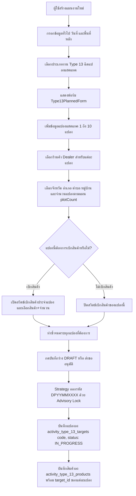
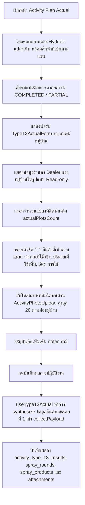
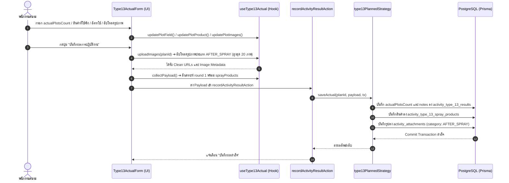

# Activity Type 13 — ฉีดแปลงแฮตแทค (README)

> **Feature Slice**: `modules/activity/features/type-13`  
> **Work Type Code**: `TYPE_13`  
> **Work Type Name**: ฉีดแปลงแฮตแทค (Hattack Spraying)  
> **Parent Module**: `modules/activity`  
> **Database Authority**: `prisma/schema.prisma` (`ActivityPlanType13Target`, `ActivityPlanType13Product`, `ActivityResultType13`, `ActivityResultType13SprayRound`, `ActivityResultType13SprayProduct`, `ActivityResultType13SprayExternal`, `ActivityAttachment`)  
> **Status**: Production Ready / Active Reference (v2.6.1 — Updated 2026-10-28 Unplanned 2-in-1 Full Persistence Pipeline Fix: Targets, Products, Actual Results, Spray Rounds, Spray Products & Attachments)

---

## 1. Overview

### 1.1 วัตถุประสงค์ของ Type 13
**Type 13 (ฉีดแปลงแฮตแทค - Hattack Spraying)** มีวัตถุประสงค์เพื่อรองรับการปฏิบัติงานภาคสนามของพนักงานขายและเจ้าหน้าที่เทคนิคเกษตร (Sales / Technical Reps / Promoters) ในการดำเนินงานฉีดพ่นสารเคมีและสาธิตผลิตภัณฑ์แฮตแทคในแปลงเกษตรกรของตัวแทนจำหน่าย (Dealer):
1. **วางแผนลงพื้นที่แปลงสาธิตแฮตแทครายตัวแทนจำหน่าย:** รองรับระบบ Multi-Plot (1–10 แปลงต่อหนึ่งแผนงาน)
2. **วางแผนเบิกสินค้าสาธิตแยกรายแปลง (Per-Plot Product Withdrawal):** กำหนดการเบิกสินค้าสาธิตแยกเฉพาะเจาะจงในแต่ละแปลงสาธิต เช่น แปลงที่ 1 เบิกสินค้า A/B, แปลงที่ 2 เบิกสินค้า C
3. **บันทึกผลการปฏิบัติงานจริงแบบสรุปรายหมู่บ้าน (Streamlined Actual Execution):** บันทึกจำนวนแปลงที่ฉีดพ่นจริง (`actualPlotsCount`) ต่อหมู่บ้าน พร้อมแสดงข้อมูลร้านค้า Dealer และหมู่บ้านในรูปแบบแสดงผล (Read-only) โดยไม่ต้องกรอกชื่อแปลงหรือปักหมุด GPS ซ้ำซ้อน
4. **บันทึกการใช้สินค้าสาธิตที่เบิกตามแผนอย่างละเอียด (Planned Demo Products Usage):** ดึงรายการสินค้าที่เบิกตามแผนมาแสดงในหัวข้อ 1.1 เพื่อให้บันทึกจำนวนที่ใช้จริง (`actualQuantity`), ปริมาณที่ใช้เพิ่ม (`extraQuantity` + `extraUnit`), และอัตราการใช้ (`actualRate`) ตามมาตรฐานเดียวกับ Type 7B
5. **จัดเก็บภาพถ่ายหลักฐานหลังการฉีดพ่นด้วยคอมโพเนนต์มาตรฐาน:** ใช้งาน `ActivityPhotoUpload` อัปโหลดภาพหลังฉีดพ่นจริง (สูงสุด 20 ภาพต่อหมู่บ้าน) เพื่อยืนยันผลสัมฤทธิ์
6. **เชื่อมโยงข้อมูลสู่ Type 14 (ติดตามแปลงแฮตแทค):** ออกรหัสแปลงมาตรฐาน `code` (`DPYYMMXXXX` ผ่าน Advisory Lock) และสถานะเริ่มต้น `status: IN_PROGRESS` เพื่อส่งต่อให้ Type 14 ดึงไปติดตามผลต่อได้ทันที

### 1.2 ขอบเขตของ Type 13
- **กลุ่มเป้าหมายและการจัดสรรแปลง (Multi-Plot Scope):**
  - ตัวแทนจำหน่ายหลัก (`DEALER`) และร้านค้าร่วมโครงการ
  - รองรับการกำหนดแปลงสาธิตแฮตแทคได้ตั้งแต่ 1 ถึง 10 แปลงต่อหนึ่งแผนงาน
  - แต่ละแปลงระบุ ร้านค้า Dealer, จังหวัด, อำเภอ, ตำบล, หมู่บ้าน และจำนวนแปลงตามแผน (`plotCount`)
  - แต่ละแปลงจัดเก็บในตารางเฉพาะ `activity_type_13_targets` (`ActivityPlanType13Target`) พร้อมออกรหัสแปลงมาตรฐาน `code` (`DPYYMMXXXX` ผ่าน Advisory Lock)
  - ยกเลิกการพึ่งพาตาราง `demo_plots` และ `demo_plot_visits` เก่าอย่างสมบูรณ์
- **การเบิกสินค้าสาธิตแยกตามแปลง (Per-Plot Product Withdrawal):**
  - สวิตช์เปิด-ปิดการเบิกสินค้าประจำแปลง (แปลงที่ 1 มีช่องติ๊กเบิกสินค้า, แปลงที่ 2 มีช่องติ๊กเบิกสินค้า ฯลฯ)
  - กำหนดรายการสินค้าที่ขอเบิก (`productId`), จำนวนที่เบิก (`quantity`), และหน่วยนับ (`unit`) โดยเชื่อมโยง `targetId` เข้ากับแปลงนั้นๆ โดยตรงในตาราง `activity_type_13_products`
- **การบันทึกผลการปฏิบัติงานจริง (Actual Outcome Scope):**
  - แสดงข้อมูลร้านค้า Dealer และชื่อหมู่บ้านในรูปแบบ Read-only Display นำมาจากแผนงาน
  - ช่องระบุจำนวนแปลงที่ฉีดพ่นจริง (`actualPlotsCount`)
  - หัวข้อ **1.1 สินค้าที่เบิกตามแผน (Planned Demo Products):**
    - จำนวนที่ใช้จริง (`actualQuantity`) หน่วยขวด/กระป๋อง
    - ปริมาณที่ใช้เพิ่ม (`extraQuantity`) เช่น ใช้ไปครึ่งขวด 0.5 พร้อมหน่วย (`extraUnit` เช่น มล., ซีซี, ลิตร, กรัม, กก.)
    - อัตราการใช้จริง (`actualRate` เช่น ซีซี ต่อน้ำ 20 ลิตร)
  - ภาพถ่ายหลังฉีดพ่น: ใช้งาน `ActivityPhotoUpload` สำหรับอัปโหลดภาพถ่ายหลังการฉีดพ่น สูงสุด 20 ภาพต่อหมู่บ้าน
  - บันทึกเพิ่มเติมเกี่ยวกับผลการฉีดพ่น (`notes`)
  - *(ปรับลดฟิลด์ซ้ำซ้อน: ลบช่องกรอกชื่อแปลง, ลบพิกัดแปลง GPS Picker, และลบรอบการฉีดพ่น 0 รอบ ออกจากฟอร์ม Actual เพื่อลดภาระงานของทีมสนาม โดยระบบจะสังเคราะห์รอบที่ 1 และซิงค์ลงตาราง `activity_type_13_spray_products` ให้อัตโนมัติ)*

### 1.3 รูปแบบการทำงานที่รองรับ
1. **Planned (ในแผนงาน):** วางแผนแปลงแฮตแทค 1–10 แปลง เลือกร้านค้าตัวแทนจำหน่าย ระบุที่อยู่แปลง หมู่บ้าน จำนวนแปลงตามแผน และติ๊กเบิกผลิตภัณฑ์สาธิตแยกรายแปลง
2. **Planned Actual (บันทึกผลงานตามแผน):** นำแผนเดิมมารายงานผลการฉีดพ่นจริง ระบุจำนวนแปลงที่ฉีดพ่น บันทึกการใช้สินค้าสาธิตตามแผน (จำนวนใช้จริง, ปริมาณเพิ่ม, อัตราใช้) และอัปโหลดภาพถ่ายหลังฉีดพ่น
3. **Planned Edit (แก้ไขแผนงานเดิม):** ดึงข้อมูล `type13Targets`, `type13Products` และ `type13Results` มาแสดงผลอย่างครบถ้วน หากมีผลจริงในระบบแล้วจะเรนเดอร์ `Type13DetailView` ในส่วนผลงานจริงให้อัตโนมัติ
4. **Unplanned (กิจกรรมนอกแผน 2-in-1):** รองรับการออกปฏิบัติงานฉีดพ่นกะทันหัน สามารถระบุข้อมูลตัวแทนจำหน่าย ข้อมูลแปลง พร้อมผลการฉีดพ่นเสร็จสิ้นในฟอร์มเดียว
5. **Detail View:** แสดงข้อมูลแปลงแฮตแทคตามแผน พร้อมแท็บสลับดูรายละเอียดผลการฉีดพ่น การใช้ผลิตภัณฑ์ และระบบ Lightbox แสดงภาพถ่ายหลังการฉีดพ่น
6. **Approval View:** สรุปรายการแปลงแฮตแทคและรายการเบิกสินค้าแยกตามแปลงเพื่อให้หัวหน้างานพิจารณาอนุมัติ

---

## 2. Business Flows

### 2.1 Planned (สร้างและแก้ไขแผนงาน)


### 2.2 Planned Actual (บันทึกผลการปฏิบัติงานตามแผน)


### 2.3 Unplanned (กิจกรรมนอกแผน 2-in-1 รองรับ 1-10 หมู่บ้าน)
- ผู้ใช้งานเข้าหน้า `/activity-plans/unplanned/new` หรือแก้ไขกิจกรรมนอกแผนเดิม แล้วเลือกประเภทงาน **ฉีดแปลงแฮตแทค (Type 13)**
- ฟอร์ม `Type13UnplannedForm` ได้รับการปรับปรุงเป็นรูปแบบ Multi-Village (1–10 หมู่บ้าน) สอดคล้องกับ `Type13ActualForm` และ Type 7B:
  1. **ระบบเพิ่ม/ลบหมู่บ้าน (Multi-Village Support 1–10 หมู่บ้าน):** มีปุ่ม "+ เพิ่มหมู่บ้าน" และ "ลบหมู่บ้านนี้" พร้อมแสดง Badge จำนวนหมู่บ้านทั้งหมดแบบเรียลไทม์
  2. **ข้อมูลแปลงและพื้นที่ (Plot & Location Information):** เลือกร้านค้าตัวแทนจำหน่าย (`ActivityCustomerSelect` พร้อม auto-fill ที่อยู่), เลือกจังหวัด/อำเภอ/ตำบล (`ActivityAddressSelect`), ระบุชื่อหมู่บ้าน (`village`) และระบุจำนวนแปลงที่ฉีดพ่นจริง (`actualPlotsCount` กำหนดค่าเริ่มต้นเป็น 1 แปลง)
  3. **สินค้าสาธิตที่ใช้ (Demo Products Used):** การ์ดรายการสินค้าสไตล์ Type 7B เลือกสินค้า (`ActivityProductSelect` พร้อม Atomic state update แสดงผลชื่อสินค้าทันทีที่เลือก), ระบุจำนวนที่ใช้จริง (`actualQuantity`), ปริมาณที่ใช้เพิ่ม (`extraQuantity` + ตัวเลือกหน่วย `extraUnit`), และอัตราการใช้ (`actualRate`)
  4. **ภาพถ่ายหลังฉีดพ่น (After Spray Photos):** ใช้งานคอมโพเนนต์ `ActivityPhotoUpload` กำหนด `maxFiles={20}` สำหรับอัปโหลดภาพถ่ายหลักฐานแยกอิสระในแต่ละหมู่บ้าน
  5. **บันทึกเพิ่มเติม (Notes):** ช่องระบุหมายเหตุหรือข้อสังเกตเพิ่มเติมจากการลงพื้นที่ในแต่ละหมู่บ้าน
- เมื่อกดบันทึก ระบบจะสร้าง/อัปเดต `ActivityPlan` พร้อมบันทึก `ActivityPlanType13Target`, `ActivityPlanType13Product`, `ActivityResultType13` และผลการฉีดพ่นสำหรับทุกหมู่บ้านผ่าน `type13UnplannedStrategy` โดยอัตโนมัติ

### 2.4 Detail and Approval (ดูรายละเอียดและพิจารณาอนุมัติ)
- **Detail View:** เรนเดอร์ `<Type13PlanCard />` สำหรับสรุปแปลงแฮตแทคตามแผน และเรนเดอร์ `<Type13DetailView />` มีแท็บสลับดูแต่ละแปลง สรุปจำนวนแปลงที่ฉีดจริง ตารางการใช้สินค้าสาธิต และแกลเลอรีรูปภาพพร้อม Image Lightbox
- **Approval View:** เรนเดอร์ `<Type13ApprovalCard />` แสดงจำนวนแปลงแฮตแทค ร้านค้าตัวแทนจำหน่าย และสรุปรายการเบิกสินค้าแยกรายแปลง เพื่อให้ผู้มีอำนาจอนุมัติสามารถตรวจสอบยอดเบิกและขอบเขตงานได้ทันที

---

## 3. Architecture

### 3.1 Folder Structure (Vertical Slice Architecture)
```text
modules/activity/features/type-13/
├── index.ts                              # Unified Public API Contract (Client-Safe Barrel Export)
├── README.md                             # เอกสารคู่มือทางเทคนิคฉบับสมบูรณ์ (ไฟล์นี้)
│
├── planned/                              # Sub-slice: กิจกรรมในแผนงานและบันทึกผลตามแผน
│   ├── application/                      # Business Logic, Validation, Mappers
│   │   ├── actual-mapper.ts              # แกะผลการฉีดพ่นจาก resultSummary / payload
│   │   ├── actual-validation.ts          # ตรวจสอบความถูกต้องของผลจริง (actualPlotsCount, demo products, 20 photos)
│   │   ├── planned-mapper.ts             # แปลงแปลงแฮตแทค Form <-> DB / Hydration / Section items
│   │   └── planned-validation.ts         # ตรวจสอบฟอร์มแผนงาน (validateType13FormValues, Zod schemas)
│   ├── components/                       # UI Components ประจำ Type 13 ในแผน
│   │   ├── type13-planned-form.tsx       # ฟอร์มแปลง 1-10 แปลง + เบิกสินค้าแยกตามแปลง (Create / Edit)
│   │   ├── type13-actual-form.tsx        # ฟอร์มบันทึกผลจริง (จำนวนแปลงจริง, สินค้า 1.1, ActivityPhotoUpload)
│   │   ├── type13-plan-card.tsx          # การ์ดสรุปแปลงแฮตแทคตามแผนงาน
│   │   ├── type13-detail-view.tsx        # หน้ารายละเอียดเต็มรูปแบบ แท็บแปลง การใช้สินค้า และ Lightbox
│   │   └── type13-approval-card.tsx      # การ์ดสรุปแปลงและรายการเบิกสินค้าสำหรับหน้าอนุมัติ
│   ├── hooks/                            # Custom State Hooks
│   │   ├── use-type13-planned-form.ts    # จัดการ State รายการแปลงแฮตแทคและการเบิกสินค้าแยกรายแปลง
│   │   └── use-type13-actual.ts          # จัดการ State ผลจริง Hydrate สินค้าสาธิต และ synthesize round 1
│   ├── infrastructure/                   # Database Strategies & Repositories
│   │   ├── type13.repository.ts          # จัดการ CRUD ตาราง Type 13, DemoPlot Code Generator (Advisory Lock)
│   │   └── type13-planned.strategy.ts    # WorkTypeStrategy สำหรับ Type 13 ในแผนงาน (Server only)
│   └── types/                            # Type Definitions ในแผน
│       ├── planned.types.ts              # Type13PlanFormProps, ValidateType13Params, Card Props
│       └── actual.types.ts               # Type13PlotActualState, Type13ActualProductState, Type13ActualProps
│
├── unplanned/                            # Sub-slice: กิจกรรมนอกแผน (2-in-1)
│   ├── application/                      # Logic และ Mappers กิจกรรมนอกแผน
│   │   ├── unplanned-mapper.ts           # Hydration และ Data mapping นอกแผน (mapType13UnplannedToPayload)
│   │   └── unplanned-validation.ts       # Zod validation กิจกรรมนอกแผน (validateType13UnplannedItem)
│   ├── components/                       # UI Components กิจกรรมนอกแผน
│   │   └── type13-unplanned-form.tsx     # ฟอร์ม 2-in-1 (ข้อมูลแปลง + ผลการฉีดพ่น + รูปภาพ)
│   ├── hooks/                            # Custom State Hooks
│   │   └── use-type13-unplanned-form.ts  # จัดการ State รายการนอกแผน
│   ├── infrastructure/                   # Database Strategies นอกแผน
│   │   └── type13-unplanned.strategy.ts  # WorkTypeStrategy สำหรับกิจกรรมนอกแผน (Server only)
│   └── types/                            # Type Definitions นอกแผน
│       └── unplanned.types.ts            # Type13UnplannedItem, Type13UnplannedFormProps
│
└── shared/                               # ชิ้นส่วนที่ใช้ร่วมกันภายใน Feature Type 13
    ├── constants.ts                      # WORK_TYPE_CODE, SPRAY_EQUIPMENT_OPTIONS, PRODUCT_RESPONSE_OPTIONS, FORMULAS
    ├── types.ts                          # Type13PlotItem (พร้อม actualPlotsCount, withdrawnProducts), Type13SprayingRound
    └── notes.ts                          # formatType13PlannedNotes, formatType13ActualSummary
```

### 3.2 Type 13 vs Shared Activity
| ความรับผิดชอบ | จัดการที่ Type 13 Feature (`features/type-13`) | จัดการที่ Activity ส่วนกลาง (`ui/`, `views/`) |
| :--- | :--- | :--- |
| **ข้อมูลทั่วไป** | - | ชื่องาน, วันที่เริ่ม-สิ้นสุด, ประเภทกิจกรรมหลัก |
| **พื้นที่ & ทีมงาน** | จังหวัด อำเภอ ตำบล หมู่บ้าน และจำนวนแปลงของแต่ละแปลง | จังหวัดหลักของทริป, พนักงานร่วมเดินทาง |
| **งบประมาณ/เบิกสินค้า** | รายการสินค้าที่ขอเบิกเพื่อฉีดพ่นสาธิตแยกรายแปลง (`withdrawnProducts`) | งบเบิกสินค้าสาธิตส่วนกลาง, เบี้ยเลี้ยง, ค่ายานพาหนะ |
| **ข้อมูลแปลงสาธิต** | รายการแปลง 1–10 แปลง, ร้านค้า Dealer, ที่อยู่แปลง, หมู่บ้าน, จำนวนแปลงตามแผน (`plotCount`) | - |
| **ผลการฉีดพ่นจริง** | จำนวนแปลงที่ฉีดพ่นจริง (`actualPlotsCount`), การใช้สินค้าสาธิตที่เบิกตามแผน (จำนวนใช้จริง, ปริมาณเพิ่ม, อัตราใช้), ภาพถ่ายหลังฉีดพ่นผ่าน `ActivityPhotoUpload` สูงสุด 20 ภาพต่อหมู่บ้าน | ผลสรุปภาพรวมแผน (สำเร็จ/เลื่อน/ยกเลิก) |
| **Database Persistence** | ตาราง `activity_type_13_targets`, `activity_type_13_products`, `activity_type_13_results`, `activity_type_13_spray_rounds`, `activity_type_13_spray_products`, `activity_type_13_spray_externals` | ตารางหลัก `ActivityPlan`, `ActivityPlanApprovalLog`, `ActivityAttachment` |

### 3.3 Dependency and Import Map
- **ทิศทางการเรียกใช้ (Allowed):**
  - `views/` ➔ เรียกใช้ ➔ `features/type-13` (ผ่าน `index.ts` เท่านั้น)
  - `features/type-13` ➔ เรียกใช้ ➔ `@/modules/activity/ui` (`ActivityInput`, `ActivityAddressSelect`, `ActivityCustomerSelect`, `ActivityProductSelect`, `ActivityPhotoUpload`)
  - `features/type-13` ➔ เรียกใช้ ➔ `@/modules/activity/types/strategy.interface`
  - `features/type-13` ➔ เรียกใช้ ➔ `@/modules/activity/application/media/image-uploader` (`uploadActivityPlanImageGroup`, `collectPermanentUrls`)
- **Server Actions & Database Flow:**
  - `views/` ➔ ส่งข้อมูลไปยัง ➔ Server Actions ใน `@/modules/activity/server/`:
    - `planned.actions.ts` (`createActivityPlanAction`, `updateActivityPlanAction`, `getActivityPlanAction`)
    - `unplanned.actions.ts` (`createUnplannedActivityAction`, `updateUnplannedActivityAction`, `getUnplannedActivityAction`)
    - `actual.actions.ts` (`recordActivityResultAction`)
  - Server Actions ➔ ทำงานร่วมกับ ➔ `@/modules/activity/infrastructure/strategy.registry` ➔ เรียกใช้ `type13PlannedStrategy` / `type13UnplannedStrategy` บันทึกลงตาราง Type 13 โดยตรง
- **สิ่งต้องห้าม (Strictly Forbidden):**
  - ❌ ภายนอก Import เจาะลึกเข้าไปในโฟลเดอร์ย่อย เช่น `features/type-13/planned/components/...`
  - ❌ `features/type-13` เรียกใช้ข้ามไปยัง `features/type-1` ถึง `type-12` หรือ `type-14`
  - ❌ Import ย้อนกลับไปยังโมดูลเก่า `@/modules/activity-plans/...` โดยเด็ดขาด

### 3.4 Entry Points and Public Exports
ไฟล์ [modules/activity/features/type-13/index.ts](file:///d:/code/crm-bank/modules/activity/features/type-13/index.ts) ทำหน้าที่เป็น **Single Public API Contract** สำหรับฝั่ง UI / Application โดยส่งออก:
- **Components:** `Type13PlannedForm`, `Type13PlanCard`, `Type13ActualForm`, `Type13DetailView`, `Type13ApprovalCard`, `Type13UnplannedForm`
- **Hooks:** `useType13PlannedForm` (`useType13Form`), `useType13Actual` (`useType13ActualState`), `useType13UnplannedForm`
- **Mappers & Hydrators:** `extractType13PlanTargets`, `hydrateType13PlannedData`, `mapType13ToSectionItems`, `parseType13ActualResult`, `hydrateType13UnplannedData`, `mapType13UnplannedToPayload`
- **Validators & Schemas:** `validateType13FormValues`, `type13PlanInputSchema`, `validateType13Actual`, `type13PlotActualSchema`, `type13SprayingRoundSchema`, `validateType13UnplannedItem`
- **Constants & Types:** `WORK_TYPE_CODE`, `WORK_TYPE_NAME`, `SPRAY_EQUIPMENT_OPTIONS`, `PRODUCT_RESPONSE_OPTIONS`, `FORMULA_OPTIONS`, `TYPE13_MAX_IMAGES_PER_VILLAGE`, `Type13PlotItem`, `Type13SprayingRound`, `Type13PlotActualState`, `Type13ActualProductState`, `Type13UnplannedItem`

---

## 4. File Responsibilities

### 4.1 Planned & Actual
- **`use-type13-planned-form.ts`:** จัดการ State รายการแปลงแฮตแทค (`type13Plots` สูงสุด 10 แปลง) และการเบิกสินค้าแยกตามแปลง (`withdrawnProducts` ในแต่ละ `Type13PlotItem`), มีฟังก์ชัน `validateType13()` และ `mapType13Payload()` แปลงเป็น Payload พร้อมลงตาราง
- **`type13-planned-form.tsx`:** ฟอร์มสร้าง/แก้ไขแปลงแฮตแทค ใช้ `ActivityCustomerSelect` เลือกร้านค้า Dealer, `ActivityAddressSelect` เลือกที่อยู่แปลง, ระบุชื่อหมู่บ้านและจำนวนแปลงตามแผน, พร้อมสวิตช์เบิกสินค้าสาธิตแยกเฉพาะเจาะจงในแต่ละแปลงด้วย `ActivityProductSelect`
- **`type13-actual-form.tsx`:** ฟอร์มบันทึกผลการปฏิบัติงานจริง แสดงผลร้านค้า Dealer และหมู่บ้านในรูปแบบ Read-only, มีช่องกรอกจำนวนแปลงที่ฉีดพ่นจริง (`actualPlotsCount`), หัวข้อ 1.1 บันทึกการใช้สินค้าที่เบิกตามแผน (จำนวนใช้จริง, ปริมาณใช้เพิ่ม, อัตราใช้), และอัปโหลดภาพหลังฉีดพ่นด้วย `ActivityPhotoUpload` (สูงสุด 20 ภาพต่อหมู่บ้าน)
- **`use-type13-actual.ts`:** Custom Hook จัดการ State ผลจริง ดึงสินค้าที่ตั้งเบิกไว้จากแปลงมาเป็น baseline เพื่อให้ผู้ใช้กรอกผลการใช้จริง, มีฟังก์ชัน `updatePlotProduct()`, `uploadImages()` อัปโหลดหมวดหมู่ `type13/after_spray`, และ `collectPayload()` ที่ synthesize รอบที่ 1 พร้อมสินค้าเข้าโครงสร้างมาตรฐาน
- **`type13-detail-view.tsx`:** คอมโพเนนต์แสดงผลในหน้ารายละเอียด มีแท็บเลือกแปลง แสดงสรุปจำนวนแปลงที่ฉีดจริง ตารางการใช้สินค้าสาธิต และแกลเลอรีรูปภาพพร้อม Image Lightbox ขยายดูภาพเต็มจอ
- **`type13-plan-card.tsx` & `type13-approval-card.tsx`:** การ์ดสรุปแปลงแฮตแทค ข้อมูลร้านค้า Dealer และสรุปรายการขอเบิกสินค้าแยกรายแปลงสำหรับหน้าดูรายละเอียดและหน้าพิจารณาอนุมัติ
- **`planned-mapper.ts` & `actual-mapper.ts`:** ทำหน้าที่ดึงข้อมูลแปลง (`extractType13PlanTargets`), Hydrate ข้อมูลเดิมเมื่อเปิดหน้าแก้ไข, และสกัดข้อมูลผลการฉีดพ่นจาก `resultSummary`
- **`actual-validation.ts`:** ตรวจสอบความถูกต้องของผลจริง ตรวจสอบว่าต้องระบุจำนวนแปลงที่ฉีดจริง (`actualPlotsCount > 0`), รายการสินค้าที่เบิกต้องระบุจำนวนใช้จริงและอัตราการใช้ครบถ้วน, และรูปภาพต้องไม่เกิน 20 ภาพต่อหมู่บ้าน
- **`type13.repository.ts` & `type13-planned.strategy.ts`:** Logic จัดการฐานข้อมูล สร้างรหัสแปลง `generateDemoPlotCode()` ด้วย Advisory Lock, สร้างและซิงค์ `ActivityPlanType13Target`, `ActivityPlanType13Product`, `ActivityResultType13`, และ `ActivityResultType13SprayProduct`

### 4.2 Unplanned
- **`use-type13-unplanned-form.ts`:** จัดการ State สำหรับฟอร์มนอกแผน 2-in-1 (ข้อมูลแปลง + ผลการฉีดพ่น + รูปภาพ)
- **`type13-unplanned-form.tsx`:** ฟอร์ม 2-in-1 สไตล์โมเดิร์น (สอดคล้องกับ Type 13 Actual และ Type 7B) ประกอบด้วย: ข้อมูลร้านค้า Dealer, พื้นที่แปลง (จังหวัด/อำเภอ/ตำบล), ชื่อหมู่บ้าน, จำนวนแปลงที่ฉีดพ่นจริง (`actualPlotsCount`), การ์ดสินค้าสาธิตที่ใช้ (สินค้า, จำนวนใช้จริง, ปริมาณเพิ่ม + หน่วย, อัตราใช้), ภาพถ่ายหลังฉีดพ่นด้วย `ActivityPhotoUpload` (สูงสุด 20 ภาพ), และบันทึกเพิ่มเติม
- **`unplanned-mapper.ts`:** แปลง Form Item เป็น Payload สำหรับบันทึกทั้งส่วน Plan และ Actual พร้อมกัน (`mapType13UnplannedToPayload`) รองรับ `actualPlotsCount`, `actualQuantity`, `extraQuantity`, `extraUnit`, `actualRate` และ Hydrate ข้อมูลเดิม (`hydrateType13UnplannedData`)
- **`unplanned-validation.ts`:** ตรวจสอบความถูกต้องของข้อมูลนอกแผน (`validateType13UnplannedItem`) ได้แก่ ร้านค้า Dealer, ที่อยู่แปลง, จำนวนแปลงจริง (> 0), สินค้าที่ใช้และอัตราใช้, และรูปถ่ายไม่เกิน 20 ภาพ
- **`type13-unplanned.strategy.ts`:** บันทึกข้อมูลกิจกรรมนอกแผนลงในฐานข้อมูลผ่าน `syncType13Data`

### 4.3 Shared Types and Constants
- **`shared/constants.ts`:** ค่าคงที่ระบบ เช่น `WORK_TYPE_CODE = "TYPE_13"`, `SPRAY_EQUIPMENT_OPTIONS` (เครื่องยนต์พ่นยา, โดรนพ่นยา, ปั๊มลากสาย), `PRODUCT_RESPONSE_OPTIONS` (ปกติ, ใบไหม้, ยาไม่ละลาย), `EXTERNAL_CHEMICAL_FORMULAS`, และ `TYPE13_MAX_IMAGES_PER_VILLAGE = 20`
- **`shared/types.ts`:** Interfaces สำคัญ เช่น `Type13PlotItem` (รองรับ `actualPlotsCount`, `withdrawnProducts`), `Type13SprayingRound`, `Type13ImageFile`
- **`shared/notes.ts`:** ฟังก์ชันจัดรูปแบบข้อความสรุป `formatType13PlannedNotes` และ `formatType13ActualSummary`

### 4.4 Views Orchestration
- **`edit-view.tsx`:** ดึง `plan.type13Targets`, `plan.type13Products`, และ `plan.type13Results` จาก Prisma มาประกอบเป็น `type13Object`, `mappedType13Plots` และ `type13ActualData` เพื่อส่งต่อให้ฟอร์มแก้ไข
- **`planned-activity-form.tsx`:** ตรวจสอบการมีอยู่ของผลจริงใน DB (`hasActualResults`) หากพบข้อมูลจะเรนเดอร์ `<Type13DetailView />` ในส่วนผลงานจริงให้อัตโนมัติ เพื่อให้ผู้ใช้สามารถตรวจสอบผลงานจริงเดิมได้
- **`result-summary-parser.ts`:** ทำหน้าที่ Parse ข้อมูล `type13Results` จากทั้ง Root Payload หรือ `activityPlan.type13Results` ลงใน State ส่วนกลาง

---

## 5. Data Flow



### 5.1 Create Planned (สร้างแผนใหม่)
1. `create-view.tsx` เรียกใช้ `useType13PlannedForm()`
2. ผู้ใช้เพิ่มแปลง (1 ถึง 10 แปลง) เลือกร้านค้า Dealer, ระบุที่อยู่แปลง, ชื่อหมู่บ้าน และจำนวนแปลงตามแผน (`plotCount`) ใน `Type13PlannedForm`
3. ในแต่ละแปลง หากต้องการเบิกสินค้า ผู้ใช้เปิดสวิตช์และเลือกสินค้าพร้อมจำนวนประจำแปลงนั้น
4. เมื่อกดส่งข้อมูล ระบบจะรัน `validateType13()`
5. Form Orchestrator เรียก `mapType13Payload()` เพื่อจัดโครงสร้าง `type13Data`, `type13Plots`, `planStores`, และ `planProducts` (ผูก `targetId` เข้ากับแต่ละแปลง)
6. ส่ง Payload ไปยัง `createActivityPlanAction` ➔ เรียกใช้ `type13PlannedStrategy.savePlan()`
7. Strategy ออกรหัสแปลงมาตรฐาน `code: DPYYMMXXXX` ด้วย PostgreSQL Advisory Lock และบันทึกลง `ActivityPlanType13Target` (`activity_type_13_targets`) พร้อมบันทึกสินค้าลง `ActivityPlanType13Product` (`activity_type_13_products`) ภายใต้ Transaction เดียวกัน

### 5.2 Edit Planned (แก้ไขแผนงานเดิม)
1. `edit-view.tsx` ดึงข้อมูลแผนงาน (`plan`) ผ่าน `getActivityPlanAction`
2. ระบบทำการ Hydrate ข้อมูล `plan.type13Targets`, `plan.type13Products`, และ `plan.type13Results`
3. สินค้าที่เบิกตามแผนจะถูกจัดกลุ่มเข้าสู่แต่ละแปลงตาม `targetId` (`plot.withdrawnProducts`)
4. หากพบว่ามีผลการฉีดพ่นจริงใน DB แล้ว (`hasActualResults`) `planned-activity-form.tsx` จะเรนเดอร์ `<Type13DetailView />` เพื่อแสดงผลงานจริงที่บันทึกไว้
5. ผู้ใช้สามารถปรับปรุงข้อมูลแปลงและรายการเบิกสินค้า แล้วบันทึกซ้ำผ่าน `updateActivityPlanAction`

### 5.3 Save Actual (บันทึกผลการปฏิบัติงานจริง)
1. `activity-plan-actual-view.tsx` รันการตรวจสอบความถูกต้องผ่าน `validateType13Actual()`
2. ตรวจสอบว่าทุกแปลงระบุ `actualPlotsCount > 0`, สินค้าที่เบิกมี `actualQuantity >= 0` และ `actualRate` ครบถ้วน, และรูปภาพไม่เกิน 20 ภาพต่อหมู่บ้าน
3. เรียก `type13Actual.uploadImages(planId)` เพื่ออัปโหลดภาพถ่ายหลังฉีดพ่นไปยัง Storage ได้ Clean URLs กลับมา
4. เรียก `type13Actual.collectPayload()` ซึ่งจะทำการ synthesize ข้อมูลสินค้าและการใช้จริงเข้าสู่ Spray Round ที่ 1
5. ส่ง Payload เข้า `recordActivityResultAction(planId, payload)`
6. `type13PlannedStrategy.saveActual` บันทึกผลลง `ActivityResultType13`, `ActivityResultType13SprayRound`, `ActivityResultType13SprayProduct`, และ `ActivityAttachment`

### 5.4 Load Actual (โหลดผลงานเดิมมาแสดงในหน้าบันทึกผล)
1. โหลดข้อมูลแผนและผลการปฏิบัติงานจริงจากฐานข้อมูล
2. `result-summary-parser.ts` สกัด `resData.type13Results` หรือ `activityPlan.type13Results`
3. เรียก `type13Actual.hydrate(plan, parsedResult)` นำสินค้าที่ตั้งเบิกไว้จาก `target.products` มาเป็น baseline
4. ดึงข้อมูลผลจริงเดิม (จำนวนแปลงที่ฉีดจริง, จำนวนใช้จริง, ปริมาณเพิ่ม, อัตราใช้, รูปภาพ) มา populate ลงใน State
5. ฟอร์มแสดงผลข้อมูลเดิมให้ผู้ใช้ตรวจสอบและแก้ไขเพิ่มเติมได้ทันที

### 5.5 Create/Edit Unplanned (กิจกรรมนอกแผน)
1. ผู้ใช้กรอกฟอร์ม `Type13UnplannedForm` ระบุร้านค้า Dealer, ที่อยู่แปลง, ผลการฉีดพ่น และอัปโหลดรูปภาพ
2. ตรวจสอบความถูกต้องด้วย `validateType13UnplannedItem`
3. อัปโหลดรูปภาพและแปลงข้อมูลด้วย `mapType13UnplannedToPayload`
4. บันทึกผ่าน `createUnplannedActivityAction` ➔ เรียก `type13UnplannedStrategy.savePlan()` สร้างระเบียนแผนงานและผลการฉีดพ่นพร้อมกัน

---

## 6. Data Models and Mapping

### 6.1 Database CRUD Matrix (สิทธิ์และการจัดการตารางในฐานข้อมูล)
| ตารางในฐานข้อมูล (`Prisma Model`) | Create (สร้าง) | Read (อ่าน/แสดงผล) | Update (แก้ไข) | Delete (ลบ) | หมายเหตุ |
| :--- | :--- | :--- | :--- | :--- | :--- |
| **`activity_type_13_targets`**<br>(`ActivityPlanType13Target`) | `savePlan()` ใน Planned/Unplanned | `findType13ByPlanId()`, `plan.type13Targets` | ลบและสร้างใหม่ใน `syncType13Data()` | Cascade เมื่อลบ `ActivityPlan` | เก็บรายการแปลงแฮตแทค 1–10 แปลง รหัส Dealer, หมู่บ้าน, จำนวนแปลงตามแผน (`plot_count`), และรหัสแปลง `DPYYMMXXXX` |
| **`activity_type_13_products`**<br>(`ActivityPlanType13Product`) | `savePlan()` เมื่อมีการเบิกสินค้า | `plan.type13Products` ใน Edit / Detail / Approval | ลบและสร้างใหม่ใน `syncType13Data()` | Cascade เมื่อลบ `ActivityPlan` | เก็บรายการสินค้าและจำนวนที่ขอเบิกแยกตามแปลง (`target_id`) |
| **`activity_type_13_results`**<br>(`ActivityResultType13`) | `saveActual()` ใน Actual/Unplanned | `plan.type13Results` ใน Detail / Actual | ลบและสร้างใหม่ใน `saveActual()` | Cascade เมื่อลบ `ActivityPlan` | ผลการปฏิบัติงานจริงรายแปลง เชื่อมโยง `target_id` พร้อมบันทึก `actualPlotsCount` ลง `actual_plots_count` และบันทึกเพิ่มเติมใน `notes` |
| **`activity_type_13_spray_rounds`**<br>(`ActivityResultType13SprayRound`) | `saveActual()` | `result.sprayRounds` | ลบและสร้างใหม่ใน `saveActual()` | Cascade เมื่อลบ `ActivityResultType13` | เก็บรอบการฉีดพ่น (สังเคราะห์เป็นรอบที่ 1 อัตโนมัติ) |
| **`activity_type_13_spray_products`**<br>(`ActivityResultType13SprayProduct`) | `saveActual()` | `sprayRound.sprayProducts` | ลบและสร้างใหม่ใน `saveActual()` | Cascade เมื่อลบ `ActivityResultType13SprayRound` | เก็บสินค้าที่ใช้จริง (`quantity_used`), ปริมาณเพิ่มแยกคอลัมน์ (`extra_quantity`), หน่วย (`extra_unit`), `detail`, และอัตราพ่นจริง (`actual_rate`) |
| **`activity_type_13_spray_externals`**<br>(`ActivityResultType13SprayExternal`) | `saveActual()` | `sprayRound.sprayExternals` | ลบและสร้างใหม่ใน `saveActual()` | Cascade เมื่อลบ `ActivityResultType13SprayRound` | เก็บสารเคมีภายนอก (ถ้ามี) |
| **`activity_attachments`**<br>(`ActivityAttachment`) | อัปโหลดภาพหลังฉีดพ่น ➔ `saveActual()` | `actualData.attachments` (หมวดหมู่ AFTER_SPRAY) | ลบและสร้างใหม่ | Cascade เมื่อลบ `ActivityPlan` | เก็บรูปภาพหลังฉีดพ่น สูงสุด 20 ภาพต่อหมู่บ้าน |

### 6.2 Complete Field-to-Database Mapping (ตารางจับคู่ฟิลด์ครบถ้วนทุกจุด)

| Form Field (UI) | TypeScript Type Field | Mapper Function (Write/Read) | Prisma Model | DB Column Name | Data Type | Nullable? | Default |
| :--- | :--- | :--- | :--- | :--- | :--- | :---: | :--- |
| **ลำดับแปลง** | `plotIndex` | `mapType13Payload` | `ActivityPlanType13Target` | `plot_index` | `INTEGER` | No | `1` |
| **รหัสแปลงมาตรฐาน** | `code` | `generateDemoPlotCode` | `ActivityPlanType13Target` | `code` | `VARCHAR` | Yes | `DPYYMMXXXX` |
| **สถานะแปลง** | `status` | `type13PlannedStrategy` | `ActivityPlanType13Target` | `status` | `VARCHAR` | No | `"IN_PROGRESS"` |
| **รหัสร้านค้า Dealer** | `storeId` | `mapType13Payload` | `ActivityPlanType13Target` | `store_id` | `VARCHAR (FK)` | Yes | `null` |
| **ชื่อร้านค้า Dealer** | `dealerName` | `mapType13Payload` / `extractType13PlanTargets` | `ActivityPlanType13Target` | `dealer_name` | `VARCHAR` | Yes | `null` |
| **จังหวัดของแปลง** | `province` | `mapType13Payload` | `ActivityPlanType13Target` | `province` | `VARCHAR` | Yes | `null` |
| **อำเภอของแปลง** | `district` | `mapType13Payload` | `ActivityPlanType13Target` | `district` | `VARCHAR` | Yes | `null` |
| **ตำบลของแปลง** | `subdistrict` | `mapType13Payload` | `ActivityPlanType13Target` | `subdistrict` | `VARCHAR` | Yes | `null` |
| **ชื่อหมู่บ้าน** | `villageName` | `mapType13Payload` / `extractType13PlanTargets` | `ActivityPlanType13Target` | `village_name` | `VARCHAR` | Yes | `null` |
| **จำนวนแปลงตามแผน** | `plotCount` | `mapType13Payload` (`Number(plotCount)`) | `ActivityPlanType13Target` | `plot_count` | `INTEGER` | Yes | `1` |
| **สินค้าที่ขอเบิกประจำแปลง** | `withdrawnProducts` | `mapType13Payload` (`target_id` link) | `ActivityPlanType13Product`| `product_id` | `VARCHAR (FK)` | No | - |
| **จำนวนสินค้าที่เบิก** | `quantity` | `mapType13Payload` (`Number(quantity)`) | `ActivityPlanType13Product`| `quantity` | `DECIMAL(10,2)`| No | `1.00` |
| **หน่วยนับสินค้าที่เบิก** | `unit` | `mapType13Payload` | `ActivityPlanType13Product`| `unit` | `VARCHAR` | Yes | `"ขวด"` |
| **จำนวนแปลงที่ฉีดพ่นจริง** | `actualPlotsCount` | `collectPayload` ➔ `saveActual` | `ActivityResultType13` | `actual_plots_count` | `INTEGER` | Yes | `1` |
| **สินค้าที่ใช้ฉีดพ่นจริง** | `productId` (ในรอบพ่น) | `collectPayload` | `ActivityResultType13SprayProduct`| `product_id` | `VARCHAR (FK)` | No | - |
| **จำนวนที่ใช้จริง** | `actualQuantity` | `collectPayload` (`quantityUsed`) | `ActivityResultType13SprayProduct`| `quantity_used` | `DECIMAL(10,2)`| No | `0.00` |
| **อัตราพ่นจริง** | `actualRate` | `collectPayload` | `ActivityResultType13SprayProduct`| `actual_rate` | `VARCHAR` | No | - |
| **ปริมาณที่ใช้เพิ่ม** | `extraQuantity` | `collectPayload` ➔ `saveActual` | `ActivityResultType13SprayProduct`| `extra_quantity` | `DECIMAL(10,2)`| Yes | `null` |
| **หน่วยปริมาณที่ใช้เพิ่ม** | `extraUnit` | `collectPayload` ➔ `saveActual` | `ActivityResultType13SprayProduct`| `extra_unit` | `VARCHAR` | Yes | `"ซีซี"` |
| **ข้อความสังเคราะห์/รายละเอียด** | `detail` | `collectPayload` (`detail: "+{extraQuantity} {extraUnit}"`) | `ActivityResultType13SprayProduct`| `detail` | `VARCHAR` | Yes | `null` |
| **บันทึกผลงานจริง** | `notes` | `collectPayload` | `ActivityResultType13` | `notes` | `TEXT` | Yes | `null` |
| **ภาพถ่ายหลังฉีดพ่น** | `afterSprayImages` | `uploadImages()` ➔ URLs ➔ `ActivityAttachment` | `ActivityAttachment` | `file_url` | `TEXT` | No | - |

---

## 7. Business Rules

### 7.1 Validation Rules
- **จำนวนแปลงแฮตแทคตามแผน:** ต้องมีอย่างน้อย 1 แปลง และไม่เกิน 10 แปลงต่อแผนงาน
- **ร้านค้า Dealer:** ทุกแปลงต้องเลือกร้านค้า Dealer (`storeId` ห้ามว่าง)
- **ที่อยู่แปลง:** ทุกแปลงต้องระบุจังหวัดและอำเภออย่างน้อย (`province`, `district` ห้ามว่าง)
- **การเบิกสินค้าประจำแปลง (`hasProductWithdrawal = true`):**
  - ต้องมีรายการสินค้าอย่างน้อย 1 รายการสำหรับแปลงที่เปิดสวิตช์เบิกสินค้า
  - สินค้าต้องถูกเลือก (`productId` ห้ามว่าง)
  - จำนวนสินค้าต้องมากกว่า 0 (`quantity > 0`)
- **การบันทึกผลจริง (Actual Validation):**
  - **จำนวนแปลงที่ฉีดพ่นจริง:** ต้องระบุและมากกว่า 0 (`actualPlotsCount > 0`)
  - **สินค้าที่เบิกตามแผน:** ต้องระบุจำนวนที่ใช้จริง (`actualQuantity >= 0`) และอัตราการใช้ (`actualRate` ห้ามว่าง)
  - **ภาพถ่ายหลังฉีดพ่น:** อัปโหลดได้สูงสุด 20 ภาพต่อหมู่บ้าน (`TYPE13_MAX_IMAGES_PER_VILLAGE = 20`)
  - *(ไม่มีการบังคับกรอกชื่อแปลงหรือปักหมุด GPS ในหน้า Actual เพื่อความคล่องตัว)*

### 7.2 Default Values
- `hasProductWithdrawal`: ค่าเริ่มต้นเป็น `false`
- `plotIndex`: ค่าเริ่มต้นรันจาก 1 ถึง N
- `plotCount`: ค่าเริ่มต้นจำนวนแปลงตามแผนเป็น `1`
- `actualPlotsCount`: ค่าเริ่มต้นเท่ากับ `plotCount` ตามแผน
- `quantity`: ค่าเริ่มต้นสินค้าที่เบิกเป็น `1`
- `actualQuantity`: ค่าเริ่มต้นสินค้าที่ใช้จริงเป็น `0`
- `extraUnit`: ค่าเริ่มต้นเป็น `"มล."`

### 7.3 Conditional Fields
- **การสลับเปิด/ปิดเบิกสินค้าประจำแปลง:** หากเปิดสวิตช์เบิกสินค้าของการ์ดแปลงนั้นๆ ฟอร์มจะแสดงตารางเลือกสินค้า จำนวน และหน่วยนับเฉพาะแปลงนั้น
- **ปริมาณที่ใช้เพิ่ม (กรณีใช้ไปครึ่งขวด):** มีช่องให้กรอกปริมาณ `extraQuantity` และเลือกหน่วย `extraUnit` (มล., ซีซี, ลิตร, กรัม, กก.)

### 7.4 Status and Approval Rules
- **การบันทึกผลงานจริง:** สามารถบันทึกได้เฉพาะเมื่อแผนงานมีสถานะเป็น `APPROVED` (อนุมัติแล้ว) เท่านั้น
- **สิทธิ์การบันทึกผล:** เฉพาะผู้สร้างแผนงาน (Creator) และ Administrator เท่านั้น
- **สถานะผลกิจกรรมที่รองรับ:** ฟอร์ม Actual จะแสดงขึ้นมาให้บันทึกผลเมื่อเลือกสถานะกิจกรรมเป็น `COMPLETED` หรือ `PARTIAL`

---

## 8. Shared Dependencies

โมดูล Type 13 ทำงานร่วมกับชิ้นส่วนส่วนกลางต่อไปนี้:
1. **`@/modules/activity/ui`:**
   - `ActivityInput`: กล่องกรอกข้อมูลมาตรฐาน (จำนวนแปลงตามแผน, จำนวนแปลงที่ฉีดจริง, ปริมาณเพิ่ม, อัตราใช้)
   - `ActivityAddressSelect`: คอมโพเนนต์เลือกจังหวัด อำเภอ ตำบล
   - `ActivityCustomerSelect`: คอมโพเนนต์ค้นหาและเลือกร้านค้า Dealer
   - `ActivityProductSelect`: คอมโพเนนต์ค้นหาและเลือกสินค้าเบิก
   - `ActivityPhotoUpload`: คอมโพเนนต์อัปโหลดรูปภาพมาตรฐาน รองรับการเลือกภาพ พรีวิว บีบอัด และจำกัด 20 ภาพ
2. **`@/modules/activity/views`:**
   - `edit-view.tsx`: ดึงข้อมูล `type13Targets`, `type13Products`, `type13Results` มา Hydrate ครบถ้วน
   - `planned-activity-form.tsx`: เรนเดอร์ `<Type13DetailView />` เมื่อแผนงานมีผลงานจริงใน DB
   - `actual-view.tsx` & `activity-plan-actual-view.tsx`: ตัวแสดงผลฟอร์ม Actual
   - `detail-view.tsx`: แท็บแสดงผลและ Image Lightbox
   - `approval-view.tsx`: การ์ดสรุปแปลงและรายการเบิกสินค้าในหน้าพิจารณาอนุมัติ
3. **`@/modules/activity/domain/summary/result-summary-parser.ts`:**
   - สกัด `type13Results` จาก `resData.type13Results` และ `activityPlan.type13Results`
4. **Server Actions ที่ใช้งานจริง (`@/modules/activity/server/`):**
   - **`planned.actions.ts`**: `createActivityPlanAction`, `updateActivityPlanAction`, `getActivityPlanAction`
   - **`actual.actions.ts`**: `recordActivityResultAction`
5. **Media Service (`@/modules/activity/application/media/image-uploader`):**
   - `uploadActivityPlanImageGroup`: จัดการอัปโหลดไฟล์ภาพไปยัง Object Storage ภายใต้ไดเรกทอรี `type13/after_spray`

---

## 9. How to Modify Type 13

### 9.1 การเพิ่มฟิลด์ใหม่บนฟอร์ม (Add a Form Field)
1. เพิ่มฟิลด์ใน Type Definitions:
   - แปลงตามแผน: `shared/types.ts` (`Type13PlotItem`) หรือ `planned/types/planned.types.ts`
   - ผลการฉีดพ่นจริง: `planned/types/actual.types.ts` (`Type13PlotActualState`, `Type13ActualProductState`)
2. เพิ่มเงื่อนไขตรวจสอบใน Validation Schema:
   - แผน: `planned/application/planned-validation.ts` (`type13PlotItemSchema`)
   - ผลจริง: `planned/application/actual-validation.ts` (`validateType13Actual`)
3. เพิ่มช่อง Input ใน UI Component:
   - แผน: `planned/components/type13-planned-form.tsx`
   - ผลจริง: `planned/components/type13-actual-form.tsx`
4. ปรับแก้ Mapper และ Hook:
   - `planned-mapper.ts`, `use-type13-planned-form.ts`, `use-type13-actual.ts`
5. อัปเดต Strategy ใน `type13-planned.strategy.ts` และ `type13.repository.ts` เพื่อบันทึกลงตารางที่เกี่ยวข้อง

### 9.2 การปรับแก้ Validation (Change Validation)
- ปรับแก้เงื่อนไขจำนวนแปลง หรือการตรวจสอบร้านค้า Dealer ได้ที่ `planned/application/planned-validation.ts`
- ปรับแก้เงื่อนไขผลการฉีดจริงที่ `planned/application/actual-validation.ts`

### 9.3 การปรับ Database Mapping (Change Database Mapping)
- หากมีการเปลี่ยนแปลงคอลัมน์ใน Prisma Schema ให้แก้ไขที่ `planned/infrastructure/type13.repository.ts` และ `type13-planned.strategy.ts`

---

## 10. Troubleshooting & Tracing Pipeline

### 10.1 Step-by-Step Tracing Pipeline (คู่มือการไล่โค้ดเมื่อพบปัญหา)

เมื่อพบปัญหาข้อมูลผลการฉีดพ่นหรือสินค้าไม่บันทึก ให้ไล่ตรวจสอบตาม 7 ขั้นตอนนี้ตามลำดับ:

```text
[Step 1: UI Form] ➔ Type13ActualForm.tsx (ตรวจ actualPlotsCount, ตารางสินค้า 1.1 และรูปภาพ)
        ↓
[Step 2: Validation] ➔ actual-validation.ts (ตรวจ validateType13Actual: plots count, quantity, rate)
        ↓
[Step 3: Image Upload] ➔ uploadImages() (ตรวจว่ารูปภาพถูกอัปโหลดและได้ Clean URLs กลับมา)
        ↓
[Step 4: Payload Synthesize] ➔ collectPayload() (ตรวจการสังเคราะห์ round 1 และ sprayProducts)
        ↓
[Step 5: Server Action] ➔ recordActivityResultAction ➔ ตรวจการส่ง payload เข้า type13PlannedStrategy.saveActual
        ↓
[Step 6: Transaction Write] ➔ type13-planned.strategy.ts
                             (ตรวจการบันทึกลง activity_type_13_results, spray_products, activity_attachments)
        ↓
[Step 7: Load Hydrator] ➔ edit-view.tsx / result-summary-parser.ts / use-type13-actual.ts: hydrate()
```

### 10.2 ตารางวิเคราะห์ปัญหาที่พบบ่อย (Common Pitfalls)

| อาการ | จุดที่ต้องตรวจสอบ | ต้นตอและวิธีแก้ไข |
| :--- | :--- | :--- |
| **บันทึกแผนงานแล้วแปลงไม่บันทึก** | `planned-validation.ts` | ฟิลด์ `storeId`, `province` หรือ `district` ของแปลงใดแปลงหนึ่งว่างอยู่ ให้กรอกให้ครบทุกแปลง |
| **เบิกสินค้าแปลงที่ 2 แล้วสินค้าไม่ผูกกับแปลง** | `type13-planned-form.tsx` ➔ `withdrawnProducts` | ตรวจสอบว่า `targetId` ถูกส่งต่อไปยัง `activity_type_13_products` ถูกต้องหรือไม่ |
| **หน้า Edit Plan ไม่ดึงผลจริงมาแสดง** | `edit-view.tsx` ➔ `planned-activity-form.tsx` | ตรวจสอบว่าได้ include `type13Results` ใน `findType13ByPlanId` หรือ `getActivityPlanAction` หรือไม่ และเช็คเงื่อนไข `hasActualResults` |
| **รูปถ่ายหลังฉีดพ่นเกิน 20 รูปต่อหมู่บ้าน** | `type13-actual-form.tsx` | คอมโพเนนต์ `ActivityPhotoUpload` มีการตั้งค่า `maxFiles={20}` ป้องกันการเลือกรูปภาพเกินโควตา |
| **กดบันทึกผลจริงแล้วแจ้งเตือนกรอกข้อมูลไม่ครบ** | `actual-validation.ts` | ตรวจสอบว่ากรอกจำนวนแปลงที่ฉีดพ่นจริง (`actualPlotsCount`) หรือยัง และสินค้าระบุอัตราการใช้ (`actualRate`) ครบถ้วนหรือไม่ |
| **บันทึกผลจริงสำเร็จแต่ข้อมูลไม่ลง Database** | `type13-planned.strategy.ts` & `activity-plan-actual-view.tsx` | ตรวจสอบว่า `saveActual` รองรับการดึง `plots` จากโครงสร้างซ้อน `t13.type13Plots` / `t13.plots` / `actualData.type13Plots` และอัปโหลดรูปก่อนส่ง `collectPayload(updatedPlots)` |

---

## 11. Testing and Manual UAT

### แผนการทดสอบแบบครบวงจร (End-to-End Test Checklist):
- [ ] **TC-01 (Planned Create Multi-Plot with Dealer):** สร้างแผนงาน Type 13 ระบุ 3 แปลง เลือกร้านค้า Dealer ต่างกัน ระบุตำบล หมู่บ้าน และจำนวนแปลงตามแผน บันทึกร่างสำเร็จ
- [ ] **TC-02 (Planned Per-Plot Product Withdrawal):** ติ๊กเบิกสินค้าเฉพาะแปลงที่ 1 และแปลงที่ 3 (ไม่ติ๊กแปลงที่ 2) บันทึกแล้วตรวจสอบว่าตาราง `activity_type_13_products` มี `target_id` ผูกตรงตามแปลง
- [ ] **TC-03 (Planned Validation Guard):** ทดสอบเพิ่มแปลงที่ 11 ระบบต้องปฏิเสธและแจ้งเตือนว่าเพิ่มได้สูงสุด 10 แปลง
- [ ] **TC-04 (Planned Edit Hydration):** เข้าหน้าแก้ไข (`/activity-plans/[id]/edit`) ข้อมูลแปลง ร้านค้า Dealer หมู่บ้าน และรายการเบิกสินค้าของแต่ละแปลงต้องแสดงผลครบถ้วน
- [ ] **TC-05 (Actual Execution with Planned Demo Products):** ในหน้าบันทึกผลจริง ตรวจสอบว่าร้านค้า Dealer และหมู่บ้านแสดงแบบ Read-only, ระบุจำนวนแปลงที่ฉีดจริง, กรอกจำนวนที่ใช้จริง, ปริมาณเพิ่ม, และอัตราการใช้ในหัวข้อ 1.1 บันทึกสำเร็จ
- [ ] **TC-06 (Actual Photo Upload Limit via ActivityPhotoUpload):** อัปโหลดภาพหลังฉีดพ่นจริงผ่าน `ActivityPhotoUpload` ระบบต้องอนุญาตให้อัปโหลดได้สูงสุด 20 รูปต่อหมู่บ้าน
- [ ] **TC-07 (Edit Plan with Existing Actual Results):** เข้าหน้าแก้ไขแผนงานที่มีผลจริงในระบบแล้ว หน้า `planned-activity-form.tsx` ต้องเรนเดอร์ `Type13DetailView` ในส่วนผลงานจริงให้เห็นผลจริงเดิมทันที
- [ ] **TC-08 (Detail View with Lightbox):** เข้าหน้ารายละเอียด สลับแท็บดูแต่ละแปลง ตรวจสอบสรุปการใช้สินค้า และคลิกขยายดูรูปภาพหลังการฉีดพ่นผ่าน Lightbox
- [ ] **TC-09 (Approval View):** หัวหน้างานเข้าหน้าพิจารณาอนุมัติ การ์ดสรุป Type 13 ต้องแสดงจำนวนแปลง ร้านค้า Dealer และรายการสินค้าที่ขอเบิกแยกตามแปลงครบถ้วน
- [ ] **TC-10 (Modernized Unplanned Form):** สร้างกิจกรรมนอกแผน Type 13 เลือกร้านค้า Dealer, ที่อยู่แปลง, ระบุหมู่บ้าน, จำนวนแปลงที่ฉีดพ่นจริง (`actualPlotsCount`), เพิ่มรายการสินค้าสาธิต (จำนวนใช้จริง, ปริมาณเพิ่ม + หน่วย, อัตราใช้), อัปโหลดภาพหลังฉีดพ่นผ่าน `ActivityPhotoUpload` (สูงสุด 20 ภาพ) และบันทึกสำเร็จโดยไม่ต้องกรอกชื่อแปลงหรือปักหมุด GPS ซ้ำซ้อน

---

## 12. Known Limitations and Important Notes

1. **Multi-Plot Dedicated Storage (`activity_type_13_targets`):**
   - ทุกครั้งที่มีการบันทึกแปลงใหม่ใน Type 13 ระบบจะออกรหัสแปลงมาตรฐาน `code: DPYYMMXXXX` (เช่น `DP26100001`) และเก็บใน `activity_type_13_targets` โดยตรง พร้อมสถานะ `status: IN_PROGRESS` โดยไม่พึ่งพาตาราง `demo_plots` หรือ `demo_plot_visits`
2. **Per-Plot Product Withdrawal (`target_id`):**
   - รายการเบิกสินค้าใน `activity_type_13_products` จะเก็บ `target_id` ของแปลงที่เบิก เพื่อให้สามารถติดตามยอดเบิกและนำไปแสดงเป็นสินค้าที่ต้องใช้จริงในหน้าบันทึกผลได้ถูกต้อง
3. **Streamlined Actual Recording & Round 1 Synthesis:**
   - หน้าบันทึกผลจริงไม่มีการให้กรอกชื่อแปลงหรือรอบการฉีดพ่น 0 รอบ เพื่อให้พนักงานภาคสนามทำงานได้เร็วและสะดวกที่สุด ระบบจะทำการสังเคราะห์ข้อมูลรอบการฉีดที่ 1 ให้อัตโนมัติใน `collectPayload()` เพื่อจัดเก็บลงในตาราง `activity_type_13_spray_products` ตามโครงสร้างมาตรฐานเดิม
4. **ข้อจำกัดภาพถ่ายต่อหมู่บ้าน:**
   - กำหนดให้มีภาพถ่ายหลังฉีดพ่นได้สูงสุด 20 ภาพต่อหมู่บ้าน (`TYPE13_MAX_IMAGES_PER_VILLAGE = 20`) ผ่านคอมโพเนนต์ `ActivityPhotoUpload`
5. **Decoupling Dependency:**
   - ห้ามนำเข้าฟังก์ชันหรือค่าคงที่จากโฟลเดอร์เก่า `@/modules/activity-plans` โดยเด็ดขาด ให้ใช้จาก `@/modules/activity` เท่านั้น

---

## 13. Change Log

| วันที่ | เวอร์ชัน | รายละเอียดการปรับปรุง | ผู้ดำเนินการ |
| :--- | :--- | :--- | :--- |
| **2026-10-28** | 2.6.1 | **Unplanned 2-in-1 Full Persistence Pipeline Fix (Targets, Products, Actual Results, Spray Rounds, Spray Products & Attachments):**<br>1. **Unplanned Strategy Fix:** ปรับปรุง `type13UnplannedStrategy.savePlan` ใน `type13-unplanned.strategy.ts` ให้เรียก `type13PlannedStrategy.saveActual` ต่อจากการสร้าง Targets & Products เพื่อบันทึกผลการฉีดพ่นจริง (`activity_type_13_results`, `activity_type_13_spray_rounds`, `activity_type_13_spray_products`, `activity_attachments`) ครบถ้วนทุกหมู่บ้าน<br>2. **Header ActivityResult Upsert:** เพิ่มการ upsert หัวตาราง `activity_results` กำหนดสถานะ `resultStatus: COMPLETED` และคำนวณจำนวนแปลงจริง `demoPlotsCreated`<br>3. **Validation & Image Handling Alignment:** เชื่อมโยง `validateType13UnplannedItems` ใน `validatePlan` และรองรับ `plot.afterSprayImages || plot.images` พร้อมลบ attachments เดิมก่อนบันทึกใหม่เพื่อป้องกันภาพซ้ำซ้อน | Antigravity AI |
| **2026-10-28** | 2.6.0 | **ระบบจัดการสถานะแปลงแฮตแทคและปุ่มเปิดติดตามต่ออีกครั้ง (Plot Lifecycle & Re-open Capability):**<br>1. **Database Schema:** เพิ่มคอลัมน์ `closed_at TIMESTAMP` และ `closure_notes TEXT` ให้กับตาราง `activity_type_13_targets` (`ActivityPlanType13Target`) พร้อม Enum `DemoPlotStatus` (`IN_PROGRESS` / `COMPLETED`) โดยกำหนดค่าเริ่มต้นเป็น `IN_PROGRESS` (\"ต้องติดตามต่อ\")<br>2. **Status Banner & Quick Action Buttons:** ใน `Type13DetailView` เพิ่มแถบแสดงสถานะแปลงด้านบนสุด พร้อมปุ่ม Action ด่วน:<br>&nbsp;&nbsp;- เมื่อแปลงเป็น `COMPLETED`: แสดงปุ่ม \"เปิดติดตามต่ออีกครั้ง\" พร้อมกล่องยืนยัน (Confirmation Dialog) เพื่อเปลี่ยนสถานะกลับเป็น `IN_PROGRESS` ทันที<br>&nbsp;&nbsp;- เมื่อแปลงเป็น `IN_PROGRESS`: แสดงปุ่ม \"ปิดแปลงสาธิตนี้\" พร้อมกล่องข้อความให้ระบุหมายเหตุปิดแปลง เพื่อเปลี่ยนสถานะเป็น `COMPLETED`<br>3. **Server Action:** พัฒนา `toggleHattackPlotStatusAction` ใน `planned.actions.ts` รองรับการสลับสถานะแปลง พร้อมอัปเดต `closedAt`, `closureNotes` และ Revalidate Cache หน้าจอทันที<br>4. **Mapper & Types Integration:** เพิ่มฟิลด์ `status`, `closedAt`, `closureNotes` ใน `Type13PlotItem` และแมปผ่าน `extractType13PlanTargets` ใน `planned-mapper.ts` ครบวงจร | Antigravity AI |
| **2026-10-28** | 2.5.0 | **เชื่อมโยงการแสดงผลการติดตามแปลงแฮตแทค (Type 14 Follow-up Linkage & Quick View):**<br>1. **Type13DetailView Integration:** เพิ่ม Section 1.2 \"ข้อมูลการติดตามแปลงแฮตแทค (Type 14 Follow-up)\" ภายในการ์ดรายละเอียดแปลง โดยดึงข้อมูลแผนงานติดตาม Type 14 ที่เชื่อมโยงกับแปลงและแผนงานนี้มาแสดงผลคร่าวๆ<br>2. **Summary Data Points:** แสดงรหัสและชื่อแผนงาน, สถานะแผนงาน (Badge), วันที่ตามแผน, ผู้รับผิดชอบ, วันที่ตรวจจริง, จำนวนวันหลังฉีดพ่น, จำนวนแปลงจริง, ผลการติดตาม, การตอบสนองของพืช, รายการสินค้าที่ใช้พ่นซ้ำ และบันทึกเพิ่มเติม<br>3. **Direct Navigation Button:** เพิ่มปุ่ม \"ไปยังแผนงานนี้\" (`/activity-plans/${planId}`) พร้อมไอคอน `ExternalLink` ให้สามารถคลิกเข้าสู่หน้ารายละเอียดของแผนงาน Type 14 ได้ทันที<br>4. **Auto-Include Query:** ปรับปรุง `activity-plan-include.ts` ให้รวม `type14Targets` ภายใต้ `type13Targets` และ `type14SourceFollowUps` ระดับแผนงาน เพื่อให้ดึงข้อมูลการติดตามแปลง Type 14 ขึ้นมาพร้อมกับแผนงาน Type 13 อัตโนมัติ | Antigravity AI |
| **2026-10-28** | 2.4.0 | **Dedicated Extra Quantity & Unit Columns & Full 5-Stage Read/Hydration Pipeline Alignment:**<br>1. **Database Schema Enhancement:** แยกคอลัมน์เก็บปริมาณที่ใช้เพิ่มและหน่วยนับใน `activity_type_13_spray_products` (`ActivityResultType13SprayProduct`) โดยเพิ่ม `extra_quantity: DECIMAL(10,2)` และ `extra_unit: TEXT` พร้อม Migration SQL และ Prisma Client generation<br>2. **Write Strategy Pipeline:** ปรับ `type13PlannedStrategy.saveActual` ให้บันทึกทั้ง `extraQuantity`, `extraUnit`, และข้อความสังเคราะห์ `detail` เพื่อ Backward Compatibility<br>3. **Full 5-Stage Read & Hydration Pipeline Alignment:**<br>&nbsp;&nbsp;- *Prisma Query Include:* ตรวจสอบ `activity-plan-include.ts` ดึงครบทั้งโมเดล<br>&nbsp;&nbsp;- *View & Extractor:* ตรวจสอบ `edit-view.tsx`, `result-summary-parser.ts`, `activity-plan-actual-view.tsx` ส่งต่อข้อมูลครบ<br>&nbsp;&nbsp;- *Mapper & Hooks:* อัปเกรด `useType13Actual.hydrate` และ `unplanned-mapper.ts` ให้อ่านจาก `extraQuantity`/`extraUnit` โดยตรง พร้อม Fallback จาก `detail`<br>&nbsp;&nbsp;- *UI Binding:* เชื่อมโยงและแสดงผลข้อมูลสินค้าที่เบิกตามแผน 1.1 ทั้งใน `Type13ActualForm`, `Type13DetailView`, และ `Type13UnplannedForm`<br>4. **Zero TypeScript Errors:** ผ่านการทดสอบ `npx tsc --noEmit` Exit Code 0 | Antigravity AI |
| **2026-10-28** | 2.3.1 | **Documentation & Database Mapping Alignment:**<br>1. แก้ไขตาราง 6.2 และ 6.1 ให้ตรงกับ Prisma Schema จริง โดยปรับคอลัมน์เก็บปริมาณที่ใช้เพิ่ม (`extraQuantity` + `extraUnit`) ของตาราง `activity_type_13_spray_products` จาก `notes` เป็น `detail`<br>2. ปรับการบันทึกจำนวนแปลงจริง `actualPlotsCount` ของตาราง `activity_type_13_results` ให้ชี้ไปยังคอลัมน์ `actual_plots_count` แทนข้อความเก่า `notes` ให้ตรงตามโค้ดจริง 100% | Antigravity AI |
| **2026-10-28** | 2.3.0 | **Unplanned Multi-Village (1–10 Villages) & Read-Hydration Pipeline Enhancement:**<br>1. **Unplanned Multi-Village Support:** อัปเกรด `Type13UnplannedForm` ให้สามารถเพิ่มข้อมูลหมู่บ้านได้ 1–10 หมู่บ้าน พร้อมปุ่ม "+ เพิ่มหมู่บ้าน" และ "ลบหมู่บ้านนี้" โดยแยกข้อมูลร้านค้า Dealer, ที่อยู่แปลง, จำนวนแปลงจริง, สินค้าสาธิต และรูปถ่าย (สูงสุด 20 ภาพ) ประจำแต่ละหมู่บ้าน<br>2. **Product Selection Atomic State Fix:** แก้ไขปัญหาการเลือกสินค้าใน `ActivityProductSelect` แล้วไม่แสดงในช่อง โดยปรับ `handleUpdateProductRow` ให้บันทึก `productId`, `productName`, และ `unit` ร่วมกันใน State Update เดียวแบบ Atomic ป้องกันปัญหา React State closure overwrite<br>3. **Full 5-Stage Read & Hydration Pipeline:**<br>&nbsp;&nbsp;- *Prisma Include:* เพิ่ม `subdistrict: true` ให้กับ Store relation ใน `activity-plan-include.ts`<br>&nbsp;&nbsp;- *View & Extractor:* อัปเดต `unplanned/edit-view.tsx` ให้ส่งต่อ `type13Products`, `type13Results`, `type13Actual`, `type13Data`, และ `type13UnplannedItems` เข้าสู่ `initialData`<br>&nbsp;&nbsp;- *Mapper & Hooks:* พัฒนา `hydrateType13UnplannedItems` ให้ Hydrate ข้อมูลครบทุกหมู่บ้าน (ผลงานจริง, สินค้า 1.1, extraQuantity/extraUnit, รูปถ่ายแยกตามแปลง) และเพิ่ม `useEffect` ใน `useType13UnplannedForm` เพื่อรองรับ Async Data Loading<br>&nbsp;&nbsp;- *UI Value Binding:* ผูกค่า input และ select ครบถ้วนทุกหมู่บ้าน<br>4. **Detail View Optimization:** ลบส่วนประวัติการฉีดพ่นจริงซ้ำซ้อนออก, แยกรูปภาพแสดงตามแปลงที่เลือกอย่างถูกต้อง, และแก้ปัญหารูปภาพแสดงเบิ้ลด้วย URL Deduplication | Antigravity AI |
| **2026-10-15** | 1.0.0 | สร้างโมดูล Type 13 (ฉีดแปลงแฮตแทค) ตามสถาปัตยกรรม Vertical Slice Architecture | Antigravity AI |
| **2026-10-16** | 1.1.0 | เพิ่มการรองรับ Multi-Plot (1–10 แปลง) และระบบสร้าง Master DemoPlot รหัส DPYYMMXXXX | Antigravity AI |
| **2026-10-18** | 1.2.0 | ปรับปรุงระบบบันทึกรอบการฉีดพ่น (Spray Rounds) สารเคมีผสม และสารเคมีภายนอก (External Products) | Antigravity AI |
| **2026-10-19** | 1.3.0 | พัฒนาระบบอัปโหลดภาพหลังฉีดพ่นสูงสุด 20 ภาพต่อหมู่บ้าน และ Image Lightbox ในหน้า Detail View | Antigravity AI |
| **2026-10-20** | 1.4.0 | เชื่อมต่อ Shared Inputs จาก `@/modules/activity/ui` (`ActivityCustomerSelect`, `ActivityAddressSelect`, `ActivityGpsPicker`, `ActivityProductSelect`) | Antigravity AI |
| **2026-10-21** | 1.5.0 | ปรับปรุงกิจกรรมนอกแผน (Unplanned 2-in-1) และเชื่อมต่อ Strategy เข้ากับ `strategy.registry.ts` | Antigravity AI |
| **2026-10-22** | 1.6.0 | จัดทำเอกสารคู่มือทางเทคนิคฉบับสมบูรณ์ 13 หัวข้อตามมาตรฐาน Gold Standard ของ Type 1 ครบถ้วน 100% | Antigravity AI |
| **2026-10-27** | 2.0.0 | **ยกเลิกตาราง `demo_plots` และ `demo_plot_visits` สู่ 100% Dedicated Relational Architecture:**<br>1. จัดเก็บแปลงแฮตแทคลงใน `ActivityPlanType13Target` (`activity_type_13_targets`) โดยตรง พร้อม `code` (`DPYYMMXXXX`) และสถานะ `status: IN_PROGRESS`<br>2. รองรับการเชื่อมโยงต่อไปยัง Type 14 (ติดตามแปลงแฮตแทค) ผ่าน `type13TargetId`<br>3. ปรับเปลี่ยนตารางผลงานจริงเป็น `ActivityResultType13`, `ActivityResultType13SprayRound`, `ActivityResultType13SprayProduct`, `ActivityResultType13SprayExternal` | Antigravity AI |
| **2026-10-27** | 2.2.0 | **Modernized Type 13 Unplanned Form (2-in-1):**<br>1. **Streamlined Form Layout:** ปรับหน้า `Type13UnplannedForm` ให้สอดคล้องกับ `Type13ActualForm` และ Type 7B โดยตัดช่องชื่อแปลงและพิกัด GPS ที่ซ้ำซ้อนออก<br>2. **Target & Location Section:** คงการเลือกร้านค้า Dealer (`ActivityCustomerSelect`), ที่อยู่แปลง (`ActivityAddressSelect`), ช่องกรอกชื่อหมู่บ้าน (`village`) และเพิ่มช่องระบุจำนวนแปลงที่ฉีดพ่นจริง (`actualPlotsCount` กำหนดค่าเริ่มต้นเป็น 1 แปลง)<br>3. **Modern Demo Products Section:** ปรับแต่งการ์ดเลือกสินค้าสาธิต (`ActivityProductSelect`) พร้อมระบุจำนวนที่ใช้จริง (`actualQuantity`), ปริมาณที่ใช้เพิ่ม (`extraQuantity` + ตัวเลือกหน่วย `extraUnit`), และอัตราการใช้ (`actualRate`)<br>4. **ActivityPhotoUpload Integration:** นำคอมโพเนนต์ `ActivityPhotoUpload` มาใช้งานสำหรับอัปโหลดภาพถ่ายหลังฉีดพ่น (จำกัดสูงสุด 20 ภาพต่อหมู่บ้าน)<br>5. **Schema & Mapper Alignment:** อัปเดต `unplanned-validation.ts` และ `unplanned-mapper.ts` เพื่อรองรับการแปลงและตรวจสอบข้อมูลฟิลด์ใหม่ทั้งหมดอย่างสมบูรณ์ | Antigravity AI |
| **2026-10-27** | 2.1.1 | **Fix Type 13 Actual Database Persistence & Multi-Structure Unwrapping:**<br>1. **Data Persistence Fix:** แก้ไข `type13PlannedStrategy.saveActual` ให้สกัด `plots` ได้อย่างสมบูรณ์จากทั้ง `t13.plots`, `t13.type13Plots`, `t13.type13Actual.plots`, และ `actualData.type13Plots` ป้องกันการหลุด return เมื่อ payload เป็นโครงสร้างซ้อน<br>2. **Image Upload Flow:** ปรับปรุง `activity-plan-actual-view.tsx` ให้อัปโหลดภาพผ่าน `uploadImages` ก่อนส่งเข้า `collectPayload(updatedPlots)` เพื่อให้ได้ URL ถาวรลง DB<br>3. **Product State Fallback:** อัปเดต `useType13Actual.updatePlotProduct` ให้รับ fallback products ป้องกันกรณี state products เริ่มต้นว่าง<br>4. **Targets Resolution:** แก้ไข `actual-work-type-list.tsx` การส่ง `targets` เมื่อ `type13Targets` เป็น empty array | Antigravity AI |
| **2026-10-27** | 2.1.0 | **Per-Plot Product Withdrawal, Streamlined Actual Form, and Edit View Actual Hydration:**<br>1. **Planned Form:** รองรับการเบิกสินค้าสาธิตแยกรายแปลง (`withdrawnProducts` ในแต่ละ `Type13PlotItem`) พร้อมระบุชื่อหมู่บ้านและจำนวนแปลงตามแผน (`plotCount`)<br>2. **Planned Edit Hydration:** ดึงข้อมูล `type13Targets`, `type13Products`, `type13Results` มา Hydrate ใน `edit-view.tsx` และเรนเดอร์ `Type13DetailView` ใน `planned-activity-form.tsx` อัตโนมัติเมื่อพบผลจริงใน DB<br>3. **Streamlined Actual Form (`Type13ActualForm`):** ลบช่องกรอกชื่อแปลง, ปรับร้านค้า Dealer และหมู่บ้านเป็นรูปแบบ Read-only Display, ลบ GPS Picker และ Spray Rounds ซ้ำซ้อน, เพิ่ม Section 1.1 สินค้าที่เบิกตามแผน (จำนวนใช้จริง, ปริมาณเพิ่ม, อัตราใช้) สไตล์ Type 7B, ใช้งาน `ActivityPhotoUpload` (จำกัด 20 รูป/หมู่บ้าน), และเพิ่มช่องกรอกจำนวนแปลงที่ฉีดพ่นจริง (`actualPlotsCount`)<br>4. **State & DB Synthesize:** `useType13Actual` ทำการ hydrate baseline สินค้าจากแผน และสังเคราะห์ round 1 ใน `collectPayload()` เพื่อจัดเก็บลง `activity_type_13_spray_products` ได้อย่างสมบูรณ์ | Antigravity AI |
