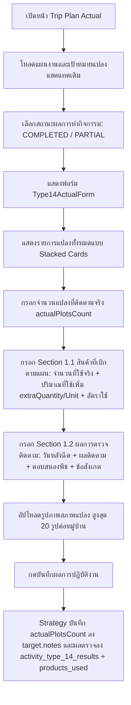
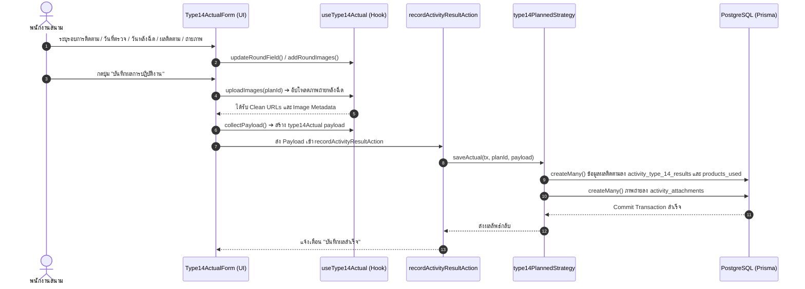

# Activity Type 14 — ติดตามแปลงแฮตแทค (README)

> **Feature Slice**: `modules/activity/features/type-14`  
> **Work Type Code**: `TYPE_14`  
> **Work Type Name**: ติดตามแปลงแฮตแทค (Hattack Follow-up)  
> **Parent Module**: `modules/activity`  
> **Database Authority**: `prisma/schema.prisma` (`ActivityPlanType14Target`, `ActivityPlanType14Product`, `ActivityResultType14`, `ActivityResultType14ProductUsed`, `ActivityAttachment`)  
> **Status**: Production Ready / Active Reference (v2.7.0 — Updated 2026-10-28 Streamlined Type 14 Unplanned Form: Removed New Plot & Product Withdrawal, Enforced Source Plan Prerequisite)

---

## 1. Overview

### 1.1 วัตถุประสงค์ของ Type 14
**Type 14 (ติดตามแปลงแฮตแทค - Hattack Follow-up)** มีวัตถุประสงค์เพื่อรองรับการตรวจติดตามและประเมินผลสัมฤทธิ์ของแปลงเกษตรกรที่ผ่านการฉีดพ่นสารเคมีแฮตแทค (จากกิจกรรม Type 13 หรือแปลงสาธิตที่เปิดไว้แล้ว):
1. ตรวจสอบประสิทธิภาพและประสิทธิผลในการกำจัดแมลง/หนอนศัตรูพืชหลังการฉีดพ่นแฮตแทค
2. บันทึกจำนวนแปลงที่ติดตามจริง (`actualPlotsCount`) สำหรับแต่ละแปลงที่ดึงมาจากแผนเดิม
3. บันทึกระยะเวลาหลังการฉีดพ่น (Days After Spray) และการตอบสนองของพืช (ไม่มีอาการแพ้/ใบเขียวเข้ม/พบอาการใบไหม้)
4. ประเมินผลการควบคุมการระบาด (ได้ผลดีมาก/ได้ผลตามเกณฑ์/ต้องฉีดพ่นซ้ำ/ไม่เห็นผล)
5. วางแผนเบิกสินค้าเพิ่มเติม กรณีแปลงเกิดการระบาดรอบใหม่หรือจำเป็นต้องฉีดพ่นซ้ำ (Retreatment)
6. ถ่ายภาพประเมินสภาพแปลงและยอดพืชหลังการฉีดพ่น (สูงสุด 20 ภาพต่อหมู่บ้าน) เพื่อเป็นหลักฐานเชิงประจักษ์

### 1.2 ขอบเขตของ Type 14
- **Plot Selection for Planned Form (การเลือกแปลงสำหรับแผนงาน):**
  - **โหมดแปลงเดิม (`EXISTING_PLOT`):** เลือกจาก **แผนงานฉีดแปลงแฮตแทคเดิม (Type 13 Activity Plans)** โดยตรง เมื่อเลือกแผนงานเดิมแล้ว ระบบจะดึงแปลงแฮตแทคทั้งหมดที่อยู่ในแผนงานนั้น (`ActivityPlanType13Target`) เข้ามาเป็นเป้าหมายติดตามผลแบบครบชุด พร้อมข้อมูล Dealer, เกษตรกรเจ้าของแปลง, ที่อยู่, และจำนวนแปลงตามแผน (`plannedPlotsCount`)
  - *(หมายเหตุ: ได้ปลดระวางตัวเลือก "ระบุแปลงใหม่" (`NEW_PLOT`) ออกจากหน้าฟอร์ม Planned แล้ว เพื่อให้แผนงานติดตามผลเชื่อมโยงกับแผนงานฉีดพ่น Type 13 เดิมเท่านั้น)*
- **Actual Outcome Recording (หน้าบันทึกผลตามแผน - ปรับให้ตรงตามมาตรฐาน Type 13 100%):**
  - แสดงรายการแปลงแบบ Stacked Cards เหมือน Type 13 โดยแต่ละแปลงจะแสดง Dealer, เจ้าของแปลง, หมู่บ้าน, จำนวนแปลงตามแผน
  - กรอก **จำนวนแปลงที่ติดตามจริง (แปลง) \*** (`actualPlotsCount`)
  - **Section 1.1 สินค้าที่เบิกตามแผน (Planned Demo Products):** แสดงรายการสินค้าตามแผนพร้อมให้กรอก `จำนวนที่ใช้จริง (ขวด) *`, `ปริมาณที่ใช้เพิ่ม (extraQuantity + extraUnit ซีซี/กรัม)` และ `อัตราการใช้ *`
  - **Section 1.2 ผลการตรวจติดตามแปลง:** ระบุระยะเวลาหลังฉีดพ่น (วัน), ผลการติดตามแปลง, การตอบสนองของพืช และบันทึกข้อสังเกตเพิ่มเติม/ปัญหาที่พบ
  - **Section 1.3 รูปหลังติดตามแปลง (ต่อหมู่บ้าน):** อัปโหลดภาพถ่ายสภาพแปลงหลังการติดตาม (สูงสุด 20 รูปต่อหมู่บ้าน) ผ่าน `ActivityPhotoUpload`
  - *(หมายเหตุ: ได้ปลดระวางแนวคิด "รอบการติดตามที่..." (Tracking rounds) ออกจากหน้าบันทึกผล เพื่อปรับให้เป็นการกรอกข้อมูลผลงานจริงรายแปลงตามมาตรฐานเดียวกับ Type 13 อย่างสมบูรณ์)*
- **สถาปัตยกรรมข้อมูล 100% Dedicated Relational Tables:**
  - เป้าหมายแปลงจัดเก็บใน `activity_type_14_targets` (`ActivityPlanType14Target`)
  - สินค้าเบิกพ่นซ้ำจัดเก็บใน `activity_type_14_products` (`ActivityPlanType14Product`)
  - ผลการติดตามจริงจัดเก็บใน `activity_type_14_results` (`ActivityResultType14`) และ `activity_type_14_products_used` (`ActivityResultType14ProductUsed`)
  - รูปภาพแนบจัดเก็บใน `ActivityAttachment` (หมวดหมู่ `PLOT` / `TRACKING_AFTER_SPRAY`)

### 1.3 รูปแบบการทำงานที่รองรับ
1. **Planned (ในแผนงาน):** วางแผนติดตามแปลงแฮตแทค (เลือกแปลงเดิมจากแผน Type 13) พร้อมขอเบิกสินค้าฉีดพ่นซ้ำล่วงหน้า
2. **Planned Actual (บันทึกผลงานตามแผน):** นำแผนติดตามเดิมมารายงานผลการลงพื้นที่จริงรายแปลง ระบุจำนวนแปลงที่ติดตามจริง, สินค้าที่ใช้จริงพร้อมปริมาณที่ใช้เพิ่ม, ผลการตรวจติดตามแปลง, และอัปโหลดภาพถ่าย
3. **Unplanned (กิจกรรมนอกแผน 2-in-1):** กรณีลงพื้นที่ติดตามแปลงกะทันหัน สามารถระบุข้อมูลแปลง พิกัด GPS ผลการตรวจติดตาม สินค้าที่ใช้ และถ่ายภาพจบในฟอร์มเดียว
4. **Detail View:** แสดงสรุปแปลงที่วางแผนติดตาม และแสดงผลการตรวจติดตามจริงรายแปลง พร้อม Section 1.1 สินค้าที่เบิกตามแผน และ Image Lightbox ขยายดูภาพถ่ายสภาพแปลง
5. **Approval View:** แสดงการ์ดสรุปแปลงแฮตแทคและรายการขอเบิกสินค้าเพื่อให้ผู้จัดการสายงานพิจารณาอนุมัติ

---

## 2. Business Flows

### 2.1 Planned (สร้างและแก้ไขแผนงาน)
```mermaid
graph TD
    A[ผู้ใช้สร้างแผนงานใหม่] --> B[กรอกข้อมูลทั่วไป วันที่ และพื้นที่หลัก]
    B --> C[เลือกประเภทงาน Type 14 ติดตามแปลงแฮตแทค]
    C --> D[แสดงฟอร์ม Type14PlannedForm]
    D --> E{เลือกโหมดการกำหนดแปลง}
    E -->|EXISTING_PLOT| F[เลือกแผนงานฉีดแปลงแฮตแทค Type 13 เดิม -> โหลดแปลงทั้งหมดในแผนอัตโนมัติ]
    E -->|NEW_PLOT| G[กรอกชื่อแปลง เลือกร้านค้า Dealer ระบุเจ้าของแปลง และที่อยู่]
    F --> H{ต้องการเบิกสินค้าพ่นซ้ำหรือไม่?}
    G --> H
    H -->|เบิกสินค้า| I[เปิดสวิตช์เบิกสินค้า และเลือกสินค้า+จำนวน]
    H -->|ไม่เบิกสินค้า| J[ข้ามส่วนเบิกสินค้า]
    I --> K[กดบันทึกร่าง DRAFT หรือ ส่งขออนุมัติ]
    J --> K
    K --> L[Strategy บันทึกเป้าหมายลง activity_type_14_targets (type13TargetId)]
    L --> M[บันทึกสินค้าลง activity_type_14_products]
```

### 2.2 Planned Actual (บันทึกผลการปฏิบัติงานตามแผน)


### 2.3 Unplanned (กิจกรรมนอกแผน 2-in-1 Plan + Actual)
- ผู้ใช้งานเข้าหน้า `/activity-plans/unplanned/new` และเลือกประเภทงาน **ติดตามแปลงแฮตแทค (Type 14)**
- ฟอร์ม `Type14UnplannedForm` รวมการทำงานแบบ 2-in-1 เรียบง่ายและตรงจุด (Streamlined Follow-up):
  1. **เป้าหมายแปลง (Target Setup):** เชื่อมโยงกับแผนงานฉีดแปลงแฮตแทค Type 13 เดิมที่อนุมัติแล้วผ่าน `getHattackFollowUpPlansAction` (ปลดระวางตัวเลือก "ระบุแปลงใหม่โดยตรง" และการเบิกสินค้าพ่นซ้ำออก เพื่อความกระชับในการทำงาน)
  2. **ผลการปฏิบัติงานจริง (Actual Outcome - Stacked Plot Cards):** แสดงขึ้นมาหลังจากเลือกแผนงาน Type 13 เดิมแล้ว โดยดึงแปลงทั้งหมดมาแสดงผล ระบุจำนวนแปลงที่ติดตามจริง (`actualPlotsCount`), สินค้าสาธิตที่ใช้จริง (`actualQuantity`, `extraQuantity`, `extraUnit`, `actualRate`), ข้อมูลการตรวจติดตาม (`actualVisitDate`, `daysAfterSpray`, `trackingResult`, `productResponse`, `additionalNotes`, สลับสถานะปิดแปลง `plotStatus` พร้อม `closureNotes`), และอัปโหลดภาพถ่ายสภาพแปลง (สูงสุด 20 รูปต่อหมู่บ้าน) ผ่าน `ActivityPhotoUpload`
- เมื่อกดบันทึก ระบบจะสร้าง `ActivityPlan` พร้อมบันทึก `ActivityPlanType14Target`, `ActivityResultType14`, `ActivityResultType14ProductUsed`, `ActivityAttachment` (ผูก `type14ResultId`), อัปเดตสถานะแปลงต้นทาง Type 13 และสร้าง Header `ActivityResult` ใน Transaction เดียวกันผ่าน `type14UnplannedStrategy.savePlan()`
- เมื่อเปิดเข้ามาแก้ไข (Edit Hydration): ฟังก์ชัน `hydrateType14UnplannedData` จะกู้คืนข้อมูลกลับมาแสดงครบทุกช่องในฟอร์มโดยไม่มีข้อมูลสูญหาย

### 2.4 Detail and Approval (ดูรายละเอียดและพิจารณาอนุมัติ)
- **Detail View:** เรนเดอร์ `<Type14PlanCard />` สำหรับสรุปข้อมูลแปลงตามแผน และเรนเดอร์ `<Type14DetailView />` แสดงรอบการตรวจติดตามย้อนหลัง (Timeline Cards), ผลการตอบสนองของพืช, สินค้าที่ใช้ซ้ำ และรูปภาพแปลงพร้อม Image Lightbox
- **Approval View:** เรนเดอร์ `<Type14ApprovalCard />` แสดงโหมดการติดตาม (แปลงเดิม/แปลงใหม่), ร้านค้า Dealer, และรายการขอเบิกสินค้า เพื่อให้ผู้มีอำนาจตรวจสอบก่อนอนุมัติ

---

## 3. Architecture

### 3.1 Folder Structure (24-Artifact Standard)
```text
modules/activity/features/type-14/
├── index.ts                              # Unified Public API Contract (Client-Safe Barrel Export)
├── README.md                             # เอกสารคู่มือทางเทคนิคฉบับสมบูรณ์ (ไฟล์นี้)
│
├── planned/                              # Sub-slice: กิจกรรมในแผนงานและบันทึกผลตามแผน
│   ├── application/                      # Business Logic, Validation, Mappers
│   │   ├── actual-mapper.ts              # แปลงผลการตรวจติดตามจริง parseType14ActualResult
│   │   ├── actual-validation.ts          # ตรวจสอบผลการติดตาม validateType14Actual & Zod schemas
│   │   ├── planned-mapper.ts             # extractType14PlanTargets, hydrateType14PlannedData
│   │   └── planned-validation.ts         # validateType14FormValues & Zod schemas
│   ├── components/                       # UI Components ประจำ Type 14 ในแผน
│   │   ├── type14-planned-form.tsx       # ฟอร์มเลือกแปลงเดิม/สร้างแปลงใหม่ + เบิกสินค้า
│   │   ├── type14-actual-form.tsx        # ฟอร์มบันทึกรอบติดตาม วันหลังฉีด ผลติดตาม และรูปภาพ
│   │   ├── type14-plan-card.tsx          # การ์ดสรุปแปลงติดตามตามแผนงาน
│   │   ├── type14-detail-view.tsx        # หน้ารายละเอียด Timeline รอบติดตามและ Lightbox
│   │   └── type14-approval-card.tsx      # การ์ดสรุปสำหรับหน้าพิจารณาอนุมัติ
│   ├── hooks/                            # Custom State Hooks
│   │   ├── use-type14-planned-form.ts    # จัดการ State ฟอร์มแผนงาน Type 14
│   │   └── use-type14-actual.ts          # จัดการ State รอบการติดตามและอัปโหลดรูปภาพ
│   ├── infrastructure/                   # Database Strategies & Repositories
│   │   ├── type14.repository.ts          # Data Access Layer (ActivityPlanType14, DemoPlot, Visits)
│   │   └── type14-planned.strategy.ts    # WorkTypeStrategy สำหรับ Type 14 ในแผนงาน (Server only)
│   └── types/                            # Type Definitions ในแผน
│       ├── planned.types.ts              # Type14PlanInput, Type14PlanFormProps, Validation Params
│       └── actual.types.ts               # Type14ActualProps, Type14DetailData, Detail Props
│
├── unplanned/                            # Sub-slice: กิจกรรมนอกแผน (2-in-1)
│   ├── application/                      # Logic และ Mappers กิจกรรมนอกแผน
│   │   ├── unplanned-mapper.ts           # hydrateType14UnplannedData, mapType14UnplannedToPayload
│   │   └── unplanned-validation.ts       # validateType14UnplannedItem
│   ├── components/                       # UI Components กิจกรรมนอกแผน
│   │   └── type14-unplanned-form.tsx     # ฟอร์ม 2-in-1 (ข้อมูลแปลง + ผลการติดตาม + รูปภาพ + GPS)
│   ├── hooks/                            # Custom State Hooks
│   │   └── use-type14-unplanned-form.ts  # จัดการ State รายการนอกแผน
│   ├── infrastructure/                   # Database Strategies นอกแผน
│   │   └── type14-unplanned.strategy.ts  # WorkTypeStrategy สำหรับกิจกรรมนอกแผน (Server only)
│   └── types/                            # Type Definitions นอกแผน
│       └── unplanned.types.ts            # Type14UnplannedItem, Type14UnplannedFormProps
│
└── shared/                               # ชิ้นส่วนที่ใช้ร่วมกันภายใน Feature Type 14
    ├── constants.ts                      # WORK_TYPE_CODE, TRACKING_RESULT_OPTIONS, FORMULA_OPTIONS
    ├── types.ts                          # Type14PlotItem, Type14SprayRoundState, Type14ImageFile
    └── notes.ts                          # formatType14PlannedNotes, formatType14ActualSummary
```

### 3.2 Type 14 vs Shared Activity
| ความรับผิดชอบ | จัดการที่ Type 14 Feature (`features/type-14`) | จัดการที่ Activity ส่วนกลาง (`ui/`, `views/`) |
| :--- | :--- | :--- |
| **ข้อมูลทั่วไป** | - | ชื่องาน, วันที่เริ่ม-สิ้นสุด, วัตถุประสงค์หลัก |
| **พื้นที่ & ทีมงาน** | จังหวัด อำเภอ ตำบล หมู่บ้าน และพิกัดแปลงแฮตแทค | จังหวัดหลักของทริป, พนักงานร่วมเดินทาง |
| **งบประมาณ** | รายการสินค้าที่ขอเบิกเพื่อฉีดพ่นซ้ำในแปลงติดตาม | งบเบิกสินค้าสาธิตส่วนกลาง, ค่าเดินทาง |
| **ข้อมูลแปลงสาธิต** | แปลงเดิมจากแผน Type 13 หรือแปลงใหม่, ข้อมูลพืช และ Dealer | - |
| **ผลการตรวจติดตาม** | รอบการติดตาม, วันหลังฉีดพ่น, ผลการติดตาม, สภาพพืช, ยาที่ใช้ซ้ำ, ภาพถ่ายแปลง 20 ภาพ/หมู่บ้าน | ผลสรุปภาพรวมแผน (สำเร็จ/เลื่อน/ยกเลิก) |
| **Database Persistence** | ตาราง `activity_type_14_targets`, `activity_type_14_products`, `activity_type_14_results`, `activity_type_14_products_used` | ตารางหลัก `ActivityPlan`, `ActivityPlanApprovalLog`, `ActivityAttachment` |

### 3.3 Dependency and Import Map
- **ทิศทางการเรียกใช้ (Allowed):**
  - `views/` ➔ เรียกใช้ ➔ `features/type-14` (ผ่าน `index.ts` เท่านั้น)
  - `features/type-14` ➔ เรียกใช้ ➔ `@/modules/activity/ui` (`ActivityInput`, `ActivityAddressSelect`, `ActivityCustomerSelect`, `ActivityProductSelect`, `ActivityPhotoUpload`, `ActivityGpsPicker`)
  - `features/type-14` ➔ เรียกใช้ ➔ `@/modules/activity/types/strategy.interface`
  - `features/type-14` ➔ เรียกใช้ ➔ `@/modules/activity/application/media/image-uploader`
- **Server Actions & Database Flow:**
  - `views/` ➔ ส่งข้อมูลไปยัง ➔ Server Actions ใน `@/modules/activity/server/`:
    - `planned.actions.ts` (`createActivityPlanAction`, `updateActivityPlanAction`, `getActivityPlanAction`)
    - `unplanned.actions.ts` (`createUnplannedActivityAction`, `updateUnplannedActivityAction`, `getUnplannedActivityAction`)
    - `actual.actions.ts` (`recordActivityResultAction`)
  - Server Actions ➔ ทำงานร่วมกับ ➔ `@/modules/activity/infrastructure/strategy.registry` ➔ เรียกใช้ `type14PlannedStrategy` / `type14UnplannedStrategy`
- **สิ่งต้องห้าม (Strictly Forbidden):**
  - ❌ ภายนอก Import เจาะลึกเข้าไปในโฟลเดอร์ย่อย เช่น `features/type-14/planned/components/...`
  - ❌ `features/type-14` เรียกใช้ข้ามไปยัง `features/type-1` ถึง `type-13`
  - ❌ Import ย้อนกลับไปยังโมดูลเก่า `@/modules/activity-plans/...` โดยเด็ดขาด

### 3.4 Entry Points and Public Exports
ไฟล์ [modules/activity/features/type-14/index.ts](file:///d:/code/crm-bank/modules/activity/features/type-14/index.ts) ทำหน้าที่เป็น **Single Public API Contract** สำหรับฝั่ง UI / Application โดยส่งออกเฉพาะ:
- **Components:** `Type14PlannedForm`, `Type14PlanCard`, `Type14ActualForm`, `Type14DetailView`, `Type14ApprovalCard`, `Type14UnplannedForm`
- **Hooks:** `useType14PlannedForm`, `useType14Actual` (`useType14ActualState`), `useType14UnplannedForm`
- **Mappers & Hydrators:** `extractType14PlanTargets`, `hydrateType14PlannedData`, `parseType14ActualResult`, `hydrateType14UnplannedData`, `mapType14UnplannedToPayload`
- **Validators & Schemas:** `validateType14FormValues`, `type14PlanInputSchema`, `validateType14Actual`, `type14TrackingRoundSchema`, `validateType14UnplannedItem`
- **Constants & Types:** `WORK_TYPE_CODE`, `WORK_TYPE_NAME`, `TRACKING_RESULT_OPTIONS`, `PRODUCT_RESPONSE_OPTIONS`, `FORMULA_OPTIONS`, `TYPE14_MAX_IMAGES_PER_VILLAGE`, `Type14PlanInput`, `Type14PlotItem`, `Type14SprayRoundState`, `Type14UnplannedItem`
- *(หมายเหตุ: `type14PlannedStrategy` และ `type14UnplannedStrategy` ถูกนำเข้าโดยตรงที่ `modules/activity/infrastructure/strategy.registry.ts` เพื่อแยกโค้ดฝั่ง Server/Database ออกจาก Client Bundle)*

---

## 4. File Responsibilities

### 4.1 Planned & Actual
- **`use-type14-planned-form.ts`:** จัดการ State ฟอร์มแผนงาน Type 14 สลับโหมดแปลงเดิม/แปลงใหม่ (`mode: "EXISTING_PLOT" | "NEW_PLOT"`), จัดการรายการสินค้าที่ขอเบิก (`withdrawnProducts`), และแปลง Payload ผ่าน `mapType14Payload()`
- **`type14-planned-form.tsx`:** UI ฟอร์มแผนงาน มีปุ่มสลับแท็บโหมดเลือกแปลงเดิม (ดึงจากแผน Type 13 ที่อนุมัติแล้วผ่าน `hattackFollowUpPlans`) หรือแท็บสร้างแปลงใหม่ เลือกร้านค้า Dealer และสวิตช์เปิดปิดเบิกสินค้า
- **`type14-actual-form.tsx`:** ฟอร์มบันทึกผลการตรวจติดตามจริง เพิ่มรอบการติดตามผล (`rounds`), ระบุวันที่ตรวจจริง, วันหลังฉีดพ่น, ผลการติดตาม (`trackingResult`), การตอบสนองของพืช, รายการยาที่ใช้พ่นซ้ำ, และกล่องอัปโหลดภาพถ่ายสภาพแปลง
- **`use-type14-actual.ts`:** Custom Hook จัดการ State รอบการตรวจติดตามหลายรอบ เพิ่ม/ลบรอบการติดตาม, จัดการสินค้าพ่นซ้ำ, และฟังก์ชัน `uploadImages()` แยกหมวดหมู่ `type14/after_spray`
- **`type14-detail-view.tsx`:** คอมโพเนนต์แสดงผลในหน้ารายละเอียด แสดงการ์ดรอบการตรวจติดตามเรียงตามลำดับเวลา (Timeline Cards), ผลการตอบสนองของพืช, สินค้าที่ใช้ซ้ำ และระบบ Image Lightbox สำหรับดูรูปขยายเต็มจอ
- **`type14-plan-card.tsx` & `type14-approval-card.tsx`:** การ์ดสรุปข้อมูลแปลงติดตามตามแผนงาน ข้อมูลร้านค้า Dealer และสรุปรายการขอเบิกสินค้าสำหรับหน้ารายละเอียดและหน้าพิจารณาอนุมัติ
- **`planned-mapper.ts` & `actual-mapper.ts`:** ทำหน้าที่ดึงข้อมูลแปลงเดิม (`extractType14PlanTargets`), Hydrate ข้อมูลเดิมเมื่อเปิดหน้าแก้ไข, และสกัดข้อมูลรอบการตรวจติดตามจริงจาก `payloadToHydrate`
- **`planned-validation.ts` & `actual-validation.ts`:** ตรวจสอบความถูกต้องของแผนงาน (ตรวจการเลือกแปลงเดิมหรือกรอกแปลงใหม่ครบถ้วน) และตรวจสอบผลจริง (ต้องระบุวันที่ตรวจและผลการติดตามทุกรอบ)
- **`type14.repository.ts` & `type14-planned.strategy.ts`:** Data Access Layer จัดการค้นหาแผน Type 13 ที่พร้อมติดตามผล (`findHattackFollowUpActivityPlans` คืนค่าเป็น `FollowUpPlanOption[]`), ค้นหาเป้าหมายแปลง Type 13 (`findHattackFollowUpDemoPlots`), บันทึกตาราง `ActivityPlanType14Target`, `ActivityPlanType14Product`, `ActivityResultType14`, `ActivityResultType14ProductUsed` และบันทึกรูปภาพลง `ActivityAttachment` โดยทำงานร่วมกับ Server Action `getHattackFollowUpPlansAction`

### 4.2 Unplanned
- **`use-type14-unplanned-form.ts`:** จัดการ State สำหรับฟอร์มกิจกรรมนอกแผน 2-in-1
- **`type14-unplanned-form.tsx`:** ฟอร์ม 2-in-1 แสดงส่วนเลือกร้านค้า Dealer, ข้อมูลแปลง, พิกัด GPS, วันที่ตรวจจริง, วันหลังฉีดพ่น, ผลการติดตาม, สินค้าที่ใช้ซ้ำ และกล้องถ่ายรูป/อัปโหลดภาพ
- **`unplanned-mapper.ts`:** จัดการแปลงข้อมูล Form Item เป็น Payload ทั้งในส่วน Plan และ Actual พร้อมกัน (`mapType14UnplannedToPayload`) และกู้คืนข้อมูลเดิม (`hydrateType14UnplannedData`)
- **`type14-unplanned.strategy.ts`:** บันทึกข้อมูลกิจกรรมนอกแผนลงฐานข้อมูลผ่าน `syncType14Data` และอัปเดต `DemoPlotVisit`

### 4.3 Shared Types and Constants
- **`shared/constants.ts`:** กำหนดรหัสประเภทงาน `WORK_TYPE_CODE = "TYPE_14"`, ตัวเลือกผลการติดตาม `TRACKING_RESULT_OPTIONS` (ได้ผลดีมาก, ได้ผลตามเกณฑ์, ต้องฉีดพ่นซ้ำ, ไม่เห็นผล), ตัวเลือกการตอบสนองของพืช `PRODUCT_RESPONSE_OPTIONS`, และสูตรสารเคมี `FORMULA_OPTIONS`
- **`shared/types.ts`:** Type Definitions กลาง เช่น `Type14PlotItem`, `Type14SprayRoundState`, `Type14ActualProductState`, `FollowUpPlanOption`, `Type14ImageFile`
- **`shared/notes.ts`:** ฟังก์ชันจัดรูปแบบข้อความสรุป `formatType14PlannedNotes` และ `formatType14ActualSummary`

### 4.4 Shared UI and Views
- `ActualWorkTypeList`, `DetailWorkTypeList`, และ `ApprovalWorkTypeList` ใน `views/` ทำหน้าที่เป็น Orchestrator ตรวจจับรหัสประเภทงาน `TYPE_14` หรือการมีอยู่ของ `type14Plots` เพื่อเรนเดอร์คอมโพเนนต์ของ Type 14 ให้ถูกต้อง

---

## 5. Data Flow



### 5.1 Create Planned (สร้างแผนใหม่)
1. `create-view.tsx` เรียกใช้ `useType14PlannedForm()` และดึงแผนติดตามผ่าน `getHattackFollowUpPlansAction()`
2. ผู้ใช้เลือกโหมด:
   - กรณีเลือก **"แปลงเดิม" (`EXISTING_PLOT`)**: เลือกแผน Type 13 เดิมที่เคยฉีดพ่นแล้ว หรือเลือกแปลงแฮตแทคจาก `ActivityPlanType13Target`
   - กรณีเลือก **"สร้างแปลงใหม่" (`NEW_PLOT`)**: ระบุชื่อแปลง เลือกร้านค้า Dealer และที่อยู่แปลง
3. หากต้องการเบิกสินค้าพ่นซ้ำ ผู้ใช้เปิดสวิตช์และเลือกสินค้าพร้อมจำนวน
4. เมื่อกดส่งข้อมูล ระบบจะรัน `validateType14()`
5. Form Orchestrator เรียก `mapType14Payload()` เพื่อจัดโครงสร้าง `type14Data`, `type14Plots`, `planStores`, และ `planProducts`
6. ส่ง Payload ไปยัง `createActivityPlanAction` ➔ เรียกใช้ `type14PlannedStrategy.savePlan()`
7. `createType14Data` บันทึกลง `ActivityPlanType14Target` (เชื่อมโยง `type13TargetId` และ `sourceActivityPlanId`) และ `ActivityPlanType14Product`

### 5.2 Edit Planned (แก้ไขแผนงานเดิม)
1. `edit-view.tsx` ดึงข้อมูลแผนงาน (`plan`) ผ่าน `getActivityPlanAction` และดึงแปลงติดตามผ่าน `getHattackFollowUpPlansAction()`
2. เรียก `hydrateType14PlannedData(plan)` หรือดึงจาก `plan.type14`
3. ข้อมูลถูกเซ็ตลงใน `useType14PlannedForm({ initial })`
4. ฟอร์มแสดงผลแปลงที่เลือกและรายการเบิกสินค้าเดิม พร้อมให้ปรับปรุงและบันทึกซ้ำผ่าน `updateActivityPlanAction`

### 5.3 Save Actual (บันทึกผลการปฏิบัติงานจริง)
1. `activity-plan-actual-view.tsx` รันการตรวจสอบความถูกต้องผ่าน `validateType14Actual()`
2. เรียก `type14Actual.uploadImages(planId)` เพื่ออัปโหลดภาพถ่ายไปยัง Storage ได้ URLs กลับมา
3. ดึง Payload ผ่าน `type14Actual.collectPayload()` ได้โครงสร้าง `type14Actual` ที่มีรอบการติดตาม สภาพพืช และสินค้าที่ใช้พ่นซ้ำ
4. ส่ง Payload เข้า `recordActivityResultAction(planId, payload)`
5. `type14PlannedStrategy.saveActual()` บันทึกผลการตรวจติดตามลงตาราง `activity_type_14_results`, บันทึกรายการยาพ่นซ้ำลง `activity_type_14_products_used` และบันทึกภาพถ่ายลง `activity_attachments`

### 5.4 Load Actual (โหลดผลงานเดิมมาแสดงในหน้าบันทึกผล)
1. โหลดข้อมูลแผนงานและผลงานเดิมจากฐานข้อมูล
2. เรียก `type14Actual.hydrate(plan, parsedResult)`
3. Custom Hook ทำการกู้คืนรอบการตรวจติดตาม วันหลังฉีดพ่น ผลการติดตาม และรูปภาพเดิม
4. ฟอร์มแสดงผลรอบการติดตามเดิมให้ผู้ใช้แก้ไขหรือกดเพิ่มรอบติดตามใหม่ได้ทันที

### 5.5 Create/Edit Unplanned (กิจกรรมนอกแผน 2-in-1)
1. ผู้ใช้กรอกฟอร์ม `Type14UnplannedForm` เลือกระหว่างโหมดแปลงเดิม (`EXISTING_PLOT` ดึงแปลงทั้งหมดจากแผนงาน Type 13) หรือโหมดระบุแปลงใหม่ (`NEW_PLOT`) พร้อมสวิตช์ขอเบิกสินค้าพ่นซ้ำ
2. ส่วนบันทึกผลจริงรายแปลง (Stacked Plot Cards) รองรับการกรอกจำนวนแปลงที่ติดตามจริง (`actualPlotsCount`), สินค้าสาธิตที่ใช้จริง (`actualQuantity`, `extraQuantity`, `extraUnit`, `actualRate`), ข้อมูลการตรวจติดตาม (`actualVisitDate`, `daysAfterSpray`, `trackingResult`, `productResponse`, `additionalNotes`, และสลับสถานะปิดแปลง `plotStatus` พร้อม `closureNotes`), และอัปโหลดภาพถ่ายหลังติดตาม (สูงสุด 20 รูปต่อหมู่บ้าน) ผ่าน `ActivityPhotoUpload`
3. ตรวจสอบความถูกต้องด้วย `validateType14UnplannedItem` ทั้งในส่วนเงื่อนไขโหมดแปลง, สินค้าที่เบิก, จำนวนแปลงจริง, วันที่ตรวจ, ผลตรวจ และรูปภาพ
4. อัปโหลดรูปภาพผ่าน `uploadActivityPlanImageGroup` และแปลงข้อมูลด้วย `mapType14UnplannedToPayload`
5. บันทึกผ่าน `createUnplannedActivityAction` หรือ `updateUnplannedActivityAction` ➔ เรียก `type14UnplannedStrategy.savePlan()` ซึ่งบันทึกทั้งเป้าหมาย (`ActivityPlanType14Target`), สินค้า (`ActivityPlanType14Product`), ผลงานจริง (`ActivityResultType14`), สินค้าที่ใช้จริง (`ActivityResultType14ProductUsed`), รูปภาพแนบ (`ActivityAttachment` พร้อม `type14ResultId`), อัปเดตสถานะแปลงต้นทาง Type 13 (`ActivityPlanType13Target`), และสร้าง Header `ActivityResult`
6. ตอนแก้ไข (Edit Hydration): `edit-view.tsx` ส่งข้อมูล `type14Targets`, `type14Plots`, `type14Products`, `type14Results`, `type14Actual` และ `type14UnplannedItem` ไปยัง `unplanned-activity-form.tsx` ➔ ฟังก์ชัน `hydrateType14UnplannedData` จะดึงข้อมูลกลับมาใส่ครบถ้วนทั้งเป้าหมาย สินค้า ผลการติดตาม และรูปภาพในทุกแปลง

### 5.6 Detail and Approval (การแสดงผลหน้ารายละเอียดและพิจารณาอนุมัติ)
1. หน้ารายละเอียดเรนเดอร์ `<Type14PlanCard />` สำหรับสรุปแปลงตามแผน
2. หากมีผลการปฏิบัติงานจริง เรนเดอร์ `<Type14DetailView />` แสดง Timeline Cards ของแต่ละรอบการติดตาม และ Image Lightbox
3. หน้าอนุมัติเรนเดอร์ `<Type14ApprovalCard />` แสดงสรุปแปลงและรายการขอเบิกสินค้า

---

## 6. Data Models and Mapping

### 6.1 Database CRUD Matrix (100% Dedicated Relational Tables)
| ตารางในฐานข้อมูล (`Prisma Model`) | Create (สร้าง) | Read (อ่าน/แสดงผล) | Update (แก้ไข) | Delete (ลบ) | หน้าที่รับผิดชอบ |
| :--- | :--- | :--- | :--- | :--- | :--- |
| **`activity_type_14_targets`**<br>(`ActivityPlanType14Target`) | `createType14Data()` ใน `savePlan()` | โหลดรายละเอียดแผน Type 14 | ลบและสร้างใหม่ใน `syncType14Data()` | Cascade เมื่อลบ `ActivityPlan` | เป้าหมายแปลงแฮตแทคที่เลือกติดตาม เชื่อมโยง `type13TargetId` สู่แปลงฉีด 13 |
| **`activity_type_14_products`**<br>(`ActivityPlanType14Product`) | `createType14Data()` | รายการสินค้าที่ขอเบิกพ่นซ้ำ | ลบและสร้างใหม่ตามแผน | Cascade เมื่อลบ `ActivityPlan` | เก็บสินค้าตัวอย่างที่ขอเบิกพ่นซ้ำตามแผน |
| **`activity_type_14_results`**<br>(`ActivityResultType14`) | `saveActual()` ใน Actual | โหลดผลการติดตามจริงใน Detail / Actual View | ลบและสร้างใหม่ใน `saveActual()` | Cascade เมื่อลบ `ActivityPlan` | เก็บผลการติดตามแปลง วันตรวจจริง วันหลังฉีดพ่น ผลการควบคุม และการตอบสนอง |
| **`activity_type_14_products_used`**<br>(`ActivityResultType14ProductUsed`) | `saveActual()` ใน Actual | โหลดรายการสินค้าที่ใช้พ่นซ้ำจริง | ลบและสร้างใหม่ใน `saveActual()` | Cascade เมื่อลบ `ActivityResultType14` | เก็บรายการยาที่ใช้ฉีดพ่นซ้ำจริงหน้างาน |
| **`activity_attachments`**<br>(`ActivityAttachment`) | Storage Upload + `saveActual()` | `plan.attachments` (หมวดหมู่ AFTER_SPRAY) | ลบรายการเก่าและสร้างใหม่ | Cascade เมื่อลบ `ActivityPlan` | เก็บล็อก URL ภาพถ่ายสภาพแปลงหลังการฉีดพ่น |

### 6.2 Complete Field-to-Database Mapping
| Form Field (UI) | TypeScript Type Field | Mapper Function (Write/Read) | Prisma Model | DB Column Name | Data Type | Nullable? | Default |
| :--- | :--- | :--- | :--- | :--- | :--- | :---: | :--- |
| **แปลงแฮตแทคที่เลือก** | `selectedPlotIds` / `type13TargetId` | `mapType14Payload` | `ActivityPlanType14Target` | `type13_target_id` | `VARCHAR (FK)` | Yes | `null` |
| **โหมดการเลือกแปลง** | `mode` / `plotSelectionMode` | `mapType14Payload` | `ActivityPlanType14Target` | `plot_selection_mode` | `VARCHAR` | No | `"EXISTING_PLOT"` |
| **ชื่อแปลง** | `name` / `plotName` | `mapType14Payload` | `ActivityPlanType14Target` | `plot_name` | `VARCHAR` | Yes | `null` |
| **ร้านค้า Dealer** | `storeId`, `dealerName` | `mapType14Payload` | `ActivityPlanType14Target` | `store_id`, `dealer_name` | `VARCHAR` | Yes | `null` |
| **เจ้าของแปลง** | `farmerName` / `ownerName` | `mapType14Payload` | `ActivityPlanType14Target` | `owner_name` | `VARCHAR` | Yes | `null` |
| **ที่อยู่แปลง** | `province`, `district`, `subdistrict` | `mapType14Payload` | `ActivityPlanType14Target` | `province`, etc. | `VARCHAR` | Yes | `null` |
| **สินค้าขอเบิกพ่นซ้ำ** | `products` | `mapType14Payload` | `ActivityPlanType14Product`| `product_id`, `quantity` | `VARCHAR`, `DECIMAL` | No | - |
| **วันที่ตรวจติดตามจริง** | `actualVisitDate` | `saveActual` | `ActivityResultType14` | `actual_visit_date` | `TIMESTAMP` | Yes | `now()` |
| **ระยะเวลาหลังฉีดพ่น** | `daysAfterSpray` | `saveActual` | `ActivityResultType14` | `days_after_spray` | `INTEGER` | Yes | `0` |
| **ผลการติดตาม** | `trackingResult` | `saveActual` | `ActivityResultType14` | `tracking_result` | `VARCHAR` | Yes | `null` |
| **การตอบสนองของพืช** | `productResponse` | `saveActual` | `ActivityResultType14` | `product_response` | `VARCHAR` | Yes | `"ปกติ"` |
| **บันทึกเพิ่มเติมรอบติดตาม**| `additionalNotes` | `saveActual` | `ActivityResultType14` | `notes` | `TEXT` | Yes | `null` |
| **สินค้าที่ใช้พ่นซ้ำจริง** | `productUsed` | `saveActual` | `ActivityResultType14ProductUsed` | `product_id`, `quantity` | `VARCHAR`, `DECIMAL` | No | - |
| **ภาพถ่ายสภาพแปลง** | `afterSprayImages` | `uploadImages()` ➔ URLs | `ActivityAttachment` | `file_url`, `work_type_code = 'TYPE_14'` | `TEXT` | No | - |

### 6.3 รายละเอียด Schema ตารางเฉพาะ (Prisma Definitions)

```prisma
// 1. ตารางเป้าหมายการติดตามแปลงแฮตแทค (activity_type_14_targets)
model ActivityPlanType14Target {
  id                   String                    @id @default(cuid())
  activityPlanId       String                    @map("activity_plan_id")
  type13TargetId       String?                   @map("type13_target_id") // เชื่อมโยงตรงสู่แปลงฉีดแฮตแทค 13
  sourceActivityPlanId String?                   @map("source_activity_plan_id")
  plotSelectionMode    String                    @default("EXISTING_PLOT") @map("plot_selection_mode")
  plotName             String?                   @map("plot_name")
  storeId              String?                   @map("store_id")
  dealerName           String?                   @map("dealer_name")
  ownerName            String?                   @map("owner_name")
  cropCategory         String?                   @map("crop_category")
  cropName             String?                   @map("crop_name")
  province             String?                   @map("province")
  district             String?                   @map("district")
  subdistrict          String?                   @map("subdistrict")
  villageName          String?                   @map("village_name")
  plotCount            Int?                      @default(1) @map("plot_count")
  objective            String?                   @map("objective") @db.Text
  notes                String?                   @map("notes") @db.Text
  createdAt            DateTime                  @default(now()) @map("created_at")
  updatedAt            DateTime                  @updatedAt @map("updated_at")

  activityPlan         ActivityPlan              @relation(fields: [activityPlanId], references: [id], onDelete: Cascade)
  type13Target         ActivityPlanType13Target? @relation(fields: [type13TargetId], references: [id], onDelete: SetNull)
  sourceActivityPlan   ActivityPlan?             @relation("Type14SourcePlan", fields: [sourceActivityPlanId], references: [id], onDelete: SetNull)
  products             ActivityPlanType14Product[]
  results              ActivityResultType14[]

  @@index([activityPlanId])
  @@index([type13TargetId])
  @@index([sourceActivityPlanId])
  @@map("activity_type_14_targets")
}

// 2. ตารางเบิกสินค้าพ่นซ้ำ Type 14 (activity_type_14_products)
model ActivityPlanType14Product {
  id             String                    @id @default(cuid())
  activityPlanId String                    @map("activity_plan_id")
  targetId       String?                   @map("target_id")
  productId      String                    @map("product_id")
  productName    String?                   @map("product_name")
  quantity       Decimal                   @default(1) @map("quantity") @db.Decimal(10, 2)
  unit           String?                   @map("unit")
  sortOrder      Int                       @default(0) @map("sort_order")
  createdAt      DateTime                  @default(now()) @map("created_at")

  activityPlan   ActivityPlan              @relation(fields: [activityPlanId], references: [id], onDelete: Cascade)
  target         ActivityPlanType14Target? @relation(fields: [targetId], references: [id], onDelete: Cascade)
  product        Product                   @relation(fields: [productId], references: [id], onDelete: Restrict)

  @@index([activityPlanId])
  @@index([targetId])
  @@index([productId])
  @@map("activity_type_14_products")
}

// 3. ตารางบันทึกผลการตรวจติดตามแปลงจริง (activity_type_14_results)
model ActivityResultType14 {
  id               String                            @id @default(cuid())
  activityPlanId   String                            @map("activity_plan_id")
  targetId         String?                           @map("target_id")
  type13TargetId   String?                           @map("type_13_target_id")
  roundNumber      Int                               @default(1) @map("round_number")
  actualVisitDate  DateTime                          @map("actual_visit_date")
  actualPlotsCount Int?                              @map("actual_plots_count") // จำนวนแปลงที่ติดตามจริง
  daysAfterSpray   Int?                              @map("days_after_spray")
  trackingResult   String                            @default("ปกติ") @map("tracking_result")
  productResponse  String                            @default("ปกติ") @map("product_response")
  actualLatitude   Decimal?                          @map("actual_latitude") @db.Decimal(10, 7)
  actualLongitude  Decimal?                          @map("actual_longitude") @db.Decimal(10, 7)
  additionalNotes  String?                           @map("additional_notes") @db.Text
  createdAt        DateTime                          @default(now()) @map("created_at")
  updatedAt        DateTime                          @updatedAt @map("updated_at")

  activityPlan     ActivityPlan                      @relation(fields: [activityPlanId], references: [id], onDelete: Cascade)
  target           ActivityPlanType14Target?         @relation(fields: [targetId], references: [id], onDelete: Cascade)
  type13Target     ActivityPlanType13Target?         @relation("Type13TargetFollowUpResults", fields: [type13TargetId], references: [id], onDelete: SetNull)
  productsUsed     ActivityResultType14ProductUsed[]
  attachments      ActivityAttachment[]

  @@index([activityPlanId])
  @@index([targetId])
  @@index([type13TargetId])
  @@map("activity_type_14_results")
}

// 4. ตารางสินค้าที่ใช้พ่นซ้ำจริง (activity_type_14_products_used)
model ActivityResultType14ProductUsed {
  id            String               @id @default(cuid())
  resultId      String               @map("result_id")
  productId     String               @map("product_id")
  productName   String?              @map("product_name")
  quantityUsed  Decimal              @map("quantity_used") @db.Decimal(10, 2)
  actualRate    String?              @map("actual_rate")
  unit          String?              @map("unit")
  extraQuantity Decimal?             @map("extra_quantity") @db.Decimal(10, 2) // ปริมาณที่ใช้เพิ่ม
  extraUnit     String?              @map("extra_unit") // หน่วยของปริมาณที่ใช้เพิ่ม
  detail        String?              @map("detail")
  sortOrder     Int                  @default(0) @map("sort_order")
  createdAt     DateTime             @default(now()) @map("created_at")

  result        ActivityResultType14 @relation(fields: [resultId], references: [id], onDelete: Cascade)
  product       Product              @relation(fields: [productId], references: [id], onDelete: Restrict)

  @@index([resultId])
  @@index([productId])
  @@map("activity_type_14_products_used")
}
```

### 6.4 Transaction & Persistence Strategy (ขาเขียนและขาอ่าน)
- **การจัดการ Transaction (Isolation & Atomicity):**
  - ทุกการบันทึกของ Type 14 ดำเนินการภายใต้ Transaction `tx: PrismaTransaction` เพื่อรับประกันความสอดคล้องของข้อมูล
- **ขาเขียน (Write Flow):**
  1. *Planned:* ลบระเบียนเดิมใน `ActivityPlanType14Target` ออกทั้งหมด (`deleteMany`) ➔ สร้างระเบียนเป้าหมายใน `activity_type_14_targets` (เชื่อมโยง `type13TargetId` และ `sourceActivityPlanId`) ➔ สร้างระเบียนเบิกสินค้าใน `activity_type_14_products`
  2. *Actual:* อัปโหลดรูปภาพประเภท `AFTER_SPRAY` ➔ บันทึกผลการติดตามลงใน `activity_type_14_results` (`actualVisitDate`, `daysAfterSpray`, `trackingResult`, `productResponse`, `notes`) ➔ บันทึกรายการยาพ่นซ้ำลง `activity_type_14_products_used` ➔ บันทึกรูปภาพลง `ActivityAttachment` โดยไม่มีการเขียนลง `demo_plot_visits` หรือ `demo_plots`
  3. *Unplanned:* บันทึก `ActivityPlan` หลัก ➔ บันทึกเป้าหมายและผลการติดตามลงตารางเฉพาะใน $transaction เดียวกัน
- **ขาอ่าน (Read / Hydration Flow):**
  1. *Planned Edit:* ดึงข้อมูลผ่าน `findType14ByPlanId` (include `type14Targets` + `products` + `sourceActivityPlan`) ➔ นำเข้า `hydrateType14PlannedData()`
  2. *Actual & Detail View:* ดึง `plan.type14Targets` และ `plan.type14Results` ➔ ดึง `productsUsed` และ `attachments` ➔ แมปข้อมูลรอบการติดตามและรูปภาพแสดงผลใน Timeline
- **การลบข้อมูล (Delete Policy):**
  - ใช้ **Cascade Delete** จาก `ActivityPlan` ไปยัง `activity_type_14_targets` และตารางลูกทั้งหมด

---

## 7. Business Rules

### 7.1 Validation Rules
- **กรณีเลือกแปลงเดิม (`mode = "EXISTING_PLOT"`):**
  - ต้องเลือกแปลงสาธิตแฮตแทคอย่างน้อย 1 แปลง (`selectedPlotIds` หรือ `demoPlotId` ห้ามว่าง)
- **กรณีสร้างแปลงใหม่ (`mode = "NEW_PLOT"`):**
  - ต้องระบุชื่อแปลงแฮตแทค (`name` ห้ามว่าง)
  - ต้องเลือกร้านค้า Dealer ผู้รับผิดชอบ (`storeId` ห้ามว่าง)
  - ต้องระบุจังหวัดของแปลง (`province` ห้ามว่าง)
- **การเบิกสินค้าพ่นซ้ำ (`hasProductWithdrawal = true`):**
  - ต้องระบุรายการสินค้าอย่างน้อย 1 รายการ
  - สินค้าต้องถูกเลือก (`productId` ห้ามว่าง) และจำนวนต้องมากกว่า 0 (`quantity > 0`)
- **การบันทึกผลจริง (Actual):**
  - ต้องมีรอบการติดตามผลอย่างน้อย 1 รอบ
  - ต้องระบุวันที่ติดตามผลจริง (`actualVisitDate` ห้ามว่าง) ในทุกรอบ
  - ต้องระบุผลการติดตาม (`trackingResult` ห้ามว่าง) ในทุกรอบ
  - รูปภาพสภาพแปลงต้องไม่เกิน 20 รูปต่อหมู่บ้าน (`TYPE14_MAX_IMAGES_PER_VILLAGE = 20`)

### 7.2 Default Values
- `mode`: ค่าเริ่มต้นเป็น `"EXISTING_PLOT"`
- `hasProducts`: ค่าเริ่มต้นเป็น `false`
- `daysAfterSpray`: ค่าเริ่มต้นในฟอร์ม Unplanned เป็น `"7"`
- `trackingResult`: ค่าเริ่มต้นเป็น `"ได้ผลตามเกณฑ์"`
- `productResponse`: ค่าเริ่มต้นเป็น `"ปกติ"`
- `quantity`: ค่าเริ่มต้นสินค้าที่เบิกเป็น `1`

### 7.3 Conditional Fields
- **การสลับโหมดเลือกแปลง:** หากเลือกโหมด `EXISTING_PLOT` ฟอร์มจะแสดงตารางแผน Type 13 เดิมให้เลือก แต่หากเลือก `NEW_PLOT` จะแสดงช่องกรอกข้อมูลแปลงใหม่ เลือกร้านค้า Dealer และชนิดพืช
- **การสลับเปิด/ปิดเบิกสินค้า:** หากเปิดสวิตช์เบิกสินค้า จะแสดงตารางเลือกสินค้า จำนวน และหน่วยนับ
- **รายละเอียดการระบาดหรือพ่นซ้ำ:** หากเลือกผลการติดตามเป็น "ต้องฉีดพ่นซ้ำ" หรือ "ไม่เห็นผล" ฟอร์มจะแสดงช่องระบุรายละเอียดและสินค้าที่ใช้พ่นซ้ำ

### 7.4 Status and Approval Rules
- **การบันทึกผลงานจริง:** สามารถบันทึกได้เฉพาะเมื่อแผนงานมีสถานะเป็น `APPROVED` (อนุมัติแล้ว) เท่านั้น
- **สิทธิ์การบันทึกผล:** เฉพาะผู้สร้างแผนงาน (Creator) และ Administrator เท่านั้น
- **สถานะผลกิจกรรมที่รองรับ:** ฟอร์ม Actual จะแสดงขึ้นมาให้บันทึกผลเมื่อเลือกสถานะกิจกรรมเป็น `COMPLETED` หรือ `PARTIAL`

---

## 8. Shared Dependencies

โมดูล Type 14 ทำงานร่วมกับชิ้นส่วนส่วนกลางต่อไปนี้:
1. **`@/modules/activity/ui`:**
   - `ActivityInput`: กล่องกรอกข้อมูลมาตรฐาน
   - `ActivityAddressSelect`: คอมโพเนนต์เลือกจังหวัด อำเภอ ตำบล
   - `ActivityCustomerSelect`: คอมโพเนนต์ค้นหาและเลือกร้านค้า Dealer
   - `ActivityProductSelect`: คอมโพเนนต์ค้นหาและเลือกสินค้าที่เบิกหรือพ่นซ้ำ
   - `ActivityGpsPicker`: คอมโพเนนต์ดึงพิกัด Geolocation ปัจจุบัน
   - `ActivityPhotoUpload`: คอมโพเนนต์อัปโหลดรูปภาพพร้อมบีบอัดไฟล์
2. **`@/modules/activity/views`:**
   - `ActualWorkTypeList`: ตัวกระจายฟอร์มผลการปฏิบัติงานจริง
   - `DetailWorkTypeList`: ตัวกระจายการ์ดและแท็บแสดงผลในหน้ารายละเอียด
   - `ApprovalWorkTypeList`: ตัวกระจายการ์ดสรุปในหน้าพิจารณาอนุมัติ
3. **`@/modules/activity/constants`:**
   - `WORK_TYPE_CONFIG`: การตั้งค่าและรหัสประเภทงาน
   - `ACTIVITY_RESULT_STATUS_LABELS`: ป้ายแสดงสถานะผลกิจกรรม
4. **`@/modules/activity/infrastructure/strategy.registry`:**
   - `saveStrategiesForPlan`: จัดการบันทึกข้อมูล Type Strategies ตาม Work Type Codes
   - `getStrategyForWorkType`: ดึง `type14PlannedStrategy` และ `type14UnplannedStrategy`
5. **Server Actions ที่ใช้งานจริง (`@/modules/activity/server/`):**
   - **`planned.actions.ts`**: `createActivityPlanAction`, `updateActivityPlanAction`, `getActivityPlanAction`
   - **`unplanned.actions.ts`**: `createUnplannedActivityAction`, `updateUnplannedActivityAction`, `getUnplannedActivityAction`
   - **`actual.actions.ts`**: `recordActivityResultAction`
6. **Media Service (`@/modules/activity/application/media/image-uploader`):**
   - `uploadActivityPlanImageGroup`: จัดการอัปโหลดไฟล์ภาพไปยัง Object Storage ภายใต้ไดเรกทอรี `type14/after_spray`

---

## 9. How to Modify Type 14

### 9.1 การเพิ่มฟิลด์ใหม่บนฟอร์ม (Add a Form Field)
1. เพิ่มฟิลด์ใน Type Definitions:
   - แปลงตามแผน: `planned/types/planned.types.ts` (`Type14PlanInput`) หรือ `shared/types.ts` (`Type14PlotItem`)
   - ผลการติดตามจริง: `shared/types.ts` (`Type14SprayRoundState`)
2. เพิ่มเงื่อนไขตรวจสอบใน Validation Schema:
   - แผน: `planned/application/planned-validation.ts` (`type14PlanInputSchema`)
   - ผลจริง: `planned/application/actual-validation.ts` (`type14TrackingRoundSchema`)
3. เพิ่มช่อง Input ใน UI Component:
   - แผน: `planned/components/type14-planned-form.tsx`
   - ผลจริง: `planned/components/type14-actual-form.tsx`
4. ปรับแก้ Mapper และ Hook:
   - `planned-mapper.ts`, `actual-mapper.ts`, `use-type14-planned-form.ts`, `use-type14-actual.ts`
5. อัปเดต Strategy ใน `type14.repository.ts` และ `type14-planned.strategy.ts` เพื่อบันทึกลง Database

### 9.2 การปรับแก้ Validation (Change Validation)
- ปรับแก้เงื่อนไขการตรวจโหมดแปลง หรือการตรวจสอบผลการติดตามได้ที่ `planned/application/planned-validation.ts` หรือ `planned/application/actual-validation.ts`

### 9.3 การปรับ Database Mapping (Change Database Mapping)
- หากมีการเปลี่ยนแปลงคอลัมน์ใน Prisma Schema ให้แก้ไขที่ `planned/infrastructure/type14.repository.ts` ตรงฟังก์ชัน `createType14Data` และ `findType14ByPlanId`

### 9.4 การปรับแก้ Actual Loading or Hydration
- ตรวจสอบฟังก์ชัน `hydrate` ภายใน `planned/hooks/use-type14-actual.ts` เพื่อให้รองรับการกู้คืนรอบการติดตามจาก `plan.type14Results` และ `ActivityResultType14ProductUsed`

### 9.5 การแก้ไข Shared Components อย่างปลอดภัย
- คอมโพเนนต์ใน `@/modules/activity/ui` ถูกใช้งานร่วมกันทั่วทั้งระบบ ให้คง Props เดิมไว้เสมอและไม่ใส่ Logic เฉพาะของ Type 14 ลงไปใน Shared UI

---

## 10. Troubleshooting & Tracing Pipeline

### 10.1 Step-by-Step Tracing Pipeline (คู่มือการไล่โค้ดเมื่อพบปัญหา)

เมื่อพบปัญหาผลการติดตามแปลงแฮตแทคไม่บันทึก ให้ไล่ตรวจสอบตาม 8 ขั้นตอนนี้ตามลำดับ:

```text
[Step 1: UI Form] ➔ Type14ActualForm.tsx (ตรวจการเรียก addRound และปุ่มบันทึก)
        ↓
[Step 2: Hook State] ➔ use-type14-actual.ts (ตรวจ rounds ใน State ว่ามี actualVisitDate และ trackingResult ครบ)
        ↓
[Step 3: Image Upload] ➔ uploadImages() (ตรวจว่ารูปภาพถูกอัปโหลดและได้ URLs ถาวรกลับมา)
        ↓
[Step 4: Payload Collect] ➔ collectPayload() (ตรวจโครงสร้าง type14Actual.rounds ใน Payload)
        ↓
[Step 5: Server Action] ➔ recordActivityResultAction ➔ ตรวจการส่ง payload เข้า upsertActivityResult
        ↓
[Step 6: Strategy Write] ➔ type14-planned.strategy.ts: saveActual()
                         (ตรวจการบันทึกลง ActivityResultType14, ProductsUsed และ ActivityAttachment)
        ↓
[Step 7: Database Table] ➔ ตรวจสอบตาราง activity_type_14_results และ products_used ในฐานข้อมูล PostgreSQL
        ↓
[Step 8: Load Hydrator] ➔ use-type14-actual.ts: hydrate() ➔ ตรวจสอบการกู้คืน rounds จาก type14Results
```

### 10.2 ตารางวิเคราะห์ปัญหาที่พบบ่อย (Common Pitfalls)

| อาการ | จุดที่ต้องตรวจสอบ | ต้นตอและวิธีแก้ไข |
| :--- | :--- | :--- |
| **บันทึกแผนงานไม่ได้ในโหมดแปลงเดิม** | `planned-validation.ts` | ยังไม่ได้เลือกแปลงสาธิตแฮตแทคจากตาราง ให้เลือกอย่างน้อย 1 แปลง (`selectedPlotIds`) |
| **บันทึกแผนงานไม่ได้ในโหมดแปลงใหม่** | `planned-validation.ts` | ขาดชื่อแปลง (`name`), ร้านค้า Dealer (`storeId`) หรือจังหวัด ให้กรอกให้ครบถ้วน |
| **รอบการติดตามหายหลัง Reload หน้าจอ** | `use-type14-actual.ts` ➔ `hydrate` | ตรวจสอบว่าใน `ActivityResultType14` และ `activity_type_14_results` มีระเบียนที่บันทึกไว้ตาม `activityPlanId` ถูกต้องหรือไม่ |
| **รูปถ่ายสภาพแปลงเกิน 20 รูป** | `type14-actual-form.tsx` | ระบบจำกัด 20 รูปต่อหมู่บ้าน ให้ใช้ `availableSlots = 20 - images.length` ก่อนอนุญาตให้อัปโหลด |
| **รายการสินค้าที่เบิกไม่แสดงในการ์ดอนุมัติ** | `type14-plan-card.tsx` | ตรวจสอบว่า `ActivityPlanType14Product` ถูก include มาในฟังก์ชัน `findType14ByPlanId` หรือไม่ |
| **แผนงานต้นทาง Type 13 ไม่แสดงให้เลือก (เลือกแปลงเดิมว่าง)** | `type14.repository.ts` ➔ `findHattackFollowUpActivityPlans` / `getHattackFollowUpPlansAction` | แผน Type 13 ในระบบต้องไม่ถูกยกเลิก (`status !== "CANCELLED"`) และมีเป้าหมายแปลง `ActivityPlanType13Target` ที่ไม่ถูกยกเลิก โดยระบบจะดึงผ่าน `getHattackFollowUpPlansAction()` และมี Self-healing fallback ใน `Type14PlannedForm` |

---

## 11. Testing and Manual UAT

### แผนการทดสอบแบบครบวงจร (End-to-End Test Checklist):
- [ ] **TC-01 (Planned Create - Existing Plot Mode):** สร้างแผนงาน Type 14 เลือกโหมดแปลงเดิม เลือกแผน Type 13 ที่ Approved แล้ว บันทึกร่างและส่งขออนุมัติสำเร็จ
- [ ] **TC-02 (Planned Create - New Plot Mode):** สร้างแผนงาน Type 14 เลือกโหมดแปลงใหม่ กรอกชื่อแปลง เลือกร้านค้า Dealer และที่อยู่แปลง บันทึกสำเร็จ
- [ ] **TC-03 (Planned Product Withdrawal):** เปิดสวิตช์เบิกสินค้า เลือกสินค้า 1 รายการพร้อมระบุจำนวน บันทึกแล้วตรวจสอบข้อมูลในตาราง `activity_plan_type_14_products`
- [ ] **TC-04 (Planned Validation Guard):** ทดสอบส่งข้อมูลโหมดแปลงเดิมโดยไม่เลือกแปลง ระบบต้องปฏิเสธและแจ้งเตือนให้เลือกแปลงอย่างน้อย 1 แปลง
- [ ] **TC-05 (Planned Edit):** เข้าหน้าแก้ไข (`/activity-plans/[id]/edit`) ข้อมูลโหมดที่เลือกและแปลงที่ผูกไว้ต้องแสดงครบถ้วน ปรับแก้ข้อมูลแล้วบันทึกซ้ำได้
- [ ] **TC-06 (Actual Execution with Multi-Rounds):** ในหน้าบันทึกผลจริง เพิ่มรอบการติดตาม 2 รอบ ระบุวันที่ตรวจ วันหลังฉีด และผลการติดตามสำเร็จ
- [ ] **TC-07 (Actual Photo Upload Limit):** ทดสอบอัปโหลดรูปภาพสภาพแปลง ระบบต้องอนุญาตให้อัปโหลดได้สูงสุด 20 รูปต่อหมู่บ้าน
- [ ] **TC-08 (Unplanned 2-in-1):** สร้างกิจกรรมนอกแผน Type 14 ระบุร้านค้า Dealer พิกัด GPS ผลการติดตาม และถ่ายภาพ บันทึกสำเร็จในหน้าเดียว
- [ ] **TC-09 (Detail View with Timeline & Lightbox):** เข้าหน้ารายละเอียด ตรวจสอบ Timeline รอบการติดตาม และคลิกขยายดูรูปภาพสภาพแปลงผ่าน Lightbox
- [ ] **TC-10 (Approval View):** หัวหน้างานเข้าหน้าพิจารณาอนุมัติ การ์ดสรุป Type 14 ต้องแสดงโหมดการติดตาม ร้านค้า Dealer และรายการสินค้าที่ขอเบิกครบถ้วน

---

## 12. Known Limitations and Important Notes

1. **Dual Plot Selection Modes:**
   - โหมด `EXISTING_PLOT` จะเชื่อมโยง `type13TargetId` ไปยังแปลงแฮตแทค Type 13 ต้นทางเพื่อรักษาประวัติการปฏิบัติงานอย่างต่อเนื่อง
   - โหมด `NEW_PLOT` จะสร้างเป้าหมายติดตามขึ้นใหม่โดยตรง เหมาะสำหรับกรณีที่แปลงเดิมไม่ได้ถูกบันทึกผ่าน Type 13 ในระบบ
2. **การจัดเก็บข้อมูลแบบ Dedicated 100%:**
   - ข้อมูลรอบการตรวจติดตามจริงของ Type 14 จะถูกจัดเก็บลงในตาราง `activity_type_14_results` และ `activity_type_14_products_used` โดยตรง ไม่มีการพึ่งพาตาราง `demo_plot_visits` หรือ `demo_plots`
3. **ข้อจำกัดภาพถ่ายต่อหมู่บ้าน:**
   - กำหนดให้มีภาพถ่ายสภาพแปลงได้สูงสุด 20 ภาพต่อหมู่บ้าน (`TYPE14_MAX_IMAGES_PER_VILLAGE = 20`) ตามข้อกำหนดทางธุรกิจ
4. **Decoupling Dependency:**
   - ห้ามนำเข้าฟังก์ชันหรือค่าคงที่จากโฟลเดอร์เก่า `@/modules/activity-plans` โดยเด็ดขาด ให้ใช้จาก `@/modules/activity` เท่านั้น

---

## 13. Change Log

| วันที่ | เวอร์ชัน | รายละเอียดการปรับปรุง | ผู้ดำเนินการ |
| :--- | :--- | :--- | :--- |
| **2026-10-28** | 2.7.0 | **ปรับปรุงหน้า Type 14 Unplanned Form (ลบระบุแปลงใหม่, ลบเบิกสินค้า, และแสดงผลจริงเมื่อเลือกแผนเดิมเท่านั้น):**<br>1. **ลบระบุแปลงใหม่โดยตรง:** ปลดระวางโหมด `NEW_PLOT` ออกจาก `Type14UnplannedForm` ให้เชื่อมโยงกับแผนงานฉีดพ่น Type 13 เดิม (`EXISTING_PLOT`) เท่านั้น<br>2. **เงื่อนไขการแสดงผลจริง:** ส่วน \"รายงานผลการปฏิบัติงานจริง (Actual Outcome) รายแปลง\" จะแสดงขึ้นมาหลังจากเลือกแผนงานฉีดแปลงแฮตแทคเดิมแล้วเท่านั้น หากยังไม่เลือกจะแสดงคำแนะนำให้เลือกแผนก่อน เพื่อป้องกันการแสดงข้อมูลแปลงหลอก<br>3. **ลบการเบิกสินค้าเพิ่มเติม:** นำส่วน \"มีการเบิกสินค้าเพิ่มเติมสำหรับการติดตามแปลง\" ออก เพื่อลดความซ้ำซ้อนและกระชับขั้นตอนการปฏิบัติงานภาคสนาม<br>4. **Type-safety Alignment:** อัปเดต `Type14PlotActualState` และ mapper ให้รองรับฟิลด์ครบถ้วน ผ่านการตรวจสอบ `npx tsc --noEmit` Exit Code 0 | Antigravity AI |
| **2026-10-15** | 1.0.0 | สร้างโมดูล Type 14 (ติดตามแปลงแฮตแทค) ตามสถาปัตยกรรม Vertical Slice Architecture | Antigravity AI |
| **2026-10-16** | 1.1.0 | เพิ่มระบบ Dual Plot Selection Mode (`EXISTING_PLOT` vs `NEW_PLOT`) และเชื่อมโยงแผน Type 13 ต้นทาง | Antigravity AI |
| **2026-10-18** | 1.2.0 | พัฒนาระบบบันทึกรอบการตรวจติดตามหลายรอบ (Multi-Round Tracking) และการคำนวณวันหลังฉีดพ่น | Antigravity AI |
| **2026-10-19** | 1.3.0 | พัฒนาระบบอัปโหลดภาพสภาพแปลงสูงสุด 20 ภาพต่อหมู่บ้าน และ Timeline View พร้อม Image Lightbox | Antigravity AI |
| **2026-10-20** | 1.4.0 | เชื่อมต่อ Shared Inputs จาก `@/modules/activity/ui` (`ActivityCustomerSelect`, `ActivityAddressSelect`, `ActivityGpsPicker`, `ActivityProductSelect`) | Antigravity AI |
| **2026-10-21** | 1.5.0 | ปรับปรุงกิจกรรมนอกแผน (Unplanned 2-in-1) และเชื่อมต่อ Strategy เข้ากับ `strategy.registry.ts` | Antigravity AI |
| **2026-10-22** | 1.6.0 | จัดทำเอกสารคู่มือทางเทคนิคฉบับสมบูรณ์ 13 หัวข้อตามมาตรฐาน Gold Standard ของ Type 1 ครบถ้วน 100% | Antigravity AI |
| **2026-10-27** | 2.0.0 | **ยกเลิกตาราง `demo_plots` และ `demo_plot_visits` สู่ 100% Dedicated Relational Architecture:**<br>1. ปรับ `ActivityPlanType14Target` ให้เชื่อมโยงตรงสู่แปลงแฮตแทค `ActivityPlanType13Target` ผ่าน `type13TargetId`<br>2. ปรับการบันทึกผลงานจริงลงตารางเฉพาะ `activity_type_14_results` และ `activity_type_14_products_used`<br>3. อัปเดตผัง Schema, Data Flow และ Documentation ครบถ้วน 100% | Antigravity AI |
| **2026-10-27** | 2.1.0 | **แก้ไขปัญหาช่องเลือกแปลงเดิมไม่แสดงตัวเลือก & อัปเดตเอกสาร Type 14 ให้สมบูรณ์ 100%:**<br>1. พัฒนา Server Action `getHattackFollowUpPlansAction()` ใน `planned.actions.ts` และ `actions.ts`<br>2. ปรับปรุง `findHattackFollowUpActivityPlans()` ใน `type14.repository.ts` ให้คืนค่าเป็น `FollowUpPlanOption[]` รองรับการแปลง `type13Targets` เป็น `plots` พร้อมข้อมูล Dealer, เจ้าของแปลง, พิกัด และ `planTitle`<br>3. เพิ่ม Self-healing Fallback `useEffect` ใน `Type14PlannedForm` เพื่อดึงข้อมูลแผน Type 13 อัตโนมัติเมื่อ Props ว่าง<br>4. เชื่อมต่อ `hattackFollowUpPlans` ผ่าน `PlannedActivityForm`, `create-view.tsx` และ `edit-view.tsx` ครบวงจร<br>5. ปรับปรุง `README.md` ลบข้อความตกค้างของ `demo_plots` และ `demo_plot_visits` ออกทั้งหมด พร้อมอัปเดต Data Flow และ Troubleshooting ให้ตรงกับ 100% Dedicated Relational Schema | Antigravity AI |
| **2026-10-28** | 2.2.0 | **ปลดระวางตัวเลือกระบุแปลงใหม่ (`NEW_PLOT`) ในฟอร์มแผนงาน Type 14 Planned Form:**<br>1. ปรับปรุง `type14-planned-form.tsx` ให้แสดงเฉพาะโหมดเลือกแผนงานฉีดแปลงแฮตแทคเดิม (Type 13) เท่านั้น<br>2. ลบส่วน UI สลับโหมดและฟิลด์กรอกข้อมูลแปลงใหม่ที่ไม่ใช้งานออกทั้งหมด<br>3. กำหนดค่า `mode: "EXISTING_PLOT"` เป็นค่าเริ่มต้นถาวรในฟอร์มแผนงาน | Antigravity AI |
| **2026-10-28** | 2.3.0 | **ปรับปรุง UI การเลือกแผนและระบบเบิกสินค้าของ Type 14 ให้ตรงตามมาตรฐาน Type 13:**<br>1. นำ `ActivitySelect` มาใช้แทน native `<select>` สำหรับการเลือกแผนงานฉีดแปลงแฮตแทคเดิม (Type 13)<br>2. แก้ไขปัญหาการเลือกสินค้าแล้วข้อมูลไม่ลงช่อง (ปรับปรุงให้อัปเดต `productId`, `productName`, `unit` พร้อมกันในคราวเดียว)<br>3. ปรับปรุงส่วน "มีการเบิกสินค้าเพิ่มเติมสำหรับการติดตามแปลง" ให้แสดงผลเป็น Table และมี Header, ลำดับ, จำนวน, หน่วย (readOnly) และปุ่มจัดการ เหมือนกับ Type 13 Planned Form<br>4. เพิ่มการแสดงผล Section 1.1 "สินค้าที่เบิกตามแผน (Planned Demo Products)" ใน `type14-detail-view.tsx`<br>5. ตรวจสอบและซิงค์ Full Round-Trip (ฟอร์ม -> Repository -> DB -> Hydration -> Detail/Card) ครบ 6 ขั้นตอน | Antigravity AI |
| **2026-10-28** | 2.4.0 | **ปรับโครงสร้างหน้าบันทึกผลงานจริง Type 14 ให้ตรงตามมาตรฐาน Type 13 (ปลดระวาง Tracking Rounds สู่ Plot-based Actual Recording):**<br>1. ปลดระวางแนวคิด "รอบการติดตามที่..." (Tracking rounds) ออกจากหน้าบันทึกผล Type 14 ทั้งหมด<br>2. จัดรูปแบบการกรอกข้อมูลเป็นรายแปลง (Plot-based Stacked Cards) ตามแบบ Type 13 ครบวงจร<br>3. เพิ่ม Section 1.1 สินค้าที่เบิกตามแผน: บันทึกจำนวนที่ใช้จริง (`actualQuantity`), ปริมาณที่ใช้เพิ่ม (`extraQuantity` + `extraUnit` ซีซี/กรัม) และอัตราการใช้ (`actualRate`)<br>4. เพิ่ม Section 1.2 ผลการตรวจติดตามแปลง: บันทึกวันหลังฉีดพ่น, ผลการติดตามแปลง, การตอบสนองของพืช และบันทึกข้อสังเกตเพิ่มเติม<br>5. เพิ่ม Section 1.3 รูปหลังติดตามแปลง (ต่อหมู่บ้าน) ผ่าน `ActivityPhotoUpload` สูงสุด 20 ภาพ<br>6. ปรับปรุง Hook `useType14Actual`, Validation `validateType14Actual`, Mapper `actual-mapper.ts`, Strategy `type14-planned.strategy.ts` และ Detail View `type14-detail-view.tsx` ให้ซิงค์ผลการติดตามจริงรายแปลงและกู้คืน (Hydration) ครบทั้ง 6 ขั้นตอนอย่างสมบูรณ์ | Antigravity AI |
| **2026-10-28** | 2.6.0 | **ระบบจัดการสถานะแปลงแฮตแทค (Hattack Plot Lifecycle: ต้องติดตามต่อ / ปิดแปลงแล้ว):**<br>1. **Database Schema:** เพิ่มคอลัมน์ `plot_status DemoPlotStatus @default(IN_PROGRESS)` และ `closure_notes TEXT` ในตาราง `activity_type_14_results` (`ActivityResultType14`) พร้อม Migration SQL<br>2. **Planned Form Filtering:** ปรับปรุง `findHattackFollowUpActivityPlans` ใน `type14.repository.ts` ให้คัดกรองเฉพาะแปลงที่ยังมีสถานะ `IN_PROGRESS` (แปลงที่ปิดแล้วจะไม่แสดงใน Dropdown ให้เลือกติดตามอีก)<br>3. **Actual Form Plot Status Selection:** เพิ่มตัวเลือกสถานะแปลง ("ต้องติดตามต่อ" / "ปิดแปลงแล้ว") และช่องระบุหมายเหตุปิดแปลงใน `Type14ActualForm` (Section 1.2)<br>4. **Auto Status Sync:** เมื่อบันทึกผลงานจริงใน `type14-planned.strategy.ts` ระบบจะซิงค์สถานะกลับไปยังแปลงแม่ `ActivityPlanType13Target` ทันที (หากเลือกปิดแปลง จะอัปเดต `status: COMPLETED`, `closedAt: now()`, `closureNotes` หรือถ้าเลือกติดตามต่อจะรีเซ็ตกลับเป็น `IN_PROGRESS`)<br>5. **Detail View Badge & Notes:** แสดงป้ายสถานะแปลงและหมายเหตุปิดแปลงในการ์ดรายละเอียด `type14-detail-view.tsx` | Antigravity AI |
| **2026-10-28** | 2.5.0 | **ยกระดับการจัดเก็บข้อมูลสู่ 100% Dedicated Relational Columns (แก้ปัญหา Anti-pattern String Packing):**<br>1. เพิ่มคอลัมน์จริง `actual_plots_count INTEGER` ในตาราง `activity_type_14_results` (`ActivityResultType14`) สำหรับจัดเก็บจำนวนแปลงที่ติดตามจริงโดยตรงแบบ First-class Column เช่นเดียวกับ Type 13<br>2. เพิ่มคอลัมน์จริง `extra_quantity DECIMAL(10,2)` และ `extra_unit TEXT` ในตาราง `activity_type_14_products_used` (`ActivityResultType14ProductUsed`) สำหรับจัดเก็บปริมาณที่ใช้เพิ่มและหน่วยอย่างเป็นทางการ เช่นเดียวกับ `activity_type_13_spray_products`<br>3. ยกเลิกการ encode ปริมาณใช้เพิ่มลงในคอลัมน์ `detail` และยกเลิกการฝากข้อความ `[จำนวนแปลงจริง: X]` ใน `target.notes` หรือ `additionalNotes`<br>4. สร้างและรัน Migration `20261028160000_add_actual_plots_and_extra_fields_to_activity_type_14` พร้อมอัปเดต Prisma Client และทดสอบระบบผ่าน 100% | Antigravity AI |
