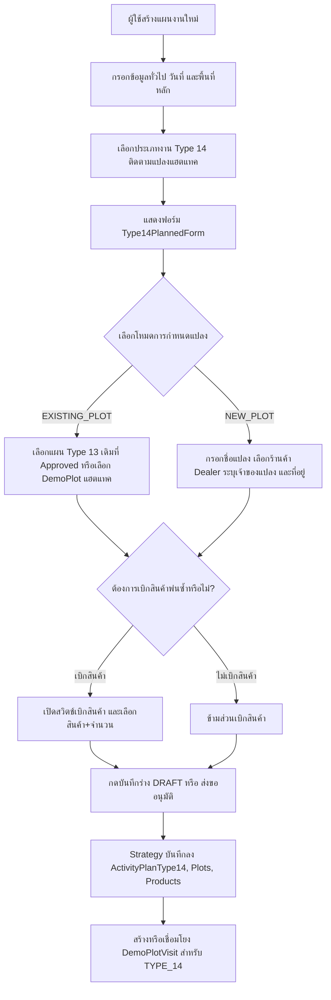
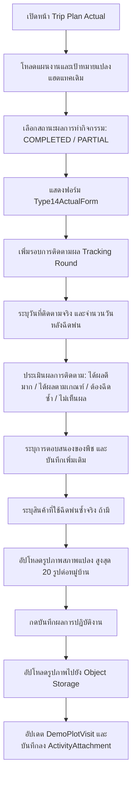
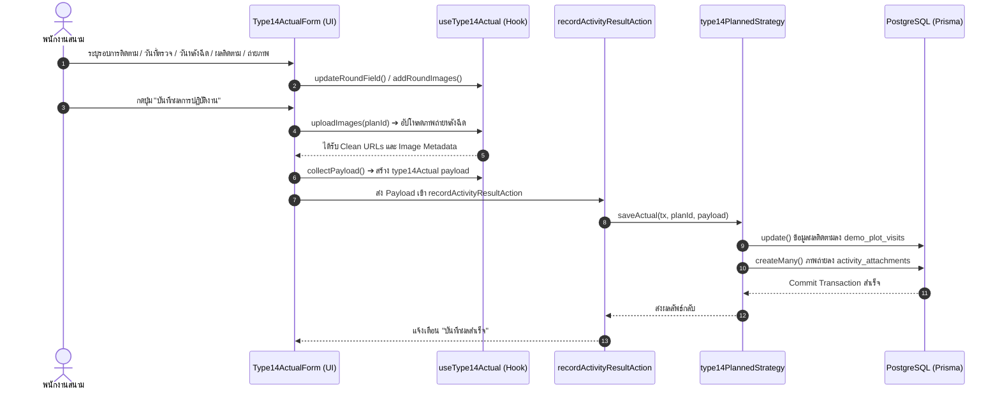

# Activity Type 14 — ติดตามแปลงแฮตแทค (README)

> **Feature Slice**: `modules/activity/features/type-14`  
> **Work Type Code**: `TYPE_14`  
> **Work Type Name**: ติดตามแปลงแฮตแทค (Hattack Follow-up)  
> **Parent Module**: `modules/activity`  
> **Database Authority**: `prisma/schema.prisma` (`ActivityPlanType14Target`, `ActivityPlanType14Product`, `ActivityResultType14`, `ActivityResultType14ProductUsed`, `DemoPlot`, `DemoPlotVisit`, `ActivityAttachment`)  
> **Status**: Production Ready / Active Reference

---

## 1. Overview

### 1.1 วัตถุประสงค์ของ Type 14
**Type 14 (ติดตามแปลงแฮตแทค - Hattack Follow-up)** มีวัตถุประสงค์เพื่อรองรับการตรวจติดตามและประเมินผลสัมฤทธิ์ของแปลงเกษตรกรที่ผ่านการฉีดพ่นสารเคมีแฮตแทค (จากกิจกรรม Type 13 หรือแปลงสาธิตที่เปิดไว้แล้ว):
1. ตรวจสอบประสิทธิภาพและประสิทธิผลในการกำจัดแมลง/หนอนศัตรูพืชหลังการฉีดพ่นแฮตแทค
2. บันทึกระยะเวลาหลังการฉีดพ่น (Days After Spray) และการตอบสนองของพืช (ไม่มีอาการแพ้/ใบเขียวเข้ม/พบอาการใบไหม้)
3. ประเมินผลการควบคุมการระบาด (ได้ผลดีมาก/ได้ผลตามเกณฑ์/ต้องฉีดพ่นซ้ำ/ไม่เห็นผล)
4. วางแผนเบิกสินค้าเพิ่มเติม กรณีแปลงเกิดการระบาดรอบใหม่หรือจำเป็นต้องฉีดพ่นซ้ำ (Retreatment)
5. ถ่ายภาพประเมินสภาพแปลงและยอดพืชหลังการฉีดพ่น (สูงสุด 20 ภาพต่อหมู่บ้าน) เพื่อเป็นหลักฐานเชิงประจักษ์

### 1.2 ขอบเขตของ Type 14
- **Dual Plot Selection Modes (การเลือกแปลง 2 โหมด):**
  - **โหมดแปลงเดิม (`EXISTING_PLOT`):** เลือกติดตามแปลงที่เคยฉีดพ่นแฮตแทคจากแผนงานเดิม (เชื่อมโยง `sourceActivityPlanId` จากแผน Type 13 ที่ได้รับอนุมัติแล้ว) หรือเลือกจาก Master DemoPlot ที่มีประเภทแปลงเป็น `HATTACK`
  - **โหมดสร้างแปลงใหม่ (`NEW_PLOT`):** ระบุชื่อแปลง ร้านค้า Dealer ผู้รับผิดชอบ เจ้าของแปลง ชนิดพืช และที่อยู่แปลงใหม่โดยตรง
- **การเบิกสินค้าสำหรับติดตามแปลง (Product Withdrawal):**
  - สวิตช์เปิด-ปิดการขอเบิกสินค้าสำหรับการติดตามแปลง พร้อมกำหนดรหัสสินค้า จำนวน และหน่วยนับ
- **การบันทึกผลการปฏิบัติงานจริง (Actual Outcome Scope):**
  - บันทึกรอบการติดตามผล (Follow-up Rounds: รอบที่ 1, 2, 3...)
  - วันที่ลงพื้นที่ตรวจติดตามจริง (`actualVisitDate`)
  - จำนวนวันหลังฉีดพ่น (`daysAfterSpray` / `daysSinceStart`)
  - ผลการติดตาม (`trackingResult`): ได้ผลดีมาก, ได้ผลตามเกณฑ์, ต้องฉีดพ่นซ้ำ, ไม่เห็นผล
  - การตอบสนองของพืช (`productResponse`): ปกติ, พืชตอบสนองดี, พบอาการผิดปกติ
  - รายการสินค้าที่ใช้พ่นซ้ำจริง (สินค้า, จำนวนที่ใช้, อัตราใช้จริง, รายละเอียด)
  - รูปภาพสภาพแปลงหลังการฉีดพ่น (สูงสุด 20 รูปต่อหมู่บ้าน)

### 1.3 รูปแบบการทำงานที่รองรับ
1. **Planned (ในแผนงาน):** วางแผนติดตามแปลงแฮตแทค (เลือกแปลงเดิมหรือสร้างแปลงใหม่) พร้อมขอเบิกสินค้าฉีดพ่นซ้ำล่วงหน้า
2. **Planned Actual (บันทึกผลงานตามแผน):** นำแผนติดตามเดิมมารายงานผลการลงพื้นที่จริง ระบุรอบการติดตาม ผลการควบคุมแมลง พืชตอบสนอง สินค้าที่ใช้ซ้ำ และอัปโหลดภาพถ่าย
3. **Unplanned (กิจกรรมนอกแผน 2-in-1):** กรณีลงพื้นที่ติดตามแปลงกะทันหัน สามารถระบุข้อมูลแปลง พิกัด GPS ผลการตรวจติดตาม สินค้าที่ใช้ และถ่ายภาพจบในฟอร์มเดียว
4. **Detail View:** แสดงสรุปแปลงที่วางแผนติดตาม และแสดงผลการตรวจติดตามจริงแยกตามรอบ พร้อม Image Lightbox ขยายดูภาพถ่ายสภาพแปลง
5. **Approval View:** แสดงการ์ดสรุปแปลงแฮตแทคและรายการขอเบิกสินค้าเพื่อให้ผู้จัดการสายงานพิจารณาอนุมัติ

---

## 2. Business Flows

### 2.1 Planned (สร้างและแก้ไขแผนงาน)


### 2.2 Planned Actual (บันทึกผลการปฏิบัติงานตามแผน)


### 2.3 Unplanned (กิจกรรมนอกแผน 2-in-1)
- ผู้ใช้งานเข้าหน้า `/activity-plans/unplanned/new` และเลือกประเภทงาน **ติดตามแปลงแฮตแทค (Type 14)**
- ฟอร์ม `Type14UnplannedForm` รวมการกรอกข้อมูลแปลง, ร้านค้า Dealer, พิกัด GPS, วันที่ติดตามจริง, จำนวนวันหลังฉีด, ผลการติดตาม, สภาพพืช, ยาที่ใช้ซ้ำ และกล้องถ่ายรูปสภาพแปลงเข้าด้วยกัน
- เมื่อกดบันทึก ระบบจะสร้าง `ActivityPlan` พร้อมบันทึก `ActivityPlanType14`, `ActivityPlanType14Plot`, `DemoPlotVisit` และรูปภาพใน Transaction เดียวกันผ่าน `type14UnplannedStrategy`

### 2.4 Detail and Approval (ดูรายละเอียดและพิจารณาอนุมัติ)
- **Detail View:** เรนเดอร์ `<Type14PlanCard />` สำหรับสรุปข้อมูลแปลงตามแผน และเรนเดอร์ `<Type14DetailView />` แสดงรอบการตรวจติดตามย้อนหลัง (Timeline Cards), ผลการตอบสนองของพืช, สินค้าที่ใช้ซ้ำ และรูปภาพแปลงพร้อม Image Lightbox
- **Approval View:** เรนเดอร์ `<Type14ApprovalCard />` แสดงโหมดการติดตาม (แปลงเดิม/แปลงใหม่), ร้านค้า Dealer, และรายการขอเบิกสินค้า เพื่อให้ผู้มีอำนาจตรวจสอบก่อนอนุมัติ

---

## 3. Architecture

### 3.1 Folder Structure (24-Artifact Standard)
```text
modules/activity/features/type-14/
├── index.ts                              # Unified Public API Contract (Client-Safe Barrel Export)
├── README.md                             # เอกสารคู่มือทางเทคนิคฉบับสมบูรณ์ (ไฟล์นี้)
│
├── planned/                              # Sub-slice: กิจกรรมในแผนงานและบันทึกผลตามแผน
│   ├── application/                      # Business Logic, Validation, Mappers
│   │   ├── actual-mapper.ts              # แปลงผลการตรวจติดตามจริง parseType14ActualResult
│   │   ├── actual-validation.ts          # ตรวจสอบผลการติดตาม validateType14Actual & Zod schemas
│   │   ├── planned-mapper.ts             # extractType14PlanTargets, hydrateType14PlannedData
│   │   └── planned-validation.ts         # validateType14FormValues & Zod schemas
│   ├── components/                       # UI Components ประจำ Type 14 ในแผน
│   │   ├── type14-planned-form.tsx       # ฟอร์มเลือกแปลงเดิม/สร้างแปลงใหม่ + เบิกสินค้า
│   │   ├── type14-actual-form.tsx        # ฟอร์มบันทึกรอบติดตาม วันหลังฉีด ผลติดตาม และรูปภาพ
│   │   ├── type14-plan-card.tsx          # การ์ดสรุปแปลงติดตามตามแผนงาน
│   │   ├── type14-detail-view.tsx        # หน้ารายละเอียด Timeline รอบติดตามและ Lightbox
│   │   └── type14-approval-card.tsx      # การ์ดสรุปสำหรับหน้าพิจารณาอนุมัติ
│   ├── hooks/                            # Custom State Hooks
│   │   ├── use-type14-planned-form.ts    # จัดการ State ฟอร์มแผนงาน Type 14
│   │   └── use-type14-actual.ts          # จัดการ State รอบการติดตามและอัปโหลดรูปภาพ
│   ├── infrastructure/                   # Database Strategies & Repositories
│   │   ├── type14.repository.ts          # Data Access Layer (ActivityPlanType14, DemoPlot, Visits)
│   │   └── type14-planned.strategy.ts    # WorkTypeStrategy สำหรับ Type 14 ในแผนงาน (Server only)
│   └── types/                            # Type Definitions ในแผน
│       ├── planned.types.ts              # Type14PlanInput, Type14PlanFormProps, Validation Params
│       └── actual.types.ts               # Type14ActualProps, Type14DetailData, Detail Props
│
├── unplanned/                            # Sub-slice: กิจกรรมนอกแผน (2-in-1)
│   ├── application/                      # Logic และ Mappers กิจกรรมนอกแผน
│   │   ├── unplanned-mapper.ts           # hydrateType14UnplannedData, mapType14UnplannedToPayload
│   │   └── unplanned-validation.ts       # validateType14UnplannedItem
│   ├── components/                       # UI Components กิจกรรมนอกแผน
│   │   └── type14-unplanned-form.tsx     # ฟอร์ม 2-in-1 (ข้อมูลแปลง + ผลการติดตาม + รูปภาพ + GPS)
│   ├── hooks/                            # Custom State Hooks
│   │   └── use-type14-unplanned-form.ts  # จัดการ State รายการนอกแผน
│   ├── infrastructure/                   # Database Strategies นอกแผน
│   │   └── type14-unplanned.strategy.ts  # WorkTypeStrategy สำหรับกิจกรรมนอกแผน (Server only)
│   └── types/                            # Type Definitions นอกแผน
│       └── unplanned.types.ts            # Type14UnplannedItem, Type14UnplannedFormProps
│
└── shared/                               # ชิ้นส่วนที่ใช้ร่วมกันภายใน Feature Type 14
    ├── constants.ts                      # WORK_TYPE_CODE, TRACKING_RESULT_OPTIONS, FORMULA_OPTIONS
    ├── types.ts                          # Type14PlotItem, Type14SprayRoundState, Type14ImageFile
    └── notes.ts                          # formatType14PlannedNotes, formatType14ActualSummary
```

### 3.2 Type 14 vs Shared Activity
| ความรับผิดชอบ | จัดการที่ Type 14 Feature (`features/type-14`) | จัดการที่ Activity ส่วนกลาง (`ui/`, `views/`) |
| :--- | :--- | :--- |
| **ข้อมูลทั่วไป** | - | ชื่องาน, วันที่เริ่ม-สิ้นสุด, วัตถุประสงค์หลัก |
| **พื้นที่ & ทีมงาน** | จังหวัด อำเภอ ตำบล หมู่บ้าน และพิกัดแปลงแฮตแทค | จังหวัดหลักของทริป, พนักงานร่วมเดินทาง |
| **งบประมาณ** | รายการสินค้าที่ขอเบิกเพื่อฉีดพ่นซ้ำในแปลงติดตาม | งบเบิกสินค้าสาธิตส่วนกลาง, ค่าเดินทาง |
| **ข้อมูลแปลงสาธิต** | แปลงเดิมจากแผน Type 13 หรือแปลงใหม่, ข้อมูลพืช และ Dealer | - |
| **ผลการตรวจติดตาม** | รอบการติดตาม, วันหลังฉีดพ่น, ผลการติดตาม, สภาพพืช, ยาที่ใช้ซ้ำ, ภาพถ่ายแปลง 20 ภาพ/หมู่บ้าน | ผลสรุปภาพรวมแผน (สำเร็จ/เลื่อน/ยกเลิก) |
| **Database Persistence** | ตาราง `activity_plan_type_14`, `activity_plan_type_14_plots`, `activity_plan_type_14_products`, `demo_plot_visits` | ตารางหลัก `ActivityPlan`, `ActivityPlanApprovalLog`, `ActivityAttachment` |

### 3.3 Dependency and Import Map
- **ทิศทางการเรียกใช้ (Allowed):**
  - `views/` ➔ เรียกใช้ ➔ `features/type-14` (ผ่าน `index.ts` เท่านั้น)
  - `features/type-14` ➔ เรียกใช้ ➔ `@/modules/activity/ui` (`ActivityInput`, `ActivityAddressSelect`, `ActivityCustomerSelect`, `ActivityProductSelect`, `ActivityPhotoUpload`, `ActivityGpsPicker`)
  - `features/type-14` ➔ เรียกใช้ ➔ `@/modules/activity/types/strategy.interface`
  - `features/type-14` ➔ เรียกใช้ ➔ `@/modules/activity/application/media/image-uploader`
- **Server Actions & Database Flow:**
  - `views/` ➔ ส่งข้อมูลไปยัง ➔ Server Actions ใน `@/modules/activity/server/`:
    - `planned.actions.ts` (`createActivityPlanAction`, `updateActivityPlanAction`, `getActivityPlanAction`)
    - `unplanned.actions.ts` (`createUnplannedActivityAction`, `updateUnplannedActivityAction`, `getUnplannedActivityAction`)
    - `actual.actions.ts` (`recordActivityResultAction`)
  - Server Actions ➔ ทำงานร่วมกับ ➔ `@/modules/activity/infrastructure/strategy.registry` ➔ เรียกใช้ `type14PlannedStrategy` / `type14UnplannedStrategy`
- **สิ่งต้องห้าม (Strictly Forbidden):**
  - ❌ ภายนอก Import เจาะลึกเข้าไปในโฟลเดอร์ย่อย เช่น `features/type-14/planned/components/...`
  - ❌ `features/type-14` เรียกใช้ข้ามไปยัง `features/type-1` ถึง `type-13`
  - ❌ Import ย้อนกลับไปยังโมดูลเก่า `@/modules/activity-plans/...` โดยเด็ดขาด

### 3.4 Entry Points and Public Exports
ไฟล์ [modules/activity/features/type-14/index.ts](file:///d:/code/crm-bank/modules/activity/features/type-14/index.ts) ทำหน้าที่เป็น **Single Public API Contract** สำหรับฝั่ง UI / Application โดยส่งออกเฉพาะ:
- **Components:** `Type14PlannedForm`, `Type14PlanCard`, `Type14ActualForm`, `Type14DetailView`, `Type14ApprovalCard`, `Type14UnplannedForm`
- **Hooks:** `useType14PlannedForm`, `useType14Actual` (`useType14ActualState`), `useType14UnplannedForm`
- **Mappers & Hydrators:** `extractType14PlanTargets`, `hydrateType14PlannedData`, `parseType14ActualResult`, `hydrateType14UnplannedData`, `mapType14UnplannedToPayload`
- **Validators & Schemas:** `validateType14FormValues`, `type14PlanInputSchema`, `validateType14Actual`, `type14TrackingRoundSchema`, `validateType14UnplannedItem`
- **Constants & Types:** `WORK_TYPE_CODE`, `WORK_TYPE_NAME`, `TRACKING_RESULT_OPTIONS`, `PRODUCT_RESPONSE_OPTIONS`, `FORMULA_OPTIONS`, `TYPE14_MAX_IMAGES_PER_VILLAGE`, `Type14PlanInput`, `Type14PlotItem`, `Type14SprayRoundState`, `Type14UnplannedItem`
- *(หมายเหตุ: `type14PlannedStrategy` และ `type14UnplannedStrategy` ถูกนำเข้าโดยตรงที่ `modules/activity/infrastructure/strategy.registry.ts` เพื่อแยกโค้ดฝั่ง Server/Database ออกจาก Client Bundle)*

---

## 4. File Responsibilities

### 4.1 Planned & Actual
- **`use-type14-planned-form.ts`:** จัดการ State ฟอร์มแผนงาน Type 14 สลับโหมดแปลงเดิม/แปลงใหม่ (`mode: "EXISTING_PLOT" | "NEW_PLOT"`), จัดการรายการสินค้าที่ขอเบิก (`withdrawnProducts`), และแปลง Payload ผ่าน `mapType14Payload()`
- **`type14-planned-form.tsx`:** UI ฟอร์มแผนงาน มีปุ่มสลับแท็บโหมดเลือกแปลงเดิม (ดึงจากแผน Type 13 ที่อนุมัติแล้วผ่าน `hattackFollowUpPlans`) หรือแท็บสร้างแปลงใหม่ เลือกร้านค้า Dealer และสวิตช์เปิดปิดเบิกสินค้า
- **`type14-actual-form.tsx`:** ฟอร์มบันทึกผลการตรวจติดตามจริง เพิ่มรอบการติดตามผล (`rounds`), ระบุวันที่ตรวจจริง, วันหลังฉีดพ่น, ผลการติดตาม (`trackingResult`), การตอบสนองของพืช, รายการยาที่ใช้พ่นซ้ำ, และกล่องอัปโหลดภาพถ่ายสภาพแปลง
- **`use-type14-actual.ts`:** Custom Hook จัดการ State รอบการตรวจติดตามหลายรอบ เพิ่ม/ลบรอบการติดตาม, จัดการสินค้าพ่นซ้ำ, และฟังก์ชัน `uploadImages()` แยกหมวดหมู่ `type14/after_spray`
- **`type14-detail-view.tsx`:** คอมโพเนนต์แสดงผลในหน้ารายละเอียด แสดงการ์ดรอบการตรวจติดตามเรียงตามลำดับเวลา (Timeline Cards), ผลการตอบสนองของพืช, สินค้าที่ใช้ซ้ำ และระบบ Image Lightbox สำหรับดูรูปขยายเต็มจอ
- **`type14-plan-card.tsx` & `type14-approval-card.tsx`:** การ์ดสรุปข้อมูลแปลงติดตามตามแผนงาน ข้อมูลร้านค้า Dealer และสรุปรายการขอเบิกสินค้าสำหรับหน้ารายละเอียดและหน้าพิจารณาอนุมัติ
- **`planned-mapper.ts` & `actual-mapper.ts`:** ทำหน้าที่ดึงข้อมูลแปลงเดิม (`extractType14PlanTargets`), Hydrate ข้อมูลเดิมเมื่อเปิดหน้าแก้ไข, และสกัดข้อมูลรอบการตรวจติดตามจริงจาก `payloadToHydrate`
- **`planned-validation.ts` & `actual-validation.ts`:** ตรวจสอบความถูกต้องของแผนงาน (ตรวจการเลือกแปลงเดิมหรือกรอกแปลงใหม่ครบถ้วน) และตรวจสอบผลจริง (ต้องระบุวันที่ตรวจและผลการติดตามทุกรอบ)
- **`type14.repository.ts` & `type14-planned.strategy.ts`:** Data Access Layer จัดการค้นหาแผน Type 13 ที่ Approved (`findHattackFollowUpActivityPlans`), บันทึกตาราง `ActivityPlanType14`, `ActivityPlanType14Plot`, `ActivityPlanType14Product` และอัปเดตสถานะใน `DemoPlotVisit`

### 4.2 Unplanned
- **`use-type14-unplanned-form.ts`:** จัดการ State สำหรับฟอร์มกิจกรรมนอกแผน 2-in-1
- **`type14-unplanned-form.tsx`:** ฟอร์ม 2-in-1 แสดงส่วนเลือกร้านค้า Dealer, ข้อมูลแปลง, พิกัด GPS, วันที่ตรวจจริง, วันหลังฉีดพ่น, ผลการติดตาม, สินค้าที่ใช้ซ้ำ และกล้องถ่ายรูป/อัปโหลดภาพ
- **`unplanned-mapper.ts`:** จัดการแปลงข้อมูล Form Item เป็น Payload ทั้งในส่วน Plan และ Actual พร้อมกัน (`mapType14UnplannedToPayload`) และกู้คืนข้อมูลเดิม (`hydrateType14UnplannedData`)
- **`type14-unplanned.strategy.ts`:** บันทึกข้อมูลกิจกรรมนอกแผนลงฐานข้อมูลผ่าน `syncType14Data` และอัปเดต `DemoPlotVisit`

### 4.3 Shared Types and Constants
- **`shared/constants.ts`:** กำหนดรหัสประเภทงาน `WORK_TYPE_CODE = "TYPE_14"`, ตัวเลือกผลการติดตาม `TRACKING_RESULT_OPTIONS` (ได้ผลดีมาก, ได้ผลตามเกณฑ์, ต้องฉีดพ่นซ้ำ, ไม่เห็นผล), ตัวเลือกการตอบสนองของพืช `PRODUCT_RESPONSE_OPTIONS`, และสูตรสารเคมี `FORMULA_OPTIONS`
- **`shared/types.ts`:** Type Definitions กลาง เช่น `Type14PlotItem`, `Type14SprayRoundState`, `Type14ActualProductState`, `FollowUpPlanOption`, `Type14ImageFile`
- **`shared/notes.ts`:** ฟังก์ชันจัดรูปแบบข้อความสรุป `formatType14PlannedNotes` และ `formatType14ActualSummary`

### 4.4 Shared UI and Views
- `ActualWorkTypeList`, `DetailWorkTypeList`, และ `ApprovalWorkTypeList` ใน `views/` ทำหน้าที่เป็น Orchestrator ตรวจจับรหัสประเภทงาน `TYPE_14` หรือการมีอยู่ของ `type14Plots` เพื่อเรนเดอร์คอมโพเนนต์ของ Type 14 ให้ถูกต้อง

---

## 5. Data Flow



### 5.1 Create Planned (สร้างแผนใหม่)
1. `create-view.tsx` เรียกใช้ `useType14PlannedForm()`
2. ผู้ใช้เลือกโหมด:
   - กรณีเลือก **"แปลงเดิม" (`EXISTING_PLOT`)**: เลือกแผน Type 13 เดิมที่เคยฉีดพ่นแล้ว หรือเลือกแปลงสาธิตแฮตแทค
   - กรณีเลือก **"สร้างแปลงใหม่" (`NEW_PLOT`)**: ระบุชื่อแปลง เลือกร้านค้า Dealer และที่อยู่แปลง
3. หากต้องการเบิกสินค้าพ่นซ้ำ ผู้ใช้เปิดสวิตช์และเลือกสินค้าพร้อมจำนวน
4. เมื่อกดส่งข้อมูล ระบบจะรัน `validateType14()`
5. Form Orchestrator เรียก `mapType14Payload()` เพื่อจัดโครงสร้าง `type14Data`, `type14Plots`, `planStores`, และ `planProducts`
6. ส่ง Payload ไปยัง `createActivityPlanAction` ➔ เรียกใช้ `type14PlannedStrategy.savePlan()`
7. `createType14Data` บันทึกลง `ActivityPlanType14`, `ActivityPlanType14Plot`, `ActivityPlanType14Product` และสร้าง/เชื่อมโยง `DemoPlotVisit` สำหรับ TYPE_14

### 5.2 Edit Planned (แก้ไขแผนงานเดิม)
1. `edit-view.tsx` ดึงข้อมูลแผนงาน (`plan`) ผ่าน `getActivityPlanAction`
2. เรียก `hydrateType14PlannedData(plan)` หรือดึงจาก `plan.type14`
3. ข้อมูลถูกเซ็ตลงใน `useType14PlannedForm({ initial })`
4. ฟอร์มแสดงผลแปลงที่เลือกและรายการเบิกสินค้าเดิม พร้อมให้ปรับปรุงและบันทึกซ้ำผ่าน `updateActivityPlanAction`

### 5.3 Save Actual (บันทึกผลการปฏิบัติงานจริง)
1. `activity-plan-actual-view.tsx` รันการตรวจสอบความถูกต้องผ่าน `validateType14Actual()`
2. เรียก `type14Actual.uploadImages(planId)` เพื่ออัปโหลดภาพถ่ายไปยัง Storage ได้ URLs กลับมา
3. ดึง Payload ผ่าน `type14Actual.collectPayload()` ได้โครงสร้าง `type14Actual` ที่มีรอบการติดตาม สภาพพืช และสินค้าที่ใช้พ่นซ้ำ
4. ส่ง Payload เข้า `recordActivityResultAction(planId, payload)`
5. `type14PlannedStrategy.saveActual()` อัปเดตผลการตรวจติดตามลงตาราง `demo_plot_visits` และบันทึกภาพถ่ายลง `activity_attachments`

### 5.4 Load Actual (โหลดผลงานเดิมมาแสดงในหน้าบันทึกผล)
1. โหลดข้อมูลแผนงานและผลงานเดิมจากฐานข้อมูล
2. เรียก `type14Actual.hydrate(plan, parsedResult)`
3. Custom Hook ทำการกู้คืนรอบการตรวจติดตาม วันหลังฉีดพ่น ผลการติดตาม และรูปภาพเดิม
4. ฟอร์มแสดงผลรอบการติดตามเดิมให้ผู้ใช้แก้ไขหรือกดเพิ่มรอบติดตามใหม่ได้ทันที

### 5.5 Create/Edit Unplanned (กิจกรรมนอกแผน)
1. ผู้ใช้กรอกฟอร์ม `Type14UnplannedForm` ระบุร้านค้า Dealer, ชื่อแปลง, พิกัด GPS, วันที่ตรวจจริง, วันหลังฉีด, ผลการติดตาม และอัปโหลดรูปภาพ
2. ตรวจสอบความถูกต้องด้วย `validateType14UnplannedItem`
3. อัปโหลดรูปภาพและแปลงข้อมูลด้วย `mapType14UnplannedToPayload`
4. บันทึกผ่าน `createUnplannedActivityAction` ➔ เรียก `type14UnplannedStrategy.savePlan()` และ `saveActual()` สร้างระเบียนแผนงานและบันทึกผลตรวจติดตามพร้อมกัน

### 5.6 Detail and Approval (การแสดงผลหน้ารายละเอียดและพิจารณาอนุมัติ)
1. หน้ารายละเอียดเรนเดอร์ `<Type14PlanCard />` สำหรับสรุปแปลงตามแผน
2. หากมีผลการปฏิบัติงานจริง เรนเดอร์ `<Type14DetailView />` แสดง Timeline Cards ของแต่ละรอบการติดตาม และ Image Lightbox
3. หน้าอนุมัติเรนเดอร์ `<Type14ApprovalCard />` แสดงสรุปแปลงและรายการขอเบิกสินค้า

---

## 6. Data Models and Mapping

### 6.1 Database CRUD Matrix (สิทธิ์และการจัดการตารางในฐานข้อมูล)
| ตารางในฐานข้อมูล (`Prisma Model`) | Create (สร้าง) | Read (อ่าน/แสดงผล) | Update (แก้ไข) | Delete (ลบ) | หมายเหตุ |
| :--- | :--- | :--- | :--- | :--- | :--- |
| **`activity_type_14_targets`**<br>(`ActivityPlanType14Target`) | `savePlan()` ใน Planned/Unplanned | `findType14ByPlanId()`, `plan.type14Targets` | ลบและสร้างใหม่ใน `syncType14Data()` | Cascade เมื่อลบ `ActivityPlan` | ตารางหลักเป้าหมาย Type 14 เก็บโหมดแปลง ลิงก์แผนต้นทาง Dealer และ DemoPlot |
| **`activity_type_14_products`**<br>(`ActivityPlanType14Product`) | `savePlan()` เมื่อมีการเบิกสินค้า | `plan.type14Products` ใน Edit / Detail / Approval | ลบและสร้างใหม่ใน `syncType14Data()` | Cascade เมื่อลบ `ActivityPlan` | เก็บรายการสินค้าและจำนวนที่ขอเบิกสำหรับพ่นซ้ำ |
| **`activity_type_14_results`**<br>(`ActivityResultType14`) | `saveActual()` ใน Actual/Unplanned | `plan.type14Results` ใน Detail / Actual | ลบและสร้างใหม่ใน `saveActual()` | Cascade เมื่อลบ `ActivityPlan` | เก็บผลการตรวจติดตามจริง วันหลังฉีดพ่น ผลตอบสนองของพืช และพิกัด GPS |
| **`activity_type_14_products_used`**<br>(`ActivityResultType14ProductUsed`) | `saveActual()` | `result.productsUsed` | ลบและสร้างใหม่ใน `saveActual()` | Cascade เมื่อลบ `ActivityResultType14` | เก็บสินค้าที่ใช้พ่นซ้ำจริง อัตราพ่น และปริมาณที่ใช้ |
| **`demo_plots`**<br>(`DemoPlot`) | Read-only สำหรับโหมด Existing Plot | `findHattackFollowUpDemoPlots` | อัปเดตพิกัด/ข้อมูลแปลง | - | แปลงสาธิตแฮตแทคที่เคยสร้างไว้จาก Type 13 |
| **`demo_plot_visits`**<br>(`DemoPlotVisit`) | `createType14Data()` | `plan.demoPlotVisits` ใน Detail / Actual | อัปเดตผลติดตามใน `saveActual()` | Cascade เมื่อลบ `ActivityPlan` | เก็บรอบการเข้าติดตาม วันหลังฉีดพ่น ผลการตอบสนองของพืช |
| **`activity_attachments`**<br>(`ActivityAttachment`) | `saveActual()` | `actualData.attachments` (หมวดหมู่ PLOT) | ลบและสร้างใหม่ | Cascade เมื่อลบ `ActivityPlan` | เก็บรูปภาพหลังการติดตาม |
| **`activity_attachments`**<br>(`ActivityAttachment`) | อัปโหลดภาพหลังฉีด ➔ `saveActual()` | `actualData.attachments` (หมวดหมู่ AFTER_SPRAY) | ลบและสร้างใหม่ | Cascade เมื่อลบ `ActivityPlan` | เก็บภาพถ่ายสภาพแปลง สูงสุด 20 ภาพต่อหมู่บ้าน |

### 6.2 Complete Field-to-Database Mapping (ตารางจับคู่ฟิลด์ครบถ้วนทุกจุด)

| Form Field (UI) | TypeScript Type Field | Mapper Function (Write/Read) | Prisma Model | DB Column Name | Data Type | Nullable? | Default |
| :--- | :--- | :--- | :--- | :--- | :--- | :---: | :--- |
| **โหมดการเลือกแปลง** | `mode` | `mapType14Payload` | `ActivityPlanType14` | `mode` | `VARCHAR` | No | `"EXISTING_PLOT"` |
| **รหัสแผนงาน Type 13 ต้นทาง**| `selectedPlanId` | `mapType14Payload` | `ActivityPlanType14` | `source_activity_plan_id`| `VARCHAR (FK)` | Yes | `null` |
| **มีเบิกสินค้าหรือไม่** | `hasProductWithdrawal` | `mapType14Payload` | `ActivityPlanType14` | `has_products` | `BOOLEAN` | No | `false` |
| **บันทึกแผนงาน Type 14**| `notes` | `mapType14Payload` / `notes.ts` | `ActivityPlanType14` | `notes` | `TEXT` | Yes | `null` |
| **รหัสแปลงสาธิตแฮตแทค**| `demoPlotId` | `mapType14Payload` / `extractType14PlanTargets` | `ActivityPlanType14Plot` | `demo_plot_id` | `VARCHAR (FK)` | Yes | `null` |
| **ชื่อแปลงติดตาม** | `name` / `plotName` | `mapType14Payload` / `extractType14PlanTargets` | `ActivityPlanType14Plot` | `plot_name` | `VARCHAR` | Yes | `null` |
| **ชื่อร้านค้า Dealer** | `dealerName` | `mapType14Payload` | `ActivityPlanType14Plot` | `dealer_name` | `VARCHAR` | Yes | `null` |
| **ชื่อเจ้าของแปลง** | `ownerName` | `mapType14Payload` | `ActivityPlanType14Plot` | `owner_name` | `VARCHAR` | Yes | `null` |
| **หมวดหมู่พืช** | `cropCategory` | `mapType14Payload` | `ActivityPlanType14Plot` | `crop_category` | `VARCHAR` | Yes | `null` |
| **ชนิดพืช** | `cropName` | `mapType14Payload` | `ActivityPlanType14Plot` | `crop_name` | `VARCHAR` | Yes | `null` |
| **จังหวัดของแปลง** | `province` | `mapType14Payload` | `ActivityPlanType14Plot` | `province` | `VARCHAR` | Yes | `null` |
| **อำเภอของแปลง** | `district` | `mapType14Payload` | `ActivityPlanType14Plot` | `district` | `VARCHAR` | Yes | `null` |
| **พิกัดละติจูด (แผน/จริง)**| `latitude` | `mapType14Payload` / `type14Actual.collectPayload` | `ActivityPlanType14Plot` | `latitude` | `DECIMAL(10,7)`| Yes | `null` |
| **พิกัดลองจิจูด (แผน/จริง)**| `longitude` | `mapType14Payload` / `type14Actual.collectPayload` | `ActivityPlanType14Plot` | `longitude` | `DECIMAL(10,7)`| Yes | `null` |
| **สินค้าที่ขอเบิกพ่นซ้ำ** | `productId` | `mapType14Payload` | `ActivityPlanType14Product`| `product_id` | `VARCHAR (FK)` | No | - |
| **จำนวนสินค้าที่เบิก** | `quantity` | `mapType14Payload` (`Number(quantity)`) | `ActivityPlanType14Product`| `quantity` | `DECIMAL(10,2)`| No | `1.00` |
| **หน่วยนับสินค้าที่เบิก** | `unit` | `mapType14Payload` | `ActivityPlanType14Product`| `unit` | `VARCHAR` | Yes | `"ขวด"` |
| **รอบการติดตาม** | `roundNumber` | `type14Actual.collectPayload` | `DemoPlotVisit` | `visit_number` | `INTEGER` | No | `1` |
| **วันที่ตรวจติดตามจริง** | `actualVisitDate` | `type14Actual.collectPayload` (`new Date(actualVisitDate)`) | `DemoPlotVisit` | `visit_date` | `TIMESTAMP` | No | `now()` |
| **ระยะเวลาหลังฉีดพ่น** | `daysAfterSpray` | `type14Actual.collectPayload` (`parseInt`) | `DemoPlotVisit` | `days_since_start` | `INTEGER` | Yes | `0` |
| **ผลการติดตาม** | `trackingResult` | `type14Actual.collectPayload` | `DemoPlotVisit` | `product_problem_desc` | `TEXT` | Yes | `null` |
| **การตอบสนองของพืช** | `productResponse` | `type14Actual.collectPayload` | `DemoPlotVisit` | `product_response` | `VARCHAR` | Yes | `"ปกติ"` |
| **บันทึกเพิ่มเติมรอบติดตาม**| `additionalNotes` | `type14Actual.collectPayload` | `DemoPlotVisit` | `notes` | `TEXT` | Yes | `null` |
| **ภาพถ่ายสภาพแปลง** | `afterSprayImages` | `uploadImages()` ➔ URLs ➔ `ActivityAttachment` | `ActivityAttachment` | `file_url` | `TEXT` | No | - |

### 6.3 รายละเอียด Schema ตารางที่เกี่ยวข้อง (Prisma Definitions)

```prisma
// 1. ตารางหลักสำหรับ Type 14 (ติดตามแปลงแฮตแทค)
model ActivityPlanType14 {
  id                   String                      @id @default(cuid())
  activityPlanId       String                      @unique @map("activity_plan_id")
  sourceActivityPlanId String?                     @map("source_activity_plan_id")
  mode                 String                      @default("EXISTING_PLOT") @map("mode")
  hasProducts          Boolean                     @default(false) @map("has_products")
  notes                String?                     @map("notes") @db.Text
  createdAt            DateTime                    @default(now()) @map("created_at")
  updatedAt            DateTime                    @updatedAt @map("updated_at")

  activityPlan         ActivityPlan                @relation(fields: [activityPlanId], references: [id], onDelete: Cascade)
  sourceActivityPlan   ActivityPlan?               @relation("Type14SourcePlan", fields: [sourceActivityPlanId], references: [id], onDelete: SetNull)
  plots                ActivityPlanType14Plot[]
  products             ActivityPlanType14Product[]

  @@index([activityPlanId])
  @@index([sourceActivityPlanId])
  @@map("activity_plan_type_14")
}

// 2. ตารางแปลงที่ติดตาม Type 14
model ActivityPlanType14Plot {
  id           String             @id @default(cuid())
  type14Id     String             @map("type_14_id")
  demoPlotId   String?            @map("demo_plot_id")
  plotName     String?            @map("plot_name")
  dealerName   String?            @map("dealer_name")
  ownerName    String?            @map("owner_name")
  cropCategory String?            @map("crop_category")
  cropName     String?            @map("crop_name")
  province     String?            @map("province")
  district     String?            @map("district")
  latitude     Decimal?           @map("latitude") @db.Decimal(10, 7)
  longitude    Decimal?           @map("longitude") @db.Decimal(10, 7)
  createdAt    DateTime           @default(now()) @map("created_at")

  type14       ActivityPlanType14 @relation(fields: [type14Id], references: [id], onDelete: Cascade)
  demoPlot     DemoPlot?          @relation(fields: [demoPlotId], references: [id], onDelete: SetNull)

  @@index([type14Id])
  @@index([demoPlotId])
  @@map("activity_plan_type_14_plots")
}

// 3. ตารางเบิกสินค้าพ่นซ้ำ Type 14
model ActivityPlanType14Product {
  id          String             @id @default(cuid())
  type14Id    String             @map("type_14_id")
  productId   String             @map("product_id")
  productName String?            @map("product_name")
  quantity    Decimal            @default(1) @map("quantity") @db.Decimal(10, 2)
  unit        String?            @map("unit")
  sortOrder   Int                @default(0) @map("sort_order")
  createdAt   DateTime           @default(now()) @map("created_at")

  type14      ActivityPlanType14 @relation(fields: [type14Id], references: [id], onDelete: Cascade)
  product     Product            @relation(fields: [productId], references: [id], onDelete: Restrict)

  @@index([type14Id])
  @@index([productId])
  @@map("activity_plan_type_14_products")
}

// 4. ตารางบันทึกการเข้าตรวจแปลงจริง
model DemoPlotVisit {
  id                 String    @id @default(cuid())
  demoPlotId         String    @map("demo_plot_id")
  activityPlanId     String?   @map("activity_plan_id")
  workTypeCode       String?   @map("work_type_code") // "TYPE_14"
  visitNumber        Int       @map("visit_number")
  visitDate          DateTime  @map("visit_date")
  daysSinceStart     Int?      @map("days_since_start")
  productResponse    String?   @map("product_response")
  productProblemDesc String?   @map("product_problem_desc")
  notes              String?   @map("notes") @db.Text
  createdAt          DateTime  @default(now()) @map("created_at")

  demoPlot           DemoPlot      @relation(fields: [demoPlotId], references: [id], onDelete: Cascade)
  activityPlan       ActivityPlan? @relation(fields: [activityPlanId], references: [id], onDelete: Cascade)

  @@index([demoPlotId])
  @@index([activityPlanId])
  @@index([workTypeCode])
  @@map("demo_plot_visits")
}
```

### 6.4 Transaction & Persistence Strategy (ขาเขียนและขาอ่าน)
- **การจัดการ Transaction (Isolation & Atomicity):**
  - ทุกการบันทึกของ Type 14 ดำเนินการภายใต้ Transaction `tx: PrismaTransaction` เพื่อรับประกันความสอดคล้องของข้อมูล
- **ขาเขียน (Write Flow):**
  1. *Planned:* ลบระเบียนเดิมใน `ActivityPlanType14` ออกทั้งหมด (`deleteMany`) ➔ สร้างระเบียนหลักใหม่ ➔ เชื่อมโยง `sourceActivityPlanId` (ถ้ามี) ➔ สร้างระเบียนแปลงใน `ActivityPlanType14Plot` ➔ สร้างระเบียนเบิกสินค้าใน `ActivityPlanType14Product` ➔ สร้างหรือผูก `DemoPlotVisit` สำหรับ TYPE_14
  2. *Actual:* อัปโหลดรูปภาพประเภท `AFTER_SPRAY` ➔ อัปเดตข้อมูลผลการติดตามลงใน `DemoPlotVisit` (อัปเดต `visitDate`, `daysSinceStart`, `productResponse`, `productProblemDesc`, `notes`) ➔ บันทึกรูปภาพลง `ActivityAttachment`
  3. *Unplanned:* บันทึก `ActivityPlan` หลัก ➔ เรียก `syncType14Data()` ➔ บันทึกผลการติดตามและภาพถ่ายใน $transaction เดียวกัน
- **ขาอ่าน (Read / Hydration Flow):**
  1. *Planned Edit:* ดึงข้อมูลผ่าน `findType14ByPlanId` (include `plots` + `products` + `sourceActivityPlan` + `demoPlot`) ➔ นำเข้า `hydrateType14PlannedData()`
  2. *Actual & Detail View:* ดึง `plan.type14.plots` หรือ `plan.demoPlotVisits` ➔ ดึง `attachments` ➔ แมปข้อมูลรอบการติดตามและรูปภาพแสดงผลใน Timeline
- **การลบข้อมูล (Delete Policy):**
  - ใช้ **Cascade Delete** จาก `ActivityPlan` ไปยัง `ActivityPlanType14` และตารางลูกทั้งหมด สำหรับ `DemoPlot` จะใช้การเชื่อมโยงแบบ `SetNull` เพื่อคงข้อมูลแปลงหลักไว้

---

## 7. Business Rules

### 7.1 Validation Rules
- **กรณีเลือกแปลงเดิม (`mode = "EXISTING_PLOT"`):**
  - ต้องเลือกแปลงสาธิตแฮตแทคอย่างน้อย 1 แปลง (`selectedPlotIds` หรือ `demoPlotId` ห้ามว่าง)
- **กรณีสร้างแปลงใหม่ (`mode = "NEW_PLOT"`):**
  - ต้องระบุชื่อแปลงแฮตแทค (`name` ห้ามว่าง)
  - ต้องเลือกร้านค้า Dealer ผู้รับผิดชอบ (`storeId` ห้ามว่าง)
  - ต้องระบุจังหวัดของแปลง (`province` ห้ามว่าง)
- **การเบิกสินค้าพ่นซ้ำ (`hasProductWithdrawal = true`):**
  - ต้องระบุรายการสินค้าอย่างน้อย 1 รายการ
  - สินค้าต้องถูกเลือก (`productId` ห้ามว่าง) และจำนวนต้องมากกว่า 0 (`quantity > 0`)
- **การบันทึกผลจริง (Actual):**
  - ต้องมีรอบการติดตามผลอย่างน้อย 1 รอบ
  - ต้องระบุวันที่ติดตามผลจริง (`actualVisitDate` ห้ามว่าง) ในทุกรอบ
  - ต้องระบุผลการติดตาม (`trackingResult` ห้ามว่าง) ในทุกรอบ
  - รูปภาพสภาพแปลงต้องไม่เกิน 20 รูปต่อหมู่บ้าน (`TYPE14_MAX_IMAGES_PER_VILLAGE = 20`)

### 7.2 Default Values
- `mode`: ค่าเริ่มต้นเป็น `"EXISTING_PLOT"`
- `hasProducts`: ค่าเริ่มต้นเป็น `false`
- `daysAfterSpray`: ค่าเริ่มต้นในฟอร์ม Unplanned เป็น `"7"`
- `trackingResult`: ค่าเริ่มต้นเป็น `"ได้ผลตามเกณฑ์"`
- `productResponse`: ค่าเริ่มต้นเป็น `"ปกติ"`
- `quantity`: ค่าเริ่มต้นสินค้าที่เบิกเป็น `1`

### 7.3 Conditional Fields
- **การสลับโหมดเลือกแปลง:** หากเลือกโหมด `EXISTING_PLOT` ฟอร์มจะแสดงตารางแผน Type 13 เดิมให้เลือก แต่หากเลือก `NEW_PLOT` จะแสดงช่องกรอกข้อมูลแปลงใหม่ เลือกร้านค้า Dealer และชนิดพืช
- **การสลับเปิด/ปิดเบิกสินค้า:** หากเปิดสวิตช์เบิกสินค้า จะแสดงตารางเลือกสินค้า จำนวน และหน่วยนับ
- **รายละเอียดการระบาดหรือพ่นซ้ำ:** หากเลือกผลการติดตามเป็น "ต้องฉีดพ่นซ้ำ" หรือ "ไม่เห็นผล" ฟอร์มจะแสดงช่องระบุรายละเอียดและสินค้าที่ใช้พ่นซ้ำ

### 7.4 Status and Approval Rules
- **การบันทึกผลงานจริง:** สามารถบันทึกได้เฉพาะเมื่อแผนงานมีสถานะเป็น `APPROVED` (อนุมัติแล้ว) เท่านั้น
- **สิทธิ์การบันทึกผล:** เฉพาะผู้สร้างแผนงาน (Creator) และ Administrator เท่านั้น
- **สถานะผลกิจกรรมที่รองรับ:** ฟอร์ม Actual จะแสดงขึ้นมาให้บันทึกผลเมื่อเลือกสถานะกิจกรรมเป็น `COMPLETED` หรือ `PARTIAL`

---

## 8. Shared Dependencies

โมดูล Type 14 ทำงานร่วมกับชิ้นส่วนส่วนกลางต่อไปนี้:
1. **`@/modules/activity/ui`:**
   - `ActivityInput`: กล่องกรอกข้อมูลมาตรฐาน
   - `ActivityAddressSelect`: คอมโพเนนต์เลือกจังหวัด อำเภอ ตำบล
   - `ActivityCustomerSelect`: คอมโพเนนต์ค้นหาและเลือกร้านค้า Dealer
   - `ActivityProductSelect`: คอมโพเนนต์ค้นหาและเลือกสินค้าที่เบิกหรือพ่นซ้ำ
   - `ActivityGpsPicker`: คอมโพเนนต์ดึงพิกัด Geolocation ปัจจุบัน
   - `ActivityPhotoUpload`: คอมโพเนนต์อัปโหลดรูปภาพพร้อมบีบอัดไฟล์
2. **`@/modules/activity/views`:**
   - `ActualWorkTypeList`: ตัวกระจายฟอร์มผลการปฏิบัติงานจริง
   - `DetailWorkTypeList`: ตัวกระจายการ์ดและแท็บแสดงผลในหน้ารายละเอียด
   - `ApprovalWorkTypeList`: ตัวกระจายการ์ดสรุปในหน้าพิจารณาอนุมัติ
3. **`@/modules/activity/constants`:**
   - `WORK_TYPE_CONFIG`: การตั้งค่าและรหัสประเภทงาน
   - `ACTIVITY_RESULT_STATUS_LABELS`: ป้ายแสดงสถานะผลกิจกรรม
4. **`@/modules/activity/infrastructure/strategy.registry`:**
   - `saveStrategiesForPlan`: จัดการบันทึกข้อมูล Type Strategies ตาม Work Type Codes
   - `getStrategyForWorkType`: ดึง `type14PlannedStrategy` และ `type14UnplannedStrategy`
5. **Server Actions ที่ใช้งานจริง (`@/modules/activity/server/`):**
   - **`planned.actions.ts`**: `createActivityPlanAction`, `updateActivityPlanAction`, `getActivityPlanAction`
   - **`unplanned.actions.ts`**: `createUnplannedActivityAction`, `updateUnplannedActivityAction`, `getUnplannedActivityAction`
   - **`actual.actions.ts`**: `recordActivityResultAction`
6. **Media Service (`@/modules/activity/application/media/image-uploader`):**
   - `uploadActivityPlanImageGroup`: จัดการอัปโหลดไฟล์ภาพไปยัง Object Storage ภายใต้ไดเรกทอรี `type14/after_spray`

---

## 9. How to Modify Type 14

### 9.1 การเพิ่มฟิลด์ใหม่บนฟอร์ม (Add a Form Field)
1. เพิ่มฟิลด์ใน Type Definitions:
   - แปลงตามแผน: `planned/types/planned.types.ts` (`Type14PlanInput`) หรือ `shared/types.ts` (`Type14PlotItem`)
   - ผลการติดตามจริง: `shared/types.ts` (`Type14SprayRoundState`)
2. เพิ่มเงื่อนไขตรวจสอบใน Validation Schema:
   - แผน: `planned/application/planned-validation.ts` (`type14PlanInputSchema`)
   - ผลจริง: `planned/application/actual-validation.ts` (`type14TrackingRoundSchema`)
3. เพิ่มช่อง Input ใน UI Component:
   - แผน: `planned/components/type14-planned-form.tsx`
   - ผลจริง: `planned/components/type14-actual-form.tsx`
4. ปรับแก้ Mapper และ Hook:
   - `planned-mapper.ts`, `actual-mapper.ts`, `use-type14-planned-form.ts`, `use-type14-actual.ts`
5. อัปเดต Strategy ใน `type14.repository.ts` และ `type14-planned.strategy.ts` เพื่อบันทึกลง Database

### 9.2 การปรับแก้ Validation (Change Validation)
- ปรับแก้เงื่อนไขการตรวจโหมดแปลง หรือการตรวจสอบผลการติดตามได้ที่ `planned/application/planned-validation.ts` หรือ `planned/application/actual-validation.ts`

### 9.3 การปรับ Database Mapping (Change Database Mapping)
- หากมีการเปลี่ยนแปลงคอลัมน์ใน Prisma Schema ให้แก้ไขที่ `planned/infrastructure/type14.repository.ts` ตรงฟังก์ชัน `createType14Data` และ `findType14ByPlanId`

### 9.4 การปรับแก้ Actual Loading or Hydration
- ตรวจสอบฟังก์ชัน `hydrate` ภายใน `planned/hooks/use-type14-actual.ts` เพื่อให้รองรับการจับคู่รอบการติดตามจาก `demoPlotVisits` หรือ `plan.result`

### 9.5 การแก้ไข Shared Components อย่างปลอดภัย
- คอมโพเนนต์ใน `@/modules/activity/ui` ถูกใช้งานร่วมกันทั่วทั้งระบบ ให้คง Props เดิมไว้เสมอและไม่ใส่ Logic เฉพาะของ Type 14 ลงไปใน Shared UI

---

## 10. Troubleshooting & Tracing Pipeline

### 10.1 Step-by-Step Tracing Pipeline (คู่มือการไล่โค้ดเมื่อพบปัญหา)

เมื่อพบปัญหาผลการติดตามแปลงแฮตแทคไม่บันทึก ให้ไล่ตรวจสอบตาม 8 ขั้นตอนนี้ตามลำดับ:

```text
[Step 1: UI Form] ➔ Type14ActualForm.tsx (ตรวจการเรียก addRound และปุ่มบันทึก)
        ↓
[Step 2: Hook State] ➔ use-type14-actual.ts (ตรวจ rounds ใน State ว่ามี actualVisitDate และ trackingResult ครบ)
        ↓
[Step 3: Image Upload] ➔ uploadImages() (ตรวจว่ารูปภาพถูกอัปโหลดและได้ URLs ถาวรกลับมา)
        ↓
[Step 4: Payload Collect] ➔ collectPayload() (ตรวจโครงสร้าง type14Actual.rounds ใน Payload)
        ↓
[Step 5: Server Action] ➔ recordActivityResultAction ➔ ตรวจการส่ง payload เข้า upsertActivityResult
        ↓
[Step 6: Strategy Write] ➔ type14-planned.strategy.ts: saveActual()
                         (ตรวจการอัปเดตลง DemoPlotVisit และ ActivityAttachment)
        ↓
[Step 7: Database Table] ➔ ตรวจสอบตาราง demo_plot_visits ในฐานข้อมูล PostgreSQL
        ↓
[Step 8: Load Hydrator] ➔ use-type14-actual.ts: hydrate() ➔ ตรวจสอบการกู้คืน rounds จาก demoPlotVisits
```

### 10.2 ตารางวิเคราะห์ปัญหาที่พบบ่อย (Common Pitfalls)

| อาการ | จุดที่ต้องตรวจสอบ | ต้นตอและวิธีแก้ไข |
| :--- | :--- | :--- |
| **บันทึกแผนงานไม่ได้ในโหมดแปลงเดิม** | `planned-validation.ts` | ยังไม่ได้เลือกแปลงสาธิตแฮตแทคจากตาราง ให้เลือกอย่างน้อย 1 แปลง (`selectedPlotIds`) |
| **บันทึกแผนงานไม่ได้ในโหมดแปลงใหม่** | `planned-validation.ts` | ขาดชื่อแปลง (`name`), ร้านค้า Dealer (`storeId`) หรือจังหวัด ให้กรอกให้ครบถ้วน |
| **รอบการติดตามหายหลัง Reload หน้าจอ** | `use-type14-actual.ts` ➔ `hydrate` | `workTypeCode !== "TYPE_14"` ใน `demoPlotVisits` ให้ตรวจว่าตอนสร้างแผนงานระบุ workTypeCode ถูกต้องหรือไม่ |
| **รูปถ่ายสภาพแปลงเกิน 20 รูป** | `type14-actual-form.tsx` | ระบบจำกัด 20 รูปต่อหมู่บ้าน ให้ใช้ `availableSlots = 20 - images.length` ก่อนอนุญาตให้อัปโหลด |
| **รายการสินค้าที่เบิกไม่แสดงในการ์ดอนุมัติ** | `type14-plan-card.tsx` | ตรวจสอบว่า `ActivityPlanType14Product` ถูก include มาในฟังก์ชัน `findType14ByPlanId` หรือไม่ |
| **แผนงานต้นทาง Type 13 ไม่แสดงให้เลือก** | `type14.repository.ts` ➔ `findHattackFollowUpActivityPlans` | แผน Type 13 ต้องมีสถานะเป็น `APPROVED` และผลการดำเนินงานต้องเป็น `COMPLETED` เท่านั้นจึงจะแสดงให้เลือก |

---

## 11. Testing and Manual UAT

### แผนการทดสอบแบบครบวงจร (End-to-End Test Checklist):
- [ ] **TC-01 (Planned Create - Existing Plot Mode):** สร้างแผนงาน Type 14 เลือกโหมดแปลงเดิม เลือกแผน Type 13 ที่ Approved แล้ว บันทึกร่างและส่งขออนุมัติสำเร็จ
- [ ] **TC-02 (Planned Create - New Plot Mode):** สร้างแผนงาน Type 14 เลือกโหมดแปลงใหม่ กรอกชื่อแปลง เลือกร้านค้า Dealer และที่อยู่แปลง บันทึกสำเร็จ
- [ ] **TC-03 (Planned Product Withdrawal):** เปิดสวิตช์เบิกสินค้า เลือกสินค้า 1 รายการพร้อมระบุจำนวน บันทึกแล้วตรวจสอบข้อมูลในตาราง `activity_plan_type_14_products`
- [ ] **TC-04 (Planned Validation Guard):** ทดสอบส่งข้อมูลโหมดแปลงเดิมโดยไม่เลือกแปลง ระบบต้องปฏิเสธและแจ้งเตือนให้เลือกแปลงอย่างน้อย 1 แปลง
- [ ] **TC-05 (Planned Edit):** เข้าหน้าแก้ไข (`/activity-plans/[id]/edit`) ข้อมูลโหมดที่เลือกและแปลงที่ผูกไว้ต้องแสดงครบถ้วน ปรับแก้ข้อมูลแล้วบันทึกซ้ำได้
- [ ] **TC-06 (Actual Execution with Multi-Rounds):** ในหน้าบันทึกผลจริง เพิ่มรอบการติดตาม 2 รอบ ระบุวันที่ตรวจ วันหลังฉีด และผลการติดตามสำเร็จ
- [ ] **TC-07 (Actual Photo Upload Limit):** ทดสอบอัปโหลดรูปภาพสภาพแปลง ระบบต้องอนุญาตให้อัปโหลดได้สูงสุด 20 รูปต่อหมู่บ้าน
- [ ] **TC-08 (Unplanned 2-in-1):** สร้างกิจกรรมนอกแผน Type 14 ระบุร้านค้า Dealer พิกัด GPS ผลการติดตาม และถ่ายภาพ บันทึกสำเร็จในหน้าเดียว
- [ ] **TC-09 (Detail View with Timeline & Lightbox):** เข้าหน้ารายละเอียด ตรวจสอบ Timeline รอบการติดตาม และคลิกขยายดูรูปภาพสภาพแปลงผ่าน Lightbox
- [ ] **TC-10 (Approval View):** หัวหน้างานเข้าหน้าพิจารณาอนุมัติ การ์ดสรุป Type 14 ต้องแสดงโหมดการติดตาม ร้านค้า Dealer และรายการสินค้าที่ขอเบิกครบถ้วน

---

## 12. Known Limitations and Important Notes

1. **Dual Plot Selection Modes:**
   - โหมด `EXISTING_PLOT` จะเชื่อมโยง `sourceActivityPlanId` ไปยังแผน Type 13 ต้นทางเพื่อรักษาประวัติการปฏิบัติงานอย่างต่อเนื่อง
   - โหมด `NEW_PLOT` จะสร้างเป้าหมายติดตามขึ้นใหม่โดยตรง เหมาะสำหรับกรณีที่แปลงเดิมไม่ได้ถูกบันทึกผ่าน Type 13 ในระบบ
2. **การซิงค์ข้อมูลผลงานกับ `DemoPlotVisit`:**
   - ข้อมูลรอบการตรวจติดตามจริงของ Type 14 จะถูกอัปเดตลงในตาราง `demo_plot_visits` โดยตรง โดยมี `workTypeCode = "TYPE_14"`
3. **ข้อจำกัดภาพถ่ายต่อหมู่บ้าน:**
   - กำหนดให้มีภาพถ่ายสภาพแปลงได้สูงสุด 20 ภาพต่อหมู่บ้าน (`TYPE14_MAX_IMAGES_PER_VILLAGE = 20`) ตามข้อกำหนดทางธุรกิจ
4. **Decoupling Dependency:**
   - ห้ามนำเข้าฟังก์ชันหรือค่าคงที่จากโฟลเดอร์เก่า `@/modules/activity-plans` โดยเด็ดขาด ให้ใช้จาก `@/modules/activity` เท่านั้น

---

## 13. Change Log

| วันที่ | เวอร์ชัน | รายละเอียดการปรับปรุง | ผู้ดำเนินการ |
| :--- | :--- | :--- | :--- |
| **2026-10-15** | 1.0.0 | สร้างโมดูล Type 14 (ติดตามแปลงแฮตแทค) ตามสถาปัตยกรรม Vertical Slice Architecture | Antigravity AI |
| **2026-10-16** | 1.1.0 | เพิ่มระบบ Dual Plot Selection Mode (`EXISTING_PLOT` vs `NEW_PLOT`) และเชื่อมโยงแผน Type 13 ต้นทาง | Antigravity AI |
| **2026-10-18** | 1.2.0 | พัฒนาระบบบันทึกรอบการตรวจติดตามหลายรอบ (Multi-Round Tracking) และการคำนวณวันหลังฉีดพ่น | Antigravity AI |
| **2026-10-19** | 1.3.0 | พัฒนาระบบอัปโหลดภาพสภาพแปลงสูงสุด 20 ภาพต่อหมู่บ้าน และ Timeline View พร้อม Image Lightbox | Antigravity AI |
| **2026-10-20** | 1.4.0 | เชื่อมต่อ Shared Inputs จาก `@/modules/activity/ui` (`ActivityCustomerSelect`, `ActivityAddressSelect`, `ActivityGpsPicker`, `ActivityProductSelect`) | Antigravity AI |
| **2026-10-21** | 1.5.0 | ปรับปรุงกิจกรรมนอกแผน (Unplanned 2-in-1) และเชื่อมต่อ Strategy เข้ากับ `strategy.registry.ts` | Antigravity AI |
| **2026-10-22** | 1.6.0 | จัดทำเอกสารคู่มือทางเทคนิคฉบับสมบูรณ์ 13 หัวข้อตามมาตรฐาน Gold Standard ของ Type 1 ครบถ้วน 100% | Antigravity AI |
