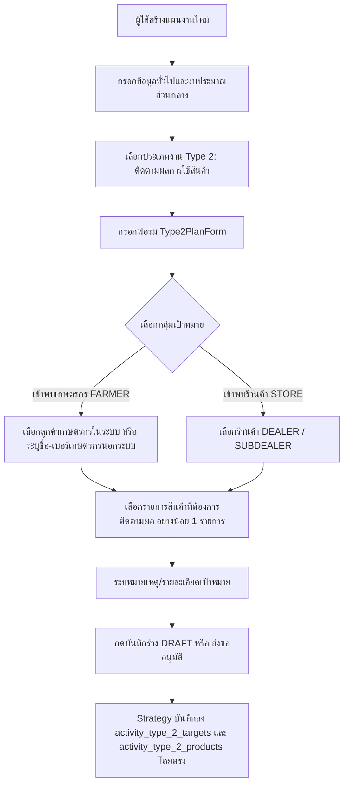
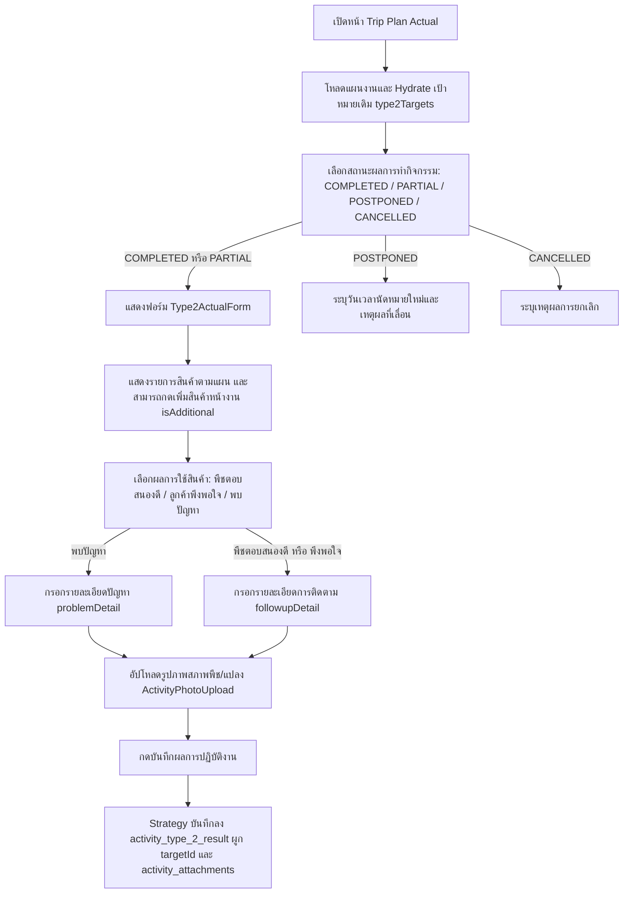
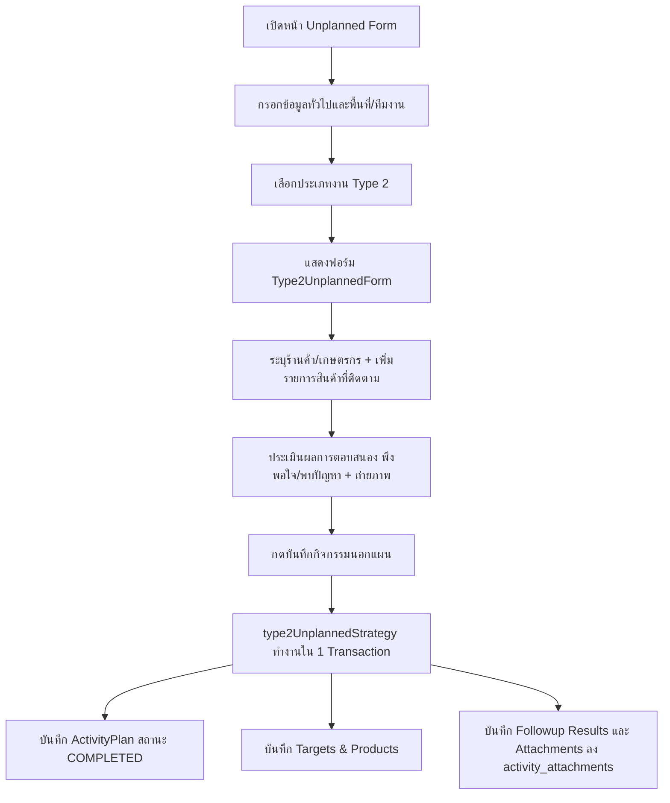
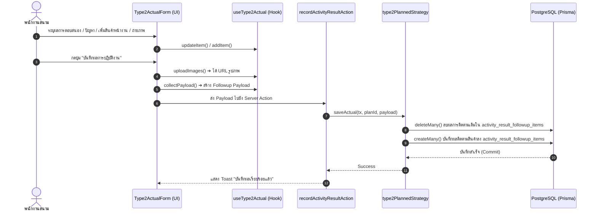

# Activity Type 2 — ติดตามผลการใช้สินค้า / Product Follow-up (README)

> **Feature Slice**: `modules/activity/features/type-2`  
> **Standard Reference**: ออกแบบตามแนวทาง Vertical Slice Architecture อิงต้นแบบ Gold Standard Type 1  
> **Parent Module**: `modules/activity`  
> **Database Authority**: `prisma/schema.prisma` (`ActivityPlanType2Target`, `ActivityPlanType2Product`, `ActivityResultType2`, `ActivityAttachment`)  
> **Status**: Production Ready / Active Reference (v2.0.0 Standalone)

---

## 1. Overview

### 1.1 วัตถุประสงค์ของ Type 2
**Type 2 (ติดตามผลการใช้สินค้า / Product Follow-up)** มีวัตถุประสงค์เพื่อรองรับการปฏิบัติงานของพนักงานสนาม (Sales / Technical Reps / Promoters) ในการเดินทางเข้าพบลูกค้าและเกษตรกรเพื่อ:
1. ติดตามผลลัพธ์และประสิทธิภาพหลังการใช้งานผลิตภัณฑ์เคมีเกษตร ฮอร์โมน และปุ๋ย
2. รับฟังความคิดเห็น (Feedback) ความพึงพอใจ หรือปัญหาที่เกิดขึ้นจากการใช้งานจริงในแปลงพืช
3. ให้คำแนะนำเพิ่มเติมทางเทคนิคเพื่อแก้ไขปัญหาเฉพาะหน้าและสร้างความมั่นใจให้แก่เกษตรกร
4. เก็บรวบรวมหลักฐานภาพถ่ายแปลงพืชและสภาพผลผลิตเพื่อใช้อ้างอิงและพัฒนาสินค้า

### 1.2 ขอบเขตของ Type 2
- **กลุ่มเป้าหมายที่รองรับ:**
  - **ร้านค้า (STORE):** ติดตาม feedback ผ่านร้านค้าตัวแทนจำหน่ายหลัก (`DEALER`) และตัวแทนจำหน่ายย่อย (`SUBDEALER`)
  - **เกษตรกร (FARMER):** เกษตรกรที่มีประวัติในฐานข้อมูลลูกค้า (Registered Customer) และเกษตรกรรายใหม่ที่ยังไม่ได้ลงทะเบียนในระบบ (Unregistered Farmer)
- **การจัดเก็บข้อมูล (Standalone 100%):**
  - **วางแผนเป้าหมายล่วงหน้า (Planned Targets & Products):** กำหนดร้านค้าหรือเกษตรกรเป้าหมายลง `activity_type_2_targets` พร้อมผูกรายการสินค้าเคมีเกษตรที่ต้องการติดตามผลลง `activity_type_2_products` (Multi-Product per Target)
  - **บันทึกผลการปฏิบัติงานจริง (Actual Outcome):** บันทึกลง Dedicated Table `activity_type_2_result` โดยประเมินผลลัพธ์รายสินค้า (`usageResult`: "พืชตอบสนองดี", "ลูกค้าพึงพอใจ", "พบปัญหา"), บันทึกรายละเอียดการติดตาม (`followupDetail`), รายละเอียดปัญหา (`problemDetail`), รองรับการเพิ่มสินค้าที่ติดตามหน้างานจริง (`isAdditional`) และอัปโหลดภาพถ่ายแปลงพืชลง `ActivityAttachment` (`category = "PLOT"`, `workTypeCode = "TYPE_2"`)

### 1.3 รูปแบบการทำงานที่รองรับ
1. **Planned (ในแผนงาน):** วางแผนการเดินทางเข้าพบเพื่อติดตามผลลัพธ์สินค้าล่วงหน้า ส่งขออนุมัติตามสายงาน
2. **Planned Actual (บันทึกผลงานตามแผน):** เมื่อแผนได้รับอนุมัติ นำแผนเดิมมารายงานผลการตอบสนองของพืช ระบุปัญหาที่พบ และอัปโหลดภาพถ่ายหลักฐาน
3. **Unplanned (กิจกรรมนอกแผน 2-in-1):** รองรับการลงพื้นที่ติดตามผลการใช้สินค้ากะทันหัน ระบุเป้าหมาย ร้านค้า/เกษตรกร พร้อมประเมินผลการตอบสนองของสินค้าและแนบภาพถ่ายจบในหน้าเดียว สถานะแผนเป็น `COMPLETED` ทันที
4. **Detail and Approval Views:** แสดงสรุปเป้าหมาย สินค้าที่ติดตาม และผลการใช้งานเพื่อการตรวจสอบและพิจารณาอนุมัติ

---

## 2. Business Flows

### 2.1 Planned (สร้างและแก้ไขแผนงาน)


### 2.2 Planned Actual (บันทึกผลการปฏิบัติงานตามแผน)


### 2.3 Unplanned (กิจกรรมนอกแผน 2-in-1)


### 2.4 Detail and Approval (ดูรายละเอียดและพิจารณาอนุมัติ)
- **Detail View:** แสดงการ์ด `Type2PlanCard` สำหรับเป้าหมายสินค้าตามแผน และแสดง `Type2DetailView` เพื่อดูผลการตอบสนองของพืช รายละเอียดปัญหา และรูปถ่ายแปลง
- **Approval View:** แสดง `Type2ApprovalCard` สรุปเป้าหมายร้านค้า/เกษตรกรและรายการสินค้าที่วางแผนติดตาม เพื่อให้หัวหน้างานพิจารณาอนุมัติ

---

## 3. Architecture

### 3.1 Folder Structure
```text
modules/activity/features/type-2/
├── index.ts                              # Unified Public API Contract (ส่งออกเฉพาะสิ่งที่ภายนอกต้องใช้)
├── README.md                             # เอกสารคู่มือทางเทคนิค (ไฟล์นี้)
│
├── planned/                              # Sub-slice: กิจกรรมในแผนงานและผลงานจริง
│   ├── application/                      # Business Logic, Validation, Mappers
│   │   ├── planned-validation.ts         # Zod schemas ตรวจสอบความถูกต้องของแผนงาน
│   │   ├── planned-mapper.ts             # แปลงเป้าหมาย Form <-> DB / Hydration
│   │   ├── actual-validation.ts          # Zod schemas ตรวจสอบผลการติดตามสินค้า
│   │   └── actual-mapper.ts              # แปลงผลงานจริง Form <-> DB Payload
│   ├── components/                       # UI Components ประจำ Type 2
│   │   ├── type2-planned-form.tsx        # ฟอร์มกรอกเป้าหมายติดตามสินค้า (Type2PlannedForm)
│   │   ├── type2-plan-card.tsx           # การ์ดสรุปเป้าหมายสินค้าตามแผนงาน
│   │   ├── type2-actual-form.tsx         # ฟอร์มบันทึกผลการตอบสนอง + ปัญหา + รูปภาพ
│   │   ├── type2-detail-view.tsx         # คอมโพเนนต์แสดงผลเต็มรูปแบบในหน้ารายละเอียด
│   │   └── type2-approval-card.tsx       # การ์ดสรุปสำหรับหน้าพิจารณาอนุมัติ
│   ├── hooks/                            # Custom State Hooks
│   │   ├── use-type2-planned-form.ts     # จัดการ State รายการเป้าหมายและสินค้าในแผน (useType2PlannedForm)
│   │   └── use-type2-actual.ts           # จัดการ State ผลการติดตามสินค้าและรูปภาพ
│   ├── infrastructure/                   # Database Strategies
│   │   └── type2-planned.strategy.ts     # บันทึก/โหลด Dedicated Tables (Targets & Products & Results)
│   └── types/                            # Type Definitions ในแผนและผลงานจริง
│       ├── planned.types.ts              # Type2PlannedItem, Type2ProductFollowupItem, Props
│       └── actual.types.ts               # Type2ActualFormProps, Type2ActualData
│
├── unplanned/                            # Sub-slice: กิจกรรมนอกแผน (2-in-1 Composition)
│   ├── application/                      # Logic และ Mappers กิจกรรมนอกแผน
│   │   ├── unplanned-mapper.ts           # Hydration และ Mapping นอกแผน
│   │   └── unplanned-validation.ts       # Zod validation กิจกรรมนอกแผน
│   ├── components/                       # UI Components กิจกรรมนอกแผน
│   │   └── type2-unplanned-form.tsx      # ฟอร์ม 2-in-1 (ระบุเป้าหมาย + สินค้า + ผลการใช้)
│   ├── hooks/                            # Custom State Hooks
│   │   └── use-type2-unplanned-form.ts   # จัดการ State รายการนอกแผน
│   ├── infrastructure/                   # Database Strategies นอกแผน
│   │   └── type2-unplanned.strategy.ts   # บันทึกเป้าหมายและผลการติดตามใน 1 Transaction
│   └── types/                            # Type Definitions นอกแผน
│       └── unplanned.types.ts            # Type2UnplannedItem, Props
│
└── shared/                               # ชิ้นส่วนที่ใช้ร่วมกันภายใน Feature Type 2
    ├── constants.ts                      # USAGE_RESULTS ("พืชตอบสนองดี", "ลูกค้าพึงพอใจ", "พบปัญหา")
    └── types.ts                          # CustomerOption, ProductOption, Type2ImageFile
```

### 3.2 Type 2 vs Shared Activity
| ความรับผิดชอบ | จัดการที่ Type 2 Feature (`features/type-2`) | จัดการที่ Activity ส่วนกลาง (`ui/`, `views/`) |
| :--- | :--- | :--- |
| **ข้อมูลทั่วไป** | - | ชื่องาน, วันที่เริ่ม-สิ้นสุด, วัตถุประสงค์หลัก |
| **พื้นที่ & ทีมงาน** | - | จังหวัด, อำเภอ, ตำบล, พนักงานร่วมเดินทาง |
| **งบประมาณ** | - | งบเบิกสินค้าสาธิต, ของแถม, ค่าใช้จ่ายเดินทาง |
| **ข้อมูลเป้าหมาย** | ร้านค้า, เกษตรกรใน/นอกระบบ, รายการสินค้าที่ติดตาม | - |
| **ผลการติดตามจริง** | ผลการใช้สินค้า (พึงพอใจ/พบปัญหา), รายละเอียดปัญหา, สินค้าเพิ่มหน้างาน | ผลสรุปภาพรวมแผน (สำเร็จ/เลื่อน/ยกเลิก) |
| **Database Persistence** | ตาราง `activity_plan_type_2_targets`, `activity_plan_type_2_products`, `activity_result_followup_items` | ตารางหลัก `ActivityPlan`, `ActivityPlanApprovalLog`, `ActivityAttachment` |

### 3.3 Dependency and Import Map
- **ทิศทางการเรียกใช้ (Allowed):**
  - `views/` ➔ เรียกใช้ ➔ `features/type-2` (ผ่าน `index.ts` เท่านั้น)
  - `features/type-2` ➔ เรียกใช้ ➔ `ui/` ส่วนกลาง (เช่น `ActivityPhotoUpload`, `FormActionButtons`)
  - `features/type-2` ➔ เรียกใช้ ➔ `@/modules/activity/constants`
  - `features/type-2` ➔ เรียกใช้ ➔ `@/modules/activity/types/strategy.interface`
- **Server Actions & Database Flow:**
  - `views/` ➔ ส่งข้อมูลไปยัง ➔ `@/modules/activity/server/actions` (`createActivityPlanAction`, `updateActivityPlanAction`, `recordActivityResultAction`)
  - Server Actions ➔ ทำงานร่วมกับ ➔ `type2PlannedStrategy` บันทึกลงตาราง `activity_plan_type_2_targets`, `activity_plan_type_2_products`, และ `activity_result_followup_items` โดยตรง
- **สิ่งต้องห้าม (Strictly Forbidden):**
  - ❌ ภายนอก Import เจาะลึกเข้าไปในโฟลเดอร์ย่อย เช่น `features/type-2/planned/components/...`
  - ❌ `features/type-2` เรียกใช้ข้อมูลข้ามไปยัง Feature อื่นโดยตรง
  - ❌ Import ย้อนกลับไปยังโมดูลเก่า `@/modules/activity-plans/...` โดยเด็ดขาด

### 3.4 Entry Points and Public Exports
ไฟล์ [modules/activity/features/type-2/index.ts](file:///d:/code/crm-bank/modules/activity/features/type-2/index.ts) ทำหน้าที่เป็น **Single Public API Contract** ส่งออกเฉพาะ:
- **Components:** `Type2PlanForm`, `Type2PlanCard`, `Type2ActualForm`, `Type2DetailView`, `Type2ApprovalCard`
- **Hooks:** `useType2Form`, `useType2Actual`
- **Mappers & Hydrators:** `extractType2PlanTargets`, `hydrateType2PlannedData`, `parseType2ActualResult`, `mapType2ActualFormToDb`
- **Validations:** `validateType2FormItems`, `createType2ValidationSchema`, `validateType2Actual`
- **Strategies:** `type2PlannedStrategy`
- **Types & Constants:** `USAGE_RESULTS`, `FollowupProductItem`, `Type2TargetItem`, `Type2ActualData`

---

## 4. File Responsibilities

### 4.1 Planned
- **`use-type2-planned-form.ts`:** จัดการ State ของรายการเป้าหมาย (Array of `Type2ProductFollowupItem` / `Type2PlannedItem`) รองรับการเพิ่ม/แก้ไข/ลบเป้าหมาย และการเพิ่ม/ลบรายการสินค้าในแต่ละเป้าหมาย (ส่งออก alias `useType2Form` ใน `index.ts`)
- **`type2-planned-form.tsx`:** เรนเดอร์การ์ดเป้าหมาย สลับ UI ระหว่างร้านค้ากับเกษตรกร พร้อมตารางเพิ่มรายการสินค้าที่ต้องการติดตามผล (Component: `Type2PlannedForm`, ส่งออก alias `Type2PlanForm` ใน `index.ts`)
- **`planned-mapper.ts`:**
  - `extractType2PlanTargets`: ดึงเป้าหมายจาก `type2Targets` (หรือ generic stores) เพื่อส่งให้หน้า Actual, Detail, และ Approval
  - `hydrateType2PlannedData`: กู้คืนข้อมูลแผนเดิมเข้าฟอร์มเมื่อเปิดหน้าแก้ไข (`edit-view.tsx`)
- **`planned-validation.ts`:** ตรวจสอบความถูกต้องของเป้าหมายและรายการสินค้า (ต้องมีสินค้าอย่างน้อย 1 รายการต่อเป้าหมาย)
- **`type2-planned.strategy.ts`:** บันทึกและโหลดข้อมูลลง Dedicated Tables `ActivityPlanType2Target` และ `ActivityPlanType2Product` พร้อม sync ตารางเดิม

### 4.2 Actual
- **`use-type2-actual.ts`:** จัดการ State ผลการติดตามสินค้า (`followupResults`), ผลการใช้ (`usageResult`), ปัญหาที่พบ (`problemDetail`), และรูปภาพ
- **`type2-actual-form.tsx`:** ฟอร์มบันทึกผลงานจริง รองรับการเลือกผลการตอบสนอง การบันทึกปัญหา และการเพิ่มสินค้าหน้างาน (`isAdditional`)
- **`actual-mapper.ts`:**
  - `parseType2ActualResult`: แปลงข้อมูลจาก `result.followupResults` หรือ `resultSummary` เข้าสู่ State
  - `mapType2ActualFormToDb`: แปลง State ผลงานจริงให้เป็น Payload สำหรับบันทึกลงฐานข้อมูล
- **`actual-validation.ts`:** ตรวจสอบว่าถ้าเลือก "พบปัญหา" ต้องระบุรายละเอียดปัญหา (`problemDetail`)

### 4.3 Shared Types and Constants
- **`shared/constants.ts`:** กำหนด `USAGE_RESULTS` ("พืชตอบสนองดี", "ลูกค้าพึงพอใจ", "พบปัญหา") พร้อม Config สีและ Badge
- **`shared/types.ts`:** กำหนด `CustomerOption`, `ProductOption`, `Type2ImageFile`

### 4.4 Shared UI and Views Integration
- `DetailWorkTypeList`, `ApprovalWorkTypeList`, และ `ActualWorkTypeList` ใน `modules/activity/views/` ทำหน้าที่เป็น Orchestrator เรียกใช้ Component ของ Type 2 เมื่อตรวจพบ `TYPE_2` หรือ `ติดตามผลการใช้สินค้า`

---

## 5. Data Flow



### 5.1 Create Planned (สร้างแผนใหม่)
1. `create-view.tsx` เรียกใช้ `useType2Form()`
2. ผู้ใช้ระบุเป้าหมายใน `Type2PlanForm` (ร้านค้า/เกษตรกร และสินค้าที่ต้องการติดตาม)
3. ตรวจสอบความถูกต้องด้วย `validateType2FormItems`
4. Form Orchestrator รวบรวม payload ➔ ส่งไปยัง Server Action `createActivityPlanAction`
5. Server Action เรียก `type2PlannedStrategy.savePlan()` ภายใน `$transaction`
6. Prisma บันทึกเป้าหมายลง `activity_plan_type_2_targets` และสินค้าลง `activity_plan_type_2_products`

### 5.2 Edit Planned (แก้ไขแผนงานเดิม)
1. `edit-view.tsx` ดึงข้อมูลแผนจากฐานข้อมูล (`plan`)
2. เรียก `hydrateType2PlannedData(plan)` เพื่อดึงข้อมูลเดิมจาก `type2Targets`
3. ข้อมูลเดิมถูกเติมเข้าสู่ State ของฟอร์ม พร้อมให้แก้ไขและบันทึกกลับ

### 5.3 Save Actual (บันทึกผลการปฏิบัติงานจริง)
1. `activity-plan-actual-view.tsx` รัน `handleSubmit`
2. เรียก `type2Actual.uploadImages(id)` เพื่ออัปโหลดไฟล์ภาพ
3. เรียก `type2Actual.collectPayload()` ได้รายการ `t2FollowupResults`
4. ส่ง Payload เข้า `recordActivityResultAction(id, payload)`
5. `type2PlannedStrategy.saveActual()` ลบผลงานเก่าแล้วสร้างระเบียนใหม่ลง `activity_result_followup_items`

### 5.4 Load Actual (โหลดผลงานเดิมมาแสดงในหน้าบันทึกผล)
1. `useActualPlanLoader` โหลดแผนและข้อมูล `plan.result`
2. `extractType2PlanTargets(plan)` แปลงเป้าหมายและรายการสินค้าเดิมเข้าสู่ `targets`
3. `type2Actual.hydrate(plan.result, targets)` กู้คืนผลลัพธ์รายสินค้าและรูปภาพเดิม
4. ฟอร์มแสดงข้อมูลเดิมพร้อมให้แก้ไขเพิ่มเติม

---

## 6. Data Models and Mapping

### 6.1 Database CRUD Matrix (สิทธิ์และการจัดการตารางในฐานข้อมูล)
| ตารางในฐานข้อมูล (`Prisma Model`) | Create (สร้าง) | Read (อ่าน/แสดงผล) | Update (แก้ไข) | Delete (ลบ) | หมายเหตุ |
| :--- | :--- | :--- | :--- | :--- | :--- |
| **`activity_type_2_targets`**<br>(`ActivityPlanType2Target`) | `savePlan()` ใน Planned | `loadPlan()`, `plan.type2Targets` ใน Detail / Edit / Actual | `deleteMany()` + `create()` ใน `savePlan()` | Cascade เมื่อลบ `ActivityPlan` | เก็บเป้าหมายร้านค้า/เกษตรกร |
| **`activity_type_2_products`**<br>(`ActivityPlanType2Product`) | `savePlan()` ใน Planned | `loadPlan()`, `target.products` | `deleteMany()` + `createMany()` ใน `savePlan()` | Cascade เมื่อลบ `Target` หรือ `Plan` | เก็บรายการสินค้าที่ผูกกับเป้าหมาย |
| **`activity_type_2_result`**<br>(`ActivityResultType2`) | `saveActual()` ใน Actual | `result.type2Results` / `target.results` | `deleteMany()` + `createMany()` ใน `saveActual()` | Cascade เมื่อลบ `ActivityPlan` หรือ `Target` | เก็บผลการตอบสนองและปัญหาของสินค้า |
| **`activity_attachments`**<br>(`ActivityAttachment`) | Storage Upload + Action | `plan.attachments` | ลบรายการเก่าและสร้างระเบียนใหม่ | Cascade เมื่อลบ `ActivityPlan` | เก็บล็อก URL ภาพถ่ายแปลง |

### 6.2 Complete Field-to-Database Mapping (ตารางจับคู่ฟิลด์ครบถ้วนทุกจุด)
ไล่จาก **Form Field ➔ Type Field ➔ Mapper ➔ Prisma Model ➔ DB Column Name ➔ Data Type**:

| Form Field (UI) | TypeScript Type Field | Mapper Function (Write/Read) | Prisma Model | DB Column Name | Data Type | Nullable? | Default |
| :--- | :--- | :--- | :--- | :--- | :--- | :---: | :--- |
| **เป้าหมายเข้าพบ** | `visitPurpose` | `hydrateType2PlannedData` | `ActivityPlanType2Target` | `visit_purpose` | `VARCHAR` | No | `"FARMER"` |
| **รหัสร้านค้า/ลูกค้า** | `storeId` | `savePlan` / `extractType2PlanTargets` | `ActivityPlanType2Target` | `store_id` | `VARCHAR (FK)` | Yes | `null` |
| **จังหวัดของเป้าหมาย** | `province` | `savePlan` | `ActivityPlanType2Target` | `province` | `VARCHAR` | No | `""` |
| **เกษตรกรไม่มีในระบบ**| `isUnregisteredFarmer`| `savePlan` | `ActivityPlanType2Target` | `is_unregistered_farmer`| `BOOLEAN` | No | `false` |
| **ชื่อเกษตรกรนอกระบบ**| `unregisteredFarmerName`| `savePlan` | `ActivityPlanType2Target` | `unregistered_farmer_name`| `VARCHAR` | Yes | `null` |
| **เบอร์โทรเกษตรกร** | `unregisteredFarmerPhone`| `savePlan` | `ActivityPlanType2Target` | `unregistered_farmer_phone`| `VARCHAR` | Yes | `null` |
| **รายละเอียดเป้าหมาย** | `notes` | `savePlan` / `hydrateType2PlannedData` | `ActivityPlanType2Target` | `notes` | `TEXT` | Yes | `null` |
| **รหัสสินค้าในแผน** | `productId` | `savePlan` | `ActivityPlanType2Product` | `product_id` | `VARCHAR (FK)` | No | - |
| **หมายเหตุสินค้าในแผน**| `notes` | `savePlan` | `ActivityPlanType2Product` | `notes` | `TEXT` | Yes | `null` |
| **รหัสเป้าหมายผลงาน** | `targetId` | `mapType2ActualFormToDb` | `ActivityResultType2` | `target_id` | `VARCHAR (FK)` | Yes | `null` |
| **ผลการใช้สินค้า** | `usageResult` | `mapType2ActualFormToDb` | `ActivityResultType2` | `usage_result` | `VARCHAR` | Yes | `null` |
| **รายละเอียดการติดตาม**| `followupDetail` | `mapType2ActualFormToDb` | `ActivityResultType2` | `followup_detail` | `TEXT` | Yes | `null` |
| **ปัญหาที่พบ** | `problemDetail` | `mapType2ActualFormToDb` | `ActivityResultType2` | `problem_detail` | `TEXT` | Yes | `null` |
| **สินค้าเพิ่มหน้างาน** | `isAdditional` | `mapType2ActualFormToDb` | `ActivityResultType2` | `is_additional` | `BOOLEAN` | No | `false` |
| **รูปภาพสภาพแปลง/พืช** | `images` / `attachments` | `uploadImages` / `saveActual` | `ActivityAttachment` | `file_url` | `VARCHAR` | No | - |
| **ชื่อไฟล์รูปภาพ** | `fileName` / `name` | `saveActual` | `ActivityAttachment` | `file_name` | `VARCHAR` | No | `"รูปภาพ"` |
| **หมวดหมู่รูปภาพ** | `category` | `saveActual` | `ActivityAttachment` | `category` | `ENUM (AttachmentCategory)` | No | `PLOT` |
| **รหัสประเภทงานรูปภาพ** | `workTypeCode` | `saveActual` | `ActivityAttachment` | `work_type_code` | `VARCHAR` | Yes | `"TYPE_2"` |

### 6.3 รายละเอียดตารางและความสัมพันธ์ (Prisma Schema)

```prisma
// 1. ตารางเก็บเป้าหมาย Type 2 (Dedicated Table)
model ActivityPlanType2Target {
  id                      String   @id @default(cuid())
  activityPlanId          String   @map("activity_plan_id")
  visitPurpose            String   @map("visit_purpose") // "FARMER" | "STORE"
  storeId                 String?  @map("store_id")
  province                String   @map("province")
  isUnregisteredFarmer    Boolean  @default(false) @map("is_unregistered_farmer")
  unregisteredFarmerName  String?  @map("unregistered_farmer_name")
  unregisteredFarmerPhone String?  @map("unregistered_farmer_phone")
  notes                   String?  @map("notes")

  createdAt               DateTime @default(now()) @map("created_at")
  updatedAt               DateTime @updatedAt @map("updated_at")

  activityPlan            ActivityPlan               @relation("ActivityPlanType2Targets", fields: [activityPlanId], references: [id], onDelete: Cascade)
  store                   Customer?                  @relation("Type2TargetStore", fields: [storeId], references: [id], onDelete: SetNull)
  products                ActivityPlanType2Product[] @relation("Type2TargetProducts")
  results                 ActivityResultType2[]      @relation("Type2TargetResults")

  @@index([activityPlanId])
  @@index([storeId])
  @@map("activity_type_2_targets")
}

// 2. ตารางเก็บสินค้าที่ติดตามตามเป้าหมาย Type 2
model ActivityPlanType2Product {
  id                      String   @id @default(cuid())
  targetId                String   @map("target_id")
  activityPlanId          String   @map("activity_plan_id")
  productId               String   @map("product_id")
  notes                   String?  @map("notes")

  createdAt               DateTime @default(now()) @map("created_at")
  updatedAt               DateTime @updatedAt @map("updated_at")

  target                  ActivityPlanType2Target @relation("Type2TargetProducts", fields: [targetId], references: [id], onDelete: Cascade)
  activityPlan            ActivityPlan            @relation("ActivityPlanType2Products", fields: [activityPlanId], references: [id], onDelete: Cascade)
  product                 Product                 @relation("Type2ProductRef", fields: [productId], references: [id], onDelete: Restrict)

  @@index([targetId])
  @@index([activityPlanId])
  @@index([productId])
  @@map("activity_type_2_products")
}

// 3. ตารางเก็บผลการติดตามผลการใช้สินค้าจริง (Dedicated Result Table)
model ActivityResultType2 {
  id              String                   @id @default(cuid())
  activityPlanId  String                   @map("activity_plan_id")
  targetId        String?                  @map("target_id")
  storeId         String?                  @map("store_id")
  productId       String                   @map("product_id")
  productName     String?                  @map("product_name")
  usageResult     String?                  @map("usage_result") // "ลูกค้าพึงพอใจ" | "พืชตอบสนองดี" | "พบปัญหา"
  followupDetail  String?                  @map("followup_detail") @db.Text
  problemDetail   String?                  @map("problem_detail") @db.Text
  isAdditional    Boolean                  @default(false) @map("is_additional")

  createdAt       DateTime                 @default(now()) @map("created_at")
  updatedAt       DateTime                 @updatedAt @map("updated_at")

  activityPlan    ActivityPlan             @relation("ActivityResultType2s", fields: [activityPlanId], references: [id], onDelete: Cascade)
  target          ActivityPlanType2Target? @relation("Type2TargetResults", fields: [targetId], references: [id], onDelete: Cascade)
  store           Customer?                @relation("Type2ResultStore", fields: [storeId], references: [id], onDelete: SetNull)
  product         Product                  @relation("Type2ResultProduct", fields: [productId], references: [id], onDelete: Restrict)

  @@index([activityPlanId])
  @@index([targetId])
  @@index([storeId])
  @@index([productId])
  @@index([isAdditional])
  @@map("activity_type_2_result")
}

// 4. ตารางเก็บรูปภาพประกอบกิจกรรม (ภาพสภาพแปลง / ผลิตภัณฑ์)
model ActivityAttachment {
  id               String             @id @default(cuid())
  activityPlanId   String             @map("activity_plan_id")
  activityResultId String?            @map("activity_result_id")
  workTypeCode     String?            @map("work_type_code") // "TYPE_2"
  storeId          String?            @map("store_id")
  productId        String?            @map("product_id")
  category         AttachmentCategory @default(GENERAL)      // PLOT, GENERAL
  fileUrl          String             @map("file_url")
  fileName         String             @map("file_name")
  fileSize         Int?               @map("file_size")
  mimeType         String?            @map("mime_type")
  createdAt        DateTime           @default(now()) @map("created_at")

  activityPlan     ActivityPlan       @relation(fields: [activityPlanId], references: [id], onDelete: Cascade)
  activityResult   ActivityResult?    @relation(fields: [activityResultId], references: [id], onDelete: Cascade)
  store            Customer?          @relation(fields: [storeId], references: [id], onDelete: SetNull)
  product          Product?           @relation("ActivityAttachmentProductRef", fields: [productId], references: [id], onDelete: SetNull)

  @@index([activityPlanId])
  @@index([activityResultId])
  @@index([category])
  @@map("activity_attachments")
}
```

### 6.4 Transaction & Persistence Strategy
- **Atomic Operations:** ทุกคำสั่ง Write ดำเนินการภายใต้ Prisma Transaction (`tx`) หากเกิดข้อผิดพลาดจะ Rollback ทั้งหมด
- **Cascade Delete:** เมื่อลบ `ActivityPlan` ระเบียนใน `activity_plan_type_2_targets`, `activity_plan_type_2_products`, `activity_attachments` จะถูกลบตามทันที และเมื่อลบ `ActivityResult` ระเบียนใน `activity_result_followup_items` จะถูกลบด้วย

---

## 7. Business Rules

### 7.1 Validation Rules
- **เป้าหมายในแผน:**
  - ต้องระบุเป้าหมายอย่างน้อย 1 รายการ และแต่ละเป้าหมายต้องระบุสินค้าที่ต้องการติดตามอย่างน้อย 1 รายการ
  - หากเข้าพบร้านค้า (`STORE`): ต้องเลือกร้านค้าที่มีอยู่ในระบบ (`storeId` ห้ามว่าง)
  - หากเข้าพบเกษตรกรนอกระบบ (`isUnregisteredFarmer = true`): ต้องระบุชื่อเกษตรกรและจังหวัด
- **ผลงานจริง (Actual):**
  - ต้องมีผลการติดตามสินค้าอย่างน้อย 1 รายการ
  - หากเลือกผลการใช้สินค้าเป็น **"พบปัญหา"**: ต้องระบุรายละเอียดปัญหา (`problemDetail`)

### 7.2 Default Values
- `visitPurpose`: ค่าเริ่มต้นเป็น `"FARMER"`
- `usageResult`: ค่าเริ่มต้นเป็น `"พืชตอบสนองดี"`
- `isAdditional`: ค่าเริ่มต้นเป็น `false` สำหรับสินค้าตามแผน และ `true` สำหรับสินค้าที่เพิ่มหน้างาน

### 7.3 Conditional Fields
- เมื่อผู้ใช้เลือกผลการใช้สินค้าเป็น `"พบปัญหา"` หน้าจอจะแสดงกล่องข้อความสีแดงให้กรอกรายละเอียดปัญหา
- เมื่อผู้ใช้เลือกเกษตรกรนอกระบบ ช่องกรอกชื่อและเบอร์โทรศัพท์จะเปิดขึ้นมาให้กรอกแทน Dropdown เลือกลูกค้า

---

## 8. Shared Dependencies

โมดูล Type 2 ทำงานร่วมกับชิ้นส่วนส่วนกลางดังนี้:
1. **`@/modules/activity/ui`:**
   - `ActivityPhotoUpload`: สำหรับอัปโหลดภาพถ่ายแปลงพืชและภาพสินค้า
   - `FormActionButtons`: ปุ่ม ยกเลิก / บันทึกร่าง / ส่งขออนุมัติ
2. **`@/modules/activity/views`:**
   - `ActualWorkTypeList`: ตัวกระจายฟอร์ม Type 2 Actual
   - `DetailWorkTypeList`: ตัวกระจายการ์ด Type 2 Detail
   - `ApprovalWorkTypeList`: ตัวกระจายการ์ด Type 2 Approval
3. **`@/modules/activity/domain/summary`:**
   - `plan-targets-registry.ts`: ลงทะเบียน `TYPE_2` Extractor เพื่อดึงเป้าหมายจาก `type2Targets` อัตโนมัติ

---

## 9. How to Modify Type 2

### 9.1 การเพิ่มฟิลด์ใหม่บนฟอร์ม
1. เพิ่มฟิลด์ใน Type: `planned/types/planned.types.ts` หรือ `actual.types.ts`
2. เพิ่ม Validation ใน `planned-validation.ts` หรือ `actual-validation.ts`
3. เพิ่ม Input Field ใน Component: `type2-planned-form.tsx` หรือ `type2-actual-form.tsx`
4. อัปเดต Mapper ใน `planned-mapper.ts` หรือ `actual-mapper.ts`
5. อัปเดต Strategy ใน `type2-planned.strategy.ts` เพื่อบันทึกฟิลด์ลง Database

### 9.2 การปรับแก้ Validation
- ปรับเปลี่ยนเงื่อนไข Zod schema ใน `planned-validation.ts` หรือ `actual-validation.ts`

---

## 10. Troubleshooting & Tracing Pipeline

### 10.1 Step-by-Step Tracing Pipeline
```text
[Step 1: UI Field] ➔ Type2ActualForm.tsx (ตรวจว่า Dropdown usageResult และ problemDetail ทำงานถูกต้อง)
        ↓
[Step 2: Hook State] ➔ use-type2-actual.ts (ตรวจว่า followupResults มีข้อมูลครบถ้วน)
        ↓
[Step 3: Save Mapper] ➔ actual-mapper.ts: mapType2ActualFormToDb()
        ↓
[Step 4: Server Action] ➔ recordActivityResultAction
        ↓
[Step 5: Strategy Write] ➔ type2-planned.strategy.ts: saveActual()
        ↓
[Step 6: Prisma Table] ➔ ActivityResultType2 (ตรวจว่าข้อมูลลงตาราง activity_type_2_result ถูกต้อง)
        ↓
[Step 7: Loader & Include] ➔ ACTIVITY_PLAN_FULL_INCLUDE (ตรวจว่า include type2Targets และ type2Results ครบ)
        ↓
[Step 8: Load Hydrator] ➔ planned-mapper.ts: extractType2PlanTargets() & parseType2ActualResult()
```

### 10.2 ตารางวิเคราะห์ปัญหาที่พบบ่อย (Common Pitfalls)
| อาการ | จุดที่ต้องตรวจสอบ | วิธีแก้ไข |
| :--- | :--- | :--- |
| **ผลการใช้สินค้าบันทึก "พบปัญหา" ใน DB แต่หน้า UI แสดงเป็น "ลูกค้าพึงพอใจ"** | `Type2ActualForm`, `useType2Actual`, `actual-mapper.ts`, `planned-mapper.ts`, `activity-plan-actual-view.tsx` | แก้ไข Hydration ให้ส่ง `type2Results` เข้า `payloadToHydrate`, ให้ `useType2Actual` และ `parseType2ActualResult` อ่าน `type2Results` และ `activityPlan.type2Results`, ปรับ `getParsedUsageResult` และ `initialPlannedItems` ใน `Type2ActualForm` ให้ยึดค่า `usageResult` จากผลงานจริงที่บันทึกไว้ใน DB ("พบปัญหา") เป็นหลัก ไม่ถูก override เป็นค่าเริ่มต้น |
| **สินค้าตามแผนไม่แสดงในหน้า Actual** | `extractType2PlanTargets` ใน `planned-mapper.ts` | ตรวจสอบว่า `type2Targets` ถูก include มาใน Query หรือไม่ และเช็ค fallback `t2Products` |
| **บันทึกไม่ผ่าน แจ้งให้ระบุรายละเอียดปัญหา** | `actual-validation.ts` | เมื่อเลือก `usageResult === "พบปัญหา"` ระบบบังคับกรอก `problemDetail` ให้กรอกรายละเอียดปัญหา |
| **รูปภาพไม่บันทึกลงฐานข้อมูล** | `use-type2-actual.ts` ➔ `uploadImages` | ตรวจสอบการเรียก `uploadImages(planId)` ก่อนส่ง payload ไปบันทึกผล |
| **รูปภาพการติดตามผลแสดงซ้ำ 2 รูปทั้งที่อัปโหลด 1 รูป** | `Type2DetailView`, `result-summary-parser.ts`, `detail-work-type-list.tsx` | เนื่องจากไฟล์แนบผูกทั้ง `activityPlanId` และ `activityResultId` ตอน query ทำให้ได้ผลลัพธ์ซ้ำ ระบบจึงทำ Deduplication กรองรูปตาม `id` และ `url` ก่อนเรนเดอร์ในคอมโพเนนต์ |

---

## 11. Testing and Manual UAT

- [ ] **TC-01 (Planned Create - Store):** สร้างแผนเข้าพบร้านค้าเพื่อติดตามผล ระบุสินค้าอย่างน้อย 1 รายการ บันทึกสำเร็จ
- [ ] **TC-02 (Planned Create - Farmer):** สร้างแผนเข้าพบเกษตรกรนอกระบบ ระบุชื่อ เบอร์โทร และสินค้า บันทึกสำเร็จ
- [ ] **TC-03 (Planned Edit):** เข้าหน้าแก้ไข แผน Type 2 ข้อมูลเป้าหมายและรายการสินค้าต้องโหลดขึ้นมาครบถ้วน
- [ ] **TC-04 (Detail View):** เข้าหน้ารายละเอียด การ์ด Type 2 ต้องแสดงเป้าหมายและรายการสินค้าครบถ้วน
- [ ] **TC-05 (Actual - Normal):** บันทึกผลการใช้สินค้าแบบ "พืชตอบสนองดี" หรือ "ลูกค้าพึงพอใจ" พร้อมภาพถ่าย บันทึกสำเร็จลง `activity_type_2_result`
- [ ] **TC-06 (Actual - Problem):** บันทึกผลแบบ "พบปัญหา" ตรวจสอบว่าระบบบังคับกรอก `problemDetail` และบันทึกลง DB สำเร็จ
- [ ] **TC-07 (Actual - Additional Product):** กดปุ่มเพิ่มสินค้าหน้างาน (`isAdditional = true`) และบันทึกผลได้จริง
- [ ] **TC-08 (Approval View):** หัวหน้างานเปิดหน้าพิจารณาอนุมัติ การ์ด Type 2 ต้องแสดงเป้าหมายชัดเจน
- [ ] **TC-09 (Detail Images Deduplication):** อัปโหลดภาพผลการติดตาม 1 รูป หน้ารายละเอียดและหน้าอนุมัติต้องแสดง 1 รูป ไม่เบิ้ลซ้ำ
- [ ] **TC-10 (Actual Hydration - Problem State):** ข้อมูลผลการติดตามใน DB ที่บันทึก "พบปัญหา" และรายละเอียดปัญหา ต้องโหลดขึ้นมาแสดงผลเป็น "พบปัญหา" บนหน้า Type2ActualForm และ Type2DetailView อย่างถูกต้อง

---

## 12. Change Log

| วันที่ | เวอร์ชัน | รายละเอียดการปรับปรุง | ผู้ดำเนินการ |
| :--- | :--- | :--- | :--- |
| **2026-10-26** | 2.1.0 | แก้ไขปัญหา Hydration ผลการใช้สินค้า "พบปัญหา" ใน DB แต่หน้า UI แสดงเป็น "ลูกค้าพึงพอใจ": ส่ง `type2Results` เข้า `payloadToHydrate`, ปรับ `useType2Actual`, `actual-mapper.ts`, `planned-mapper.ts`, `result-summary-parser.ts` และ `Type2ActualForm` ให้ยึดผลงานจริงจาก DB อย่างถูกต้อง | Antigravity AI |
| **2026-10-24** | 2.0.0 | **Batch B Standardization**: ปรับปรุงโครงสร้างตารางเป็น Dedicated Tables (`activity_type_2_targets`, `activity_type_2_products`, `activity_type_2_result`), ผูก `targetId` กับผลงานติดตาม, ตัด Generic Dual-writes ไปยัง `activity_plan_stores` / `activity_plan_products` / `activity_result_followup_items` ออก 100% | Antigravity AI |
| **2026-10-20** | 1.3.0 | แก้ไขปัญหาภาพถ่ายการติดตามผลแสดงซ้ำ (Image Deduplication) ใน `Type2DetailView`, `result-summary-parser.ts` และ `useType2Actual` | Antigravity AI |
| **2026-10-19** | 1.2.0 | พัฒนา Sub-slice `unplanned/` (2-in-1 Form, Hook, Mapper, Validation, Strategy) สำหรับการติดตามผลการใช้สินค้านอกแผน | Antigravity AI |
| **2026-10-19** | 1.1.0 | จัดทำเอกสารคู่มือสถาปัตยกรรมฉบับสมบูรณ์ตามรูปแบบมาตรฐาน Type 1 Gold Standard | Antigravity AI |
| **2026-10-19** | 1.0.0 | พัฒนา Type 2 Vertical Slice ฉบับสมบูรณ์ พร้อมเชื่อมโยง Dedicated Tables และ Targets Registry | Antigravity AI |
