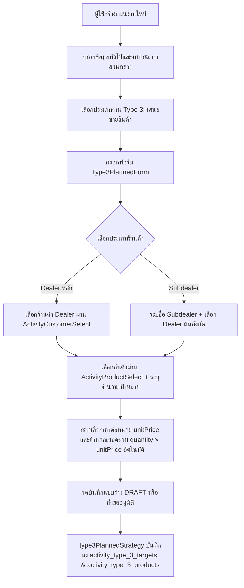
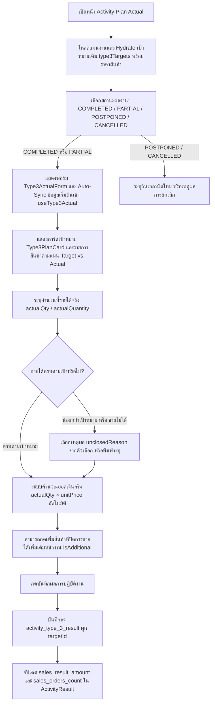
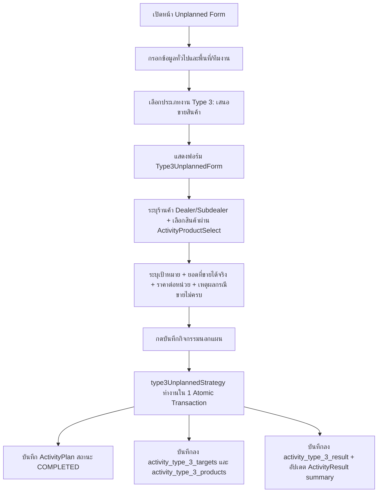

# Activity Type 3 — เสนอขายสินค้า / Product Sales Proposal (README)

> **Feature Slice**: `modules/activity/features/type-3`  
> **Standard Reference**: ออกแบบตามแนวทาง Vertical Slice Architecture อิงตามต้นแบบ Gold Standard Type 1 และ Type 2  
> **Parent Module**: `modules/activity`  
> **Database Authority**: `prisma/schema.prisma` (`ActivityPlanType3Target`, `ActivityPlanType3Product`, `ActivityResultType3`)  
> **Status**: Production Ready / Active Reference (v2.0.0 Standalone)

---

## 1. Overview

### 1.1 วัตถุประสงค์ของ Type 3
**Type 3 (เสนอขายสินค้า / Product Sales Proposal)** มีวัตถุประสงค์เพื่อรองรับการปฏิบัติงานของพนักงานฝ่ายขาย (Sales Reps / Technical Sales) ในการนำเสนอขายผลิตภัณฑ์เคมีเกษตร ฮอร์โมน และปุ๋ย แก่ร้านค้าตัวแทนจำหน่าย:
1. วางแผนเสนอขายสินค้าล่วงหน้า พร้อมกำหนดเป้าหมายจำนวน (`targetQuantity`) ราคาต่อหน่วย (`unitPrice`) และยอดเงินรวมเป้าหมาย (`targetAmount = targetQuantity × unitPrice`)
2. รองรับโครงสร้างลูกค้าทั้ง **ตัวแทนจำหน่ายหลัก (Dealer)** และ **ร้านค้าย่อย (Subdealer)** ที่มี Dealer ต้นสังกัด
3. บันทึกผลการปิดการขายจริงหน้างาน (Actual Sales Outcome) เปรียบเทียบกับเป้าหมาย (Target vs Actual)
4. บันทึกเหตุผลในกรณีที่ไม่สามารถปิดการขายได้ หรือปิดได้ไม่ครบตามเป้าหมาย (`unclosedReason`) เพื่อนำไปวิเคราะห์คู่แข่งและการตลาด
5. รองรับการเพิ่มสินค้าที่ขายได้จริงนอกเหนือจากแผนเดิมหน้างาน (`isAdditional`)
6. จัดเก็บข้อมูลลงใน Dedicated Tables (`activity_type_3_targets`, `activity_type_3_products`, `activity_type_3_result`) 100% พร้อมอัปเดตสรุปยอดขาย `sales_result_amount` และ `sales_orders_count` ใน `activity_results`

### 1.2 ขอบเขตของ Type 3
- **กลุ่มเป้าหมายที่รองรับ:**
  - **ตัวแทนจำหน่ายหลัก (DEALER):** เลือกร้านค้าตัวแทนจำหน่ายที่ขึ้นทะเบียนในระบบผ่าน `ActivityCustomerSelect`
  - **ร้านค้าย่อย (SUBDEALER):** ระบุชื่อร้านค้าย่อย (`subDealerStore`) พร้อมเลือก Dealer ต้นสังกัด (`storeId`)
- **รายการสินค้าและราคา (Price & Amount Calculation):**
  - ผูกแคตตาล็อกสินค้าเคมีเกษตร (`ProductOption`) ผ่าน `ActivityProductSelect` (`unitFilter="box"`)
  - ดึงราคาตั้งต้นจากมาสเตอร์สินค้า (`Product.price` -> `masterPrice` / `unitPrice`) โดยคำนวณยอดรวมรายรายการ (`price = quantity × unitPrice`) และยอดรวมเป้าหมายรายร้าน (`targetAmount`) อัตโนมัติ
  - มีระบบ **Catalog Price Fallback**: หากข้อมูลแผนเดิมในฐานข้อมูลมี `unitPrice` เป็น `0` หรือ `null` ระบบจะค้นหาราคาจาก `product.price` ใน Relation หรือ `products` Catalog มาคำนวณแสดงผลให้อัตโนมัติทั้งใน `Type3PlannedForm`, `Type3PlanCard`, และ `Type3ActualForm`
- **การจัดเก็บข้อมูลแบบ Standalone 100%:**
  - บันทึกลงใน Dedicated Tables: `ActivityPlanType3Target` (`activity_type_3_targets`) และ `ActivityPlanType3Product` (`activity_type_3_products`)
  - บันทึกผลงานจริงลงใน Dedicated Table: `ActivityResultType3` (`activity_type_3_result`) ผูกกับ `targetId`
  - อัปเดตสรุปยอดขายรวมใน `activity_results.sales_result_amount` และจำนวนออเดอร์ใน `activity_results.sales_orders_count`
  - ปราศจากการเขียน dual-write ซ้ำซ้อนไปยัง generic tables

### 1.3 รูปแบบการทำงานที่รองรับ
1. **Planned (ในแผนงาน Trip Plan):** วางแผนเสนอขายสินค้าล่วงหน้า เลือกร้านค้า Dealer/Subdealer กำหนดจำนวนและแสดงราคา/ยอดรวมอัตโนมัติ
2. **Planned Actual (บันทึกผลงานตามแผน):** นำแผนเดิมมารายงานผลการขายจริง (จำนวนที่ขายได้, ยอดเงินจริงตามราคาต่อหน่วย, เหตุผลที่ไม่ปิดการขาย) และเพิ่มสินค้าที่ขายได้จริงหน้างาน พร้อม Auto-Sync ข้อมูลเริ่มต้นตั้งแต่เปิดฟอร์ม
3. **Unplanned (กิจกรรมนอกแผน 2-in-1):** รองรับการเสนอขายสินค้ากะทันหันหน้างาน บันทึกร้านค้าเป้าหมาย สินค้า และยอดขายจริงเสร็จสิ้นในหน้าเดียว สถานะแผนเป็น `COMPLETED` ทันที
4. **Detail View:** การ์ดสรุปเป้าหมาย (`Type3PlanCard`) และตารางเปรียบเทียบเป้าหมาย vs ผลขายจริง (`Type3DetailView`) พร้อมสรุปตัวเลขยอดขายและสถานะการปิดดีล
5. **Approval View:** การ์ดสรุปเป้าหมายร้านค้าและรายการเสนอขาย (`Type3ApprovalCard`) สำหรับหัวหน้างานพิจารณาอนุมัติ

---

## 2. Business Flows

### 2.1 Planned (สร้างและแก้ไขแผนงาน)


### 2.2 Planned Actual (บันทึกผลการปฏิบัติงานตามแผน)


### 2.3 Unplanned (กิจกรรมนอกแผน 2-in-1)


### 2.4 Detail and Approval
- **Detail View:** แสดงการ์ดเป้าหมาย (`Type3PlanCard`) และตารางเปรียบเทียบ Target vs Actual ผ่าน `Type3DetailView` สรุปยอดขายรวมและสถานะการปิดดีล (`ปิดการขายได้ทั้งหมด`, `ปิดการขายได้บางส่วน`, `ปิดการขายไม่ได้`)
- **Approval View:** หากเป็นกิจกรรมนอกแผนที่มีผลงานจริง จะแสดง `Type3DetailView` แบบเต็ม; หากเป็น Trip Plan ปกติ จะแสดง `Type3ApprovalCard` เพื่อตรวจเช็คเป้าหมายก่อนอนุมัติ

---

## 3. Architecture & Directory Structure

```text
modules/activity/features/type-3/
├── index.ts                                    # Unified Public API Contract
├── README.md                                   # คู่มือทางเทคนิค (ไฟล์นี้)
│
├── shared/                                     # ส่วนที่ใช้ร่วมกันใน Type 3
│   ├── constants.ts                            # NOT_CLOSED_REASONS, SALE_STATUSES, SALE_STATUS_CONFIG
│   └── types.ts                                # StoreOption, ProductOption, Type3ImageFile
│
├── planned/                                    # Sub-slice แผนงานและผลงานจริงในแผน
│   ├── types/
│   │   ├── planned.types.ts                    # Type3SalesItem, Type3SalesProductLine, TargetProductItem, Type3TargetItem, Type3PlanCardProps
│   │   └── actual.types.ts                     # Type3ProductSaleDetail (รองรับทั้ง UI & DB keys), Type3SaleResultItem, Type3ActualFormProps
│   ├── application/
│   │   ├── planned-validation.ts               # validateType3FormItems, type3SalesItemSchema, type3ProductLineSchema
│   │   ├── planned-mapper.ts                   # extractType3PlanTargets, hydrateType3PlannedData, mapType3FormToPayload, mapType3ToSectionItems
│   │   ├── actual-validation.ts                # validateType3Actual, type3ActualProductDetailSchema
│   │   └── actual-mapper.ts                    # parseType3ActualResult, mapType3ActualFormToDb
│   ├── hooks/
│   │   ├── use-type3-planned-form.ts           # Hook จัดการสถานะฟอร์มในแผน (เพิ่ม/ลบร้านค้า, สินค้า, คำนวณราคา, enrich ราคาจาก catalog)
│   │   └── use-type3-actual.ts                 # Hook จัดการสถานะผลการขายจริง พร้อม normalize Dual-Key Payload ใน collectPayload()
│   ├── infrastructure/
│   │   └── type3-planned.strategy.ts           # Strategy บันทึกแผนงานและผลงานจริง (Dual Persistence & Atomic Transaction)
│   └── components/
│       ├── type3-planned-form.tsx              # ฟอร์มสร้าง/แก้ไขแผนงาน Type 3 (Type3PlannedForm / alias: Type3PlanForm)
│       ├── type3-plan-card.tsx                 # การ์ดสรุปเป้าหมายสินค้าตามแผน (แสดงราคาต่อหน่วย, รวมรายรายการ, เป้าหมายยอดเงินรวม)
│       ├── type3-actual-form.tsx               # ฟอร์มบันทึกผลงานจริงตามแผน (พร้อม Auto-Sync ตอน mount และ Catalog Price Fallback)
│       ├── type3-detail-view.tsx               # การ์ดแสดงผลเปรียบเทียบเป้าหมาย vs ผลขายจริง
│       └── type3-approval-card.tsx             # การ์ดสำหรับหน้าพิจารณาอนุมัติ
│
└── unplanned/                                  # Sub-slice กิจกรรมนอกแผน 2-in-1
    ├── types/
    │   └── unplanned.types.ts                  # Type3UnplannedItem, Type3UnplannedProductItem, Type3UnplannedPayload
    ├── application/
    │   ├── unplanned-validation.ts             # validateType3UnplannedForm, validateType3UnplannedItem, Schemas
    │   └── unplanned-mapper.ts                 # hydrateType3UnplannedData, mapType3UnplannedToPayload
    ├── hooks/
    │   └── use-type3-unplanned-form.ts         # Hook จัดการฟอร์มนอกแผน 2-in-1
    ├── infrastructure/
    │   └── type3-unplanned.strategy.ts         # Strategy สำหรับกิจกรรมนอกแผน บันทึกแผน + ผลงานใน 1 Transaction
    └── components/
        └── type3-unplanned-form.tsx            # ฟอร์มนอกแผน 2-in-1 สำหรับ Type 3
```

---

## 4. Database Schema & Data Mapping

### 4.1 ตารางฐานข้อมูลที่เกี่ยวข้อง
```prisma
// 1. เป้าหมายร้านค้า Type 3 (Dedicated Table)
model ActivityPlanType3Target {
  id                      String   @id @default(cuid())
  activityPlanId          String   @map("activity_plan_id")
  storeId                 String?  @map("store_id")
  isSubDealer             Boolean  @default(false) @map("is_sub_dealer")
  subDealerStore          String?  @map("sub_dealer_store")
  notes                   String?  @map("notes")

  createdAt               DateTime @default(now()) @map("created_at")
  updatedAt               DateTime @updatedAt @map("updated_at")

  activityPlan            ActivityPlan               @relation("ActivityPlanType3Targets", fields: [activityPlanId], references: [id], onDelete: Cascade)
  store                   Customer?                  @relation("Type3TargetStore", fields: [storeId], references: [id], onDelete: SetNull)
  products                ActivityPlanType3Product[] @relation("Type3TargetProducts")
  results                 ActivityResultType3[]      @relation("Type3TargetResults")

  @@index([activityPlanId])
  @@index([storeId])
  @@map("activity_type_3_targets")
}

// 2. รายการสินค้าเป้าหมาย Type 3 (Dedicated Table)
model ActivityPlanType3Product {
  id                      String   @id @default(cuid())
  targetId                String   @map("target_id")
  activityPlanId          String   @map("activity_plan_id")
  productId               String   @map("product_id")
  targetQuantity          Int?     @map("target_quantity")
  unitPrice               Decimal? @map("unit_price") @db.Decimal(15, 2)
  targetAmount            Decimal? @map("target_amount") @db.Decimal(15, 2)
  notes                   String?  @map("notes")

  createdAt               DateTime @default(now()) @map("created_at")
  updatedAt               DateTime @updatedAt @map("updated_at")

  target                  ActivityPlanType3Target @relation("Type3TargetProducts", fields: [targetId], references: [id], onDelete: Cascade)
  activityPlan            ActivityPlan            @relation("ActivityPlanType3Products", fields: [activityPlanId], references: [id], onDelete: Cascade)
  product                 Product                 @relation("Type3ProductRef", fields: [productId], references: [id], onDelete: Restrict)

  @@index([targetId])
  @@index([activityPlanId])
  @@index([productId])
  @@map("activity_type_3_products")
}

// 3. ผลการขายจริงรายสินค้า (Dedicated Result Table)
model ActivityResultType3 {
  id              String                   @id @default(cuid())
  activityPlanId  String                   @map("activity_plan_id")
  targetId        String?                  @map("target_id")
  storeId         String?                  @map("store_id")
  productId       String                   @map("product_id")
  productName     String?                  @map("product_name")
  actualQuantity  Int                      @default(0) @map("actual_quantity")
  actualUnitPrice Decimal                  @default(0) @map("actual_unit_price") @db.Decimal(15, 2)
  actualTotal     Decimal                  @default(0) @map("actual_total") @db.Decimal(15, 2)
  unclosedReason  String?                  @map("unclosed_reason")
  isAdditional    Boolean                  @default(false) @map("is_additional")

  createdAt       DateTime                 @default(now()) @map("created_at")
  updatedAt       DateTime                 @updatedAt @map("updated_at")

  activityPlan    ActivityPlan             @relation("ActivityResultType3s", fields: [activityPlanId], references: [id], onDelete: Cascade)
  target          ActivityPlanType3Target? @relation("Type3TargetResults", fields: [targetId], references: [id], onDelete: Cascade)
  store           Customer?                @relation("Type3ResultStore", fields: [storeId], references: [id], onDelete: SetNull)
  product         Product                  @relation("Type3ResultProduct", fields: [productId], references: [id], onDelete: Restrict)

  @@index([activityPlanId])
  @@index([targetId])
  @@index([storeId])
  @@index([productId])
  @@index([isAdditional])
  @@map("activity_type_3_result")
}
```

### 4.2 การ Mapping ราคาและจำนวนสินค้า (Price & Quantity Mapping Rules)
1. **ฝั่งแผนงาน (`Planned`):**
   - `extractType3PlanTargets` และ `hydrateType3PlannedData` อ่านค่า `unitPrice` จาก `ActivityPlanType3Product.unitPrice` หากไม่มีหรือเป็น `0` จะ fallback ไปยัง `product.price` จาก Relation `Product`
   - `targetAmount` คำนวณจาก `Number(p.targetAmount) > 0 ? Number(p.targetAmount) : targetQty * unitPrice`
   - ใน `useType3PlannedForm` มี `useEffect` คอยตรวจสอบและเติม `unitPrice`, `masterPrice`, และ `price` (`quantity * unitPrice`) จาก `products` catalog เมื่อรายการสินค้าโหลดเสร็จ
2. **ฝั่งบันทึกผลจริง (`Actual`):**
   - `Type3ProductSaleDetail` รองรับฟิลด์คู่ขนานเพื่อความเข้ากันได้ระหว่าง UI State และ Prisma Repository:
     - **UI Fields:** `actualQty`, `unitPrice`, `actualSales`
     - **Database / Repository Fields:** `actualQuantity`, `actualUnitPrice`, `actualTotal`, `targetId`
   - บันทึกลงในตาราง `activity_type_3_result` โดยตรง และอัปเดตสรุปยอดรวม `sales_result_amount` และจำนวนออเดอร์ `sales_orders_count` ใน `activity_results`

### 4.3 Standalone Table Architecture (Zero Dual Persistence)
Type 3 ได้รับการปรับปรุงเป็น Standalone 100% โดย:
- บันทึกและโหลดข้อมูลแผนงานลง `activity_type_3_targets` และ `activity_type_3_products` โดยตรง โดยไม่มีการเขียน dual-write ไปยัง `activity_plan_stores` หรือ `activity_plan_products`
- บันทึกและโหลดข้อมูลผลงานลง `activity_type_3_result` โดยผูกกับเป้าหมายผ่าน `targetId`
- อัปเดตสรุปยอดเงินขายจริงและจำนวนออเดอร์ลงใน `activity_results`

---

## 5. Integration with Views & Orchestrators

| จุดเชื่อมต่อ (Integration Point) | ไฟล์เป้าหมาย (Target File) | สิ่งที่เชื่อมต่อ (Integration Content) |
|---|---|---|
| **Prisma Plan Include** | `modules/activity/infrastructure/activity-plan-include.ts` | ดึง `type3Targets` (รวม `products` และ `results`), `type3Results` |
| **Target Registry** | `modules/activity/domain/summary/plan-targets-registry.ts` | ลงทะเบียน `extractType3PlanTargets` ใน `TARGET_EXTRACTORS` และ fallback extraction |
| **Result Parser** | `modules/activity/domain/summary/result-summary-parser.ts` | แปลงผลงานจริง `type3Results` / `saleResults` สู่ `t3ProductSalesDetails`, `t3ActualSales`, `t3ActualQuantity` |
| **Server Actions** | `modules/activity/server/actions.ts` | ผูก `type3PlannedStrategy` และ `type3UnplannedStrategy` ใน `createActivityPlanAction` และ `updateActivityPlanAction` |
| **Planned Form View** | `modules/activity/views/planned/components/planned-activity-form.tsx` | ผูก `useType3Form` และเรนเดอร์ `Type3PlanForm` |
| **Unplanned Form View** | `modules/activity/views/unplanned/components/unplanned-activity-form.tsx` | ผูก `useType3UnplannedForm` และเรนเดอร์ `Type3UnplannedForm` |
| **Actual View** | `modules/activity/views/actual/activity-plan-actual-view.tsx` & `actual-work-type-list.tsx` | ผูก `useType3Actual`, validate, hydrate และเรนเดอร์ `Type3ActualForm` พร้อมส่ง `products` catalog เข้าไปคำนวณราคา |
| **Detail View** | `modules/activity/views/detail/components/detail-work-type-list.tsx` | เรนเดอร์ `Type3DetailView` (การ์ดเป้าหมาย + ตาราง Target vs Actual) |
| **Approval View** | `modules/activity/views/approvals/components/approval-work-type-list.tsx` | เรนเดอร์ `Type3ApprovalCard` หรือ `Type3DetailView` ตามสถานะ |

---

## 6. Verification & Quality Assurance

- **TypeScript Compilation:** ผ่านการตรวจสอบด้วย `npx tsc --noEmit` โดยมี Error = 0
- **Boundary Check:** ทุก Import ภายใน `modules/activity/features/type-3/` เรียกใช้เฉพาะโค้ดภายใน Slice ตัวเอง หรือ `@/modules/activity/*`, `@/components/*`, `@/lib/*` โดยไม่มีการเรียกข้ามไปยัง `@/modules/activity-plans`
- **Unit & Price Calculation:** ตรวจสอบสูตรคำนวณราคาขาย (`Quantity × Unit Price = Total`), การดึงราคาจาก Catalog Fallback กรณีข้อมูลแผนเดิมไม่มีราคาต่อหน่วย และการจัดการทศนิยมผ่าน `Prisma.Decimal` ครบถ้วน

---

## 7. Change Log

| วันที่ | เวอร์ชัน | รายละเอียดการปรับปรุง | ผู้ดำเนินการ |
| :--- | :--- | :--- | :--- |
| **2026-10-24** | 2.0.0 | **Batch B Standardization**: ปรับปรุงโครงสร้างตารางเป็น Dedicated Tables (`activity_type_3_targets`, `activity_type_3_products`, `activity_type_3_result`), ผูก `targetId` กับผลการขาย, อัปเดตยอดสรุป `sales_result_amount` / `sales_orders_count`, และตัด Generic Dual-writes ไปยัง `activity_plan_stores` / `activity_plan_products` / `activity_result_sale_items` ออก 100% | Antigravity AI |
| **2026-10-21** | 1.2.0 | ปรับปรุงระบบราคาและหน่วยนับ (Catalog Price Fallback), เพิ่ม Auto-sync ข้อมูลเริ่มต้นใน `Type3ActualForm` | Antigravity AI |
| **2026-10-19** | 1.1.0 | พัฒนา Sub-slice `unplanned/` สำหรับกิจกรรมนอกแผน 2-in-1 และเชื่อมต่อ Server Actions | Antigravity AI |
| **2026-10-18** | 1.0.0 | สร้างโมดูล Type 3 ตามมาตรฐาน Vertical Slice Architecture | Antigravity AI |
