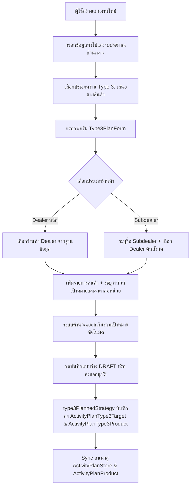
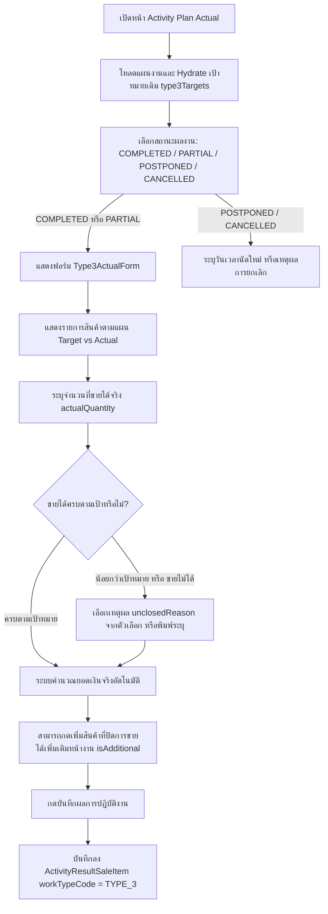
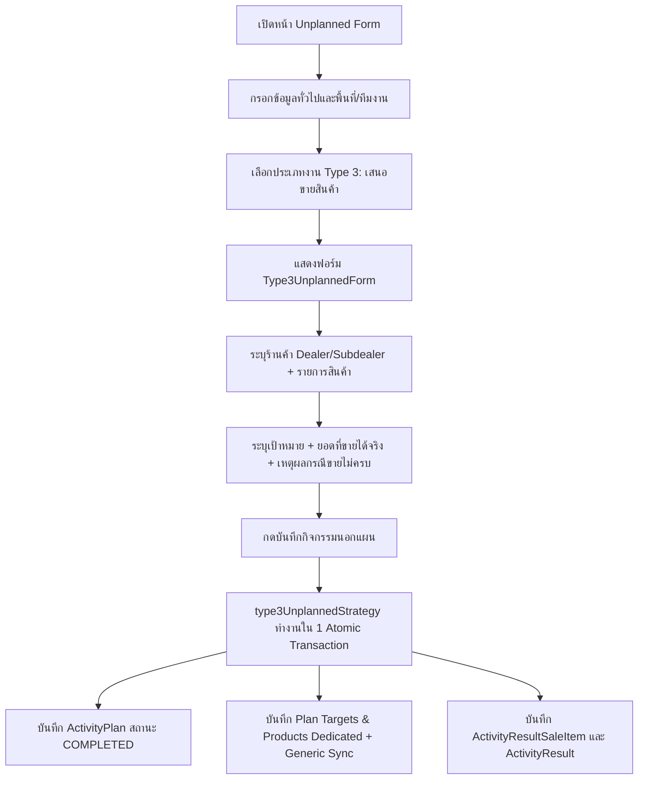

# Activity Type 3 — เสนอขายสินค้า / Product Sales Proposal (README)

> **Feature Slice**: `modules/activity/features/type-3`  
> **Standard Reference**: ออกแบบตามแนวทาง Vertical Slice Architecture อิงตามต้นแบบ Gold Standard Type 1 และ Type 2  
> **Parent Module**: `modules/activity`  
> **Database Authority**: `prisma/schema.prisma` (`ActivityPlanType3Target`, `ActivityPlanType3Product`, `ActivityResultSaleItem`, พร้อม sync สู่ `ActivityPlanStore`, `ActivityPlanProduct`)  
> **Status**: Production Ready / Active Reference (v1.0.0)

---

## 1. Overview

### 1.1 วัตถุประสงค์ของ Type 3
**Type 3 (เสนอขายสินค้า / Product Sales Proposal)** มีวัตถุประสงค์เพื่อรองรับการปฏิบัติงานของพนักงานฝ่ายขาย (Sales Reps / Technical Sales) ในการนำเสนอขายผลิตภัณฑ์เคมีเกษตร ฮอร์โมน และปุ๋ย แก่ร้านค้าตัวแทนจำหน่าย:
1. วางแผนเสนอขายสินค้าล่วงหน้า พร้อมกำหนดเป้าหมายจำนวน (Target Quantity) และราคาเป้าหมาย (Target Amount / Unit Price)
2. รองรับโครงสร้างลูกค้าทั้ง **ตัวแทนจำหน่ายหลัก (Dealer)** และ **ร้านค้าย่อย (Subdealer)** ที่มี Dealer ต้นสังกัด
3. บันทึกผลการปิดการขายจริงหน้างาน (Actual Sales Outcome) เปรียบเทียบกับเป้าหมาย (Target vs Actual)
4. บันทึกเหตุผลในกรณีที่ไม่สามารถปิดการขายได้ หรือปิดได้ไม่ครบตามเป้าหมาย (Unclosed Reasons) เพื่อนำไปวิเคราะห์คู่แข่งและการตลาด
5. รองรับการเพิ่มสินค้าที่ขายได้จริงนอกเหนือจากแผนเดิมหน้างาน (`isAdditional`)

### 1.2 ขอบเขตของ Type 3
- **กลุ่มเป้าหมายที่รองรับ:**
  - **ตัวแทนจำหน่ายหลัก (DEALER):** เลือกร้านค้าตัวแทนจำหน่ายที่ขึ้นทะเบียนในระบบ
  - **ร้านค้าย่อย (SUBDEALER):** ระบุชื่อร้านค้าย่อย พร้อมระบุ Dealer ต้นสังกัด
- **รายการสินค้าและราคา:**
  - ผูกแคตตาล็อกสินค้าเคมีเกษตร (`ProductOption`)
  - อิงราคาตั้งจากมาสเตอร์สินค้า (`masterPrice`) โดยสามารถแก้ไขราคาขายเฉพาะดีลได้ (`unitPrice`, `price`)
  - คำนวณยอดเงินรวมเป้าหมายและยอดเงินรวมที่ขายได้จริงอัตโนมัติ
- **การจัดเก็บข้อมูลแบบ Dual Persistence:**
  - บันทึกลงใน Dedicated Tables: `ActivityPlanType3Target` และ `ActivityPlanType3Product`
  - ทำการ Sync สำเนาอัตโนมัติลงใน Generic Tables: `ActivityPlanStore` และ `ActivityPlanProduct` เพื่อให้รายงานภาพรวมและระบบเดิมทำงานร่วมกันได้อย่างราบรื่น 100%
  - บันทึกผลงานจริงลงใน `ActivityResultSaleItem` โดยกำหนด `workTypeCode = "TYPE_3"`

### 1.3 รูปแบบการทำงานที่รองรับ
1. **Planned (ในแผนงาน Trip Plan):** วางแผนเสนอขายสินค้าล่วงหน้า เลือกร้านค้า Dealer/Subdealer กำหนดจำนวนและราคาเสนอขาย
2. **Planned Actual (บันทึกผลงานตามแผน):** นำแผนเดิมมารายงานผลการขายจริง (จำนวนที่ขายได้, ยอดเงินจริง, เหตุผลที่ไม่ปิดการขาย) และเพิ่มสินค้าที่ขายได้จริงหน้างาน
3. **Unplanned (กิจกรรมนอกแผน 2-in-1):** รองรับการเสนอขายสินค้ากะทันหันหน้างาน บันทึกร้านค้าเป้าหมาย สินค้า และยอดขายจริงเสร็จสิ้นในหน้าเดียว สถานะแผนเป็น `COMPLETED` ทันที
4. **Detail View:** ตารางเปรียบเทียบเป้าหมาย vs ผลขายจริง (Target vs Actual Comparison Table) พร้อมสรุปตัวเลขยอดขาย
5. **Approval View:** การ์ดสรุปเป้าหมายร้านค้าและรายการเสนอขาย สำหรับหัวหน้างานพิจารณาอนุมัติ

---

## 2. Business Flows

### 2.1 Planned (สร้างและแก้ไขแผนงาน)


### 2.2 Planned Actual (บันทึกผลการปฏิบัติงานตามแผน)


### 2.3 Unplanned (กิจกรรมนอกแผน 2-in-1)


### 2.4 Detail and Approval
- **Detail View:** แสดงตารางเปรียบเทียบ Target vs Actual ผ่าน `Type3DetailView` สรุปยอดขายรวมและสถานะการปิดดีล
- **Approval View:** หากเป็นกิจกรรมนอกแผนที่มีผลงานจริง จะแสดง `Type3DetailView` แบบเต็ม; หากเป็น Trip Plan ปกติ จะแสดง `Type3ApprovalCard` เพื่อตรวจเช็คเป้าหมายก่อนอนุมัติ

---

## 3. Architecture & Directory Structure

```text
modules/activity/features/type-3/
├── index.ts                                    # Unified Public API Contract
├── README.md                                   # คู่มือทางเทคนิค (ไฟล์นี้)
│
├── shared/                                     # ส่วนที่ใช้ร่วมกันใน Type 3
│   ├── constants.ts                            # NOT_CLOSED_REASONS, SALE_STATUSES, SALE_STATUS_CONFIG
│   └── types.ts                                # StoreOption, ProductOption, Type3ImageFile
│
├── planned/                                    # Sub-slice แผนงานและผลงานจริงในแผน
│   ├── types/
│   │   ├── planned.types.ts                    # Type3SalesItem, Type3SalesProductLine, Type3PlanCardProps, Type3PlannedFormProps
│   │   └── actual.types.ts                     # Type3ProductSaleDetail, Type3SaleResultItem, Type3ActualFormProps
│   ├── application/
│   │   ├── planned-validation.ts               # validateType3FormItems, type3SalesItemSchema, type3ProductLineSchema
│   │   ├── planned-mapper.ts                   # extractType3PlanTargets, hydrateType3PlannedData, mapType3FormToPayload
│   │   ├── actual-validation.ts                # validateType3Actual, type3ActualProductDetailSchema
│   │   └── actual-mapper.ts                    # parseType3ActualResult, mapType3ActualFormToDb
│   ├── hooks/
│   │   ├── use-type3-planned-form.ts           # Hook จัดการสถานะฟอร์มในแผน (เพิ่ม/ลบร้านค้า, สินค้า, คำนวณราคา)
│   │   └── use-type3-actual.ts                 # Hook จัดการสถานะผลการขายจริง (Target vs Actual, เหตุผลไม่ปิดการขาย)
│   ├── infrastructure/
│   │   └── type3-planned.strategy.ts           # Strategy บันทึกแผนงานและผลงานจริง (Dual Persistence & Atomic Transaction)
│   └── components/
│       ├── type3-planned-form.tsx              # ฟอร์มสร้าง/แก้ไขแผนงาน Type 3 (Type3PlannedForm / alias: Type3PlanForm)
│       ├── type3-plan-card.tsx                 # การ์ดสรุปเป้าหมายสินค้าตามแผน
│       ├── type3-actual-form.tsx               # ฟอร์มบันทึกผลงานจริงตามแผน
│       ├── type3-detail-view.tsx               # การ์ดแสดงผลเปรียบเทียบเป้าหมาย vs ผลขายจริง
│       └── type3-approval-card.tsx             # การ์ดสำหรับหน้าพิจารณาอนุมัติ
│
└── unplanned/                                  # Sub-slice กิจกรรมนอกแผน 2-in-1
    ├── types/
    │   └── unplanned.types.ts                  # Type3UnplannedItem, Type3UnplannedProductItem, Type3UnplannedPayload
    ├── application/
    │   ├── unplanned-validation.ts             # validateType3UnplannedForm, validateType3UnplannedItem, Schemas
    │   └── unplanned-mapper.ts                 # hydrateType3UnplannedData, mapType3UnplannedToPayload
    ├── hooks/
    │   └── use-type3-unplanned-form.ts         # Hook จัดการฟอร์มนอกแผน 2-in-1
    ├── infrastructure/
    │   └── type3-unplanned.strategy.ts         # Strategy สำหรับกิจกรรมนอกแผน บันทึกแผน + ผลงานใน 1 Transaction
    └── components/
        └── type3-unplanned-form.tsx            # ฟอร์มนอกแผน 2-in-1 สำหรับ Type 3
```

---

## 4. Database Schema & Data Mapping

### 4.1 ตารางฐานข้อมูลที่เกี่ยวข้อง
```prisma
// 1. เป้าหมายร้านค้า Type 3 (Dedicated Table)
model ActivityPlanType3Target {
  id              String   @id @default(uuid())
  activityPlanId  String
  storeId         String?  // ID ของ Dealer
  isSubDealer     Boolean  @default(false)
  subDealerStore  String?  // ชื่อร้านค้า Subdealer
  notes           String?
  products        ActivityPlanType3Product[]
  ...
}

// 2. รายการสินค้าเป้าหมาย Type 3 (Dedicated Table)
model ActivityPlanType3Product {
  id              String   @id @default(uuid())
  targetId        String
  activityPlanId  String
  productId       String
  targetQuantity  Int      @default(1)
  unitPrice       Decimal? @db.Decimal(10, 2)
  targetAmount    Decimal? @db.Decimal(12, 2)
  notes           String?
  ...
}

// 3. ผลการขายจริงรายสินค้า (Actual Outcome Table)
model ActivityResultSaleItem {
  id              String   @id @default(uuid())
  activityResultId String
  workTypeCode    String   // "TYPE_3"
  storeId         String?
  productId       String
  productName     String?
  actualQuantity  Int      @default(0)
  actualUnitPrice Decimal  @default(0) @db.Decimal(10, 2)
  actualTotal     Decimal  @default(0) @db.Decimal(12, 2)
  unclosedReason  String?
  isAdditional    Boolean  @default(false)
  ...
}
```

### 4.2 Generic Tables Sync (Dual Persistence)
เมื่อผู้ใช้บันทึก Type 3 Strategy จะทำการ sync สำเนาข้อมูลลงตาราง generic:
- `ActivityPlanStore`: บันทึก `storeId`, `storeName`, `subDealerStore`, `workTypeCode: "TYPE_3"`
- `ActivityPlanProduct`: บันทึก `storeId`, `productId`, `productName`, `targetQuantity`, `unitPrice`, `targetAmount`, `workTypeCode: "TYPE_3"`

ประโยชน์ของการทำ Dual Persistence:
1. การันตีว่ารายงานสรุปภาพรวมขององค์กร (Cross-type Reporting) ที่อ่านจาก `ActivityPlanStore` และ `ActivityPlanProduct` ยังคงทำงานได้ครบถ้วน
2. รักษาข้อมูลเชิงลึกเฉพาะงาน Type 3 ไว้ในตารางเฉพาะได้อย่างสมบูรณ์

---

## 5. Integration with Views & Orchestrators

| จุดเชื่อมต่อ (Integration Point) | ไฟล์เป้าหมาย (Target File) | สิ่งที่เชื่อมต่อ (Integration Content) |
|---|---|---|
| **Target Registry** | `modules/activity/domain/summary/plan-targets-registry.ts` | ลงทะเบียน `extractType3PlanTargets` ใน `TARGET_EXTRACTORS` และ fallback extraction |
| **Result Parser** | `modules/activity/domain/summary/result-summary-parser.ts` | แปลงผลงานจริง `saleResults` (`workTypeCode = TYPE_3`) สู่ `t3ProductSalesDetails`, `t3ActualSales`, `t3ActualQuantity` |
| **Server Actions** | `modules/activity/server/actions.ts` | ผูก `type3PlannedStrategy` และ `type3UnplannedStrategy` ใน `createActivityPlanAction` และ `updateActivityPlanAction` |
| **Planned Form View** | `modules/activity/views/planned/components/planned-activity-form.tsx` | ผูก `useType3Form` และเรนเดอร์ `Type3PlanForm` |
| **Unplanned Form View** | `modules/activity/views/unplanned/components/unplanned-activity-form.tsx` | ผูก `useType3UnplannedForm` และเรนเดอร์ `Type3UnplannedForm` |
| **Actual View** | `modules/activity/views/actual/activity-plan-actual-view.tsx` & `actual-work-type-list.tsx` | ผูก `useType3Actual`, validate, hydrate และเรนเดอร์ `Type3ActualForm` |
| **Detail View** | `modules/activity/views/detail/components/detail-work-type-list.tsx` | เรนเดอร์ `Type3DetailView` (ตาราง Target vs Actual) |
| **Approval View** | `modules/activity/views/approvals/components/approval-work-type-list.tsx` | เรนเดอร์ `Type3ApprovalCard` หรือ `Type3DetailView` ตามสถานะ |

---

## 6. Verification & Quality Assurance

- **TypeScript Compilation:** ผ่านการตรวจสอบด้วย `npx tsc --noEmit` โดยมี Error = 0
- **Boundary Check:** ทุก Import ภายใน `modules/activity/features/type-3/` เรียกใช้เฉพาะโค้ดภายใน Slice ตัวเอง หรือ `@/modules/activity/*`, `@/components/*`, `@/lib/*` โดยไม่มีการเรียกข้ามไปยัง `@/modules/activity-plans`
- **Unit Calculation:** ตรวจสอบสูตรคำนวณราคาขาย (Quantity * Unit Price = Total) และการจัดการทศนิยมผ่าน Prisma Decimal ครบถ้วน
