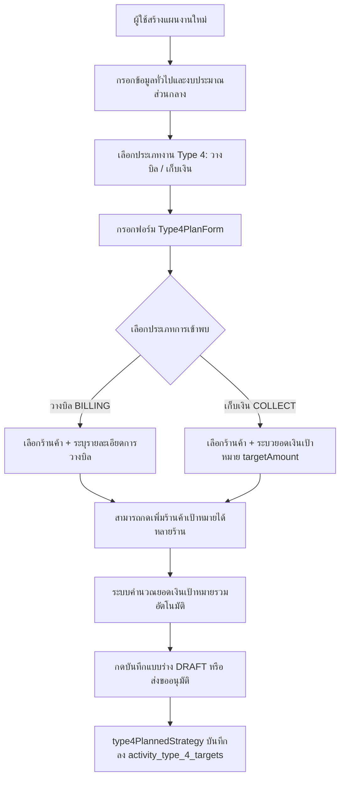
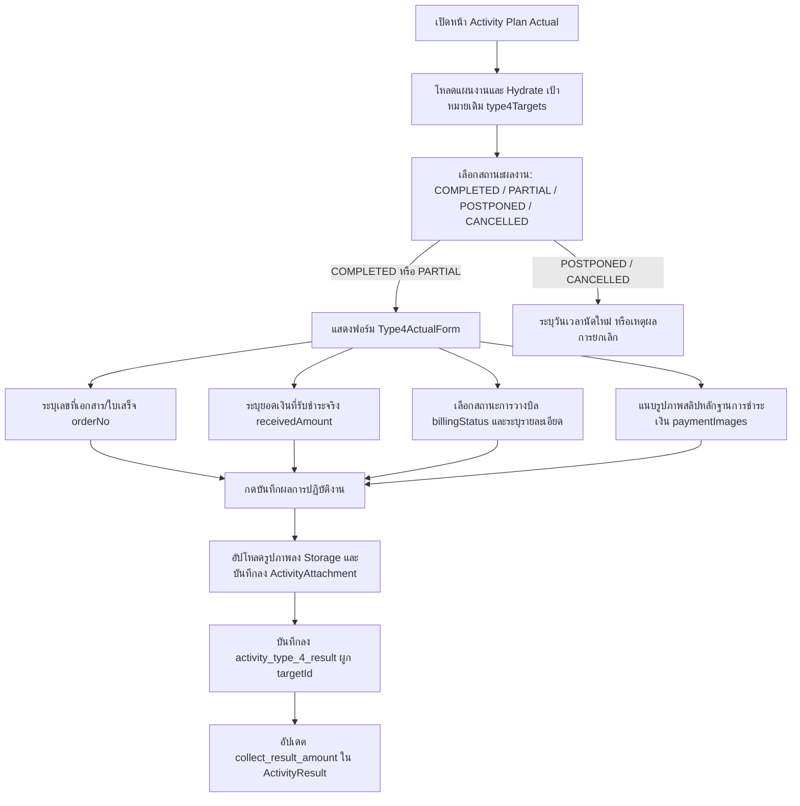
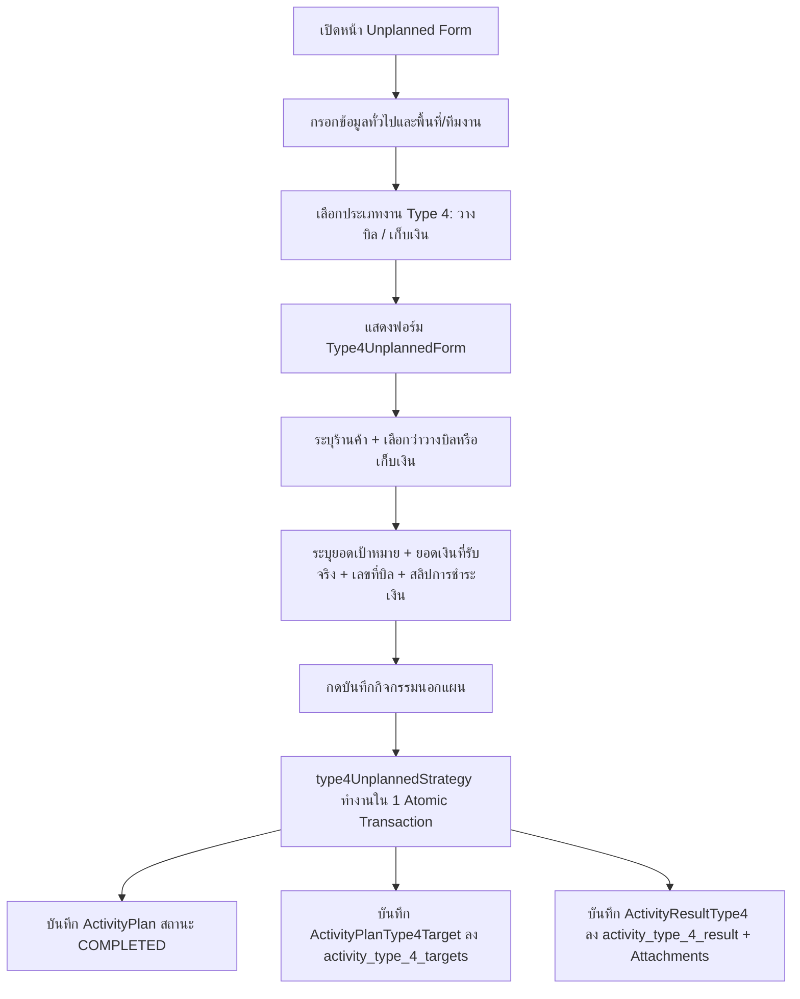

# Activity Type 4 — วางบิล / เก็บเงิน / Billing & Payment Collection (README)

> **Feature Slice**: `modules/activity/features/type-4`  
> **Standard Reference**: ออกแบบตามแนวทาง Vertical Slice Architecture อิงตามต้นแบบ Gold Standard Type 1, Type 2 และ Type 3  
> **Parent Module**: `modules/activity`  
> **Database Authority**: `prisma/schema.prisma` (`ActivityPlanType4Target`, `ActivityResultType4`, `ActivityAttachment`)  
> **Status**: Production Ready / Active Reference (v2.0.0 Standalone)

---

## 1. Overview

### 1.1 วัตถุประสงค์ของ Type 4
**Type 4 (วางบิล / เก็บเงิน / Billing & Payment Collection)** มีวัตถุประสงค์เพื่อรองรับกระบวนการปฏิบัติงานด้านการเงินและการชำระหนี้ของพนักงานขาย (Sales Reps) และพนักงานส่งสินค้า/บัญชีในการเข้าพบร้านค้าตัวแทนจำหน่าย:
1. วางแผนการเข้าวางบิลล่วงหน้า (Billing / Invoice Delivery) พร้อมกำหนดวันนัดหมายและเงื่อนไขเครดิต
2. วางแผนการเข้าเก็บเงิน/รับชำระหนี้ (Payment Collection) พร้อมระบุยอดเงินเป้าหมายที่ต้องเก็บ (Target Amount)
3. รองรับการระบุเป้าหมายหลายร้านค้าในแผนเดียวกัน (Multi-target Collection)
4. บันทึกผลการวางบิลจริง (สำเร็จ / เลื่อน / พบปัญหา) และยอดเงินที่รับชำระได้จริง (Received Amount vs Target Amount)
5. บันทึกเลขที่เอกสาร/ใบเสร็จรับเงิน (Receipt / Invoice Number) พร้อมแนบหลักฐานสลิปการโอนหรือภาพถ่ายใบเสร็จ (Payment Receipts / Slips)
6. รองรับการจัดเก็บข้อมูลผลงานลงใน Dedicated Table (`ActivityResultType4`) พร้อมอัปเดตสรุปยอดเงิน `activity_results.collect_result_amount`

### 1.2 ขอบเขตของ Type 4
- **ประเภทการดำเนินการ (Collect Type):**
  - **วางบิล (BILLING):** นำส่งใบแจ้งหนี้/ใบวางบิล ไม่มียอดเงินที่ต้องรับชำระ ณ วันดังกล่าว แต่ต้องติดตามสถานะการรับวางบิล
  - **เก็บเงิน (COLLECT):** รับชำระหนี้ค่าสินค้า มีการระบุยอดเงินเป้าหมาย (Target Amount) และบันทึกยอดเงินที่รับจริง (Received Amount)
- **สถานะการวางบิล (Billing Status):**
  - `วางบิลสำเร็จ`: ร้านค้ารับวางบิลเรียบร้อย นัดหมายวันรับเงินตามรอบ
  - `เลื่อนวางบิล`: ร้านค้ายังไม่พร้อมรับวางบิล ให้ระบุเหตุผลและวันนัดใหม่
  - `พบปัญหา`: บิลไม่ถูกต้อง ยอดไม่ตรง สินค้ามีปัญหา ฯลฯ
- **การจัดเก็บข้อมูลแบบ Standalone 100%:**
  - บันทึกลงใน Dedicated Tables: `ActivityPlanType4Target` (`activity_type_4_targets` สำหรับแผน) และ `ActivityResultType4` (`activity_type_4_result` สำหรับผลงาน ผูกกับ `targetId`)
  - จัดเก็บไฟล์สลิปหลักฐานการชำระเงินลงใน `ActivityAttachment` (`category = "GENERAL"`, `workTypeCode = "TYPE_4"`)
  - อัปเดตสรุปยอดเงินจริงลงใน `activity_results.collect_result_amount`

### 1.3 รูปแบบการทำงานที่รองรับ
1. **Planned (ในแผนงาน Trip Plan):** วางแผนวางบิลหรือเก็บเงินล่วงหน้า เลือกร้านค้า กำหนดยอดเงินเป้าหมายและหมายเหตุ
2. **Planned Actual (บันทึกผลงานตามแผน):** รายงานผลการรับชำระเงินจริง ระบุเลขที่บิล ยอดเงินที่ได้รับ สถานะการวางบิล พร้อมอัปโหลดสลิป/หลักฐานการชำระเงิน
3. **Unplanned (กิจกรรมนอกแผน 2-in-1):** รองรับการเข้าวางบิล/เก็บเงินกะทันหันหน้างาน บันทึกร้านค้า ยอดเป้าหมาย ยอดรับจริง และหลักฐานเสร็จสิ้นในหน้าเดียว สถานะแผนเป็น `COMPLETED` ทันที
4. **Detail View:** การ์ดแสดงผลรายละเอียดแผนงานและผลการวางบิล/เก็บเงินจริง พร้อมรูปภาพหลักฐานการชำระเงิน
5. **Approval View:** การ์ดสรุปเป้าหมายยอดเก็บเงินและร้านค้า สำหรับหัวหน้างานพิจารณาอนุมัติ

---

## 2. Business Flows

### 2.1 Planned (สร้างและแก้ไขแผนงาน)


### 2.2 Planned Actual (บันทึกผลการปฏิบัติงานตามแผน)


### 2.3 Unplanned (กิจกรรมนอกแผน 2-in-1)


---

## 3. Architecture & Directory Structure

```text
modules/activity/features/type-4/
├── index.ts                                    # Unified Public API Contract
├── README.md                                   # คู่มือทางเทคนิค (ไฟล์นี้)
│
├── shared/                                     # ส่วนที่ใช้ร่วมกันใน Type 4
│   ├── constants.ts                            # COLLECT_TYPES, BILLING_STATUSES, COLLECT_STATUS_CONFIG, BADGES
│   └── types.ts                                # StoreOption, Type4ImageFile
│
├── planned/                                    # Sub-slice แผนงานและผลงานจริงในแผน
│   ├── types/
│   │   ├── planned.types.ts                    # Type4CollectItem, TargetCollectCompanyItem, Type4TargetItem, Type4PlannedFormProps
│   │   └── actual.types.ts                     # Type4ActualData, Type4ActualFormProps, Type4DetailViewProps
│   ├── application/
│   │   ├── planned-validation.ts               # validateType4FormItems, type4CollectItemSchema
│   │   ├── planned-mapper.ts                   # extractType4PlanTargets, hydrateType4PlannedData, mapType4FormToPayload
│   │   ├── actual-validation.ts                # validateType4Actual, type4ActualSchema
│   │   └── actual-mapper.ts                    # parseType4ActualResult, mapType4ActualFormToDb
│   ├── hooks/
│   │   ├── use-type4-planned-form.ts           # Hook จัดการสถานะฟอร์มในแผน (เพิ่ม/ลบร้านค้า, ประเภทเก็บเงิน, รวมยอด)
│   │   └── use-type4-actual.ts                 # Hook จัดการสถานะผลการวางบิล/เก็บเงินจริง (ยอดรับจริง, สลิป, อัปโหลด)
│   ├── infrastructure/
│   │   └── type4-planned.strategy.ts           # Strategy บันทึกแผนงานและผลงานจริง (Dual Persistence & Atomic Transaction)
│   └── components/
│       ├── type4-planned-form.tsx              # ฟอร์มสร้าง/แก้ไขแผนงาน Type 4 (Type4PlannedForm / alias: Type4PlanForm, Type4Collect)
│       ├── type4-plan-card.tsx                 # การ์ดสรุปเป้าหมายวางบิล/เก็บเงินตามแผน
│       ├── type4-actual-form.tsx               # ฟอร์มบันทึกผลงานจริงตามแผน (เลขบิล, ยอดเงินจริง, รูปสลิป)
│       ├── type4-detail-view.tsx               # การ์ดแสดงผลเปรียบเทียบเป้าหมาย vs ผลเก็บเงินจริง
│       └── type4-approval-card.tsx             # การ์ดสำหรับหน้าพิจารณาอนุมัติ
│
└── unplanned/                                  # Sub-slice กิจกรรมนอกแผน 2-in-1
    ├── types/
    │   └── unplanned.types.ts                  # Type4UnplannedItem, Type4UnplannedPayload
    ├── application/
    │   ├── unplanned-validation.ts             # validateType4UnplannedForm, validateType4UnplannedItem, Schemas
    │   └── unplanned-mapper.ts                 # hydrateType4UnplannedData, mapType4UnplannedToPayload
    ├── hooks/
    │   └── use-type4-unplanned-form.ts         # Hook จัดการฟอร์มนอกแผน 2-in-1
    ├── infrastructure/
    │   └── type4-unplanned.strategy.ts         # Strategy สำหรับกิจกรรมนอกแผน บันทึกแผน + ผลงานใน 1 Transaction
    └── components/
        └── type4-unplanned-form.tsx            # ฟอร์มนอกแผน 2-in-1 สำหรับ Type 4
```

---

## 4. Database Schema & Data Mapping

### 4.1 ตารางฐานข้อมูลที่เกี่ยวข้อง
```prisma
// 1. เป้าหมายวางบิล/เก็บเงิน Type 4 (Dedicated Table)
model ActivityPlanType4Target {
  id             String                @id @default(cuid())
  activityPlanId String                @map("activity_plan_id")
  collectType    String                @default("COLLECT") @map("collect_type") // "BILLING" | "COLLECT"
  storeId        String?               @map("store_id")
  targetAmount   Decimal?              @map("target_amount") @db.Decimal(15, 2)
  invoiceNo      String?               @map("invoice_no")
  notes          String?               @map("notes")

  createdAt      DateTime              @default(now()) @map("created_at")
  updatedAt      DateTime              @updatedAt @map("updated_at")

  activityPlan   ActivityPlan          @relation("ActivityPlanType4Targets", fields: [activityPlanId], references: [id], onDelete: Cascade)
  store          Customer?             @relation("Type4TargetStore", fields: [storeId], references: [id], onDelete: SetNull)
  result         ActivityResultType4?  @relation("Type4TargetResult")

  @@index([activityPlanId])
  @@index([storeId])
  @@map("activity_type_4_targets")
}

// 2. ผลการปฏิบัติงานจริง Type 4 (Dedicated Table — 1 แถวต่อ 1 ร้านค้าในแผน ผูกผ่าน targetId)
model ActivityResultType4 {
  id             String                   @id @default(cuid())
  activityPlanId String                   @map("activity_plan_id")
  targetId       String?                  @unique @map("target_id")
  storeId        String?                  @map("store_id")
  companyName    String?                  @map("company_name")
  collectType    String                   @default("COLLECT") @map("collect_type") // "BILLING" | "COLLECT"
  targetAmount   Decimal?                 @map("target_amount") @db.Decimal(15, 2)
  receivedAmount Decimal?                 @map("received_amount") @db.Decimal(15, 2)
  orderNo        String?                  @map("order_no")
  billingStatus  String?                  @map("billing_status") // "วางบิลสำเร็จ" | "วางบิลไม่สำเร็จ"
  billingDetail  String?                  @map("billing_detail")
  collectDetail  String?                  @map("collect_detail")
  notes          String?                  @map("notes")

  createdAt      DateTime                 @default(now()) @map("created_at")
  updatedAt      DateTime                 @updatedAt @map("updated_at")

  activityPlan   ActivityPlan             @relation("ActivityResultType4s", fields: [activityPlanId], references: [id], onDelete: Cascade)
  target         ActivityPlanType4Target? @relation("Type4TargetResult", fields: [targetId], references: [id], onDelete: Cascade)
  store          Customer?                @relation("Type4ResultStore", fields: [storeId], references: [id], onDelete: SetNull)

  @@index([activityPlanId])
  @@index([targetId])
  @@index([storeId])
  @@map("activity_type_4_result")
}
```

### 4.2 Standalone Table Architecture (Zero Dual Persistence)
Type 4 ได้รับการปรับปรุงเป็น Standalone 100% โดย:
- บันทึกและโหลดข้อมูลแผนงานลง `activity_type_4_targets` โดยตรง โดยไม่มีการเขียน dual-write ไปยัง `activity_plan_stores`
- บันทึกและโหลดข้อมูลผลงานลง `activity_type_4_result` โดยผูกกับเป้าหมายผ่าน `targetId` (1:1 relation)
- อัปเดตสรุปยอดเงิน `activity_results.collect_result_amount = receivedAmount`
- จัดเก็บรูปภาพหลักฐานการชำระเงินลงใน `activity_attachments` (`workTypeCode = "TYPE_4"`, `category = "GENERAL"`)

---

## 5. Integration with Views & Orchestrators

| จุดเชื่อมต่อ (Integration Point) | ไฟล์เป้าหมาย (Target File) | สิ่งที่เชื่อมต่อ (Integration Content) |
|---|---|---|
| **Target Registry** | `modules/activity/domain/summary/plan-targets-registry.ts` | ลงทะเบียน `extractType4PlanTargets` ใน `TARGET_EXTRACTORS` และ fallback extraction |
| **Result Parser** | `modules/activity/domain/summary/result-summary-parser.ts` | แปลงผลงานจริง `ActivityResultType4` / `type4Result` สู่ `t4OrderNo`, `t4ReceivedAmount`, `t4BillingStatus`, `t4PaymentImages` |
| **Server Actions** | `modules/activity/server/actions.ts` | ผูก `type4PlannedStrategy` และ `type4UnplannedStrategy` ใน `createActivityPlanAction` และ `updateActivityPlanAction` |
| **Planned Form View** | `modules/activity/views/planned/components/planned-activity-form.tsx` | ผูก `useType4PlannedForm` และเรนเดอร์ `Type4PlannedForm` |
| **Unplanned Form View** | `modules/activity/views/unplanned/components/unplanned-activity-form.tsx` | ผูก `useType4UnplannedForm` และเรนเดอร์ `Type4UnplannedForm` |
| **Actual View** | `modules/activity/views/actual/activity-plan-actual-view.tsx` & `actual-work-type-list.tsx` | ผูก `useType4Actual`, validate, hydrate, อัปโหลดสลิป และเรนเดอร์ `Type4ActualForm` |
| **Detail View** | `modules/activity/views/detail/components/detail-work-type-list.tsx` | เรนเดอร์ `Type4DetailView` พร้อมแสดงยอดเงินจริงและสลิปการชำระเงิน |
| **Approval View** | `modules/activity/views/approvals/components/approval-work-type-list.tsx` | เรนเดอร์ `Type4ApprovalCard` หรือ `Type4DetailView` ตามสถานะ |

---

## 6. Verification & Quality Assurance

- **TypeScript Compilation:** ผ่านการตรวจสอบด้วย `npx tsc --noEmit` โดยมี Error = 0
- **Boundary Check:** ทุก Import ภายใน `modules/activity/features/type-4/` เรียกใช้เฉพาะโค้ดภายใน Slice ตัวเอง หรือ `@/modules/activity/*`, `@/components/*`, `@/lib/*` โดยไม่มีการเรียกข้ามไปยัง `@/modules/activity-plans` โดยเด็ดขาด
- **Multi-target Validation:** รองรับการกำหนดเป้าหมายเก็บเงินหลายร้านค้า พร้อมตรวจเช็คความถูกต้องของยอดเงิน (`targetAmount > 0` เมื่อเลือกประเภท `COLLECT`)
- **Image Upload Integration:** รองรับการอัปโหลดไฟล์หลักฐานสลิปการชำระเงินหลายไฟล์พร้อมกัน แสดงพรีวิว และจัดเก็บถาวรใน Cloud Storage

---

## 7. Change Log

| วันที่ | เวอร์ชัน | รายละเอียดการปรับปรุง | ผู้ดำเนินการ |
| :--- | :--- | :--- | :--- |
| **2026-10-18** | 1.0.0 | สร้างโมดูล Type 4 ตาม Vertical Slice Architecture เชื่อมต่อฟอร์ม Planned / Actual / Unplanned | Antigravity AI |
| **2026-10-24** | 2.0.0 | **Batch A Standardization**: ปรับโครงสร้างตารางเป็น Standalone Dedicated Tables (`activity_type_4_targets`, `activity_type_4_result`), ผูก `targetId` 1:1 ระหว่างเป้าหมายและผลการปฏิบัติงาน, ตัด Generic Dual-write ไปยัง `activity_plan_stores` ออก 100%, และอัปเดต Views/Mappers/Strategies ทั้งหมดให้ตรงกัน | Antigravity AI |
