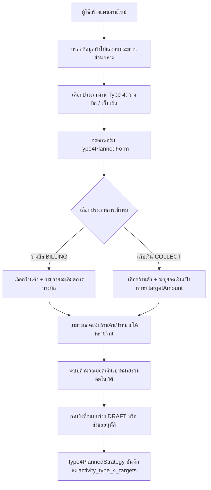
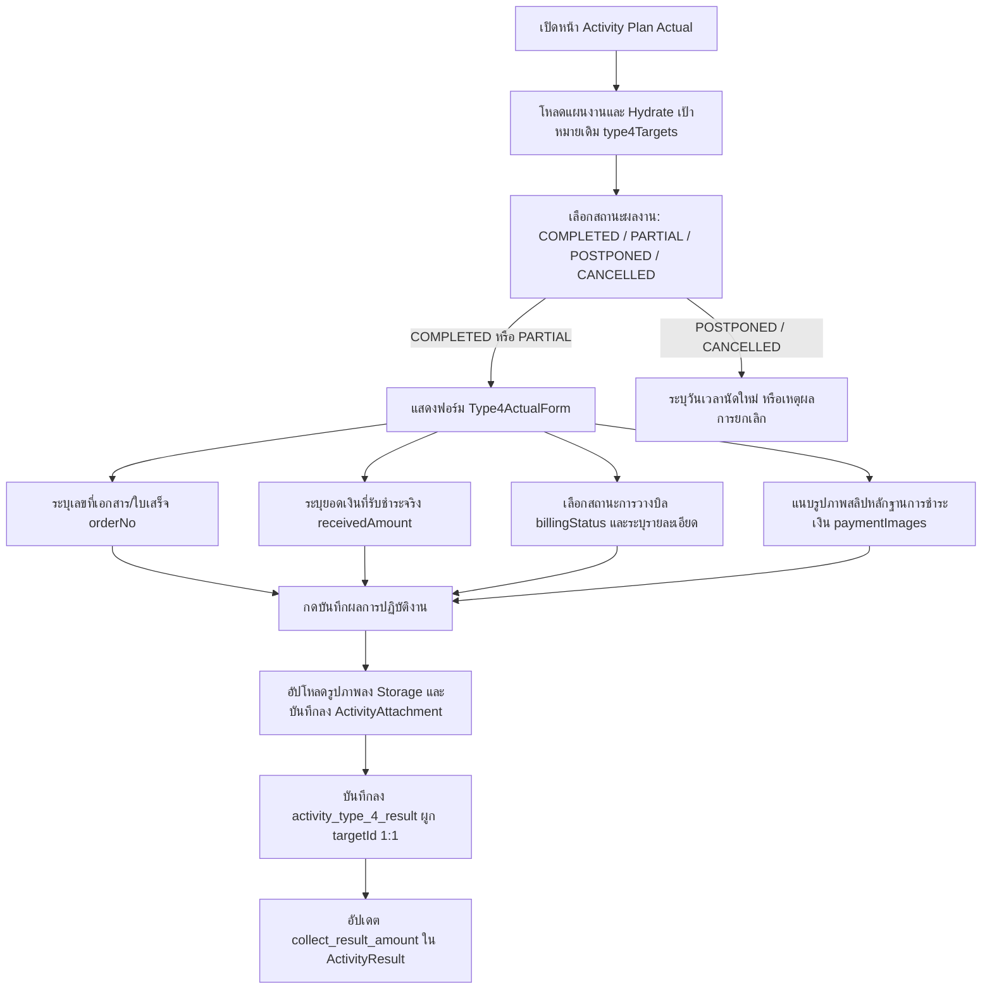
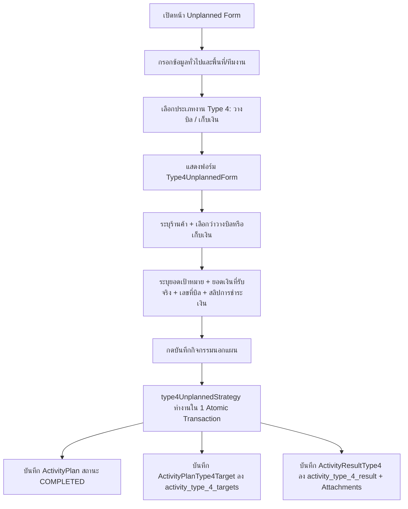
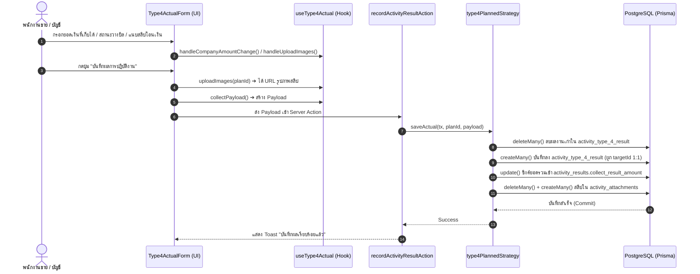

# Activity Type 4 — วางบิล / เก็บเงิน / Billing & Payment Collection (README)

> **Feature Slice**: `modules/activity/features/type-4`  
> **Standard Reference**: ออกแบบตามแนวทาง Vertical Slice Architecture อิงตามต้นแบบ Gold Standard Type 1  
> **Parent Module**: `modules/activity`  
> **Database Authority**: `prisma/schema.prisma` (`ActivityPlanType4Target`, `ActivityResultType4`, `ActivityAttachment`, `ActivityResult`)  
> **Status**: Production Ready / Active Reference (v2.0.0 Standalone)

---

## 1. Overview

### 1.1 วัตถุประสงค์ของ Type 4
**Type 4 (วางบิล / เก็บเงิน / Billing & Payment Collection)** มีวัตถุประสงค์เพื่อรองรับกระบวนการปฏิบัติงานด้านการเงินและการชำระหนี้ของพนักงานขาย (Sales Reps) และพนักงานส่งสินค้า/บัญชีในการเข้าพบร้านค้าตัวแทนจำหน่าย:
1. วางแผนการเข้าวางบิลล่วงหน้า (Billing / Invoice Delivery) พร้อมกำหนดวันนัดหมายและเงื่อนไขเครดิต
2. วางแผนการเข้าเก็บเงิน/รับชำระหนี้ (Payment Collection) พร้อมระบุยอดเงินเป้าหมายที่ต้องเก็บ (Target Amount)
3. รองรับการระบุเป้าหมายหลายร้านค้าในแผนเดียวกัน (Multi-target Collection)
4. บันทึกผลการวางบิลจริง (สำเร็จ / ไม่สำเร็จ / พบปัญหา) และยอดเงินที่รับชำระได้จริง (Received Amount vs Target Amount)
5. บันทึกเลขที่เอกสาร/ใบเสร็จรับเงิน (Receipt / Invoice Number) พร้อมแนบหลักฐานสลิปการโอนหรือภาพถ่ายใบเสร็จ (Payment Receipts / Slips)
6. จัดเก็บข้อมูลผลงานลงใน Dedicated Table (`ActivityResultType4`) พร้อมอัปเดตสรุปยอดเงินรวมลงใน `activity_results.collect_result_amount`

### 1.2 ขอบเขตของ Type 4
- **ประเภทการดำเนินการ (Collect Type):**
  - **วางบิล (BILLING):** นำส่งใบแจ้งหนี้/ใบวางบิล ไม่มียอดเงินที่ต้องรับชำระ ณ วันดังกล่าว แต่ต้องติดตามสถานะการรับวางบิลและวันกำหนดรับเช็ค
  - **เก็บเงิน (COLLECT):** รับชำระหนี้ค่าสินค้า มีการระบุยอดเงินเป้าหมาย (Target Amount) และบันทึกยอดเงินที่รับจริง (Received Amount)
- **สถานะการวางบิล (Billing Status):**
  - `วางบิลสำเร็จ`: ร้านค้ารับวางบิลเรียบร้อย นัดหมายวันรับเงินตามรอบ
  - `วางบิลไม่สำเร็จ`: ร้านค้ายังไม่พร้อมรับวางบิล หรือพบปัญหาบิลไม่ถูกต้อง ยอดไม่ตรง สินค้ามีปัญหา ฯลฯ
- **การจัดเก็บข้อมูลแบบ Standalone 100%:**
  - บันทึกลงใน Dedicated Tables: `ActivityPlanType4Target` (`activity_type_4_targets` สำหรับแผน) และ `ActivityResultType4` (`activity_type_4_result` สำหรับผลงาน ผูกกับ `targetId` แบบ 1:1)
  - จัดเก็บไฟล์สลิปหลักฐานการชำระเงินลงใน `ActivityAttachment` (`category = "GENERAL"`, `workTypeCode = "TYPE_4"`)
  - อัปเดตสรุปยอดเงินจริงลงใน `activity_results.collect_result_amount`

### 1.3 รูปแบบการทำงานที่รองรับ
1. **Planned (ในแผนงาน Trip Plan):** วางแผนวางบิลหรือเก็บเงินล่วงหน้า เลือกร้านค้า กำหนดยอดเงินเป้าหมายและหมายเหตุ
2. **Planned Actual (บันทึกผลงานตามแผน):** รายงานผลการรับชำระเงินจริง ระบุเลขที่บิล ยอดเงินที่ได้รับ สถานะการวางบิล พร้อมอัปโหลดสลิป/หลักฐานการชำระเงิน
3. **Unplanned (กิจกรรมนอกแผน 2-in-1):** รองรับการเข้าวางบิล/เก็บเงินกะทันหันหน้างาน บันทึกร้านค้า ยอดเป้าหมาย ยอดรับจริง และหลักฐานเสร็จสิ้นในหน้าเดียว สถานะแผนเป็น `COMPLETED` ทันที
4. **Detail View:** การ์ดแสดงผลรายละเอียดแผนงานและผลการวางบิล/เก็บเงินจริง พร้อมรูปภาพหลักฐานการชำระเงิน
5. **Approval View:** การ์ดสรุปเป้าหมายยอดเก็บเงินและร้านค้า สำหรับหัวหน้างานพิจารณาอนุมัติ

---

## 2. Business Flows

### 2.1 Planned (สร้างและแก้ไขแผนงาน)


### 2.2 Planned Actual (บันทึกผลการปฏิบัติงานตามแผน)


### 2.3 Unplanned (กิจกรรมนอกแผน 2-in-1)


### 2.4 Detail and Approval (ดูรายละเอียดและพิจารณาอนุมัติ)
- **Detail View:** แสดงการ์ด `Type4PlanCard` สรุปเป้าหมายร้านค้าและยอดเงินตามแผน และแสดง `Type4DetailView` เพื่อเปรียบเทียบยอดเป้าหมาย vs ยอดรับจริง สถานะวางบิล และรูปภาพสลิปหลักฐาน
- **Approval View:** แสดง `Type4ApprovalCard` สรุปร้านค้า ยอดเงินเป้าหมายรวม และรายละเอียด เพื่อให้หัวหน้างานพิจารณาอนุมัติแผนงาน

---

## 3. Architecture & Directory Structure

### 3.1 Folder Structure
```text
modules/activity/features/type-4/
├── index.ts                                    # Unified Public API Contract (ส่งออกเฉพาะสิ่งที่ภายนอกต้องใช้)
├── README.md                                   # คู่มือทางเทคนิค (ไฟล์นี้)
│
├── shared/                                     # ส่วนที่ใช้ร่วมกันใน Type 4
│   ├── constants.ts                            # COLLECT_TYPES, BILLING_STATUSES, COLLECT_STATUS_CONFIG, BADGES
│   └── types.ts                                # StoreOption, Type4ImageFile
│
├── planned/                                    # Sub-slice แผนงานและผลงานจริงในแผน
│   ├── types/
│   │   ├── planned.types.ts                    # Type4CollectItem, TargetCollectCompanyItem, Type4TargetItem, Type4PlannedFormProps
│   │   └── actual.types.ts                     # Type4ActualData, Type4ActualFormProps, Type4DetailViewProps, Type4ApprovalCardProps
│   ├── application/
│   │   ├── planned-validation.ts               # validateType4FormItems, type4CollectItemSchema
│   │   ├── planned-mapper.ts                   # extractType4PlanTargets, hydrateType4PlannedData, mapType4FormToPayload, mapType4ToSectionItems
│   │   ├── actual-validation.ts                # validateType4Actual, type4ActualSchema
│   │   └── actual-mapper.ts                    # parseType4ActualResult, mapType4ActualFormToDb
│   ├── hooks/
│   │   ├── use-type4-planned-form.ts           # Hook จัดการสถานะฟอร์มในแผน (เพิ่ม/ลบร้านค้า, ประเภทเก็บเงิน, รวมยอด)
│   │   └── use-type4-actual.ts                 # Hook จัดการสถานะผลการวางบิล/เก็บเงินจริง (ยอดรับจริง, สลิป, อัปโหลด)
│   ├── infrastructure/
│   │   └── type4-planned.strategy.ts           # Strategy บันทึกแผนงานและผลงานจริง (Dedicated Tables & Atomic Transaction)
│   └── components/
│       ├── type4-planned-form.tsx              # ฟอร์มสร้าง/แก้ไขแผนงาน Type 4 (Type4PlannedForm / alias: Type4PlanForm, Type4Collect)
│       ├── type4-plan-card.tsx                 # การ์ดสรุปเป้าหมายวางบิล/เก็บเงินตามแผน
│       ├── type4-actual-form.tsx               # ฟอร์มบันทึกผลงานจริงตามแผน (เลขบิล, ยอดเงินจริง, รูปสลิป)
│       ├── type4-detail-view.tsx               # การ์ดแสดงผลเปรียบเทียบเป้าหมาย vs ผลเก็บเงินจริง
│       └── type4-approval-card.tsx             # การ์ดสำหรับหน้าพิจารณาอนุมัติ
│
└── unplanned/                                  # Sub-slice กิจกรรมนอกแผน 2-in-1
    ├── types/
    │   └── unplanned.types.ts                  # Type4UnplannedItem, Type4UnplannedPayload, Type4UnplannedFormProps
    ├── application/
    │   ├── unplanned-validation.ts             # validateType4UnplannedForm, validateType4UnplannedItem, Schemas
    │   └── unplanned-mapper.ts                 # hydrateType4UnplannedData, mapType4UnplannedToPayload
    ├── hooks/
    │   └── use-type4-unplanned-form.ts         # Hook จัดการฟอร์มนอกแผน 2-in-1
    ├── infrastructure/
    │   └── type4-unplanned.strategy.ts         # Strategy สำหรับกิจกรรมนอกแผน บันทึกแผน + ผลงานใน 1 Transaction
    └── components/
        └── type4-unplanned-form.tsx            # ฟอร์มนอกแผน 2-in-1 สำหรับ Type 4
```

### 3.2 Type 4 vs Shared Activity
| ความรับผิดชอบ | จัดการที่ Type 4 Feature (`features/type-4`) | จัดการที่ Activity ส่วนกลาง (`ui/`, `views/`) |
| :--- | :--- | :--- |
| **ข้อมูลทั่วไป** | - | ชื่องาน, วันที่เริ่ม-สิ้นสุด, วัตถุประสงค์หลัก |
| **พื้นที่ & ทีมงาน** | - | จังหวัด, อำเภอ, ตำบล, พนักงานร่วมเดินทาง |
| **งบประมาณ** | - | งบเบิกสินค้าสาธิต, ของแถม, ค่าใช้จ่ายเดินทาง |
| **ข้อมูลเป้าหมาย** | เลือกร้านค้า, ประเภทการดำเนินการ (วางบิล/เก็บเงิน), ยอดเป้าหมาย, เลขที่บิล | - |
| **ผลงานจริง** | ยอดเงินที่รับจริง, สถานะวางบิล, รายละเอียดวางบิล/เก็บเงิน, รูปถ่ายสลิป/ใบเสร็จ | ผลสรุปภาพรวมแผน (สำเร็จ/เลื่อน/ยกเลิก) |
| **Database Persistence** | ตาราง `activity_type_4_targets`, `activity_type_4_result`, `activity_attachments` | ตารางหลัก `ActivityPlan`, `ActivityResult`, `ActivityPlanApprovalLog` |

### 3.3 Dependency and Import Map
- **ทิศทางการเรียกใช้ (Allowed):**
  - `views/` ➔ เรียกใช้ ➔ `features/type-4` (ผ่าน `index.ts` เท่านั้น)
  - `features/type-4` ➔ เรียกใช้ ➔ `ui/` ส่วนกลาง (`ActivityInput`, `ActivityCustomerSelect`)
  - `features/type-4` ➔ เรียกใช้ ➔ `@/modules/activity/types/strategy.interface`
  - `features/type-4` ➔ เรียกใช้ ➔ `@/modules/activity/application/media/image-uploader`
- **Server Actions & Database Flow:**
  - `views/` ➔ ส่งข้อมูลไปยัง ➔ Server Actions ใน `@/modules/activity/server/`:
    - `planned.actions.ts` (`createActivityPlanAction`, `updateActivityPlanAction`, `getActivityPlanAction`)
    - `unplanned.actions.ts` (`createUnplannedActivityAction`, `updateUnplannedActivityAction`, `getUnplannedActivityAction`)
    - `actual.actions.ts` (`recordActivityResultAction`)
  - Server Actions ➔ ทำงานร่วมกับ ➔ `@/modules/activity/infrastructure/strategy.registry` ➔ เรียกใช้ `type4PlannedStrategy` / `type4UnplannedStrategy` บันทึกลงตาราง `activity_type_4_targets` และ `activity_type_4_result` โดยตรง
- **สิ่งต้องห้าม (Strictly Forbidden):**
  - ❌ ภายนอก Import เจาะลึกเข้าไปในโฟลเดอร์ย่อย เช่น `features/type-4/planned/components/...`
  - ❌ `features/type-4` เรียกใช้ข้อมูลข้ามไปยัง `features/type-1` ถึง `type-3` หรือ `type-5` ถึง `type-14`
  - ❌ Import ย้อนกลับไปยังโมดูลเก่า `@/modules/activity-plans/...` โดยเด็ดขาด

### 3.4 Entry Points and Public Exports
ไฟล์ [modules/activity/features/type-4/index.ts](file:///d:/code/crm-bank/modules/activity/features/type-4/index.ts) ทำหน้าที่เป็น **Single Public API Contract** สำหรับฝั่ง UI / Application โดยส่งออกเฉพาะ:
- **Components:** `Type4PlannedForm` (alias: `Type4PlanForm`, `Type4Collect`), `Type4PlanCard`, `Type4ActualForm` (alias: `ActualType4Collect`), `Type4DetailView` (alias: `DetailType4Collect`), `Type4ApprovalCard` (alias: `ApprovalType4Collect`), `Type4UnplannedForm`
- **Hooks:** `useType4PlannedForm`, `useType4Actual`, `useType4UnplannedForm`
- **Mappers & Hydrators:** `extractType4PlanTargets`, `hydrateType4PlannedData`, `mapType4FormToPayload`, `mapType4ToSectionItems`, `parseType4ActualResult`, `mapType4ActualFormToDb`, `hydrateType4UnplannedData`, `mapType4UnplannedToPayload`
- **Validators & Schemas:** `validateType4FormItems`, `type4CollectItemSchema`, `validateType4Actual`, `type4ActualSchema`, `validateType4UnplannedForm`, `validateType4UnplannedItem`, `type4UnplannedItemSchema`, `type4UnplannedPayloadSchema`
- **Constants & Types:** `COLLECT_TYPES`, `BILLING_STATUSES`, `COLLECT_STATUS_CONFIG`, `BADGES`, `Type4CollectItem`, `TargetCollectCompanyItem`, `Type4TargetItem`, `Type4PlanCardTarget`, `Type4ActualData`, `Type4UnplannedItem`, `StoreOption`, `Type4ImageFile`
- *(หมายเหตุ: `type4PlannedStrategy` และ `type4UnplannedStrategy` ถูกนำเข้าโดยตรงที่ `modules/activity/infrastructure/strategy.registry.ts` เพื่อแยกโค้ดฝั่ง Server/Database ออกจาก Client Bundle)*

---

## 4. File Responsibilities

### 4.1 Planned & Actual
- **`use-type4-planned-form.ts`:** จัดการ State รายการร้านค้าเป้าหมายในแผน (Array of `Type4CollectItem`) มีฟังก์ชัน `addType4Row`, `updateType4Row`, `deleteType4Row`, `hydrateItems`, และคำนวณ `totalCollectAmount` รวม
- **`type4-planned-form.tsx`:** เรนเดอร์การ์ดเป้าหมายแต่ละร้านค้า สลับโหมดวางบิล (`BILLING`) vs เก็บเงิน (`COLLECT`), เลือกร้านค้าผ่าน `ActivityCustomerSelect`, กำหนดยอดเงิน และหมายเหตุ
- **`type4-actual-form.tsx`:** ฟอร์มบันทึกผลงานจริงตามแผน รองรับทั้งเป้าหมายเดี่ยวและหลายร้านค้า (`TargetCollectCompanyItem[]`), บันทึกยอดเงินรับจริง, สถานะวางบิล, รายละเอียดวางบิล/เก็บเงิน, และอัปโหลดสลิป/หลักฐาน
- **`use-type4-actual.ts`:** จัดการ State ผลงานจริง ยอดเงินรับจริง สถานะวางบิล และออร์เคสเตรตการอัปโหลดรูปภาพสลิป (`/uploads/activity-plans/{planId}/payment/type4`)
- **`planned-mapper.ts`:**
  - `mapType4FormToPayload`: แปลงรายการฟอร์มไปเป็น Payload `{ type4Targets, planStores }` สำหรับ Server Actions
  - `hydrateType4PlannedData`: กู้คืนข้อมูลร้านค้าเป้าหมายเมื่อเปิดหน้าแก้ไข
  - `extractType4PlanTargets`: แปลงข้อมูลแผนงานเดิมทั้งแบบ Single และ Multi-target สำหรับหน้า Actual และ Detail View
  - `mapType4ToSectionItems`: จัดรูปแบบรายการร้านค้าและยอดเงินเพื่อนำไปแสดงผลในการ์ดรายละเอียด
- **`actual-mapper.ts`:** แปลงผลการดำเนินงานจริงเป็น Payload (`mapType4ActualFormToDb`) และแปลงข้อมูลจาก Backend มารองรับการแสดงผล (`parseType4ActualResult`)
- **`planned-validation.ts` & `actual-validation.ts`:** ตรวจสอบความถูกต้องของแผนงาน (`validateType4FormItems`: ตรวจสอบยอดเงินเก็บเงิน > 0) และผลการดำเนินงานจริง (`validateType4Actual`)
- **`type4-planned.strategy.ts`:** ตรวจสอบความถูกต้อง บันทึกข้อมูลลงตาราง `activity_type_4_targets` และ `activity_type_4_result` (จับคู่ `targetId` 1:1) พร้อมอัปเดตยอดรวมใน `activity_results.collect_result_amount`

### 4.2 Unplanned
- **`use-type4-unplanned-form.ts`:** จัดการ State กิจกรรมนอกแผน 2-in-1 (ร้านค้า + ผลการวางบิล/เก็บเงิน + สลิป)
- **`type4-unplanned-form.tsx`:** ฟอร์ม 2-in-1 สำหรับวางบิล/เก็บเงินนอกแผน สามารถเพิ่มได้หลายร้านค้า รองรับการระบุเลขที่บิล/ใบเสร็จ (`invoiceNo`), ยอดเงินตามบิล/ยอดหนี้เป้าหมาย (`targetAmount`), ยอดเก็บเงินจริง (`receivedAmount`), แนบสลิป/หลักฐานผ่าน `ActivityPhotoUpload` พร้อมคำนวณยอดเงินรวมและสถิติการวางบิลสำเร็จ
- **`unplanned-mapper.ts`:** จัดการ Hydrate ข้อมูลเดิมเมื่อเปิดแก้ไข (`hydrateType4UnplannedData`) และแปลง State ฟอร์มเป็น Payload บันทึก DB (`mapType4UnplannedToPayload`)
- **`type4-unplanned.strategy.ts`:** บันทึกทั้งเป้าหมายและผลการดำเนินงานจริงใน 1 Transaction เดียวกัน

### 4.3 Shared Types and Constants
- **`shared/constants.ts`:** กำหนด `COLLECT_TYPES` (`BILLING`, `COLLECT`), `BILLING_STATUSES` (`วางบิลสำเร็จ`, `วางบิลไม่สำเร็จ`), `COLLECT_STATUS_CONFIG`, และสีของ `BADGES`
- **`shared/types.ts`:** กำหนด `StoreOption` และ `Type4ImageFile` (รองรับ `targetId` และ `storeId`)

### 4.4 Shared UI and Views
- `ActualWorkTypeList`, `DetailWorkTypeList`, และ `ApprovalWorkTypeList` ในโฟลเดอร์ `views/` ทำหน้าที่เป็น Orchestrator เรียกใช้ Component ของ Type 4 ตามโค้ดประเภทงาน

---

## 5. Data Flow



### 5.1 Create Planned (สร้างแผนใหม่)
1. `create-view.tsx` เรียกใช้ `useType4PlannedForm()`
2. ผู้ใช้ระบุเป้าหมายใน `Type4PlannedForm` (เลือกร้านค้า, เลือกว่าวางบิลหรือเก็บเงิน, กำหนดยอดเงินเป้าหมาย)
3. ผู้ใช้กดส่งข้อมูล ➔ รัน `validateType4FormItems`
4. Form Orchestrator แปลง Type 4 payload ผ่าน `mapType4FormToPayload()` ➔ ส่งไปยัง Server Action `createActivityPlanAction`
5. Server Action เรียก `type4PlannedStrategy.savePlan()` ภายใน `$transaction`
6. Prisma บันทึกเป้าหมายลงตาราง `activity_type_4_targets` โดยตรง (Zero dual-write ไปยัง `activity_plan_stores`)

### 5.2 Edit Planned (แก้ไขแผนงานเดิม)
1. `edit-view.tsx` ดึงข้อมูลแผนจากฐานข้อมูล (`plan`)
2. เรียก `hydrateType4PlannedData(plan)` เพื่อแปลงข้อมูลจาก `type4Targets`
3. ส่งข้อมูลที่ hydrate เข้า `useType4PlannedForm({ initialItems })`
4. ข้อมูลแสดงบนฟอร์มพร้อมให้แก้ไขและบันทึกกลับ

### 5.3 Save Actual (บันทึกผลการปฏิบัติงานจริง)
1. `activity-plan-actual-view.tsx` รัน `handleSubmit`
2. เรียก `type4Actual.uploadImages(id)` เพื่ออัปโหลดสลิป/หลักฐานการชำระเงินไปยัง Storage ได้ URLs กลับมา
3. เรียก `type4Actual.collectPayload()` รวบรวมผลการดำเนินงานทุกร้านค้า
4. ส่ง Payload เข้า `recordActivityResultAction(id, payload)`
5. `type4PlannedStrategy.saveActual()` ลบผลงานเก่าแล้วสร้างระเบียนใหม่ลงตาราง `activity_type_4_result` โดยผูก `targetId: target.id` แบบ 1:1
6. ซิงค์ยอดเงินเก็บได้จริงรวมเข้าฟิลด์สรุป `activity_results.collect_result_amount`
7. บันทึกรูปภาพหลักฐานสลิปลงตาราง `activity_attachments` (`category: "GENERAL"`, `workTypeCode: "TYPE_4"`)

### 5.4 Load Actual (โหลดผลงานเดิมมาแสดงในหน้าบันทึกผล)
1. `useActualPlanLoader` โหลดแผนและข้อมูล `plan.type4Targets` และ `plan.type4Results`
2. `extractType4PlanTargets(plan)` แปลงเป้าหมายและผลงานเดิมเข้าสู่ `targets`
3. `type4Actual.hydrate(plan.result || plan.type4Results)` กู้คืนยอดรับจริง สถานะวางบิล และรูปสลิปเดิม
4. ฟอร์มแสดงข้อมูลเดิมพร้อมให้แก้ไขเพิ่มเติม

### 5.5 Create/Edit Unplanned (กิจกรรมนอกแผน)
1. ผู้ใช้กรอกฟอร์ม `Type4UnplannedForm`
2. ข้อมูลเป้าหมายและผลงานถูกตรวจสอบพร้อมกันด้วย `type4UnplannedPayloadSchema`
3. `type4UnplannedStrategy.savePlan()` บันทึกเป้าหมายลง `activity_type_4_targets` และผลงานลง `activity_type_4_result` พร้อม Attachments ใน 1 Transaction เดียวกัน

### 5.6 Detail and Approval (การแสดงผลหน้ารายละเอียดและพิจารณาอนุมัติ)
1. โหลดข้อมูลแผนงานผ่าน `useDetailPlanLoader` หรือ `useApprovalDetailLoader`
2. ระบบตรวจจับประเภทงานว่าเป็น Type 4
3. เรนเดอร์ `<Type4PlanCard />` (เป้าหมายตามแผน)
4. หากมีผลงานจริง เรนเดอร์ `<Type4DetailView />` พร้อมเปรียบเทียบยอดเป้าหมาย vs ยอดรับจริง และรูปถ่ายสลิปหลักฐาน

---

## 6. Data Models and Mapping

### 6.1 Database CRUD Matrix (สิทธิ์และการจัดการตารางในฐานข้อมูล)
| ตารางในฐานข้อมูล (`Prisma Model`) | Create (สร้าง) | Read (อ่าน/แสดงผล) | Update (แก้ไข) | Delete (ลบ) | หมายเหตุ |
| :--- | :--- | :--- | :--- | :--- | :--- |
| **`activity_type_4_targets`**<br>(`ActivityPlanType4Target`) | `savePlan()`<br>ใน Planned/Unplanned | `loadPlan()`, `plan.type4Targets` ใน Detail / Edit / Actual | `deleteMany()` + `createMany()` ใน `savePlan()` | Cascade เมื่อลบ `ActivityPlan` | เก็บรายการเป้าหมายวางบิล/เก็บเงินตามแผนงาน (รองรับหลายร้านค้า) |
| **`activity_type_4_result`**<br>(`ActivityResultType4`) | `saveActual()`<br>ใน Actual/Unplanned | `loadActual()`, `plan.type4Targets[].result` หรือ `plan.type4Results` | `deleteMany()` + `createMany()` / `create()` ใน `saveActual()` | Cascade เมื่อลบ `ActivityPlan` หรือ `Target` | เก็บผลการวางบิล/เก็บเงินจริงรายร้านค้า ยอดเงินจริง สถานะวางบิล (ผูกผ่าน `targetId` 1:1) |
| **`activity_attachments`**<br>(`ActivityAttachment`) | Storage Upload + `saveActual()` | `plan.attachments` (หมวดหมู่ `GENERAL` / `PAYMENT`, `workTypeCode = "TYPE_4"`) | ลบรายการเดิม (`category: "GENERAL"`) และสร้างระเบียนใหม่ | Cascade เมื่อลบ `ActivityPlan` | เก็บล็อก URL ภาพถ่ายสลิปโอนเงิน / ใบเสร็จรับเงิน / ใบวางบิล |
| **`activity_results`**<br>(`ActivityResult`) | `saveActual()` (upsert parent `ActivityResult`) | `plan.result` | `update({ collectResultAmount })` ใน `saveActual()` | Cascade เมื่อลบ `ActivityPlan` | ซิงค์ยอดเงินเก็บได้จริงรวมเข้าฟิลด์สรุป `collect_result_amount` |

### 6.2 Complete Field-to-Database Mapping (ตารางจับคู่ฟิลด์ครบถ้วนทุกจุด)
ไล่จาก **Form Field ➔ Type Field ➔ Mapper ➔ Prisma Model ➔ DB Column Name ➔ Data Type**:

| Form Field (UI) | TypeScript Type Field | Mapper Function (Write/Read) | Prisma Model | DB Column Name | Data Type | Nullable? | Default |
| :--- | :--- | :--- | :--- | :--- | :--- | :---: | :--- |
| **ประเภทการดำเนินการ** | `collectType` | `mapType4FormToPayload` / `hydrateType4PlannedData` / `mapType4UnplannedToPayload` / `hydrateType4UnplannedData` | `ActivityPlanType4Target` / `ActivityResultType4` | `collect_type` | `VARCHAR` | No | `"COLLECT"` |
| **รหัสร้านค้า/ลูกค้า** | `storeId` | `mapType4FormToPayload` / `extractType4PlanTargets` / `mapType4ActualFormToDb` / `mapType4UnplannedToPayload` | `ActivityPlanType4Target` / `ActivityResultType4` | `store_id` | `VARCHAR (FK)` | Yes | `null` |
| **ชื่อร้านค้า/ลูกค้า (แผน)** | `customerName` | `hydrateType4PlannedData` (อ่านจาก `store.name`) / `mapType4FormToPayload` | `Customer` (ผ่าน relation `store`) | `name` | `VARCHAR` | Yes | - |
| **ชื่อร้านค้า/ลูกค้า (ผลจริง)**| `companyName` / `customer` | `mapType4ActualFormToDb` / `parseType4ActualResult` / `mapType4UnplannedToPayload` | `ActivityResultType4` | `company_name` | `VARCHAR` | Yes | `null` |
| **ยอดเงินเป้าหมาย/ตามบิล** | `collectAmount` / `targetAmountNum` / `targetAmount` | `mapType4FormToPayload` (`new Prisma.Decimal`) / `extractType4PlanTargets` / `hydrateType4PlannedData` | `ActivityPlanType4Target` | `target_amount` | `DECIMAL(15,2)` | Yes | `null` |
| **เลขที่บิล/ใบแจ้งหนี้ (แผน)** | `invoiceNo` | `mapType4FormToPayload` / `extractType4PlanTargets` / `hydrateType4PlannedData` | `ActivityPlanType4Target` | `invoice_no` | `VARCHAR` | Yes | `null` |
| **รายละเอียดเพิ่มเติม (แผน)** | `detail` / `notes` | `mapType4FormToPayload` (`notes: item.detail`) / `extractType4PlanTargets` / `hydrateType4PlannedData` | `ActivityPlanType4Target` | `notes` | `TEXT` | Yes | `null` |
| **รหัสเป้าหมายผลงาน (Relation)**| `targetId` | `findMatchingTargetId(item, idx)` ใน `type4PlannedStrategy.saveActual()` | `ActivityResultType4` | `target_id` | `VARCHAR (FK, Unique)` | Yes | `null` |
| **ยอดเงินเป้าหมายอ้างอิง (ผลงาน)**| `targetAmountNum` / `targetAmount` | `mapType4ActualFormToDb` / `parseType4ActualResult` / `mapType4UnplannedToPayload` | `ActivityResultType4` | `target_amount` | `DECIMAL(15,2)` | Yes | `null` |
| **จำนวนเงินที่เก็บได้จริง (บาท)**| `receivedAmount` / `t4ReceivedAmount` | `mapType4ActualFormToDb` (`Number(replace(/,/g, ''))`) / `parseType4ActualResult` / `mapType4UnplannedToPayload` | `ActivityResultType4` | `received_amount` | `DECIMAL(15,2)` | Yes | `null` |
| **เลขที่เอกสาร/ใบเสร็จ (ผลงาน)**| `orderNo` / `t4OrderNo` | `mapType4ActualFormToDb` / `parseType4ActualResult` / `mapType4UnplannedToPayload` | `ActivityResultType4` | `order_no` | `VARCHAR` | Yes | `null` |
| **สถานะการวางบิล** | `billingStatus` / `t4BillingStatus` | `mapType4ActualFormToDb` / `parseType4ActualResult` / `mapType4UnplannedToPayload` / `hydrateType4UnplannedData` | `ActivityResultType4` | `billing_status` | `VARCHAR` | Yes | `null` |
| **รายละเอียดการวางบิล** | `billingDetail` / `t4BillingDetail` | `mapType4ActualFormToDb` / `parseType4ActualResult` / `mapType4UnplannedToPayload` | `ActivityResultType4` | `billing_detail` | `TEXT` | Yes | `null` |
| **รายละเอียดการเก็บเงิน** | `collectDetail` / `t4CollectDetail` | `mapType4ActualFormToDb` / `parseType4ActualResult` / `mapType4UnplannedToPayload` | `ActivityResultType4` | `collect_detail` | `TEXT` | Yes | `null` |
| **หมายเหตุผลการดำเนินงาน** | `notes` / `detail` / `t4Detail` | `mapType4ActualFormToDb` / `parseType4ActualResult` / `mapType4UnplannedToPayload` | `ActivityResultType4` | `notes` | `TEXT` | Yes | `null` |
| **ยอดเงินเก็บได้จริงรวม (สรุป)**| `actualCollectAmount` / `totalReceivedAmt` | `type4PlannedStrategy.saveActual` ➔ `tx.activityResult.update({ collectResultAmount })` | `ActivityResult` | `collect_result_amount` | `DECIMAL(15,2)` | Yes | `null` |
| **รูปภาพสลิป/หลักฐานการชำระ** | `paymentImages` / `t4PaymentImages` / `images` | `useType4Actual.uploadImages()` (Path: `/{planId}/payment/type4`) ➔ `ActivityAttachment` | `ActivityAttachment` | `file_url` | `TEXT` | No | - |
| **ชื่อไฟล์รูปภาพหลักฐาน** | `fileName` / `name` | `type4PlannedStrategy.saveActual` | `ActivityAttachment` | `file_name` | `VARCHAR` | No | `"หลักฐานการชำระเงิน"` |
| **ขนาดไฟล์รูปภาพ (Bytes)** | `fileSize` / `size` | `type4PlannedStrategy.saveActual` | `ActivityAttachment` | `file_size` | `INTEGER` | Yes | `0` |
| **ประเภท MIME Type รูปภาพ** | `mimeType` / `type` | `type4PlannedStrategy.saveActual` | `ActivityAttachment` | `mime_type` | `VARCHAR` | Yes | `"image/jpeg"` |
| **หมวดหมู่เอกสารแนบ** | `category` | `type4PlannedStrategy.saveActual` (`category: "GENERAL"`) / Unplanned (`category: "PAYMENT"`) | `ActivityAttachment` | `category` | `ENUM` | No | `GENERAL` |
| **รหัสประเภทงานเอกสารแนบ** | `workTypeCode` | `type4PlannedStrategy.saveActual` (`workTypeCode: "TYPE_4"`) | `ActivityAttachment` | `work_type_code` | `VARCHAR` | Yes | `"TYPE_4"` |
| **รหัสร้านค้าของเอกสารแนบ** | `storeId` | `mapType4UnplannedToPayload` | `ActivityAttachment` | `store_id` | `VARCHAR (FK)` | Yes | `null` |

### 6.3 รายละเอียดตารางฐานข้อมูลและความสัมพันธ์ (Relations & Schema)

```prisma
// 1. เป้าหมายวางบิล/เก็บเงิน Type 4 (Dedicated Table)
model ActivityPlanType4Target {
  id             String                @id @default(cuid())
  activityPlanId String                @map("activity_plan_id")
  collectType    String                @default("COLLECT") @map("collect_type") // "BILLING" | "COLLECT"
  storeId        String?               @map("store_id")
  targetAmount   Decimal?              @map("target_amount") @db.Decimal(15, 2)
  invoiceNo      String?               @map("invoice_no")
  notes          String?               @map("notes")

  createdAt      DateTime              @default(now()) @map("created_at")
  updatedAt      DateTime              @updatedAt @map("updated_at")

  activityPlan   ActivityPlan          @relation("ActivityPlanType4Targets", fields: [activityPlanId], references: [id], onDelete: Cascade)
  store          Customer?             @relation("Type4TargetStore", fields: [storeId], references: [id], onDelete: SetNull)
  result         ActivityResultType4?  @relation("Type4TargetResult")

  @@index([activityPlanId])
  @@index([storeId])
  @@map("activity_type_4_targets")
}

// 2. ผลการปฏิบัติงานจริง Type 4 (Dedicated Table — 1 แถวต่อ 1 ร้านค้าในแผน ผูกผ่าน targetId แบบ 1:1)
model ActivityResultType4 {
  id             String                   @id @default(cuid())
  activityPlanId String                   @map("activity_plan_id")
  targetId       String?                  @unique @map("target_id")
  storeId        String?                  @map("store_id")
  companyName    String?                  @map("company_name")
  collectType    String                   @default("COLLECT") @map("collect_type") // "BILLING" | "COLLECT"
  targetAmount   Decimal?                 @map("target_amount") @db.Decimal(15, 2)
  receivedAmount Decimal?                 @map("received_amount") @db.Decimal(15, 2)
  orderNo        String?                  @map("order_no")
  billingStatus  String?                  @map("billing_status") // "วางบิลสำเร็จ" | "วางบิลไม่สำเร็จ"
  billingDetail  String?                  @map("billing_detail")
  collectDetail  String?                  @map("collect_detail")
  notes          String?                  @map("notes")

  createdAt      DateTime                 @default(now()) @map("created_at")
  updatedAt      DateTime                 @updatedAt @map("updated_at")

  activityPlan   ActivityPlan             @relation("ActivityResultType4s", fields: [activityPlanId], references: [id], onDelete: Cascade)
  target         ActivityPlanType4Target? @relation("Type4TargetResult", fields: [targetId], references: [id], onDelete: Cascade)
  store          Customer?                @relation("Type4ResultStore", fields: [storeId], references: [id], onDelete: SetNull)

  @@index([activityPlanId])
  @@index([targetId])
  @@index([storeId])
  @@map("activity_type_4_result")
}

// 3. ตารางหลักฐานเอกสารแนบและรูปภาพสลิปการชำระเงิน
model ActivityAttachment {
  id               String             @id @default(cuid())
  activityPlanId   String             @map("activity_plan_id")
  activityResultId String?            @map("activity_result_id")
  workTypeCode     String?            @map("work_type_code")
  storeId          String?            @map("store_id")
  category         AttachmentCategory @default(GENERAL)
  fileUrl          String             @map("file_url")
  fileName         String             @map("file_name")
  fileSize         Int?               @map("file_size")
  mimeType         String?            @map("mime_type")
  createdAt        DateTime           @default(now()) @map("created_at")

  activityPlan     ActivityPlan       @relation(fields: [activityPlanId], references: [id], onDelete: Cascade)
  activityResult   ActivityResult?    @relation(fields: [activityResultId], references: [id], onDelete: Cascade)

  @@index([activityPlanId])
  @@index([activityResultId])
  @@map("activity_attachments")
}
```

### 6.4 Transaction & Persistence Strategy (ขาเขียนและขาอ่าน)
- **การจัดการ Transaction (Isolation & Atomicity):**
  - ทุกการบันทึกของ Type 4 ดำเนินการภายใต้ `db.$transaction(async (tx) => { ... })`
  - มีการทำงานร่วมกันระหว่าง `ActivityPlanType4Target`, `ActivityResultType4`, `ActivityAttachment`, และ `ActivityResult`
  - หากการบันทึกรูปภาพสลิป หรือข้อมูลรายร้านค้าล้มเหลว ระบบจะทำการ **Rollback ทั้งหมด** ทันที ไม่ปล่อยให้มีระเบียนกำพร้า (Orphaned records) ตกค้าง
- **Target ID Matching Algorithm (1-to-1 Constraint):**
  - เนื่องจากคอลัมน์ `target_id` ในตาราง `activity_type_4_result` มีเงื่อนไข `@unique` (1:1 Relation กับ `ActivityPlanType4Target`)
  - ฟังก์ชัน `findMatchingTargetId(item, idx)` ใน Strategy จะจับคู่ Target อย่างเคร่งครัดตามลำดับ:
    1. Explicit `targetId` ที่มีอยู่ใน `planTargets` และยังไม่ถูกใช้ใน Transaction นั้น
    2. `item.id` ที่ตรงกับ `planTarget.id` และยังไม่ถูกใช้
    3. จับคู่ผ่าน `storeId` ที่ยังไม่ถูกใช้
    4. จับคู่ตาม Index ลำดับแถว (`planTargets[idx]`)
    5. Fallback สำหรับกรณีมีเป้าหมายเดียว (`planTargets[0]`)
    6. คืนค่า `null` หากแมปเป้าหมายครบหมดแล้ว เพื่อป้องกันข้อผิดพลาด Unique Constraint Violation
- **ขาเขียน (Write Flow):**
  1. *Planned:* ลบระเบียนเดิมใน `activity_type_4_targets` ตาม `activityPlanId` ➔ สร้างระเบียนเป้าหมายใหม่ด้วย `createMany()` (Zero dual-write ไปยัง `activity_plan_stores`)
  2. *Actual:* อัปโหลดสลิป/หลักฐานการชำระเงิน (`/uploads/activity-plans/{planId}/payment/type4`) ➔ ลบระเบียนเดิมใน `activity_type_4_result` (ทั้งตาม `activityPlanId` และ `targetId`) ➔ สร้างระเบียนผลงานใหม่รายร้านค้าโดยผูก `targetId: matchedTargetId` ➔ ซิงค์ยอดเงินรวมเข้า `activity_results.collect_result_amount` ➔ บันทึกรูปภาพลง `activity_attachments`
  3. *Unplanned (2-in-1):* บันทึก `ActivityPlan` หลักสถานะ `COMPLETED` ➔ บันทึก `activity_type_4_targets` ➔ บันทึก `activity_type_4_result` (ผูก `targetId` กับเป้าหมายที่เพิ่งสร้าง) ➔ บันทึกรูปภาพหลักฐานและสรุปยอดเงินใน Transaction เดียวกัน
- **ขาอ่าน (Read / Hydration Flow):**
  1. *Planned Edit:* ดึง `plan.type4Targets` (include `store`, `result`) ➔ ส่งผ่าน `hydrateType4PlannedData()` เพื่อเติมลงใน State ของฟอร์ม
  2. *Actual & Detail View:* ดึง `plan.type4Targets` + `type4Results` + `attachments` ➔ ส่งผ่าน `extractType4PlanTargets()` เพื่อรวมเป้าหมายและรายการย่อยรายร้านค้า (Multi-target Aggregation) ➔ เรียก `useType4Actual.hydrate()` เพื่อกู้คืนยอดเงินจริง สถานะวางบิล และรูปสลิป
  3. *Unplanned Edit:* ดึงข้อมูลแผน ➔ ส่งผ่าน `hydrateType4UnplannedData()` เพื่อกู้คืนทั้งข้อมูลร้านค้าเป้าหมาย ยอดเงินเป้าหมาย ยอดรับจริง สถานะวางบิล และรูปสลิปแยกรายร้านค้า
- **การลบข้อมูล (Delete Policy):**
  - ใช้ **Cascade Delete** จาก `ActivityPlan`: เมื่อลบแผนงาน ระเบียนใน `activity_type_4_targets`, `activity_type_4_result`, และ `activity_attachments` จะถูกลบออกอัตโนมัติ

---

## 7. Business Rules

### 7.1 Validation Rules
- **กรณีเลือกประเภทเก็บเงิน (`COLLECT`):**
  - ต้องระบุจำนวนเงินที่ต้องการเก็บ (`collectAmount` > 0 หรือ `targetAmount` > 0)
  - ต้องเลือกร้านค้าเป้าหมายที่มีอยู่ในระบบ (`storeId` ห้ามว่าง)
- **กรณีเลือกประเภทวางบิล (`BILLING`):**
  - ไม่บังคับยอดเงินเก็บ แต่สามารถระบุยอดเงินตามบิลหรือเลขที่บิลอ้างอิงได้
  - ต้องเลือกร้านค้าเป้าหมายที่มีอยู่ในระบบ (`storeId` ห้ามว่าง)
- **ผลงานจริง (Actual):**
  - หากเป็นรายการเก็บเงิน (`COLLECT`): แนะนำให้ระบุยอดเงินที่รับชำระจริง (`receivedAmount`) และแนบรูปภาพสลิป/หลักฐานการชำระเงิน
  - หากเป็นรายการวางบิล (`BILLING`): ต้องเลือกสถานะการวางบิล (`วางบิลสำเร็จ` หรือ `วางบิลไม่สำเร็จ`) พร้อมระบุรายละเอียดหากพบปัญหา

### 7.2 Multi-Target Calculation & Aggregation
- **คำนวณยอดเงินรวมอัตโนมัติ:** เมื่อมีร้านค้าเป้าหมายหลายรายการในแผนเดียวกัน ระบบจะรวมยอด `collectAmount` ทั้งหมดแสดงผลที่ Footer ของฟอร์ม
- **การรวมผลงานจริง:** ยอดเงินที่รับชำระจริงจากทุกร้านค้าจะถูกคำนวณรวมอัตโนมัติ และบันทึกซิงค์ไปยัง `activity_results.collect_result_amount`

### 7.3 Conditional Fields
- **สลับโหมดตามประเภทรายการ:**
  - เมื่อเลือก **"วางบิล"**: ซ่อนช่องบังคับยอดเงิน และแสดงช่องรายละเอียดการวางบิล เช่น เอกสารที่ส่งมอบ, วันกำหนดรับเช็ค
  - เมื่อเลือก **"เก็บเงิน"**: แสดงช่องกรอกจำนวนเงินเป้าหมายที่จะเก็บ (บาท) เป็นฟิลด์บังคับ (`*`)
- **การบันทึกผลตามแผน:**
  - หากรายการเดิมเป็นวางบิล จะแสดงปุ่มสถานะ `วางบิลสำเร็จ` / `วางบิลไม่สำเร็จ`
  - หากรายการเดิมเป็นเก็บเงิน จะเน้นช่องกรอกจำนวนเงินที่เก็บได้จริง และส่วนอัปโหลดหลักฐานสลิป

### 7.4 Status and Approval Rules
- แผนงานที่มี Type 4 จะแสดงยอดเงินเป้าหมายรวมในการ์ด Approval เพื่อให้ผู้บังคับบัญชาเห็นยอดเงินที่จะจัดเก็บก่อนอนุมัติ
- แผนที่ได้รับการอนุมัติ (`APPROVED`) เท่านั้นที่สามารถเข้าสู่ขั้นตอนบันทึกผลงานจริง (Trip Plan Actual) ได้

---

## 8. Integration with Views & Orchestrators

| จุดเชื่อมต่อ (Integration Point) | ไฟล์เป้าหมาย (Target File) | สิ่งที่เชื่อมต่อ (Integration Content) |
|---|---|---|
| **Target Registry** | `modules/activity/domain/summary/plan-targets-registry.ts` | ลงทะเบียน `extractType4PlanTargets` ใน `TARGET_EXTRACTORS` และ fallback extraction |
| **Result Parser** | `modules/activity/domain/summary/result-summary-parser.ts` | แปลงผลงานจริง `ActivityResultType4` / `type4Result` สู่ `t4OrderNo`, `t4ReceivedAmount`, `t4BillingStatus`, `t4PaymentImages` |
| **Server Actions** | `modules/activity/server/actions.ts` / `planned.actions.ts` / `actual.actions.ts` | ผูก `type4PlannedStrategy` และ `type4UnplannedStrategy` ใน `createActivityPlanAction`, `updateActivityPlanAction`, และ `recordActivityResultAction` |
| **Planned Form View** | `modules/activity/views/planned/components/planned-activity-form.tsx` | ผูก `useType4PlannedForm` และเรนเดอร์ `Type4PlannedForm` |
| **Unplanned Form View** | `modules/activity/views/unplanned/components/unplanned-activity-form.tsx` | ผูก `useType4UnplannedForm` และเรนเดอร์ `Type4UnplannedForm` |
| **Actual View** | `modules/activity/views/actual/activity-plan-actual-view.tsx` & `actual-work-type-list.tsx` | ผูก `useType4Actual`, validate, hydrate, อัปโหลดสลิป และเรนเดอร์ `Type4ActualForm` |
| **Detail View** | `modules/activity/views/detail/components/detail-work-type-list.tsx` | เรนเดอร์ `Type4DetailView` พร้อมแสดงยอดเงินจริงและสลิปการชำระเงิน |
| **Approval View** | `modules/activity/views/approvals/components/approval-work-type-list.tsx` | เรนเดอร์ `Type4ApprovalCard` เพื่อพิจารณาอนุมัติยอดเงินตามแผน |

---

## 9. How to Modify Type 4

### 9.1 การเพิ่มฟิลด์ใหม่บนฟอร์ม (Add a Form Field)
1. เพิ่มฟิลด์ใน Type Definitions:
   - ฟอร์มในแผน: `planned/types/planned.types.ts` (`Type4CollectItem`, `Type4TargetItem`)
   - ฟอร์มผลจริง: `planned/types/actual.types.ts` (`Type4ActualData`, `TargetCollectCompanyItem`)
   - นอกแผน: `unplanned/types/unplanned.types.ts` (`Type4UnplannedItem`)
2. เพิ่ม Validation Schema ใน `planned-validation.ts`, `actual-validation.ts`, หรือ `unplanned-validation.ts`
3. เพิ่ม Input Field ใน UI Component:
   - ในแผน: `planned/components/type4-planned-form.tsx`
   - ผลจริง: `planned/components/type4-actual-form.tsx`
   - นอกแผน: `unplanned/components/type4-unplanned-form.tsx`
4. อัปเดต Mapper ใน `planned-mapper.ts`, `actual-mapper.ts`, หรือ `unplanned-mapper.ts`
5. อัปเดต Strategy ใน `type4-planned.strategy.ts` เพื่อบันทึกฟิลด์ลงตาราง `ActivityPlanType4Target` หรือ `ActivityResultType4`

### 9.2 การปรับแก้ Validation (Change Validation)
- แก้ไขที่ `planned/application/planned-validation.ts` สำหรับการตรวจสอบยอดเงินและร้านค้าในแผน
- แก้ไขที่ `planned/application/actual-validation.ts` สำหรับการตรวจสอบผลการวางบิลและยอดเงินรับจริง

### 9.3 การปรับแก้ Database Mapping
- หากมีการเปลี่ยนแปลง Schema ให้ปรับปรุงใน `prisma/schema.prisma` พร้อมรัน Prisma Migration
- อัปเดต `type4PlannedStrategy.savePlan` และ `type4PlannedStrategy.saveActual` ใน `planned/infrastructure/type4-planned.strategy.ts`

---

## 10. Troubleshooting & Tracing Pipeline

### 10.1 Step-by-Step Tracing Pipeline (คู่มือการไล่โค้ดเมื่อพบปัญหา)

เมื่อพบว่าข้อมูลบางจุดไม่แสดงผล (เช่น ยอดเงินที่รับจริง หรือรูปสลิปไม่แสดงหลัง Reload) ให้ไล่ตรวจสอบตาม 8 ขั้นตอน:

```text
[Step 1: UI Field] ➔ Type4ActualForm.tsx (ตรวจว่า Input receivedAmount ผูกกับ handler ถูกต้องหรือไม่)
        ↓
[Step 2: Hook State] ➔ use-type4-actual.ts (ตรวจว่า state t4ReceivedAmount / t4Items มีค่าหรือไม่)
        ↓
[Step 3: Save Mapper] ➔ actual-mapper.ts: mapType4ActualFormToDb (ตรวจการแปลง receivedAmount เป็น Number)
        ↓
[Step 4: Server Action] ➔ recordActivityResultAction ➔ recordActivityResultUseCase
        ↓
[Step 5: Strategy Write] ➔ type4-planned.strategy.ts: saveActual()
                          (ตรวจว่าบันทึกลง activity_type_4_result และ update collect_result_amount หรือไม่)
        ↓
[Step 6: Prisma Table] ➔ ActivityResultType4 (คอลัมน์ received_amount และ target_id ใน DB มีค่าจริงหรือไม่)
        ↓
[Step 7: Loader & Include] ➔ getActivityPlanAction (ตรวจว่า include type4Targets และ type4Results ครบถ้วนหรือไม่)
        ↓
[Step 8: Load Hydrator] ➔ planned-mapper.ts: extractType4PlanTargets() / actual-mapper.ts: parseType4ActualResult()
```

### 10.2 ตารางวิเคราะห์ปัญหาที่พบบ่อย (Common Pitfalls)

| อาการ | จุดที่ต้องตรวจสอบ | ต้นตอและวิธีแก้ไข |
| :--- | :--- | :--- |
| **ยอดเงินที่เก็บได้จริงไม่ขึ้นในหน้ารายละเอียด** | `result-summary-parser.ts` ➔ `parseType4ActualResult` | ตรวจสอบว่า Mapper อ่านค่าจาก `type4Results[].receivedAmount` หรือ `collectResultAmount` ครบถ้วน |
| **บันทึก Actual แล้วชน Unique Constraint บน `target_id`** | `type4-planned.strategy.ts` ➔ `findMatchingTargetId` | มีการส่งรายการซ้ำที่ผูกกับ `targetId` เดียวกัน ให้ตรวจสอบว่าอัลกอริทึม Track `usedTargetIds` ป้องกันการใช้ซ้ำ |
| **รูปสลิปการชำระเงินไม่แสดงในการ์ด Detail** | `actual-mapper.ts` ➔ `parseType4ActualResult` | ตรวจสอบว่า filter attachments ด้วย `workTypeCode === "TYPE_4"` หรือ `category === "PAYMENT"` หรือไม่ |
| **ยอดเงินในแผนแสดงเป็น 0 หลัง Reload** | `planned-mapper.ts` ➔ `hydrateType4PlannedData` | ฟิลด์ใน DB เป็น `targetAmount` ตรวจสอบว่า Mapper แปลง `Number(t.targetAmount)` เป็น `collectAmount` ใน State หรือไม่ |

---

## 11. Testing and Manual UAT

### แผนการทดสอบแบบครบวงจร (End-to-End Test Checklist):
- [ ] **TC-01 (Planned Create - Collect):** สร้างแผนเก็บเงิน เลือกร้านค้า ระบุยอดเงินเป้าหมาย บันทึกร่างและส่งอนุมัติได้สำเร็จ ตรวจสอบข้อมูลในตาราง `activity_type_4_targets`
- [ ] **TC-02 (Planned Create - Billing):** สร้างแผนวางบิล เลือกร้านค้า ระบุรายละเอียดการวางบิลโดยไม่ระบุยอดเงิน ตรวจสอบว่าบันทึกสำเร็จ
- [ ] **TC-03 (Planned Multi-Target):** สร้างแผนที่มีหลายร้านค้า (ทั้งวางบิลและเก็บเงิน) ตรวจสอบยอดรวมที่ Footer และการบันทึกลงฐานข้อมูล
- [ ] **TC-04 (Planned Edit):** เข้าหน้าแก้ไข (`/activity-plans/[id]/edit`) ข้อมูลร้านค้าและยอดเงินต้องแสดงครบทุกช่อง แก้ไขแล้วบันทึกสำเร็จ
- [ ] **TC-05 (Detail View):** เข้าหน้ารายละเอียด (`/activity-plans/[id]`) การ์ดเป้าหมาย Type 4 ต้องแสดงยอดรวมและรายชื่อร้านค้าถูกต้อง
- [ ] **TC-06 (Actual - Completed):** บันทึกผลการรับชำระเงินจริง ระบุเลขที่บิล ยอดเงินที่ได้รับ พร้อมอัปโหลดรูปภาพสลิป ตรวจสอบว่าบันทึกลง `activity_type_4_result` และ `activity_attachments`
- [ ] **TC-07 (Actual - Multi-Target):** บันทึกผลจริงสำหรับแผนที่มีหลายร้านค้า ตรวจสอบว่า `targetId` ผูกกับเป้าหมายแต่ละแถวถูกต้องแบบ 1:1
- [ ] **TC-08 (Unplanned 2-in-1):** สร้างกิจกรรมนอกแผน ระบุร้านค้าพร้อมยอดเงินจริงและสลิปในหน้าเดียว บันทึกแล้วเปิดแก้ไขซ้ำ ข้อมูลต้องแสดงครบถ้วน
- [ ] **TC-09 (Approval View):** หัวหน้างานเข้าหน้าพิจารณาอนุมัติ ข้อมูลเป้าหมายยอดเงิน Type 4 ต้องแสดงในการ์ดอนุมัติอย่างถูกต้อง

---

## 12. Known Limitations and Important Notes

1. **Standalone Table Architecture:**
   - Type 4 จัดเก็บเป้าหมายและผลงานในตารางเฉพาะกิจ `activity_type_4_targets` และ `activity_type_4_result` 100% Standalone ไม่มีการเขียน dual-write ไปยัง `activity_plan_stores`
2. **1-to-1 Target to Result Relation:**
   - ตาราง `activity_type_4_result` ผูกกับเป้าหมายผ่านคอลัมน์ `target_id` ซึ่งเป็น Unique Key ทำให้ 1 เป้าหมายในแผนสามารถมีผลงานจริงได้ 1 แถวเท่านั้น
3. **การอัปเดต Header Summary:**
   - เพื่อรักษาความเข้ากันได้กับ Dashboard และ Reports ระบบจะซิงค์ยอดเงินเก็บได้จริงรวมเข้าฟิลด์ `activity_results.collect_result_amount` อัตโนมัติทุกครั้งที่บันทึก Actual
4. **รูปภาพและการบีบอัด:**
   - รูปภาพหลักฐานการชำระเงินจะถูกอัปโหลดไปยัง Storage ภายใต้ Path `/{planId}/payment/type4` และบันทึกลงตาราง `activity_attachments`

---

## 13. Change Log

| วันที่ | เวอร์ชัน | รายละเอียดการปรับปรุง | ผู้ดำเนินการ |
| :--- | :--- | :--- | :--- |
| **2026-10-18** | 1.0.0 | สร้างโมดูล Type 4 ตาม Vertical Slice Architecture เชื่อมต่อฟอร์ม Planned / Actual / Unplanned | Antigravity AI |
| **2026-10-24** | 2.0.0 | **Batch A Standardization**: ปรับโครงสร้างตารางเป็น Standalone Dedicated Tables (`activity_type_4_targets`, `activity_type_4_result`), ผูก `targetId` 1:1 ระหว่างเป้าหมายและผลการปฏิบัติงาน, ตัด Generic Dual-write ไปยัง `activity_plan_stores` ออก 100%, และอัปเดต Views/Mappers/Strategies ทั้งหมดให้ตรงกัน | Antigravity AI |
| **2026-11-02** | 2.1.0 | **Gold Standard Documentation Parity**: ยกระดับเอกสาร `README.md` สู่มาตรฐานเดียวกับ Type 1 โดยเพิ่ม **Complete Field-to-Database Mapping** ครบถ้วนทุกจุด (23 ฟิลด์), Database CRUD Matrix, รายละเอียด Prisma Schema & Relations, Transaction & Persistence Strategy (Target ID Matching Algorithm), Business Rules, Tracing Pipeline, และ End-to-End Test Checklist | Antigravity AI |
