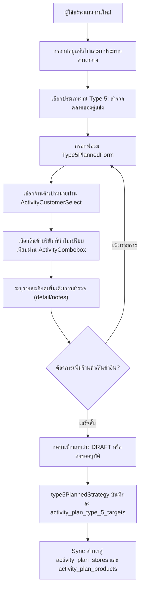
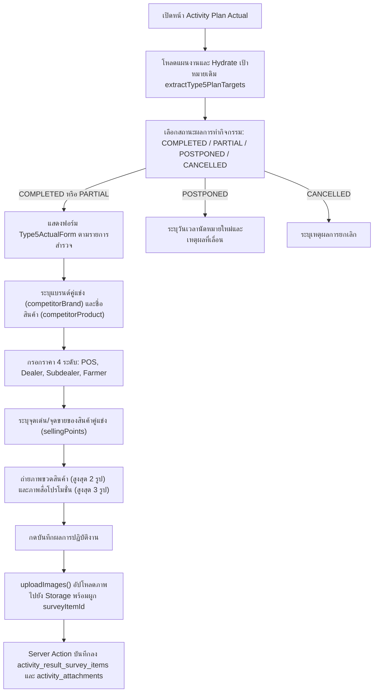
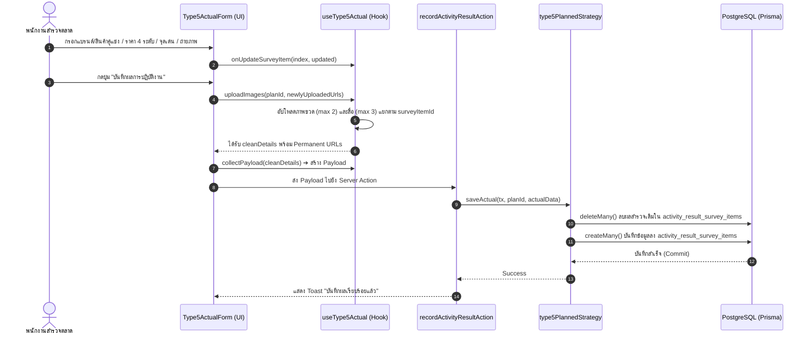

# Activity Type 5 — สำรวจตลาดของคู่แข่ง / Competitor Market Survey (README)

> **Feature Slice**: `modules/activity/features/type-5`  
> **Standard Reference**: ออกแบบตามแนวทาง Vertical Slice Architecture อิงตามแม่แบบ Gold Standard Type 1  
> **Parent Module**: `modules/activity`  
> **Database Authority**: `prisma/schema.prisma` (`ActivityPlanType5Target`, `ActivityResultSurveyItem`, `ActivityAttachment`, พร้อม sync สู่ `ActivityPlanStore`, `ActivityPlanProduct`)  
> **Status**: Production Ready / Active Reference (v1.6.0 — Updated 2026-10-22)

---

## 1. Overview

### 1.1 วัตถุประสงค์ของ Type 5
**Type 5 (สำรวจตลาดของคู่แข่ง / Competitor Market Survey)** มีวัตถุประสงค์เพื่อรองรับการปฏิบัติงานของพนักงานฝ่ายขายและพัฒนาตลาด (Sales Representatives / Market Development Reps / Promoters) ในการลงพื้นที่สำรวจราคาสินค้า โปรโมชั่น และความเคลื่อนไหวของผลิตภัณฑ์คู่แข่งทางการค้า ณ ร้านค้าตัวแทนจำหน่าย:
1. กำหนดเป้าหมายร้านค้าและผลิตภัณฑ์ของบริษัทที่จะนำไปเปรียบเทียบล่วงหน้า (Store & Compared Product Targets)
2. บันทึกข้อมูลแบรนด์คู่แข่ง (Competitor Brand) และชื่อสินค้าคู่แข่งที่พบจริงหน้างาน
3. สำรวจราคาขายของคู่แข่งแยกตามโครงสร้าง 4 ระดับราคามาตรฐาน (4-Tier Pricing Structure):
   - **ราคาขายหน้าร้าน / ณ จุดขาย (POS Price)**
   - **ราคาขายส่งให้ Dealer (Dealer Price)**
   - **ราคาขายส่งให้ Subdealer (Subdealer Price)**
   - **ราคาขายให้เกษตรกร (Farmers Price)**
4. บันทึกจุดเด่น / จุดขายของสินค้าคู่แข่ง (Selling Points) เพื่อใช้ประเมินกลยุทธ์ทางการตลาด
5. บันทึกหลักฐานภาพถ่ายภาคสนามความละเอียดสูงแยกเป็น 2 หมวดหมู่ชัดเจน:
   - **ภาพถ่ายขวดผลิตภัณฑ์ (Bottle Photos)** สูงสุด 2 ภาพต่อรายการ
   - **ภาพสื่อส่งเสริมการขาย / ป้ายโปรโมชั่น (Promotional Media Photos)** สูงสุด 3 ภาพต่อรายการ

### 1.2 ขอบเขตของ Type 5
- **กลุ่มเป้าหมายที่รองรับ:**
  - **ร้านค้าตัวแทนจำหน่าย (STORE):** ตัวแทนจำหน่ายหลัก (`DEALER`) และตัวแทนจำหน่ายย่อย (`SUBDEALER`) ที่ขึ้นทะเบียนในระบบ
  - **สินค้าเปรียบเทียบ (COMPARED PRODUCTS):** รายการผลิตภัณฑ์เคมีเกษตร ฮอร์โมน หรือปุ๋ยของบริษัท โดยระบบกรองเฉพาะหน่วยมาตรฐาน (เช่น หน่วย "กล่อง")
- **การจัดเก็บข้อมูลแบบ Dual Persistence:**
  - **Dedicated Tables:** บันทึกเป้าหมายลงตารางเฉพาะกิจ `ActivityPlanType5Target` (`activity_plan_type_5_targets`) และผลสำรวจจริงลง `ActivityResultSurveyItem` (`activity_result_survey_items`)
  - **Generic Tables Sync:** ซิงค์สำเนาเป้าหมายลงใน `ActivityPlanStore` และ `ActivityPlanProduct` (`workTypeCode = "TYPE_5"`) เพื่อให้ระบบส่วนกลางและรายงานเดิมทำงานร่วมกันได้อย่างราบรื่น
  - **Evidence Attachments:** รูปถ่ายขวดผลิตภัณฑ์และสื่อโปรโมชั่นผูกเข้ากับ `ActivityAttachment` โดยระบุ `surveyItemId` ตรงกับ ID ผลสำรวจจริง
- **การจัดเก็บผลสำรวจจริง (Actual Outcome):**
  - ระบุแบรนด์และชื่อสินค้าคู่แข่งที่พบหน้างาน
  - บันทึกโครงสร้างราคา 4 ระดับ (POS, Dealer, Subdealer, Farmer) และจุดเด่นสินค้า
  - รองรับราคาคู่แข่งทั่วไป (`competitorPrice`), หน่วยสินค้า (`competitorUnit`), และโปรโมชั่น (`promotionDetail`)
  - จัดเก็บและแสดงผลรูปภาพพร้อมระบบขยายดูภาพขนาดใหญ่ (Image Lightbox)

### 1.3 รูปแบบการทำงานที่รองรับ
1. **Planned (ในแผนงาน Trip Plan):** กำหนดเป้าหมายร้านค้าและผลิตภัณฑ์ที่จะนำไปเปรียบเทียบล่วงหน้า ส่งขออนุมัติตามสายงานก่อนออกปฏิบัติงาน
2. **Planned Actual (บันทึกผลงานตามแผน):** นำเป้าหมายที่ได้รับอนุมัติมารายงานผลการสำรวจคู่แข่งจริงหน้างาน (แบรนด์คู่แข่ง, ราคา 4 ระดับ, จุดขาย, ภาพถ่ายขวดและสื่อ)
3. **Unplanned (กิจกรรมนอกแผน 2-in-1):** กรณีลงพื้นที่สำรวจตลาดกะทันหันโดยไม่ได้วางแผนล่วงหน้า สามารถเลือกเป้าหมายร้านค้า/สินค้าเปรียบเทียบ พร้อมบันทึกผลสำรวจ ราคา และรูปภาพจบในฟอร์มเดียว พร้อมสร้างแผนงานสถานะ `COMPLETED` ทันที
4. **Detail View:** แสดงผลการสำรวจเปรียบเทียบในหน้ารายละเอียดแผนงานผ่าน `Type5DetailView` พร้อมตารางเปรียบเทียบและแกลเลอรีภาพถ่าย Lightbox
5. **Approval View:** การ์ดสำหรับผู้บังคับบัญชาพิจารณาอนุมัติผ่าน `Type5ApprovalCard` (แสดงเป้าหมายก่อนเริ่มงาน หรือผลงานจริงเมื่อมีบันทึกเข้ามา)

---

## 2. Business Flows

### 2.1 Planned (สร้างและแก้ไขแผนงาน)


### 2.2 Planned Actual (บันทึกผลการปฏิบัติงานตามแผน)


### 2.3 Unplanned (กิจกรรมนอกแผน 2-in-1)
- ผู้ใช้งานเข้าหน้า `/activity-plans/unplanned/new`
- ฟอร์ม `Type5UnplannedForm` ผสานทั้งการกำหนดเป้าหมาย (ร้านค้า + สินค้าเปรียบเทียบ) และการบันทึกผลการสำรวจคู่แข่งจริง (แบรนด์คู่แข่ง, ราคา 4 ระดับ, จุดเด่น, ภาพถ่ายขวด และภาพสื่อ) จบในฟอร์มเดียว
- เมื่อกดบันทึก ระบบจะตรวจสอบความถูกต้องผ่าน `validateType5UnplannedItems` และแปลง Payload ผ่าน `mapType5UnplannedToPayload`
- `type5UnplannedStrategy.savePlan()` จะบันทึกเป้าหมายลง `activity_plan_type_5_targets` (พร้อม sync สู่ generic stores/products) และเรียก `saveActual()` บันทึกผลสำรวจลง `activity_result_survey_items` ทันทีภายใน `$transaction` เดียวกัน โดยแผนงานมีสถานะเสร็จสิ้นสมบูรณ์

### 2.4 Detail and Approval (ดูรายละเอียดและพิจารณาอนุมัติ)
- **Detail View:** `DetailWorkTypeList` เรียกใช้ `Type5DetailView` เพื่อแสดงการ์ดสรุปเป้าหมายสำรวจตามแผน พร้อมตารางแสดงผลการสำรวจคู่แข่งจริง โครงสร้างราคา 4 ระดับ จุดขาย และรูปถ่ายขวด/สื่อที่มีระบบ Modal ขยายภาพ (Lightbox)
- **Approval View:** `ApprovalWorkTypeList` เรียกใช้ `Type5ApprovalCard` เพื่อให้หัวหน้างานพิจารณาเป้าหมายสำรวจร้านค้า/สินค้า หรือหากมีผลงานจริงแล้ว จะสลับแสดงผลลัพธ์ผ่าน `Type5DetailView` โดยอัตโนมัติ

---

## 3. Architecture

### 3.1 Folder Structure
```text
modules/activity/features/type-5/
├── index.ts                                    # Unified Public API Contract (ส่งออกเฉพาะสิ่งที่ภายนอกต้องใช้)
├── README.md                                   # เอกสารคู่มือทางเทคนิค (ไฟล์นี้)
│
├── planned/                                    # Sub-slice: กิจกรรมในแผนงานและบันทึกผลตามแผน
│   ├── application/                            # Business Logic, Validation, Mappers
│   │   ├── actual-mapper.ts                    # แปลงผลสำรวจจริง Form <-> DB/Payload (parseType5ActualResult)
│   │   ├── actual-validation.ts                # ตรวจสอบความถูกต้องของผลสำรวจจริง (validateType5Actual, type5SurveyRecordSchema)
│   │   ├── planned-mapper.ts                   # แปลงเป้าหมายในแผน Form <-> DB / Hydration (extractType5PlanTargets, hydrateType5PlannedData, mapType5FormToPayload, mapType5ToSectionItems)
│   │   └── planned-validation.ts               # Zod schemas สำหรับตรวจสอบความถูกต้องของแผน (validateType5FormItems, type5SurveyItemSchema)
│   ├── components/                             # UI Components ประจำ Type 5 ในแผน
│   │   ├── type5-planned-form.tsx              # ฟอร์มกำหนดเป้าหมายสำรวจตลาด (Create / Edit)
│   │   ├── type5-actual-form.tsx               # ฟอร์มบันทึกผลสำรวจจริง (ราคา 4 ระดับ + จุดเด่น + รูปขวด/สื่อ)
│   │   ├── type5-plan-card.tsx                 # การ์ดสรุปเป้าหมายสำรวจตามแผนงาน
│   │   ├── type5-detail-view.tsx               # คอมโพเนนต์แสดงผลเต็มรูปแบบในหน้ารายละเอียดพร้อม Lightbox
│   │   └── type5-approval-card.tsx             # การ์ดสรุปสำหรับหน้าพิจารณาอนุมัติ
│   ├── hooks/                                  # Custom State Hooks
│   │   ├── use-type5-planned-form.ts           # จัดการ State รายการเป้าหมายตามแผน
│   │   └── use-type5-actual.ts                 # จัดการ State ผลสำรวจจริงและอัปโหลดรูปภาพแยกตาม surveyItemId
│   ├── infrastructure/                         # Database Strategies
│   │   └── type5-planned.strategy.ts           # Strategy บันทึก/โหลดข้อมูล ActivityPlanType5Target & ActivityResultSurveyItem + Dual-write sync
│   └── types/                                  # Type Definitions ในแผน
│       ├── planned.types.ts                    # Type5SurveyItem, Type5TargetItem, Type5PlanCardProps, Type5PlannedFormProps
│       └── actual.types.ts                     # Type5SurveyRecord, Type5ActualFormProps, Type5DetailViewProps, Type5ApprovalCardProps
│
├── unplanned/                                  # Sub-slice: กิจกรรมนอกแผน (2-in-1)
│   ├── application/                            # Logic และ Mappers กิจกรรมนอกแผน
│   │   ├── unplanned-mapper.ts                 # Hydration และ Data mapping นอกแผน (hydrateType5UnplannedData, mapType5UnplannedToPayload)
│   │   └── unplanned-validation.ts             # Validation กิจกรรมนอกแผน (validateType5UnplannedItems)
│   ├── components/                             # UI Components กิจกรรมนอกแผน
│   │   └── type5-unplanned-form.tsx            # ฟอร์ม 2-in-1 (ระบุร้านค้า/สินค้าเปรียบเทียบ + แบรนด์คู่แข่ง/ราคา 4 ระดับ/รูปถ่าย)
│   ├── hooks/                                  # Custom State Hooks
│   │   └── use-type5-unplanned-form.ts         # จัดการ State รายการนอกแผน (เพิ่ม/แก้ไข/ลบรายการ)
│   ├── infrastructure/                         # Database Strategies นอกแผน
│   │   └── type5-unplanned.strategy.ts         # บันทึกกิจกรรมนอกแผนลง Prisma ผสานเป้าหมายและผลสำรวจพร้อมกัน
│   └── types/                                  # Type Definitions นอกแผน
│       └── unplanned.types.ts                  # Type5UnplannedItem, Type5UnplannedFormProps
│
└── shared/                                     # ชิ้นส่วนที่ใช้ร่วมกันภายใน Feature Type 5
    ├── constants.ts                            # SURVEY_IMAGE_CATEGORIES (BOTTLE, PROMOTION)
    └── types.ts                                # CustomerOption, StoreOption, ProductOption, Type5ImageFile, ImageFile
```

### 3.2 Type 5 vs Shared Activity
| ความรับผิดชอบ | จัดการที่ Type 5 Feature (`features/type-5`) | จัดการที่ Activity ส่วนกลาง (`ui/`, `views/`) |
| :--- | :--- | :--- |
| **ข้อมูลทั่วไป** | - | ชื่องาน, วันที่เริ่ม-สิ้นสุด, วัตถุประสงค์หลัก, ผู้ร่วมเดินทาง |
| **พื้นที่ & ทีมงาน** | - | จังหวัด, อำเภอ, ตำบล, พนักงานร่วมเดินทาง |
| **งบประมาณ** | - | งบเบิกสินค้าสาธิต, ของแถม, ค่าใช้จ่ายเดินทาง |
| **เป้าหมายสำรวจ** | เลือกร้านค้าเป้าหมาย, เลือกสินค้าบริษัทที่นำไปเปรียบเทียบ, รายละเอียด | - |
| **ผลการสำรวจจริง** | แบรนด์คู่แข่ง, ชื่อสินค้าคู่แข่ง, ราคา 4 ระดับ, จุดขาย, ภาพขวด/สื่อ | ผลสรุปภาพรวมแผน (สำเร็จ/เลื่อน/ยกเลิก) |
| **Database Persistence** | ตาราง `activity_plan_type_5_targets`, `activity_result_survey_items`, sync `activity_plan_stores`, `activity_plan_products` | ตารางหลัก `ActivityPlan`, `ActivityPlanApprovalLog`, `ActivityAttachment` |

### 3.3 Dependency and Import Map
- **ทิศทางการเรียกใช้ (Allowed):**
  - `views/` ➔ เรียกใช้ ➔ `features/type-5` (ผ่าน `index.ts` เท่านั้น)
  - `features/type-5` ➔ เรียกใช้ ➔ `@/modules/activity/ui` (`ActivityInput`, `ActivityTextarea`, `ActivityCustomerSelect`, `ActivityCombobox`, `ActivityPhotoUpload`)
  - `features/type-5` ➔ เรียกใช้ ➔ `@/modules/activity/constants`
  - `features/type-5` ➔ เรียกใช้ ➔ `@/modules/activity/types/strategy.interface`
  - `features/type-5` ➔ เรียกใช้ ➔ `@/modules/activity/application/media/image-uploader` (`uploadActivityPlanImageGroup`, `collectPermanentUrls`)
  - `features/type-5` ➔ เรียกใช้ ➔ `@/components/custom/image-lightbox-modal` (`ImageLightboxModal`)
- **Server Actions & Database Flow:**
  - `views/` ➔ ส่งข้อมูลไปยัง ➔ Server Actions ใน `@/modules/activity/server/`:
    - `planned.actions.ts` (`createActivityPlanAction`, `updateActivityPlanAction`, `getActivityPlanAction`)
    - `unplanned.actions.ts` (`createUnplannedActivityAction`, `updateUnplannedActivityAction`, `getUnplannedActivityAction`)
    - `actual.actions.ts` (`recordActivityResultAction`)
  - Server Actions ➔ ทำงานร่วมกับ ➔ `@/modules/activity/infrastructure/strategy.registry` ➔ เรียกใช้ `type5PlannedStrategy` / `type5UnplannedStrategy` บันทึกลงตาราง dedicated และ generic tables ภายใน `$transaction`
- **สิ่งต้องห้าม (Strictly Forbidden):**
  - ❌ ภายนอก Import เจาะลึกเข้าไปในโฟลเดอร์ย่อย เช่น `features/type-5/planned/components/...`
  - ❌ `features/type-5` เรียกใช้ข้อมูลข้ามไปยัง `features/type-1` ถึง `type-4` หรือ `type-6` ถึง `type-14`
  - ❌ Import ย้อนกลับไปยังโมดูลเก่า `@/modules/activity-plans/...` โดยเด็ดขาด

### 3.4 Entry Points and Public Exports
ไฟล์ [modules/activity/features/type-5/index.ts](file:///d:/code/crm-bank/modules/activity/features/type-5/index.ts) ทำหน้าที่เป็น **Single Public API Contract** สำหรับฝั่ง UI / Application โดยส่งออกเฉพาะ:
- **Components:** `Type5PlannedForm` (`Type5PlanForm`, `Type5Survey`, `EditType5Survey`), `Type5PlanCard`, `Type5ActualForm` (`ActualType5Survey`), `Type5DetailView` (`DetailType5Survey`), `Type5ApprovalCard` (`ApprovalType5Survey`), `Type5UnplannedForm`
- **Hooks:** `useType5PlannedForm` (`useType5Form`), `useType5Actual`, `useType5UnplannedForm`
- **Mappers & Hydrators:** `extractType5PlanTargets`, `hydrateType5PlannedData`, `mapType5FormToPayload`, `mapType5ToSectionItems`, `parseType5ActualResult`, `hydrateType5UnplannedData`, `mapType5UnplannedToPayload`
- **Validators & Schemas:** `validateType5FormItems`, `type5SurveyItemSchema`, `validateType5Actual`, `type5SurveyRecordSchema`, `validateType5UnplannedItems`
- **Constants & Types:** `SURVEY_IMAGE_CATEGORIES`, `Type5SurveyItem`, `TargetSurveyItem`, `Type5TargetItem`, `Type5PlanCardTargetItem`, `Type5PlanCardTarget`, `Type5PlanCardProps`, `Type5PlannedFormProps`, `Type5SurveyRecord`, `Type5ActualFormProps`, `Type5DetailViewProps`, `Type5ApprovalCardProps`, `Type5UnplannedItem`, `Type5UnplannedFormProps`, `CustomerOption`, `StoreOption`, `ProductOption`, `Type5ImageFile`, `ImageFile`
- *(หมายเหตุ: `type5PlannedStrategy` และ `type5UnplannedStrategy` ถูกนำเข้าโดยตรงที่ `modules/activity/infrastructure/strategy.registry.ts` เพื่อแยกโค้ดฝั่ง Server/Database ออกจาก Client Bundle)*

---

## 4. File Responsibilities

### 4.1 Planned & Actual
- **`use-type5-planned-form.ts`:** จัดการ State รายการสำรวจในแผน (Array of `Type5SurveyItem`), รองรับการเพิ่ม (`addType5Row`), แก้ไข (`updateType5Row`), ลบ (`deleteType5Row`), เติมชื่อร้านค้าและสินค้าอัตโนมัติเมื่อเลือก ID, ตรวจสอบความถูกต้อง (`validateType5`), และสร้าง Payload (`mapType5Payload`)
- **`type5-planned-form.tsx`:** ฟอร์มสร้าง/แก้ไขแผนงาน แสดงรายการสำรวจแต่ละการ์ด เลือกร้านค้าผ่าน `ActivityCustomerSelect` และเลือกสินค้าบริษัทผ่าน `ActivityCombobox` (กรองสินค้าหน่วย "กล่อง")
- **`type5-plan-card.tsx`:** การ์ดสรุปเป้าหมายสำรวจตลาดตามแผน แสดงชื่อร้านค้า สินค้าที่นำไปเปรียบเทียบ และรายละเอียด
- **`type5-actual-form.tsx`:** ฟอร์มบันทึกผลการสำรวจคู่แข่งจริงหน้างาน รองรับการระบุแบรนด์และชื่อสินค้าคู่แข่ง, โครงสร้างราคา 4 ระดับ (POS, Dealer, Subdealer, Farmer), จุดขายสินค้า, และอัปโหลดภาพถ่ายขวด (สูงสุด 2 รูป) และสื่อโปรโมชั่น (สูงสุด 3 รูป)
- **`use-type5-actual.ts`:** จัดการ State ผลการสำรวจจริงรายเป้าหมาย, รองรับการ Hydrate ข้อมูลเดิม, อัปโหลดรูปภาพแยกโฟลเดอร์ตาม `surveyItemId` ผ่าน `uploadActivityPlanImageGroup`, คืนค่า URL ภาพเก่าเพื่อลบ, และสร้าง Payload สำหรับบันทึกผล
- **`type5-detail-view.tsx`:** การ์ดแสดงผลเปรียบเทียบในหน้ารายละเอียด แสดงทั้งข้อมูลเป้าหมายและผลการสำรวจจริง พร้อมตารางเปรียบเทียบราคา 4 ระดับและแกลเลอรีรูปถ่ายพร้อม Lightbox
- **`type5-approval-card.tsx`:** การ์ดสำหรับหน้าพิจารณาอนุมัติของหัวหน้างาน แสดงข้อมูลสรุปเป้าหมายร้านค้าและสินค้าที่จะไปสำรวจ
- **`planned-mapper.ts`:**
  - `extractType5PlanTargets`: ดึงเป้าหมายจาก `plan.type5Targets` หรือ fallback จาก generic stores/products
  - `hydrateType5PlannedData`: กู้คืนรายการเป้าหมายเดิมเมื่อเข้าสู่หน้าแก้ไขแผนงาน (`edit-view.tsx`)
  - `mapType5FormToPayload`: แปลงรายการสำรวจเป็น Payload พร้อมโครงสร้าง `planStores` และ `planProducts` สำหรับ Dual-write sync
  - `mapType5ToSectionItems`: แปลงรายการสำรวจสำหรับแสดงผลใน Section ทั่วไปของระบบ
- **`actual-mapper.ts`:** แปลงผลการสำรวจจากฐานข้อมูล (`plan.result.surveyResults` หรือ `attachments`) เข้าสู่โครงสร้าง `Type5SurveyRecord` สำหรับ UI
- **`planned-validation.ts`:** ตรวจสอบความถูกต้องของเป้าหมายในแผน (`validateType5FormItems`, `type5SurveyItemSchema`)
- **`actual-validation.ts`:** ตรวจสอบความถูกต้องของผลสำรวจจริง ต้องระบุแบรนด์และสินค้าคู่แข่ง (`validateType5Actual`, `type5SurveyRecordSchema`)
- **`type5-planned.strategy.ts`:** ดำเนินการตรวจสอบเงื่อนไข (`validatePlan`), บันทึกลงตาราง `ActivityPlanType5Target` พร้อม dual-write sync ไปยัง `ActivityPlanStore` และ `ActivityPlanProduct` (`savePlan`), บันทึกผลสำรวจลง `ActivityResultSurveyItem` (`saveActual`), และโหลดข้อมูลแผน (`loadPlan`)

### 4.2 Unplanned
- **`use-type5-unplanned-form.ts`:** จัดการ State กิจกรรมนอกแผน 2-in-1 ที่รวมทั้งเป้าหมายร้านค้า/สินค้า และผลการสำรวจราคา/รูปภาพ มีฟังก์ชัน `addItem`, `updateItem`, `deleteItem`
- **`type5-unplanned-form.tsx`:** ฟอร์ม 2-in-1 สำหรับกิจกรรมนอกแผน แสดงเลือกร้านค้า สินค้าบริษัทที่นำไปเปรียบเทียบ แบรนด์คู่แข่ง สินค้าคู่แข่ง ราคา 4 ระดับ จุดขาย และช่องอัปโหลดภาพถ่ายขวด/สื่อ
- **`unplanned-mapper.ts`:**
  - `hydrateType5UnplannedData`: กู้คืนข้อมูลกิจกรรมนอกแผนเดิมเมื่อเปิดหน้าแก้ไข
  - `mapType5UnplannedToPayload`: แปลงข้อมูลนอกแผนให้เป็นทั้ง `type5Targets` (เป้าหมาย) และ `type5SurveyRecords` / `targetActualResults` (ผลงานจริง)
- **`unplanned-validation.ts`:** ตรวจสอบความถูกต้องของรายการนอกแผน (`validateType5UnplannedItems`) ต้องระบุร้านค้า สินค้าเปรียบเทียบ แบรนด์คู่แข่ง และสินค้าคู่แข่งครบถ้วน
- **`type5-unplanned.strategy.ts`:** บันทึกทั้งเป้าหมายและผลการสำรวจคู่แข่งพร้อมกันผ่าน `type5PlannedStrategy.savePlan()` และ `type5PlannedStrategy.saveActual()`

### 4.3 Shared Types and Constants
- **`shared/constants.ts`:** กำหนด `SURVEY_IMAGE_CATEGORIES` ประกอบด้วย `BOTTLE: "SURVEY_BOTTLE"` และ `PROMOTION: "SURVEY_PROMO_MATERIAL"`
- **`shared/types.ts`:** กำหนดอินเทอร์เฟซ `CustomerOption`, `StoreOption`, `ProductOption`, `Type5ImageFile`, `ImageFile`

### 4.4 Shared UI and Views
- `planned-activity-form.tsx`, `unplanned-activity-form.tsx`, `activity-plan-actual-view.tsx`, `actual-work-type-list.tsx`, `detail-work-type-list.tsx`, และ `approval-work-type-list.tsx` ทำหน้าที่เป็น Orchestrators ในการเลือกเรนเดอร์และประมวลผล Type 5 ตามเงื่อนไข `isType5Active`

---

## 5. Data Flow



### 5.1 Create Planned (สร้างแผนใหม่)
1. `create-view.tsx` หรือ `planned-activity-form.tsx` เรียกใช้ `useType5PlannedForm()`
2. ผู้ใช้เลือกร้านค้าเป้าหมายและสินค้าเปรียบเทียบใน `Type5PlannedForm` พร้อมระบุรายละเอียด
3. ผู้ใช้กดส่งขออนุมัติ ➔ รัน `validateType5()`
4. Map ข้อมูลผ่าน `mapType5Payload()` ได้ `type5Items`, `planStores`, `planProducts`
5. ส่งไปยัง Server Action `createActivityPlanAction`
6. Server Action เรียก `type5PlannedStrategy.savePlan()` ภายใน `$transaction`
7. Prisma บันทึกลงตาราง `activity_plan_type_5_targets` พร้อม sync สู่ `activity_plan_stores` และ `activity_plan_products`

### 5.2 Edit Planned (แก้ไขแผนงานเดิม)
1. `edit-view.tsx` ดึงข้อมูลแผนเดิมจากฐานข้อมูล
2. เรียก `hydrateType5PlannedData(initialData)` เพื่อแปลงข้อมูลจาก `type5Targets` (หรือ fallback `planStores`/`planProducts`)
3. ส่งข้อมูลที่กู้คืนได้เข้า `useType5PlannedForm({ initialItems })`
4. ฟอร์มแสดงข้อมูลเดิมพร้อมให้แก้ไข เพิ่ม หรือลบรายการได้อย่างสมบูรณ์

### 5.3 Save Actual (บันทึกผลการปฏิบัติงานจริง)
1. `activity-plan-actual-view.tsx` รันกระบวนการบันทึกผล
2. ตรวจสอบความถูกต้องด้วย `validateType5Actual(type5Actual.t5SurveyDetails)`
3. เรียก `type5Actual.uploadImages(id, newlyUploadedUrls)` เพื่ออัปโหลดภาพขวดและสื่อโปรโมชั่น ได้ URL ถาวร
4. เรียก `type5Actual.collectPayload(cleanDetails)` เพื่อรวบรวมข้อมูลสำรวจคู่แข่ง
5. ส่ง Payload เข้า `recordActivityResultAction(id, payload)`
6. `type5PlannedStrategy.saveActual()` ลบผลสำรวจเก่าแล้วสร้างระเบียนใหม่ลงตาราง `activity_result_survey_items` และบันทึกรูปภาพลง `activity_attachments`

### 5.4 Load Actual (โหลดผลงานเดิมมาแสดงในหน้าบันทึกผล)
1. หน้า Actual ดึงข้อมูลแผนและผลงานเดิม
2. `extractType5PlanTargets(plan)` แปลงเป้าหมายเดิมเข้าสู่ `targets`
3. เรียก `type5Actual.hydrate(payloadToHydrate, { t5: extractedT5.primary })`
4. ฟอร์มแสดงข้อมูลผลสำรวจเดิม ราคา 4 ระดับ และรูปถ่ายที่เคยบันทึกไว้

### 5.5 Create/Edit Unplanned (กิจกรรมนอกแผน)
1. ผู้ใช้กรอกฟอร์ม `Type5UnplannedForm` (ระบุร้านค้า สินค้าเปรียบเทียบ แบรนด์คู่แข่ง ราคา 4 ระดับ และภาพถ่าย)
2. ตรวจสอบความถูกต้องด้วย `validateType5UnplannedItems(type5.items)`
3. แปลง Payload ผ่าน `mapType5UnplannedToPayload(type5.items)`
4. `type5UnplannedStrategy.savePlan()` บันทึกเป้าหมายลง `activity_plan_type_5_targets` และบันทึกผลสำรวจลง `activity_result_survey_items` พร้อมกันใน `$transaction` เดียวกัน

### 5.6 Detail and Approval (การแสดงผลหน้ารายละเอียดและพิจารณาอนุมัติ)
1. โหลดข้อมูลแผนงานผ่าน Loader
2. ระบบตรวจจับประเภทงานว่าเป็น Type 5 ผ่าน `WORK_TYPE_STRATEGY_REGISTRY.TYPE_5.hasData()`
3. หน้ารายละเอียดเรนเดอร์ `<Type5DetailView />` พร้อมตารางราคา 4 ระดับและ Lightbox
4. หน้าอนุมัติเรนเดอร์ `<Type5ApprovalCard />` (หากมีผลงานจริงจะสลับแสดง `<Type5DetailView />` ให้อัตโนมัติ)

---

## 6. Data Models and Mapping

### 6.1 Database CRUD Matrix (สิทธิ์และการจัดการตารางในฐานข้อมูล)
| ตารางในฐานข้อมูล (`Prisma Model`) | Create (สร้าง) | Read (อ่าน/แสดงผล) | Update (แก้ไข) | Delete (ลบ) | หมายเหตุ |
| :--- | :--- | :--- | :--- | :--- | :--- |
| **`activity_plan_type_5_targets`**<br>(`ActivityPlanType5Target`) | `savePlan()`<br>ใน Planned/Unplanned | `loadPlan()`, `plan.type5Targets` ใน Detail / Edit / Actual | `deleteMany()` + `createMany()` ใน `savePlan()` | Cascade เมื่อลบ `ActivityPlan` | ตารางหลักเก็บเป้าหมายร้านค้าและสินค้าเปรียบเทียบ |
| **`activity_result_survey_items`**<br>(`ActivityResultSurveyItem`) | `saveActual()`<br>ใน Actual/Unplanned | `plan.result.surveyResults` หรือ `plan.surveyResults` | `deleteMany()` + `createMany()` ใน `saveActual()` | Cascade เมื่อลบ `ActivityResult` | เก็บผลสำรวจคู่แข่ง ราคา 4 ระดับ จุดขาย |
| **`activity_plan_stores`**<br>(`ActivityPlanStore`) | Dual-write sync ใน `savePlan()` | Generic store queries | `deleteMany()` + `createMany()` (`workTypeCode: "TYPE_5"`) | Cascade เมื่อลบ `ActivityPlan` | ซิงค์สำเนาเป้าหมายร้านค้า |
| **`activity_plan_products`**<br>(`ActivityPlanProduct`) | Dual-write sync ใน `savePlan()` | Generic product queries | `deleteMany()` + `createMany()` (`workTypeCode: "TYPE_5"`) | Cascade เมื่อลบ `ActivityPlan` | ซิงค์สำเนาสินค้าเปรียบเทียบ |
| **`activity_attachments`**<br>(`ActivityAttachment`) | Storage Upload + `upsertActivityResult()` | `plan.attachments` (หมวดหมู่ SURVEY_BOTTLE / SURVEY_PROMO_MATERIAL) | ลบรายการเก่าและสร้างระเบียนใหม่ | Cascade เมื่อลบ `ActivityPlan` | เก็บล็อก URL ภาพถ่ายจริงผูก `surveyItemId` |

### 6.2 Complete Field-to-Database Mapping (ตารางจับคู่ฟิลด์ครบถ้วนทุกจุด)
ไล่จาก **Form Field ➔ Type Field ➔ Mapper ➔ Prisma Model ➔ DB Column Name ➔ Data Type**:

| Form Field (UI) | TypeScript Type Field | Mapper Function (Write/Read) | Prisma Model | DB Column Name | Data Type | Nullable? | Default |
| :--- | :--- | :--- | :--- | :--- | :--- | :---: | :--- |
| **ร้านค้าเป้าหมาย** | `storeId` / `storeName` | `mapType5FormToPayload` / `extractType5PlanTargets` | `ActivityPlanType5Target` | `store_id` | `VARCHAR (FK)` | Yes | `null` |
| **สินค้าที่นำไปเปรียบเทียบ** | `productId` / `comparedProduct` | `mapType5FormToPayload` / `extractType5PlanTargets` | `ActivityPlanType5Target` | `product_id` | `VARCHAR (FK)` | Yes | `null` |
| **รายละเอียดการสำรวจ** | `detail` | `mapType5FormToPayload` / `extractType5PlanTargets` | `ActivityPlanType5Target` | `detail` | `TEXT` | Yes | `null` |
| **แบรนด์คู่แข่ง** | `competitorBrand` | `saveActual` / `parseType5ActualResult` | `ActivityResultSurveyItem` | `competitor_brand` | `VARCHAR` | No | `"-"` |
| **ชื่อสินค้าคู่แข่ง** | `competitorProduct` | `saveActual` / `parseType5ActualResult` | `ActivityResultSurveyItem` | `competitor_product` | `VARCHAR` | No | `"-"` |
| **ราคาขายหน้าร้าน (POS)** | `posPrice` | `saveActual` (`new Prisma.Decimal()`) / `parseType5ActualResult` | `ActivityResultSurveyItem` | `pos_price` | `DECIMAL(15,2)` | Yes | `null` |
| **ราคาขายให้ Dealer** | `dealerPrice` | `saveActual` (`new Prisma.Decimal()`) / `parseType5ActualResult` | `ActivityResultSurveyItem` | `dealer_price` | `DECIMAL(15,2)` | Yes | `null` |
| **ราคาขายให้ Subdealer** | `subdealerPrice` | `saveActual` (`new Prisma.Decimal()`) / `parseType5ActualResult` | `ActivityResultSurveyItem` | `subdealer_price` | `DECIMAL(15,2)` | Yes | `null` |
| **ราคาขายให้เกษตรกร** | `farmerPrice` | `saveActual` (`new Prisma.Decimal()`) / `parseType5ActualResult` | `ActivityResultSurveyItem` | `farmer_price` | `DECIMAL(15,2)` | Yes | `null` |
| **จุดเด่น/จุดขายสินค้าคู่แข่ง** | `sellingPoints` | `saveActual` / `parseType5ActualResult` | `ActivityResultSurveyItem` | `selling_points` | `TEXT` | Yes | `null` |
| **ราคาคู่แข่งเดิม/ทั่วไป** | `competitorPrice` | `saveActual` (`new Prisma.Decimal()`) / `parseType5ActualResult` | `ActivityResultSurveyItem` | `competitor_price` | `DECIMAL(15,2)` | Yes | `null` |
| **หน่วยสินค้าคู่แข่ง** | `competitorUnit` | `saveActual` / `parseType5ActualResult` | `ActivityResultSurveyItem` | `competitor_unit` | `VARCHAR` | Yes | `null` |
| **รายละเอียดโปรโมชั่น** | `promotionDetail` | `saveActual` / `parseType5ActualResult` | `ActivityResultSurveyItem` | `promotion_detail` | `TEXT` | Yes | `null` |
| **ภาพถ่ายขวดผลิตภัณฑ์** | `bottleImages` | `uploadImages()` (`SURVEY_BOTTLE`, max 2) | `ActivityAttachment` | `file_url`, `survey_item_id` | `TEXT` | No | - |
| **ภาพสื่อส่งเสริมการขาย** | `promotionalImages` | `uploadImages()` (`SURVEY_PROMO_MATERIAL`, max 3) | `ActivityAttachment` | `file_url`, `survey_item_id` | `TEXT` | No | - |

### 6.3 รายละเอียดตารางสินค้า รูปภาพ และความสัมพันธ์ (Relations & Schema)

```prisma
// 1. ตารางเก็บเป้าหมายการสำรวจตลาด Type 5
model ActivityPlanType5Target {
  id             String   @id @default(cuid())
  activityPlanId String   @map("activity_plan_id")
  storeId        String?  @map("store_id")
  productId      String?  @map("product_id") // สินค้าที่นำไปเปรียบเทียบ
  detail         String?  @map("detail") @db.Text // รายละเอียดเพิ่มเติมการสำรวจ

  createdAt      DateTime @default(now()) @map("created_at")
  updatedAt      DateTime @updatedAt @map("updated_at")

  activityPlan   ActivityPlan @relation(fields: [activityPlanId], references: [id], onDelete: Cascade)
  store          Customer?    @relation(fields: [storeId], references: [id], onDelete: SetNull)
  product        Product?     @relation(fields: [productId], references: [id], onDelete: SetNull)

  @@index([activityPlanId])
  @@index([storeId])
  @@index([productId])
  @@map("activity_plan_type_5_targets")
}

// 2. ตารางเก็บผลการสำรวจคู่แข่งจริง Type 5
model ActivityResultSurveyItem {
  id                String   @id @default(cuid())
  activityResultId  String   @map("activity_result_id")
  storeId           String   @map("store_id")
  productId         String?  @map("product_id")
  competitorBrand   String   @map("competitor_brand")
  competitorProduct String   @map("competitor_product")
  competitorPrice   Decimal? @map("competitor_price") @db.Decimal(15, 2)
  competitorUnit    String?  @map("competitor_unit")
  promotionDetail   String?  @map("promotion_detail")

  // โครงสร้างราคา 4 ระดับ และจุดเด่นสินค้า (TYPE_5 requirement)
  posPrice       Decimal? @map("pos_price") @db.Decimal(15, 2)
  dealerPrice    Decimal? @map("dealer_price") @db.Decimal(15, 2)
  subdealerPrice Decimal? @map("subdealer_price") @db.Decimal(15, 2)
  farmerPrice    Decimal? @map("farmer_price") @db.Decimal(15, 2)
  sellingPoints  String?  @map("selling_points") @db.Text

  activityResult ActivityResult       @relation(fields: [activityResultId], references: [id], onDelete: Cascade)
  store          Customer             @relation(fields: [storeId], references: [id], onDelete: Restrict)
  product        Product?             @relation("ActivityResultSurveyProductRef", fields: [productId], references: [id], onDelete: SetNull)
  attachments    ActivityAttachment[]

  @@index([activityResultId])
  @@index([storeId])
  @@index([competitorBrand])
  @@map("activity_result_survey_items")
}

// 3. ตารางบันทึกรูปภาพหลักฐานที่ผูกกับผลสำรวจ
model ActivityAttachment {
  id             String                    @id @default(cuid())
  activityPlanId String                    @map("activity_plan_id")
  activityResultId String?                 @map("activity_result_id")
  surveyItemId   String?                   @map("survey_item_id")
  category       String                    @map("category") // "SURVEY_BOTTLE" | "SURVEY_PROMO_MATERIAL"
  fileUrl        String                    @map("file_url")
  fileName       String?                   @map("file_name")
  fileSize       Int?                      @map("file_size")
  mimeType       String?                   @map("mime_type")

  surveyItem     ActivityResultSurveyItem? @relation(fields: [surveyItemId], references: [id], onDelete: Cascade)
  // ... ความสัมพันธ์อื่น ๆ ในระบบหลัก

  @@index([surveyItemId])
  @@map("activity_attachments")
}
```

### 6.4 Transaction & Persistence Strategy (ขาเขียนและขาอ่าน)
- **การจัดการ Transaction (Isolation & Atomicity):**
  - ทุกการบันทึกของ Type 5 ดำเนินการภายใต้ `tx` (`PrismaTransaction`) ของระบบ
  - หากบันทึกรูปภาพ หรือข้อมูลราคา หรือสินค้าเปรียบเทียบล้มเหลว ระบบจะทำการ **Rollback ทั้งหมด** ป้องกันไม่ให้มีข้อมูลกำพร้า (Orphaned records) ตกค้าง
- **ขาเขียน (Write Flow):**
  1. *Planned:* ลบระเบียนเดิมใน `activity_plan_type_5_targets` ที่ผูกกับ `activityPlanId` ➔ สร้างระเบียนเป้าหมายใหม่ด้วย `createMany()` ➔ ทำการ Dual-write sync ไปยัง `activity_plan_stores` และ `activity_plan_products`
  2. *Actual:* อัปโหลดรูปภาพแยกโฟลเดอร์ตาม `surveyItemId` ➔ ลบระเบียนเดิมใน `activity_result_survey_items` ➔ สร้างระเบียนผลสำรวจใหม่พร้อมแปลงค่าราคาเป็น `Prisma.Decimal` ➔ ผูกรูปภาพใน `activity_attachments`
  3. *Unplanned:* บันทึกเป้าหมายและผลสำรวจพร้อมกันใน `$transaction` เดียวกัน โดยผูก `surveyItemId` เข้ากับ ID ใหม่ทันที
- **ขาอ่าน (Read / Hydration Flow):**
  1. *Planned Edit:* ดึง `plan.type5Targets` (พร้อม include `store` และ `product`) ➔ ส่งผ่าน `hydrateType5PlannedData()` เพื่อเติมลงใน State ของฟอร์ม
  2. *Actual & Detail View:* ดึง `plan.type5Targets` + `plan.result.surveyResults` + `attachments` ➔ ส่งผ่าน `extractType5PlanTargets()` และเรียก `type5Actual.hydrate()` เพื่อกู้คืนข้อมูลเป้าหมาย ราคา 4 ระดับ และรูปภาพพร้อมใช้งาน
  3. *Unplanned Edit:* ดึงข้อมูลแผนผ่าน `getActivityPlanAction` ➔ ส่งผ่าน `hydrateType5UnplannedData()` เพื่อกู้คืนทั้งเป้าหมายและผลสำรวจคู่แข่ง
- **การลบข้อมูล (Delete Policy):**
  - ใช้ **Cascade Delete** จาก `ActivityPlan`: เมื่อลบแผนงาน ระเบียนใน `activity_plan_type_5_targets`, `activity_result_survey_items`, และรูปภาพใน `activity_attachments` จะถูกลบออกอัตโนมัติ

---

## 7. Business Rules

### 7.1 Validation Rules
- **การวางแผนเป้าหมาย (`Type5PlannedForm`):**
  - ต้องมีรายการสำรวจอย่างน้อย 1 รายการ
  - แต่ละรายการต้องระบุร้านค้าเป้าหมาย (`storeId` หรือ `storeName`)
  - แต่ละรายการต้องระบุสินค้าบริษัทที่นำไปเปรียบเทียบ (`productId` หรือ `comparedProduct`)
- **การบันทึกผลงานจริง (`Type5ActualForm`):**
  - ต้องระบุแบรนด์คู่แข่ง (`competitorBrand` ห้ามว่าง)
  - ต้องระบุชื่อสินค้าคู่แข่ง (`competitorProduct` ห้ามว่าง)
- **การบันทึกกิจกรรมนอกแผน (`Type5UnplannedForm`):**
  - ต้องระบุร้านค้า สินค้าเปรียบเทียบ แบรนด์คู่แข่ง และสินค้าคู่แข่งครบถ้วนทุกรายการ

### 7.2 Default Values
- `workTypeCode`: `"TYPE_5"`
- `competitorBrand`: ค่าเริ่มต้นในฐานข้อมูลกรณีว่างคือ `"-"`
- `competitorProduct`: ค่าเริ่มต้นในฐานข้อมูลกรณีว่างคือ `"-"`
- `activityResultStatus`: ค่าเริ่มต้นเมื่อเปิดหน้าบันทึกผลเป็น `"COMPLETED"`

### 7.3 Conditional Fields
- **โครงสร้างราคา 4 ระดับ (4-Tier Pricing):**
  - ฟิลด์ `posPrice`, `dealerPrice`, `subdealerPrice`, `farmerPrice` เป็น Optional เพื่อความยืดหยุ่นหน้างาน (หากร้านค้าไม่เปิดเผยราคาขายส่งบางระดับ สามารถเว้นว่างได้)
- **ข้อจำกัดจำนวนภาพถ่าย:**
  - ภาพขวดผลิตภัณฑ์ (`SURVEY_BOTTLE`): รองรับสูงสุด 2 ภาพต่อรายการสำรวจ
  - ภาพสื่อส่งเสริมการขาย (`SURVEY_PROMO_MATERIAL`): รองรับสูงสุด 3 ภาพต่อรายการสำรวจ
- **การกรองรายการสินค้าบริษัท:**
  - ฟอร์มจะแสดงเฉพาะรายการสินค้าที่มีหน่วยเป็น "กล่อง" (Box units) เป็นค่าตั้งต้น หากไม่มีหน่วยกล่องจะแสดงสินค้าทั้งหมด

### 7.4 Status and Approval Rules
- **การบันทึกผลงานจริง (Trip Plan Actual):** สามารถบันทึกได้เฉพาะเมื่อแผนมีสถานะเป็น `APPROVED` (อนุมัติแล้ว) เท่านั้น
- **สิทธิ์การบันทึกผล:** เฉพาะเจ้าของแผนงาน (Creator) และ Administrator เท่านั้น ผู้ช่วยงาน (Helper) ไม่สามารถบันทึกผลแทนได้
- **การแสดงผลฟอร์มจริง:** ฟอร์ม Type 5 Actual จะแสดงขึ้นมาให้กรอกเมื่อสถานะกิจกรรมเป็น **`COMPLETED` (ปฏิบัติงานแล้วเสร็จ)** หรือ **`PARTIAL` (สำเร็จบางส่วน)**

---

## 8. Shared Dependencies

โมดูล Type 5 ทำงานร่วมกับชิ้นส่วนส่วนกลางต่อไปนี้:
1. **`@/modules/activity/ui`:**
   - `ActivityInput`: คอมโพเนนต์ Input มาตรฐานประจำโมดูล Activity
   - `ActivityTextarea`: คอมโพเนนต์กรอกข้อความหลายบรรทัดสำหรับรายละเอียดและจุดขาย
   - `ActivityCustomerSelect`: คอมโพเนนต์ค้นหาและเลือกร้านค้าตัวแทนจำหน่าย
   - `ActivityCombobox`: คอมโพเนนต์เลือกสินค้าที่นำไปเปรียบเทียบพร้อมรองรับ Custom Search
   - `ActivityPhotoUpload`: คอมโพเนนต์อัปโหลดรูปภาพพร้อมบีบอัดไฟล์ในตัว
2. **`@/components/custom`:**
   - `ImageLightboxModal`: โมดอลดูภาพถ่ายขนาดใหญ่ (Full-screen Lightbox)
3. **`@/modules/activity/views`:**
   - `planned-activity-form.tsx`: ฟอร์มหลักสำหรับสร้าง/แก้ไขแผนงาน
   - `unplanned-activity-form.tsx`: ฟอร์มหลักสำหรับกิจกรรมนอกแผน 2-in-1
   - `activity-plan-actual-view.tsx` & `actual-work-type-list.tsx`: ตัวกระจายฟอร์มผลการปฏิบัติงานจริง
   - `detail-work-type-list.tsx`: ตัวกระจายการ์ดแสดงผลในหน้ารายละเอียด
   - `approval-work-type-list.tsx`: ตัวกระจายการ์ดในหน้าพิจารณาอนุมัติ
4. **`@/modules/activity/constants`:**
   - `WORK_TYPE_CONFIG`: การตั้งค่าและรหัสประเภทงาน (`TYPE_5`)
   - `ACTIVITY_RESULT_STATUS_LABELS`: ป้ายแสดงสถานะผลกิจกรรม
5. **`@/modules/activity/infrastructure/strategy.registry`:**
   - `saveStrategiesForPlan`: จัดการบันทึกข้อมูล Type Strategies ตาม Work Type Codes
   - `WORK_TYPE_STRATEGY_REGISTRY.TYPE_5`: ลงทะเบียน `type5PlannedStrategy` และ `type5UnplannedStrategy`
6. **Server Actions ที่ใช้งานจริง (`@/modules/activity/server/`):**
   - **`planned.actions.ts`**: `createActivityPlanAction`, `updateActivityPlanAction`, `getActivityPlanAction`
   - **`unplanned.actions.ts`**: `createUnplannedActivityAction`, `updateUnplannedActivityAction`, `getUnplannedActivityAction`
   - **`actual.actions.ts`**: `recordActivityResultAction`

---

## 9. How to Modify Type 5

### 9.1 การเพิ่มฟิลด์ใหม่บนฟอร์ม (Add a Form Field)
1. เพิ่มฟิลด์ใน Type Definitions:
   - ฟอร์มในแผน: `planned/types/planned.types.ts` (`Type5SurveyItem`)
   - ฟอร์มผลจริง: `planned/types/actual.types.ts` (`Type5SurveyRecord`)
   - ฟอร์มนอกแผน: `unplanned/types/unplanned.types.ts` (`Type5UnplannedItem`)
2. เพิ่ม Validation Schema ใน `planned-validation.ts`, `actual-validation.ts`, หรือ `unplanned-validation.ts`
3. เพิ่ม Input Field ใน UI Component:
   - ในแผน: `planned/components/type5-planned-form.tsx`
   - ผลจริง: `planned/components/type5-actual-form.tsx`
   - นอกแผน: `unplanned/components/type5-unplanned-form.tsx`
   - หน้ารายละเอียด: `planned/components/type5-detail-view.tsx`
4. อัปเดต Mapper ใน `planned-mapper.ts`, `actual-mapper.ts`, หรือ `unplanned-mapper.ts`
5. อัปเดต Strategy ใน `type5-planned.strategy.ts` เพื่อบันทึกฟิลด์ลง Database

### 9.2 การปรับแก้ Validation (Change Validation)
- ปรับแก้เงื่อนไข Zod schema หรือตรรกะใน:
  - `planned/application/planned-validation.ts` (`validateType5FormItems`)
  - `planned/application/actual-validation.ts` (`validateType5Actual`)
  - `unplanned/application/unplanned-validation.ts` (`validateType5UnplannedItems`)

### 9.3 การปรับ Database Mapping (Change Database Mapping)
- หากมีการเปลี่ยนแปลงคอลัมน์ใน Prisma Schema ให้แก้ไขใน `planned/infrastructure/type5-planned.strategy.ts` ตรงฟังก์ชัน `savePlan`, `loadPlan`, และ `saveActual`

### 9.4 การปรับแก้ Actual Loading or Hydration
- ตรวจสอบฟังก์ชัน `extractType5PlanTargets` และ `hydrateType5PlannedData` ใน `planned/application/planned-mapper.ts` และ `hydrate` ใน `use-type5-actual.ts` เพื่อให้รองรับ fallback ฟิลด์เดิมอย่างครอบคลุม

### 9.5 การแก้ไข Shared Components อย่างปลอดภัย
- หากต้องปรับปรุง Shared Components ใน `modules/activity/ui/` ให้คง Props Interface เดิมไว้เสมอเพื่อไม่ให้ส่งผลกระทบต่อประเภทงานอื่น

---

## 10. Troubleshooting & Tracing Pipeline

### 10.1 Step-by-Step Tracing Pipeline (คู่มือการไล่โค้ดเมื่อพบปัญหา)

เมื่อพบว่าข้อมูลบางจุดไม่แสดงผล (เช่น ราคา 4 ระดับ หรือภาพถ่ายขวดไม่แสดงหลัง Reload) ให้ไล่ตรวจสอบตาม 8 ขั้นตอนนี้ตามลำดับ:

```text
[Step 1: UI Field] ➔ Type5ActualForm.tsx (ตรวจว่า Input ผูกกับ value={rec.posPrice} หรือ bottleImages หรือไม่)
        ↓
[Step 2: Hook State] ➔ use-type5-actual.ts (ตรวจว่า t5SurveyDetails มี key ราคาและรูปภาพครบหรือไม่)
        ↓
[Step 3: Save Mapper] ➔ collectPayload() (ตรวจว่าส่ง cleanDetails ที่มีราคาและรูปภาพครบถ้วนหรือไม่)
        ↓
[Step 4: Server Action] ➔ recordActivityResultAction ➔ recordActivityResultUseCase
        ↓
[Step 5: Strategy Write] ➔ type5-planned.strategy.ts: saveActual()
                          (ตรวจว่าแปลง new Prisma.Decimal() บันทึกลง ActivityResultSurveyItem หรือไม่)
        ↓
[Step 6: Prisma Table] ➔ ActivityResultSurveyItem & ActivityAttachment
                          (คอลัมน์ pos_price, dealer_price และ survey_item_id ใน DB มีค่าจริงหรือไม่)
        ↓
[Step 7: Loader & Include] ➔ getActivityPlanAction (ตรวจว่า include result.surveyResults และ attachments ครบหรือไม่)
        ↓
[Step 8: Load Hydrator] ➔ actual-mapper.ts: parseType5ActualResult() & useType5Actual.hydrate()
                          (ตรวจว่าแปลง Decimal กลับเป็น String และจับคู่รูปภาพตาม surveyItemId หรือไม่)
```

### 10.2 ตารางวิเคราะห์ปัญหาที่พบบ่อย (Common Pitfalls)

| อาการ | จุดที่ต้องตรวจสอบ | ต้นตอและวิธีแก้ไข |
| :--- | :--- | :--- |
| **ข้อมูลเป้าหมายไม่ขึ้นในหน้าแก้ไขแผน** | `planned-mapper.ts` ➔ `hydrateType5PlannedData` | ข้อมูลส่งมาเป็น `type5Targets` แต่โค้ดอ่าน `planStores` หรือ `type5Items` ให้ตรวจเช็คว่าฟังก์ชันอ่านครบทั้ง 3 คีย์ |
| **หน้า Actual ไม่แสดงช่องกรอกข้อมูล Type 5** | `activity-plan-actual-view.tsx` บรรทัด 365 | ตรวจสอบเงื่อนไข `isType5Active` ว่าครอบคลุมทั้ง `"TYPE_5"`, `"สำรวจตลาดของคู่แข่ง"` และ `plan?.type5Targets?.length` |
| **ราคา 4 ระดับกลายเป็น null หลังบันทึก** | `type5-planned.strategy.ts` ➔ `saveActual` | ฟอร์มส่งค่ามาเป็น String ว่าง `""` ทำให้แปลงเป็น Decimal ล้มเหลว ต้องตรวจเงื่อนไข `val != null && val !== ""` ก่อนแปลงเป็น `new Prisma.Decimal(val)` |
| **ภาพถ่ายขวดหรือภาพสื่อโปรโมชั่นหายหลัง Reload** | `use-type5-actual.ts` ➔ `uploadImages` | ตรวจสอบว่า `uploadActivityPlanImageGroup` ส่ง `surveyItemId` ตรงกับ ID ของระเบียนผลสำรวจหรือไม่ หาก `surveyItemId` ไม่ตรง ภาพจะไม่สามารถจับคู่กลับมาแสดงผลได้ |
| **รูปภาพสลับรายการกันระหว่างหลายร้านค้า** | `actual-mapper.ts` ➔ `parseType5ActualResult` | ตรวจสอบ Fallback Filter ในการจับคู่ `att.surveyItemId === sv.id` เพื่อไม่ให้รูปภาพของรายการแรกไปปนกับรายการที่สอง |
| **บันทึกกิจกรรมนอกแผนแล้วเป้าหมายไม่ขึ้นในรายงานรวม** | `type5-unplanned.strategy.ts` | ตรวจสอบว่า `savePlan` ได้ทำ Dual-write sync ไปยัง `ActivityPlanStore` และ `ActivityPlanProduct` ครบถ้วนหรือไม่ |

---

## 11. Testing and Manual UAT

### แผนการทดสอบแบบครบวงจร (End-to-End Test Checklist):
- [ ] **TC-01 (Planned Create):** สร้างแผนสำรวจตลาดคู่แข่ง เลือกร้านค้าและสินค้าเปรียบเทียบ บันทึกแบบร่าง (DRAFT) และส่งขออนุมัติได้สำเร็จ ตรวจสอบข้อมูลในตาราง `activity_plan_type_5_targets`
- [ ] **TC-02 (Dual-write Sync Check):** ตรวจสอบว่าใน `activity_plan_stores` และ `activity_plan_products` มีระเบียนที่ซิงค์ `workTypeCode = "TYPE_5"` ถูกต้องตรงกัน
- [ ] **TC-03 (Planned Edit):** เข้าหน้าแก้ไข (`/activity-plans/[id]/edit`) ข้อมูลร้านค้าและสินค้าเปรียบเทียบต้องแสดงครบถ้วน แก้ไข เพิ่ม/ลบแถว แล้วบันทึกสำเร็จ
- [ ] **TC-04 (Detail View - Planned):** เข้าหน้ารายละเอียดก่อนเริ่มงาน การ์ดเป้าหมาย Type 5 (`Type5PlanCard`) ต้องแสดงร้านค้าและสินค้าเปรียบเทียบถูกต้อง
- [ ] **TC-05 (Actual - Completed):** บันทึกผลสำรวจจริงแบบ "ปฏิบัติงานแล้วเสร็จ" พร้อมใส่แบรนด์คู่แข่ง สินค้าคู่แข่ง ราคา 4 ระดับ จุดขาย และรูปภาพขวด/สื่อ ตรวจสอบว่าบันทึกลง `activity_result_survey_items`
- [ ] **TC-06 (Actual - Partial):** บันทึกผลแบบ "สำเร็จบางส่วน" ตรวจสอบว่าฟอร์มยังคงแสดงและบันทึกผลได้ตามปกติ
- [ ] **TC-07 (Unplanned 2-in-1):** สร้างกิจกรรมนอกแผน Type 5 ระบุร้านค้า สินค้าเปรียบเทียบ แบรนด์คู่แข่ง ราคา 4 ระดับ และภาพถ่ายในหน้าเดียว บันทึกแล้วต้องได้สถานะ `COMPLETED` ทันที
- [ ] **TC-08 (Detail View - Actual & Lightbox):** เข้าหน้ารายละเอียดหลังบันทึกผลจริง ตารางราคา 4 ระดับและรูปภาพต้องแสดงครบถ้วน และเมื่อคลิกที่รูปภาพ ต้องเปิด Modal Lightbox ดูภาพขยายได้
- [ ] **TC-09 (Approval View):** ผู้บังคับบัญชาเข้าหน้าอนุมัติ ข้อมูลเป้าหมายหรือผลงานจริงต้องแสดงในการ์ดอนุมัติอย่างถูกต้อง
- [ ] **TC-10 (Multi-Item Reload Check):** สร้างรายการสำรวจ 2 รายการขึ้นไป บันทึกผลจริงและรูปภาพ จากนั้นกด Refresh (F5) ข้อมูลราคาและรูปภาพของแต่ละรายการต้องแยกกันชัดเจน 100% ไม่ปนกัน

---

## 12. Known Limitations and Important Notes

1. **Prisma Dedicated Table Architecture:**
   - Type 5 จัดเก็บเป้าหมายหลักไว้ที่ `activity_plan_type_5_targets` และผลสำรวจที่ `activity_result_survey_items` โดยรักษาการซิงค์ข้อมูลลง `activity_plan_stores` และ `activity_plan_products` เพื่อความเข้ากันได้แบบ Backward-compatible 100%
2. **การจัดการรูปภาพภาคสนาม:**
   - ก่อนส่ง Payload บันทึกผลจริง ระบบต้องเรียก `type5Actual.uploadImages()` เสมอ เพื่อแปลงไฟล์รูปภาพจาก `Blob/File` ให้กลายเป็น `URL String` ก่อนบันทึกลงฐานข้อมูล โดยแยกหมวดหมู่เป็น `SURVEY_BOTTLE` (ขวดสินค้า สูงสุด 2 รูป) และ `SURVEY_PROMO_MATERIAL` (สื่อโปรโมชั่น สูงสุด 3 รูป)
3. **Decoupling Dependency:**
   - ต้องนำเข้าค่าคงที่และฟังก์ชันจาก `@/modules/activity/constants` และคอมโพเนนต์จาก `@/modules/activity/ui` เท่านั้น ห้ามนำเข้าจาก `@/modules/activity-plans` โดยเด็ดขาด

---

## 13. Change Log

| วันที่ | เวอร์ชัน | รายละเอียดการปรับปรุง | ผู้ดำเนินการ |
| :--- | :--- | :--- | :--- |
| **2026-10-16** | 1.0.0 | สร้างโมดูล Type 5 เป็น Vertical Slice Architecture พร้อมรองรับราคา 4 ระดับ (POS, Dealer, Subdealer, Farmer) และภาพถ่ายขวด/สื่อ | Antigravity AI |
| **2026-10-18** | 1.1.0 | ปรับปรุงระบบ Dual-write sync ไปยัง generic stores/products และรองรับการดึงเป้าหมายแบบ Multi-Target | Antigravity AI |
| **2026-10-19** | 1.2.0 | ปลด Dependency เก่า สลับมาใช้ `@/modules/activity/ui` (`ActivityInput`, `ActivityCustomerSelect`, `ActivityCombobox`, `ActivityPhotoUpload`) | Antigravity AI |
| **2026-10-20** | 1.3.0 | พัฒนา Sub-slice `unplanned/` (Type 5 Unplanned Form 2-in-1, Strategy, Mappers, Hooks) | Antigravity AI |
| **2026-10-21** | 1.4.0 | เชื่อมต่อเข้ากับ `strategy.registry.ts` และ Server Actions ใหม่ (`planned.actions.ts`, `unplanned.actions.ts`, `actual.actions.ts`) | Antigravity AI |
| **2026-10-21** | 1.5.0 | เพิ่มระบบ Image Lightbox Modal ใน `Type5DetailView` และ `Type5ApprovalCard` พร้อมปรับปรุงการแยกรูปภาพตาม `surveyItemId` | Antigravity AI |
| **2026-10-22** | 1.6.0 | ปรับปรุงเอกสารคู่มือทางเทคนิคฉบับสมบูรณ์ (`README.md`) ครบทั้ง 13 หัวข้อตามมาตรฐาน Gold Standard Type 1 พร้อมรายละเอียดสถาปัตยกรรม แผนภาพ Flow และ Data Models ครบถ้วน 100% | Antigravity AI |
