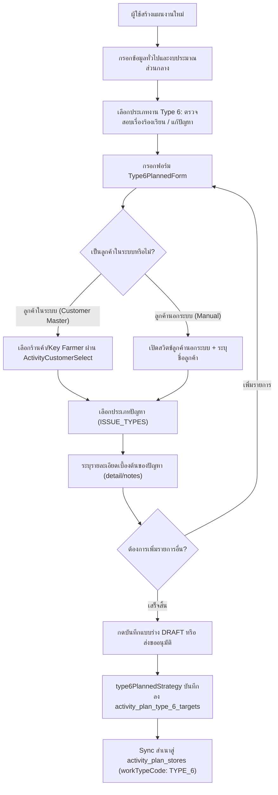
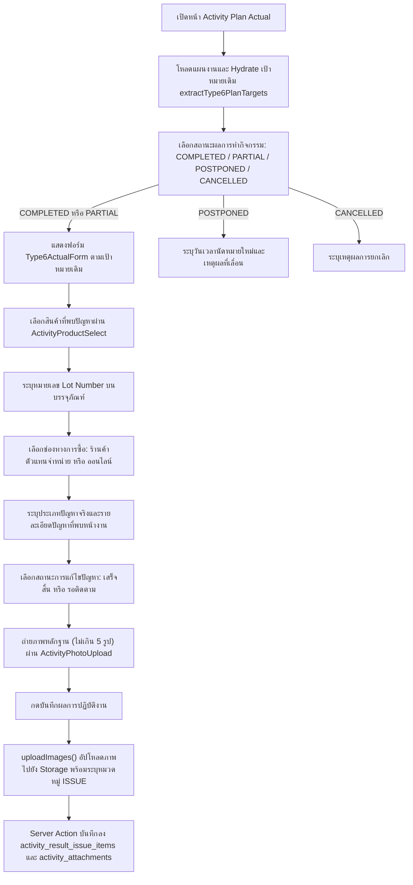
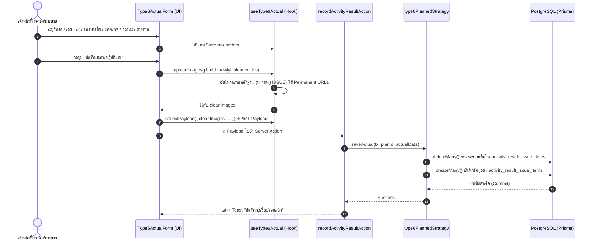

# Activity Type 6 — ตรวจสอบเรื่องร้องเรียน / แก้ปัญหา / Customer Complaint & Issue Resolution (README)

> **Feature Slice**: `modules/activity/features/type-6`  
> **Standard Reference**: ออกแบบตามแนวทาง Vertical Slice Architecture อิงตามแม่แบบ Gold Standard Type 1  
> **Parent Module**: `modules/activity`  
> **Database Authority**: `prisma/schema.prisma` (`ActivityPlanType6Target` [@@map("activity_type_6_targets")], `ActivityResultType6` [@@map("activity_type_6_result")], `ActivityAttachment` [type_6_result_id])  
> **Status**: Production Ready / Standalone Dedicated Architecture (v2.2.1 — Updated 2026-10-26)

---

## 1. Overview

### 1.1 วัตถุประสงค์ของ Type 6
**Type 6 (ตรวจสอบเรื่องร้องเรียน / แก้ปัญหา / Customer Complaint & Issue Resolution)** มีวัตถุประสงค์เพื่อรองรับการปฏิบัติงานของเจ้าหน้าที่ฝ่ายเทคนิค ฝ่ายบริการลูกค้า และพนักงานขายภาคสนาม (Technical Specialists / Customer Support / Sales Reps) ในการลงพื้นที่เข้าตรวจสอบข้อร้องเรียน สืบหาสาเหตุ และดำเนินการแก้ไขปัญหาการใช้งานผลิตภัณฑ์เคมีเกษตร ฮอร์โมน หรือปุ๋ย ร่วมกับร้านค้าและเกษตรกร:
1. กำหนดเป้าหมายลูกค้า/ร้านค้าที่มีการร้องเรียนล่วงหน้า พร้อมระบุประเภทปัญหา (`issueType`) และรายละเอียดเบื้องต้น (`detail`)
2. รองรับทั้งลูกค้าที่มีประวัติในระบบ (Customer Master / Key Farmer) และลูกค้าภายนอกที่ยังไม่ได้ขึ้นทะเบียนในระบบ (`isManualCustomer = true`)
3. บันทึกผลการเข้าตรวจสอบปัญหาจริงหน้างาน (Investigation Outcome):
   - ระบุผลิตภัณฑ์ที่พบปัญหา (`productId`, `productName`)
   - ตรวจสอบและระบุหมายเลขแบทช์ผลิตบนบรรจุภัณฑ์ (`lotNumber` / Lot Number)
   - ระบุช่องทางการสั่งซื้อ (`purchaseChannel`: "ร้านค้าตัวแทนจำหน่าย" หรือ "ออนไลน์") พร้อมระบุร้านค้าต้นทาง (`storeId`, `storeName`)
   - สรุปรายละเอียดปัญหาที่ตรวจพบจริงหน้างาน (`problemFound`) และแนวทางแก้ไขเบื้องต้น (`initialSolution`)
   - วางแผนการปฏิบัติการถัดไป (`nextAction`)
   - กำหนดสถานะการแก้ไขปัญหา (`status`: "เสร็จสิ้น" หรือ "รอติดตาม")
4. บันทึกภาพถ่ายหลักฐานภาคสนาม (Evidence Photos) เช่น สภาพบรรจุภัณฑ์ที่ชำรุด ฉลากสินค้า เลข Lot สภาพแปลงพืชที่เสียหาย หรืออาการผิดปกติของพืช สูงสุด 5 ภาพต่อรายการ (หมวดหมู่ `ISSUE`)

### 1.2 ขอบเขตของ Type 6
- **กลุ่มเป้าหมายที่รองรับ:**
  - **ลูกค้าในระบบ (Customer Master):** ร้านค้าตัวแทนจำหน่ายหลัก (`DEALER`), ร้านค้าย่อย (`SUBDEALER`) และเกษตรกรที่ลงทะเบียนแล้ว (`FARMER`) ผ่าน `ActivityCustomerSelect`
  - **ลูกค้านอกระบบ (Manual Customer Entry):** ลูกค้าทั่วไปหรือเกษตรกรรายย่อยที่ไม่ได้ขึ้นทะเบียนในระบบ โดยเปิดสวิตช์ `isManualCustomer = true` เพื่อระบุชื่อ (`manualCustomerName`), ที่อยู่ (`manualCustomerAddress`) และเบอร์โทรศัพท์ (`manualCustomerPhone`)
- **ประเภทปัญหาที่รองรับ (Issue Types):**
  - **สินค้าหรือบรรจุภัณฑ์ชำรุด / เสียหาย** (Product or Packaging Defect)
  - **เกิดความเสียหายหลังการใช้สินค้า** (Crop Damage After Application)
  - **อื่นๆ ระบุ** (Other Custom Issues)
- **ช่องทางการซื้อ (Purchase Channels):**
  - **ร้านค้าตัวแทนจำหน่าย** (Authorized Dealer Store): ต้องระบุร้านค้าที่ซื้อ (`storeId` หรือ `storeName`)
  - **ออนไลน์** (Online Channel / E-Commerce)
- **สถานะการแก้ไขปัญหา (Resolution Statuses):**
  - **เสร็จสิ้น** (Resolved / Closed)
  - **รอติดตาม** (Pending Follow-up)
- **การจัดเก็บข้อมูลแบบ Standalone Dedicated Tables 100%:**
  - **Dedicated Plan Table:** บันทึกเป้าหมายลงตารางเฉพาะกิจ `ActivityPlanType6Target` (`activity_type_6_targets`)
  - **Dedicated Actual Table:** บันทึกผลการตรวจสอบจริงลง `ActivityResultType6` (`activity_type_6_result`) พร้อมผูก `targetId` เข้ากับเป้าหมายแผนงานโดยตรง
  - **Evidence Attachments:** รูปถ่ายหลักฐานผูกเข้ากับ `ActivityAttachment` โดยระบุ `type6ResultId` ตรงกับ ID ผลการตรวจสอบจริง
  - **Zero Dual-Writes:** ตัดการเขียนสำเนาลง generic tables (`activity_plan_stores`, `activity_result_issue_items`) ออก 100% บน Dev Environment

### 1.3 รูปแบบการทำงานที่รองรับ
1. **Planned (ในแผนงาน Trip Plan):** กำหนดเป้าหมายลูกค้าที่มีเรื่องร้องเรียนและประเภทปัญหาล่วงหน้า ส่งขออนุมัติตามสายงานก่อนออกปฏิบัติงาน
2. **Planned Actual (บันทึกผลงานตามแผน):** นำเป้าหมายที่ได้รับอนุมัติมารายงานผลการลงพื้นที่จริง (เลข Lot, สินค้า, ช่องทางซื้อ, ผลตรวจสอบ, แนวทางแก้ไข, รูปถ่ายหลักฐาน และสถานะการแก้ไข)
3. **Unplanned (กิจกรรมนอกแผน 2-in-1):** กรณีได้รับการแจ้งเรื่องด่วนและลงพื้นที่ตรวจสอบทันทีโดยไม่ได้วางแผนล่วงหน้า สามารถเลือกลูกค้า ระบุปัญหา พร้อมบันทึกผลการตรวจสอบ เลข Lot รูปถ่าย และสถานะจบในฟอร์มเดียว พร้อมสร้างแผนงานสถานะ `COMPLETED` ทันที
4. **Detail View:** แสดงผลการตรวจสอบเรื่องร้องเรียนในหน้ารายละเอียดแผนงานผ่าน `Type6DetailView` พร้อมข้อมูลปัญหา ผลตรวจสอบ และแกลเลอรีรูปถ่ายพร้อม Lightbox
5. **Approval View:** การ์ดสำหรับผู้บังคับบัญชาพิจารณาอนุมัติผ่าน `Type6ApprovalCard` (แสดงเป้าหมายเรื่องร้องเรียนก่อนเริ่มงาน หรือผลการตรวจสอบจริงเมื่อมีบันทึกเข้ามา)

---

## 2. Business Flows

### 2.1 Planned (สร้างและแก้ไขแผนงาน)


### 2.2 Planned Actual (บันทึกผลการปฏิบัติงานตามแผน)


### 2.3 Unplanned (กิจกรรมนอกแผน 2-in-1)
- ผู้ใช้งานเข้าหน้า `/activity-plans/unplanned/new`
- ฟอร์ม `Type6UnplannedForm` ผสานทั้งส่วนระบุเป้าหมายลูกค้า (เลือกลูกค้าในระบบหรือกรอกเอง) และส่วนบันทึกผลการตรวจสอบจริง (สินค้าที่พบปัญหา, เลข Lot, ช่องทางซื้อ, รายละเอียดปัญหา, รูปถ่าย และสถานะการแก้ไขปัญหา) จบในฟอร์มเดียว
- เมื่อกดบันทึก ระบบจะตรวจสอบความถูกต้องผ่าน `validateType6UnplannedItems` และแปลง Payload ผ่าน `mapType6UnplannedToPayload`
- `type6UnplannedStrategy.savePlan()` จะบันทึกเป้าหมายลง `activity_plan_type_6_targets` (พร้อม sync สู่ `activity_plan_stores`) และเรียก `saveActual()` บันทึกผลการตรวจสอบลง `activity_result_issue_items` ทันทีภายใน `$transaction` เดียวกัน โดยแผนงานมีสถานะเสร็จสิ้นสมบูรณ์

### 2.4 Detail and Approval (ดูรายละเอียดและพิจารณาอนุมัติ)
- **Detail View:** `DetailWorkTypeList` เรียกใช้ `Type6DetailView` เพื่อแสดงการ์ดสรุปเรื่องร้องเรียนตามแผน พร้อมข้อมูลการตรวจสอบจริง เลข Lot สินค้า ร้านค้าที่ซื้อ รายละเอียดการแก้ไขปัญหา และแกลเลอรีรูปถ่ายหลักฐานพร้อมระบบ Lightbox
- **Approval View:** `ApprovalWorkTypeList` เรียกใช้ `Type6ApprovalCard` เพื่อให้หัวหน้างานพิจารณาเป้าหมายเรื่องร้องเรียน หรือหากมีผลการตรวจสอบจริงเข้ามาแล้ว จะสลับแสดงผลลัพธ์ผ่าน `Type6DetailView` โดยอัตโนมัติ

---

## 3. Architecture

### 3.1 Folder Structure
```text
modules/activity/features/type-6/
├── index.ts                                    # Unified Public API Contract (ส่งออกเฉพาะสิ่งที่ภายนอกต้องใช้)
├── README.md                                   # เอกสารคู่มือทางเทคนิค (ไฟล์นี้)
│
├── planned/                                    # Sub-slice: กิจกรรมในแผนงานและบันทึกผลตามแผน
│   ├── application/                            # Business Logic, Validation, Mappers
│   │   ├── actual-mapper.ts                    # แปลงผลตรวจสอบจริง Form <-> DB/Payload (parseType6ActualResult)
│   │   ├── actual-validation.ts                # ตรวจสอบความถูกต้องของผลตรวจสอบจริง (validateType6Actual)
│   │   ├── planned-mapper.ts                   # แปลงเป้าหมายในแผน Form <-> DB / Hydration (extractType6PlanTargets, hydrateType6PlannedData, mapType6ToSectionItems)
│   │   └── planned-validation.ts               # ตรวจสอบความถูกต้องของเป้าหมายในแผน (validateType6FormItems)
│   ├── components/                             # UI Components ประจำ Type 6 ในแผน
│   │   ├── type6-planned-form.tsx              # ฟอร์มระบุเป้าหมายเรื่องร้องเรียน (Create / Edit)
│   │   ├── type6-actual-form.tsx               # ฟอร์มบันทึกผลการตรวจสอบจริง (Lot, สินค้า, ช่องทางซื้อ, รูปถ่าย, สถานะ)
│   │   ├── type6-plan-card.tsx                 # การ์ดสรุปเป้าหมายเรื่องร้องเรียนตามแผนงาน
│   │   ├── type6-detail-view.tsx               # คอมโพเนนต์แสดงผลเต็มรูปแบบในหน้ารายละเอียดพร้อม Lightbox
│   │   └── type6-approval-card.tsx             # การ์ดสรุปสำหรับหน้าพิจารณาอนุมัติ
│   ├── hooks/                                  # Custom State Hooks
│   │   ├── use-type6-planned-form.ts           # จัดการ State รายการเป้าหมายเรื่องร้องเรียนตามแผน
│   │   └── use-type6-actual.ts                 # จัดการ State ผลการตรวจสอบจริงและอัปโหลดรูปภาพหลักฐาน
│   ├── infrastructure/                         # Database Strategies
│   │   └── type6-planned.strategy.ts           # Strategy บันทึก/โหลดข้อมูล ActivityPlanType6Target & ActivityResultIssueItem + Dual-write sync
│   └── types/                                  # Type Definitions ในแผน
│       ├── planned.types.ts                    # Type6PlanFormProps, ValidateType6Options, UseType6FormResult ฯลฯ
│       └── actual.types.ts                     # Type6ActualFormProps, Type6DetailViewProps, Type6ApprovalCardProps ฯลฯ
│
├── unplanned/                                  # Sub-slice: กิจกรรมนอกแผน (2-in-1)
│   ├── application/                            # Logic และ Mappers กิจกรรมนอกแผน
│   │   ├── unplanned-mapper.ts                 # Hydration และ Data mapping นอกแผน (hydrateType6UnplannedData, mapType6UnplannedToPayload)
│   │   └── unplanned-validation.ts             # Validation กิจกรรมนอกแผน (validateType6UnplannedItems)
│   ├── components/                             # UI Components กิจกรรมนอกแผน
│   │   └── type6-unplanned-form.tsx            # ฟอร์ม 2-in-1 (ระบุลูกค้า/ปัญหา + ตรวจสอบ Lot/สินค้า/รูปถ่าย/สถานะ)
│   ├── hooks/                                  # Custom State Hooks
│   │   └── use-type6-unplanned-form.ts         # จัดการ State รายการนอกแผน (เพิ่ม/แก้ไข/ลบรายการ)
│   ├── infrastructure/                         # Database Strategies นอกแผน
│   │   └── type6-unplanned.strategy.ts         # บันทึกกิจกรรมนอกแผนลง Prisma ผสานเป้าหมายและผลตรวจสอบพร้อมกัน
│   └── types/                                  # Type Definitions นอกแผน
│       └── unplanned.types.ts                  # Type6UnplannedItem, Type6UnplannedFormProps
│
└── shared/                                     # ชิ้นส่วนที่ใช้ร่วมกันภายใน Feature Type 6
    ├── constants.ts                            # ISSUE_TYPES, PURCHASE_CHANNELS, ISSUE_STATUSES, ISSUE_ATTACHMENT_CATEGORY
    └── types.ts                                # CustomerOption, ProductOption, Type6ImageFile, Type6IssueItem, Type6IssueRecord, Type6TargetItem
```

### 3.2 Type 6 vs Shared Activity
| ความรับผิดชอบ | จัดการที่ Type 6 Feature (`features/type-6`) | จัดการที่ Activity ส่วนกลาง (`ui/`, `views/`) |
| :--- | :--- | :--- |
| **ข้อมูลทั่วไป** | - | ชื่องาน, วันที่เริ่ม-สิ้นสุด, วัตถุประสงค์หลัก, ผู้ร่วมเดินทาง |
| **พื้นที่ & ทีมงาน** | - | จังหวัด, อำเภอ, ตำบล, พนักงานร่วมเดินทาง |
| **งบประมาณ** | - | งบเบิกสินค้าทดแทน, ของแถม, ค่าใช้จ่ายเดินทาง |
| **เป้าหมายเรื่องร้องเรียน** | เลือกลูกค้าในระบบ/นอกระบบ, ประเภทปัญหา, รายละเอียดปัญหา | - |
| **ผลการตรวจสอบจริง** | สินค้าที่พบปัญหา, เลข Lot, ช่องทางซื้อ, ผลตรวจ, แนวทางแก้ไข, สถานะ, รูปภาพ | ผลสรุปภาพรวมแผน (สำเร็จ/เลื่อน/ยกเลิก) |
| **Database Persistence** | ตาราง `activity_plan_type_6_targets`, `activity_result_issue_items`, sync `activity_plan_stores` | ตารางหลัก `ActivityPlan`, `ActivityPlanApprovalLog`, `ActivityAttachment` |

### 3.3 Dependency and Import Map
- **ทิศทางการเรียกใช้ (Allowed):**
  - `views/` ➔ เรียกใช้ ➔ `features/type-6` (ผ่าน `index.ts` เท่านั้น)
  - `features/type-6` ➔ เรียกใช้ ➔ `@/modules/activity/ui` (`ActivityInput`, `ActivityTextarea`, `ActivityCustomerSelect`, `ActivityProductSelect`, `ActivityCombobox`, `ActivityPhotoUpload`)
  - `features/type-6` ➔ เรียกใช้ ➔ `@/modules/activity/constants`
  - `features/type-6` ➔ เรียกใช้ ➔ `@/modules/activity/types/strategy.interface`
  - `features/type-6` ➔ เรียกใช้ ➔ `@/modules/activity/application/media/image-uploader` (`uploadActivityPlanImageGroup`, `collectPermanentUrls`)
  - `features/type-6` ➔ เรียกใช้ ➔ `@/components/custom/image-lightbox-modal` (`ImageLightboxModal`)
- **Server Actions & Database Flow:**
  - `views/` ➔ ส่งข้อมูลไปยัง ➔ Server Actions ใน `@/modules/activity/server/`:
    - `planned.actions.ts` (`createActivityPlanAction`, `updateActivityPlanAction`, `getActivityPlanAction`)
    - `unplanned.actions.ts` (`createUnplannedActivityAction`, `updateUnplannedActivityAction`, `getUnplannedActivityAction`)
    - `actual.actions.ts` (`recordActivityResultAction`)
  - Server Actions ➔ ทำงานร่วมกับ ➔ `@/modules/activity/infrastructure/strategy.registry` ➔ เรียกใช้ `type6PlannedStrategy` / `type6UnplannedStrategy` บันทึกลงตาราง dedicated และ generic tables ภายใน `$transaction`
- **สิ่งต้องห้าม (Strictly Forbidden):**
  - ❌ ภายนอก Import เจาะลึกเข้าไปในโฟลเดอร์ย่อย เช่น `features/type-6/planned/components/...`
  - ❌ `features/type-6` เรียกใช้ข้อมูลข้ามไปยัง `features/type-1` ถึง `type-5` หรือ `type-7a` ถึง `type-14`
  - ❌ Import ย้อนกลับไปยังโมดูลเก่า `@/modules/activity-plans/...` โดยเด็ดขาด

### 3.4 Entry Points and Public Exports
ไฟล์ [modules/activity/features/type-6/index.ts](file:///d:/code/crm-bank/modules/activity/features/type-6/index.ts) ทำหน้าที่เป็น **Single Public API Contract** สำหรับฝั่ง UI / Application โดยส่งออกเฉพาะ:
- **Components:** `Type6PlannedForm` (`Type6PlanForm`, `Type6Issue`, `EditType6Issue`), `Type6PlanCard`, `Type6ActualForm` (`ActualType6Issue`), `Type6DetailView` (`DetailType6Issue`), `Type6ApprovalCard` (`ApprovalType6Issue`), `Type6UnplannedForm`
- **Hooks:** `useType6PlannedForm` (`useType6Form`), `useType6Actual`, `useType6UnplannedForm`, `normalizeType6Issue`
- **Mappers & Hydrators:** `extractType6PlanTargets`, `hydrateType6PlannedData`, `mapType6ToSectionItems`, `parseType6ActualResult`, `hydrateType6UnplannedData`, `mapType6UnplannedToPayload`
- **Validators & Schemas:** `validateType6FormItems`, `validateType6Actual`, `validateType6UnplannedItems`
- **Constants & Types:** `ISSUE_TYPES`, `PURCHASE_CHANNELS`, `ISSUE_STATUSES`, `ISSUE_ATTACHMENT_CATEGORY`, `CustomerOption`, `ProductOption`, `Type6ImageFile`, `Type6IssueItem`, `TargetIssueItem`, `Type6IssueRecord`, `Type6TargetItem`, `Type6PlanCardTargetItem`, `Type6PlanCardTarget`, `Type6PlanCardProps`, `Type6PlannedFormProps`, `Type6ActualFormProps`, `Type6DetailViewProps`, `Type6ApprovalCardProps`, `Type6UnplannedItem`, `Type6UnplannedFormProps`
- *(หมายเหตุ: `type6PlannedStrategy` และ `type6UnplannedStrategy` ถูกนำเข้าโดยตรงที่ `modules/activity/infrastructure/strategy.registry.ts` เพื่อแยกโค้ดฝั่ง Server/Database ออกจาก Client Bundle)*

---

## 4. File Responsibilities

### 4.1 Planned & Actual
- **`use-type6-planned-form.ts`:** จัดการ State รายการเรื่องร้องเรียนตามแผน (Array of `Type6IssueItem`), สลับโหมดลูกค้านอกระบบ (`isManualCustomer`), เพิ่ม/แก้ไข/ลบแถว, ตรวจสอบความถูกต้อง (`validateType6`), และแปลง Payload สำหรับบันทึกแผนงาน (`mapType6Payload`)
- **`type6-planned-form.tsx`:** ฟอร์มสร้าง/แก้ไขแผนงาน แสดงการ์ดรายการเรื่องร้องเรียนแต่ละรายการ รองรับการเลือกลูกค้าในระบบผ่าน `ActivityCustomerSelect` หรือเปิดสวิตช์กรอกชื่อเอง และเลือกประเภทปัญหาจาก `ISSUE_TYPES`
- **`type6-plan-card.tsx`:** การ์ดสรุปเป้าหมายเรื่องร้องเรียนตามแผน แสดงชื่อลูกค้า ประเภทปัญหา และรายละเอียดเบื้องต้น
- **`type6-actual-form.tsx`:** ฟอร์มบันทึกผลการตรวจสอบจริงหน้างาน เลือกลำดับสินค้าที่พบปัญหาผ่าน `ActivityProductSelect`, กรอกเลข Lot Number, เลือกช่องทางการซื้อ (ร้านค้า / ออนไลน์), ระบุรายละเอียดปัญหา, เลือกสถานะการแก้ไข (เสร็จสิ้น / รอติดตาม), และอัปโหลดภาพถ่ายหลักฐาน (ไม่เกิน 5 ภาพ)
- **`use-type6-actual.ts`:** จัดการ State ผลการตรวจสอบจริง, รองรับการ Hydrate ข้อมูลเดิม, อัปโหลดรูปภาพหลักฐานผ่าน `uploadActivityPlanImageGroup`, คืนค่า URL ภาพเก่าเพื่อลบ, และสร้าง Payload สำหรับบันทึกผล
- **`type6-detail-view.tsx`:** การ์ดแสดงผลในหน้ารายละเอียด แสดงทั้งข้อมูลเป้าหมายและผลการตรวจสอบจริง พร้อมเลข Lot สินค้า ร้านค้าที่ซื้อ แนวทางแก้ไข สถานะ และแกลเลอรีรูปถ่ายพร้อม Lightbox
- **`type6-approval-card.tsx`:** การ์ดสำหรับหน้าพิจารณาอนุมัติของหัวหน้างาน แสดงข้อมูลสรุปเป้าหมายเรื่องร้องเรียนและผลการตรวจสอบ
- **`planned-mapper.ts`:**
  - `extractType6PlanTargets`: ดึงเป้าหมายจาก `plan.type6Targets` หรือ fallback จาก generic stores
  - `hydrateType6PlannedData`: กู้คืนรายการเป้าหมายเดิมเมื่อเข้าสู่หน้าแก้ไขแผนงาน (`edit-view.tsx`)
  - `mapType6ToSectionItems`: แปลงรายการเรื่องร้องเรียนสำหรับแสดงผลใน Section ทั่วไปของระบบ
- **`actual-mapper.ts`:** แปลงผลการตรวจสอบจากฐานข้อมูล (`plan.result.issueResults` หรือ `attachments`) เข้าสู่โครงสร้าง `Type6IssueRecord` สำหรับ UI
- **`planned-validation.ts`:** ตรวจสอบความถูกต้องของเป้าหมายในแผน ต้องระบุชื่อลูกค้าและประเภทปัญหา (`validateType6FormItems`)
- **`actual-validation.ts`:** ตรวจสอบความถูกต้องของผลตรวจสอบจริง ต้องระบุเลข Lot Number และช่องทางการซื้อ (`validateType6Actual`)
- **`type6-planned.strategy.ts`:** ดำเนินการตรวจสอบเงื่อนไข (`validatePlan`), บันทึกลงตาราง `ActivityPlanType6Target` พร้อม dual-write sync ไปยัง `ActivityPlanStore` (`savePlan`), บันทึกผลตรวจสอบลง `ActivityResultIssueItem` (`saveActual`), และโหลดข้อมูลแผน (`loadPlan`)

### 4.2 Unplanned
- **`use-type6-unplanned-form.ts`:** จัดการ State กิจกรรมนอกแผน 2-in-1 ที่รวมทั้งเป้าหมายลูกค้าและผลการตรวจสอบจริง มีฟังก์ชัน `addItem`, `updateItem`, `deleteItem`
- **`type6-unplanned-form.tsx`:** ฟอร์ม 2-in-1 สำหรับกิจกรรมนอกแผน แสดงส่วนเลือกลูกค้าใน/นอกระบบ, ประเภทปัญหา, สินค้าที่พบปัญหา, เลข Lot, ช่องทางซื้อ, รูปถ่าย และสถานะการแก้ไขปัญหา
- **`unplanned-mapper.ts`:**
  - `hydrateType6UnplannedData`: กู้คืนข้อมูลกิจกรรมนอกแผนเดิมเมื่อเปิดหน้าแก้ไข
  - `mapType6UnplannedToPayload`: แปลงข้อมูลนอกแผนให้เป็นทั้ง `type6Targets` (เป้าหมาย) และ `type6ActualIssues` / `targetActualResults` (ผลงานจริง)
- **`unplanned-validation.ts`:** ตรวจสอบความถูกต้องของรายการนอกแผน (`validateType6UnplannedItems`) ต้องระบุลูกค้า ประเภทปัญหา และเลข Lot Number ครบถ้วน
- **`type6-unplanned.strategy.ts`:** บันทึกทั้งเป้าหมายและผลการตรวจสอบเรื่องร้องเรียนพร้อมกันผ่าน `type6PlannedStrategy.savePlan()` และ `type6PlannedStrategy.saveActual()`

### 4.3 Shared Types and Constants
- **`shared/constants.ts`:** กำหนดค่าคงที่มาตรฐาน:
  - `ISSUE_TYPES`: รายการประเภทปัญหา
  - `PURCHASE_CHANNELS`: ช่องทางการซื้อ ("ร้านค้าตัวแทนจำหน่าย", "ออนไลน์")
  - `ISSUE_STATUSES`: สถานะการแก้ไขปัญหา ("เสร็จสิ้น", "รอติดตาม")
  - `ISSUE_ATTACHMENT_CATEGORY`: หมวดหมู่ไฟล์แนบ `"ISSUE"`
- **`shared/types.ts`:** กำหนดประเภทข้อมูล `CustomerOption`, `ProductOption`, `Type6ImageFile`, `Type6IssueItem`, `Type6IssueRecord`, `Type6TargetItem`

### 4.4 Shared UI and Views
- `planned-activity-form.tsx`, `unplanned-activity-form.tsx`, `activity-plan-actual-view.tsx`, `actual-work-type-list.tsx`, `detail-work-type-list.tsx`, และ `approval-work-type-list.tsx` ทำหน้าที่เป็น Orchestrators ในการเลือกเรนเดอร์และประมวลผล Type 6 ตามเงื่อนไข `isType6Active`

---

## 5. Data Flow



### 5.1 Create Planned (สร้างแผนใหม่)
1. `create-view.tsx` หรือ `planned-activity-form.tsx` เรียกใช้ `useType6PlannedForm()`
2. ผู้ใช้ระบุเป้าหมายลูกค้า (ในระบบหรือกรอกเอง) และประเภทปัญหาใน `Type6PlannedForm` พร้อมระบุรายละเอียด
3. ผู้ใช้กดส่งขออนุมัติ ➔ รัน `validateType6()`
4. Map ข้อมูลผ่าน `mapType6Payload()` ได้ `type6Items` และ `planStores`
5. ส่งไปยัง Server Action `createActivityPlanAction`
6. Server Action เรียก `type6PlannedStrategy.savePlan()` ภายใน `$transaction`
7. Prisma บันทึกลงตาราง `activity_plan_type_6_targets` พร้อม sync สู่ `activity_plan_stores`

### 5.2 Edit Planned (แก้ไขแผนงานเดิม)
1. `edit-view.tsx` ดึงข้อมูลแผนเดิมจากฐานข้อมูล
2. เรียก `hydrateType6PlannedData(initialData)` เพื่อแปลงข้อมูลจาก `type6Targets` (หรือ fallback `stores`)
3. ส่งข้อมูลที่กู้คืนได้เข้า `useType6PlannedForm({ initial })`
4. ฟอร์มแสดงข้อมูลเดิมพร้อมให้แก้ไข เพิ่ม หรือลบรายการได้อย่างสมบูรณ์

### 5.3 Save Actual (บันทึกผลการปฏิบัติงานจริง)
1. `activity-plan-actual-view.tsx` รันกระบวนการบันทึกผล
2. ตรวจสอบความถูกต้องด้วย `validateType6Actual()`
3. เรียก `type6Actual.uploadImages(id, newlyUploadedUrls)` เพื่ออัปโหลดภาพหลักฐาน ได้ URL ถาวร
4. เรียก `type6Actual.collectPayload(...)` เพื่อรวบรวมข้อมูลการตรวจสอบ
5. ส่ง Payload เข้า `recordActivityResultAction(id, payload)`
6. `type6PlannedStrategy.saveActual()` ลบผลตรวจเก่าแล้วสร้างระเบียนใหม่ลงตาราง `activity_result_issue_items` และบันทึกรูปภาพลง `activity_attachments`

### 5.4 Load Actual (โหลดผลงานเดิมมาแสดงในหน้าบันทึกผล)
1. หน้า Actual ดึงข้อมูลแผนและผลงานเดิม
2. `extractType6PlanTargets(plan)` แปลงเป้าหมายเดิมเข้าสู่ `targets`
3. เรียก `type6Actual.hydrate(payloadToHydrate)`
4. ฟอร์มแสดงข้อมูลสินค้า เลข Lot ช่องทางซื้อ ผลตรวจ และรูปภาพที่เคยบันทึกไว้

### 5.5 Create/Edit Unplanned (กิจกรรมนอกแผน)
1. ผู้ใช้กรอกฟอร์ม `Type6UnplannedForm` (ระบุลูกค้า ประเภทปัญหา สินค้า เลข Lot ช่องทางซื้อ รูปภาพ และสถานะ)
2. ตรวจสอบความถูกต้องด้วย `validateType6UnplannedItems(type6.items)`
3. แปลง Payload ผ่าน `mapType6UnplannedToPayload(type6.items)`
4. `type6UnplannedStrategy.savePlan()` บันทึกเป้าหมายลง `activity_plan_type_6_targets` และบันทึกผลตรวจลง `activity_result_issue_items` พร้อมกันใน `$transaction` เดียวกัน

### 5.6 Detail and Approval (การแสดงผลหน้ารายละเอียดและพิจารณาอนุมัติ)
1. โหลดข้อมูลแผนงานผ่าน Loader
2. ระบบตรวจจับประเภทงานว่าเป็น Type 6 ผ่าน `WORK_TYPE_STRATEGY_REGISTRY.TYPE_6.hasData()`
3. หน้ารายละเอียดเรนเดอร์ `<Type6DetailView />` พร้อมข้อมูลการแก้ไขปัญหาและ Lightbox
4. หน้าอนุมัติเรนเดอร์ `<Type6ApprovalCard />` (หากมีผลงานจริงจะสลับแสดง `<Type6DetailView />` ให้อัตโนมัติ)

---

## 6. Data Models and Mapping

### 6.1 Database CRUD Matrix (สิทธิ์และการจัดการตารางในฐานข้อมูล)
| ตารางในฐานข้อมูล (`Prisma Model`) | Create (สร้าง) | Read (อ่าน/แสดงผล) | Update (แก้ไข) | Delete (ลบ) | หมายเหตุ |
| :--- | :--- | :--- | :--- | :--- | :--- |
| **`activity_plan_type_6_targets`**<br>(`ActivityPlanType6Target`) | `savePlan()`<br>ใน Planned/Unplanned | `loadPlan()`, `plan.type6Targets` ใน Detail / Edit / Actual | `deleteMany()` + `createMany()` ใน `savePlan()` | Cascade เมื่อลบ `ActivityPlan` | ตารางหลักเก็บเป้าหมายลูกค้าและประเภทปัญหา |
| **`activity_result_issue_items`**<br>(`ActivityResultIssueItem`) | `saveActual()`<br>ใน Actual/Unplanned | `plan.result.issueResults` หรือ `plan.issueResults` | `deleteMany()` + `createMany()` ใน `saveActual()` | Cascade เมื่อลบ `ActivityResult` | เก็บผลการตรวจสอบจริง เลข Lot สินค้า แนวทางแก้ไข สถานะ |
| **`activity_plan_stores`**<br>(`ActivityPlanStore`) | Dual-write sync ใน `savePlan()` | Generic store queries | `deleteMany()` + `createMany()` (`workTypeCode: "TYPE_6"`) | Cascade เมื่อลบ `ActivityPlan` | ซิงค์สำเนาเป้าหมายลูกค้า/ร้านค้า |
| **`activity_attachments`**<br>(`ActivityAttachment`) | Storage Upload + `upsertActivityResult()` | `plan.attachments` (หมวดหมู่ ISSUE) | ลบรายการเก่าและสร้างระเบียนใหม่ | Cascade เมื่อลบ `ActivityPlan` | เก็บล็อก URL ภาพถ่ายจริงผูก `issueItemId` |

### 6.2 Complete Field-to-Database Mapping (ตารางจับคู่ฟิลด์ครบถ้วนทุกจุด)
ไล่จาก **Form Field ➔ Type Field ➔ Mapper ➔ Prisma Model ➔ DB Column Name ➔ Data Type**:

| Form Field (UI) | TypeScript Type Field | Mapper Function (Write/Read) | Prisma Model | DB Column Name | Data Type | Nullable? | Default |
| :--- | :--- | :--- | :--- | :--- | :--- | :---: | :--- |
| **ลูกค้าในระบบ** | `storeId` | `mapType6Payload` / `extractType6PlanTargets` | `ActivityPlanType6Target` | `store_id` | `VARCHAR (FK)` | Yes | `null` |
| **ชื่อลูกค้า / ร้านค้า** | `customerName` | `mapType6Payload` / `extractType6PlanTargets` | `ActivityPlanType6Target` | `customer_name` | `VARCHAR` | Yes | `null` |
| **สวิตช์ลูกค้านอกระบบ** | `isManualCustomer` | `mapType6Payload` / `extractType6PlanTargets` | `ActivityPlanType6Target` | `is_manual_customer` | `BOOLEAN` | No | `false` |
| **ประเภทปัญหา** | `issueType` | `mapType6Payload` / `extractType6PlanTargets` | `ActivityPlanType6Target` | `issue_type` | `VARCHAR` | No | `"สินค้าหรือบรรจุภัณฑ์ชำรุด / เสียหาย"` |
| **รายละเอียดปัญหา** | `detail` | `mapType6Payload` / `extractType6PlanTargets` | `ActivityPlanType6Target` | `detail` | `TEXT` | Yes | `null` |
| **สินค้าที่พบปัญหา** | `productId` | `collectPayload` / `parseType6ActualResult` | `ActivityResultIssueItem` | `product_id` | `VARCHAR (FK)` | Yes | `null` |
| **ชื่อสินค้าที่พบปัญหา** | `productName` | `collectPayload` / `parseType6ActualResult` | `ActivityResultIssueItem` | `product_name` | `VARCHAR` | Yes | `null` |
| **หมายเลข Lot Number** | `lotNumber` | `collectPayload` / `parseType6ActualResult` | `ActivityResultIssueItem` | `lot_number` | `VARCHAR` | Yes | `null` |
| **ช่องทางการซื้อ** | `purchaseChannel` | `collectPayload` / `parseType6ActualResult` | `ActivityResultIssueItem` | `purchase_channel` | `VARCHAR` | No | `"ร้านค้าตัวแทนจำหน่าย"` |
| **ร้านค้าที่ซื้อสินค้า** | `storeId` / `storeName` | `collectPayload` / `parseType6ActualResult` | `ActivityResultType6` | `store_id`, `store_name` | `VARCHAR` | Yes | `null` |
| **ปัญหาที่ตรวจพบจริง** | `problemFound` / `detail` | `collectPayload` / `parseType6ActualResult` | `ActivityResultType6` | `problem_found`, `detail` | `TEXT` | Yes | `null` |
| **แนวทางแก้ไขเบื้องต้น** | `initialSolution` | `collectPayload` / `parseType6ActualResult` | `ActivityResultType6` | `initial_solution` | `TEXT` | Yes | `null` |
| **การปฏิบัติการถัดไป** | `nextAction` | `collectPayload` / `parseType6ActualResult` | `ActivityResultType6` | `next_action` | `VARCHAR` | Yes | `null` |
| **สถานะการแก้ไขปัญหา** | `status` | `collectPayload` / `parseType6ActualResult` | `ActivityResultType6` | `status` | `VARCHAR` | No | `"เสร็จสิ้น"` |
| **ภาพถ่ายหลักฐาน** | `images` | `uploadImages()` (`ISSUE`, max 5) | `ActivityAttachment` | `file_url`, `type_6_result_id` | `TEXT` | No | - |

### 6.3 รายละเอียดตารางสินค้า รูปภาพ และความสัมพันธ์ (Relations & Schema)

```prisma
// 1. ตารางเก็บเป้าหมายเรื่องร้องเรียน Type 6
model ActivityPlanType6Target {
  id                 String   @id @default(cuid())
  activityPlanId     String   @map("activity_plan_id")
  storeId            String?  @map("store_id")
  customerName       String?  @map("customer_name")
  isManualCustomer   Boolean  @default(false) @map("is_manual_customer")
  issueType          String   @default("สินค้าหรือบรรจุภัณฑ์ชำรุด / เสียหาย") @map("issue_type")
  detail             String?  @map("detail") @db.Text

  createdAt          DateTime @default(now()) @map("created_at")
  updatedAt          DateTime @updatedAt @map("updated_at")

  activityPlan       ActivityPlan          @relation("ActivityPlanType6Targets", fields: [activityPlanId], references: [id], onDelete: Cascade)
  store              Customer?             @relation("Type6TargetStore", fields: [storeId], references: [id], onDelete: SetNull)
  results            ActivityResultType6[]

  @@index([activityPlanId])
  @@index([storeId])
  @@map("activity_type_6_targets")
}

// 2. ตารางเก็บผลการตรวจสอบเรื่องร้องเรียนจริง Type 6 (Dedicated Standalone Result)
model ActivityResultType6 {
  id               String   @id @default(cuid())
  activityPlanId   String   @map("activity_plan_id")
  targetId         String?  @map("target_id")
  productId        String?  @map("product_id")
  productName      String?  @map("product_name")
  lotNumber        String?  @map("lot_number")
  purchaseChannel  String   @default("ร้านค้าตัวแทนจำหน่าย") @map("purchase_channel")
  storeId          String?  @map("store_id")
  storeName        String?  @map("store_name")
  customerName     String?  @map("customer_name")
  isManualCustomer Boolean  @default(false) @map("is_manual_customer")
  issueType        String   @default("สินค้าหรือบรรจุภัณฑ์ชำรุด / เสียหาย") @map("issue_type")
  detail           String?  @map("detail") @db.Text
  status           String   @default("เสร็จสิ้น") @map("status")
  problemFound     String?  @map("problem_found") @db.Text
  initialSolution  String?  @map("initial_solution") @db.Text
  nextAction       String?  @map("next_action")
  isAdditional     Boolean  @default(false) @map("is_additional")

  createdAt        DateTime @default(now()) @map("created_at")
  updatedAt        DateTime @updatedAt @map("updated_at")

  activityPlan     ActivityPlan             @relation("ActivityResultType6s", fields: [activityPlanId], references: [id], onDelete: Cascade)
  target           ActivityPlanType6Target? @relation(fields: [targetId], references: [id], onDelete: Cascade)
  store            Customer?                @relation("Type6ResultStore", fields: [storeId], references: [id], onDelete: SetNull)
  product          Product?                 @relation("Type6ResultProduct", fields: [productId], references: [id], onDelete: SetNull)
  attachments      ActivityAttachment[]

  @@index([activityPlanId])
  @@index([targetId])
  @@index([storeId])
  @@index([productId])
  @@map("activity_type_6_result")
}

// 3. ตารางบันทึกรูปภาพหลักฐานที่ผูกกับผลการตรวจสอบ
model ActivityAttachment {
  id               String                   @id @default(cuid())
  activityPlanId   String                   @map("activity_plan_id")
  activityResultId String?                  @map("activity_result_id")
  type6ResultId    String?                  @map("type_6_result_id")
  category         AttachmentCategory       @default(GENERAL)
  fileUrl          String                   @map("file_url")
  fileName         String?                  @map("file_name")
  fileSize         Int?                     @map("file_size")
  mimeType         String?                  @map("mime_type")

  type6Result      ActivityResultType6?     @relation(fields: [type6ResultId], references: [id], onDelete: Cascade)
  // ... ความสัมพันธ์อื่น ๆ ในระบบหลัก

  @@index([type6ResultId])
  @@map("activity_attachments")
}
```

### 6.4 Transaction & Persistence Strategy (ขาเขียนและขาอ่าน)
- **การจัดการ Transaction (Isolation & Atomicity):**
  - ทุกการบันทึกของ Type 6 ดำเนินการภายใต้ `tx` (`PrismaTransaction`) ของระบบ
  - หากบันทึกรูปภาพหลักฐาน หรือข้อมูลเลข Lot หรือรายละเอียดการแก้ไขล้มเหลว ระบบจะทำการ **Rollback ทั้งหมด** ป้องกันข้อมูลตกค้าง
- **ขาเขียน (Write Flow):**
  1. *Planned:* ลบระเบียนเดิมใน `activity_type_6_targets` ที่ผูกกับ `activityPlanId` ➔ สร้างระเบียนเป้าหมายใหม่ด้วย `createMany()` โดยตรง (Zero dual-writes)
  2. *Actual:* อัปโหลดรูปภาพหลักฐานหมวดหมู่ `ISSUE` ➔ ลบระเบียนเดิมใน `activity_type_6_result` ➔ สร้างระเบียนผลตรวจใหม่พร้อมผูก `targetId` ➔ ผูกรูปภาพใน `activity_attachments` โดยระบุ `type_6_result_id`
  3. *Unplanned:* บันทึกเป้าหมายและผลตรวจพร้อมกันใน `$transaction` เดียวกัน โดยผูก `targetId` และ `type_6_result_id` เข้ากับ ID ใหม่ทันที
- **ขาอ่าน (Read / Hydration Flow):**
  1. *Planned Edit:* ดึง `plan.type6Targets` (พร้อม include `store`, `results`) ➔ ส่งผ่าน `hydrateType6PlannedData()` เพื่อเติมลงใน State ของฟอร์ม
  2. *Actual & Detail View:* ดึง `plan.type6Targets` + `plan.type6Results` + `attachments` ➔ ส่งผ่าน `extractType6PlanTargets()` และเรียก `type6Actual.hydrate()` เพื่อกู้คืนข้อมูลเป้าหมาย สินค้า เลข Lot และรูปภาพพร้อมใช้งาน
  3. *Unplanned Edit:* ดึงข้อมูลแผนผ่าน `getActivityPlanAction` ➔ ส่งผ่าน `hydrateType6UnplannedData()` เพื่อกู้คืนทั้งเป้าหมายและผลการตรวจสอบ
- **การลบข้อมูล (Delete Policy):**
  - ใช้ **Cascade Delete** จาก `ActivityPlan`: เมื่อลบแผนงาน ระเบียนใน `activity_type_6_targets`, `activity_type_6_result`, และรูปภาพใน `activity_attachments` จะถูกลบออกอัตโนมัติ

---

## 7. Business Rules

### 7.1 Validation Rules
- **การวางแผนเป้าหมาย (`Type6PlannedForm`):**
  - ต้องมีรายการเรื่องร้องเรียนอย่างน้อย 1 รายการ
  - แต่ละรายการต้องระบุลูกค้า:
    - หากเป็นลูกค้าในระบบ: ต้องเลือกจาก Customer Master (`storeId` ห้ามว่าง)
    - หากเป็นลูกค้านอกระบบ (`isManualCustomer = true`): ต้องระบุชื่อลูกค้า (`manualCustomerName` ห้ามว่าง)
  - ต้องระบุประเภทปัญหา (`issueType` ห้ามว่าง)
  - หากเลือกประเภทปัญหาเป็น "อื่นๆ ระบุ": ต้องระบุรายละเอียดเพิ่มเติม (`detail` ห้ามว่าง)
- **การบันทึกผลงานจริง (`Type6ActualForm`):**
  - ต้องระบุช่องทางการซื้อ (`purchaseChannel`)
  - หากช่องทางการซื้อเป็น "ร้านค้าตัวแทนจำหน่าย": ต้องระบุร้านค้า (`storeId` หรือ `storeName`)
  - ต้องระบุหมายเลข Lot Number (`lotNumber` ห้ามว่าง)
  - ต้องระบุสถานะการแก้ไขปัญหา (`status`: "เสร็จสิ้น" หรือ "รอติดตาม")
- **การบันทึกกิจกรรมนอกแผน (`Type6UnplannedForm`):**
  - ต้องระบุลูกค้า ประเภทปัญหา และเลข Lot Number ครบถ้วนทุกรายการ

### 7.2 Default Values
- `workTypeCode`: `"TYPE_6"`
- `issueType`: ค่าเริ่มต้นคือ `"สินค้าหรือบรรจุภัณฑ์ชำรุด / เสียหาย"`
- `purchaseChannel`: ค่าเริ่มต้นคือ `"ร้านค้าตัวแทนจำหน่าย"`
- `status`: ค่าเริ่มต้นคือ `"เสร็จสิ้น"`
- `isManualCustomer`: ค่าเริ่มต้นคือ `false`

### 7.3 Conditional Fields
- **สลับโหมดลูกค้านอกระบบ (`isManualCustomer`):**
  - เมื่อเปิดสวิตช์: ซ่อนช่องเลือกร้านค้าในระบบ และแสดงช่องกรอกชื่อ ที่อยู่ และเบอร์โทรศัพท์ลูกค้านอกระบบแทน
- **ช่องทางการซื้อ (`purchaseChannel`):**
  - หากเลือก "ร้านค้าตัวแทนจำหน่าย": แสดงช่องค้นหาเลือกร้านค้าตัวแทนจำหน่ายที่จำหน่ายสินค้าให้ลูกค้า
  - หากเลือก "ออนไลน์": ซ่อนช่องค้นหาร้านค้าตัวแทนจำหน่าย
- **ข้อจำกัดจำนวนภาพถ่าย:**
  - รูปภาพหลักฐานข้อร้องเรียน (`ISSUE`): รองรับสูงสุด 5 ภาพต่อรายการ

### 7.4 Status and Approval Rules
- **การบันทึกผลงานจริง (Trip Plan Actual):** สามารถบันทึกได้เฉพาะเมื่อแผนมีสถานะเป็น `APPROVED` (อนุมัติแล้ว) เท่านั้น
- **สิทธิ์การบันทึกผล:** เฉพาะเจ้าของแผนงาน (Creator) และ Administrator เท่านั้น ผู้ช่วยงาน (Helper) ไม่สามารถบันทึกผลแทนได้
- **การแสดงผลฟอร์มจริง:** ฟอร์ม Type 6 Actual จะแสดงขึ้นมาให้กรอกเมื่อสถานะกิจกรรมเป็น **`COMPLETED` (ปฏิบัติงานแล้วเสร็จ)** หรือ **`PARTIAL` (สำเร็จบางส่วน)**

---

## 8. Shared Dependencies

โมดูล Type 6 ทำงานร่วมกับชิ้นส่วนส่วนกลางต่อไปนี้:
1. **`@/modules/activity/ui`:**
   - `ActivityInput`: คอมโพเนนต์ Input มาตรฐานประจำโมดูล Activity
   - `ActivityTextarea`: คอมโพเนนต์กรอกข้อความหลายบรรทัดสำหรับรายละเอียดปัญหาและแนวทางแก้ไข
   - `ActivityCustomerSelect`: คอมโพเนนต์ค้นหาและเลือกลูกค้า/ร้านค้า
   - `ActivityProductSelect`: คอมโพเนนต์ค้นหาและเลือกสินค้าที่พบปัญหา
   - `ActivityCombobox`: คอมโพเนนต์ตัวเลือกประเภทปัญหา
   - `ActivityPhotoUpload`: คอมโพเนนต์อัปโหลดรูปภาพหลักฐานพร้อมบีบอัดไฟล์ในตัว
2. **`@/components/custom`:**
   - `ImageLightboxModal`: โมดอลดูภาพถ่ายขนาดใหญ่ (Full-screen Lightbox)
3. **`@/modules/activity/views`:**
   - `planned-activity-form.tsx`: ฟอร์มหลักสำหรับสร้าง/แก้ไขแผนงาน
   - `unplanned-activity-form.tsx`: ฟอร์มหลักสำหรับกิจกรรมนอกแผน 2-in-1
   - `activity-plan-actual-view.tsx` & `actual-work-type-list.tsx`: ตัวกระจายฟอร์มผลการปฏิบัติงานจริง
   - `detail-work-type-list.tsx`: ตัวกระจายการ์ดแสดงผลในหน้ารายละเอียด
   - `approval-work-type-list.tsx`: ตัวกระจายการ์ดในหน้าพิจารณาอนุมัติ
4. **`@/modules/activity/constants`:**
   - `WORK_TYPE_CONFIG`: การตั้งค่าและรหัสประเภทงาน (`TYPE_6`)
   - `ACTIVITY_RESULT_STATUS_LABELS`: ป้ายแสดงสถานะผลกิจกรรม
5. **`@/modules/activity/infrastructure/strategy.registry`:**
   - `saveStrategiesForPlan`: จัดการบันทึกข้อมูล Type Strategies ตาม Work Type Codes
   - `WORK_TYPE_STRATEGY_REGISTRY.TYPE_6`: ลงทะเบียน `type6PlannedStrategy` และ `type6UnplannedStrategy`
6. **Server Actions ที่ใช้งานจริง (`@/modules/activity/server/`):**
   - **`planned.actions.ts`**: `createActivityPlanAction`, `updateActivityPlanAction`, `getActivityPlanAction`
   - **`unplanned.actions.ts`**: `createUnplannedActivityAction`, `updateUnplannedActivityAction`, `getUnplannedActivityAction`
   - **`actual.actions.ts`**: `recordActivityResultAction`
   - **`modules/products`**: `listProductsAction`
   - **`modules/customers`**: `getCustomersAction`

---

## 9. How to Modify Type 6

### 9.1 การเพิ่มฟิลด์ใหม่บนฟอร์ม (Add a Form Field)
1. เพิ่มฟิลด์ใน Type Definitions:
   - ฟอร์มในแผน: `shared/types.ts` (`Type6IssueItem`)
   - ฟอร์มผลจริง: `shared/types.ts` (`Type6IssueRecord`)
   - ฟอร์มนอกแผน: `unplanned/types/unplanned.types.ts` (`Type6UnplannedItem`)
2. เพิ่ม Validation Schema ใน `planned-validation.ts`, `actual-validation.ts`, หรือ `unplanned-validation.ts`
3. เพิ่ม Input Field ใน UI Component:
   - ในแผน: `planned/components/type6-planned-form.tsx`
   - ผลจริง: `planned/components/type6-actual-form.tsx`
   - นอกแผน: `unplanned/components/type6-unplanned-form.tsx`
   - หน้ารายละเอียด: `planned/components/type6-detail-view.tsx`
4. อัปเดต Mapper ใน `planned-mapper.ts`, `actual-mapper.ts`, หรือ `unplanned-mapper.ts`
5. อัปเดต Strategy ใน `type6-planned.strategy.ts` เพื่อบันทึกฟิลด์ลง Database

### 9.2 การปรับแก้ Validation (Change Validation)
- ปรับแก้เงื่อนไขการตรวจสอบใน:
  - `planned/application/planned-validation.ts` (`validateType6FormItems`)
  - `planned/application/actual-validation.ts` (`validateType6Actual`)
  - `unplanned/application/unplanned-validation.ts` (`validateType6UnplannedItems`)

### 9.3 การปรับ Database Mapping (Change Database Mapping)
- หากมีการเปลี่ยนแปลงคอลัมน์ใน Prisma Schema ให้แก้ไขใน `planned/infrastructure/type6-planned.strategy.ts` ตรงฟังก์ชัน `savePlan`, `loadPlan`, และ `saveActual`

### 9.4 การปรับแก้ Actual Loading or Hydration
- ตรวจสอบฟังก์ชัน `extractType6PlanTargets` และ `hydrateType6PlannedData` ใน `planned/application/planned-mapper.ts` และ `hydrate` ใน `use-type6-actual.ts` เพื่อให้รองรับ fallback ฟิลด์เดิมอย่างครอบคลุม

### 9.5 การแก้ไข Shared Components อย่างปลอดภัย
- หากต้องปรับปรุง Shared Components ใน `modules/activity/ui/` ให้คง Props Interface เดิมไว้เสมอเพื่อไม่ให้ส่งผลกระทบต่อประเภทงานอื่น

---

## 10. Troubleshooting & Tracing Pipeline

### 10.1 Step-by-Step Tracing Pipeline (คู่มือการไล่โค้ดเมื่อพบปัญหา)

เมื่อพบว่าข้อมูลบางจุดไม่แสดงผล (เช่น หมายเลข Lot Number หรือรูปภาพหลักฐานไม่แสดงหลัง Reload) ให้ไล่ตรวจสอบตาม 8 ขั้นตอนนี้ตามลำดับ:

```text
[Step 1: UI Field] ➔ Type6ActualForm.tsx (ตรวจว่า Input ผูกกับ value={lotNumber} หรือ images หรือไม่)
        ↓
[Step 2: Hook State] ➔ use-type6-actual.ts (ตรวจว่า t6LotNumber และ t6Images มีค่าถูกต้องหรือไม่)
        ↓
[Step 3: Save Mapper] ➔ collectPayload() (ตรวจว่าส่ง t6IssueRecord ที่มี lotNumber และ cleanImages ครบถ้วนหรือไม่)
        ↓
[Step 4: Server Action] ➔ recordActivityResultAction ➔ recordActivityResultUseCase
        ↓
[Step 5: Strategy Write] ➔ type6-planned.strategy.ts: saveActual()
                          (ตรวจว่าบันทึกลง ActivityResultIssueItem และ ActivityAttachment หรือไม่)
        ↓
[Step 6: Prisma Table] ➔ ActivityResultIssueItem & ActivityAttachment
                          (คอลัมน์ lot_number, product_id และ issue_item_id ใน DB มีค่าจริงหรือไม่)
        ↓
[Step 7: Loader & Include] ➔ getActivityPlanAction (ตรวจว่า include result.issueResults และ attachments ครบหรือไม่)
        ↓
[Step 8: Load Hydrator] ➔ actual-mapper.ts: parseType6ActualResult() & useType6Actual.hydrate()
                          (ตรวจว่ากู้คืนค่า lotNumber และผูกรูปภาพตาม issueItemId หรือไม่)
```

### 10.2 ตารางวิเคราะห์ปัญหาที่พบบ่อย (Common Pitfalls)

| อาการ | จุดที่ต้องตรวจสอบ | ต้นตอและวิธีแก้ไข |
| :--- | :--- | :--- |
| **ข้อมูลลูกค้าไม่ขึ้นในหน้าแก้ไขแผน** | `planned-mapper.ts` ➔ `hydrateType6PlannedData` | ข้อมูลส่งมาเป็น `type6Targets` แต่โค้ดอ่าน `stores` หรือ `type6Items` ให้ตรวจเช็คว่าฟังก์ชันอ่านครบทั้ง 3 คีย์ |
| **หน้า Actual ไม่แสดงช่องกรอกข้อมูล Type 6** | `activity-plan-actual-view.tsx` บรรทัด 371 | ตรวจสอบเงื่อนไข `isType6Active` ว่าครอบคลุมทั้ง `"TYPE_6"`, `"ตรวจสอบเรื่องร้องเรียน"` และ `plan?.type6Targets?.length` |
| **บันทึกแล้วหมายเลข Lot Number หาย** | `type6-planned.strategy.ts` ➔ `saveActual` | ตรวจสอบว่าใน `actualData` ส่งคีย์ `t6IssueRecord.lotNumber` หรือ `issueResults[].lotNumber` ครบถ้วน |
| **ภาพถ่ายหลักฐานข้อร้องเรียนหายหลัง Reload** | `use-type6-actual.ts` ➔ `uploadImages` | ตรวจสอบว่า `uploadActivityPlanImageGroup` บันทึกหมวดหมู่ `"issue"` และระบุ `issueItemId` ตรงกับ ID ของระเบียนผลตรวจหรือไม่ |
| **บันทึกแล้วชื่อลูกค้ากรณีลูกค้านอกระบบว่างเปล่า** | `type6-planned.strategy.ts` ➔ `savePlan` | กรณี `isManualCustomer = true` ระบบต้องดึงค่าจาก `manualCustomerName` ไปบันทึกลงฟิลด์ `customerName` |
| **กดบันทึกกิจกรรมนอกแผนแล้วเป้าหมายไม่ขึ้นในรายงานรวม** | `type6-unplanned.strategy.ts` | ตรวจสอบว่า `savePlan` ได้ทำ Dual-write sync ไปยัง `ActivityPlanStore` ครบถ้วนหรือไม่ |

---

## 11. Testing and Manual UAT

### แผนการทดสอบแบบครบวงจร (End-to-End Test Checklist):
- [ ] **TC-01 (Planned Create - Customer Master):** สร้างแผนตรวจสอบเรื่องร้องเรียน เลือกลูกค้าจาก Customer Master ระบุประเภทปัญหา บันทึกแบบร่าง (DRAFT) และส่งขออนุมัติได้สำเร็จ ตรวจสอบข้อมูลในตาราง `activity_plan_type_6_targets`
- [ ] **TC-02 (Planned Create - Manual Customer):** สร้างแผนโดยเปิดสวิตช์ลูกค้านอกระบบ ระบุชื่อลูกค้าและรายละเอียดปัญหา ตรวจสอบว่า `isManualCustomer = true` และบันทึกลงฐานข้อมูลถูกต้อง
- [ ] **TC-03 (Dual-write Sync Check):** ตรวจสอบว่าใน `activity_plan_stores` มีระเบียนที่ซิงค์ `workTypeCode = "TYPE_6"` และบันทึก `remarks` เป็นประเภทปัญหาถูกต้อง
- [ ] **TC-04 (Planned Edit):** เข้าหน้าแก้ไข (`/activity-plans/[id]/edit`) ข้อมูลลูกค้าและประเภทปัญหาต้องแสดงครบถ้วน แก้ไขข้อมูลแล้วบันทึกสำเร็จ
- [ ] **TC-05 (Detail View - Planned):** เข้าหน้ารายละเอียดก่อนเริ่มงาน การ์ดเป้าหมาย Type 6 (`Type6PlanCard`) ต้องแสดงชื่อลูกค้าและประเภทปัญหาถูกต้อง
- [ ] **TC-06 (Actual - Completed):** บันทึกผลการตรวจสอบจริงแบบ "ปฏิบัติงานแล้วเสร็จ" พร้อมเลือกสินค้า ระบุเลข Lot ช่องทางซื้อ ผลตรวจ แนวทางแก้ไข สถานะ "เสร็จสิ้น" และรูปภาพ ตรวจสอบว่าบันทึกลง `activity_result_issue_items`
- [ ] **TC-07 (Actual - Follow-up Status):** บันทึกผลตรวจโดยเลือกสถานะ "รอติดตาม" ตรวจสอบว่าสถานะถูกบันทึกถูกต้องและแสดง Badge ในหน้ารายละเอียด
- [ ] **TC-08 (Unplanned 2-in-1):** สร้างกิจกรรมนอกแผน Type 6 ระบุลูกค้า ปัญหา สินค้า เลข Lot รูปภาพ และสถานะในหน้าเดียว บันทึกแล้วต้องได้สถานะ `COMPLETED` ทันที
- [ ] **TC-09 (Detail View - Actual & Lightbox):** เข้าหน้ารายละเอียดหลังบันทึกผลจริง ข้อมูลการตรวจสอบและรูปภาพหลักฐานต้องแสดงครบถ้วน และเมื่อคลิกที่รูปภาพ ต้องเปิด Modal Lightbox ดูภาพขยายได้
- [ ] **TC-10 (Approval View):** ผู้บังคับบัญชาเข้าหน้าอนุมัติ ข้อมูลเป้าหมายหรือผลการตรวจสอบต้องแสดงในการ์ดอนุมัติอย่างถูกต้อง

---

## 12. Known Limitations and Important Notes

1. **Prisma Dedicated Table Architecture:**
   - Type 6 จัดเก็บเป้าหมายหลักไว้ที่ `activity_type_6_targets` และผลการตรวจสอบที่ `activity_type_6_result` โดยเป็น Standalone Dedicated Table 100% พร้อมตัดการเขียนสำเนาลง generic stores ออกทั้งหมดบน Dev Environment 100%
2. **การจัดการรูปภาพหลักฐาน:**
   - ก่อนส่ง Payload บันทึกผลจริง ระบบต้องเรียก `type6Actual.uploadImages()` เสมอ เพื่อแปลงไฟล์รูปภาพจาก `Blob/File` ให้กลายเป็น `URL String` ก่อนบันทึกลงฐานข้อมูล โดยกำหนดหมวดหมู่เป็น `ISSUE` (สูงสุด 5 ภาพต่อรายการ) และบันทึกลง `activity_attachments` ผ่าน `type_6_result_id`
3. **Decoupling Dependency:**
   - ต้องนำเข้าค่าคงที่และฟังก์ชันจาก `@/modules/activity/constants` และคอมโพเนนต์จาก `@/modules/activity/ui` เท่านั้น ห้ามนำเข้าจาก `@/modules/activity-plans` โดยเด็ดขาด

---

## 13. Change Log

| วันที่ | เวอร์ชัน | รายละเอียดการปรับปรุง | ผู้ดำเนินการ |
| :--- | :--- | :--- | :--- |
| **2026-10-16** | 1.0.0 | สร้างโมดูล Type 6 เป็น Vertical Slice Architecture สำหรับการจัดการข้อร้องเรียนและแก้ไขปัญหา | Antigravity AI |
| **2026-10-18** | 1.1.0 | รองรับโหมดลูกค้านอกระบบ (`isManualCustomer`) และเพิ่มระบบ Dual-write sync ไปยัง `activity_plan_stores` | Antigravity AI |
| **2026-10-19** | 1.2.0 | ปลด Dependency เก่า สลับมาใช้ `@/modules/activity/ui` (`ActivityInput`, `ActivityCustomerSelect`, `ActivityProductSelect`, `ActivityPhotoUpload`) | Antigravity AI |
| **2026-10-20** | 1.3.0 | พัฒนา Sub-slice `unplanned/` (Type 6 Unplanned Form 2-in-1, Strategy, Mappers, Hooks) | Antigravity AI |
| **2026-10-21** | 1.4.0 | เชื่อมต่อเข้ากับ `strategy.registry.ts` และ Server Actions ใหม่ (`planned.actions.ts`, `unplanned.actions.ts`, `actual.actions.ts`) | Antigravity AI |
| **2026-10-21** | 1.5.0 | เพิ่มระบบ Image Lightbox Modal ใน `Type6DetailView` และ `Type6ApprovalCard` พร้อมปรับปรุงการผูกรูปภาพกับ `issueItemId` | Antigravity AI |
| **2026-10-22** | 1.6.0 | ปรับปรุงเอกสารคู่มือทางเทคนิคฉบับสมบูรณ์ (`README.md`) ครบทั้ง 13 หัวข้อตามมาตรฐาน Gold Standard Type 1 พร้อมรายละเอียดสถาปัตยกรรม แผนภาพ Flow และ Data Models ครบถ้วน 100% | Antigravity AI |
| **2026-10-24** | 2.0.0 | **Batch C Redesign**: ยกระดับสู่ Standalone Dedicated Architecture 100% โดยเปลี่ยนชื่อตารางเป้าหมายเป็น `activity_type_6_targets`, สร้าง `activity_type_6_result` ทดแทน `activity_result_issue_items`, เพิ่ม `type_6_result_id` ใน `activity_attachments` และตัด Generic Dual-Writes ออกทั้งหมด | Antigravity AI |
| **2026-10-26** | 2.1.0 | **Bug Fix**: แก้ไขข้อผิดพลาด `Unique constraint failed on the fields: (id)` ใน `ActivityPlanType6Target.createMany()` โดยยกเลิกการส่ง client `id` ชั่วคราว (เช่น `"1"`) จากหน้าฟอร์ม และเปิดให้ Prisma CUID generator (`@default(cuid())`) สร้าง Primary Key อัตโนมัติ พร้อมปรับ `saveActual` ให้ใช้ `randomUUID()` และผูกรูปภาพหลักฐานอย่างถูกต้อง | Antigravity AI |
| **2026-10-26** | 2.2.0 | **Feature Enhancement**: ปรับปรุง `Type6ActualForm`, `useType6Actual`, และ `Type6DetailView` ให้รองรับการบันทึกผลตามเป้าหมายแผนงานแบบหลายรายการ (Multi-Target Actual Outcomes) สอดคล้องกับจำนวนเป้าหมายที่กรอกในหน้าสร้างแผน (`activity_type_6_targets`) โดยแสดงการ์ดบันทึกผลแยกตามแต่ละเป้าหมาย พร้อมผูกเลข Lot สินค้า ร้านค้า รูปภาพ และสถานะครบทุกรายการ | Antigravity AI |
| **2026-10-26** | 2.2.1 | **Bug Fix**: แก้ไขข้อผิดพลาดใน `Type6ActualForm` ไม่สามารถเลือก "ช่องทางการซื้อสินค้า", "เลือกร้านค้าตัวแทนจำหน่าย" และ "ชื่อสินค้า" เนื่องจาก race condition ในการเรียก `handleItemFieldChange` ซ้ำซ้อน ซึ่งนำ stale object มาทับ state กลับเป็นค่าว่าง/ค่าเดิม โดยปรับปรุงให้ใช้ `handleItemUpdates` แบบ Atomic Batch Update, เพิ่ม `localIssueDetails` state สำหรับ sync และ fallback, และปรับปรุงให้ `value` รองรับการจับคู่ทั้ง ID และชื่อ | Antigravity AI |
