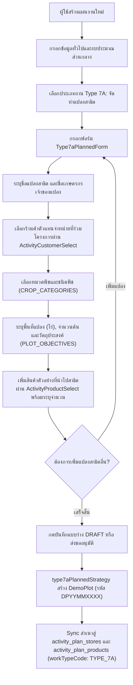
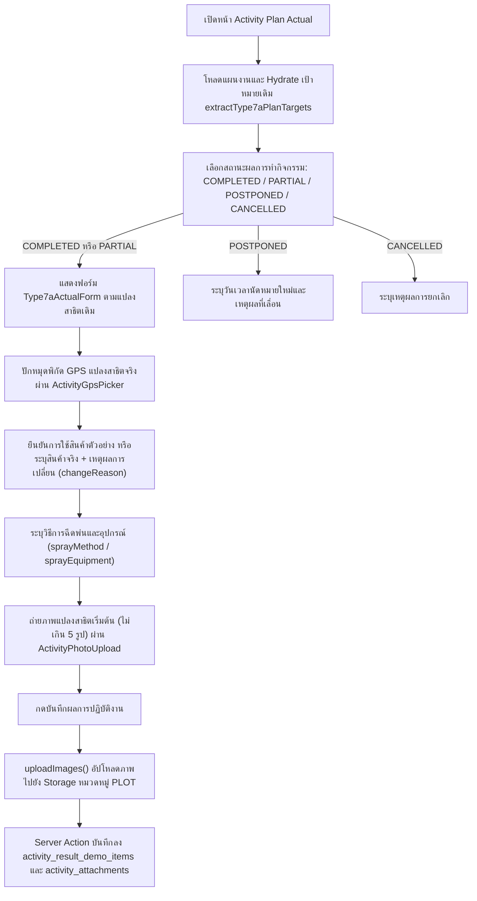
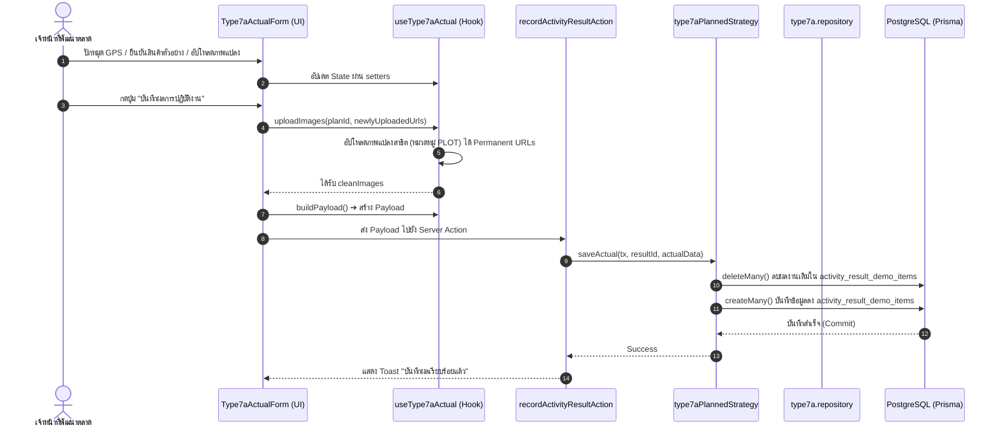

# Activity Type 7A — จัดทำแปลงสาธิต / Demo Plot Establishment (README)

> **Feature Slice**: `modules/activity/features/type-7a`  
> **Standard Reference**: ออกแบบตามแนวทาง Vertical Slice Architecture อิงตามแม่แบบ Gold Standard Type 1  
> **Parent Module**: `modules/activity`  
> **Database Authority**: `prisma/schema.prisma` (`DemoPlot`, `ActivityPlanType7a`, `ActivityPlanType7aProduct`, `ActivityResultDemoItem`, `ActivityAttachment`, พร้อม sync สู่ `ActivityPlanStore`, `ActivityPlanProduct`)  
> **Status**: Production Ready / Active Reference (v1.6.0 — Updated 2026-10-22)

---

## 1. Overview

### 1.1 วัตถุประสงค์ของ Type 7A
**Type 7A (จัดทำแปลงสาธิต / Demo Plot Establishment)** มีวัตถุประสงค์เพื่อรองรับการปฏิบัติงานของเจ้าหน้าที่พัฒนาตลาดและนักวิชาการเกษตร (Market Development Representatives / Technical Agronomists / Promoters) ในการจัดตั้งแปลงสาธิตเชิงประจักษ์ใหม่ร่วมกับร้านค้าตัวแทนจำหน่ายและเกษตรกรชั้นนำ:
1. กำหนดเป้าหมายจัดตั้งแปลงสาธิตใหม่ล่วงหน้า พร้อมสร้างระเบียนแปลงหลัก (`DemoPlot`) ที่มีรหัสแปลงมาตรฐาน (`DPYYMMXXXX`) โดยอัตโนมัติ
2. บันทึกข้อมูลแปลงสาธิตและเกษตรกรเจ้าของแปลง (ชื่อแปลง, เจ้าของแปลง, ร้านค้าตัวแทนจำหน่ายที่ร่วมโครงการ, พิกัดแปลง GPS และขนาดพื้นที่)
3. ระบุชนิดพืชและเป้าหมายการทดสอบ (หมวดพืช, ชื่อพืช, วัตถุประสงค์การทดลอง, วันที่ปลูก และกำหนดการฉีดพ่น)
4. วางแผนรายการผลิตภัณฑ์และจำนวนสินค้าตัวอย่างที่จะนำไปทดสอบสาธิต (`demoProducts` / `products`)
5. บันทึกผลการจัดทำแปลงจริงหน้างาน (Actual Outcome):
   - ยืนยันพิกัดแปลงจริง (GPS Lat/Long)
   - ข้อมูลสภาพพื้นที่ปลูกเริ่มต้นและการเจริญเติบโตของพืช
   - วิธีการฉีดพ่นและอุปกรณ์ที่ใช้ (เครื่องพ่นสะพายหลัง, เครื่องพ่นปั๊มลากสาย, โดรนเพื่อการเกษตร)
   - สินค้าที่ใช้จริงเปรียบเทียบกับแผน พร้อมเหตุผลการปรับเปลี่ยน (`changeReason`)
   - บันทึกภาพถ่ายแปลงสาธิตเริ่มต้น (Establishment Photos) สูงสุด 5 รูปต่อแปลง (หมวดหมู่ `PLOT`)

### 1.2 ขอบเขตของ Type 7A
- **กลุ่มเป้าหมายที่รองรับ:**
  - **ร้านค้าตัวแทนจำหน่าย (Dealer Store):** ร้านค้าตัวแทนจำหน่ายหลัก (`DEALER`) ที่เข้าร่วมโครงการแปลงสาธิต
  - **เกษตรกรเจ้าของแปลง (Farmer / Plot Owner):** รองรับทั้งเกษตรกรในระบบและเกษตรกรชั้นนำที่ระบุชื่อหน้างาน
- **การจำแนกหมวดพืชและวัตถุประสงค์ (Crop & Objectives):**
  - **หมวดพืช (`CROP_CATEGORIES`):** พืชไร่ (ข้าว, ข้าวโพด, มันสำปะหลัง, อ้อย), ไม้ผล (ทุเรียน, มังคุด, ลำไย, ส้ม, มะม่วง), พืชผัก (พริก, มะเขือเทศ, กะหล่ำปลี, แตงกวา), ไม้ดอกไม้ประดับ, พืชอื่นๆ
  - **วัตถุประสงค์ (`PLOT_OBJECTIVES`):** เปรียบเทียบประสิทธิภาพสินค้ากับสารเคมีคู่แข่ง, ทดสอบการป้องกันและกำจัดโรค/แมลง, ทดสอบการเพิ่มผลผลิต, แปลงสาธิตสำหรับจัดงาน Field Day, อื่นๆ ระบุ
- **ระบบออกรหัสแปลงสาธิตอัตโนมัติ (Automated DemoPlot Code Generation):**
  - สร้างรหัสแปลงรูปแบบ `DPYYMMXXXX` (เช่น `DP26100001`) ผ่านฟังก์ชัน `generateDemoPlotCode` โดยใช้ PostgreSQL Advisory Lock (`pg_advisory_xact_lock`) เพื่อรับประกันว่าจะไม่มีรหัสซ้ำกันแม้มีการบันทึกพร้อมกัน (Concurrent Requests)
- **การจัดเก็บข้อมูลแบบ Dual Persistence:**
  - **Master Table:** สร้างระเบียนแปลงสาธิตหลักลงตาราง `DemoPlot` (`demo_plots`) มีสถานะเริ่มต้นเป็น `IN_PROGRESS`
  - **Dedicated Plan Tables:** บันทึกรายละเอียดแผนงานลง `ActivityPlanType7a` (`activity_plan_type_7a`) และรายการสินค้าลง `ActivityPlanType7aProduct` (`activity_plan_type_7a_products`)
  - **Generic Tables Sync:** ซิงค์สำเนาแปลงลง `ActivityPlanStore` และสินค้าตัวอย่างลง `ActivityPlanProduct` (`workTypeCode = "TYPE_7A"`) เพื่อให้ปฏิทินงาน รายงานภาพรวม และระบบเดิมทำงานร่วมกันได้อย่างสมบูรณ์
  - **Actual Outcome Tables:** บันทึกผลการใช้สินค้าตัวอย่างลง `ActivityResultDemoItem` (`activity_result_demo_items`) และรูปภาพลง `ActivityAttachment` (`category = "PLOT"`)

### 1.3 รูปแบบการทำงานที่รองรับ
1. **Planned (ในแผนงาน Trip Plan):** กำหนดเป้าหมายแปลงสาธิต ร้านค้า เกษตรกร ชนิดพืช และสินค้าตัวอย่างล่วงหน้า ส่งขออนุมัติตามสายงาน
2. **Planned Actual (บันทึกผลงานตามแผน):** เมื่อแผนได้รับอนุมัติ นำแผนเดิมมารายงานผลการจัดตั้งแปลงจริง ปักหมุด GPS ยืนยันการใช้สินค้า และอัปโหลดภาพถ่ายแปลงเริ่มต้น
3. **Unplanned (กิจกรรมนอกแผน 2-in-1):** รองรับกรณีเข้าจัดทำแปลงสาธิตหน้างานทันที สามารถกรอกข้อมูลแปลง เกษตรกร ชนิดพืช พิกัด GPS สินค้าตัวอย่าง และถ่ายรูปแปลงสาธิตจบในฟอร์มเดียว พร้อมสร้าง `DemoPlot` และแผนงานสถานะ `COMPLETED` ทันที
4. **Detail View:** แสดงข้อมูลแปลงสาธิตเต็มรูปแบบผ่าน `Type7aDetailView` ทั้งชื่อแปลง เกษตรกร พิกัด ชนิดพืช สินค้าที่ใช้ และรูปถ่าย
5. **Approval View:** การ์ดสำหรับผู้บังคับบัญชาพิจารณาอนุมัติผ่าน `Type7aApprovalCard` สรุปจำนวนแปลง เกษตรกร และชนิดพืชที่ขอจัดทำ

---

## 2. Business Flows

### 2.1 Planned (สร้างและแก้ไขแผนงาน)


### 2.2 Planned Actual (บันทึกผลการปฏิบัติงานตามแผน)


### 2.3 Unplanned (กิจกรรมนอกแผน 2-in-1)
- ผู้ใช้งานเข้าหน้า `/activity-plans/unplanned/new`
- ฟอร์ม `Type7aUnplannedForm` ผสานทั้งส่วนตั้งต้นแปลง (ชื่อแปลง, เกษตรกร, ร้านค้า, ชนิดพืช, วัตถุประสงค์) และส่วนผลงานจริง (พิกัด GPS, สินค้าตัวอย่าง, และภาพถ่ายแปลงสาธิต) จบในฟอร์มเดียว
- เมื่อกดบันทึก ระบบตรวจสอบผ่าน `validateType7aUnplannedItems` และแปลง Payload ผ่าน `mapType7aUnplannedToPayload`
- `type7aUnplannedStrategy.savePlan()` จะสร้าง `DemoPlot` พร้อมรหัส `DPYYMMXXXX` อัตโนมัติ ซิงค์เข้า `activity_plan_stores` / `activity_plan_products` และบันทึกผลงานลง `activity_result_demo_items` ภายใน `$transaction` เดียวกัน โดยแผนงานมีสถานะเสร็จสิ้นสมบูรณ์

### 2.4 Detail and Approval (ดูรายละเอียดและพิจารณาอนุมัติ)
- **Detail View:** `DetailWorkTypeList` เรียกใช้ `Type7aDetailView` เพื่อแสดงข้อมูลแปลงสาธิตแต่ละแปลง ชนิดพืช เกษตรกร พื้นที่ พิกัด GPS สินค้าตัวอย่าง และภาพถ่ายแปลงเริ่มต้น
- **Approval View:** `ApprovalWorkTypeList` เรียกใช้ `Type7aApprovalCard` เพื่อให้หัวหน้างานพิจารณาอนุมัติการขอจัดตั้งแปลงสาธิต สรุปชื่อแปลง เกษตรกร พืชที่ทดสอบ และพื้นที่ไร่

---

## 3. Architecture

### 3.1 Folder Structure
```text
modules/activity/features/type-7a/
├── index.ts                                    # Unified Public API Contract (ส่งออกเฉพาะสิ่งที่ภายนอกต้องใช้)
├── README.md                                   # เอกสารคู่มือทางเทคนิค (ไฟล์นี้)
│
├── planned/                                    # Sub-slice: กิจกรรมในแผนงานและบันทึกผลตามแผน
│   ├── application/                            # Business Logic, Validation, Mappers
│   │   ├── actual-mapper.ts                    # แปลงผลงานจริง Form <-> DB/Payload (parseType7aActualResult)
│   │   ├── actual-validation.ts                # ตรวจสอบความถูกต้องของผลงานจริง (validateType7aActual)
│   │   ├── planned-mapper.ts                   # แปลงเป้าหมายในแผน Form <-> DB / Hydration (extractType7aPlanTargets, hydrateType7aPlannedData, mapType7aToSectionItems)
│   │   └── planned-validation.ts               # ตรวจสอบความถูกต้องของแผน (validateType7aFormItems)
│   ├── components/                             # UI Components ประจำ Type 7A ในแผน
│   │   ├── type7a-planned-form.tsx             # ฟอร์มสร้าง/แก้ไขแปลงสาธิตตามแผน
│   │   ├── type7a-actual-form.tsx              # ฟอร์มบันทึกผลจัดตั้งแปลงจริง (GPS + สินค้า + รูปถ่าย)
│   │   ├── type7a-plan-card.tsx                # การ์ดสรุปเป้าหมายแปลงสาธิตตามแผนงาน
│   │   ├── type7a-detail-view.tsx              # คอมโพเนนต์แสดงผลเต็มรูปแบบในหน้ารายละเอียด
│   │   └── type7a-approval-card.tsx            # การ์ดสรุปสำหรับหน้าพิจารณาอนุมัติ
│   ├── hooks/                                  # Custom State Hooks
│   │   ├── use-type7a-planned-form.ts          # จัดการ State แปลงสาธิตและสินค้าตามแผน
│   │   └── use-type7a-actual.ts                # จัดการ State ผลการจัดทำแปลงจริงและอัปโหลดรูปภาพ
│   ├── infrastructure/                         # Database Strategies & Repositories
│   │   ├── type7a.repository.ts                # generateDemoPlotCode, syncType7aPlots, findType7aByPlanId
│   │   └── type7a-planned.strategy.ts          # Strategy บันทึก/โหลดข้อมูล DemoPlot & ActivityResultDemoItem
│   └── types/                                  # Type Definitions ในแผน
│       ├── planned.types.ts                    # Type7aPlanItem, Type7aTargetItem, Type7aPlanCardProps ฯลฯ
│       └── actual.types.ts                     # Type7aActualRecord, Type7aActualFormProps, Type7aDetailViewProps ฯลฯ
│
├── unplanned/                                  # Sub-slice: กิจกรรมนอกแผน (2-in-1)
│   ├── application/                            # Logic และ Mappers กิจกรรมนอกแผน
│   │   ├── unplanned-mapper.ts                 # Hydration และ Data mapping นอกแผน (hydrateType7aUnplannedData, mapType7aUnplannedToPayload)
│   │   └── unplanned-validation.ts             # Validation กิจกรรมนอกแผน (validateType7aUnplannedItems)
│   ├── components/                             # UI Components กิจกรรมนอกแผน
│   │   └── type7a-unplanned-form.tsx           # ฟอร์ม 2-in-1 (ตั้งแปลง + บันทึกผลจริง + GPS + รูปถ่าย)
│   ├── hooks/                                  # Custom State Hooks
│   │   └── use-type7a-unplanned-form.ts        # จัดการ State แปลงสาธิตนอกแผน
│   ├── infrastructure/                         # Database Strategies นอกแผน
│   │   └── type7a-unplanned.strategy.ts        # บันทึกกิจกรรมนอกแผนลง Prisma ผสาน DemoPlot และผลงานจริง
│   └── types/                                  # Type Definitions นอกแผน
│       └── unplanned.types.ts                  # Type7aUnplannedItem, Type7aUnplannedFormProps
│
└── shared/                                     # ชิ้นส่วนที่ใช้ร่วมกันภายใน Feature Type 7A
    ├── constants.ts                            # CROP_CATEGORIES, PLOT_OBJECTIVES, IRRIGATION_METHODS, SPRAY_METHODS
    └── types.ts                                # CustomerOption, ProductOption, Type7aDemoProductItem, Type7aPlotInput, Type7aImageFile
```

### 3.2 Type 7A vs Shared Activity
| ความรับผิดชอบ | จัดการที่ Type 7A Feature (`features/type-7a`) | จัดการที่ Activity ส่วนกลาง (`ui/`, `views/`) |
| :--- | :--- | :--- |
| **ข้อมูลทั่วไป** | - | ชื่องาน, วันที่เริ่ม-สิ้นสุด, วัตถุประสงค์หลัก, ผู้ร่วมเดินทาง |
| **พื้นที่ & ทีมงาน** | - | จังหวัด, อำเภอ, ตำบล, พนักงานร่วมเดินทาง |
| **งบประมาณ** | - | งบเบิกสินค้าสาธิต, ค่าใช้จ่ายเดินทาง |
| **เป้าหมายแปลงสาธิต** | ชื่อแปลง, เกษตรกร, ร้านค้า, ชนิดพืช, พื้นที่ไร่, สินค้าตัวอย่าง | - |
| **ผลการจัดตั้งแปลงจริง** | พิกัดแปลง GPS, การใช้สินค้าจริง, เหตุผลการเปลี่ยน, รูปถ่ายแปลง | ผลสรุปภาพรวมแผน (สำเร็จ/เลื่อน/ยกเลิก) |
| **Database Persistence** | ตาราง `DemoPlot`, `ActivityPlanType7a`, `ActivityPlanType7aProduct`, `ActivityResultDemoItem`, sync `ActivityPlanStore`, `ActivityPlanProduct` | ตารางหลัก `ActivityPlan`, `ActivityPlanApprovalLog`, `ActivityAttachment` |

### 3.3 Dependency and Import Map
- **ทิศทางการเรียกใช้ (Allowed):**
  - `views/` ➔ เรียกใช้ ➔ `features/type-7a` (ผ่าน `index.ts` เท่านั้น)
  - `features/type-7a` ➔ เรียกใช้ ➔ `@/modules/activity/ui` (`ActivityInput`, `ActivityTextarea`, `ActivityCombobox`, `ActivityCustomerSelect`, `ActivityProductSelect`, `ActivityPhotoUpload`, `ActivityGpsPicker`)
  - `features/type-7a` ➔ เรียกใช้ ➔ `@/modules/activity/constants`
  - `features/type-7a` ➔ เรียกใช้ ➔ `@/modules/activity/types/strategy.interface`
  - `features/type-7a` ➔ เรียกใช้ ➔ `@/modules/activity/application/media/image-uploader` (`uploadActivityPlanImageGroup`, `deleteActivityPlanImagePaths`)
- **Server Actions & Database Flow:**
  - `views/` ➔ ส่งข้อมูลไปยัง ➔ Server Actions ใน `@/modules/activity/server/`:
    - `planned.actions.ts` (`createActivityPlanAction`, `updateActivityPlanAction`, `getActivityPlanAction`)
    - `unplanned.actions.ts` (`createUnplannedActivityAction`, `updateUnplannedActivityAction`, `getUnplannedActivityAction`)
    - `actual.actions.ts` (`recordActivityResultAction`)
  - Server Actions ➔ ทำงานร่วมกับ ➔ `@/modules/activity/infrastructure/strategy.registry` ➔ เรียกใช้ `type7aPlannedStrategy` / `type7aUnplannedStrategy` บันทึกลงตาราง Master (`DemoPlot`) และ Generic Tables ภายใน `$transaction`
- **สิ่งต้องห้าม (Strictly Forbidden):**
  - ❌ ภายนอก Import เจาะลึกเข้าไปในโฟลเดอร์ย่อย เช่น `features/type-7a/planned/components/...`
  - ❌ `features/type-7a` เรียกใช้ข้อมูลข้ามไปยัง `features/type-1` ถึง `type-6` หรือ `type-7b` ถึง `type-14`
  - ❌ Import ย้อนกลับไปยังโมดูลเก่า `@/modules/activity-plans/...` โดยเด็ดขาด

### 3.4 Entry Points and Public Exports
ไฟล์ [modules/activity/features/type-7a/index.ts](file:///d:/code/crm-bank/modules/activity/features/type-7a/index.ts) ทำหน้าที่เป็น **Single Public API Contract** สำหรับฝั่ง UI / Application โดยส่งออกเฉพาะ:
- **Components:** `Type7aPlannedForm` (`Type7aPlanForm`, `Type7NewDemo`, `EditType7aNewDemo`), `Type7aPlanCard`, `Type7aActualForm` (`ActualType7NewDemo`), `Type7aDetailView` (`DetailType7NewDemo`), `Type7aApprovalCard` (`ApprovalType7aDemo`), `Type7aUnplannedForm`
- **Hooks:** `useType7aPlannedForm` (`useType7aForm`), `useType7aActual`, `useType7aUnplannedForm`
- **Mappers & Hydrators:** `extractType7aPlanTargets`, `hydrateType7aPlannedData`, `mapType7aToSectionItems`, `parseType7aActualResult`, `hydrateType7aUnplannedData`, `mapType7aUnplannedToPayload`
- **Validators & Schemas:** `validateType7aFormItems`, `validateType7aActual`, `validateType7aUnplannedItems`
- **Constants & Types:** `WORK_TYPE_CODE`, `WORK_TYPE_NAME`, `CROP_CATEGORIES`, `PLOT_OBJECTIVES`, `IRRIGATION_METHODS`, `SPRAY_METHODS`, `DEMO_PLOT_STATUSES`, `Type7aPlanItem`, `Type7aTargetItem`, `Type7aPlanCardTarget`, `Type7aPlanCardProps`, `Type7aPlannedFormProps`, `Type7aActualRecord`, `Type7aActualFormProps`, `Type7aDetailViewProps`, `Type7aApprovalCardProps`, `Type7aUnplannedItem`, `Type7aUnplannedFormProps`, `CustomerOption`, `ProductOption`, `Type7aDemoProductItem`, `Type7aPlotInput`, `Type7aImageFile`
- *(หมายเหตุ: `type7aPlannedStrategy` และ `type7aUnplannedStrategy` ถูกนำเข้าโดยตรงที่ `modules/activity/infrastructure/strategy.registry.ts` เพื่อแยกโค้ดฝั่ง Server/Database ออกจาก Client Bundle)*

---

## 4. File Responsibilities

### 4.1 Planned & Actual
- **`use-type7a-planned-form.ts`:** จัดการ State แปลงสาธิตในแผน (Array of `Type7aPlanItem`), รองรับการเพิ่มแปลง (`addType7aRow`), แก้ไขแปลง (`updateType7aRow`), ลบแปลง (`deleteType7aRow`), เพิ่มสินค้าตัวอย่างในแปลง (`addProductToDemoPlot`), และปรับปรุงสินค้าในแปลง
- **`type7a-planned-form.tsx`:** ฟอร์มสร้าง/แก้ไขแปลงสาธิตตามแผน แสดงการ์ดของแต่ละแปลง กรอกชื่อแปลง เกษตรกร เลือกร้านค้าตัวแทนจำหน่าย เลือกชนิดพืช วัตถุประสงค์ และเลือกสินค้าตัวอย่างผ่าน `ActivityProductSelect`
- **`type7a-plan-card.tsx`:** การ์ดสรุปเป้าหมายแปลงสาธิตตามแผน แสดงชื่อแปลง เกษตรกร พืชที่ทดสอบ และขนาดพื้นที่
- **`type7a-actual-form.tsx`:** ฟอร์มบันทึกผลการจัดทำแปลงจริงหน้างาน ปักหมุดพิกัด GPS ผ่าน `ActivityGpsPicker`, ยืนยันการใช้สินค้าตัวอย่าง, ระบุวิธีการฉีดพ่น, และอัปโหลดภาพถ่ายแปลงสาธิตเริ่มต้น (ไม่เกิน 5 รูป)
- **`use-type7a-actual.ts`:** จัดการ State ผลการจัดทำแปลงจริง, รองรับการ Hydrate ข้อมูลเดิม, อัปโหลดภาพถ่ายแปลงสาธิตหมวดหมู่ `PLOT`, และสร้าง Payload สำหรับบันทึกผล
- **`type7a-detail-view.tsx`:** การ์ดแสดงผลในหน้ารายละเอียด แสดงข้อมูลแปลงสาธิต เกษตรกร พิกัด ชนิดพืช และแกลเลอรีรูปถ่าย
- **`type7a-approval-card.tsx`:** การ์ดสำหรับหน้าพิจารณาอนุมัติของหัวหน้างาน สรุปจำนวนแปลงสาธิตและรายละเอียดเบื้องต้น
- **`type7a.repository.ts`:** ฟังก์ชันระดับล่างสำหรับฐานข้อมูล:
  - `generateDemoPlotCode`: สร้างรหัสแปลง `DPYYMMXXXX` ด้วย Advisory Lock
  - `syncType7aPlots`: สร้างระเบียน `DemoPlot` และ Dual-sync ไปยัง `ActivityPlanStore` และ `ActivityPlanProduct`
  - `findType7aByPlanId`: ดึงข้อมูลแปลงสาธิตตาม `activityPlanId`
- **`type7a-planned.strategy.ts`:** จัดการการตรวจสอบเงื่อนไข (`validatePlan`), บันทึกแผนงานและสร้าง `DemoPlot` (`savePlan`), บันทึกผลการใช้สินค้าลง `ActivityResultDemoItem` (`saveActual`), และโหลดข้อมูล (`loadPlan`)
- **`planned-mapper.ts`:** ดึงเป้าหมายจากแผน (`extractType7aPlanTargets`) และ Hydrate ข้อมูลเดิมสำหรับหน้าแก้ไข (`hydrateType7aPlannedData`)
- **`actual-mapper.ts`:** แปลงผลงานจริงจากฐานข้อมูลเข้าสู่โครงสร้าง `Type7aActualRecord` สำหรับ UI
- **`planned-validation.ts` & `actual-validation.ts`:** ตรวจสอบความถูกต้องของแผนงาน (`validateType7aFormItems`) และผลงานจริง (`validateType7aActual`)

### 4.2 Unplanned
- **`use-type7a-unplanned-form.ts`:** จัดการ State กิจกรรมนอกแผน 2-in-1 ที่รวมทั้งข้อมูลแปลงสาธิต พิกัด GPS สินค้าตัวอย่าง และภาพถ่ายหน้างาน
- **`type7a-unplanned-form.tsx`:** ฟอร์ม 2-in-1 สำหรับกิจกรรมนอกแผน แสดงข้อมูลการตั้งแปลง พืชที่ทดสอบ สินค้าตัวอย่าง พิกัด GPS และกล้องถ่ายภาพแปลงสาธิต
- **`unplanned-mapper.ts`:**
  - `hydrateType7aUnplannedData`: กู้คืนข้อมูลกิจกรรมนอกแผนเดิมเมื่อเปิดหน้าแก้ไข
  - `mapType7aUnplannedToPayload`: แปลงข้อมูลนอกแผนให้เป็นทั้ง `type7aPlots` (สำหรับสร้าง DemoPlot) และ `actualOutcome`
- **`unplanned-validation.ts`:** ตรวจสอบความถูกต้องของรายการนอกแผน (`validateType7aUnplannedItems`) ต้องระบุชื่อแปลง เกษตรกร และชนิดพืชครบถ้วน
- **`type7a-unplanned.strategy.ts`:** บันทึกทั้งการสร้าง `DemoPlot` และผลการจัดทำแปลงสาธิตพร้อมกันผ่าน `type7aPlannedStrategy.savePlan()` และ `type7aPlannedStrategy.saveActual()`

### 4.3 Shared Types and Constants
- **`shared/constants.ts`:** กำหนด `WORK_TYPE_CODE = "TYPE_7A"`, `CROP_CATEGORIES`, `PLOT_OBJECTIVES`, `IRRIGATION_METHODS`, `SPRAY_METHODS`, และ `DEMO_PLOT_STATUSES`
- **`shared/types.ts`:** กำหนดประเภทข้อมูล `CustomerOption`, `ProductOption`, `Type7aDemoProductItem`, `Type7aPlotInput`, `Type7aImageFile`

### 4.4 Shared UI and Views
- `planned-activity-form.tsx`, `unplanned-activity-form.tsx`, `activity-plan-actual-view.tsx`, `actual-work-type-list.tsx`, `detail-work-type-list.tsx`, และ `approval-work-type-list.tsx` ทำหน้าที่เป็น Orchestrators ในการเลือกเรนเดอร์และประมวลผล Type 7A ตามเงื่อนไข `isType7aActive`

---

## 5. Data Flow



### 5.1 Create Planned (สร้างแผนใหม่)
1. `create-view.tsx` หรือ `planned-activity-form.tsx` เรียกใช้ `useType7aPlannedForm()`
2. ผู้ใช้ระบุข้อมูลแปลงสาธิต ชนิดพืช และสินค้าตัวอย่างใน `Type7aPlannedForm`
3. ผู้ใช้กดส่งขออนุมัติ ➔ รัน `validateType7aFormItems(type7a.type7aPlots)`
4. Map ข้อมูลเป็น `type7aPlots` ส่งไปยัง Server Action `createActivityPlanAction`
5. Server Action เรียก `type7aPlannedStrategy.savePlan()` ภายใน `$transaction`
6. Repository รัน `generateDemoPlotCode()` ได้รหัส `DPYYMMXXXX` ➔ สร้างระเบียนใน `DemoPlot` ➔ Dual-sync สำเนาลง `activity_plan_stores` และ `activity_plan_products`

### 5.2 Edit Planned (แก้ไขแผนงานเดิม)
1. `edit-view.tsx` ดึงข้อมูลแผนเดิมจากฐานข้อมูล
2. เรียก `hydrateType7aPlannedData(initialData)` เพื่อแปลงข้อมูลแปลงสาธิต
3. ส่งข้อมูลเข้า `useType7aPlannedForm({ initial })`
4. ฟอร์มแสดงข้อมูลเดิมพร้อมให้แก้ไข เพิ่ม หรือลบแปลงและสินค้าได้อย่างสมบูรณ์

### 5.3 Save Actual (บันทึกผลการปฏิบัติงานจริง)
1. `activity-plan-actual-view.tsx` รันกระบวนการบันทึกผล
2. ตรวจสอบความถูกต้องด้วย `validateType7aActual()`
3. เรียก `type7aActual.uploadImages(id, newlyUploadedUrls)` เพื่ออัปโหลดภาพแปลง ได้ URL ถาวร
4. เรียก `type7aActual.buildPayload()` เพื่อรวบรวมข้อมูลแปลงจริง
5. ส่ง Payload เข้า `recordActivityResultAction(id, payload)`
6. `type7aPlannedStrategy.saveActual()` ลบผลงานเก่าแล้วสร้างระเบียนใหม่ลงตาราง `activity_result_demo_items` และบันทึกรูปภาพลง `activity_attachments`

### 5.4 Load Actual (โหลดผลงานเดิมมาแสดงในหน้าบันทึกผล)
1. หน้า Actual ดึงข้อมูลแผนและผลงานเดิม
2. `extractType7aPlanTargets(plan)` แปลงเป้าหมายเดิมเข้าสู่ `targets`
3. เรียก `type7aActual.hydrate(plan, parsed, { t7a: extractedT7a.primary })`
4. ฟอร์มแสดงข้อมูลแปลง พืช พิกัด GPS สินค้า และรูปภาพที่เคยบันทึกไว้

### 5.5 Create/Edit Unplanned (กิจกรรมนอกแผน)
1. ผู้ใช้กรอกฟอร์ม `Type7aUnplannedForm` (ระบุชื่อแปลง เกษตรกร ชนิดพืช สินค้า พิกัด GPS และรูปถ่าย)
2. ตรวจสอบความถูกต้องด้วย `validateType7aUnplannedItems(type7a.items)`
3. แปลง Payload ผ่าน `mapType7aUnplannedToPayload(type7a.items)`
4. `type7aUnplannedStrategy.savePlan()` สร้างระเบียน `DemoPlot` และบันทึกผลตรวจลง `activity_result_demo_items` พร้อมกันใน `$transaction` เดียวกัน

### 5.6 Detail and Approval (การแสดงผลหน้ารายละเอียดและพิจารณาอนุมัติ)
1. โหลดข้อมูลแผนงานผ่าน Loader
2. ระบบตรวจจับประเภทงานว่าเป็น Type 7A ผ่าน `WORK_TYPE_STRATEGY_REGISTRY.TYPE_7A.hasData()`
3. หน้ารายละเอียดเรนเดอร์ `<Type7aDetailView />` พร้อมข้อมูลแปลงและรูปภาพ
4. หน้าอนุมัติเรนเดอร์ `<Type7aApprovalCard />` สรุปชื่อแปลง เกษตรกร และชนิดพืช

---

## 6. Data Models and Mapping

### 6.1 Database CRUD Matrix (สิทธิ์และการจัดการตารางในฐานข้อมูล)
| ตารางในฐานข้อมูล (`Prisma Model`) | Create (สร้าง) | Read (อ่าน/แสดงผล) | Update (แก้ไข) | Delete (ลบ) | หมายเหตุ |
| :--- | :--- | :--- | :--- | :--- | :--- |
| **`demo_plots`**<br>(`DemoPlot`) | `syncType7aPlots()` ใน `savePlan()` | หน้ารายการแปลงสาธิต, Detail / Actual | อัปเดตข้อมูลแปลง / สถานะปิดแปลง | Cascade หรือ Soft-delete | ตารางหลัก Master Data แปลงสาธิต รหัส `DPYYMMXXXX` |
| **`activity_plan_type_7a`**<br>(`ActivityPlanType7a`) | Dedicated Plan Table | โหลดรายละเอียดแผน Type 7A | อัปเดตข้อมูลแผนแปลง | Cascade เมื่อลบ `ActivityPlan` | เก็บรายละเอียดเป้าหมายแผนแปลงสาธิต |
| **`activity_plan_type_7a_products`**<br>(`ActivityPlanType7aProduct`) | Dedicated Plan Table | รายการสินค้าตัวอย่างประจำแปลง | ลบและสร้างใหม่ตามแปลง | Cascade เมื่อลบ `ActivityPlanType7a` | เก็บสินค้าตัวอย่างประจำแผน |
| **`activity_result_demo_items`**<br>(`ActivityResultDemoItem`) | `saveActual()` ใน Actual/Unplanned | `plan.result.demoResults` | `deleteMany()` + `createMany()` ใน `saveActual()` | Cascade เมื่อลบ `ActivityResult` | เก็บผลการใช้สินค้าตัวอย่างและการทดสอบ |
| **`activity_plan_stores`**<br>(`ActivityPlanStore`) | Dual-write sync ใน `syncType7aPlots()` | Generic store queries | `deleteMany()` + `createMany()` (`workTypeCode: "TYPE_7A"`) | Cascade เมื่อลบ `ActivityPlan` | ซิงค์สำเนาเป้าหมายร้านค้า/แปลง |
| **`activity_plan_products`**<br>(`ActivityPlanProduct`) | Dual-write sync ใน `syncType7aPlots()` | Generic product queries | `deleteMany()` + `createMany()` (`workTypeCode: "TYPE_7A"`) | Cascade เมื่อลบ `ActivityPlan` | ซิงค์สำเนาสินค้าตัวอย่าง |
| **`activity_attachments`**<br>(`ActivityAttachment`) | Storage Upload + `saveActual()` | `plan.attachments` (หมวดหมู่ PLOT) | ลบรายการเก่าและสร้างใหม่ | Cascade เมื่อลบ `ActivityPlan` | เก็บล็อก URL ภาพถ่ายแปลงสาธิต |

### 6.2 Complete Field-to-Database Mapping (ตารางจับคู่ฟิลด์ครบถ้วนทุกจุด)
ไล่จาก **Form Field ➔ Type Field ➔ Mapper ➔ Prisma Model ➔ DB Column Name ➔ Data Type**:

| Form Field (UI) | TypeScript Type Field | Mapper Function (Write/Read) | Prisma Model | DB Column Name | Data Type | Nullable? | Default |
| :--- | :--- | :--- | :--- | :--- | :--- | :---: | :--- |
| **ชื่อแปลงสาธิต** | `plotName` / `name` | `syncType7aPlots` / `extractType7aPlanTargets` | `DemoPlot` / `ActivityPlanType7a` | `name` / `plot_name` | `VARCHAR` | No | - |
| **ชื่อเกษตรกร / เจ้าของแปลง** | `farmerName` / `ownerName` | `syncType7aPlots` / `extractType7aPlanTargets` | `DemoPlot` / `ActivityPlanType7a` | `owner_name` | `VARCHAR` | No | `""` |
| **ร้านค้าตัวแทนจำหน่าย** | `storeId` | `syncType7aPlots` | `DemoPlot` / `ActivityPlanType7a` | `customer_id` / `store_id` | `VARCHAR (FK)` | Yes | `null` |
| **จังหวัด** | `province` | `syncType7aPlots` | `DemoPlot` / `ActivityPlanType7a` | `province` | `VARCHAR` | Yes | `null` |
| **อำเภอ** | `district` | `syncType7aPlots` | `DemoPlot` / `ActivityPlanType7a` | `district` | `VARCHAR` | Yes | `null` |
| **หมวดพืช** | `cropCategory` | `syncType7aPlots` | `DemoPlot` / `ActivityPlanType7a` | `crop_category` | `VARCHAR` | Yes / No | `"พืชทั่วไป"` |
| **ชนิดพืช** | `cropName` | `syncType7aPlots` | `DemoPlot` / `ActivityPlanType7a` | `crop_name` | `VARCHAR` | Yes / No | `"พืชทั่วไป"` |
| **ชื่อพืชเพิ่มเติม (ระบุเอง)** | `customCropName` | `syncType7aPlots` | `DemoPlot` / `ActivityPlanType7a` | `custom_crop_name` | `VARCHAR` | Yes | `null` |
| **ขนาดพื้นที่แปลง (ไร่)** | `areaRai` | `syncType7aPlots` (`new Prisma.Decimal()`) | `DemoPlot` / `ActivityPlanType7a` | `area_rai` | `DECIMAL(10,2)` | Yes | `null` |
| **จำนวนต้น** | `treeCount` | `syncType7aPlots` | `DemoPlot` / `ActivityPlanType7a` | `tree_count` | `INTEGER` | Yes | `null` |
| **วัตถุประสงค์แปลงสาธิต** | `objective` / `plotObjective` | `syncType7aPlots` | `DemoPlot` / `ActivityPlanType7a` | `objective` | `TEXT` | Yes | `null` |
| **วันที่ปลูก / เริ่มแปลง** | `plantingDate` | `syncType7aPlots` | `DemoPlot` | `start_date` / `planting_date` | `TIMESTAMP` | No / Yes | `now()` |
| **วันที่ฉีดพ่นครั้งแรก** | `initialSprayDate` | `syncType7aPlots` | `DemoPlot` | `initial_spray_date` | `TIMESTAMP` | Yes | `null` |
| **กำหนดฉีดพ่นครั้งต่อไป** | `nextSprayDate` | `syncType7aPlots` | `DemoPlot` | `next_spray_date` | `TIMESTAMP` | Yes | `null` |
| **พิกัดแปลง (GPS ละติจูด)** | `latitude` | `syncType7aPlots` (`parseDecimalCoord`) | `DemoPlot` | `latitude` | `DECIMAL(10,7)` | Yes | `null` |
| **พิกัดแปลง (GPS ลองจิจูด)** | `longitude` | `syncType7aPlots` (`parseDecimalCoord`) | `DemoPlot` | `longitude` | `DECIMAL(10,7)` | Yes | `null` |
| **สินค้าทดสอบสาธิต** | `demoProducts` / `products` | `syncType7aPlots` / `saveActual` | `ActivityPlanProduct` / `ActivityResultDemoItem` | `product_id`, `target_quantity` | `VARCHAR (FK)` | No | - |
| **ภาพถ่ายแปลงสาธิต** | `initialPhotos` / `plotImages` | `uploadImages()` (`PLOT`, max 5) | `ActivityAttachment` | `file_url`, `category: "PLOT"` | `TEXT` | No | - |

### 6.3 รายละเอียดตารางสินค้า รูปภาพ และความสัมพันธ์ (Relations & Schema)

```prisma
// 1. ตาราง Master Data แปลงสาธิต
model DemoPlot {
  id             String         @id @default(cuid())
  code           String         @unique // รหัสแปลงสาธิต เช่น DP26100001
  name           String         // ชื่อแปลง เช่น "แปลงสาธิตทุเรียนหมอนทอง นายสมชาย"
  ownerName      String         @map("owner_name") // เจ้าของแปลง/ลูกค้า
  customerId     String?        @map("customer_id") // FK -> Customer (ร้านค้า Dealer)
  employeeId     String         @map("employee_id") // พนักงานผู้ดูแลแปลง
  plotType       String         @default("GENERAL_DEMO") @map("plot_type")

  cropCategory   String?        @map("crop_category")
  cropName       String?        @map("crop_name")
  customCropName String?        @map("custom_crop_name")
  areaRai        Decimal?       @map("area_rai") @db.Decimal(10, 2)
  treeCount      Int?           @map("tree_count")
  province       String?        @map("province")
  district       String?        @map("district")
  objective      String?        @map("objective")

  startDate      DateTime       @map("start_date")
  plantingDate   DateTime?      @map("planting_date")
  initialSprayDate DateTime?    @map("initial_spray_date")
  nextSprayDate  DateTime?      @map("next_spray_date")
  latitude       Decimal?       @map("latitude") @db.Decimal(10, 7)
  longitude      Decimal?       @map("longitude") @db.Decimal(10, 7)
  status         DemoPlotStatus @default(IN_PROGRESS)

  customer       Customer?      @relation("CustomerDemoPlots", fields: [customerId], references: [id], onDelete: SetNull)

  createdAt      DateTime       @default(now()) @map("created_at")
  updatedAt      DateTime       @updatedAt @map("updated_at")
  deletedAt      DateTime?      @map("deleted_at")

  @@map("demo_plots")
}

// 2. ตารางเก็บผลการจัดทำแปลงและการใช้สินค้าจริง Type 7A
model ActivityResultDemoItem {
  id                 String         @id @default(cuid())
  activityResultId   String         @map("activity_result_id")
  demoPlotId         String?        @map("demo_plot_id")
  plannedProductId   String?        @map("planned_product_id")
  actualProductId    String?        @map("actual_product_id")
  changeReason       String?        @map("change_reason")
  plotObjective      String?        @map("plot_objective")

  activityResult     ActivityResult @relation(fields: [activityResultId], references: [id], onDelete: Cascade)
  plannedProduct     Product?       @relation("ActivityResultDemoPlannedProductRef", fields: [plannedProductId], references: [id], onDelete: SetNull)
  actualProduct      Product?       @relation("ActivityResultDemoActualProductRef", fields: [actualProductId], references: [id], onDelete: SetNull)

  @@index([activityResultId])
  @@index([demoPlotId])
  @@map("activity_result_demo_items")
}

// 3. ตารางบันทึกรูปภาพแปลงสาธิต
model ActivityAttachment {
  id               String         @id @default(cuid())
  activityPlanId   String         @map("activity_plan_id")
  activityResultId String?        @map("activity_result_id")
  category         String         @map("category") // "PLOT"
  fileUrl          String         @map("file_url")
  fileName         String?        @map("file_name")
  fileSize         Int?           @map("file_size")
  mimeType         String?        @map("mime_type")

  @@index([activityPlanId])
  @@map("activity_attachments")
}
```

### 6.4 Transaction & Persistence Strategy (ขาเขียนและขาอ่าน)
- **การจัดการ Transaction (Isolation & Atomicity):**
  - ทุกการบันทึกของ Type 7A ดำเนินการภายใต้ `tx` (`PrismaTransaction`) ของระบบ
  - มีการใช้ PostgreSQL Advisory Lock ใน `generateDemoPlotCode()` ป้องกันรหัสแปลงซ้ำซ้อน
  - หากบันทึกรูปภาพ หรือข้อมูลสินค้าตัวอย่างล้มเหลว ระบบจะทำการ **Rollback ทั้งหมด**
- **ขาเขียน (Write Flow):**
  1. *Planned:* ดึงรายการแปลงสาธิต ➔ รัน `syncType7aPlots()` เพื่อสร้างระเบียน `DemoPlot` ใหม่ (หากยังไม่มี `demoPlotId`) ➔ Dual-sync ข้อมูลร้านค้า/แปลงลง `activity_plan_stores` (`workTypeCode: "TYPE_7A"`) และสินค้าตัวอย่างลง `activity_plan_products`
  2. *Actual:* อัปโหลดภาพถ่ายแปลงสาธิตหมวดหมู่ `PLOT` ➔ ลบระเบียนเดิมใน `activity_result_demo_items` ➔ สร้างระเบียนผลการใช้สินค้าตัวอย่างใหม่ ➔ บันทึกรูปภาพลง `activity_attachments`
  3. *Unplanned:* สร้าง `DemoPlot` พร้อมรหัส `DPYYMMXXXX` ➔ บันทึกลง `activity_plan_stores` / `activity_plan_products` และบันทึกผลงานลง `activity_result_demo_items` ภายใน `$transaction` เดียวกัน
- **ขาอ่าน (Read / Hydration Flow):**
  1. *Planned Edit:* ดึง `plan.type7aPlots` (หรือ fallback `stores`/`products`) ➔ ส่งผ่าน `hydrateType7aPlannedData()` เพื่อเติมลงใน State ของฟอร์ม
  2. *Actual & Detail View:* ดึง `plan.type7aPlots` + `plan.result.demoResults` + `attachments` ➔ ส่งผ่าน `extractType7aPlanTargets()` และเรียก `type7aActual.hydrate()` เพื่อกู้คืนข้อมูลแปลง พิกัด และรูปภาพ
  3. *Unplanned Edit:* ดึงข้อมูลแผนผ่าน `getActivityPlanAction` ➔ ส่งผ่าน `hydrateType7aUnplannedData()` เพื่อกู้คืนข้อมูลแปลงและสินค้า
- **การลบข้อมูล (Delete Policy):**
  - ใช้ **Cascade Delete** จาก `ActivityPlan` สำหรับระเบียนในแผนงาน และ Soft-delete / Keep Master สำหรับ `DemoPlot` ที่ถูกสร้างขึ้นแล้วเพื่อรักษาประวัติการติดตามใน Type 7B

---

## 7. Business Rules

### 7.1 Validation Rules
- **การวางแผนเป้าหมาย (`Type7aPlannedForm`):**
  - ต้องมีแปลงสาธิตอย่างน้อย 1 แปลง
  - แต่ละแปลงต้องระบุชื่อแปลงสาธิต (`plotName` ห้ามว่าง)
  - แต่ละแปลงต้องระบุชื่อเจ้าของแปลง / เกษตรกร (`farmerName` หรือ `ownerName` ห้ามว่าง)
  - แต่ละแปลงต้องระบุชนิดพืชที่ต้องการทดสอบ (`cropName`, `cropCategory` หรือ `customCropName`)
- **การบันทึกผลงานจริง (`Type7aActualForm`):**
  - ต้องมีข้อมูลชื่อแปลงสาธิตหรือชื่อเกษตรกร
  - ต้องระบุชนิดพืชที่ทำการสาธิต
- **การบันทึกกิจกรรมนอกแผน (`Type7aUnplannedForm`):**
  - ต้องระบุชื่อแปลง เกษตรกรเจ้าของแปลง และชนิดพืชครบถ้วนทุกรายการ

### 7.2 Default Values
- `workTypeCode`: `"TYPE_7A"`
- `plotType`: `"GENERAL_DEMO"`
- `status` (DemoPlot): `IN_PROGRESS`
- `cropCategory`: ค่าเริ่มต้นกรณีไม่ได้เลือกคือ `"พืชทั่วไป"`
- `cropName`: ค่าเริ่มต้นกรณีไม่ได้เลือกคือ `"พืชทั่วไป"`

### 7.3 Conditional Fields
- **พืชอื่นๆ (`customCropName`):**
  - หากเลือกชนิดพืชเป็น "พืชอื่นๆ": ฟอร์มจะแสดงช่องให้กรอกชื่อพืชเพิ่มเติม
- **ข้อจำกัดจำนวนภาพถ่าย:**
  - รูปภาพแปลงสาธิต (`PLOT`): รองรับสูงสุด 5 ภาพต่อแปลง

### 7.4 Status and Approval Rules
- **การบันทึกผลงานจริง (Trip Plan Actual):** สามารถบันทึกได้เฉพาะเมื่อแผนมีสถานะเป็น `APPROVED` (อนุมัติแล้ว) เท่านั้น
- **สิทธิ์การบันทึกผล:** เฉพาะเจ้าของแผนงาน (Creator) และ Administrator เท่านั้น ผู้ช่วยงาน (Helper) ไม่สามารถบันทึกผลแทนได้
- **การแสดงผลฟอร์มจริง:** ฟอร์ม Type 7A Actual จะแสดงขึ้นมาให้กรอกเมื่อสถานะกิจกรรมเป็น **`COMPLETED` (ปฏิบัติงานแล้วเสร็จ)** หรือ **`PARTIAL` (สำเร็จบางส่วน)**

---

## 8. Shared Dependencies

โมดูล Type 7A ทำงานร่วมกับชิ้นส่วนส่วนกลางต่อไปนี้:
1. **`@/modules/activity/ui`:**
   - `ActivityInput`: คอมโพเนนต์ Input มาตรฐานประจำโมดูล Activity
   - `ActivityTextarea`: คอมโพเนนต์กรอกข้อความหลายบรรทัดสำหรับวัตถุประสงค์แปลง
   - `ActivityCombobox`: คอมโพเนนต์ตัวเลือกหมวดพืชและชนิดพืช
   - `ActivityCustomerSelect`: คอมโพเนนต์ค้นหาและเลือกร้านค้าตัวแทนจำหน่าย/เกษตรกร
   - `ActivityProductSelect`: คอมโพเนนต์ค้นหาและเลือกสินค้าตัวอย่าง
   - `ActivityPhotoUpload`: คอมโพเนนต์อัปโหลดรูปภาพแปลงสาธิตพร้อมบีบอัดไฟล์ในตัว
   - `ActivityGpsPicker`: คอมโพเนนต์ดึงพิกัดแปลงสาธิตปัจจุบันผ่าน Geolocation
2. **`@/modules/activity/views`:**
   - `planned-activity-form.tsx`: ฟอร์มหลักสำหรับสร้าง/แก้ไขแผนงาน
   - `unplanned-activity-form.tsx`: ฟอร์มหลักสำหรับกิจกรรมนอกแผน 2-in-1
   - `activity-plan-actual-view.tsx` & `actual-work-type-list.tsx`: ตัวกระจายฟอร์มผลการปฏิบัติงานจริง
   - `detail-work-type-list.tsx`: ตัวกระจายการ์ดแสดงผลในหน้ารายละเอียด
   - `approval-work-type-list.tsx`: ตัวกระจายการ์ดในหน้าพิจารณาอนุมัติ
3. **`@/modules/activity/constants`:**
   - `WORK_TYPE_CONFIG`: การตั้งค่าและรหัสประเภทงาน (`TYPE_7A`)
   - `ACTIVITY_RESULT_STATUS_LABELS`: ป้ายแสดงสถานะผลกิจกรรม
4. **`@/modules/activity/infrastructure/strategy.registry`:**
   - `saveStrategiesForPlan`: จัดการบันทึกข้อมูล Type Strategies ตาม Work Type Codes
   - `WORK_TYPE_STRATEGY_REGISTRY.TYPE_7A`: ลงทะเบียน `type7aPlannedStrategy` และ `type7aUnplannedStrategy`
5. **Server Actions ที่ใช้งานจริง (`@/modules/activity/server/`):**
   - **`planned.actions.ts`**: `createActivityPlanAction`, `updateActivityPlanAction`, `getActivityPlanAction`
   - **`unplanned.actions.ts`**: `createUnplannedActivityAction`, `updateUnplannedActivityAction`, `getUnplannedActivityAction`
   - **`actual.actions.ts`**: `recordActivityResultAction`

---

## 9. How to Modify Type 7A

### 9.1 การเพิ่มฟิลด์ใหม่บนฟอร์ม (Add a Form Field)
1. เพิ่มฟิลด์ใน Type Definitions:
   - ฟอร์มในแผน: `planned/types/planned.types.ts` (`Type7aPlanItem`)
   - ฟอร์มผลจริง: `planned/types/actual.types.ts` (`Type7aActualRecord`)
   - ฟอร์มนอกแผน: `unplanned/types/unplanned.types.ts` (`Type7aUnplannedItem`)
   - โมเดลรวม: `shared/types.ts` (`Type7aPlotInput`)
2. เพิ่ม Validation Schema ใน `planned-validation.ts`, `actual-validation.ts`, หรือ `unplanned-validation.ts`
3. เพิ่ม Input Field ใน UI Component:
   - ในแผน: `planned/components/type7a-planned-form.tsx`
   - ผลจริง: `planned/components/type7a-actual-form.tsx`
   - นอกแผน: `unplanned/components/type7a-unplanned-form.tsx`
   - หน้ารายละเอียด: `planned/components/type7a-detail-view.tsx`
4. อัปเดต Mapper ใน `planned-mapper.ts`, `actual-mapper.ts`, หรือ `unplanned-mapper.ts`
5. อัปเดต Repository และ Strategy ใน `type7a.repository.ts` และ `type7a-planned.strategy.ts` เพื่อบันทึกลงฐานข้อมูล

### 9.2 การปรับแก้ Validation (Change Validation)
- ปรับแก้เงื่อนไขการตรวจสอบใน:
  - `planned/application/planned-validation.ts` (`validateType7aFormItems`)
  - `planned/application/actual-validation.ts` (`validateType7aActual`)
  - `unplanned/application/unplanned-validation.ts` (`validateType7aUnplannedItems`)

### 9.3 การปรับ Database Mapping (Change Database Mapping)
- หากมีการเปลี่ยนแปลงคอลัมน์ใน `DemoPlot` หรือ `ActivityPlanType7a` ให้แก้ไขใน `planned/infrastructure/type7a.repository.ts` ตรงฟังก์ชัน `syncType7aPlots` และ `type7a-planned.strategy.ts`

### 9.4 การปรับแก้ Actual Loading or Hydration
- ตรวจสอบฟังก์ชัน `extractType7aPlanTargets` และ `hydrateType7aPlannedData` ใน `planned/application/planned-mapper.ts` และ `hydrate` ใน `use-type7a-actual.ts` เพื่อให้รองรับ fallback ฟิลด์เดิมอย่างครอบคลุม

### 9.5 การแก้ไข Shared Components อย่างปลอดภัย
- หากต้องปรับปรุง Shared Components ใน `modules/activity/ui/` ให้คง Props Interface เดิมไว้เสมอเพื่อไม่ให้ส่งผลกระทบต่อประเภทงานอื่น

---

## 10. Troubleshooting & Tracing Pipeline

### 10.1 Step-by-Step Tracing Pipeline (คู่มือการไล่โค้ดเมื่อพบปัญหา)

เมื่อพบว่าข้อมูลบางจุดไม่แสดงผล (เช่น รหัสแปลงสาธิตไม่ถูกสร้าง หรือพิกัด GPS ไม่แสดงหลัง Reload) ให้ไล่ตรวจสอบตาม 8 ขั้นตอนนี้ตามลำดับ:

```text
[Step 1: UI Field] ➔ Type7aActualForm.tsx (ตรวจว่า ActivityGpsPicker ผูกกับ latitude/longitude หรือไม่)
        ↓
[Step 2: Hook State] ➔ use-type7a-actual.ts (ตรวจว่า t7Latitude และ t7Longitude มีค่าถูกต้องหรือไม่)
        ↓
[Step 3: Save Mapper] ➔ buildPayload() (ตรวจว่าส่ง t7Latitude และ t7Longitude ครบถ้วนหรือไม่)
        ↓
[Step 4: Server Action] ➔ recordActivityResultAction ➔ recordActivityResultUseCase
        ↓
[Step 5: Strategy Write] ➔ type7a-planned.strategy.ts: saveActual() / syncType7aPlots()
                          (ตรวจว่าบันทึกลง DemoPlot และ ActivityResultDemoItem หรือไม่)
        ↓
[Step 6: Prisma Table] ➔ DemoPlot & ActivityResultDemoItem
                          (คอลัมน์ latitude, longitude และ code ใน DB มีค่าจริงหรือไม่)
        ↓
[Step 7: Loader & Include] ➔ getActivityPlanAction (ตรวจว่า include type7aPlots, demoPlotData หรือไม่)
        ↓
[Step 8: Load Hydrator] ➔ planned-mapper.ts: extractType7aPlanTargets() & useType7aActual.hydrate()
                          (ตรวจว่ากู้คืนค่าพิกัดและข้อมูลแปลงสาธิตครบถ้วนหรือไม่)
```

### 10.2 ตารางวิเคราะห์ปัญหาที่พบบ่อย (Common Pitfalls)

| อาการ | จุดที่ต้องตรวจสอบ | ต้นตอและวิธีแก้ไข |
| :--- | :--- | :--- |
| **รหัสแปลงสาธิต (`code`) ชนกันกรณีบันทึกพร้อมกัน** | `type7a.repository.ts` ➔ `generateDemoPlotCode` | ตรวจสอบว่ามีคำสั่ง `pg_advisory_xact_lock` ทำงานอยู่หรือไม่ หากไม่มี lock ธุรกรรมที่บันทึกพร้อมกันอาจได้เลขลำดับเดียวกัน |
| **ข้อมูลแปลงสาธิตไม่ขึ้นในหน้าแก้ไขแผน** | `planned-mapper.ts` ➔ `hydrateType7aPlannedData` | ข้อมูลส่งมาเป็น `type7aPlots` แต่โค้ดอ่าน `demoPlotData` หรือ `stores` ให้ตรวจเช็คว่าฟังก์ชันอ่านครบทั้ง 3 คีย์ |
| **หน้า Actual ไม่แสดงช่องกรอกข้อมูล Type 7A** | `activity-plan-actual-view.tsx` | ตรวจสอบเงื่อนไข `isType7aActive` ว่าครอบคลุมทั้ง `"TYPE_7A"`, `"จัดทำแปลงสาธิต"` และ `plan?.type7aPlots?.length` |
| **พิกัดแปลง GPS บันทึกแล้วเป็น null** | `type7a.repository.ts` ➔ `parseDecimalCoord` | ค่าพิกัดส่งมาเป็น String ว่าง `""` หรือ NaN ต้องตรวจสอบผ่าน `parseDecimalCoord` ก่อนแปลงเป็น `new Prisma.Decimal()` |
| **ภาพถ่ายแปลงสาธิตหายหลัง Reload** | `use-type7a-actual.ts` ➔ `uploadImages` | ตรวจสอบว่า `uploadActivityPlanImageGroup` บันทึกหมวดหมู่ `"plot"` หรือ `"issue"` ถูกต้องหรือไม่ |
| **บันทึกกิจกรรมนอกแผนแล้วแปลงไม่แสดงในหน้า Type 7B** | `type7a-unplanned.strategy.ts` ➔ `savePlan` | กิจกรรมนอกแผนต้องเรียก `type7aPlannedStrategy.savePlan()` เสมอเพื่อสร้างระเบียน `DemoPlot` ในระบบ Master |

---

## 11. Testing and Manual UAT

### แผนการทดสอบแบบครบวงจร (End-to-End Test Checklist):
- [ ] **TC-01 (Planned Create):** สร้างแผนจัดทำแปลงสาธิต ระบุชื่อแปลง เกษตรกร เลือกร้านค้า ชนิดพืช และเพิ่มสินค้าตัวอย่าง บันทึกแบบร่าง (DRAFT) และส่งขออนุมัติได้สำเร็จ ตรวจสอบรหัส `DPYYMMXXXX` ในตาราง `demo_plots`
- [ ] **TC-02 (Dual-write Sync Check):** ตรวจสอบว่าใน `activity_plan_stores` และ `activity_plan_products` มีระเบียนที่ซิงค์ `workTypeCode = "TYPE_7A"` ถูกต้องตรงกัน
- [ ] **TC-03 (Planned Edit):** เข้าหน้าแก้ไข (`/activity-plans/[id]/edit`) ข้อมูลแปลงสาธิตและสินค้าตัวอย่างต้องแสดงครบถ้วน แก้ไขข้อมูลแล้วบันทึกสำเร็จ
- [ ] **TC-04 (Detail View - Planned):** เข้าหน้ารายละเอียดก่อนเริ่มงาน การ์ดเป้าหมาย Type 7A (`Type7aPlanCard`) ต้องแสดงชื่อแปลง เกษตรกร และพืชที่ทดสอบถูกต้อง
- [ ] **TC-05 (Actual - Completed):** บันทึกผลการจัดทำแปลงจริงแบบ "ปฏิบัติงานแล้วเสร็จ" พร้อมปักหมุด GPS ยืนยันการใช้สินค้าตัวอย่าง และอัปโหลดภาพถ่ายแปลง ตรวจสอบว่าบันทึกลง `activity_result_demo_items`
- [ ] **TC-06 (Actual - Partial):** บันทึกผลแบบ "สำเร็จบางส่วน" ตรวจสอบว่าฟอร์มยังคงแสดงและบันทึกผลได้ตามปกติ
- [ ] **TC-07 (Unplanned 2-in-1):** สร้างกิจกรรมนอกแผน Type 7A ระบุแปลง เกษตรกร สินค้า พิกัด GPS และรูปถ่ายในหน้าเดียว บันทึกแล้วต้องได้สถานะ `COMPLETED` และสร้าง `DemoPlot` สำเร็จทันที
- [ ] **TC-08 (Detail View - Actual):** เข้าหน้ารายละเอียดหลังบันทึกผลจริง ข้อมูลการจัดทำแปลง พิกัด GPS และรูปถ่ายแปลงต้องแสดงครบถ้วน
- [ ] **TC-09 (Approval View):** ผู้บังคับบัญชาเข้าหน้าอนุมัติ ข้อมูลเป้าหมายแปลงสาธิตต้องแสดงในการ์ดอนุมัติอย่างถูกต้อง
- [ ] **TC-10 (Type 7B Integration Check):** แปลงสาธิตที่สร้างเสร็จแล้วใน Type 7A ต้องปรากฏในตัวเลือกแปลงสาธิตของกิจกรรม Type 7B (ติดตามผลแปลงสาธิต)

---

## 12. Known Limitations and Important Notes

1. **Master Table Persistence (`DemoPlot`):**
   - Type 7A ทำหน้าที่เป็นตัวกำเนิด Master Data ของแปลงสาธิตในตาราง `demo_plots` เพื่อให้กิจกรรม Type 7B (ติดตามผลแปลงสาธิต) สามารถนำรหัสแปลงไปอ้างอิงและบันทึกผลการติดตามต่อเนื่องได้
2. **PostgreSQL Advisory Lock:**
   - การออกรหัสแปลงสาธิต `DPYYMMXXXX` อาศัย `pg_advisory_xact_lock` ซึ่งทำงานเฉพาะบนฐานข้อมูล PostgreSQL จริง ในสภาพแวดล้อมทดสอบที่ไม่มีฟังก์ชันนี้จะสลับไปใช้การสแกนหาเลขลำดับสูงสุดแทน
3. **การจัดการรูปภาพแปลงสาธิต:**
   - ก่อนส่ง Payload บันทึกผลจริง ระบบต้องเรียก `type7aActual.uploadImages()` เสมอ เพื่อแปลงไฟล์รูปภาพจาก `Blob/File` ให้กลายเป็น `URL String` ก่อนบันทึกลงฐานข้อมูล โดยกำหนดหมวดหมู่เป็น `PLOT` (สูงสุด 5 ภาพต่อแปลง)
4. **Decoupling Dependency:**
   - ต้องนำเข้าค่าคงที่และฟังก์ชันจาก `@/modules/activity/constants` และคอมโพเนนต์จาก `@/modules/activity/ui` เท่านั้น ห้ามนำเข้าจาก `@/modules/activity-plans` โดยเด็ดขาด

---

## 13. Change Log

| วันที่ | เวอร์ชัน | รายละเอียดการปรับปรุง | ผู้ดำเนินการ |
| :--- | :--- | :--- | :--- |
| **2026-10-16** | 1.0.0 | สร้างโมดูล Type 7A เป็น Vertical Slice Architecture สำหรับการจัดทำแปลงสาธิตใหม่ | Antigravity AI |
| **2026-10-18** | 1.1.0 | พัฒนาระบบออกรหัสแปลงสาธิตอัตโนมัติ `DPYYMMXXXX` ผ่าน Advisory Lock ใน `type7a.repository.ts` | Antigravity AI |
| **2026-10-19** | 1.2.0 | ปลด Dependency เก่า สลับมาใช้ `@/modules/activity/ui` (`ActivityInput`, `ActivityCustomerSelect`, `ActivityProductSelect`, `ActivityPhotoUpload`, `ActivityGpsPicker`) | Antigravity AI |
| **2026-10-20** | 1.3.0 | พัฒนา Sub-slice `unplanned/` (Type 7A Unplanned Form 2-in-1, Strategy, Mappers, Hooks) | Antigravity AI |
| **2026-10-21** | 1.4.0 | เชื่อมต่อเข้ากับ `strategy.registry.ts` และ Server Actions ใหม่ (`planned.actions.ts`, `unplanned.actions.ts`, `actual.actions.ts`) | Antigravity AI |
| **2026-10-21** | 1.5.0 | ปรับปรุงการซิงค์ `ActivityPlanStore` และ `ActivityPlanProduct` พร้อมรองรับการเชื่อมต่อไปยัง Type 7B | Antigravity AI |
| **2026-10-22** | 1.6.0 | ปรับปรุงเอกสารคู่มือทางเทคนิคฉบับสมบูรณ์ (`README.md`) ครบทั้ง 13 หัวข้อตามมาตรฐาน Gold Standard Type 1 พร้อมรายละเอียดสถาปัตยกรรม แผนภาพ Flow และ Data Models ครบถ้วน 100% | Antigravity AI |
