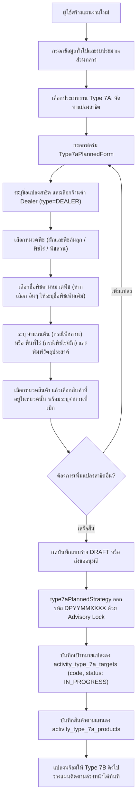
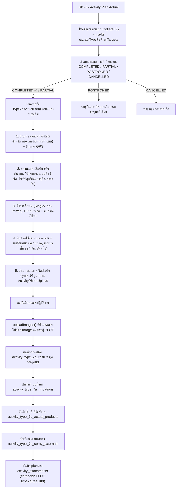
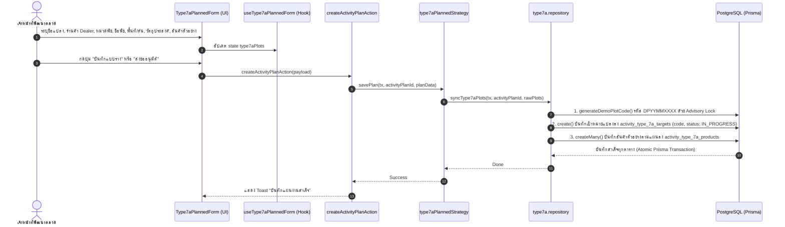
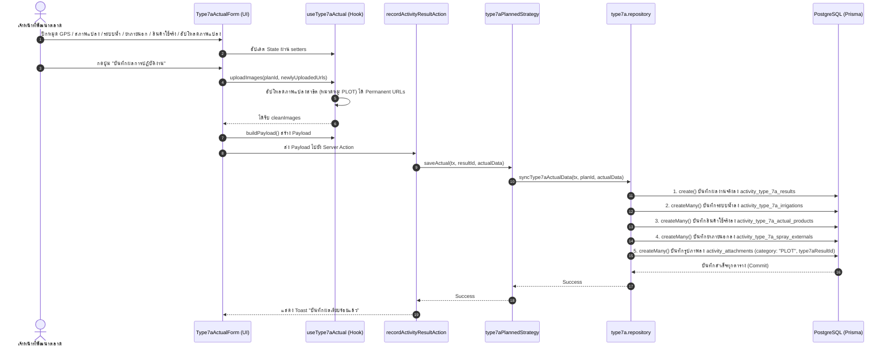

# Activity Type 7A — จัดทำแปลงสาธิต / Demo Plot Establishment (README)

> **Feature Slice**: `modules/activity/features/type-7a`  
> **Standard Reference**: ออกแบบตามแนวทาง Vertical Slice Architecture อิงตามแม่แบบ Gold Standard Type 1  
> **Parent Module**: `modules/activity`  
> **Database Authority**: `prisma/schema.prisma` (`ActivityPlanType7aTarget`, `ActivityPlanType7aProduct`, `ActivityResultType7a`, `ActivityResultType7aIrrigation`, `ActivityResultType7aProduct`, `ActivityResultType7aExternal`, `ActivityAttachment`)  
> **Status**: Production Ready / Active Reference (v3.0.0 — Updated 2026-10-27 100% Dedicated Relational Architecture & Advance Monthly Planning)

---

## 1. Overview

### 1.1 วัตถุประสงค์ของ Type 7A
**Type 7A (จัดทำแปลงสาธิต / Demo Plot Establishment)** มีวัตถุประสงค์เพื่อรองรับการปฏิบัติงานของเจ้าหน้าที่พัฒนาตลาดและนักวิชาการเกษตร (Market Development Representatives / Technical Agronomists / Promoters) ในการจัดตั้งแปลงสาธิตเชิงประจักษ์ใหม่ร่วมกับร้านค้าตัวแทนจำหน่ายและเกษตรกรชั้นนำ:
1. **กำหนดเป้าหมายจัดตั้งแปลงสาธิตใหม่ล่วงหน้า:** สร้างระเบียนแปลงสาธิตในตารางเฉพาะ `activity_type_7a_targets` พร้อมออกรหัสแปลงมาตรฐาน (`DPYYMMXXXX`) โดยอัตโนมัติ และกำหนดสถานะเริ่มต้นเป็น `IN_PROGRESS`
2. **บันทึกข้อมูลแปลงสาธิตและร้านค้าตัวแทนจำหน่าย:** บันทึกชื่อแปลง, ร้านค้าตัวแทนจำหน่าย Dealer ที่ร่วมโครงการ (`storeId`), หมวดพืช, ชื่อพืช, ขนาดพื้นที่ (ไร่ หรือ จำนวนต้น) และวัตถุประสงค์
3. **วางแผนรายการผลิตภัณฑ์และจำนวนสินค้าตัวอย่าง:** วางแผนรายการยาและจำนวนสินค้าตัวอย่างที่จะนำไปทดสอบสาธิตลงตารางเฉพาะ `activity_type_7a_products`
4. **รองรับ Advance Monthly Planning (การวางแผนล่วงหน้ารายเดือน):** พนักงานสามารถวางแผน Type 7A ในวันที่ 5 และวางแผน Type 7B (ติดตามแปลงสาธิต) สำหรับแปลงดังกล่าวในวันที่ 7 ได้ทันทีในรอบเดือนเดียวกัน โดยไม่ต้องรอให้ถึงวันลงพื้นที่จริง หรือรอให้บันทึกผลงานจริงก่อน เนื่องจากแปลงสาธิตถูกสร้างขึ้นใน `activity_type_7a_targets` พร้อมรหัส `code` และสถานะ `IN_PROGRESS` ตั้งแต่ขั้นตอนการสร้างแผน Type 7A
5. **บันทึกผลการจัดทำแปลงจริงหน้างาน (Actual Outcome):** ครบ 7 หมวดหมู่ ลงตารางเฉพาะ `activity_type_7a_results` และตารางความสัมพันธ์ โดยไม่มีการพึ่งพาหรือบันทึกซ้ำซ้อนลงตาราง Master อื่น:
   - **เกษตรกรเจ้าของแปลงและพิกัดแปลง:** กรองเกษตรกรตามจังหวัดที่เลือก หรือบันทึกเกษตรกรนอกระบบ (ที่อยู่ระดับจังหวัด/อำเภอ/ตำบล ผ่าน `ActivityAddressSelect`, ชื่อ-สกุล, เบอร์โทรศัพท์) พร้อมปักหมุดพิกัด GPS จริงหน้างาน (`ActivityGpsPicker`)
   - **ข้อมูลสภาพแปลงเริ่มต้น:** พืชประธาน, วิธีการทดลอง, ระบบน้ำ 8 ชนิด (`ActivityIrrigationCheckbox`), วันที่เริ่มปลูกจริง, วันที่ฉีดพ่นครั้งแรก, กำหนดพ่นครั้งต่อไป (`ActivityDatePicker`), อายุพืช (วัน/เดือน), ระยะการเจริญเติบโต และข้อมูลเพิ่มเติม
   - **วิธีการฉีดพ่นและยาภายนอก:** รองรับทั้งแบบฉีดเดี่ยว (Single) และผสมถัง (Tank-mixed) พร้อมตารางระบุยาภายนอก (บริษัท, ชื่อสินค้า, สารออกฤทธิ์, สูตร SL/SC/EC/อื่นๆ, อัตราการใช้)
   - **อุปกรณ์ที่ใช้ฉีดพ่น:** เครื่องพ่นสะพายหลัง, เครื่องพ่นปั๊มลากสาย, โดรนเพื่อการเกษตร, แอร์บัส/รถพ่นยา, หรืออื่นๆ ระบุ
   - **สินค้าที่เบิกตามแผน:** ดึงรายการยาตัวอย่างที่เบิกตามแผนมาแสดง พร้อมบันทึกจำนวนที่ใช้จริง (ขวด), ปริมาณที่ใช้เพิ่ม (ซีซี/กรัม) และอัตราการใช้
   - **สินค้าเพิ่มเติมในการปฏิบัติงาน:** บันทึกยาที่ใช้นอกเหนือจากแผน โดยเลือกสินค้าจากระบบ และบันทึกจำนวนจริง, ปริมาณเพิ่ม, อัตราการใช้
   - **ภาพถ่ายแปลงสาธิตเริ่มต้น:** อัปโหลดภาพถ่ายแปลงสาธิตเริ่มต้นสูงสุด 10 รูปต่อแปลง (หมวดหมู่ `PLOT`)

### 1.2 ขอบเขตของ Type 7A
- **กลุ่มเป้าหมายที่รองรับ:**
  - **ชื่อ ร้านค้า Dealer (`storeId` / `dealerName`):** เลือกเฉพาะร้านค้าตัวแทนจำหน่ายหลัก (`type="DEALER"`) ที่เข้าร่วมโครงการแปลงสาธิต พร้อมซิงค์จังหวัดและอำเภออัตโนมัติ
- **การจำแนกหมวดพืช ชื่อพืช ขนาดแปลง และวัตถุประสงค์ (Crop, Size & Objectives):**
  - **หมวดพืช (`CROP_CATEGORIES`):** มี 3 ตัวเลือก ได้แก่ `ผักและพืชล้มลุก`, `พืชไร่`, `พืชสวน`
  - **ชื่อพืชตามหมวดพืช (`CROP_NAMES_BY_CATEGORY`):**
    1. ถ้าเลือก **`ผักและพืชล้มลุก`**: ตัวเลือกมี `คะน้า`, `กะหล่ำปลี`, `พริก`, `ผักและพืชล้มลุกอื่นๆ` (หากเลือก `ผักและพืชล้มลุกอื่นๆ` จะแสดงช่อง **`ระบุชื่อพืชเพิ่มเติม *`** เก็บใน `customCropName`)
    2. ถ้าเลือก **`พืชไร่`**: ตัวเลือกมี `ข้าว`, `อ้อย`, `ยางพารา`, `พืชไร่อื่นๆ` (หากเลือก `พืชไร่อื่นๆ` จะแสดงช่อง **`ระบุชื่อพืชเพิ่มเติม *`** เก็บใน `customCropName`)
    3. ถ้าเลือก **`พืชสวน`**: ตัวเลือกมี `ทุเรียน`, `ชมพู่`, `ยางพารา`, `พืชสวนอื่นๆ` (หากเลือก `พืชสวนอื่นๆ` จะแสดงช่อง **`ระบุชื่อพืชเพิ่มเติม *`** เก็บใน `customCropName`)
  - **ขนาดแปลงตามหมวดพืช (`areaRai` vs `treeCount`):**
    - หากเลือกหมวดพืชเป็น **`พืชสวน`**: แสดงช่อง **`จำนวนต้น *`** (`treeCount`)
    - หากเลือกหมวดพืชเป็น **`ผักและพืชล้มลุก`** หรือ **`พืชไร่`**: แสดงช่อง **`พื้นที่ (ไร่) *`** (`areaRai`)
  - **วัตถุประสงค์การจัดทำแปลง (`objective`):** ช่องกรอกข้อความอิสระ (Free-text `ActivityInput`) ให้พิมพ์ระบุเอง
  - **สินค้าที่นำไปทดสอบสาธิต (`demoProducts` / `products`):** มีตัวเลือก **`หมวดสินค้า`** (`categoryId` จาก `ProductCategory`) ก่อน แล้วช่อง **`เลือกสินค้า`** (`ActivityProductSelect`) จะกรองเฉพาะสินค้าที่อยู่ในหมวดสินค้านั้น
- **ระบบออกรหัสแปลงสาธิตอัตโนมัติ (Automated DemoPlot Code Generation):**
  - สร้างรหัสแปลงรูปแบบ `DPYYMMXXXX` (เช่น `DP26100001`) ผ่านฟังก์ชัน `generateDemoPlotCode` โดยใช้ PostgreSQL Advisory Lock (`pg_advisory_xact_lock`) บันทึกลงฟิลด์ `code` ของ `ActivityPlanType7aTarget` โดยตรง
- **สถาปัตยกรรมข้อมูลแบบ 100% Dedicated Relational Storage (ไร้ตาราง DemoPlot เก่า):**
  - **Single Source of Truth:** ข้อมูลแปลงสาธิตจัดเก็บไว้ที่ `activity_type_7a_targets` เป็นตารางหลักเพียงแห่งเดียว ไม่มีตาราง `demo_plots` หรือตารางร่วมเดิมอีกต่อไป
  - **Type 7B & Type 10 Integration:** Type 7B (ติดตามแปลงสาธิต) และ Type 10 (Field Day) เชื่อมโยงตรงมายัง `activity_type_7a_targets` ผ่านคอลัมน์ `type7aTargetId`
  - **Lifecycle Management:** แปลงสาธิตมีสถานะเริ่มต้น `status = IN_PROGRESS` เมื่อ Type 7B ดำเนินการติดตามจนถึงขั้นตอนปิดแปลง จะทำการอัปเดต `status = COMPLETED` (หรือ `CANCELLED`) และบันทึก `closedDate` กลับมาที่ `activity_type_7a_targets`
  - **Media & Attachments Integration:** บันทึกภาพถ่ายแปลงสาธิตเริ่มต้นลง `ActivityAttachment` (`category: PLOT`, `workTypeCode: "TYPE_7A"`, สูงสุด 10 รูป) ผูกตรงกับ `type7aResultId`

### 1.3 รูปแบบการทำงานที่รองรับ
1. **Planned (ในแผนงาน Trip Plan):** กำหนดเป้าหมายแปลงสาธิต ร้านค้า ชนิดพืช และสินค้าตัวอย่างล่วงหน้า ส่งขออนุมัติตามสายงาน โดยระบบสร้างระเบียนแปลงพร้อมรหัส `DPYYMMXXXX` ทันที
2. **Planned Actual (บันทึกผลงานตามแผน):** เมื่อแผนได้รับอนุมัติ นำแผนเดิมมารายงานผลการจัดตั้งแปลงจริง ปักหมุด GPS ยืนยันเกษตรกร ระบุสภาพแปลงและระบบน้ำ บันทึกการใช้สินค้าจริง และอัปโหลดภาพถ่ายแปลงเริ่มต้นสูงสุด 10 รูป
3. **Unplanned (กิจกรรมนอกแผน 2-in-1):** รองรับกรณีเข้าจัดทำแปลงสาธิตหน้างานทันที สามารถกรอกข้อมูลแปลง เกษตรกร ชนิดพืช พิกัด GPS สินค้าตัวอย่าง และถ่ายรูปแปลงสาธิตจบในฟอร์มเดียว พร้อมสร้างแผนงานสถานะ `COMPLETED` ทันที
4. **Detail View:** แสดงข้อมูลแปลงสาธิตเต็มรูปแบบผ่าน `Type7aDetailView` ทั้งชื่อแปลง เกษตรกร พิกัด ชนิดพืช สินค้าที่ใช้ และรูปถ่าย
5. **Approval View:** การ์ดสำหรับผู้บังคับบัญชาพิจารณาอนุมัติผ่าน `Type7aApprovalCard` สรุปจำนวนแปลง เกษตรกร และชนิดพืชที่ขอจัดทำ

---

## 2. Business Flows

### 2.1 Planned (สร้างและแก้ไขแผนงาน)


### 2.2 Planned Actual (บันทึกผลการปฏิบัติงานตามแผน)


### 2.3 Unplanned (กิจกรรมนอกแผน 2-in-1)
- ผู้ใช้งานเข้าหน้า `/activity-plans/unplanned/new`
- ฟอร์ม `Type7aUnplannedForm` ผสานทั้งส่วนตั้งต้นแปลง (ชื่อแปลง, เกษตรกร, ร้านค้า, ชนิดพืช, วัตถุประสงค์) และส่วนผลงานจริง (พิกัด GPS, สินค้าตัวอย่าง, และภาพถ่ายแปลงสาธิต) จบในฟอร์มเดียว
- เมื่อกดบันทึก ระบบตรวจสอบผ่าน `validateType7aUnplannedItems` และแปลง Payload ผ่าน `mapType7aUnplannedToPayload`
- `type7aUnplannedStrategy.savePlan()` จะออกรหัส `DPYYMMXXXX` อัตโนมัติ บันทึกลงตารางเป้าหมาย `activity_type_7a_targets` / `activity_type_7a_products`, และบันทึกผลงานจริงลง `activity_type_7a_results`, `activity_type_7a_irrigations`, `activity_type_7a_actual_products`, `activity_type_7a_spray_externals`, และ `activity_attachments` ภายใน `$transaction` เดียวกัน โดยแผนงานมีสถานะเสร็จสิ้นสมบูรณ์

---

## 3. Architecture

### 3.1 Folder Structure
```text
modules/activity/features/type-7a/
├── index.ts                                    # Unified Public API Contract (ส่งออกเฉพาะสิ่งที่ภายนอกต้องใช้)
├── README.md                                   # เอกสารคู่มือทางเทคนิค (ไฟล์นี้)
│
├── planned/                                    # Sub-slice: กิจกรรมในแผนงานและบันทึกผลตามแผน
│   ├── application/                            # Business Logic, Validation, Mappers
│   │   ├── actual-mapper.ts                    # แปลงผลงานจริง Form <-> DB/Payload (parseType7aActualResult)
│   │   ├── actual-validation.ts                # ตรวจสอบความถูกต้องของผลงานจริง (validateType7aActual)
│   │   ├── planned-mapper.ts                   # แปลงเป้าหมายในแผน Form <-> DB / Hydration (extractType7aPlanTargets, hydrateType7aPlannedData)
│   │   └── planned-validation.ts               # ตรวจสอบความถูกต้องของแผน (validateType7aFormItems)
│   ├── components/                             # UI Components ประจำ Type 7A ในแผน
│   │   ├── type7a-planned-form.tsx             # ฟอร์มสร้าง/แก้ไขแปลงสาธิตตามแผน
│   │   ├── type7a-actual-form.tsx              # ฟอร์มบันทึกผลจัดตั้งแปลงจริง (GPS + สินค้า + รูปถ่าย)
│   │   ├── type7a-plan-card.tsx                # การ์ดสรุปเป้าหมายแปลงสาธิตตามแผนงาน
│   │   ├── type7a-detail-view.tsx              # คอมโพเนนต์แสดงผลเต็มรูปแบบในหน้ารายละเอียด
│   │   └── type7a-approval-card.tsx            # การ์ดสรุปสำหรับหน้าพิจารณาอนุมัติ
│   ├── hooks/                                  # Custom State Hooks
│   │   ├── use-type7a-planned-form.ts          # จัดการ State แปลงสาธิตและสินค้าตามแผน
│   │   └── use-type7a-actual.ts                # จัดการ State ผลการจัดทำแปลงจริงและอัปโหลดรูปภาพ
│   ├── infrastructure/                         # Database Strategies & Repositories
│   │   ├── type7a.repository.ts                # generateDemoPlotCode, syncType7aPlots, findType7aByPlanId, syncType7aActualData
│   │   └── type7a-planned.strategy.ts          # Strategy บันทึก/โหลดข้อมูล ActivityPlanType7aTarget & Results
│   └── types/                                  # Type Definitions ในแผน
│       ├── planned.types.ts                    # Type7aPlanItem, Type7aTargetItem, Type7aPlanCardProps ฯลฯ
│       └── actual.types.ts                     # Type7aActualRecord, Type7aActualFormProps, Type7aDetailViewProps ฯลฯ
│
├── unplanned/                                  # Sub-slice: กิจกรรมนอกแผน (2-in-1)
│   ├── application/                            # Logic และ Mappers กิจกรรมนอกแผน
│   │   ├── unplanned-mapper.ts                 # Hydration และ Data mapping นอกแผน
│   │   └── unplanned-validation.ts             # Validation กิจกรรมนอกแผน (validateType7aUnplannedItems)
│   ├── components/                             # UI Components กิจกรรมนอกแผน
│   │   └── type7a-unplanned-form.tsx           # ฟอร์ม 2-in-1 (ตั้งแปลง + บันทึกผลจริง + GPS + รูปถ่าย)
│   ├── hooks/                                  # Custom State Hooks
│   │   └── use-type7a-unplanned-form.ts        # จัดการ State แปลงสาธิตนอกแผน
│   ├── infrastructure/                         # Database Strategies นอกแผน
│   │   └── type7a-unplanned.strategy.ts        # บันทึกกิจกรรมนอกแผนลง Prisma ผ่าน Type7A Strategy
│   └── types/                                  # Type Definitions นอกแผน
│       └── unplanned.types.ts                  # Type7aUnplannedItem, Type7aUnplannedFormProps
│
└── shared/                                     # ชิ้นส่วนที่ใช้ร่วมกันภายใน Feature Type 7A
    ├── constants.ts                            # CROP_CATEGORIES, PLOT_OBJECTIVES, IRRIGATION_METHODS, SPRAY_METHODS
    └── types.ts                                # CustomerOption, ProductOption, Type7aDemoProductItem, Type7aPlotInput, Type7aImageFile
```

### 3.2 Type 7A vs Shared Activity
| ความรับผิดชอบ | จัดการที่ Type 7A Feature (`features/type-7a`) | จัดการที่ Activity ส่วนกลาง (`ui/`, `views/`) |
| :--- | :--- | :--- |
| **ข้อมูลทั่วไป** | - | ชื่องาน, วันที่เริ่ม-สิ้นสุด, วัตถุประสงค์หลัก, ผู้ร่วมเดินทาง |
| **พื้นที่ & ทีมงาน** | - | จังหวัด, อำเภอ, ตำบล, พนักงานร่วมเดินทาง |
| **งบประมาณ** | - | งบเบิกสินค้าสาธิต, ค่าใช้จ่ายเดินทาง |
| **เป้าหมายแปลงสาธิต** | ชื่อแปลง, ร้านค้า Dealer, ชนิดพืช, พื้นที่ไร่/ต้น, สินค้าตัวอย่าง, รหัสแปลง `DPYYMMXXXX` | - |
| **ผลการจัดตั้งแปลงจริง** | เกษตรกร, พิกัดแปลง GPS, สภาพแปลง, ระบบน้ำ, ยาภายนอก, การใช้สินค้าจริง, รูปถ่ายแปลง | ผลสรุปภาพรวมแผน (สำเร็จ/เลื่อน/ยกเลิก) |
| **Database Persistence** | ตารางเฉพาะ 100%: `activity_type_7a_targets`, `activity_type_7a_products`, `activity_type_7a_results`, `activity_type_7a_irrigations`, `activity_type_7a_actual_products`, `activity_type_7a_spray_externals` | ตารางหลัก `ActivityPlan`, `ActivityPlanApprovalLog`, `ActivityAttachment` |

---

## 4. File Responsibilities

### 4.1 Planned & Actual
- **`use-type7a-planned-form.ts`:** จัดการ State แปลงสาธิตในแผน (Array of `Type7aPlanItem`), รองรับการเพิ่มแปลง (`addType7aRow`), แก้ไขแปลง (`updateType7aRow`), ลบแปลง (`deleteType7aRow`), เพิ่มสินค้าตัวอย่างในแปลง (`addProductToDemoPlot`), และปรับปรุงสินค้าในแปลง
- **`type7a-planned-form.tsx`:** ฟอร์มสร้าง/แก้ไขแปลงสาธิตตามแผน แสดงการ์ดของแต่ละแปลง กรอกชื่อแปลง เลือกร้านค้าตัวแทนจำหน่าย เลือกชนิดพืช วัตถุประสงค์ และเลือกสินค้าตัวอย่างผ่าน `ActivityProductSelect`
- **`type7a-plan-card.tsx`:** การ์ดสรุปเป้าหมายแปลงสาธิตตามแผน แสดงชื่อแปลง รหัสแปลง ร้านค้า Dealer พืชที่ทดสอบ และขนาดพื้นที่
- **`type7a-actual-form.tsx`:** ฟอร์มบันทึกผลการจัดทำแปลงจริงหน้างาน ปักหมุดพิกัด GPS ผ่าน `ActivityGpsPicker`, ระบุเกษตรกร สภาพแปลง ระบบน้ำ ยาภายนอก ยืนยันการใช้สินค้าตัวอย่าง และอัปโหลดภาพถ่ายแปลงสาธิตเริ่มต้น (สูงสุด 10 รูป)
- **`use-type7a-actual.ts`:** จัดการ State ผลการจัดทำแปลงจริง, รองรับการ Hydrate ข้อมูลเดิม, อัปโหลดภาพถ่ายแปลงสาธิตหมวดหมู่ `PLOT`, และสร้าง Payload สำหรับบันทึกผล
- **`type7a-detail-view.tsx`:** คอมโพเนนต์แสดงผลเต็มรูปแบบในหน้ารายละเอียด Trip Plan (แสดงทั้งข้อมูลเป้าหมายตามแผน และข้อมูลผลงานจริง 7 หมวดหมู่เมื่อมีผล)
- **`type7a-approval-card.tsx`:** การ์ดสำหรับหน้าพิจารณาอนุมัติของหัวหน้างาน สรุปจำนวนแปลงสาธิตและรายละเอียดเบื้องต้น
- **`type7a.repository.ts`:** ฟังก์ชันระดับล่างสำหรับฐานข้อมูล:
  - `generateDemoPlotCode`: สร้างรหัสแปลง `DPYYMMXXXX` ด้วย Advisory Lock
  - `syncType7aPlots`: บันทึกเป้าหมายแปลงลง `ActivityPlanType7aTarget` และสินค้าลง `ActivityPlanType7aProduct`
  - `findType7aByPlanId`: ดึงข้อมูลแปลงสาธิตตาม `activityPlanId` จากตารางเฉพาะ
  - `syncType7aActualData`: บันทึกผลงานจัดตั้งแปลงจริงลง `ActivityResultType7a`, `ActivityResultType7aIrrigation`, `ActivityResultType7aProduct`, `ActivityResultType7aExternal` และ `ActivityAttachment`
- **`type7a-planned.strategy.ts`:** จัดการการตรวจสอบเงื่อนไข (`validatePlan`), บันทึกแผนงาน (`savePlan`), บันทึกผลการจัดตั้งแปลง (`saveActual`), และโหลดข้อมูล (`loadPlan`)

---

## 5. Data Flow

### 5.1 Planned Plan Creation (การสร้างแผนจัดทำแปลงสาธิตล่วงหน้า)


### 5.2 Planned Actual Outcome (การบันทึกผลการจัดทำแปลงจริง)


---

## 6. Data Models and Mapping

### 6.1 Database CRUD Matrix (100% Dedicated Relational Storage)
| ตารางในฐานข้อมูล (`Prisma Model`) | Create (สร้าง) | Read (อ่าน/แสดงผล) | Update (แก้ไข) | Delete (ลบ) | หน้าที่รับผิดชอบ |
| :--- | :--- | :--- | :--- | :--- | :--- |
| **`activity_type_7a_targets`**<br>(`ActivityPlanType7aTarget`) | `syncType7aPlots()` ใน `savePlan()` | `findType7aByPlanId()`, `plan.type7aTargets` | ลบและสร้างใหม่ใน `syncType7aPlots()` | Cascade เมื่อลบ `ActivityPlan` | **Dedicated Plot Master & Plan Targets:** เก็บข้อมูลแปลง รหัส `DPYYMMXXXX` สถานะ `status` ร้านค้า Dealer ชนิดพืช และวัตถุประสงค์ เป็น Master ตลอดชีพของแปลง |
| **`activity_type_7a_products`**<br>(`ActivityPlanType7aProduct`) | `syncType7aPlots()` ใน `savePlan()` | `plan.type7aProducts`, `target.products` | ลบและสร้างใหม่ใน `syncType7aPlots()` | Cascade เมื่อลบ `ActivityPlan` | **Dedicated Plan Products:** สินค้าตัวอย่างที่ขอเบิกล่วงหน้าตามแผน |
| **`activity_type_7a_results`**<br>(`ActivityResultType7a`) | `syncType7aActualData()` ใน `saveActual()` | `findType7aByPlanId()`, `plan.type7aResults` | ลบและสร้างใหม่ใน `saveActual()` | Cascade เมื่อลบ `ActivityPlan` | **Dedicated Actual Results:** บันทึกผลงานจัดทำแปลงจริง เกษตรกร พิกัด GPS วิธีพ่น อุปกรณ์ วันที่ปลูก/พ่น |
| **`activity_type_7a_irrigations`**<br>(`ActivityResultType7aIrrigation`) | `syncType7aActualData()` ใน `saveActual()` | `result.irrigations` | ลบและสร้างใหม่ใน `saveActual()` | Cascade เมื่อลบ `ActivityResultType7a` | จัดเก็บระบบน้ำประจำแปลงฝั่งผลงานจริง (8 รูปแบบมาตรฐาน) |
| **`activity_type_7a_actual_products`**<br>(`ActivityResultType7aProduct`) | `syncType7aActualData()` ใน `saveActual()` | `result.actualProducts` | ลบและสร้างใหม่ใน `saveActual()` | Cascade เมื่อลบ `ActivityResultType7a` | จัดเก็บสินค้าที่ใช้จริงหน้างาน ทั้งสินค้าตามแผนและสินค้าเพิ่มเติม |
| **`activity_type_7a_spray_externals`**<br>(`ActivityResultType7aExternal`) | `syncType7aActualData()` ใน `saveActual()` | `result.sprayExternals` | ลบและสร้างใหม่ใน `saveActual()` | Cascade เมื่อลบ `ActivityResultType7a` | จัดเก็บสารเคมีภายนอก/ยาคู่เปรียบเทียบกรณีฉีดพ่นแบบผสมถัง (Tank-mixed) |
| **`activity_attachments`**<br>(`ActivityAttachment`) | Storage Upload + `saveActual()` | `plan.attachments` (หมวดหมู่ PLOT) | ลบรายการเก่าและสร้างใหม่ | Cascade เมื่อลบ `ActivityPlan` | บันทึก URL ภาพถ่ายแปลงสาธิต (สูงสุด 10 รูป) ผูก `type7aResultId` |

### 6.2 Complete Field-to-Database Mapping
| Form Field (UI) | TypeScript Type Field | Mapper / Hook Handler | Prisma Model | DB Column Name | Data Type | Nullable? | Default |
| :--- | :--- | :--- | :--- | :--- | :--- | :---: | :--- |
| **รหัสแปลงสาธิต** | `code` | `generateDemoPlotCode` | `ActivityPlanType7aTarget` | `code` | `VARCHAR` | Yes | `null` |
| **สถานะแปลงสาธิต** | `status` | `syncType7aPlots` | `ActivityPlanType7aTarget` | `status` | `DemoPlotStatus` | No | `IN_PROGRESS` |
| **วันที่ปิดแปลงสาธิต** | `closedDate` | `type7bPlannedStrategy.saveActual` | `ActivityPlanType7aTarget` | `closed_date` | `TIMESTAMP` | Yes | `null` |
| **หมวดสินค้าแปลง** | `categoryId` | `syncType7aPlots` | `ActivityPlanType7aTarget` | `category_id` | `VARCHAR` | Yes | `null` |
| **ชื่อแปลงสาธิต** | `plotName` | `syncType7aPlots` | `ActivityPlanType7aTarget` | `plot_name` | `VARCHAR` | No | - |
| **ชื่อ ร้านค้า Dealer** | `storeId`, `dealerName` | `syncType7aPlots` | `ActivityPlanType7aTarget` | `store_id`, `dealer_name` | `VARCHAR` | Yes | `null` |
| **หมวดพืช** | `cropCategory` | `syncType7aPlots` | `ActivityPlanType7aTarget` | `crop_category` | `VARCHAR` | Yes | `null` |
| **ชื่อพืช** | `cropName` | `syncType7aPlots` | `ActivityPlanType7aTarget` | `crop_name` | `VARCHAR` | Yes | `null` |
| **ระบุชื่อพืชเพิ่มเติม** | `customCropName` | `syncType7aPlots` | `ActivityPlanType7aTarget` | `custom_crop_name` | `VARCHAR` | Yes | `null` |
| **พื้นที่ (ไร่)** *(ผัก/พืชไร่)* | `areaRai` | `syncType7aPlots` (`Prisma.Decimal`) | `ActivityPlanType7aTarget` | `area_rai` | `DECIMAL(10,2)` | Yes | `null` |
| **จำนวนต้น** *(พืชสวน)* | `treeCount` | `syncType7aPlots` | `ActivityPlanType7aTarget` | `tree_count` | `INTEGER` | Yes | `null` |
| **วัตถุประสงค์การจัดทำแปลง** | `objective` | `syncType7aPlots` | `ActivityPlanType7aTarget` | `objective` | `TEXT` | Yes | `null` |
| **สินค้าตัวอย่าง (รหัส/ชื่อ)** | `productId`, `productName` | `syncType7aPlots` | `ActivityPlanType7aProduct` | `product_id`, `product_name` | `VARCHAR` | No / Yes | - |
| **สินค้าตัวอย่าง (จำนวนเบิก/หน่วย)** | `quantity`, `unit` | `syncType7aPlots` | `ActivityPlanType7aProduct` | `quantity`, `unit` | `DECIMAL`, `VARCHAR` | No / Yes | `1` |
| **เกษตรกรเจ้าของแปลง** | `farmerCustomerId`, `farmerName`, `farmerPhone` | `syncType7aActualData` | `ActivityResultType7a` | `farmer_customer_id`, `farmer_name`, `farmer_phone` | `VARCHAR` | Yes | `null` |
| **เกษตรกรนอกระบบ** | `isUnregisteredFarmer` | `syncType7aActualData` | `ActivityResultType7a` | `is_unregistered_farmer` | `BOOLEAN` | No | `false` |
| **ที่อยู่แปลงจริง** | `province`, `district`, `subdistrict` | `syncType7aActualData` | `ActivityResultType7a` | `province`, `district`, `subdistrict` | `VARCHAR` | Yes | `null` |
| **พิกัดแปลง (GPS ละติจูด/ลองจิจูด)** | `latitude`, `longitude` | `parseDecimalCoord` | `ActivityResultType7a` | `latitude`, `longitude` | `DECIMAL(10,7)` | Yes | `null` |
| **สภาพแปลงเริ่มต้น** | `mainCropInfo`, `plantingDate`, `firstSprayDate`, `nextSprayDate` | `syncType7aActualData` | `ActivityResultType7a` | `main_crop_info`, `planting_date`, etc. | `VARCHAR`, `TIMESTAMP` | Yes | `null` |
| **อายุพืชและระยะการโต** | `cropAgeValue`, `cropAgeUnit`, `growthStage` | `syncType7aActualData` | `ActivityResultType7a` | `crop_age_value`, `crop_age_unit`, `growth_stage` | `INT`, `VARCHAR` | Yes | `null` |
| **วิธีการฉีดพ่นและอุปกรณ์** | `sprayMethod`, `sprayEquipment`, `otherEquipment` | `syncType7aActualData` | `ActivityResultType7a` | `spray_method`, `spray_equipment`, etc. | `VARCHAR` | Yes | `"SINGLE"` |
| **ระบบน้ำ (8 รูปแบบ)** | `irrigations` (`string[]`) | `syncType7aActualData` | `ActivityResultType7aIrrigation` | `method` | `VARCHAR` | No | - |
| **สินค้าใช้จริงตามแผน/เพิ่มเติม** | `plannedProducts`, `additionalProducts` | `syncType7aActualData` | `ActivityResultType7aProduct` | `actual_quantity`, `extra_quantity`, etc. | `DECIMAL`, `VARCHAR` | Yes | - |
| **สารเคมีภายนอก** | `externalChemicals` | `syncType7aActualData` | `ActivityResultType7aExternal` | `company`, `product_name`, `formula`, etc. | `VARCHAR` | Yes | - |
| **ภาพถ่ายแปลงเริ่มต้น (10 รูป)** | `initialPhotos` / `plotImages` | `uploadImages()` (`PLOT`, max 10) | `ActivityAttachment` | `file_url`, `category: "PLOT"`, `type_7a_result_id` | `TEXT` | No | - |

### 6.3 Prisma Schema Definitions
```prisma
// 1. ตารางเป้าหมายแปลงสาธิตตามแผนงาน (activity_type_7a_targets)
model ActivityPlanType7aTarget {
  id             String          @id @default(cuid())
  activityPlanId String          @map("activity_plan_id")
  code           String?         @map("code") // รหัสแปลง DPYYMMXXXX ออกผ่าน Advisory Lock
  status         DemoPlotStatus  @default(IN_PROGRESS) @map("status") // IN_PROGRESS, COMPLETED, CANCELLED
  closedDate     DateTime?       @map("closed_date")
  categoryId     String?         @map("category_id")
  plotName       String          @map("plot_name")
  storeId        String?         @map("store_id")
  dealerName     String?         @map("dealer_name")
  cropCategory   String?         @map("crop_category")
  cropName       String?         @map("crop_name")
  customCropName String?         @map("custom_crop_name")
  areaRai        Decimal?        @map("area_rai") @db.Decimal(10, 2)
  treeCount      Int?            @map("tree_count")
  objective      String?         @map("objective") @db.Text
  notes          String?         @map("notes") @db.Text
  createdAt      DateTime        @default(now()) @map("created_at")
  updatedAt      DateTime        @updatedAt @map("updated_at")

  activityPlan   ActivityPlan               @relation(fields: [activityPlanId], references: [id], onDelete: Cascade)
  store          Customer?                  @relation("Type7aTargetStore", fields: [storeId], references: [id], onDelete: SetNull)
  products       ActivityPlanType7aProduct[]
  results        ActivityResultType7a[]
  type7bTargets  ActivityPlanType7bTarget[]
  type10Targets  ActivityPlanType10Target[]

  @@index([activityPlanId])
  @@index([storeId])
  @@index([code])
  @@index([status])
  @@map("activity_type_7a_targets")
}

// 2. ตารางสินค้าตัวอย่างที่ขอเบิกตามแผน (activity_type_7a_products)
model ActivityPlanType7aProduct {
  id             String   @id @default(cuid())
  activityPlanId String   @map("activity_plan_id")
  targetId       String?  @map("target_id")
  productId      String   @map("product_id")
  productName    String?  @map("product_name")
  quantity       Decimal  @default(1) @map("quantity") @db.Decimal(10, 2)
  unit           String?  @map("unit")
  sortOrder      Int      @default(0) @map("sort_order")
  createdAt      DateTime @default(now()) @map("created_at")

  activityPlan   ActivityPlan              @relation(fields: [activityPlanId], references: [id], onDelete: Cascade)
  target         ActivityPlanType7aTarget? @relation(fields: [targetId], references: [id], onDelete: Cascade)
  product        Product                   @relation(fields: [productId], references: [id], onDelete: Restrict)

  @@index([activityPlanId])
  @@index([targetId])
  @@index([productId])
  @@map("activity_type_7a_products")
}

// 3. ตารางผลการจัดทำแปลงสาธิตจริง (activity_type_7a_results)
model ActivityResultType7a {
  id                   String    @id @default(cuid())
  activityPlanId       String    @map("activity_plan_id")
  targetId             String?   @map("target_id")
  farmerCustomerId     String?   @map("farmer_customer_id")
  farmerName           String?   @map("farmer_name")
  farmerPhone          String?   @map("farmer_phone")
  isUnregisteredFarmer Boolean   @default(false) @map("is_unregistered_farmer")
  province             String?   @map("province")
  district             String?   @map("district")
  subdistrict          String?   @map("subdistrict")
  latitude             Decimal?  @map("latitude") @db.Decimal(10, 7)
  longitude            Decimal?  @map("longitude") @db.Decimal(10, 7)
  mainCropInfo         String?   @map("main_crop_info")
  plantingDate         DateTime? @map("planting_date")
  firstSprayDate       DateTime? @map("first_spray_date")
  nextSprayDate        DateTime? @map("next_spray_date")
  cropAgeValue         Int?      @map("crop_age_value")
  cropAgeUnit          String?   @map("crop_age_unit")
  growthStage          String?   @map("growth_stage")
  sprayMethod          String?   @map("spray_method")
  hasExternalChemicals Boolean   @default(false) @map("has_external_chemicals")
  sprayEquipment       String?   @map("spray_equipment")
  otherEquipment       String?   @map("other_equipment")
  notes                String?   @map("notes") @db.Text
  createdAt            DateTime  @default(now()) @map("created_at")
  updatedAt            DateTime  @updatedAt @map("updated_at")

  activityPlan         ActivityPlan                     @relation(fields: [activityPlanId], references: [id], onDelete: Cascade)
  target               ActivityPlanType7aTarget?        @relation(fields: [targetId], references: [id], onDelete: Cascade)
  farmerCustomer       Customer?                        @relation("Type7aFarmerCustomer", fields: [farmerCustomerId], references: [id], onDelete: SetNull)
  irrigations          ActivityResultType7aIrrigation[]
  actualProducts       ActivityResultType7aProduct[]
  sprayExternals       ActivityResultType7aExternal[]
  attachments          ActivityAttachment[]

  @@index([activityPlanId])
  @@index([targetId])
  @@index([farmerCustomerId])
  @@map("activity_type_7a_results")
}
```

---

## 7. Business Rules

### 7.1 Validation Rules
- **การวางแผนเป้าหมาย (`Type7aPlannedForm`):**
  - ต้องมีแปลงสาธิตอย่างน้อย 1 แปลง
  - แต่ละแปลงต้องระบุชื่อแปลงสาธิต (`plotName` ห้ามว่าง)
  - แต่ละแปลงต้องเลือกร้านค้า Dealer (`storeId` / `dealerName` ห้ามว่าง)
  - แต่ละแปลงต้องเลือกหมวดพืช (`cropCategory`) และชื่อพืช (`cropName`)
  - หากเลือกชื่อพืชเป็น `"ผักและพืชล้มลุกอื่นๆ"`, `"พืชไร่อื่นๆ"`, หรือ `"พืชสวนอื่นๆ"` (`OTHER_CROP_OPTIONS`) ต้องกรอกช่อง **ระบุชื่อพืชเพิ่มเติม** (`customCropName` ห้ามว่าง)
  - หากเลือกหมวดพืชเป็น **`"พืชสวน"`** ต้องระบุ **จำนวนต้น** (`treeCount > 0`)
  - หากเลือกหมวดพืชเป็น **`"ผักและพืชล้มลุก"`** หรือ **`"พืชไร่"`** ต้องระบุ **พื้นที่ (ไร่)** (`areaRai > 0`)
- **การบันทึกผลงานจริง (`Type7aActualForm`):**
  - ต้องมีข้อมูลชื่อแปลงสาธิตหรือชื่อเกษตรกร
  - ต้องระบุชนิดพืชที่ทำการสาธิต
- **การบันทึกกิจกรรมนอกแผน (`Type7aUnplannedForm`):**
  - ต้องระบุชื่อแปลง เกษตรกรเจ้าของแปลง และชนิดพืชครบถ้วนทุกรายการ

---

## 8. Troubleshooting & Tracing Pipeline

### 8.1 Step-by-Step Tracing Pipeline
```text
[Step 1: UI Field] ➔ Type7aActualForm.tsx (ตรวจว่า ActivityGpsPicker ผูกกับ latitude/longitude หรือไม่)
        ↓
[Step 2: Hook State] ➔ use-type7a-actual.ts (ตรวจว่า t7Latitude และ t7Longitude มีค่าถูกต้องหรือไม่)
        ↓
[Step 3: Save Mapper] ➔ buildPayload() (ตรวจว่าส่ง t7Latitude และ t7Longitude ครบถ้วนหรือไม่)
        ↓
[Step 4: Server Action] ➔ recordActivityResultAction ➔ recordActivityResultUseCase
        ↓
[Step 5: Strategy Write] ➔ type7a-planned.strategy.ts: saveActual() ➔ syncType7aActualData()
                          (ตรวจว่าบันทึกลง activity_type_7a_results, irrigations, actual_products, spray_externals, attachments)
        ↓
[Step 6: Prisma Table] ➔ Dedicated Tables (activity_type_7a_*)
                          (ตรวจสอบว่าข้อมูลใน DB แต่ละตารางมีค่าจริง)
        ↓
[Step 7: Loader & Include] ➔ getActivityPlanAction (ตรวจว่า include type7aTargets, type7aResults หรือไม่)
        ↓
[Step 8: Load Hydrator] ➔ planned-mapper.ts: extractType7aPlanTargets() & useType7aActual.hydrate()
                          (ตรวจว่ากู้คืนค่าพิกัดและข้อมูลแปลงสาธิตครบถ้วนหรือไม่)
```

---

## 9. Change Log

| วันที่ | เวอร์ชัน | รายละเอียดการปรับปรุง | ผู้ดำเนินการ |
| :--- | :--- | :--- | :--- |
| **2026-10-16** | 1.0.0 | สร้างโมดูล Type 7A เป็น Vertical Slice Architecture สำหรับการจัดทำแปลงสาธิตใหม่ | Antigravity AI |
| **2026-10-18** | 1.1.0 | พัฒนาระบบออกรหัสแปลงสาธิตอัตโนมัติ `DPYYMMXXXX` ผ่าน Advisory Lock ใน `type7a.repository.ts` | Antigravity AI |
| **2026-10-22** | 1.8.0 | ออกแบบฟอร์มบันทึกผลงานจริง (`Type7aActualForm`) ใหม่ทั้งหมด 7 หัวข้อหลัก | Antigravity AI |
| **2026-10-24** | 1.9.0 | พัฒนาระบบประวัติการลงพื้นที่ติดตามแปลงสาธิต (Demo Plot Follow-Up Timeline & Journey) | Antigravity AI |
| **2026-10-27** | 2.1.0 | ปรับปรุงการบันทึกผลงานจริงลงตารางเฉพาะ `activity_type_7a_results` | Antigravity AI |
| **2026-10-27** | 3.0.0 | **ยกเลิก 5 ตารางเก่า (ลบ `demo_plots`, `demo_plot_products`, `demo_plot_irrigations`, `demo_plot_external_products`, `demo_plot_visits`) สู่ 100% Dedicated Relational Architecture:**<br>1. รวมฟิลด์ `code` (`DPYYMMXXXX`), `status` (`IN_PROGRESS`), `closedDate`, `categoryId` เข้าสู่ `ActivityPlanType7aTarget` โดยตรงเป็น Single Source of Truth เพียงแห่งเดียว ปราศจากตารางซ้ำซ้อนหรือ Dual-write<br>2. รองรับ Advance Monthly Planning: ให้พนักงานวางแผนงาน Type 7A และตามด้วย Type 7B ในเดือนเดียวกันล่วงหน้าได้ทันที โดยไม่ต้องรอการลงพื้นที่หรือผลงานจริงของ 7A<br>3. ปรับให้ Type 7B และ Type 10 เชื่อมโยงตรงมายัง `activity_type_7a_targets` ผ่าน `type7aTargetId`<br>4. อัปเดตผัง Schema, Data Flow, Sequence Diagrams, Field Mapping และ CRUD Matrix ตรงตามสถาปัตยกรรม 100% Dedicated Relational Tables | Antigravity AI |
