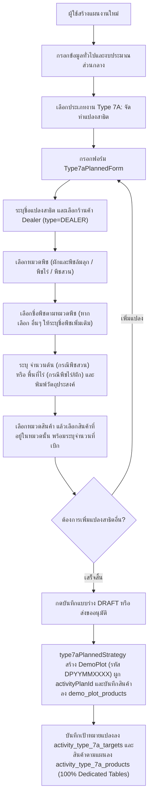
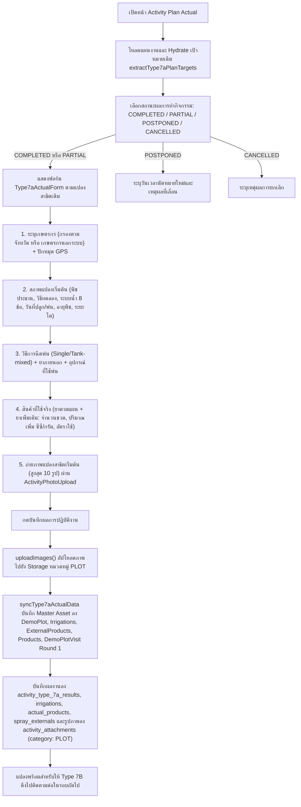
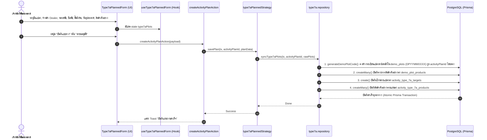
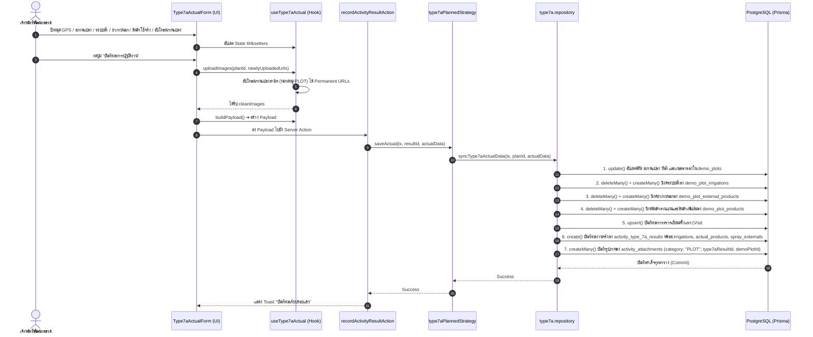

# Activity Type 7A — จัดทำแปลงสาธิต / Demo Plot Establishment (README)

> **Feature Slice**: `modules/activity/features/type-7a`  
> **Standard Reference**: ออกแบบตามแนวทาง Vertical Slice Architecture อิงตามแม่แบบ Gold Standard Type 1  
> **Parent Module**: `modules/activity`  
> **Database Authority**: `prisma/schema.prisma` (`ActivityPlanType7aTarget`, `ActivityPlanType7aProduct`, `ActivityResultType7a`, `ActivityResultType7aIrrigation`, `ActivityResultType7aProduct`, `ActivityResultType7aExternal`, `DemoPlot`, `DemoPlotProduct`, `DemoPlotIrrigation`, `DemoPlotExternalProduct`, `DemoPlotVisit`, `ActivityAttachment`)  
> **Status**: Production Ready / Active Reference (v2.1.0 — Updated 2026-10-27 100% Dedicated Relational Architecture & Operational Master Asset)

---

## 1. Overview

### 1.1 วัตถุประสงค์ของ Type 7A
**Type 7A (จัดทำแปลงสาธิต / Demo Plot Establishment)** มีวัตถุประสงค์เพื่อรองรับการปฏิบัติงานของเจ้าหน้าที่พัฒนาตลาดและนักวิชาการเกษตร (Market Development Representatives / Technical Agronomists / Promoters) ในการจัดตั้งแปลงสาธิตเชิงประจักษ์ใหม่ร่วมกับร้านค้าตัวแทนจำหน่ายและเกษตรกรชั้นนำ:
1. กำหนดเป้าหมายจัดตั้งแปลงสาธิตใหม่ล่วงหน้า พร้อมสร้างระเบียนแปลงหลัก (`DemoPlot`) ที่มีรหัสแปลงมาตรฐาน (`DPYYMMXXXX`) โดยอัตโนมัติ
2. บันทึกข้อมูลแปลงสาธิตและเกษตรกรเจ้าของแปลง (ชื่อแปลง, เจ้าของแปลง, ร้านค้าตัวแทนจำหน่ายที่ร่วมโครงการ, พิกัดแปลง GPS และขนาดพื้นที่)
3. ระบุชนิดพืชและเป้าหมายการทดสอบ (หมวดพืช, ชื่อพืช, วัตถุประสงค์การทดลอง, วันที่ปลูก และกำหนดการฉีดพ่น)
4. วางแผนรายการผลิตภัณฑ์และจำนวนสินค้าตัวอย่างที่จะนำไปทดสอบสาธิต (`demoProducts` / `products`)
5. บันทึกผลการจัดทำแปลงจริงหน้างาน (Actual Outcome) ครบ 7 หมวดหมู่ ลงตารางเฉพาะ `activity_type_7a_results` และตารางความสัมพันธ์ พร้อมซิงค์เข้า Master Asset `DemoPlot`:
   - **เกษตรกรเจ้าของแปลงและพิกัดแปลง:** กรองเกษตรกรตามจังหวัดที่เลือก หรือบันทึกเกษตรกรนอกระบบ (ที่อยู่ระดับจังหวัด/อำเภอ/ตำบล ผ่าน `ActivityAddressSelect`, ชื่อ-สกุล, เบอร์โทรศัพท์) พร้อมปักหมุดพิกัด GPS จริงหน้างาน (`ActivityGpsPicker`)
   - **ข้อมูลสภาพแปลงเริ่มต้น:** พืชประธาน, วิธีการทดลอง, ระบบน้ำ 8 ชนิด (`ActivityIrrigationCheckbox`), วันที่เริ่มปลูกจริง, วันที่ฉีดพ่นครั้งแรก, กำหนดพ่นครั้งต่อไป (`ActivityDatePicker`), อายุพืช (วัน/เดือน), ระยะการเจริญเติบโต และข้อมูลเพิ่มเติม
   - **วิธีการฉีดพ่นและยาภายนอก:** รองรับทั้งแบบฉีดเดี่ยว (Single) และผสมถัง (Tank-mixed) พร้อมตารางระบุยาภายนอก (บริษัท, ชื่อสินค้า, สารออกฤทธิ์, สูตร SL/SC/EC/อื่นๆ, อัตราการใช้)
   - **อุปกรณ์ที่ใช้ฉีดพ่น:** เครื่องพ่นสะพายหลัง, เครื่องพ่นปั๊มลากสาย, โดรนเพื่อการเกษตร, แอร์บัส/รถพ่นยา, หรืออื่นๆ ระบุ
   - **สินค้าที่เบิกตามแผน:** ดึงรายการยาตัวอย่างที่เบิกตามแผนมาแสดง พร้อมบันทึกจำนวนที่ใช้จริง (ขวด), ปริมาณที่ใช้เพิ่ม (ซีซี/กรัม) และอัตราการใช้
   - **สินค้าเพิ่มเติมในการปฏิบัติงาน:** บันทึกยาที่ใช้นอกเหนือจากแผน โดยเลือกสินค้าจากระบบ และบันทึกจำนวนจริง, ปริมาณเพิ่ม, อัตราการใช้
   - **ภาพถ่ายแปลงสาธิตเริ่มต้น:** อัปโหลดภาพถ่ายแปลงสาธิตเริ่มต้นสูงสุด 10 รูปต่อแปลง (หมวดหมู่ `PLOT`)

### 1.2 ขอบเขตของ Type 7A
- **กลุ่มเป้าหมายที่รองรับ:**
  - **ชื่อ ร้านค้า Dealer (`storeId` / `ownerName`):** เลือกเฉพาะร้านค้าตัวแทนจำหน่ายหลัก (`type="DEALER"`) ที่เข้าร่วมโครงการแปลงสาธิต พร้อมซิงค์จังหวัดและอำเภออัตโนมัติ
- **การจำแนกหมวดพืช ชื่อพืช ขนาดแปลง และวัตถุประสงค์ (Crop, Size & Objectives):**
  - **หมวดพืช (`CROP_CATEGORIES`):** มี 3 ตัวเลือก ได้แก่ `ผักและพืชล้มลุก`, `พืชไร่`, `พืชสวน`
  - **ชื่อพืชตามหมวดพืช (`CROP_NAMES_BY_CATEGORY`):**
    1. ถ้าเลือก **`ผักและพืชล้มลุก`**: ตัวเลือกมี `คะน้า`, `กะหล่ำปลี`, `พริก`, `ผักและพืชล้มลุกอื่นๆ` (หากเลือก `ผักและพืชล้มลุกอื่นๆ` จะแสดงช่อง **`ระบุชื่อพืชเพิ่มเติม *`** เก็บใน `customCropName`)
    2. ถ้าเลือก **`พืชไร่`**: ตัวเลือกมี `ข้าว`, `อ้อย`, `ยางพารา`, `พืชไร่อื่นๆ` (หากเลือก `พืชไร่อื่นๆ` จะแสดงช่อง **`ระบุชื่อพืชเพิ่มเติม *`** เก็บใน `customCropName`)
    3. ถ้าเลือก **`พืชสวน`**: ตัวเลือกมี `ทุเรียน`, `ชมพู่`, `ยางพารา`, `พืชสวนอื่นๆ` (หากเลือก `พืชสวนอื่นๆ` จะแสดงช่อง **`ระบุชื่อพืชเพิ่มเติม *`** เก็บใน `customCropName`)
  - **ขนาดแปลงตามหมวดพืช (`areaRai` vs `treeCount`):**
    - หากเลือกหมวดพืชเป็น **`พืชสวน`**: แสดงช่อง **`จำนวนต้น *`** (`treeCount`)
    - หากเลือกหมวดพืชเป็น **`ผักและพืชล้มลุก`** หรือ **`พืชไร่`**: แสดงช่อง **`พื้นที่ (ไร่) *`** (`areaRai`)
  - **วัตถุประสงค์การจัดทำแปลง (`objective`):** ช่องกรอกข้อความอิสระ (Free-text `ActivityInput`) ให้พิมพ์ระบุเอง
  - **สินค้าที่นำไปทดสอบสาธิต (`demoProducts` / `products`):** มีตัวเลือก **`หมวดสินค้า`** (`categoryId` จาก `ProductCategory`) ก่อน แล้วช่อง **`เลือกสินค้า`** (`ActivityProductSelect`) จะกรองเฉพาะสินค้าที่อยู่ในหมวดสินค้านั้น
- **ระบบออกรหัสแปลงสาธิตอัตโนมัติ (Automated DemoPlot Code Generation):**
  - สร้างรหัสแปลงรูปแบบ `DPYYMMXXXX` (เช่น `DP26100001`) ผ่านฟังก์ชัน `generateDemoPlotCode` โดยใช้ PostgreSQL Advisory Lock (`pg_advisory_xact_lock`) เพื่อรับประกันว่าจะไม่มีรหัสซ้ำกันแม้มีการบันทึกพร้อมกัน (Concurrent Requests)
- **การจัดเก็บข้อมูลและการส่งต่อสู่ Type 7B (Persistence & Type 7B Handover):**
  - **Pure Dedicated Relational Storage (100% Dedicated Tables):** แยกจัดเก็บข้อมูลลงตารางเฉพาะของ Type 7A อย่างสมบูรณ์: ฝั่งแผนงานบันทึกเป้าหมายแปลงลง `activity_type_7a_targets` (`ActivityPlanType7aTarget`) และสินค้าตามแผนลง `activity_type_7a_products` (`ActivityPlanType7aProduct`) ฝั่งผลงานจริงบันทึกลง `activity_type_7a_results` (`ActivityResultType7a`), `activity_type_7a_irrigations` (`ActivityResultType7aIrrigation`), `activity_type_7a_actual_products` (`ActivityResultType7aProduct`), และ `activity_type_7a_spray_externals` (`ActivityResultType7aExternal`)
  - **Operational Master Asset & Type 7B Handover:** ควบคู่กับตารางเฉพาะ ระบบจะสร้างและอัปเดตระเบียนแปลงสาธิตหลักลงตาราง `DemoPlot` (`demo_plots`) มีสถานะเริ่มต้นเป็น `IN_PROGRESS` พร้อมผูก `activityPlanId` (`type7aPlots DemoPlot[]`), ซิงค์สินค้าลง `DemoPlotProduct` (`demo_plot_products`), ซิงค์ระบบน้ำลง `DemoPlotIrrigation`, ยาภายนอกลง `DemoPlotExternalProduct` และบันทึกประวัติการตรวจรอบแรกเป็น `DemoPlotVisit` (Visit #1, `workTypeCode = "TYPE_7A"`) เพื่อให้โมดูล Type 7B (ติดตามแปลงสาธิต) สามารถดึงข้อมูลแปลงนี้ขึ้นมาติดตามต่อในรอบที่ 2..N ได้ทันที
  - **Zero Generic Tables Dependency:** ตัดขาดจากตาราง Generic เดิม (`activity_plan_stores`, `activity_plan_products`, `activity_result_demo_items`) 100% ไม่มีการ Dual-write หรือ Mirroring ตกค้างในระบบอีกต่อไป
  - **Media & Attachments Integration:** บันทึกภาพถ่ายแปลงสาธิตเริ่มต้นลง `ActivityAttachment` (`category: PLOT`, `workTypeCode: "TYPE_7A"`, สูงสุด 10 รูป) ผูกตรงกับ `type7aResultId`, `demoPlotId` และ `demoPlotVisitId`

### 1.3 รูปแบบการทำงานที่รองรับ
1. **Planned (ในแผนงาน Trip Plan):** กำหนดเป้าหมายแปลงสาธิต ร้านค้า เกษตรกร ชนิดพืช และสินค้าตัวอย่างล่วงหน้า ส่งขออนุมัติตามสายงาน
2. **Planned Actual (บันทึกผลงานตามแผน):** เมื่อแผนได้รับอนุมัติ นำแผนเดิมมารายงานผลการจัดตั้งแปลงจริง ปักหมุด GPS ยืนยันเกษตรกร ระบุสภาพแปลงและระบบน้ำ บันทึกการใช้สินค้าจริง และอัปโหลดภาพถ่ายแปลงเริ่มต้นสูงสุด 10 รูป
3. **Unplanned (กิจกรรมนอกแผน 2-in-1):** รองรับกรณีเข้าจัดทำแปลงสาธิตหน้างานทันที สามารถกรอกข้อมูลแปลง เกษตรกร ชนิดพืช พิกัด GPS สินค้าตัวอย่าง และถ่ายรูปแปลงสาธิตจบในฟอร์มเดียว พร้อมสร้าง `DemoPlot` และแผนงานสถานะ `COMPLETED` ทันที
4. **Detail View:** แสดงข้อมูลแปลงสาธิตเต็มรูปแบบผ่าน `Type7aDetailView` ทั้งชื่อแปลง เกษตรกร พิกัด ชนิดพืช สินค้าที่ใช้ และรูปถ่าย
5. **Approval View:** การ์ดสำหรับผู้บังคับบัญชาพิจารณาอนุมัติผ่าน `Type7aApprovalCard` สรุปจำนวนแปลง เกษตรกร และชนิดพืชที่ขอจัดทำ

---

## 2. Business Flows

### 2.1 Planned (สร้างและแก้ไขแผนงาน)


### 2.2 Planned Actual (บันทึกผลการปฏิบัติงานตามแผน)


### 2.3 Unplanned (กิจกรรมนอกแผน 2-in-1)
- ผู้ใช้งานเข้าหน้า `/activity-plans/unplanned/new`
- ฟอร์ม `Type7aUnplannedForm` ผสานทั้งส่วนตั้งต้นแปลง (ชื่อแปลง, เกษตรกร, ร้านค้า, ชนิดพืช, วัตถุประสงค์) และส่วนผลงานจริง (พิกัด GPS, สินค้าตัวอย่าง, และภาพถ่ายแปลงสาธิต) จบในฟอร์มเดียว
- เมื่อกดบันทึก ระบบตรวจสอบผ่าน `validateType7aUnplannedItems` และแปลง Payload ผ่าน `mapType7aUnplannedToPayload`
- `type7aUnplannedStrategy.savePlan()` จะสร้างระเบียน `DemoPlot` พร้อมรหัส `DPYYMMXXXX` อัตโนมัติ บันทึกลงตารางเป้าหมาย `activity_type_7a_targets` / `activity_type_7a_products`, บันทึก Master Asset สินค้าลง `demo_plot_products`, และบันทึกผลงานจริงลง `activity_type_7a_results`, `activity_type_7a_actual_products`, `demo_plot_visits`, และ `activity_attachments` ภายใน `$transaction` เดียวกัน โดยแผนงานมีสถานะเสร็จสิ้นสมบูรณ์

### 2.4 Detail and Approval (ดูรายละเอียดและพิจารณาอนุมัติ)
- **Detail View:** `DetailWorkTypeList` เรียกใช้ `Type7aDetailView` เพื่อแสดงข้อมูลแปลงสาธิตแต่ละแปลง ชนิดพืช เกษตรกร พื้นที่ พิกัด GPS สินค้าตัวอย่าง และภาพถ่ายแปลงเริ่มต้น
- **Approval View:** `ApprovalWorkTypeList` เรียกใช้ `Type7aApprovalCard` เพื่อให้หัวหน้างานพิจารณาอนุมัติการขอจัดตั้งแปลงสาธิต สรุปชื่อแปลง เกษตรกร พืชที่ทดสอบ และพื้นที่ไร่

---

## 3. Architecture

### 3.1 Folder Structure
```text
modules/activity/features/type-7a/
├── index.ts                                    # Unified Public API Contract (ส่งออกเฉพาะสิ่งที่ภายนอกต้องใช้)
├── README.md                                   # เอกสารคู่มือทางเทคนิค (ไฟล์นี้)
│
├── planned/                                    # Sub-slice: กิจกรรมในแผนงานและบันทึกผลตามแผน
│   ├── application/                            # Business Logic, Validation, Mappers
│   │   ├── actual-mapper.ts                    # แปลงผลงานจริง Form <-> DB/Payload (parseType7aActualResult)
│   │   ├── actual-validation.ts                # ตรวจสอบความถูกต้องของผลงานจริง (validateType7aActual)
│   │   ├── planned-mapper.ts                   # แปลงเป้าหมายในแผน Form <-> DB / Hydration (extractType7aPlanTargets, hydrateType7aPlannedData, mapType7aToSectionItems)
│   │   └── planned-validation.ts               # ตรวจสอบความถูกต้องของแผน (validateType7aFormItems)
│   ├── components/                             # UI Components ประจำ Type 7A ในแผน
│   │   ├── type7a-planned-form.tsx             # ฟอร์มสร้าง/แก้ไขแปลงสาธิตตามแผน
│   │   ├── type7a-actual-form.tsx              # ฟอร์มบันทึกผลจัดตั้งแปลงจริง (GPS + สินค้า + รูปถ่าย)
│   │   ├── type7a-plan-card.tsx                # การ์ดสรุปเป้าหมายแปลงสาธิตตามแผนงาน
│   │   ├── type7a-detail-view.tsx              # คอมโพเนนต์แสดงผลเต็มรูปแบบในหน้ารายละเอียด
│   │   └── type7a-approval-card.tsx            # การ์ดสรุปสำหรับหน้าพิจารณาอนุมัติ
│   ├── hooks/                                  # Custom State Hooks
│   │   ├── use-type7a-planned-form.ts          # จัดการ State แปลงสาธิตและสินค้าตามแผน
│   │   └── use-type7a-actual.ts                # จัดการ State ผลการจัดทำแปลงจริงและอัปโหลดรูปภาพ
│   ├── infrastructure/                         # Database Strategies & Repositories
│   │   ├── type7a.repository.ts                # generateDemoPlotCode, syncType7aPlots, findType7aByPlanId
│   │   └── type7a-planned.strategy.ts          # Strategy บันทึก/โหลดข้อมูล DemoPlot & ActivityResultDemoItem
│   └── types/                                  # Type Definitions ในแผน
│       ├── planned.types.ts                    # Type7aPlanItem, Type7aTargetItem, Type7aPlanCardProps ฯลฯ
│       └── actual.types.ts                     # Type7aActualRecord, Type7aActualFormProps, Type7aDetailViewProps ฯลฯ
│
├── unplanned/                                  # Sub-slice: กิจกรรมนอกแผน (2-in-1)
│   ├── application/                            # Logic และ Mappers กิจกรรมนอกแผน
│   │   ├── unplanned-mapper.ts                 # Hydration และ Data mapping นอกแผน (hydrateType7aUnplannedData, mapType7aUnplannedToPayload)
│   │   └── unplanned-validation.ts             # Validation กิจกรรมนอกแผน (validateType7aUnplannedItems)
│   ├── components/                             # UI Components กิจกรรมนอกแผน
│   │   └── type7a-unplanned-form.tsx           # ฟอร์ม 2-in-1 (ตั้งแปลง + บันทึกผลจริง + GPS + รูปถ่าย)
│   ├── hooks/                                  # Custom State Hooks
│   │   └── use-type7a-unplanned-form.ts        # จัดการ State แปลงสาธิตนอกแผน
│   ├── infrastructure/                         # Database Strategies นอกแผน
│   │   └── type7a-unplanned.strategy.ts        # บันทึกกิจกรรมนอกแผนลง Prisma ผสาน DemoPlot และผลงานจริง
│   └── types/                                  # Type Definitions นอกแผน
│       └── unplanned.types.ts                  # Type7aUnplannedItem, Type7aUnplannedFormProps
│
└── shared/                                     # ชิ้นส่วนที่ใช้ร่วมกันภายใน Feature Type 7A
    ├── constants.ts                            # CROP_CATEGORIES, PLOT_OBJECTIVES, IRRIGATION_METHODS, SPRAY_METHODS
    └── types.ts                                # CustomerOption, ProductOption, Type7aDemoProductItem, Type7aPlotInput, Type7aImageFile
```

### 3.2 Type 7A vs Shared Activity
| ความรับผิดชอบ | จัดการที่ Type 7A Feature (`features/type-7a`) | จัดการที่ Activity ส่วนกลาง (`ui/`, `views/`) |
| :--- | :--- | :--- |
| **ข้อมูลทั่วไป** | - | ชื่องาน, วันที่เริ่ม-สิ้นสุด, วัตถุประสงค์หลัก, ผู้ร่วมเดินทาง |
| **พื้นที่ & ทีมงาน** | - | จังหวัด, อำเภอ, ตำบล, พนักงานร่วมเดินทาง |
| **งบประมาณ** | - | งบเบิกสินค้าสาธิต, ค่าใช้จ่ายเดินทาง |
| **เป้าหมายแปลงสาธิต** | ชื่อแปลง, เกษตรกร, ร้านค้า, ชนิดพืช, พื้นที่ไร่, สินค้าตัวอย่าง | - |
| **ผลการจัดตั้งแปลงจริง** | พิกัดแปลง GPS, การใช้สินค้าจริง, เหตุผลการเปลี่ยน, รูปถ่ายแปลง | ผลสรุปภาพรวมแผน (สำเร็จ/เลื่อน/ยกเลิก) |
| **Database Persistence** | ตารางเฉพาะ `activity_type_7a_targets`, `activity_type_7a_products`, `activity_type_7a_results`, `activity_type_7a_irrigations`, `activity_type_7a_actual_products`, `activity_type_7a_spray_externals` ควบคู่กับ Master Asset `DemoPlot`, `DemoPlotProduct`, `DemoPlotIrrigation`, `DemoPlotExternalProduct`, `DemoPlotVisit` | ตารางหลัก `ActivityPlan`, `ActivityPlanApprovalLog`, `ActivityAttachment` |

### 3.3 Dependency and Import Map
- **ทิศทางการเรียกใช้ (Allowed):**
  - `views/` ➔ เรียกใช้ ➔ `features/type-7a` (ผ่าน `index.ts` เท่านั้น)
  - `features/type-7a` ➔ เรียกใช้ ➔ `@/modules/activity/ui` (`ActivityInput`, `ActivityTextarea`, `ActivityCombobox`, `ActivityCustomerSelect`, `ActivityProductSelect`, `ActivityPhotoUpload`, `ActivityGpsPicker`)
  - `features/type-7a` ➔ เรียกใช้ ➔ `@/modules/activity/constants`
  - `features/type-7a` ➔ เรียกใช้ ➔ `@/modules/activity/types/strategy.interface`
  - `features/type-7a` ➔ เรียกใช้ ➔ `@/modules/activity/application/media/image-uploader` (`uploadActivityPlanImageGroup`, `deleteActivityPlanImagePaths`)
- **Server Actions & Database Flow:**
  - `views/` ➔ ส่งข้อมูลไปยัง ➔ Server Actions ใน `@/modules/activity/server/`:
    - `planned.actions.ts` (`createActivityPlanAction`, `updateActivityPlanAction`, `getActivityPlanAction`)
    - `unplanned.actions.ts` (`createUnplannedActivityAction`, `updateUnplannedActivityAction`, `getUnplannedActivityAction`)
    - `actual.actions.ts` (`recordActivityResultAction`)
  - Server Actions ➔ ทำงานร่วมกับ ➔ `@/modules/activity/infrastructure/strategy.registry` ➔ เรียกใช้ `type7aPlannedStrategy` / `type7aUnplannedStrategy` บันทึกลงตาราง Master (`DemoPlot`) และ Dedicated Tables (`activity_type_7a_*`) ภายใน `$transaction`
- **สิ่งต้องห้าม (Strictly Forbidden):**
  - ❌ ภายนอก Import เจาะลึกเข้าไปในโฟลเดอร์ย่อย เช่น `features/type-7a/planned/components/...`
  - ❌ `features/type-7a` เรียกใช้ข้อมูลข้ามไปยัง `features/type-1` ถึง `type-6` หรือ `type-7b` ถึง `type-14`
  - ❌ Import ย้อนกลับไปยังโมดูลเก่า `@/modules/activity-plans/...` โดยเด็ดขาด

### 3.4 Entry Points and Public Exports
ไฟล์ [modules/activity/features/type-7a/index.ts](file:///d:/code/crm-bank/modules/activity/features/type-7a/index.ts) ทำหน้าที่เป็น **Single Public API Contract** สำหรับฝั่ง UI / Application โดยส่งออกเฉพาะ:
- **Components:** `Type7aPlannedForm` (`Type7aPlanForm`, `Type7NewDemo`, `EditType7aNewDemo`), `Type7aPlanCard`, `Type7aActualForm` (`ActualType7NewDemo`), `Type7aDetailView` (`DetailType7NewDemo`), `Type7aApprovalCard` (`ApprovalType7aDemo`), `Type7aUnplannedForm`
- **Hooks:** `useType7aPlannedForm` (`useType7aForm`), `useType7aActual`, `useType7aUnplannedForm`
- **Mappers & Hydrators:** `extractType7aPlanTargets`, `hydrateType7aPlannedData`, `mapType7aToSectionItems`, `parseType7aActualResult`, `hydrateType7aUnplannedData`, `mapType7aUnplannedToPayload`
- **Validators & Schemas:** `validateType7aFormItems`, `validateType7aActual`, `validateType7aUnplannedItems`
- **Constants & Types:** `WORK_TYPE_CODE`, `WORK_TYPE_NAME`, `CROP_CATEGORIES`, `CROP_NAMES_BY_CATEGORY`, `OTHER_CROP_OPTIONS`, `PLOT_OBJECTIVES`, `IRRIGATION_METHODS`, `SPRAY_METHODS`, `DEMO_PLOT_STATUSES`, `Type7aPlanItem`, `Type7aTargetItem`, `Type7aPlanCardTarget`, `Type7aPlanCardProps`, `Type7aPlannedFormProps`, `Type7aActualRecord`, `Type7aActualFormProps`, `Type7aDetailViewProps`, `Type7aApprovalCardProps`, `Type7aUnplannedItem`, `Type7aUnplannedFormProps`, `CustomerOption`, `ProductOption`, `ProductCategoryOption`, `Type7aDemoProductItem`, `Type7aPlotInput`, `Type7aImageFile`
- *(หมายเหตุ: `type7aPlannedStrategy` และ `type7aUnplannedStrategy` ถูกนำเข้าโดยตรงที่ `modules/activity/infrastructure/strategy.registry.ts` เพื่อแยกโค้ดฝั่ง Server/Database ออกจาก Client Bundle)*

---

## 4. File Responsibilities

### 4.1 Planned & Actual
- **`use-type7a-planned-form.ts`:** จัดการ State แปลงสาธิตในแผน (Array of `Type7aPlanItem`), รองรับการเพิ่มแปลง (`addType7aRow`), แก้ไขแปลง (`updateType7aRow`), ลบแปลง (`deleteType7aRow`), เพิ่มสินค้าตัวอย่างในแปลง (`addProductToDemoPlot`), และปรับปรุงสินค้าในแปลง
- **`type7a-planned-form.tsx`:** ฟอร์มสร้าง/แก้ไขแปลงสาธิตตามแผน แสดงการ์ดของแต่ละแปลง กรอกชื่อแปลง เกษตรกร เลือกร้านค้าตัวแทนจำหน่าย เลือกชนิดพืช วัตถุประสงค์ และเลือกสินค้าตัวอย่างผ่าน `ActivityProductSelect`
- **`type7a-plan-card.tsx`:** การ์ดสรุปเป้าหมายแปลงสาธิตตามแผน แสดงชื่อแปลง เกษตรกร พืชที่ทดสอบ และขนาดพื้นที่
- **`type7a-actual-form.tsx`:** ฟอร์มบันทึกผลการจัดทำแปลงจริงหน้างาน ปักหมุดพิกัด GPS ผ่าน `ActivityGpsPicker`, ยืนยันการใช้สินค้าตัวอย่าง, ระบุวิธีการฉีดพ่น, และอัปโหลดภาพถ่ายแปลงสาธิตเริ่มต้น (สูงสุด 10 รูป)
- **`use-type7a-actual.ts`:** จัดการ State ผลการจัดทำแปลงจริง, รองรับการ Hydrate ข้อมูลเดิม, อัปโหลดภาพถ่ายแปลงสาธิตหมวดหมู่ `PLOT`, และสร้าง Payload สำหรับบันทึกผล
- **`type7a-detail-view.tsx`:** คอมโพเนนต์แสดงผลเต็มรูปแบบในหน้ารายละเอียด Trip Plan:
  - **ข้อมูลเป้าหมายตามแผนงาน:** แสดงการ์ดสรุปเป้าหมายผ่าน `Type7aPlanCard` (ชื่อแปลง, ร้านค้า Dealer, ชนิดพืช, วัตถุประสงค์, พื้นที่ไร่/ต้น, สินค้าที่วางแผน)
  - **ข้อมูลผลการปฏิบัติงานจริง (เมื่อมี Actual Outcome):** แสดงผล 7 หมวดหมู่อย่างละเอียด:
    1. ข้อมูลเกษตรกรเจ้าของแปลง (สถานะใน/นอกระบบ, ชื่อ, เบอร์โทร, ร้านค้า Dealer) และพิกัดแปลงสาธิต (GPS) พร้อมปุ่มเปิด Google Maps
    2. สภาพแปลงเริ่มต้น (พืชประธาน, วิธีทดลอง, ระบบน้ำที่ใช้ Badges, วันที่ปลูกจริง, วันที่ฉีดพ่นครั้งแรก, กำหนดพ่นครั้งต่อไป, อายุพืช, ระยะการเจริญเติบโต, หมายเหตุ)
    3. วิธีการฉีดพ่นและยาภายนอก (Single / Tank-mixed พร้อมตารางยาภายนอก: บริษัท, ชื่อยา, สารออกฤทธิ์, สูตร, อัตราใช้)
    4. อุปกรณ์ที่ใช้ฉีดพ่น (อุปกรณ์หลักและอุปกรณ์เพิ่มเติม)
    5. สินค้าที่เบิกตามแผน (ตารางเปรียบเทียบจำนวนเบิกตามแผน vs ใช้จริง, ปริมาณเพิ่ม, อัตราการใช้)
    6. สินค้าเพิ่มเติมในการปฏิบัติงาน (ตารางสินค้าที่ใช้นอกเหนือจากแผน)
    7. ภาพถ่ายสภาพแปลงเริ่มต้น (แกลเลอรีรูปภาพพร้อมเปิด `ImageLightboxModal` ซูม/เลื่อนดูขนาดเต็ม)
- **`type7a-approval-card.tsx`:** การ์ดสำหรับหน้าพิจารณาอนุมัติของหัวหน้างาน สรุปจำนวนแปลงสาธิตและรายละเอียดเบื้องต้น
- **`type7a.repository.ts`:** ฟังก์ชันระดับล่างสำหรับฐานข้อมูล:
  - `generateDemoPlotCode`: สร้างรหัสแปลง `DPYYMMXXXX` ด้วย Advisory Lock
  - `syncType7aPlots`: สร้างระเบียน `DemoPlot`, `DemoPlotProduct`, `ActivityPlanType7aTarget`, และ `ActivityPlanType7aProduct`
  - `findType7aByPlanId`: ดึงข้อมูลแปลงสาธิตตาม `activityPlanId` จากตารางเฉพาะและ Master Asset
  - `syncType7aActualData`: บันทึกผลงานจัดตั้งแปลงจริงลง `DemoPlot`, `DemoPlotIrrigation`, `DemoPlotExternalProduct`, `DemoPlotProduct`, `DemoPlotVisit` (Visit #1) ควบคู่กับ `ActivityResultType7a`, `ActivityResultType7aIrrigation`, `ActivityResultType7aProduct`, `ActivityResultType7aExternal` และ `ActivityAttachment`
- **`type7a-planned.strategy.ts`:** จัดการการตรวจสอบเงื่อนไข (`validatePlan`), บันทึกแผนงานและสร้าง `DemoPlot` (`savePlan`), บันทึกผลการจัดตั้งแปลงลง `ActivityResultType7a` และตารางความสัมพันธ์ (`saveActual`), และโหลดข้อมูล (`loadPlan`)
- **`planned-mapper.ts`:** ดึงเป้าหมายจากแผน (`extractType7aPlanTargets`) และ Hydrate ข้อมูลเดิมสำหรับหน้าแก้ไข (`hydrateType7aPlannedData`)
- **`actual-mapper.ts`:** แปลงผลงานจริงจากฐานข้อมูลเข้าสู่โครงสร้าง `Type7aActualRecord` สำหรับ UI
- **`planned-validation.ts` & `actual-validation.ts`:** ตรวจสอบความถูกต้องของแผนงาน (`validateType7aFormItems`) และผลงานจริง (`validateType7aActual`)

### 4.2 Unplanned
- **`use-type7a-unplanned-form.ts`:** จัดการ State กิจกรรมนอกแผน 2-in-1 ที่รวมทั้งข้อมูลแปลงสาธิต พิกัด GPS สินค้าตัวอย่าง และภาพถ่ายหน้างาน
- **`type7a-unplanned-form.tsx`:** ฟอร์ม 2-in-1 สำหรับกิจกรรมนอกแผน แสดงข้อมูลการตั้งแปลง พืชที่ทดสอบ สินค้าตัวอย่าง พิกัด GPS และกล้องถ่ายภาพแปลงสาธิต
- **`unplanned-mapper.ts`:**
  - `hydrateType7aUnplannedData`: กู้คืนข้อมูลกิจกรรมนอกแผนเดิมเมื่อเปิดหน้าแก้ไข
  - `mapType7aUnplannedToPayload`: แปลงข้อมูลนอกแผนให้เป็นทั้ง `type7aPlots` (สำหรับสร้าง DemoPlot) และ `actualOutcome`
- **`unplanned-validation.ts`:** ตรวจสอบความถูกต้องของรายการนอกแผน (`validateType7aUnplannedItems`) ต้องระบุชื่อแปลง เกษตรกร และชนิดพืชครบถ้วน
- **`type7a-unplanned.strategy.ts`:** บันทึกทั้งการสร้าง `DemoPlot` และผลการจัดทำแปลงสาธิตพร้อมกันผ่าน `type7aPlannedStrategy.savePlan()` และ `type7aPlannedStrategy.saveActual()`

### 4.3 Shared Types and Constants
- **`shared/constants.ts`:** กำหนด `WORK_TYPE_CODE = "TYPE_7A"`, `CROP_CATEGORIES`, `PLOT_OBJECTIVES`, `IRRIGATION_METHODS`, `SPRAY_METHODS`, และ `DEMO_PLOT_STATUSES`
- **`shared/types.ts`:** กำหนดประเภทข้อมูล `CustomerOption`, `ProductOption`, `Type7aDemoProductItem`, `Type7aPlotInput`, `Type7aImageFile`

### 4.4 Shared UI and Views
- `planned-activity-form.tsx`, `unplanned-activity-form.tsx`, `activity-plan-actual-view.tsx`, `actual-work-type-list.tsx`, `detail-work-type-list.tsx`, และ `approval-work-type-list.tsx` ทำหน้าที่เป็น Orchestrators ในการเลือกเรนเดอร์และประมวลผล Type 7A ตามเงื่อนไข `isType7aActive`

---

## 5. Data Flow

### 5.1 Planned Plan Creation (การสร้างแผนจัดทำแปลงสาธิตล่วงหน้า)


### 5.2 Planned Actual Outcome (การบันทึกผลการจัดทำแปลงจริง)


### 5.3 Detailed Step Walkthroughs

#### 1. Create Planned (สร้างแผนใหม่)
1. `create-view.tsx` หรือ `planned-activity-form.tsx` เรียกใช้ `useType7aPlannedForm()`
2. ผู้ใช้ระบุข้อมูลแปลงสาธิต ชนิดพืช และสินค้าตัวอย่างใน `Type7aPlannedForm`
3. ผู้ใช้กดส่งขออนุมัติ ➔ รัน `validateType7aFormItems(type7a.type7aPlots)`
4. Map ข้อมูลเป็น `type7aPlots` ส่งไปยัง Server Action `createActivityPlanAction`
5. Server Action เรียก `type7aPlannedStrategy.savePlan()` ภายใน `$transaction`
6. Repository รัน `generateDemoPlotCode()` ได้รหัส `DPYYMMXXXX` ➔ สร้างระเบียนใน `DemoPlot` (`demo_plots`) ➔ บันทึกเป้าหมายแปลงลง **`activity_type_7a_targets`** และสินค้าตัวอย่างลง **`activity_type_7a_products`** ควบคู่กับการผูก `activityPlanId` เข้ากับ **`DemoPlot`** และ **`DemoPlotProduct`** (`demo_plot_products`) โดยตรง (100% Dedicated Tables)

#### 2. Edit Planned (แก้ไขแผนงานเดิม)
1. `edit-view.tsx` ดึงข้อมูลแผนเดิมจากฐานข้อมูลผ่าน `getActivityPlanAction()` (ซึ่ง Include `type7aPlots` จากตาราง `demo_plots` พร้อม `demoProducts` จาก `demo_plot_products`)
2. เรียก `hydrateType7aPlannedData(initialData)` เพื่อแปลงข้อมูลแปลงสาธิตและสินค้าตัวอย่างเดิม
3. ส่งข้อมูลเข้า `useType7aPlannedForm({ initial })`
4. ฟอร์มแสดงข้อมูลเดิมพร้อมให้แก้ไข เพิ่ม หรือลบแปลงและสินค้าได้อย่างสมบูรณ์

#### 3. Save Actual (บันทึกผลการปฏิบัติงานจริง)
1. `activity-plan-actual-view.tsx` รันกระบวนการบันทึกผล
2. ตรวจสอบความถูกต้องด้วย `validateType7aActual()`
3. เรียก `type7aActual.uploadImages(id, newlyUploadedUrls)` เพื่ออัปโหลดภาพแปลง ได้ URL ถาวร
4. เรียก `type7aActual.buildPayload()` เพื่อรวบรวมข้อมูลแปลงจริง
5. ส่ง Payload เข้า `recordActivityResultAction(id, payload)`
6. `type7aPlannedStrategy.saveActual()` เรียก `syncType7aActualData()` เพื่ออัปเดตข้อมูลแปลงจริงลง `DemoPlot`, `DemoPlotIrrigation`, `DemoPlotExternalProduct`, `DemoPlotProduct`, `DemoPlotVisit` (Visit #1) ควบคู่กับตารางเฉพาะ `activity_type_7a_results`, `activity_type_7a_irrigations`, `activity_type_7a_actual_products`, `activity_type_7a_spray_externals` และบันทึกรูปภาพลง `activity_attachments` (category: "PLOT", type7aResultId, demoPlotId)

#### 4. Load Actual (โหลดผลงานเดิมมาแสดงในหน้าบันทึกผล)
1. หน้า Actual ดึงข้อมูลแผนและผลงานเดิมผ่าน `getActivityPlanAction()`
2. `extractType7aPlanTargets(plan)` ดึงเป้าหมายจาก `type7aPlots` (`demo_plots`) หรือ `type7aTargets` (`activity_type_7a_targets`) โดยตรง
3. เรียก `type7aActual.hydrate(plan, parsed, { t7a: extractedT7a.primary })` เพื่อกู้คืนข้อมูลครบทั้ง 7 ส่วนจาก `DemoPlot` และตารางความสัมพันธ์ย่อย
4. ฟอร์มแสดงข้อมูลแปลง พืช พิกัด GPS สภาพแปลง ระบบน้ำ ยาภายนอก สินค้า และรูปภาพที่เคยบันทึกไว้

#### 5. Create/Edit Unplanned (กิจกรรมนอกแผน)
1. ผู้ใช้กรอกฟอร์ม `Type7aUnplannedForm` (ระบุชื่อแปลง เกษตรกร ชนิดพืช สินค้า พิกัด GPS และรูปถ่าย)
2. ตรวจสอบความถูกต้องด้วย `validateType7aUnplannedItems(type7a.items)`
3. แปลง Payload ผ่าน `mapType7aUnplannedToPayload(type7a.items)`
4. `type7aUnplannedStrategy.savePlan()` สร้างระเบียน `DemoPlot` พร้อมผูก `activityPlanId`, บันทึกลง `activity_type_7a_targets`, `activity_type_7a_products`, `demo_plot_products` และบันทึกผลงานลง `activity_type_7a_results`, `activity_type_7a_actual_products`, `demo_plot_visits` และ `activity_attachments` ใน `$transaction` เดียวกัน

#### 6. Detail and Approval (การแสดงผลหน้ารายละเอียดและพิจารณาอนุมัติ)
1. โหลดข้อมูลแผนงานผ่าน Loader
2. ระบบตรวจจับประเภทงานว่าเป็น Type 7A ผ่าน `WORK_TYPE_STRATEGY_REGISTRY.TYPE_7A.hasData()`
3. หน้ารายละเอียดเรนเดอร์ `<Type7aDetailView />` พร้อมข้อมูลแปลงจาก `type7aPlots` / `demoPlot` และรูปภาพ
4. หน้าอนุมัติเรนเดอร์ `<Type7aApprovalCard />` สรุปชื่อแปลง เกษตรกร และชนิดพืช

---

## 6. Data Models and Mapping

### 6.1 Database CRUD Matrix (100% Dedicated Relational Storage & Master Asset)
| ตารางในฐานข้อมูล (`Prisma Model`) | Create (สร้าง) | Read (อ่าน/แสดงผล) | Update (แก้ไข) | Delete (ลบ) | สถาปัตยกรรมและการใช้งาน |
| :--- | :--- | :--- | :--- | :--- | :--- |
| **`activity_type_7a_targets`**<br>(`ActivityPlanType7aTarget`) | `syncType7aPlots()` ใน `savePlan()` | `findType7aByPlanId()`, `plan.type7aTargets` | ลบและสร้างใหม่ใน `syncType7aPlots()` | Cascade เมื่อลบ `ActivityPlan` | **Dedicated Plan Targets:** เก็บข้อมูลเป้าหมายแปลงตามแผน ชนิดพืช ร้านค้า Dealer และเชื่อมโยง `demoPlotId` |
| **`activity_type_7a_products`**<br>(`ActivityPlanType7aProduct`) | `syncType7aPlots()` ใน `savePlan()` | `plan.type7aProducts`, `target.products` | ลบและสร้างใหม่ใน `syncType7aPlots()` | Cascade เมื่อลบ `ActivityPlan` | **Dedicated Plan Products:** สินค้าตัวอย่างที่ขอเบิกล่วงหน้าตามแผน |
| **`activity_type_7a_results`**<br>(`ActivityResultType7a`) | `syncType7aActualData()` ใน `saveActual()` | `findType7aByPlanId()`, `plan.type7aResults` | ลบและสร้างใหม่ใน `saveActual()` | Cascade เมื่อลบ `ActivityPlan` | **Dedicated Actual Results:** บันทึกผลงานจัดทำแปลงจริง เกษตรกร พิกัด GPS วิธีพ่น อุปกรณ์ |
| **`activity_type_7a_irrigations`**<br>(`ActivityResultType7aIrrigation`) | `syncType7aActualData()` ใน `saveActual()` | `result.irrigations` | ลบและสร้างใหม่ใน `saveActual()` | Cascade เมื่อลบ `ActivityResultType7a` | จัดเก็บระบบน้ำประจำแปลงฝั่งผลงานจริง (8 รูปแบบมาตรฐาน) |
| **`activity_type_7a_actual_products`**<br>(`ActivityResultType7aProduct`) | `syncType7aActualData()` ใน `saveActual()` | `result.actualProducts` | ลบและสร้างใหม่ใน `saveActual()` | Cascade เมื่อลบ `ActivityResultType7a` | จัดเก็บสินค้าที่ใช้จริงหน้างาน ทั้งสินค้าตามแผนและสินค้าเพิ่มเติม |
| **`activity_type_7a_spray_externals`**<br>(`ActivityResultType7aExternal`) | `syncType7aActualData()` ใน `saveActual()` | `result.sprayExternals` | ลบและสร้างใหม่ใน `saveActual()` | Cascade เมื่อลบ `ActivityResultType7a` | จัดเก็บสารเคมีภายนอก/ยาคู่เปรียบเทียบกรณีฉีดพ่นแบบผสมถัง (Tank-mixed) |
| **`demo_plots`**<br>(`DemoPlot`) | `syncType7aPlots()` ใน `savePlan()` | `getActivityPlanAction()` (ผ่าน relation `type7aPlots`), `findType7aByPlanId()`, Detail / Actual | `syncType7aActualData()` ใน `saveActual()` / `syncType7aPlots()` | Cascade เมื่อลบ `ActivityPlan` / Soft Delete | **Operational Master Asset:** ระเบียนแปลงหลักระดับองค์กรรหัส `DPYYMMXXXX` เชื่อมตรงกับ `ActivityPlan` เพื่อส่งต่อให้ Type 7B |
| **`demo_plot_products`**<br>(`DemoPlotProduct`) | `syncType7aPlots()` / `syncType7aActualData()` | `type7aPlots.demoProducts`, Actual / Detail | ซิงค์จำนวนตามแผน (`withdrawnQuantity`) และยอดใช้จริง (`quantity`) | Cascade เมื่อลบ `DemoPlot` | สินค้าประจำแปลงสำหรับ Master Asset Timeline |
| **`demo_plot_irrigations`**<br>(`DemoPlotIrrigation`) | `syncType7aActualData()` ใน `saveActual()` | Actual / Detail / Type 7B | ลบและสร้างใหม่ตามแปลง | Cascade เมื่อลบ `DemoPlot` | ระบบน้ำประจำแปลงของ Master Asset |
| **`demo_plot_external_products`**<br>(`DemoPlotExternalProduct`) | `syncType7aActualData()` ใน `saveActual()` | Actual / Detail / Type 7B | ลบและสร้างใหม่ตามแปลง | Cascade เมื่อลบ `DemoPlot` | สารเคมีภายนอกประจำแปลงของ Master Asset |
| **`demo_plot_visits`**<br>(`DemoPlotVisit`) | `syncType7aActualData()` ใน `saveActual()` (Visit #1) | หน้าไทม์ไลน์การตรวจแปลง / Type 7B | อัปเดตผลตรวจครั้งที่ 1 | Cascade เมื่อลบ `DemoPlot` | บันทึกประวัติการตรวจแปลงครั้งแรก (Baseline Visit) ส่งมอบฐานข้อมูลต่อเนื่องไปยัง Type 7B |
| **`activity_attachments`**<br>(`ActivityAttachment`) | Storage Upload + `saveActual()` | `plan.attachments` (หมวดหมู่ PLOT) | ลบรายการเก่าและสร้างใหม่ | Cascade เมื่อลบ `ActivityPlan` | บันทึก URL ภาพถ่ายแปลงสาธิต (สูงสุด 10 รูป) ผูก `type7aResultId` และ `demoPlotId` |

### 6.2 Complete Field-to-Database Mapping (ตารางจับคู่ฟิลด์ครบถ้วนทุกจุด)
ไล่จาก **Form Field (UI) ➔ TypeScript Field ➔ Mapper / Hook ➔ Prisma Model ➔ DB Column Name ➔ Data Type**:

| Form Field (UI) | TypeScript Type Field | Mapper / Hook Handler | Prisma Model | DB Column Name | Data Type | Nullable? | Default |
| :--- | :--- | :--- | :--- | :--- | :--- | :---: | :--- |
| **ชื่อแปลงสาธิต** | `plotName` / `name` | `syncType7aPlots` / `extractType7aPlanTargets` | `ActivityPlanType7aTarget` & `DemoPlot` | `plot_name` & `name` | `VARCHAR` | No | - |
| **ชื่อ ร้านค้า Dealer** | `storeId`, `dealerName`, `ownerName` | `syncType7aPlots` / `extractType7aPlanTargets` | `ActivityPlanType7aTarget` & `DemoPlot` | `store_id`, `dealer_name` & `customer_id`, `owner_name` | `VARCHAR` | Yes / No | `null` / `""` |
| **จังหวัด** *(แปลง/เป้าหมาย)* | `province` | `syncType7aPlots` / `syncType7aActualData` | `DemoPlot` & `ActivityResultType7a` | `province` | `VARCHAR` | Yes | `null` |
| **อำเภอ** *(แปลง/เป้าหมาย)* | `district` | `syncType7aPlots` / `syncType7aActualData` | `DemoPlot` & `ActivityResultType7a` | `district` | `VARCHAR` | Yes | `null` |
| **ตำบล** *(เกษตรกร)* | `ownerSubdistrict` / `subdistrict` | `syncType7aActualData` | `DemoPlot` & `ActivityResultType7a` | `owner_subdistrict` & `subdistrict` | `VARCHAR` | Yes | `null` |
| **ชื่อ-สกุล เกษตรกร** | `farmerName` / `ownerName` | `syncType7aActualData` | `ActivityResultType7a` & `DemoPlot` | `farmer_name` & `owner_name` | `VARCHAR` | No | `""` |
| **เบอร์โทรศัพท์เกษตรกร** | `farmerPhone` / `ownerPhone` | `syncType7aActualData` | `ActivityResultType7a` & `DemoPlot` | `farmer_phone` & `owner_phone` | `VARCHAR` | Yes | `null` |
| **เกษตรกรที่ไม่มีในระบบ** | `isUnregisteredFarmer` | `syncType7aActualData` | `ActivityResultType7a` & `DemoPlot` | `is_unregistered_farmer` | `BOOLEAN` | No | `false` |
| **หมวดพืช** | `cropCategory` | `syncType7aPlots` | `ActivityPlanType7aTarget` & `DemoPlot` | `crop_category` | `VARCHAR` | Yes / No | `"พืชทั่วไป"` |
| **ชื่อพืช** | `cropName` | `syncType7aPlots` | `ActivityPlanType7aTarget` & `DemoPlot` | `crop_name` | `VARCHAR` | Yes / No | `"พืชทั่วไป"` |
| **ระบุชื่อพืชเพิ่มเติม** | `customCropName` | `syncType7aPlots` | `ActivityPlanType7aTarget` & `DemoPlot` | `custom_crop_name` | `VARCHAR` | Yes | `null` |
| **พื้นที่ (ไร่)** *(ผัก/พืชไร่)* | `areaRai` | `syncType7aPlots` (`Prisma.Decimal`) | `ActivityPlanType7aTarget` & `DemoPlot` | `area_rai` | `DECIMAL(10,2)` | Yes | `null` |
| **จำนวนต้น** *(พืชสวน)* | `treeCount` | `syncType7aPlots` | `ActivityPlanType7aTarget` & `DemoPlot` | `tree_count` | `INTEGER` | Yes | `null` |
| **วัตถุประสงค์การจัดทำแปลง** | `objective` | `syncType7aPlots` | `ActivityPlanType7aTarget` & `DemoPlot` | `objective` | `TEXT` | No | `""` |
| **หมวดสินค้าที่เลือก** | `categoryId` | `syncType7aPlots` | `DemoPlot` | `category_id` | `VARCHAR` | Yes | `null` |
| **สินค้าตัวอย่างตามแผน (รหัสสินค้า)** | `productId` | `syncType7aPlots` | `ActivityPlanType7aProduct` & `DemoPlotProduct` | `product_id` | `VARCHAR` | No | - |
| **สินค้าตัวอย่างตามแผน (ชื่อสินค้า)** | `productName` | `syncType7aPlots` | `ActivityPlanType7aProduct` & `DemoPlotProduct` | `product_name` | `VARCHAR` | Yes | `null` |
| **สินค้าตัวอย่างตามแผน (จำนวนเบิก)** | `quantity` / `targetQuantity` | `syncType7aPlots` | `ActivityPlanType7aProduct` & `DemoPlotProduct` | `quantity` & `withdrawn_quantity` | `DECIMAL(10,2)` | No | `1` |
| **สินค้าตัวอย่างตามแผน (หน่วยนับ)** | `unit` | `syncType7aPlots` | `ActivityPlanType7aProduct` & `DemoPlotProduct` | `unit` | `VARCHAR` | Yes | `null` |
| **พิกัดแปลง (GPS ละติจูด)** | `latitude` | `parseDecimalCoord` | `ActivityResultType7a` & `DemoPlot` | `latitude` | `DECIMAL(10,7)` | Yes | `null` |
| **พิกัดแปลง (GPS ลองจิจูด)** | `longitude` | `parseDecimalCoord` | `ActivityResultType7a` & `DemoPlot` | `longitude` | `DECIMAL(10,7)` | Yes | `null` |
| **ข้อมูลพืชประธาน** | `mainCropInfo` | `syncType7aActualData` | `ActivityResultType7a` & `DemoPlot` | `main_crop_info` | `VARCHAR` | Yes | `null` |
| **วิธีการทดลอง** | `experimentDetail` | `syncType7aActualData` | `DemoPlot` | `experiment_detail` | `TEXT` | Yes | `null` |
| **ระบบน้ำ (8 รูปแบบ)** | `irrigations` (`string[]`) | `syncType7aActualData` | `ActivityResultType7aIrrigation` & `DemoPlotIrrigation` | `method` | `VARCHAR` | No | - |
| **วันที่เริ่มปลูกจริง** | `plantingDate` | `syncType7aActualData` | `ActivityResultType7a` & `DemoPlot` | `planting_date` | `TIMESTAMP` | Yes | `null` |
| **วันที่ฉีดพ่นครั้งแรก** | `initialSprayDate` / `firstSprayDate` | `syncType7aActualData` | `ActivityResultType7a` & `DemoPlot` & `DemoPlotVisit` | `first_spray_date` & `initial_spray_date` & `visit_date` | `TIMESTAMP` | Yes | `null` |
| **กำหนดฉีดพ่นครั้งต่อไป** | `nextSprayDate` | `syncType7aActualData` | `ActivityResultType7a` & `DemoPlot` | `next_spray_date` | `TIMESTAMP` | Yes | `null` |
| **อายุพืช (วัน/เดือน)** | `cropAge` (`number`), `cropAgeUnit` | `syncType7aActualData` | `ActivityResultType7a` & `DemoPlotVisit` | `crop_age_value`, `crop_age_unit` | `INT`, `VARCHAR` | Yes | `null` |
| **ระยะการเจริญเติบโต** | `growthStage` | `syncType7aActualData` | `ActivityResultType7a` & `DemoPlotVisit` | `growth_stage` | `VARCHAR` | Yes | `null` |
| **ข้อมูลเพิ่มเติม** | `additionalNotes` / `notes` | `syncType7aActualData` | `ActivityResultType7a` & `DemoPlot` & `DemoPlotVisit` | `notes` | `TEXT` | Yes | `null` |
| **วิธีการฉีดพ่น (Single/Tank)** | `sprayMethod` | `syncType7aActualData` | `ActivityResultType7a` & `DemoPlot` & `DemoPlotVisit` | `spray_method` | `VARCHAR` | Yes | `"SINGLE"` |
| **อุปกรณ์ที่ใช้ฉีดพ่น** | `sprayEquipment`, `otherEquipment` | `syncType7aActualData` | `ActivityResultType7a` & `DemoPlot` & `DemoPlotVisit` | `spray_equipment`, `other_equipment` | `VARCHAR` | Yes | `null` |
| **ยาภายนอก (บริษัท/ชื่อ/สูตร/อัตรา)** | `externalChemicals` | `syncType7aActualData` | `ActivityResultType7aExternal` & `DemoPlotExternalProduct` | multiple columns | `VARCHAR` | Yes | - |
| **สินค้าตามแผน (จำนวนเบิก/ใช้จริง/เพิ่ม/อัตรา)** | `plannedProducts` | `syncType7aActualData` | `ActivityResultType7aProduct` & `DemoPlotProduct` | `actual_quantity`, `extra_quantity`, etc. | `DECIMAL`, `VARCHAR` | Yes | - |
| **สินค้าเพิ่มเติมหน้างาน** | `additionalProducts` | `syncType7aActualData` | `ActivityResultType7aProduct` & `DemoPlotProduct` | `is_planned: false` & `is_additional: true` | `BOOLEAN`, `DECIMAL` | Yes | `false` |
| **ภาพถ่ายสภาพแปลงเริ่มต้น (10 รูป)** | `initialPhotos` / `plotImages` | `uploadImages()` (`PLOT`, max 10) | `ActivityAttachment` | `file_url`, `category: "PLOT"`, `type_7a_result_id`, `demo_plot_id` | `TEXT` | No | - |

### 6.3 รายละเอียดตารางสินค้า รูปภาพ และความสัมพันธ์ (Relations & Schema)

สถาปัตยกรรมข้อมูลของ **Type 7A (จัดทำแปลงสาธิต / Demo Plot Establishment)** แบ่งออกเป็น 4 เลเยอร์หลักตามมาตรฐาน 100% Dedicated Relational Storage & Operational Master Asset:
1. **Dedicated Plan Tables (ฝั่งแผนงาน):** จัดเก็บเป้าหมายแปลงสาธิตและสินค้าตัวอย่างที่ขอเบิกล่วงหน้า
2. **Dedicated Actual Tables (ฝั่งบันทึกผลงานจริง):** จัดเก็บผลการจัดตั้งแปลงจริง ระบบน้ำ สารเคมีภายนอก และสินค้าที่ใช้จริง
3. **Operational Master Asset & Follow-up Baseline (แปลงสาธิตหลักและประวัติ Visit #1):** ระเบียนแปลงสาธิตระดับองค์กรรหัส `DPYYMMXXXX` สำหรับส่งมอบให้ Type 7B ติดตามต่อในรอบที่ 2..N
4. **Attachments & Media Relations (รูปภาพและความสัมพันธ์):** ตารางจัดเก็บรูปภาพแปลงสาธิตเริ่มต้นสูงสุด 10 ภาพ (หมวดหมู่ `PLOT`)

---

#### 1. ฝั่งแผนงาน (Dedicated Planned Targets & Products)
จัดเก็บเป้าหมายการจัดตั้งแปลงและรายการสินค้าตัวอย่างที่ขอเบิกตามแผน:

```prisma
// 1. ตารางเป้าหมายแปลงสาธิตตามแผนงาน (activity_type_7a_targets)
model ActivityPlanType7aTarget {
  id             String    @id @default(cuid())
  activityPlanId String    @map("activity_plan_id")
  plotName       String    @map("plot_name") // ชื่อแปลงสาธิต เช่น "แปลงสาธิตทุเรียนหมอนทอง นายสมชาย"
  storeId        String?   @map("store_id") // ร้านค้า Dealer ที่ร่วมโครงการ
  dealerName     String?   @map("dealer_name")
  cropCategory   String?   @map("crop_category") // ผักและพืชล้มลุก, พืชไร่, พืชสวน
  cropName       String?   @map("crop_name")
  customCropName String?   @map("custom_crop_name")
  areaRai        Decimal?  @map("area_rai") @db.Decimal(10, 2)
  treeCount      Int?      @map("tree_count")
  objective      String?   @map("objective") @db.Text // วัตถุประสงค์การจัดทำแปลง
  demoPlotId     String?   @map("demo_plot_id") // เชื่อมโยงรหัสแปลง DPYYMMXXXX (DemoPlot)
  notes          String?   @map("notes") @db.Text
  createdAt      DateTime  @default(now()) @map("created_at")
  updatedAt      DateTime  @updatedAt @map("updated_at")

  activityPlan   ActivityPlan                @relation(fields: [activityPlanId], references: [id], onDelete: Cascade)
  store          Customer?                   @relation("Type7aTargetStore", fields: [storeId], references: [id], onDelete: SetNull)
  demoPlot       DemoPlot?                   @relation(fields: [demoPlotId], references: [id], onDelete: SetNull)
  products       ActivityPlanType7aProduct[]
  results        ActivityResultType7a[]

  @@index([activityPlanId])
  @@index([storeId])
  @@index([demoPlotId])
  @@map("activity_type_7a_targets")
}

// 2. ตารางสินค้าตัวอย่างที่ขอเบิกตามแผน (activity_type_7a_products)
model ActivityPlanType7aProduct {
  id             String   @id @default(cuid())
  activityPlanId String   @map("activity_plan_id")
  targetId       String?  @map("target_id")
  productId      String   @map("product_id")
  productName    String?  @map("product_name")
  quantity       Decimal  @default(1) @map("quantity") @db.Decimal(10, 2)
  unit           String?  @map("unit") // ขวด / ซอง
  sortOrder      Int      @default(0) @map("sort_order")
  createdAt      DateTime @default(now()) @map("created_at")

  activityPlan   ActivityPlan              @relation(fields: [activityPlanId], references: [id], onDelete: Cascade)
  target         ActivityPlanType7aTarget? @relation(fields: [targetId], references: [id], onDelete: Cascade)
  product        Product                   @relation(fields: [productId], references: [id], onDelete: Restrict)

  @@index([activityPlanId])
  @@index([targetId])
  @@index([productId])
  @@map("activity_type_7a_products")
}
```

---

#### 2. ฝั่งบันทึกผลงานจริง (Dedicated Actual Results & Child Tables)
จัดเก็บผลการจัดตั้งแปลงจริง ข้อมูลเกษตรกร พิกัด GPS ระบบน้ำ สารเคมีภายนอก และการใช้สินค้าจริง:

```prisma
// 3. ตารางผลการจัดทำแปลงสาธิตจริง (activity_type_7a_results)
model ActivityResultType7a {
  id                   String    @id @default(cuid())
  activityPlanId       String    @map("activity_plan_id")
  targetId             String?   @map("target_id")
  demoPlotId           String?   @map("demo_plot_id")
  farmerCustomerId     String?   @map("farmer_customer_id")
  farmerName           String?   @map("farmer_name")
  farmerPhone          String?   @map("farmer_phone")
  isUnregisteredFarmer Boolean   @default(false) @map("is_unregistered_farmer")
  province             String?   @map("province")
  district             String?   @map("district")
  subdistrict          String?   @map("subdistrict")
  latitude             Decimal?  @map("latitude") @db.Decimal(10, 7)
  longitude            Decimal?  @map("longitude") @db.Decimal(10, 7)
  mainCropInfo         String?   @map("main_crop_info") // ข้อมูลพืชประธาน
  plantingDate         DateTime? @map("planting_date") // วันที่เริ่มปลูกจริง
  firstSprayDate       DateTime? @map("first_spray_date") // วันที่ฉีดพ่นครั้งแรก
  nextSprayDate        DateTime? @map("next_spray_date") // กำหนดฉีดพ่นครั้งต่อไป
  cropAgeValue         Int?      @map("crop_age_value") // อายุพืช
  cropAgeUnit          String?   @map("crop_age_unit") // วัน / เดือน
  growthStage          String?   @map("growth_stage") // ระยะการเจริญเติบโต
  sprayMethod          String?   @map("spray_method") // SINGLE / TANK_MIXED
  hasExternalChemicals Boolean   @default(false) @map("has_external_chemicals")
  sprayEquipment       String?   @map("spray_equipment") // อุปกรณ์ที่ใช้ฉีดพ่น
  otherEquipment       String?   @map("other_equipment") // ระบุอุปกรณ์กรณีเลือกอื่นๆ
  notes                String?   @map("notes") @db.Text
  createdAt            DateTime  @default(now()) @map("created_at")
  updatedAt            DateTime  @updatedAt @map("updated_at")

  activityPlan         ActivityPlan                     @relation(fields: [activityPlanId], references: [id], onDelete: Cascade)
  target               ActivityPlanType7aTarget?        @relation(fields: [targetId], references: [id], onDelete: Cascade)
  demoPlot             DemoPlot?                        @relation(fields: [demoPlotId], references: [id], onDelete: SetNull)
  farmerCustomer       Customer?                        @relation("Type7aFarmerCustomer", fields: [farmerCustomerId], references: [id], onDelete: SetNull)
  irrigations          ActivityResultType7aIrrigation[]
  actualProducts       ActivityResultType7aProduct[]
  sprayExternals       ActivityResultType7aExternal[]
  attachments          ActivityAttachment[]

  @@index([activityPlanId])
  @@index([targetId])
  @@index([demoPlotId])
  @@index([farmerCustomerId])
  @@map("activity_type_7a_results")
}

// 4. ตารางระบบน้ำประจำแปลงฝั่งผลงานจริง (activity_type_7a_irrigations)
model ActivityResultType7aIrrigation {
  id        String   @id @default(cuid())
  resultId  String   @map("result_id")
  method    String   @map("method") // น้ำหยด, สายยาง, สปริงเกอร์, ให้ตามร่อง, ปล่อยท่วม, รอน้ำฝน, นาหว่านน้ำตม, นาดำ
  createdAt DateTime @default(now()) @map("created_at")

  result    ActivityResultType7a @relation(fields: [resultId], references: [id], onDelete: Cascade)

  @@index([resultId])
  @@map("activity_type_7a_irrigations")
}

// 5. ตารางสินค้าที่ใช้จริงหน้างานฝั่งผลงานจริง (activity_type_7a_actual_products)
model ActivityResultType7aProduct {
  id                String   @id @default(cuid())
  resultId          String   @map("result_id")
  productId         String   @map("product_id")
  productName       String?  @map("product_name")
  isPlanned         Boolean  @default(false) @map("is_planned") // สินค้าตามแผน vs สินค้าเพิ่มเติม
  withdrawnQuantity Decimal? @map("withdrawn_quantity") @db.Decimal(10, 2) // จำนวนที่เบิกตามแผน
  actualQuantity    Decimal  @default(0) @map("actual_quantity") @db.Decimal(10, 2) // จำนวนที่ใช้จริง
  extraQuantity     Decimal? @map("extra_quantity") @db.Decimal(10, 2) // ปริมาณที่ใช้เพิ่ม (ซีซี/กรัม)
  actualRate        String?  @map("actual_rate") // อัตราการใช้จริง
  unit              String?  @map("unit") // หน่วยนับหลัก (ขวด/ซอง)
  sortOrder         Int      @default(0) @map("sort_order")
  createdAt         DateTime @default(now()) @map("created_at")

  result            ActivityResultType7a @relation(fields: [resultId], references: [id], onDelete: Cascade)
  product           Product              @relation(fields: [productId], references: [id], onDelete: Restrict)

  @@index([resultId])
  @@index([productId])
  @@map("activity_type_7a_actual_products")
}

// 6. ตารางสารเคมีภายนอก/ยาคู่เปรียบเทียบ (activity_type_7a_spray_externals)
model ActivityResultType7aExternal {
  id               String   @id @default(cuid())
  resultId         String   @map("result_id")
  company          String   @map("company") // บริษัท
  productName      String   @map("product_name") // ชื่อสินค้า
  activeIngredient String?  @map("active_ingredient") // สารออกฤทธิ์
  formula          String   @map("formula") // SL, SC, EC, EW, ZC, OD, WP, WG, OTHER
  customFormula    String?  @map("custom_formula") // ระบุสูตรถ้าเลือก OTHER
  applicationRate  String   @map("application_rate") // อัตราการใช้
  sortOrder        Int      @default(0) @map("sort_order")
  createdAt        DateTime @default(now()) @map("created_at")

  result           ActivityResultType7a @relation(fields: [resultId], references: [id], onDelete: Cascade)

  @@index([resultId])
  @@map("activity_type_7a_spray_externals")
}
```

---

#### 3. ตาราง Operational Master Asset & Longitudinal Tracking
แปลงสาธิตหลักระดับองค์กร (`DemoPlot`) ที่ถูกสร้างขึ้นจาก Type 7A เพื่อให้ Type 7B ดึงไปติดตามต่อในรอบที่ 2..N:

```prisma
// 7. ตาราง Master Data แปลงสาธิตระดับองค์กร (demo_plots)
model DemoPlot {
  id                    String         @id @default(cuid())
  code                  String         @unique // รหัสแปลงสาธิต เช่น DP26100001 (Advisory Lock DPYYMMXXXX)
  name                  String         // ชื่อแปลง เช่น "แปลงสาธิตทุเรียนหมอนทอง นายสมชาย"
  ownerName             String         @map("owner_name") // เจ้าของแปลง/ลูกค้า
  customerId            String?        @map("customer_id") // FK -> Customer (ร้านค้า Dealer)
  farmerCustomerId      String?        @map("farmer_customer_id") // FK -> Customer (เกษตรกรในระบบ ถ้ามี)
  employeeId            String         @map("employee_id") // พนักงานผู้ดูแลแปลง
  activityPlanId        String?        @map("activity_plan_id") // ผูกตรงกับ ActivityPlan ที่สร้างแปลง
  categoryId            String?        @map("category_id") // หมวดหมู่สินค้าหลัก
  hasProducts           Boolean        @default(false) @map("has_products")
  plotType              String         @default("GENERAL_DEMO") @map("plot_type") // GENERAL_DEMO สำหรับ 7A/7B

  // ข้อมูลพืชและพื้นที่
  cropCategory          String?        @map("crop_category")
  cropName              String?        @map("crop_name")
  customCropName        String?        @map("custom_crop_name")
  areaRai               Decimal?       @map("area_rai") @db.Decimal(10, 2)
  treeCount             Int?           @map("tree_count")
  location              String?        @map("location")
  province              String?        @map("province")
  district              String?        @map("district")
  objective             String?        @map("objective")
  experimentDetail      String?        @map("experiment_detail") // วิธีการทดลอง

  // ข้อมูลเวลา สภาพแปลง และการปฏิบัติงาน
  startDate             DateTime       @map("start_date")
  plantingDate          DateTime?      @map("planting_date")
  initialSprayDate      DateTime?      @map("initial_spray_date")
  nextSprayDate         DateTime?      @map("next_spray_date")
  mainCropInfo          String?        @map("main_crop_info") // ข้อมูลพืชประธาน
  sprayMethod           String?        @map("spray_method") // SINGLE / TANK_MIXED
  sprayEquipment        String?        @map("spray_equipment") // อุปกรณ์ที่ใช้ฉีดพ่น
  otherEquipment        String?        @map("other_equipment") // ระบุอุปกรณ์กรณีเลือกอื่นๆ
  hasExternalChemicals  Boolean        @default(false) @map("has_external_chemicals")
  notes                 String?        @map("notes") // ข้อมูลเพิ่มเติม

  // ข้อมูลเกษตรกรและพิกัดแปลงจริง
  ownerPhone            String?        @map("owner_phone") // เบอร์โทรศัพท์เกษตรกร
  ownerProvince         String?        @map("owner_province") // จังหวัดเกษตรกร
  ownerDistrict         String?        @map("owner_district") // อำเภอเกษตรกร
  ownerSubdistrict      String?        @map("owner_subdistrict") // ตำบลเกษตรกร
  isUnregisteredFarmer  Boolean        @default(false) @map("is_unregistered_farmer")
  latitude              Decimal?       @map("latitude") @db.Decimal(10, 7)
  longitude             Decimal?       @map("longitude") @db.Decimal(10, 7)
  status                DemoPlotStatus @default(IN_PROGRESS)

  // ข้อมูลสรุปเมื่อปิดแปลง (Final Evaluation บันทึกโดย Type 7B)
  closedDate            DateTime?      @map("closed_date")
  finalHarvestDate      DateTime?      @map("final_harvest_date")
  controlYieldKg        Decimal?       @map("control_yield_kg") @db.Decimal(12, 2)
  demoYieldKg           Decimal?       @map("demo_yield_kg") @db.Decimal(12, 2)
  yieldIncreasePercent  Decimal?       @map("yield_increase_percent") @db.Decimal(6, 2)
  farmerSatisfaction    Int?           @map("farmer_satisfaction")
  commercialPotential   String?        @map("commercial_potential")
  finalSummaryNotes     String?        @map("final_summary_notes")

  // ความสัมพันธ์
  activityPlan          ActivityPlan?              @relation("ActivityPlanType7aDemoPlots", fields: [activityPlanId], references: [id], onDelete: Cascade)
  customer              Customer?                  @relation("CustomerDemoPlots", fields: [customerId], references: [id], onDelete: SetNull)
  farmerCustomer        Customer?                  @relation("FarmerDemoPlots", fields: [farmerCustomerId], references: [id], onDelete: SetNull)
  visits                DemoPlotVisit[]
  demoProducts          DemoPlotProduct[]
  externalProducts      DemoPlotExternalProduct[]
  irrigations           DemoPlotIrrigation[]
  attachments           ActivityAttachment[]
  type7aTargets         ActivityPlanType7aTarget[]
  type7aResults         ActivityResultType7a[]

  createdAt             DateTime       @default(now()) @map("created_at")
  updatedAt             DateTime       @updatedAt @map("updated_at")
  deletedAt             DateTime?      @map("deleted_at")

  @@index([activityPlanId])
  @@index([status])
  @@map("demo_plots")
}

// 8. ตารางสินค้าตัวอย่างประจำ Master Asset (demo_plot_products)
model DemoPlotProduct {
  id                String   @id @default(cuid())
  demoPlotId        String   @map("demo_plot_id")
  productId         String   @map("product_id")
  productName       String?  @map("product_name")
  applicationRate   String   @map("application_rate") // อัตราการใช้ เช่น "20 ml / 20 L"
  quantity          Decimal? @map("quantity") @db.Decimal(10, 2) // จำนวนที่ใช้จริง
  remainingQuantity Decimal? @map("remaining_quantity") @db.Decimal(10, 2)
  extraQuantity     Decimal? @map("extra_quantity") @db.Decimal(10, 2) // ปริมาณที่ใช้เพิ่ม
  extraUnit         String?  @map("extra_unit") // ซีซี หรือ กรัม
  isAdditional      Boolean  @default(false) @map("is_additional") // เพิ่มเติมหน้างานหรือไม่
  withdrawnQuantity Decimal? @map("withdrawn_quantity") @db.Decimal(10, 2) // จำนวนที่เบิกตามแผน
  unit              String?  @map("unit") // หน่วยนับหลัก (ขวด/ซอง)
  sortOrder         Int      @default(0) @map("sort_order")

  demoPlot          DemoPlot @relation(fields: [demoPlotId], references: [id], onDelete: Cascade)
  product           Product  @relation("DemoPlotProductRef", fields: [productId], references: [id], onDelete: Restrict)

  @@index([demoPlotId])
  @@index([productId])
  @@map("demo_plot_products")
}

// 9. ตารางระบบน้ำประจำแปลงของ Master Asset (demo_plot_irrigations)
model DemoPlotIrrigation {
  id         String @id @default(cuid())
  demoPlotId String @map("demo_plot_id")
  method     String @map("method") // น้ำหยด, สายยาง, สปริงเกอร์, ให้ตามร่อง, ปล่อยท่วม (flooding), รอน้ำฝน, นาหว่านน้ำตม

  demoPlot   DemoPlot @relation(fields: [demoPlotId], references: [id], onDelete: Cascade)

  @@unique([demoPlotId, method])
  @@index([demoPlotId])
  @@map("demo_plot_irrigations")
}

// 10. ตารางสารเคมีภายนอกประจำ Master Asset (demo_plot_external_products)
model DemoPlotExternalProduct {
  id               String   @id @default(cuid())
  demoPlotId       String   @map("demo_plot_id")
  company          String   @map("company") // บริษัท
  productName      String   @map("product_name") // ชื่อสินค้า
  activeIngredient String?  @map("active_ingredient") // สารออกฤทธิ์
  formula          String   @map("formula") // SL, SC, EC, EW, ZC, OD, WP, WG, OTHER
  customFormula    String?  @map("custom_formula") // ระบุสูตรถ้าเลือก OTHER
  applicationRate  String   @map("application_rate") // อัตราการใช้
  sortOrder        Int      @default(0) @map("sort_order")
  createdAt        DateTime @default(now()) @map("created_at")

  demoPlot         DemoPlot @relation(fields: [demoPlotId], references: [id], onDelete: Cascade)

  @@index([demoPlotId])
  @@map("demo_plot_external_products")
}

// 11. ตารางประวัติการตรวจเยี่ยมและบันทึกแปลง (demo_plot_visits — Visit #1 สำหรับ Baseline Setup)
model DemoPlotVisit {
  id             String   @id @default(cuid())
  demoPlotId     String   @map("demo_plot_id")
  activityPlanId String?  @map("activity_plan_id")
  workTypeCode   String?  @map("work_type_code") // "TYPE_7A", "TYPE_7B"
  visitNumber    Int      @default(1) @map("visit_number") // ครั้งที่ 1
  visitDate      DateTime @map("visit_date")
  daysSinceStart Int      @default(0) @map("days_since_start") // จำนวนวันนับจากวันเริ่มแปลง
  cropAgeValue   Int?     @map("crop_age_value") // อายุพืช
  cropAgeUnit    String?  @map("crop_age_unit") // วัน / เดือน
  growthStage    String?  @map("growth_stage") // ระยะการเจริญเติบโต
  notes          String?
  sprayMethod    String?  @map("spray_method") // SINGLE / TANK_MIXED
  sprayEquipment String?  @map("spray_equipment") // อุปกรณ์ที่ใช้ฉีดพ่น
  otherEquipment String?  @map("other_equipment")
  plotImageUrls  String[] @default([]) @map("plot_image_urls")
  imageUrls      String[] @default([]) @map("image_urls")

  demoPlot       DemoPlot             @relation(fields: [demoPlotId], references: [id], onDelete: Cascade)
  activityPlan   ActivityPlan?        @relation(fields: [activityPlanId], references: [id], onDelete: SetNull)
  attachments    ActivityAttachment[]

  createdAt      DateTime @default(now()) @map("created_at")

  @@index([demoPlotId])
  @@index([activityPlanId])
  @@index([workTypeCode])
  @@map("demo_plot_visits")
}
```

---

#### 4. ตารางรูปภาพและความสัมพันธ์ (Attachments & Media Relations)
จัดเก็บบันทึก URL รูปภาพแปลงสาธิตเริ่มต้นสูงสุด 10 ภาพ (หมวดหมู่ `PLOT`):

```prisma
// 12. ตารางบันทึกรูปภาพและเอกสารแนบ (activity_attachments)
model ActivityAttachment {
  id               String             @id @default(cuid())
  activityPlanId   String             @map("activity_plan_id")
  activityResultId String?            @map("activity_result_id")
  workTypeCode     String?            @map("work_type_code") // "TYPE_7A"
  storeId          String?            @map("store_id")
  productId        String?            @map("product_id")
  type7aResultId   String?            @map("type_7a_result_id") // ผูกตรงกับ ActivityResultType7a
  demoPlotId       String?            @map("demo_plot_id") // ผูกตรงกับ DemoPlot
  demoPlotVisitId  String?            @map("demo_plot_visit_id") // ผูกกับ DemoPlotVisit (Visit #1)
  category         AttachmentCategory @default(GENERAL) // หมวดหมู่ PLOT สำหรับ Type 7A
  fileUrl          String             @map("file_url")
  fileName         String             @map("file_name")
  fileSize         Int?               @map("file_size")
  mimeType         String?            @map("mime_type")
  createdAt        DateTime           @default(now()) @map("created_at")

  activityPlan     ActivityPlan          @relation(fields: [activityPlanId], references: [id], onDelete: Cascade)
  activityResult   ActivityResult?       @relation(fields: [activityResultId], references: [id], onDelete: Cascade)
  type7aResult     ActivityResultType7a? @relation(fields: [type7aResultId], references: [id], onDelete: Cascade)
  demoPlot         DemoPlot?             @relation(fields: [demoPlotId], references: [id], onDelete: SetNull)
  demoPlotVisit    DemoPlotVisit?        @relation(fields: [demoPlotVisitId], references: [id], onDelete: Cascade)

  @@index([activityPlanId])
  @@index([type7aResultId])
  @@index([demoPlotId])
  @@index([demoPlotVisitId])
  @@index([category])
  @@map("activity_attachments")
}
```

### 6.4 Transaction & Persistence Strategy (ขาเขียนและขาอ่าน)
- **การจัดการ Transaction (Isolation & Atomicity):**
  - ทุกการบันทึกของ Type 7A ดำเนินการภายใต้ `tx` (`PrismaTransaction`) ของระบบ
  - มีการใช้ PostgreSQL Advisory Lock ใน `generateDemoPlotCode()` ป้องกันรหัสแปลงซ้ำซ้อน
  - การบันทึก Actual ดำเนินการผ่านฟังก์ชัน `syncType7aActualData()` ซึ่งผูกข้อมูลตารางเฉพาะและ Master Asset ทั้งหมดภายใน $transaction เดียวกันอย่างสมบูรณ์แบบ
- **ขาเขียน (Write Flow):**
  1. *Planned:* ดึงรายการแปลงสาธิต ➔ รัน `syncType7aPlots()` ใน Transaction:
     - ตรวจสอบ/สร้าง Master Data แปลงสาธิตใน `DemoPlot` (`demo_plots`) พร้อมออกรหัส `DPYYMMXXXX` ผ่าน Advisory Lock
     - บันทึกเป้าหมายแปลงลงตารางเฉพาะ **`ActivityPlanType7aTarget` (`activity_type_7a_targets`)** โดยเก็บทั้ง `plotName`, `storeId`, `dealerName`, `cropCategory`, `cropName`, `customCropName`, `areaRai`, `treeCount`, `objective`, `demoPlotId` และ `notes`
     - บันทึกรายการสินค้าตัวอย่างที่วางแผนลงตารางเฉพาะ **`ActivityPlanType7aProduct` (`activity_type_7a_products`)** และ Master Asset **`DemoPlotProduct` (`demo_plot_products`)**
  2. *Actual:* อัปโหลดภาพถ่ายแปลงสาธิตหมวดหมู่ `PLOT` (สูงสุด 10 ภาพ) ➔ รัน `syncType7aActualData()` ใน `type7aPlannedStrategy.saveActual()`:
     - อัปเดตพิกัด GPS, ข้อมูลพืชประธาน, วิธีการทดลอง, วันที่ปลูกจริง/ฉีดพ่น, วิธีการฉีดพ่น, อุปกรณ์ฉีดพ่น, และข้อมูลเกษตรกรลงใน `DemoPlot`
     - ซิงค์ระบบน้ำลง `DemoPlotIrrigation` และตารางเฉพาะ `ActivityResultType7aIrrigation` (ลบและสร้างใหม่ตามที่เลือก)
     - ซิงค์ยาภายนอกลง `DemoPlotExternalProduct` และตารางเฉพาะ `ActivityResultType7aExternal` (กรณีฉีดผสมถัง)
     - ซิงค์ยอดใช้จริงและปริมาณใช้เพิ่มลง `DemoPlotProduct` และตารางเฉพาะ `ActivityResultType7aProduct` (รวมสินค้าตามแผนและสินค้าเพิ่มเติมหน้างาน)
     - บันทึกการตรวจเยี่ยมครั้งที่ 1 (Visit #1) ลง `DemoPlotVisit`
     - บันทึกผลการจัดทำแปลงจริงลงตารางเฉพาะ `ActivityResultType7a` (`activity_type_7a_results`)
     - บันทึก URL ภาพถ่ายลง `ActivityAttachment` (`category: PLOT`, `workTypeCode: "TYPE_7A"`, `type7aResultId`, `demoPlotId`, `demoPlotVisitId`)
  3. *Unplanned:* สร้าง `DemoPlot` พร้อมรหัส `DPYYMMXXXX` ➔ บันทึกลง `activity_type_7a_targets` / `activity_type_7a_products`, `demo_plot_products` และบันทึกผลงานลง `activity_type_7a_results`, `activity_type_7a_actual_products`, `demo_plot_visits` และ `activity_attachments` ภายใน `$transaction` เดียวกัน
- **ขาอ่าน (Read / Hydration Flow):**
  1. *Planned Edit:* โหลดแผนงานผ่าน `getActivityPlanAction()` ซึ่ง Include ตารางเฉพาะ **`activity_type_7a_targets`** และ **`activity_type_7a_products`** ควบคู่กับ relation **`type7aPlots` (`demo_plots`)** ➔ ส่งผ่าน `hydrateType7aPlannedData()` เพื่อเติมลงใน State ของฟอร์มวางแผน
  2. *Actual & Detail View:* ดึง `plan.type7aPlots` (พร้อม `demoPlot`, `irrigations`, `externalProducts`, `demoProducts`, `visits`, `attachments`) และ `plan.type7aResults` ➔ ส่งผ่าน `extractType7aPlanTargets()` และเรียก `type7aActual.hydrate()` เพื่อกู้คืนข้อมูลครบทั้ง 7 ส่วน: เกษตรกรใน/นอกระบบ, พิกัด GPS, สภาพแปลงเริ่มต้น (พืชประธาน, วิธีทดลอง, ระบบน้ำ, วันที่ปลูกจริง/ฉีดพ่น, อายุพืช วัน/เดือน, ระยะเจริญเติบโต), วิธีการฉีดพ่นและยาภายนอก, อุปกรณ์ฉีดพ่น, สินค้าตามแผนและสินค้าเพิ่มเติม, และรูปถ่ายแปลงสาธิต
  3. *Unplanned Edit:* ดึงข้อมูลแผนผ่าน `getActivityPlanAction` ➔ ส่งผ่าน `hydrateType7aUnplannedData()` เพื่อกู้คืนข้อมูลแปลงและสินค้า
- **การลบข้อมูล (Delete Policy):**
  - ใช้ **Cascade Delete** จาก `ActivityPlan` สำหรับระเบียนในแผนงาน และ Soft-delete / Keep Master สำหรับ `DemoPlot` ที่ถูกสร้างขึ้นแล้วเพื่อรักษาประวัติการติดตามใน Type 7B

---

## 7. Business Rules

### 7.1 Validation Rules
- **การวางแผนเป้าหมาย (`Type7aPlannedForm`):**
  - ต้องมีแปลงสาธิตอย่างน้อย 1 แปลง
  - แต่ละแปลงต้องระบุชื่อแปลงสาธิต (`plotName` ห้ามว่าง)
  - แต่ละแปลงต้องเลือกร้านค้า Dealer (`storeId` / `ownerName` ห้ามว่าง)
  - แต่ละแปลงต้องเลือกหมวดพืช (`cropCategory`) และชื่อพืช (`cropName`)
  - หากเลือกชื่อพืชเป็น `"ผักและพืชล้มลุกอื่นๆ"`, `"พืชไร่อื่นๆ"`, หรือ `"พืชสวนอื่นๆ"` (`OTHER_CROP_OPTIONS`) ต้องกรอกช่อง **ระบุชื่อพืชเพิ่มเติม** (`customCropName` ห้ามว่าง)
  - หากเลือกหมวดพืชเป็น **`"พืชสวน"`** ต้องระบุ **จำนวนต้น** (`treeCount > 0`)
  - หากเลือกหมวดพืชเป็น **`"ผักและพืชล้มลุก"`** หรือ **`"พืชไร่"`** ต้องระบุ **พื้นที่ (ไร่)** (`areaRai > 0`)
- **การบันทึกผลงานจริง (`Type7aActualForm`):**
  - ต้องมีข้อมูลชื่อแปลงสาธิตหรือชื่อเกษตรกร
  - ต้องระบุชนิดพืชที่ทำการสาธิต
- **การบันทึกกิจกรรมนอกแผน (`Type7aUnplannedForm`):**
  - ต้องระบุชื่อแปลง เกษตรกรเจ้าของแปลง และชนิดพืชครบถ้วนทุกรายการ

### 7.2 Default Values
- `workTypeCode`: `"TYPE_7A"`
- `plotType`: `"GENERAL_DEMO"`
- `status` (DemoPlot): `IN_PROGRESS`
- `cropCategory`: ค่าเริ่มต้นกรณีไม่ได้เลือกคือ `"พืชทั่วไป"`
- `cropName`: ค่าเริ่มต้นกรณีไม่ได้เลือกคือ `"พืชทั่วไป"`

### 7.3 Conditional Fields
- **ชื่อพืชตามหมวดพืช (`CROP_NAMES_BY_CATEGORY`) และช่องระบุชื่อพืชเพิ่มเติม (`customCropName`):**
  - `ผักและพืชล้มลุก` ➔ `คะน้า`, `กะหล่ำปลี`, `พริก`, `ผักและพืชล้มลุกอื่นๆ`
  - `พืชไร่` ➔ `ข้าว`, `อ้อย`, `ยางพารา`, `พืชไร่อื่นๆ`
  - `พืชสวน` ➔ `ทุเรียน`, `ชมพู่`, `ยางพารา`, `พืชสวนอื่นๆ`
  - เมื่อเลือกตัวเลือกที่ลงท้ายด้วย `"อื่นๆ"` ระบบจะแสดงช่อง **ระบุชื่อพืชเพิ่มเติม \*** (`customCropName`)
- **พื้นที่ (ไร่) vs จำนวนต้น (`areaRai` vs `treeCount`):**
  - ถ้า `cropCategory === "พืชสวน"` แสดงช่อง **จำนวนต้น \*** (`treeCount`)
  - ถ้าไม่ใช่ `"พืชสวน"` แสดงช่อง **พื้นที่ (ไร่) \*** (`areaRai`)
- **การกรองสินค้าตามหมวดสินค้า (`categoryId`):**
  - ในส่วน `สินค้าที่นำไปทดสอบสาธิต` ต้องเลือก **หมวดสินค้า** ก่อน แล้วช่อง **เลือกสินค้า** จะกรองแสดงเฉพาะสินค้าที่อยู่ในหมวดสินค้านั้น
- **การกรองเกษตรกรและการระบุเกษตรกรนอกระบบ (Unregistered Farmer Mode):**
  - เมื่อเลือกจังหวัดในหน้า Actual ช่องเลือกเกษตรกรจะกรองแสดงเฉพาะเกษตรกรที่อยู่ในจังหวัดนั้น
  - เมื่อติ๊ก **"เกษตรกรที่ไม่มีในระบบ"** ช่องเลือกลูกค้าจะถูกซ่อน และเปิดช่องให้กรอก จังหวัด/ตำบล (`ActivityAddressSelect`), ชื่อ-สกุล เกษตรกร, และเบอร์โทรศัพท์โดยตรง
- **วิธีการฉีดพ่น (Spray Method) และตารางสารเคมีภายนอก (External Chemicals):**
  - เลือกได้ระหว่าง `ฉีดเดี่ยว (Single)` หรือ `ผสมถัง (Tank-mixed)`
  - เมื่อเลือก **`ผสมถัง (Tank-mixed)`** จะแสดงตัวเลือก **"มียาภายนอก"** เพื่อเปิดตารางกรอกข้อมูลสารเคมีภายนอก (บริษัท, ชื่อสินค้า, สารออกฤทธิ์, สูตร: SL/SC/EC/อื่นๆ, และอัตราการใช้)
- **หน่วยปริมาณที่ใช้เพิ่ม (Extra Quantity Units):**
  - หากหน่วยนับหลักของสินค้าเป็น **"ขวด"** หน่วยปริมาณที่ใช้เพิ่มจะเป็น **"ซีซี"**
  - หากหน่วยนับหลักของสินค้าเป็น **"ซอง"** หน่วยปริมาณที่ใช้เพิ่มจะเป็น **"กรัม"**
- **ข้อจำกัดจำนวนภาพถ่ายสภาพแปลงเริ่มต้น:**
  - รูปภาพแปลงสาธิต (`PLOT`): รองรับสูงสุด 10 ภาพต่อแปลง (`ActivityPhotoUpload maxFiles={10}`)

### 7.4 Status and Approval Rules
- **การบันทึกผลงานจริง (Trip Plan Actual):** สามารถบันทึกได้เฉพาะเมื่อแผนมีสถานะเป็น `APPROVED` (อนุมัติแล้ว) เท่านั้น
- **สิทธิ์การบันทึกผล:** เฉพาะเจ้าของแผนงาน (Creator) และ Administrator เท่านั้น ผู้ช่วยงาน (Helper) ไม่สามารถบันทึกผลแทนได้
- **การแสดงผลฟอร์มจริง:** ฟอร์ม Type 7A Actual จะแสดงขึ้นมาให้กรอกเมื่อสถานะกิจกรรมเป็น **`COMPLETED` (ปฏิบัติงานแล้วเสร็จ)** หรือ **`PARTIAL` (สำเร็จบางส่วน)**

---

## 8. Shared Dependencies

โมดูล Type 7A ทำงานร่วมกับชิ้นส่วนส่วนกลางต่อไปนี้:
1. **`@/modules/activity/ui`:**
   - `ActivityInput`: คอมโพเนนต์ Input มาตรฐานประจำโมดูล Activity
   - `ActivityTextarea`: คอมโพเนนต์กรอกข้อความหลายบรรทัดสำหรับวัตถุประสงค์แปลงและสภาพแปลง
   - `ActivityCombobox`: คอมโพเนนต์ตัวเลือกหมวดพืชและชนิดพืช
   - `ActivityCustomerSelect`: คอมโพเนนต์ค้นหาและเลือกร้านค้าตัวแทนจำหน่าย/เกษตรกร (รองรับการกรองตามจังหวัด)
   - `ActivityProductSelect`: คอมโพเนนต์ค้นหาและเลือกสินค้าตัวอย่าง
   - `ActivityPhotoUpload`: คอมโพเนนต์อัปโหลดรูปภาพแปลงสาธิตพร้อมบีบอัดไฟล์ในตัว (รองรับสูงสุด 10 ภาพ)
   - `ActivityGpsPicker`: คอมโพเนนต์ดึงพิกัดแปลงสาธิตปัจจุบันผ่าน Geolocation
   - `ActivityIrrigationCheckbox`: คอมโพเนนต์เลือกระบบน้ำประจำแปลง 8 รูปแบบ (เลือกได้มากกว่า 1 ข้อ)
   - `ActivityDatePicker`: คอมโพเนนต์เลือกวันที่พร้อมปุ่มล้างค่า สำหรับวันเริ่มปลูกจริง วันฉีดพ่นแรก และกำหนดฉีดพ่นครั้งต่อไป
   - `ActivityAddressSelect`: คอมโพเนนต์เลือกจังหวัด อำเภอ และตำบล สำหรับกรณีเกษตรกรนอกระบบ
2. **`@/modules/activity/views`:**
   - `planned-activity-form.tsx`: ฟอร์มหลักสำหรับสร้าง/แก้ไขแผนงาน
   - `unplanned-activity-form.tsx`: ฟอร์มหลักสำหรับกิจกรรมนอกแผน 2-in-1
   - `activity-plan-actual-view.tsx` & `actual-work-type-list.tsx`: ตัวกระจายฟอร์มผลการปฏิบัติงานจริง
   - `detail-work-type-list.tsx`: ตัวกระจายการ์ดแสดงผลในหน้ารายละเอียด
   - `approval-work-type-list.tsx`: ตัวกระจายการ์ดในหน้าพิจารณาอนุมัติ
3. **`@/modules/activity/constants`:**
   - `WORK_TYPE_CONFIG`: การตั้งค่าและรหัสประเภทงาน (`TYPE_7A`)
   - `ACTIVITY_RESULT_STATUS_LABELS`: ป้ายแสดงสถานะผลกิจกรรม
4. **`@/modules/activity/infrastructure/strategy.registry`:**
   - `saveStrategiesForPlan`: จัดการบันทึกข้อมูล Type Strategies ตาม Work Type Codes
   - `WORK_TYPE_STRATEGY_REGISTRY.TYPE_7A`: ลงทะเบียน `type7aPlannedStrategy` และ `type7aUnplannedStrategy`
5. **Server Actions ที่ใช้งานจริง (`@/modules/activity/server/`):**
   - **`planned.actions.ts`**: `createActivityPlanAction`, `updateActivityPlanAction`, `getActivityPlanAction`
   - **`unplanned.actions.ts`**: `createUnplannedActivityAction`, `updateUnplannedActivityAction`, `getUnplannedActivityAction`
   - **`actual.actions.ts`**: `recordActivityResultAction`

---

## 9. How to Modify Type 7A

### 9.0 โครงสร้างเอกสารงานพัฒนาแบบแยก Task (`modules/activity/features/type-7a/tasks/`)
การพัฒนาและปรับปรุงโมดูล Type 7A ถูกแบ่งออกเป็น Task ย่อยและบันทึกไว้อย่างเป็นระบบในโฟลเดอร์ `tasks/`:
- `task-1-schema.md`: การออกแบบ Database Schema และ Prisma Migration สำหรับรองรับ Actual Form และ Type 7B
- `task-2-ui-components.md`: การสร้าง Reusable UI Components (`ActivityIrrigationCheckbox`, `ActivityDatePicker`)
- `task-3-types-hook.md`: การสร้าง Type Definitions และ `useType7aActual` Custom Hook
- `task-4-actual-form.md`: การจัดหน้าตา Form ใหม่ทั้ง 7 หัวข้อตามข้อกำหนด
- `task-5-repo-strategy.md`: การเชื่อมต่อ Repository Transaction (`syncType7aActualData`) และ Strategy Save Actual
- `task-6-validation.md`: การทำ Validation และทดสอบ E2E Type-check Zero Errors

### 9.1 การเพิ่มฟิลด์ใหม่บนฟอร์ม (Add a Form Field)
1. เพิ่มฟิลด์ใน Type Definitions:
   - ฟอร์มในแผน: `planned/types/planned.types.ts` (`Type7aPlanItem`)
   - ฟอร์มผลจริง: `planned/types/actual.types.ts` (`Type7aActualRecord`)
   - ฟอร์มนอกแผน: `unplanned/types/unplanned.types.ts` (`Type7aUnplannedItem`)
   - โมเดลรวม: `shared/types.ts` (`Type7aPlotInput`)
2. เพิ่ม Validation Schema ใน `planned-validation.ts`, `actual-validation.ts`, หรือ `unplanned-validation.ts`
3. เพิ่ม Input Field ใน UI Component:
   - ในแผน: `planned/components/type7a-planned-form.tsx`
   - ผลจริง: `planned/components/type7a-actual-form.tsx`
   - นอกแผน: `unplanned/components/type7a-unplanned-form.tsx`
   - หน้ารายละเอียด: `planned/components/type7a-detail-view.tsx`
4. อัปเดต Mapper และ Hook ใน `use-type7a-actual.ts`, `actual-mapper.ts`, หรือ `planned-mapper.ts`
5. อัปเดต Repository และ Strategy ใน `type7a.repository.ts` (`syncType7aActualData`) และ `type7a-planned.strategy.ts` เพื่อบันทึกลงฐานข้อมูล

### 9.2 การปรับแก้ Validation (Change Validation)
- ปรับแก้เงื่อนไขการตรวจสอบใน:
  - `planned/application/planned-validation.ts` (`validateType7aFormItems`)
  - `planned/application/actual-validation.ts` (`validateType7aActual`)
  - `unplanned/application/unplanned-validation.ts` (`validateType7aUnplannedItems`)

### 9.3 การปรับ Database Mapping (Change Database Mapping)
- หากมีการเปลี่ยนแปลงคอลัมน์ใน `DemoPlot`, `DemoPlotIrrigation`, `DemoPlotExternalProduct`, `DemoPlotProduct` หรือ `DemoPlotVisit` ให้แก้ไขใน:
  - `planned/infrastructure/type7a.repository.ts` ตรงฟังก์ชัน `syncType7aPlots` และ `syncType7aActualData`
  - `planned/infrastructure/type7a-planned.strategy.ts` ตรง `saveActual`

### 9.4 การปรับแก้ Actual Loading or Hydration
- ตรวจสอบฟังก์ชัน `extractType7aPlanTargets` และ `hydrateType7aPlannedData` ใน `planned/application/planned-mapper.ts` และ `hydrate` ใน `use-type7a-actual.ts` เพื่อให้รองรับ fallback ฟิลด์เดิมอย่างครอบคลุม

### 9.5 การแก้ไข Shared Components อย่างปลอดภัย
- หากต้องปรับปรุง Shared Components ใน `modules/activity/ui/` ให้คง Props Interface เดิมไว้เสมอเพื่อไม่ให้ส่งผลกระทบต่อประเภทงานอื่น

---

## 10. Troubleshooting & Tracing Pipeline

### 10.1 Step-by-Step Tracing Pipeline (คู่มือการไล่โค้ดเมื่อพบปัญหา)

เมื่อพบว่าข้อมูลบางจุดไม่แสดงผล (เช่น รหัสแปลงสาธิตไม่ถูกสร้าง หรือพิกัด GPS ไม่แสดงหลัง Reload) ให้ไล่ตรวจสอบตาม 8 ขั้นตอนนี้ตามลำดับ:

```text
[Step 1: UI Field] ➔ Type7aActualForm.tsx (ตรวจว่า ActivityGpsPicker ผูกกับ latitude/longitude หรือไม่)
        ↓
[Step 2: Hook State] ➔ use-type7a-actual.ts (ตรวจว่า t7Latitude และ t7Longitude มีค่าถูกต้องหรือไม่)
        ↓
[Step 3: Save Mapper] ➔ buildPayload() (ตรวจว่าส่ง t7Latitude และ t7Longitude ครบถ้วนหรือไม่)
        ↓
[Step 4: Server Action] ➔ recordActivityResultAction ➔ recordActivityResultUseCase
        ↓
[Step 5: Strategy Write] ➔ type7a-planned.strategy.ts: saveActual() ➔ syncType7aActualData()
                          (ตรวจว่าบันทึกลง DemoPlot, Irrigations, Products, ExternalProducts, Visits ควบคู่กับ activity_type_7a_results และ attachments หรือไม่)
        ↓
[Step 6: Prisma Table] ➔ Dedicated Tables (activity_type_7a_*) & Master Asset (demo_plots, demo_plot_*)
                          (ข้อมูลใน DB แต่ละตารางมีค่าจริงหรือไม่)
        ↓
[Step 7: Loader & Include] ➔ getActivityPlanAction (ตรวจว่า include type7aPlots, type7aTargets, type7aResults หรือไม่)
        ↓
[Step 8: Load Hydrator] ➔ planned-mapper.ts: extractType7aPlanTargets() & useType7aActual.hydrate()
                          (ตรวจว่ากู้คืนค่าพิกัดและข้อมูลแปลงสาธิตครบถ้วนหรือไม่)
```

### 10.2 ตารางวิเคราะห์ปัญหาที่พบบ่อย (Common Pitfalls)

| อาการ | จุดที่ต้องตรวจสอบ | ต้นตอและวิธีแก้ไข |
| :--- | :--- | :--- |
| **รหัสแปลงสาธิต (`code`) ชนกันกรณีบันทึกพร้อมกัน** | `type7a.repository.ts` ➔ `generateDemoPlotCode` | ตรวจสอบว่ามีคำสั่ง `pg_advisory_xact_lock` ทำงานอยู่หรือไม่ หากไม่มี lock ธุรกรรมที่บันทึกพร้อมกันอาจได้เลขลำดับเดียวกัน |
| **ข้อมูลแปลงสาธิตไม่ขึ้นในหน้าแก้ไขแผน** | `planned-mapper.ts` ➔ `hydrateType7aPlannedData` | ข้อมูลส่งมาเป็น `type7aPlots` หรือ `type7aTargets` ให้ตรวจเช็คว่าฟังก์ชันอ่านครอบคลุมทั้ง 2 คีย์ |
| **หน้า Actual ไม่แสดงช่องกรอกข้อมูล Type 7A** | `activity-plan-actual-view.tsx` | ตรวจสอบเงื่อนไข `isType7aActive` ว่าครอบคลุมทั้ง `"TYPE_7A"`, `"จัดทำแปลงสาธิต"` และ `plan?.type7aPlots?.length` |
| **พิกัดแปลง GPS บันทึกแล้วเป็น null** | `type7a.repository.ts` ➔ `parseDecimalCoord` | ค่าพิกัดส่งมาเป็น String ว่าง `""` หรือ NaN ต้องตรวจสอบผ่าน `parseDecimalCoord` ก่อนแปลงเป็น `new Prisma.Decimal()` |
| **ภาพถ่ายแปลงสาธิตหายหลัง Reload** | `use-type7a-actual.ts` ➔ `uploadImages` | ตรวจสอบว่า `uploadActivityPlanImageGroup` บันทึกหมวดหมู่ `"plot"` หรือ `"issue"` ถูกต้องหรือไม่ |
| **บันทึกกิจกรรมนอกแผนแล้วแปลงไม่แสดงในหน้า Type 7B** | `type7a-unplanned.strategy.ts` ➔ `savePlan` | กิจกรรมนอกแผนต้องเรียก `type7aPlannedStrategy.savePlan()` เสมอเพื่อสร้างระเบียน `DemoPlot` ในระบบ Master |

---

## 11. Testing and Manual UAT

### แผนการทดสอบแบบครบวงจร (End-to-End Test Checklist):
- [ ] **TC-01 (Planned Create):** สร้างแผนจัดทำแปลงสาธิต ระบุชื่อแปลง เกษตรกร เลือกร้านค้า ชนิดพืช และเพิ่มสินค้าตัวอย่าง บันทึกแบบร่าง (DRAFT) และส่งขออนุมัติได้สำเร็จ ตรวจสอบรหัส `DPYYMMXXXX` ในตาราง `demo_plots` และตรวจสอบข้อมูลในตารางเฉพาะ `activity_type_7a_targets` และ `activity_type_7a_products`
- [ ] **TC-02 (Dedicated & Master Storage Verification):** ตรวจสอบว่าข้อมูลถูกบันทึกลงตารางเฉพาะ `activity_type_7a_targets` และ `activity_type_7a_products` ครบถ้วน พร้อมเชื่อมโยงกับ Master `demo_plots` และ `demo_plot_products` โดยไม่มีการพึ่งพาตาราง generic เก่า
- [ ] **TC-03 (Planned Edit):** เข้าหน้าแก้ไข (`/activity-plans/[id]/edit`) ข้อมูลแปลงสาธิตและสินค้าตัวอย่างต้องแสดงครบถ้วน แก้ไขข้อมูลแล้วบันทึกสำเร็จ
- [ ] **TC-04 (Detail View - Planned):** เข้าหน้ารายละเอียดก่อนเริ่มงาน การ์ดเป้าหมาย Type 7A (`Type7aPlanCard`) ต้องแสดงชื่อแปลง เกษตรกร และพืชที่ทดสอบถูกต้อง
- [ ] **TC-05 (Actual - Redesigned Form):** เข้าหน้าบันทึกผลจริง ตรวจสอบว่ามีครบทั้ง 7 ส่วน: กรองเกษตรกรตามจังหวัด/โหมดเกษตรกรนอกระบบ, ข้อมูลสภาพแปลงเริ่มต้น (พืชประธาน, วิธีการทดลอง, เช็คบ็อกซ์ระบบน้ำ 8 ข้อ, วันที่เริ่มปลูกจริง, วันที่ฉีดพ่นแรก/ถัดไป, อายุพืช+หน่วย, ระยะการเจริญเติบโต, วิธีฉีดพ่นเดี่ยว/ผสมถัง+ตารางยาภายนอก, รูปถ่าย 10 รูป), สินค้าตามแผน (เบิก/ใช้จริง/ใช้เพิ่ม ซีซีหรือกรัม/อัตราการใช้), สินค้าเพิ่มเติมหน้างาน, และอุปกรณ์ฉีดพ่น บันทึกผลสำเร็จลง `activity_type_7a_results` และ `demo_plots`
- [ ] **TC-06 (Actual - Partial):** บันทึกผลแบบ "สำเร็จบางส่วน" ตรวจสอบว่าฟอร์มยังคงแสดงและบันทึกผลได้ตามปกติ
- [ ] **TC-07 (Unplanned 2-in-1):** สร้างกิจกรรมนอกแผน Type 7A ระบุแปลง เกษตรกร สินค้า พิกัด GPS และรูปถ่ายในหน้าเดียว บันทึกแล้วต้องได้สถานะ `COMPLETED` และสร้าง `DemoPlot` สำเร็จทันที
- [ ] **TC-08 (Detail View - Actual):** เข้าหน้ารายละเอียดหลังบันทึกผลจริง ข้อมูลการจัดทำแปลง พิกัด GPS และรูปถ่ายแปลงต้องแสดงครบถ้วน
- [ ] **TC-09 (Approval View):** ผู้บังคับบัญชาเข้าหน้าอนุมัติ ข้อมูลเป้าหมายแปลงสาธิตต้องแสดงในการ์ดอนุมัติอย่างถูกต้อง
- [ ] **TC-10 (Type 7B Integration Check):** แปลงสาธิตที่บันทึกข้อมูลจัดทำเสร็จแล้วใน Type 7A ต้องมีประวัติ Baseline Visit (#1), ข้อมูลระบบน้ำ, และสินค้าตัวอย่างพร้อมสำหรับการติดตามผลต่อเนื่องใน Type 7B (ติดตามผลแปลงสาธิต)

---

## 12. Known Limitations and Important Notes

1. **Master Table Persistence (`DemoPlot`):**
   - Type 7A ทำหน้าที่เป็นตัวกำเนิด Master Data ของแปลงสาธิตในตาราง `demo_plots` เพื่อให้กิจกรรม Type 7B (ติดตามผลแปลงสาธิต) สามารถนำรหัสแปลงไปอ้างอิงและบันทึกผลการติดตามต่อเนื่องได้
2. **PostgreSQL Advisory Lock:**
   - การออกรหัสแปลงสาธิต `DPYYMMXXXX` อาศัย `pg_advisory_xact_lock` ซึ่งทำงานเฉพาะบนฐานข้อมูล PostgreSQL จริง ในสภาพแวดล้อมทดสอบที่ไม่มีฟังก์ชันนี้จะสลับไปใช้การสแกนหาเลขลำดับสูงสุดแทน
3. **การจัดการรูปภาพแปลงสาธิต:**
   - ก่อนส่ง Payload บันทึกผลจริง ระบบต้องเรียก `type7aActual.uploadImages()` เสมอ เพื่อแปลงไฟล์รูปภาพจาก `Blob/File` ให้กลายเป็น `URL String` ก่อนบันทึกลงฐานข้อมูล โดยกำหนดหมวดหมู่เป็น `PLOT` (สูงสุด 10 ภาพต่อแปลง)
4. **Decoupling Dependency:**
   - ต้องนำเข้าค่าคงที่และฟังก์ชันจาก `@/modules/activity/constants` และคอมโพเนนต์จาก `@/modules/activity/ui` เท่านั้น ห้ามนำเข้าจาก `@/modules/activity-plans` โดยเด็ดขาด

---

## 13. Change Log

| วันที่ | เวอร์ชัน | รายละเอียดการปรับปรุง | ผู้ดำเนินการ |
| :--- | :--- | :--- | :--- |
| **2026-10-16** | 1.0.0 | สร้างโมดูล Type 7A เป็น Vertical Slice Architecture สำหรับการจัดทำแปลงสาธิตใหม่ | Antigravity AI |
| **2026-10-18** | 1.1.0 | พัฒนาระบบออกรหัสแปลงสาธิตอัตโนมัติ `DPYYMMXXXX` ผ่าน Advisory Lock ใน `type7a.repository.ts` | Antigravity AI |
| **2026-10-19** | 1.2.0 | ปลด Dependency เก่า สลับมาใช้ `@/modules/activity/ui` (`ActivityInput`, `ActivityCustomerSelect`, `ActivityProductSelect`, `ActivityPhotoUpload`, `ActivityGpsPicker`) | Antigravity AI |
| **2026-10-20** | 1.3.0 | พัฒนา Sub-slice `unplanned/` (Type 7A Unplanned Form 2-in-1, Strategy, Mappers, Hooks) | Antigravity AI |
| **2026-10-21** | 1.4.0 | เชื่อมต่อเข้ากับ `strategy.registry.ts` และ Server Actions ใหม่ (`planned.actions.ts`, `unplanned.actions.ts`, `actual.actions.ts`) | Antigravity AI |
| **2026-10-21** | 1.5.0 | ปรับปรุงการซิงค์ `ActivityPlanStore` และ `ActivityPlanProduct` พร้อมรองรับการเชื่อมต่อไปยัง Type 7B | Antigravity AI |
| **2026-10-22** | 1.6.0 | ปรับปรุงเอกสารคู่มือทางเทคนิคฉบับสมบูรณ์ (`README.md`) ครบทั้ง 13 หัวข้อตามมาตรฐาน Gold Standard Type 1 พร้อมรายละเอียดสถาปัตยกรรม แผนภาพ Flow และ Data Models ครบถ้วน 100% | Antigravity AI |
| **2026-10-22** | 1.7.0 | ปรับปรุงฟอร์ม `Type7aPlannedForm`: เปลี่ยนช่องลูกค้าเป็น `ชื่อ ร้านค้า Dealer` (`DEALER`), ปรับ `หมวดพืช` 3 หมวด (`ผักและพืชล้มลุก`, `พืชไร่`, `พืชสวน`) พร้อมตัวเลือก `ชื่อพืช` ตามหมวดและช่อง `ระบุชื่อพืชเพิ่มเติม`, สลับช่อง `จำนวนต้น *` / `พื้นที่ (ไร่) *` ตามหมวดพืช, ปรับ `วัตถุประสงค์การจัดทำแปลง` ให้พิมพ์เอง และเพิ่มตัวเลือก `หมวดสินค้า` เพื่อกรองรายการสินค้า | Antigravity AI |
| **2026-10-22** | 1.8.0 | ออกแบบฟอร์มบันทึกผลงานจริง (`Type7aActualForm`) ใหม่ทั้งหมด 7 หัวข้อหลัก: 1) ลบฟิลด์เดิมออกทั้งหมด, 2) เกษตรกรเจ้าของแปลงและพิกัด (กรองเกษตรกรตามจังหวัด + โหมดเกษตรกรนอกระบบพร้อมที่อยู่/เบอร์), 3) พิกัดแปลง GPS, 4) สภาพแปลงเริ่มต้น (พืชประธาน, วิธีการทดลอง, เช็คบ็อกซ์ระบบน้ำ 8 แบบ, วันที่เริ่มปลูกจริง, วันฉีดพ่นแรก/ถัดไป, อายุพืช วัน/เดือน, ระยะเจริญเติบโต, วิธีฉีดพ่น เดี่ยว/ผสมถัง พร้อมตารางยาภายนอก, ภาพถ่ายแปลงเริ่มต้นสูงสุด 10 ภาพ), 5) สินค้าตามแผน (แสดงยอดเบิก, ช่องกรอกยอดใช้จริง, ปริมาณใช้เพิ่ม ซีซี/กรัม, อัตราการใช้), 6) สินค้าเพิ่มเติมหน้างาน, 7) อุปกรณ์ฉีดพ่น พร้อมซิงค์ฐานข้อมูล 5 ตารางหลัก (`DemoPlot`, `DemoPlotIrrigation`, `DemoPlotExternalProduct`, `DemoPlotProduct`, `DemoPlotVisit`) ส่งมอบให้ Type 7B ใช้งานต่อเนื่องได้อย่างสมบูรณ์แบบ | Antigravity AI |
| **2026-10-22** | 1.8.1 | แก้ไขปัญหา Hydration ข้อมูลผลงานจริง (`Type7aActualForm`): ปรับปรุง `planned-mapper.ts` ให้ส่งผ่าน `demoPlotId` และ `demoPlot`, อัปเดต `useType7aActual.hydrate()` ให้กู้คืนข้อมูลครบทั้ง 7 ส่วนจากโมเดล `DemoPlot` และตารางความสัมพันธ์ย่อย, เพิ่ม fallback อัตโนมัติใน `syncType7aActualData` และอัปเดต `findType7aByPlanId` ให้ include relations ครบถ้วน | Antigravity AI |
| **2026-10-23** | 1.8.2 | เพิ่มการอธิบายและ Schema รายละเอียดตารางเฉพาะ `activity_plan_type_7a` (`DemoPlot`) และ `activity_plan_type_7a_products` (`DemoPlotProduct`) ครบถ้วนทั้งใน Data Flow Sequence Diagram, Database CRUD Matrix, Complete Field-to-Database Mapping, Prisma Schema Code Block และ Transaction Persistence Strategy | Antigravity AI |
| **2026-10-24** | 1.9.0 | **พัฒนาระบบประวัติการลงพื้นที่ติดตามแปลงสาธิต (Demo Plot Follow-Up Timeline & Journey):**<br>1. ขยาย `ACTIVITY_PLAN_FULL_INCLUDE` ให้ดึงข้อมูล `visits` พร้อม `activityPlan (7B)`, `employee`, `attachments`, `type7bPlots` และ `sprayRounds`<br>2. พัฒนาคอมโพเนนต์ `Type7aPlotFollowUpTimeline` และ Mapper `extractPlotFollowUpTimeline` รวบรวมประวัติการติดตามจากทุกแผนงาน Type 7B แสดงไทม์ไลน์เรียงตามรอบ (ครั้งที่ 1, 2, 3...)<br>3. แสดงลิงก์คลิกเปิดดู Trip Plan ติดตามแต่ละรอบ (`[TP26100010 - ติดตามแปลงสาธิต ↗]`), ข้อมูลพนักงานผู้ตรวจ, สภาพพืช, ผลการฉีดพ่น, สินค้าที่ใช้จริง และภาพถ่ายขยายดูผ่าน Lightbox<br>4. แสดงผลสรุปการประเมินปิดแปลงสาธิตเมื่อสถานะเป็น `COMPLETED` (ผลผลิต, % เพิ่มขึ้น, ความพึงพอใจ, โอกาสทางการค้า)<br>5. เชื่อมโยงเข้าสู่ `Type7aDetailView` (หมวดที่ 8) และสร้างแบนเนอร์ลิงก์ย้อนกลับใน `Type7bDetailView`<br>6. เพิ่มชุดทดสอบอัตโนมัติ `tests/activity-plans/type-7a-follow-up-timeline.test.ts` ผ่าน 100% | Antigravity AI |
| **2026-10-27** | 2.1.0 | **อัปเกรดสถาปัตยกรรมสู่ 100% Dedicated Relational Storage & Master Asset Integration:**<br>1. ปลดระวางตาราง Generic เก่า (`activity_plan_stores`, `activity_plan_products`, `activity_result_demo_items`) ออก 100% ไม่มีการ Dual-write หรือ Mirroring อีกต่อไป<br>2. ปรับปรุงฐานข้อมูลฝั่งแผนงานมาใช้ตารางเฉพาะ `activity_type_7a_targets` (`ActivityPlanType7aTarget`) และ `activity_type_7a_products` (`ActivityPlanType7aProduct`) ควบคู่กับ Operational Master Asset `demo_plots` (`DemoPlot`)<br>3. ปรับปรุงฐานข้อมูลฝั่งบันทึกผลงานจริงมาใช้ตารางเฉพาะ `activity_type_7a_results` (`ActivityResultType7a`), `activity_type_7a_irrigations` (`ActivityResultType7aIrrigation`), `activity_type_7a_actual_products` (`ActivityResultType7aProduct`), `activity_type_7a_spray_externals` (`ActivityResultType7aExternal`) ควบคู่กับ Master Asset Baseline `demo_plot_visits` (`DemoPlotVisit`) และ `activity_attachments` (`category: PLOT`)<br>4. อัปเดตผัง Schema และ Prisma Definition ในหัวข้อ 6.3 ครบถ้วนทั้ง 4 กลุ่มโมเดลจริง พร้อมอัปเดต Data Flow Sequence Diagrams, Database CRUD Matrix (6.1), Field Mapping (6.2), Transaction Strategy (6.4), Troubleshooting (10) และ UAT Checklist (11) ตรงตาม Codebase ล่าสุด 100%<br>5. **แก้ไขปัญหา Hydration ผลงานจริงใน `Type7aActualForm`:** เชื่อมโยงและดึงข้อมูลจากตารางเฉพาะ `activity_type_7a_results` (`ActivityResultType7a`) ครบทุกฟิลด์ (ข้อมูลเกษตรกร, พิกัดแปลง GPS, ข้อมูลสภาพแปลงเริ่มต้น, เช็คบ็อกซ์ระบบน้ำ, รายการสินค้าที่ใช้จริง, ตารางยาภายนอก, ภาพถ่ายแปลง) พร้อมปรับปรุง `parseType7aActualResult`, `useType7aActual.hydrate()`, `extractType7aPlanTargets` และ `activity-plan-actual-view.tsx` ให้ดึงข้อมูลจากฐานข้อมูลมาแสดงผลในฟอร์มผลงานจริงได้อย่างสมบูรณ์แบบ 100% | Antigravity AI |
