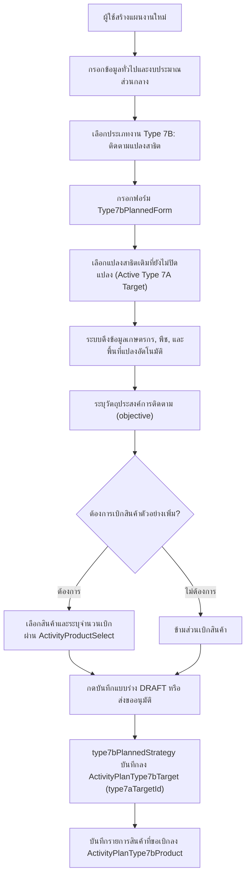
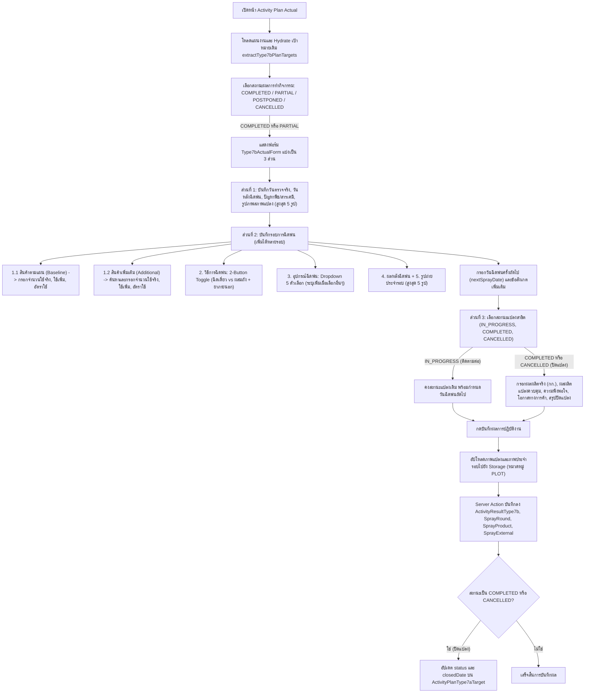
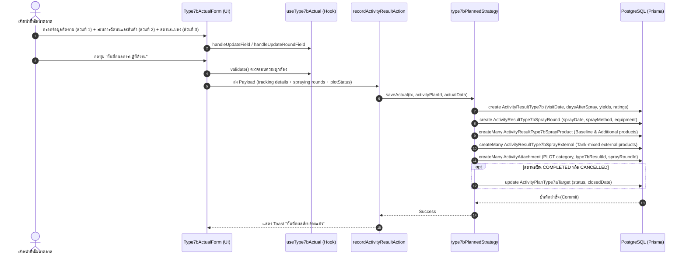

# Activity Type 7B — ติดตามแปลงสาธิต / Demo Plot Follow-up (README)

> **Feature Slice**: `modules/activity/features/type-7b`  
> **Standard Reference**: ออกแบบตามแนวทาง Vertical Slice Architecture อิงตามแม่แบบ Gold Standard Type 1  
> **Parent Module**: `modules/activity`  
> **Database Authority**: `prisma/schema.prisma` (`ActivityPlanType7bTarget`, `ActivityPlanType7bProduct`, `ActivityResultType7b`, `ActivityResultType7bSprayRound`, `ActivityResultType7bSprayProduct`, `ActivityResultType7bSprayExternal`, `ActivityAttachment`)  
> **Status**: Production Ready / Active Reference (v3.0.0 — Updated 2026-10-27 100% Dedicated Relational Architecture & Direct Linkage to Type 7A Targets)

---

## 1. Overview

### 1.1 วัตถุประสงค์ของ Type 7B
**Type 7B (ติดตามแปลงสาธิต / Demo Plot Follow-up)** มีวัตถุประสงค์เพื่อรองรับการปฏิบัติงานของเจ้าหน้าที่พัฒนาตลาดและนักวิชาการเกษตร (Market Development Representatives / Technical Agronomists) ในการลงพื้นที่เข้าติดตามผลการเจริญเติบโต การประเมินผลการใช้สารเคมี และการบันทึกผลการทดลองในแปลงสาธิตเดิมที่สร้างไว้ใน Type 7A:
1. **เลือกแปลงสาธิตเดิมที่ต้องการติดตาม:** ดึงจากแปลงสาธิตที่เปิดอยู่ทั้งหมดในระบบจาก `activity_type_7a_targets` (`status !== COMPLETED`, `status !== CANCELLED` และ `closedDate === null`) ทั้งแปลงที่มีแผนกิจกรรมต้นทาง (Grouped by Plan) และแปลงเดี่ยว
2. **รองรับ Advance Monthly Planning (การวางแผนล่วงหน้ารายเดือน):** พนักงานสามารถวางแผน Type 7A ในวันที่ 5 และวางแผน Type 7B (ติดตามแปลงสาธิต) สำหรับแปลงดังกล่าวในวันที่ 7 ได้ทันทีในรอบเดือนเดียวกัน โดยไม่ต้องรอให้ถึงวันลงพื้นที่จริง หรือรอให้บันทึกผลงานจริงของ Type 7A ก่อน เพราะระเบียนแปลงสาธิตใน `activity_type_7a_targets` จะถูกสร้างขึ้นทันทีตั้งแต่ตอนบันทึกแผนงาน Type 7A
3. **วางแผนเบิกสินค้าตัวอย่างเพิ่มเติมสำหรับการพ่นสารรอบถัดไป:** วางแผนเบิกสินค้า (`withdrawnProducts` / `products`) ล่วงหน้าลงตาราง `activity_type_7b_products` พร้อมส่งขออนุมัติตามสายงาน
4. **บันทึกผลการปฏิบัติงานจริงหน้างาน (Follow-up Evaluation & Multiple Spraying Rounds):**
   - **ส่วนที่ 1: ข้อมูลการติดตามแปลง (Tracking Details):**
     - วันที่ตรวจจริง (`visitDate`), จำนวนวันหลังฉีดพ่น (`daysAfterSpray`)
     - สภาพและปัญหาของพืช (`cropProblemDesc`), ปัญหาที่เกิดจากการใช้สินค้า (`productProblemDesc`)
     - ภาพถ่ายสภาพแปลงและการติดตามการเจริญเติบโต (หมวดหมู่ `PLOT`) สูงสุด 5 รูป
   - **ส่วนที่ 2: ข้อมูลการฉีดพ่นแต่ละรอบ (Multiple Spraying Rounds):**
     - รองรับการเพิ่มรอบการฉีดพ่นได้หลายรอบ (`sprayRounds: Type7bSprayRoundState[]`)
     - **1.1 รายการสินค้าตามแผนงาน (Planned Baseline Products):** แสดงรายการสินค้าที่เบิกตามแผนพร้อมจำนวนที่เบิก (`withdrawnQuantity`) พร้อมช่องบันทึก 3 คอลัมน์มาตรฐาน ได้แก่ จำนวนที่ใช้จริง (`actualQuantity`), ปริมาณที่ใช้เพิ่ม ซีซี/กรัม (`extraQuantity`), และอัตราการใช้ (`actualRate`)
     - **1.2 สินค้าเพิ่มเติมในการปฏิบัติงาน (Additional Products):** รองรับการเพิ่มสินค้าที่ใช้นอกแผนหน้างาน ค้นหาผ่าน `ActivityProductSelect` เต็มความกว้าง พร้อมบันทึก 3 คอลัมน์มาตรฐานเช่นเดียวกับ Baseline
     - **2. วิธีการฉีดพ่น (Spray Method):** ปุ่มสลับ 2 ตัวเลือก (2-Button Pill Toggle) ระหว่าง "ฉีดเดี่ยว (Single)" และ "ผสมถัง (Tank-mixed)"
       - กรณีเลือก "ผสมถัง (Tank-mixed)": แสดง Checkbox "มียาใช้ภายนอก (ไม่บังคับ)" (`hasExternalChemicals`)
       - เมื่อติ๊กเลือก "มียาใช้ภายนอก": แสดงกล่องรายการยาภายนอกที่ใช้ร่วม พร้อมปุ่ม "+ เพิ่มยาภายนอก" และกริด 6 ฟิลด์มาตรฐาน (บริษัท, ชื่อสินค้า, สารออกฤทธิ์, สูตร SL/SC/EC/อื่นๆ, ระบุสูตรเพิ่มเติม, อัตราการใช้)
     - **3. อุปกรณ์ที่ใช้ฉีดพ่น (Spray Equipment):** เมนูดรอปดาวน์ `ActivitySelect` 5 ตัวเลือกมาตรฐาน (`SPRAY_EQUIPMENT_OPTIONS`) ได้แก่ เครื่องพ่นสะพายหลัง (เครื่องยนต์ / แบตเตอรี่), เครื่องพ่นปั๊มลากสาย, โดรนเพื่อการเกษตร, แอร์บัส / รถพ่นยา, และ อื่นๆ (ระบุ) (พร้อม input กรอกระบุอุปกรณ์เพิ่มเติม)
     - **4. ผลหลังการฉีดพ่นรอบนี้ (Spray Response):** พืชตอบสนองดี (เห็นผลตามเป้าหมาย), เกิดความเป็นพิษต่อพืช (Phytotoxicity), ไม่เห็นความแตกต่างอย่างมีนัยสำคัญ, อื่นๆ
     - **5. รูปถ่ายการฉีดพ่นประจำรอบ (Spray Round Images):** ภาพถ่ายการปฏิบัติงานและสภาพแปลงประจำรอบนั้นๆ สูงสุด 5 รูปต่อรอบ
     - **ข้อมูลท้ายส่วนที่ 2:** กำหนดวันฉีดพ่นครั้งถัดไป (`nextSprayDate`) และข้อสังเกตหรือข้อมูลเพิ่มเติม (`notes`)
   - **ส่วนที่ 3: สถานะแปลงสาธิตและการปิดแปลง (Demo Plot Status & Final Closure):**
     - สถานะแปลงสาธิตหลังตรวจรอบนี้: "อยู่ระหว่างการทดลอง (ยังคงติดตามต่อ)" (`IN_PROGRESS`), "เสร็จสิ้น/ปิดแปลงสาธิต" (`COMPLETED`), หรือ "ยกเลิก/ยุติแปลงสาธิต" (`CANCELLED`)
     - เมื่อเลือกปิดแปลง (`COMPLETED` หรือ `CANCELLED`): ระบบจะแสดงฟอร์มประเมินผลผลิต ได้แก่ ผลผลิตแปลงสาธิต (`demoYieldKg`), ผลผลิตแปลงควบคุม (`controlYieldKg`), คะแนนความพึงพอใจของเกษตรกร (`farmerSatisfaction`: 1-5), โอกาสทางการค้า (`commercialPotential`), วันที่เก็บเกี่ยวผลผลิต (`finalHarvestDate`), และสรุปผลสัมฤทธิ์และข้อเสนอแนะ (`finalSummaryNotes`)
     - เมื่อบันทึกปิดแปลง ระบบจะอัปเดต `status` และ `closedDate` กลับไปยังแปลงแม่ `ActivityPlanType7aTarget` โดยอัตโนมัติ

### 1.2 ขอบเขตของ Type 7B
- **ความสัมพันธ์กับแปลงสาธิตและ Type 7A (Source Linkage):**
  - Type 7B เชื่อมโยงกับ Type 7A ผ่านฟิลด์ `type7aTargetId` (FK ชี้ไปยัง `ActivityPlanType7aTarget`) และ `sourceActivityPlanId`
  - รองรับการเลือกแปลงสาธิตที่เปิดอยู่ทั้งหมดในระบบ (`status: { notIn: [CANCELLED, COMPLETED] }, closedDate: null`) ผ่าน `findFollowUpDemoPlots()` และ `findFollowUpActivityPlans()`
- **สถาปัตยกรรมข้อมูลเฉพาะตัว 100% Dedicated Relational Tables:**
  - **ตารางฝั่งแผนงาน:** `ActivityPlanType7bTarget` (`activity_type_7b_targets`) และ `ActivityPlanType7bProduct` (`activity_type_7b_products`)
  - **ตารางฝั่งผลงานจริง:** `ActivityResultType7b` (`activity_type_7b_results`), `ActivityResultType7bSprayRound` (`activity_type_7b_spray_rounds`), `ActivityResultType7bSprayProduct` (`activity_type_7b_spray_products`), และ `ActivityResultType7bSprayExternal` (`activity_type_7b_spray_externals`)
  - **รูปภาพและเอกสารแนบ:** `ActivityAttachment` (หมวดหมู่ `PLOT` ทั้งภาพติดตามแปลงและภาพประจำรอบที่ผูก `sprayRoundId`)
  - **การจัดการสถานะแปลงแม่:** เมื่อบันทึกผลงานที่มีสถานะปิดแปลง (`COMPLETED` หรือ `CANCELLED`) จะอัปเดตสถานะและ `closedDate` ของระเบียน `ActivityPlanType7aTarget` โดยตรง โดยไม่มีการใช้ตาราง `demo_plots` หรือ `demo_plot_visits` เก่าอีกต่อไป

### 1.3 รูปแบบการทำงานที่รองรับ
1. **Planned (ในแผนงาน Trip Plan):** เลือกแปลงสาธิตเดิม พร้อมขอเบิกสินค้าตัวอย่างเพิ่มเติมล่วงหน้า ส่งขออนุมัติตามสายงาน
2. **Planned Actual (บันทึกผลงานตามแผน):** นำเป้าหมายที่ได้รับอนุมัติมารายงานผลการติดตามจริง แบ่งเป็น 3 ส่วน (ข้อมูลติดตามแปลง, การฉีดพ่นรอบต่างๆ พร้อม Baseline/Additional Products, และสถานะแปลงสาธิต/ปิดแปลง)
3. **Unplanned (กิจกรรมนอกแผน 2-in-1):** รองรับการลงพื้นที่ติดตามแปลงหน้างานโดยไม่ได้วางแผนล่วงหน้า สามารถเลือกแปลงสาธิตเดิม ประเมินสภาพพืช ถ่ายภาพ และประเมินผลปิดแปลงจบในฟอร์มเดียว พร้อมสร้างแผนงานสถานะ `COMPLETED` ทันที
4. **Detail View:** แสดงผลการติดตามแปลงสาธิตผ่าน `Type7bDetailView` ครบทั้ง 3 ส่วน พร้อมประวัติการเข้าตรวจย้อนหลัง ข้อมูลการฉีดพ่น และแกลเลอรีรูปภาพ
5. **Approval View:** การ์ดสำหรับผู้บังคับบัญชาพิจารณาอนุมัติผ่าน `Type7bApprovalCard` สรุปแปลงสาธิตและสินค้าที่ขอเบิกเพิ่มเติม

---

## 2. Business Flows

### 2.1 Planned (สร้างและแก้ไขแผนงาน)


### 2.2 Planned Actual (บันทึกผลการปฏิบัติงานตามแผน)


---

## 3. Architecture

### 3.1 Folder Structure
```text
modules/activity/features/type-7b/
├── index.ts                                    # Unified Public API Contract (ส่งออกเฉพาะสิ่งที่ภายนอกต้องใช้)
├── README.md                                   # เอกสารคู่มือทางเทคนิค (ไฟล์นี้)
│
├── planned/                                    # Sub-slice: กิจกรรมในแผนงานและบันทึกผลตามแผน
│   ├── application/                            # Business Logic, Validation, Mappers
│   │   ├── actual-mapper.ts                    # แปลงผลงานจริง Form <-> DB/Payload (parseType7bActualResult)
│   │   ├── actual-validation.ts                # ตรวจสอบความถูกต้องของผลงานจริง (validateType7bActual)
│   │   ├── planned-mapper.ts                   # แปลงเป้าหมายในแผน Form <-> DB / Hydration (extractType7bPlanTargets, hydrateType7bPlannedData)
│   │   └── planned-validation.ts               # ตรวจสอบความถูกต้องของแผน (validateType7bFormItems)
│   ├── components/                             # UI Components ประจำ Type 7B ในแผน
│   │   ├── type7b-planned-form.tsx             # ฟอร์มเลือกแปลงสาธิตและเบิกสินค้าตามแผน
│   │   ├── type7b-actual-form.tsx              # ฟอร์มบันทึกผลติดตามจริง (3 ส่วน: ติดตาม + รอบฉีดพ่น + สถานะแปลง)
│   │   ├── type7b-plan-card.tsx                # การ์ดสรุปเป้าหมายติดตามแปลงตามแผนงาน
│   │   ├── type7b-detail-view.tsx              # คอมโพเนนต์แสดงผลเต็มรูปแบบในหน้ารายละเอียด (รองรับ Multi-round)
│   │   └── type7b-approval-card.tsx            # การ์ดสรุปสำหรับหน้าพิจารณาอนุมัติ
│   ├── hooks/                                  # Custom State Hooks
│   │   ├── use-type7b-planned-form.ts          # จัดการ State เลือกแปลงและสินค้าที่ขอเบิกตามแผน
│   │   └── use-type7b-actual.ts                # จัดการ State บันทึกผลติดตามจริง, รอบการฉีดพ่น, สินค้า และอัปโหลดภาพ
│   ├── infrastructure/                         # Database Strategies & Repositories
│   │   ├── type7b.repository.ts                # createType7bData, syncType7bData, findFollowUpDemoPlots, findFollowUpActivityPlans, findType7bByPlanId
│   │   └── type7b-planned.strategy.ts          # Strategy บันทึก/โหลดข้อมูล ActivityPlanType7bTarget, ActivityResultType7b
│   └── types/                                  # Type Definitions ในแผน
│       ├── planned.types.ts                    # Type7bPlanItem, Type7bTargetItem, Type7bPlanCardProps ฯลฯ
│       └── actual.types.ts                     # Type7bActualRecord, Type7bSprayRoundState, Type7bBaselineProductItem, Type7bAdditionalProductItem
│
├── unplanned/                                  # Sub-slice: กิจกรรมนอกแผน (2-in-1)
│   ├── application/                            # Logic และ Mappers กิจกรรมนอกแผน
│   │   ├── unplanned-mapper.ts                 # Hydration และ Data mapping นอกแผน
│   │   └── unplanned-validation.ts             # Validation กิจกรรมนอกแผน (validateType7bUnplannedItems)
│   ├── components/                             # UI Components กิจกรรมนอกแผน
│   │   └── type7b-unplanned-form.tsx           # ฟอร์ม 2-in-1 (เลือกแปลง + บันทึกผลติดตาม + ปิดแปลง + รูปถ่าย)
│   ├── hooks/                                  # Custom State Hooks
│   │   └── use-type7b-unplanned-form.ts        # จัดการ State ติดตามแปลงนอกแผน
│   ├── infrastructure/                         # Database Strategies นอกแผน
│   │   └── type7b-unplanned.strategy.ts        # บันทึกกิจกรรมนอกแผนลง Prisma ผ่าน Type 7B Strategy
│   └── types/                                  # Type Definitions นอกแผน
│       └── unplanned.types.ts                  # Type7bUnplannedItem, Type7bUnplannedFormProps
│
└── shared/                                     # ชิ้นส่วนที่ใช้ร่วมกันภายใน Feature Type 7B
    ├── constants.ts                            # SPRAY_EQUIPMENT_OPTIONS, SPRAY_METHOD_RADIO_OPTIONS, SPRAY_RESPONSE_OPTIONS, DEMO_PLOT_STATUS_OPTIONS
    └── types.ts                                # Type7bWithdrawnProductLine, Type7bPlotInput, Type7bProductInput, Type7bDataInput, ImageFile
```

---

## 4. Data Flow



---

## 5. Data Models and Mapping

### 5.1 Database CRUD Matrix (100% Dedicated Relational Storage)
| ตารางในฐานข้อมูล (`Prisma Model`) | Create (สร้าง) | Read (อ่าน/แสดงผล) | Update (แก้ไข) | Delete (ลบ) | หน้าที่รับผิดชอบ |
| :--- | :--- | :--- | :--- | :--- | :--- |
| **`activity_type_7b_targets`**<br>(`ActivityPlanType7bTarget`) | `createType7bData()` ใน `savePlan()` | โหลดรายละเอียดแผน Type 7B | ลบและสร้างใหม่ใน `syncType7bData()` | Cascade เมื่อลบ `ActivityPlan` | เป้าหมายแปลงที่เลือกติดตาม เชื่อมโยง `type7aTargetId` สู่แปลงแม่ 7A |
| **`activity_type_7b_products`**<br>(`ActivityPlanType7bProduct`) | `createType7bData()` | รายการสินค้าที่ขอเบิกเพิ่มเติม | ลบและสร้างใหม่ตามแผน | Cascade เมื่อลบ `ActivityPlan` | เก็บสินค้าตัวอย่างที่ขอเบิกเพิ่มตามแผน |
| **`activity_type_7b_results`**<br>(`ActivityResultType7b`) | `saveActual()` ใน Actual | โหลดผลการติดตามจริงใน Detail / Actual View | ลบและสร้างใหม่ใน `saveActual()` | Cascade เมื่อลบ `ActivityPlan` | เก็บผลการติดตามแปลง วันตรวจ วันหลังพ่น ปัญหาพืช และผลสรุปปิดแปลง |
| **`activity_type_7b_spray_rounds`**<br>(`ActivityResultType7bSprayRound`) | `saveActual()` ใน Actual | โหลดรอบการฉีดพ่นใน Detail View | ลบและสร้างใหม่ใน `saveActual()` | Cascade เมื่อลบ `ActivityResultType7b` | เก็บรอบการฉีดพ่น, วิธีการ, อุปกรณ์ และผลตอบสนอง |
| **`activity_type_7b_spray_products`**<br>(`ActivityResultType7bSprayProduct`) | `saveActual()` ใน Actual | โหลดสินค้าที่ใช้ในแต่ละรอบ | ลบและสร้างใหม่ใน `saveActual()` | Cascade เมื่อลบ `ActivityResultType7bSprayRound` | เก็บสินค้าตามแผนและสินค้าเพิ่มเติม อัตราใช้ และจำนวน |
| **`activity_type_7b_spray_externals`**<br>(`ActivityResultType7bSprayExternal`) | `saveActual()` ใน Actual | โหลดยาภายนอกในแต่ละรอบ | ลบและสร้างใหม่ใน `saveActual()` | Cascade เมื่อลบ `ActivityResultType7bSprayRound` | เก็บสารเคมีภายนอกกรณีผสมถัง (Tank-mixed) |
| **`activity_attachments`**<br>(`ActivityAttachment`) | Storage Upload + `saveActual()` | `plan.attachments` (หมวดหมู่ PLOT) | ลบรายการเก่าและสร้างใหม่ | Cascade เมื่อลบ `ActivityPlan` | เก็บล็อก URL ภาพถ่ายติดตามและภาพประจำรอบ (`sprayRoundId`) |

### 5.2 Prisma Schema Definitions
```prisma
// 1. ตารางเป้าหมายแผนงานติดตามแปลงสาธิต (activity_type_7b_targets)
model ActivityPlanType7bTarget {
  id                   String                      @id @default(cuid())
  activityPlanId       String                      @map("activity_plan_id")
  type7aTargetId       String?                     @map("type7a_target_id") // เชื่อมโยงตรงสู่แปลงแม่ ActivityPlanType7aTarget
  sourceActivityPlanId String?                     @map("source_activity_plan_id")
  plotName             String?                     @map("plot_name")
  cropName             String?                     @map("crop_name")
  ownerName            String?                     @map("owner_name")
  province             String?                     @map("province")
  district             String?                     @map("district")
  areaRai              Decimal?                    @map("area_rai") @db.Decimal(10, 2)
  treeCount            Int?                        @map("tree_count")
  dealerName           String?                     @map("dealer_name")
  objective            String?                     @map("objective") @db.Text
  notes                String?                     @map("notes") @db.Text
  createdAt            DateTime                    @default(now()) @map("created_at")
  updatedAt            DateTime                    @updatedAt @map("updated_at")

  activityPlan         ActivityPlan                @relation(fields: [activityPlanId], references: [id], onDelete: Cascade)
  type7aTarget         ActivityPlanType7aTarget?   @relation(fields: [type7aTargetId], references: [id], onDelete: SetNull)
  sourceActivityPlan   ActivityPlan?               @relation("Type7bSourcePlan", fields: [sourceActivityPlanId], references: [id], onDelete: SetNull)
  products             ActivityPlanType7bProduct[]
  results              ActivityResultType7b[]

  @@index([activityPlanId])
  @@index([type7aTargetId])
  @@index([sourceActivityPlanId])
  @@map("activity_type_7b_targets")
}

// 2. ตารางสินค้าตัวอย่างที่ขอเบิกเพิ่มเติมตามแผน (activity_type_7b_products)
model ActivityPlanType7bProduct {
  id             String                    @id @default(cuid())
  activityPlanId String                    @map("activity_plan_id")
  targetId       String?                   @map("target_id")
  productId      String                    @map("product_id")
  productName    String?                   @map("product_name")
  quantity       Decimal                   @default(1) @map("quantity") @db.Decimal(10, 2)
  unit           String?                   @map("unit")
  sortOrder      Int                       @default(0) @map("sort_order")
  createdAt      DateTime                  @default(now()) @map("created_at")

  activityPlan   ActivityPlan              @relation(fields: [activityPlanId], references: [id], onDelete: Cascade)
  target         ActivityPlanType7bTarget? @relation(fields: [targetId], references: [id], onDelete: Cascade)
  product        Product                   @relation(fields: [productId], references: [id], onDelete: Restrict)

  @@index([activityPlanId])
  @@index([targetId])
  @@index([productId])
  @@map("activity_type_7b_products")
}

// 3. ตารางผลการติดตามแปลงสาธิตจริง (activity_type_7b_results)
model ActivityResultType7b {
  id                  String                              @id @default(cuid())
  activityPlanId      String                              @map("activity_plan_id")
  targetId            String?                             @map("target_id")
  visitDate           DateTime                            @default(now()) @map("visit_date")
  daysAfterSpray      Int?                                @map("days_after_spray")
  cropCondition       String?                             @map("crop_condition")
  growthStage         String?                             @map("growth_stage")
  cropProblemDesc     String?                             @map("crop_problem_desc")
  productProblemDesc  String?                             @map("product_problem_desc")
  nextSprayDate       DateTime?                           @map("next_spray_date")
  notes               String?                             @map("notes") @db.Text
  plotStatus          DemoPlotStatus?                     @map("plot_status")
  finalHarvestDate    DateTime?                           @map("final_harvest_date")
  demoYieldKg         Decimal?                            @map("demo_yield_kg") @db.Decimal(12, 2)
  controlYieldKg      Decimal?                            @map("control_yield_kg") @db.Decimal(12, 2)
  farmerSatisfaction  Int?                                @map("farmer_satisfaction")
  commercialPotential String?                             @map("commercial_potential")
  finalSummaryNotes   String?                             @map("final_summary_notes") @db.Text
  createdAt           DateTime                            @default(now()) @map("created_at")
  updatedAt           DateTime                            @updatedAt @map("updated_at")

  activityPlan        ActivityPlan                        @relation(fields: [activityPlanId], references: [id], onDelete: Cascade)
  target              ActivityPlanType7bTarget?           @relation(fields: [targetId], references: [id], onDelete: Cascade)
  sprayRounds         ActivityResultType7bSprayRound[]
  attachments         ActivityAttachment[]

  @@index([activityPlanId])
  @@index([targetId])
  @@map("activity_type_7b_results")
}
```

---

## 6. Change Log

| วันที่ | เวอร์ชัน | รายละเอียดการปรับปรุง | ผู้ดำเนินการ |
| :--- | :--- | :--- | :--- |
| **2026-10-16** | 1.0.0 | สร้างโมดูล Type 7B เป็น Vertical Slice Architecture สำหรับการติดตามแปลงสาธิต | Antigravity AI |
| **2026-10-24** | 2.0.0 | อัปเกรดระบบบันทึกผลงานจริงสู่ Multiple Spraying Rounds Architecture สมบูรณ์แบบ | Antigravity AI |
| **2026-10-24** | 2.1.0 | ปรับปรุงระบบ Hydration ข้อมูลผลงานจริง | Antigravity AI |
| **2026-10-27** | 3.0.0 | **ยกเลิกตารางเก่า (`demo_plots`, `demo_plot_visits`) สู่ 100% Dedicated Relational Architecture:**<br>1. ปรับ `ActivityPlanType7bTarget` ให้เชื่อมโยงโดยตรงกับแปลงแม่ `ActivityPlanType7aTarget` ผ่าน `type7aTargetId`<br>2. รองรับ Advance Monthly Planning: อนุญาตให้สร้างแผนงาน Type 7B ติดตามแปลงล่วงหน้าได้ทันทีที่มีแผน Type 7A โดยไม่ต้องรอผลงานจริงของ 7A<br>3. เมื่อปิดแปลง (`COMPLETED` หรือ `CANCELLED`) อัปเดต `status` และ `closedDate` กลับไปยัง `activity_type_7a_targets` โดยตรง<br>4. อัปเดต Data Flow, CRUD Matrix, Field Mapping และ Prisma Schema ครบถ้วน | Antigravity AI |
