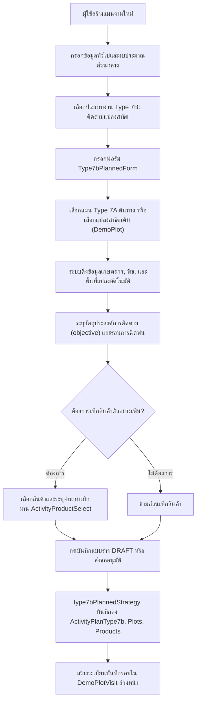
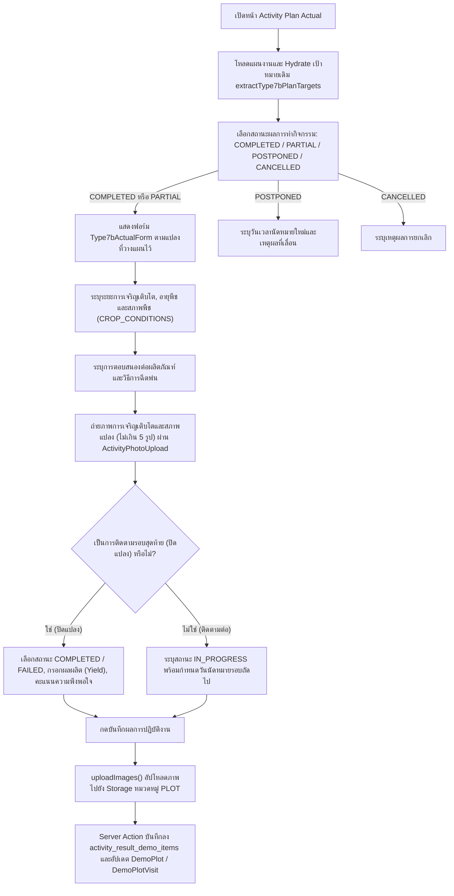
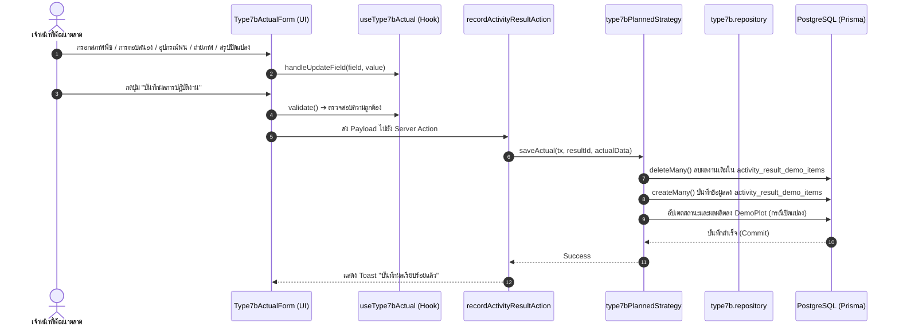

# Activity Type 7B — ติดตามแปลงสาธิต / Demo Plot Follow-up (README)

> **Feature Slice**: `modules/activity/features/type-7b`  
> **Standard Reference**: ออกแบบตามแนวทาง Vertical Slice Architecture อิงตามแม่แบบ Gold Standard Type 1  
> **Parent Module**: `modules/activity`  
> **Database Authority**: `prisma/schema.prisma` (`ActivityPlanType7b`, `ActivityPlanType7bPlot`, `ActivityPlanType7bProduct`, `DemoPlotVisit`, `DemoPlot`, `ActivityResultDemoItem`, `ActivityAttachment`)  
> **Status**: Production Ready / Active Reference (v1.6.0 — Updated 2026-10-22)

---

## 1. Overview

### 1.1 วัตถุประสงค์ของ Type 7B
**Type 7B (ติดตามแปลงสาธิต / Demo Plot Follow-up)** มีวัตถุประสงค์เพื่อรองรับการปฏิบัติงานของเจ้าหน้าที่พัฒนาตลาดและนักวิชาการเกษตร (Market Development Representatives / Technical Agronomists) ในการลงพื้นที่เข้าติดตามผลการเจริญเติบโต การประเมินผลการใช้สารเคมี และการบันทึกผลการทดลองในแปลงสาธิตเดิมที่เคยจัดตั้งไว้ใน Type 7A (จัดทำแปลงสาธิต):
1. เลือกแปลงสาธิตเดิมที่ต้องการติดตาม (ดึงจากแผนงาน Type 7A ที่ได้รับอนุมัติและเสร็จสิ้นแล้ว หรือเลือกโดยตรงจาก Master `DemoPlot`)
2. วางแผนเบิกสินค้าตัวอย่างเพิ่มเติมสำหรับการพ่นสารรอบถัดไป (`withdrawnProducts` / `products`)
3. บันทึกผลการติดตามจริงหน้างาน (Follow-up Evaluation):
   - บันทึกระยะการเจริญเติบโตของพืช (`growthStage`) และอายุพืช (`cropAgeValue`, `cropAgeUnit`)
   - ประเมินสภาพแปลงและพืช (`cropCondition`: "สมบูรณ์", "ปานกลาง", "มีปัญหา", "ทรุดโทรม")
   - ประเมินการตอบสนองต่อสารเคมี (`productResponse`: "พืชตอบสนองดี", "พบปัญหา")
   - บันทึกวิธีการและอุปกรณ์ฉีดพ่น (`sprayMethod`, `sprayEquipment`)
   - วางแผนนัดหมายรอบถัดไป: วันฉีดพ่นครั้งต่อไป (`nextSprayDate`) และวันเข้าติดตามครั้งต่อไป (`nextFollowUpDate`)
4. บันทึกผลสรุปและการปิดแปลงสาธิต (Final Evaluation & Closure):
   - เมื่อติดตามถึงรอบสุดท้าย สามารถปรับสถานะแปลงเป็น `COMPLETED` (เสร็จสิ้น) หรือ `FAILED` (เสียหาย/ยุติ)
   - เปรียบเทียบผลผลิตจริงกับแปลงควบคุม (`finalYieldKg` vs `controlYieldKg`) และคำนวณ % ผลผลิตที่เพิ่มขึ้น (`yieldIncreasePercent`)
   - ประเมินคะแนนความพึงพอใจของเกษตรกร (`farmerSatisfaction`: 1-5) และโอกาสทางการค้า (`commercialPotential`)
5. บันทึกภาพถ่ายการเจริญเติบโตของพืชและสภาพแปลงสาธิต (หมวดหมู่ `PLOT`) สูงสุด 5 รูปต่อครั้ง

### 1.2 ขอบเขตของ Type 7B
- **ความสัมพันธ์กับแปลงสาธิตและ Type 7A (Source Linkage):**
  - Type 7B เชื่อมโยงกับ Type 7A ผ่านฟิลด์ `sourceActivityPlanId` หรืออ้างอิง `demoPlotId` ใน Master Table `DemoPlot`
  - รองรับการเลือกแปลงสาธิตที่เปิดอยู่ทั้งหมดในระบบ (`status: { notIn: [CANCELLED, COMPLETED] }, closedDate: null`) ทั้งแปลงที่มีแผนกิจกรรมต้นทาง (Grouped by Plan) และแปลงสาธิตเดี่ยว (Standalone/Master Demo Plots) ผ่าน `findFollowUpDemoPlots()` และ `findFollowUpActivityPlans()`
- **ระบบบันทึกประวัติการเข้าตรวจ (Demo Plot Visit Logging):**
  - ทุกครั้งที่มีการติดตาม ระบบจะบันทึกประวัติการลงพื้นที่เข้าสู่ตาราง `DemoPlotVisit` (`demo_plot_visits`) อัตโนมัติ โดยระบุรอบการเข้าตรวจ (`visitNumber`), วันที่ตรวจ (`visitDate`) และคำนวณจำนวนวันนับจากวันเริ่มแปลง (`daysSinceStart`)
- **การจัดประเภทสภาพแปลงและการตอบสนอง (Evaluation Classifications):**
  - **สภาพพืช (`CROP_CONDITIONS`):** สมบูรณ์, ปานกลาง, มีปัญหา, ทรุดโทรม
  - **การตอบสนองต่อผลิตภัณฑ์ (`PRODUCT_RESPONSES`):** พืชตอบสนองดี, พบปัญหา
  - **โอกาสทางการค้า (`COMMERCIAL_POTENTIALS`):** สูงมาก (พร้อมขยายผลเชิงพาณิชย์), สูง (เกษตรกรสนใจมาก), ปานกลาง (ต้องติดตามผลเพิ่มเติม), น้อย (ยังไม่เห็นความแตกต่างชัดเจน)
  - **คะแนนความพึงพอใจ (`SATISFACTION_SCORES`):** 1 (ไม่พึงพอใจ) ถึง 5 (พึงพอใจมากที่สุด)
- **การจัดเก็บข้อมูลแบบ Dedicated & Dual Persistence:**
  - **Dedicated Plan Tables:** `ActivityPlanType7b` (`activity_plan_type_7b`), `ActivityPlanType7bPlot` (`activity_plan_type_7b_plots`), และ `ActivityPlanType7bProduct` (`activity_plan_type_7b_products`)
  - **Visit Tracking:** `DemoPlotVisit` (`demo_plot_visits`)
  - **Master Updates:** อัปเดตสถานะและผลผลิตเมื่อปิดแปลงลงใน `DemoPlot` (`demo_plots`)
  - **Actual Outcome Tables:** บันทึกผลการใช้สินค้าลง `ActivityResultDemoItem` (`activity_result_demo_items`) และรูปภาพลง `ActivityAttachment` (`category = "PLOT"`)

### 1.3 รูปแบบการทำงานที่รองรับ
1. **Planned (ในแผนงาน Trip Plan):** เลือกแผน Type 7A ต้นทาง หรือเลือกแปลงสาธิตเดิม พร้อมขอเบิกสินค้าตัวอย่างเพิ่มเติมล่วงหน้า ส่งขออนุมัติตามสายงาน
2. **Planned Actual (บันทึกผลงานตามแผน):** นำเป้าหมายที่ได้รับอนุมัติมารายงานผลการติดตามจริง (สภาพพืช, การตอบสนอง, อุปกรณ์ฉีดพ่น, รูปถ่าย และผลสรุปปิดแปลง)
3. **Unplanned (กิจกรรมนอกแผน 2-in-1):** รองรับการลงพื้นที่ติดตามแปลงหน้างานโดยไม่ได้วางแผนล่วงหน้า สามารถเลือกแปลงสาธิตเดิม ประเมินสภาพพืช ถ่ายภาพ และประเมินผลปิดแปลงจบในฟอร์มเดียว พร้อมสร้างแผนงานสถานะ `COMPLETED` ทันที
4. **Detail View:** แสดงผลการติดตามแปลงสาธิตผ่าน `Type7bDetailView` พร้อมประวัติการเข้าตรวจย้อนหลังและรูปภาพ
5. **Approval View:** การ์ดสำหรับผู้บังคับบัญชาพิจารณาอนุมัติผ่าน `Type7bApprovalCard` สรุปแปลงสาธิตและสินค้าที่ขอเบิกเพิ่มเติม

---

## 2. Business Flows

### 2.1 Planned (สร้างและแก้ไขแผนงาน)


### 2.2 Planned Actual (บันทึกผลการปฏิบัติงานตามแผน)


### 2.3 Unplanned (กิจกรรมนอกแผน 2-in-1)
- ผู้ใช้งานเข้าหน้า `/activity-plans/unplanned/new`
- ฟอร์ม `Type7bUnplannedForm` ผสานทั้งส่วนเลือกแปลงสาธิตเดิม (เลือกจากรายการแปลงสาธิตที่กำลังดำเนินการ) และส่วนบันทึกผลการติดตามจริง (สภาพพืช, การตอบสนอง, อุปกรณ์พ่น, รูปถ่าย และผลสรุปปิดแปลง) จบในฟอร์มเดียว
- เมื่อกดบันทึก ระบบตรวจสอบผ่าน `validateType7bUnplannedItems` และแปลง Payload ผ่าน `mapType7bUnplannedToPayload`
- `type7bUnplannedStrategy.savePlan()` จะบันทึกเป้าหมายแปลง บันทึกประวัติรอบการตรวจลง `DemoPlotVisit` และบันทึกผลงานลง `activity_result_demo_items` พร้อมกันใน `$transaction` เดียวกัน โดยแผนงานมีสถานะเสร็จสิ้นสมบูรณ์

### 2.4 Detail and Approval (ดูรายละเอียดและพิจารณาอนุมัติ)
- **Detail View:** `DetailWorkTypeList` เรียกใช้ `Type7bDetailView` เพื่อแสดงข้อมูลแปลงสาธิต ผลการติดตาม สภาพพืช การตอบสนอง ผลสรุปการปิดแปลง และแกลเลอรีรูปถ่าย
- **Approval View:** `ApprovalWorkTypeList` เรียกใช้ `Type7bApprovalCard` เพื่อให้หัวหน้างานพิจารณาอนุมัติการขอเข้าติดตามแปลงสาธิตและรายการสินค้าที่ขอเบิกเพิ่มเติม

---

## 3. Architecture

### 3.1 Folder Structure
```text
modules/activity/features/type-7b/
├── index.ts                                    # Unified Public API Contract (ส่งออกเฉพาะสิ่งที่ภายนอกต้องใช้)
├── README.md                                   # เอกสารคู่มือทางเทคนิค (ไฟล์นี้)
│
├── planned/                                    # Sub-slice: กิจกรรมในแผนงานและบันทึกผลตามแผน
│   ├── application/                            # Business Logic, Validation, Mappers
│   │   ├── actual-mapper.ts                    # แปลงผลงานจริง Form <-> DB/Payload (parseType7bActualResult)
│   │   ├── actual-validation.ts                # ตรวจสอบความถูกต้องของผลงานจริง (validateType7bActual)
│   │   ├── planned-mapper.ts                   # แปลงเป้าหมายในแผน Form <-> DB / Hydration (extractType7bPlanTargets, hydrateType7bPlannedData, mapType7bToSectionItems)
│   │   └── planned-validation.ts               # ตรวจสอบความถูกต้องของแผน (validateType7bFormItems)
│   ├── components/                             # UI Components ประจำ Type 7B ในแผน
│   │   ├── type7b-planned-form.tsx             # ฟอร์มเลือกแปลงสาธิตและเบิกสินค้าตามแผน
│   │   ├── type7b-actual-form.tsx              # ฟอร์มบันทึกผลติดตามจริง (สภาพพืช + การตอบสนอง + ปิดแปลง + รูปถ่าย)
│   │   ├── type7b-plan-card.tsx                # การ์ดสรุปเป้าหมายติดตามแปลงตามแผนงาน
│   │   ├── type7b-detail-view.tsx              # คอมโพเนนต์แสดงผลเต็มรูปแบบในหน้ารายละเอียด
│   │   └── type7b-approval-card.tsx            # การ์ดสรุปสำหรับหน้าพิจารณาอนุมัติ
│   ├── hooks/                                  # Custom State Hooks
│   │   ├── use-type7b-planned-form.ts          # จัดการ State เลือกแปลงและสินค้าที่ขอเบิกตามแผน
│   │   └── use-type7b-actual.ts                # จัดการ State ผลการติดตามจริงและอัปโหลดรูปภาพ
│   ├── infrastructure/                         # Database Strategies & Repositories
│   │   ├── type7b.repository.ts                # createType7bData, syncType7bData, findFollowUpDemoPlots, findFollowUpActivityPlans, findType7bByPlanId
│   │   └── type7b-planned.strategy.ts          # Strategy บันทึก/โหลดข้อมูล ActivityPlanType7b & DemoPlotVisit
│   └── types/                                  # Type Definitions ในแผน
│       ├── planned.types.ts                    # Type7bPlanItem, Type7bTargetItem, Type7bPlanCardProps ฯลฯ
│       └── actual.types.ts                     # Type7bActualRecord, Type7bActualFormProps, Type7bDetailViewProps ฯลฯ
│
├── unplanned/                                  # Sub-slice: กิจกรรมนอกแผน (2-in-1)
│   ├── application/                            # Logic และ Mappers กิจกรรมนอกแผน
│   │   ├── unplanned-mapper.ts                 # Hydration และ Data mapping นอกแผน (hydrateType7bUnplannedData, mapType7bUnplannedToPayload)
│   │   └── unplanned-validation.ts             # Validation กิจกรรมนอกแผน (validateType7bUnplannedItems)
│   ├── components/                             # UI Components กิจกรรมนอกแผน
│   │   └── type7b-unplanned-form.tsx           # ฟอร์ม 2-in-1 (เลือกแปลง + บันทึกผลติดตาม + ปิดแปลง + รูปถ่าย)
│   ├── hooks/                                  # Custom State Hooks
│   │   └── use-type7b-unplanned-form.ts        # จัดการ State ติดตามแปลงนอกแผน
│   ├── infrastructure/                         # Database Strategies นอกแผน
│   │   └── type7b-unplanned.strategy.ts        # บันทึกกิจกรรมนอกแผนลง Prisma ผสาน DemoPlotVisit และผลงานจริง
│   └── types/                                  # Type Definitions นอกแผน
│       └── unplanned.types.ts                  # Type7bUnplannedItem, Type7bUnplannedFormProps
│
└── shared/                                     # ชิ้นส่วนที่ใช้ร่วมกันภายใน Feature Type 7B
    ├── constants.ts                            # CROP_CONDITIONS, PRODUCT_RESPONSES, SPRAY_METHODS, COMMERCIAL_POTENTIALS, SATISFACTION_SCORES, DEMO_PLOT_STATUS_OPTIONS
    └── types.ts                                # Type7bWithdrawnProductLine, Type7bPlotInput, Type7bProductInput, Type7bDataInput, Type7bDemoPlotOption, Type7bFollowUpPlanOption, Type7bProductOption
```

### 3.2 Type 7B vs Shared Activity
| ความรับผิดชอบ | จัดการที่ Type 7B Feature (`features/type-7b`) | จัดการที่ Activity ส่วนกลาง (`ui/`, `views/`) |
| :--- | :--- | :--- |
| **ข้อมูลทั่วไป** | - | ชื่องาน, วันที่เริ่ม-สิ้นสุด, วัตถุประสงค์หลัก, ผู้ร่วมเดินทาง |
| **พื้นที่ & ทีมงาน** | - | จังหวัด, อำเภอ, ตำบล, พนักงานร่วมเดินทาง |
| **งบประมาณ** | - | งบเบิกสินค้าตัวอย่างเพิ่มเติม, ค่าใช้จ่ายเดินทาง |
| **เป้าหมายติดตามแปลง** | เลือกแปลงเดิมจาก Type 7A / DemoPlot, สินค้าที่ขอเบิกเพิ่ม | - |
| **ผลการติดตามจริง** | สภาพพืช, การตอบสนอง, วันนัดถัดไป, ผลสรุปปิดแปลง (Yield, Satisfaction), รูปภาพ | ผลสรุปภาพรวมแผน (สำเร็จ/เลื่อน/ยกเลิก) |
| **Database Persistence** | ตาราง `ActivityPlanType7b`, `ActivityPlanType7bPlot`, `ActivityPlanType7bProduct`, `DemoPlotVisit`, `ActivityResultDemoItem`, อัปเดต `DemoPlot` | ตารางหลัก `ActivityPlan`, `ActivityPlanApprovalLog`, `ActivityAttachment` |

### 3.3 Dependency and Import Map
- **ทิศทางการเรียกใช้ (Allowed):**
  - `views/` ➔ เรียกใช้ ➔ `features/type-7b` (ผ่าน `index.ts` เท่านั้น)
  - `features/type-7b` ➔ เรียกใช้ ➔ `@/modules/activity/ui` (`ActivityInput`, `ActivityTextarea`, `ActivityCombobox`, `ActivityProductSelect`, `ActivityPhotoUpload`)
  - `features/type-7b` ➔ เรียกใช้ ➔ `@/modules/activity/constants`
  - `features/type-7b` ➔ เรียกใช้ ➔ `@/modules/activity/types/strategy.interface`
  - `features/type-7b` ➔ เรียกใช้ ➔ `@/modules/activity/application/media/image-uploader` (`uploadActivityPlanImageGroup`, `deleteActivityPlanImagePaths`)
- **Server Actions & Database Flow:**
  - `views/` ➔ ส่งข้อมูลไปยัง ➔ Server Actions ใน `@/modules/activity/server/`:
    - `planned.actions.ts` (`createActivityPlanAction`, `updateActivityPlanAction`, `getActivityPlanAction`)
    - `unplanned.actions.ts` (`createUnplannedActivityAction`, `updateUnplannedActivityAction`, `getUnplannedActivityAction`)
    - `actual.actions.ts` (`recordActivityResultAction`)
  - Server Actions ➔ ทำงานร่วมกับ ➔ `@/modules/activity/infrastructure/strategy.registry` ➔ เรียกใช้ `type7bPlannedStrategy` / `type7bUnplannedStrategy` บันทึกลงตาราง Dedicated และอัปเดต Master Tables ภายใน `$transaction`
- **สิ่งต้องห้าม (Strictly Forbidden):**
  - ❌ ภายนอก Import เจาะลึกเข้าไปในโฟลเดอร์ย่อย เช่น `features/type-7b/planned/components/...`
  - ❌ `features/type-7b` เรียกใช้ข้อมูลข้ามไปยัง `features/type-1` ถึง `type-6`, `type-7a` หรือ `type-8` ถึง `type-14`
  - ❌ Import ย้อนกลับไปยังโมดูลเก่า `@/modules/activity-plans/...` โดยเด็ดขาด

### 3.4 Entry Points and Public Exports
ไฟล์ [modules/activity/features/type-7b/index.ts](file:///d:/code/crm-bank/modules/activity/features/type-7b/index.ts) ทำหน้าที่เป็น **Single Public API Contract** สำหรับฝั่ง UI / Application โดยส่งออกเฉพาะ:
- **Components:** `Type7bPlannedForm` (`Type7bPlanForm`, `Type7FollowUp`), `Type7bPlanCard`, `Type7bActualForm` (`ActualType7FollowUp`), `Type7bDetailView` (`DetailType7FollowUp`, `DetailType7bDemo`), `Type7bApprovalCard` (`ApprovalType7bDemo`), `Type7bUnplannedForm`
- **Hooks:** `useType7bPlannedForm` (`useType7bForm`), `useType7bActual`, `useType7bUnplannedForm`
- **Mappers & Hydrators:** `extractType7bPlanTargets`, `hydrateType7bPlannedData`, `mapType7bToSectionItems`, `parseType7bActualResult`, `hydrateType7bUnplannedData`, `mapType7bUnplannedToPayload`
- **Validators & Schemas:** `validateType7bFormItems`, `validateType7bActual`, `validateType7bUnplannedItems`
- **Constants & Types:** `WORK_TYPE_CODE`, `WORK_TYPE_NAME`, `CROP_CONDITIONS`, `PRODUCT_RESPONSES`, `SPRAY_METHODS`, `SPRAY_EQUIPMENTS`, `COMMERCIAL_POTENTIALS`, `SATISFACTION_SCORES`, `DEMO_PLOT_STATUS_OPTIONS`, `Type7bPlanItem`, `Type7bTargetItem`, `Type7bPlanCardTarget`, `Type7bPlanCardProps`, `Type7bPlannedFormProps`, `Type7bActualRecord`, `Type7bActualFormProps`, `Type7bDetailViewProps`, `Type7bApprovalCardProps`, `Type7bUnplannedItem`, `Type7bUnplannedFormProps`, `Type7bWithdrawnProductLine`, `Type7bPlotInput`, `Type7bProductInput`, `Type7bDataInput`, `Type7bDemoPlotOption`, `Type7bFollowUpPlanOption`, `Type7bProductOption`
- *(หมายเหตุ: `type7bPlannedStrategy` และ `type7bUnplannedStrategy` ถูกนำเข้าโดยตรงที่ `modules/activity/infrastructure/strategy.registry.ts` เพื่อแยกโค้ดฝั่ง Server/Database ออกจาก Client Bundle)*

---

## 4. File Responsibilities

### 4.1 Planned & Actual
- **`use-type7b-planned-form.ts`:** จัดการ State การเลือกแปลงสาธิตต้นทาง (Array of `Type7bPlanItem`), รองรับการเลือกแผน Type 7A ต้นทาง (`selectedPlanId`), เลือกแปลงย่อย (`selectedPlotIds`), จัดการสินค้าที่ขอเบิกเพิ่ม (`withdrawnProducts`), และแปลง Payload สำหรับบันทึกแผนงาน (`mapType7bPayload`)
- **`type7b-planned-form.tsx`:** ฟอร์มสร้าง/แก้ไขแผนงาน แสดงตัวเลือกแปลงสาธิตที่กำลังดำเนินการ พร้อมตัวเลือกเบิกสินค้าตัวอย่างเพิ่มเติมผ่าน `ActivityProductSelect`
- **`type7b-plan-card.tsx`:** การ์ดสรุปเป้าหมายติดตามแปลงตามแผน แสดงชื่อแปลง เกษตรกร ชนิดพืช และสินค้าที่ขอเบิก
- **`type7b-actual-form.tsx`:** ฟอร์มบันทึกผลการติดตามจริงหน้างาน กรอกระยะการเจริญเติบโต สภาพพืช การตอบสนอง อุปกรณ์ฉีดพ่น ถ่ายภาพแปลง และส่วนประเมินผลปิดแปลง (Yield, Satisfaction, Commercial Potential)
- **`use-type7b-actual.ts`:** จัดการ State ผลการติดตามจริง, รองรับการอัปเดตฟิลด์ (`handleUpdateField`) และตรวจสอบความถูกต้อง (`validate`)
- **`type7b-detail-view.tsx`:** การ์ดแสดงผลในหน้ารายละเอียด แสดงข้อมูลแปลงสาธิต ผลการติดตาม สภาพพืช การตอบสนอง ผลผลิต และแกลเลอรีรูปถ่าย
- **`type7b-approval-card.tsx`:** การ์ดสำหรับหน้าพิจารณาอนุมัติของหัวหน้างาน สรุปแปลงสาธิตและสินค้าที่ขอเบิก
- **`type7b.repository.ts`:** ฟังก์ชันระดับล่างสำหรับฐานข้อมูล:
  - `createType7bData`: สร้างระเบียน `ActivityPlanType7b`, แปลงย่อย, สินค้า และบันทึกรอบใน `DemoPlotVisit`
  - `syncType7bData`: ลบและซิงค์ข้อมูล Type 7B ใหม่ใน $transaction
  - `findFollowUpDemoPlots`: ค้นหาแปลงสาธิตที่พร้อมให้ติดตาม (จากแผน Type 7A ที่เสร็จสิ้นแล้ว)
  - `findFollowUpActivityPlans`: ค้นหาแผน Type 7A ที่เสร็จสิ้นแล้ว
  - `findType7bByPlanId`: ดึงข้อมูล Type 7B ตาม `activityPlanId`
- **`type7b-planned.strategy.ts`:** จัดการการตรวจสอบเงื่อนไข (`validatePlan`), บันทึกแผนงานลงตารางเฉพาะ (`savePlan`), บันทึกผลการใช้สินค้าลง `ActivityResultDemoItem` (`saveActual`), และโหลดข้อมูล (`loadPlan`)
- **`planned-mapper.ts`:** ดึงเป้าหมายจากแผน (`extractType7bPlanTargets`) และ Hydrate ข้อมูลเดิมสำหรับหน้าแก้ไข (`hydrateType7bPlannedData`)
- **`actual-mapper.ts`:** แปลงผลงานจริงจากฐานข้อมูลเข้าสู่โครงสร้าง `Type7bActualRecord` สำหรับ UI
- **`planned-validation.ts` & `actual-validation.ts`:** ตรวจสอบความถูกต้องของแผนงาน (`validateType7bFormItems`) และผลงานจริง (`validateType7bActual`)

### 4.2 Unplanned
- **`use-type7b-unplanned-form.ts`:** จัดการ State กิจกรรมนอกแผน 2-in-1 ที่รวมทั้งการเลือกแปลงสาธิตเดิม การประเมินสภาพพืช สินค้าที่เบิก รูปถ่าย และผลสรุปปิดแปลง
- **`type7b-unplanned-form.tsx`:** ฟอร์ม 2-in-1 สำหรับกิจกรรมนอกแผน แสดงตัวเลือกแปลงสาธิตเดิม ผลการประเมินสภาพพืช และกล้องถ่ายรูป
- **`unplanned-mapper.ts`:**
  - `hydrateType7bUnplannedData`: กู้คืนข้อมูลกิจกรรมนอกแผนเดิมเมื่อเปิดหน้าแก้ไข
  - `mapType7bUnplannedToPayload`: แปลงข้อมูลนอกแผนให้เป็นทั้ง `type7bData` (สำหรับบันทึกเป้าหมาย/รอบตรวจ) และ `actualOutcome`
- **`unplanned-validation.ts`:** ตรวจสอบความถูกต้องของรายการนอกแผน (`validateType7bUnplannedItems`) ต้องระบุชื่อแปลง เกษตรกร และสภาพพืชครบถ้วน
- **`type7b-unplanned.strategy.ts`:** บันทึกทั้งการบันทึกรอบตรวจใน `DemoPlotVisit` และผลการติดตามจริงพร้อมกันผ่าน `type7bPlannedStrategy.savePlan()` และ `type7bPlannedStrategy.saveActual()`

### 4.3 Shared Types and Constants
- **`shared/constants.ts`:** กำหนด `WORK_TYPE_CODE = "TYPE_7B"`, `CROP_CONDITIONS`, `PRODUCT_RESPONSES`, `SPRAY_METHODS`, `SPRAY_EQUIPMENTS`, `COMMERCIAL_POTENTIALS`, `SATISFACTION_SCORES`, และ `DEMO_PLOT_STATUS_OPTIONS`
- **`shared/types.ts`:** กำหนดประเภทข้อมูล `Type7bWithdrawnProductLine`, `Type7bPlotInput`, `Type7bProductInput`, `Type7bDataInput`, `Type7bDemoPlotOption`, `Type7bFollowUpPlanOption`, `Type7bProductOption`

### 4.4 Shared UI and Views
- `planned-activity-form.tsx`, `unplanned-activity-form.tsx`, `activity-plan-actual-view.tsx`, `actual-work-type-list.tsx`, `detail-work-type-list.tsx`, และ `approval-work-type-list.tsx` ทำหน้าที่เป็น Orchestrators ในการเลือกเรนเดอร์และประมวลผล Type 7B ตามเงื่อนไข `isType7bActive`

---

## 5. Data Flow



### 5.1 Create Planned (สร้างแผนใหม่)
1. `create-view.tsx` หรือ `planned-activity-form.tsx` เรียกใช้ `useType7bPlannedForm()`
2. ผู้ใช้เลือกแปลงสาธิตเดิม (จากแผน Type 7A ที่เสร็จสิ้นแล้ว หรือจาก Master `DemoPlot`)
3. เลือกสินค้าตัวอย่างที่ต้องการเบิกเพิ่ม (ถ้ามี) ใน `Type7bPlannedForm`
4. ผู้ใช้กดส่งขออนุมัติ ➔ รัน `validateType7bFormItems(type7b.type7bItems)`
5. Map ข้อมูลผ่าน `mapType7bPayload()` ได้ `type7bData` และ `planProducts`
6. ส่งไปยัง Server Action `createActivityPlanAction`
7. Server Action เรียก `type7bPlannedStrategy.savePlan()` ภายใน `$transaction`
8. Repository รัน `createType7bData()` บันทึกลง `ActivityPlanType7b`, `ActivityPlanType7bPlot`, `ActivityPlanType7bProduct` และสร้างระเบียนรอบการตรวจใน `DemoPlotVisit`

### 5.2 Edit Planned (แก้ไขแผนงานเดิม)
1. `edit-view.tsx` ดึงข้อมูลแผนเดิมจากฐานข้อมูล
2. เรียก `hydrateType7bPlannedData(initialData)` เพื่อกู้คืนข้อมูลแปลงที่เลือกและสินค้าที่ขอเบิก
3. ส่งข้อมูลเข้า `useType7bPlannedForm({ initial })`
4. ฟอร์มแสดงข้อมูลเดิมพร้อมให้แก้ไขได้อย่างสมบูรณ์

### 5.3 Save Actual (บันทึกผลการปฏิบัติงานจริง)
1. `activity-plan-actual-view.tsx` รันกระบวนการบันทึกผล
2. ตรวจสอบความถูกต้องด้วย `validateType7bActual(actualState)`
3. อัปโหลดภาพถ่ายการเจริญเติบโตและสภาพแปลงหมวดหมู่ `PLOT` ได้ URL ถาวร
4. รวบรวมข้อมูลผลการติดตามและผลการปิดแปลง (กรณีสิ้นสุดการสาธิต)
5. ส่ง Payload เข้า `recordActivityResultAction(id, payload)`
6. `type7bPlannedStrategy.saveActual()` ลบผลงานเก่าแล้วสร้างระเบียนใหม่ลงตาราง `activity_result_demo_items`, อัปเดตรอบการตรวจใน `DemoPlotVisit` และอัปเดตผลผลิต/สถานะใน `DemoPlot` (หากปิดแปลง)

### 5.4 Load Actual (โหลดผลงานเดิมมาแสดงในหน้าบันทึกผล)
1. หน้า Actual ดึงข้อมูลแผนและผลงานเดิม
2. `extractType7bPlanTargets(plan)` แปลงเป้าหมายเดิมเข้าสู่ `targets`
3. กู้คืนข้อมูลผลการติดตามเดิมเข้าสู่ `actualState` ใน `useType7bActual`
4. ฟอร์มแสดงข้อมูลสภาพพืช การตอบสนอง ผลผลิต และรูปภาพที่เคยบันทึกไว้

### 5.5 Create/Edit Unplanned (กิจกรรมนอกแผน)
1. ผู้ใช้กรอกฟอร์ม `Type7bUnplannedForm` (เลือกแปลงสาธิตเดิม สภาพพืช การตอบสนอง รูปถ่าย และผลสรุปปิดแปลง)
2. ตรวจสอบความถูกต้องด้วย `validateType7bUnplannedItems(type7b.items)`
3. แปลง Payload ผ่าน `mapType7bUnplannedToPayload(type7b.items)`
4. `type7bUnplannedStrategy.savePlan()` บันทึกเป้าหมายแปลง บันทึกประวัติรอบการตรวจลง `DemoPlotVisit` และบันทึกผลงานลง `activity_result_demo_items` พร้อมกันใน `$transaction` เดียวกัน

### 5.6 Detail and Approval (การแสดงผลหน้ารายละเอียดและพิจารณาอนุมัติ)
1. โหลดข้อมูลแผนงานผ่าน Loader
2. ระบบตรวจจับประเภทงานว่าเป็น Type 7B ผ่าน `WORK_TYPE_STRATEGY_REGISTRY.TYPE_7B.hasData()`
3. หน้ารายละเอียดเรนเดอร์ `<Type7bDetailView />` พร้อมข้อมูลการติดตามและรูปภาพ
4. หน้าอนุมัติเรนเดอร์ `<Type7bApprovalCard />` สรุปแปลงสาธิตและสินค้าที่ขอเบิก

---

## 6. Data Models and Mapping

### 6.1 Database CRUD Matrix (สิทธิ์และการจัดการตารางในฐานข้อมูล)
| ตารางในฐานข้อมูล (`Prisma Model`) | Create (สร้าง) | Read (อ่าน/แสดงผล) | Update (แก้ไข) | Delete (ลบ) | หมายเหตุ |
| :--- | :--- | :--- | :--- | :--- | :--- |
| **`activity_plan_type_7b`**<br>(`ActivityPlanType7b`) | `createType7bData()` ใน `savePlan()` | โหลดรายละเอียดแผน Type 7B | อัปเดตข้อมูลแผนติดตาม | Cascade เมื่อลบ `ActivityPlan` | ตารางหลักแผนงานติดตามแปลงสาธิต |
| **`activity_plan_type_7b_plots`**<br>(`ActivityPlanType7bPlot`) | `createType7bData()` | รายการแปลงสาธิตที่เลือกติดตาม | ลบและสร้างใหม่ตามแผน | Cascade เมื่อลบ `ActivityPlanType7b` | ผูก `demoPlotId` กับแปลงหลัก |
| **`activity_plan_type_7b_products`**<br>(`ActivityPlanType7bProduct`) | `createType7bData()` | รายการสินค้าที่ขอเบิกเพิ่มเติม | ลบและสร้างใหม่ตามแผน | Cascade เมื่อลบ `ActivityPlanType7b` | เก็บสินค้าตัวอย่างที่ขอเบิกเพิ่ม |
| **`demo_plot_visits`**<br>(`DemoPlotVisit`) | `createType7bData()` / `saveActual()` | ประวัติการเข้าตรวจแปลง | อัปเดตผลตรวจและค่าใช้จ่าย | Cascade เมื่อลบ `DemoPlot` | บันทึกประวัติรอบการลงพื้นที่จริง |
| **`demo_plots`**<br>(`DemoPlot`) | สร้างจาก Type 7A | ดึงข้อมูลแปลงสาธิตเดิม | อัปเดตสถานะและผลผลิตเมื่อปิดแปลง | Cascade หรือ Soft-delete | Master Table แปลงสาธิต |
| **`activity_result_demo_items`**<br>(`ActivityResultDemoItem`) | `saveActual()` ใน Actual/Unplanned | `plan.result.demoResults` | `deleteMany()` + `createMany()` ใน `saveActual()` | Cascade เมื่อลบ `ActivityResult` | เก็บผลการใช้สินค้าและการประเมิน |
| **`activity_attachments`**<br>(`ActivityAttachment`) | Storage Upload + `saveActual()` | `plan.attachments` (หมวดหมู่ PLOT) | ลบรายการเก่าและสร้างใหม่ | Cascade เมื่อลบ `ActivityPlan` | เก็บล็อก URL ภาพถ่ายการติดตาม |

### 6.2 Complete Field-to-Database Mapping (ตารางจับคู่ฟิลด์ครบถ้วนทุกจุด)
ไล่จาก **Form Field ➔ Type Field ➔ Mapper ➔ Prisma Model ➔ DB Column Name ➔ Data Type**:

| Form Field (UI) | TypeScript Type Field | Mapper Function (Write/Read) | Prisma Model | DB Column Name | Data Type | Nullable? | Default |
| :--- | :--- | :--- | :--- | :--- | :--- | :---: | :--- |
| **แปลงสาธิตที่เลือก** | `demoPlotId` | `createType7bData` / `extractType7bPlanTargets` | `ActivityPlanType7bPlot` | `demo_plot_id` | `VARCHAR (FK)` | No | - |
| **แผนงานต้นทาง Type 7A** | `sourceActivityPlanId` | `createType7bData` | `ActivityPlanType7b` | `source_activity_plan_id` | `VARCHAR (FK)` | Yes | `null` |
| **วัตถุประสงค์การติดตาม** | `objective` | `createType7bData` | `ActivityPlanType7b` | `objective` | `TEXT` | Yes | `null` |
| **สินค้าที่ขอเบิกเพิ่ม** | `products` / `withdrawnProducts` | `createType7bData` | `ActivityPlanType7bProduct` | `product_id`, `quantity` | `VARCHAR (FK)`, `DECIMAL` | No | - |
| **รอบการติดตาม** | `visitNumber` / `sprayRound` | `createType7bData` | `DemoPlotVisit` | `visit_number` | `INTEGER` | No | `1` |
| **วันที่เข้าตรวจ** | `visitDate` | `createType7bData` | `DemoPlotVisit` | `visit_date` | `TIMESTAMP` | No | `now()` |
| **จำนวนวันนับจากเริ่มแปลง** | `daysSinceStart` | `createType7bData` | `DemoPlotVisit` | `days_since_start` | `INTEGER` | No | `0` |
| **ระยะการเจริญเติบโต** | `growthStage` | `saveActual` / `parseType7bActualResult` | `DemoPlotVisit` | `growth_stage` | `VARCHAR` | Yes | `null` |
| **สภาพพืช** | `cropCondition` | `saveActual` / `parseType7bActualResult` | `DemoPlotVisit` | `crop_condition` | `VARCHAR` | Yes | `null` |
| **การตอบสนองต่อผลิตภัณฑ์** | `productResponse` | `saveActual` / `parseType7bActualResult` | `DemoPlotVisit` | `product_response` | `VARCHAR` | Yes | `null` |
| **วิธีการฉีดพ่น** | `sprayMethod` | `saveActual` / `parseType7bActualResult` | `DemoPlotVisit` | `usage_method` | `VARCHAR` | Yes | `null` |
| **สถานะแปลงสาธิต** | `plotStatus` | `saveActual` | `DemoPlot` | `status` | `ENUM (DemoPlotStatus)` | No | `"IN_PROGRESS"` |
| **ผลผลิตแปลงสาธิต (กก.)** | `finalYieldKg` | `saveActual` (`new Prisma.Decimal()`) | `DemoPlot` | `demo_yield_kg` | `DECIMAL(12,2)` | Yes | `null` |
| **ผลผลิตแปลงควบคุม (กก.)** | `controlYieldKg` | `saveActual` (`new Prisma.Decimal()`) | `DemoPlot` | `control_yield_kg` | `DECIMAL(12,2)` | Yes | `null` |
| **คะแนนความพึงพอใจ (1-5)** | `farmerSatisfaction` | `saveActual` | `DemoPlot` | `farmer_satisfaction` | `INTEGER` | Yes | `null` |
| **โอกาสทางการค้า** | `commercialPotential` | `saveActual` | `DemoPlot` | `commercial_potential` | `VARCHAR` | Yes | `null` |
| **ภาพถ่ายการติดตาม** | `cropImages` / `plotImages` | `uploadImages()` (`PLOT`, max 5) | `ActivityAttachment` | `file_url`, `category: "PLOT"` | `TEXT` | No | - |

### 6.3 รายละเอียดตารางสินค้า รูปภาพ และความสัมพันธ์ (Relations & Schema)

```prisma
// 1. ตารางเก็บแผนติดตามแปลงสาธิต Type 7B
model ActivityPlanType7b {
  id                   String                      @id @default(cuid())
  activityPlanId       String                      @unique @map("activity_plan_id")
  sourceActivityPlanId String?                     @map("source_activity_plan_id") // อ้างอิงแผน 7A ต้นทาง
  hasProducts          Boolean                     @default(false) @map("has_products")
  objective            String?                     @map("objective") @db.Text // สิ่งที่ตั้งใจจะไปติดตาม
  notes                String?                     @map("notes") @db.Text

  createdAt            DateTime                    @default(now()) @map("created_at")
  updatedAt            DateTime                    @updatedAt @map("updated_at")

  activityPlan         ActivityPlan                @relation(fields: [activityPlanId], references: [id], onDelete: Cascade)
  sourceActivityPlan   ActivityPlan?               @relation("Type7bSourcePlan", fields: [sourceActivityPlanId], references: [id], onDelete: SetNull)
  plots                ActivityPlanType7bPlot[]
  products             ActivityPlanType7bProduct[]

  @@index([activityPlanId])
  @@index([sourceActivityPlanId])
  @@map("activity_plan_type_7b")
}

// 2. ตารางแปลงสาธิตที่เลือกติดตามประจำแผน 7B
model ActivityPlanType7bPlot {
  id         String             @id @default(cuid())
  type7bId   String             @map("type_7b_id")
  demoPlotId String             @map("demo_plot_id") // แปลงสาธิตที่เลือกติดตาม
  plotName   String?            @map("plot_name")
  cropName   String?            @map("crop_name")
  ownerName  String?            @map("owner_name")
  province   String?            @map("province")
  district   String?            @map("district")
  areaRai    Decimal?           @map("area_rai") @db.Decimal(10, 2)
  treeCount  Int?               @map("tree_count")
  dealerName String?            @map("dealer_name")
  createdAt  DateTime           @default(now()) @map("created_at")

  type7b     ActivityPlanType7b @relation(fields: [type7bId], references: [id], onDelete: Cascade)
  demoPlot   DemoPlot           @relation(fields: [demoPlotId], references: [id], onDelete: Restrict)

  @@index([type7bId])
  @@index([demoPlotId])
  @@map("activity_plan_type_7b_plots")
}

// 3. ตารางสินค้าตัวอย่างที่ขอเบิกเพิ่มเติม
model ActivityPlanType7bProduct {
  id          String             @id @default(cuid())
  type7bId    String             @map("type_7b_id")
  productId   String             @map("product_id")
  productName String?            @map("product_name")
  quantity    Decimal            @default(1) @map("quantity") @db.Decimal(10, 2)
  unit        String?            @map("unit")
  sortOrder   Int                @default(0) @map("sort_order")
  createdAt   DateTime           @default(now()) @map("created_at")

  type7b      ActivityPlanType7b @relation(fields: [type7bId], references: [id], onDelete: Cascade)
  product     Product            @relation(fields: [productId], references: [id], onDelete: Restrict)

  @@index([type7bId])
  @@index([productId])
  @@map("activity_plan_type_7b_products")
}

// 4. ตารางบันทึกประวัติการเข้าตรวจรอบแปลงสาธิต
model DemoPlotVisit {
  id                 String    @id @default(cuid())
  demoPlotId         String    @map("demo_plot_id")
  activityPlanId     String?   @map("activity_plan_id")
  workTypeCode       String?   @map("work_type_code") // "TYPE_7B"
  visitNumber        Int       @default(1) @map("visit_number")
  visitDate          DateTime  @map("visit_date")
  daysSinceStart     Int       @default(0) @map("days_since_start")

  cropAgeValue       Int?      @map("crop_age_value")
  cropAgeUnit        String?   @map("crop_age_unit")
  growthStage        String?   @map("growth_stage")
  cropCondition      String?   @map("crop_condition")
  productResponse    String?   @map("product_response")
  usageMethod        String?   @map("usage_method")

  demoPlot           DemoPlot  @relation(fields: [demoPlotId], references: [id], onDelete: Cascade)

  @@index([demoPlotId])
  @@index([activityPlanId])
  @@map("demo_plot_visits")
}
```

### 6.4 Transaction & Persistence Strategy (ขาเขียนและขาอ่าน)
- **การจัดการ Transaction (Isolation & Atomicity):**
  - ทุกการบันทึกของ Type 7B ดำเนินการภายใต้ `tx` (`PrismaTransaction`) ของระบบ
  - หากบันทึกรูปภาพ หรือข้อมูลการตรวจล้มเหลว ระบบจะทำการ **Rollback ทั้งหมด**
- **ขาเขียน (Write Flow):**
  1. *Planned:* ลบระเบียนเดิมใน `activity_plan_type_7b` ที่ผูกกับ `activityPlanId` ➔ สร้างระเบียนแผนใหม่ ➔ บันทึกแปลงที่เลือกใน `activity_plan_type_7b_plots` ➔ บันทึกสินค้าที่ขอเบิกใน `activity_plan_type_7b_products` ➔ สร้างระเบียนรอบใน `demo_plot_visits`
  2. *Actual:* อัปโหลดภาพถ่ายการติดตามหมวดหมู่ `PLOT` ➔ ลบระเบียนเดิมใน `activity_result_demo_items` ➔ สร้างระเบียนผลงานใหม่ ➔ บันทึกรูปภาพลง `activity_attachments` ➔ หากปิดแปลง (`plotStatus === "COMPLETED"`): อัปเดตสถานะและผลผลิตลงใน `demo_plots`
  3. *Unplanned:* บันทึกแปลงติดตาม สร้างระเบียนใน `demo_plot_visits` และบันทึกผลงานลง `activity_result_demo_items` ภายใน `$transaction` เดียวกัน
- **ขาอ่าน (Read / Hydration Flow):**
  1. *Planned Edit:* ดึง `plan.type7b` (พร้อม include `plots` และ `products`) ➔ ส่งผ่าน `hydrateType7bPlannedData()` เพื่อเติมลงใน State ของฟอร์ม
  2. *Actual & Detail View:* ดึง `plan.type7b` + `plan.result.demoResults` + `attachments` ➔ ส่งผ่าน `extractType7bPlanTargets()` และเรียก `parseType7bActualResult()` เพื่อกู้คืนข้อมูลสภาพพืชและรูปภาพ
  3. *Unplanned Edit:* ดึงข้อมูลแผนผ่าน `getActivityPlanAction` ➔ ส่งผ่าน `hydrateType7bUnplannedData()` เพื่อกู้คืนข้อมูลแปลงและผลการติดตาม
- **การลบข้อมูล (Delete Policy):**
  - ใช้ **Cascade Delete** จาก `ActivityPlan` สำหรับระเบียนใน `activity_plan_type_7b` และ `demo_plot_visits` โดยไม่กระทบระเบียน Master `DemoPlot`

---

## 7. Business Rules

### 7.1 Validation Rules
- **การวางแผนเป้าหมาย (`Type7bPlannedForm`):**
  - ต้องเลือกแปลงสาธิตที่ต้องการติดตามอย่างน้อย 1 แปลง (`demoPlotId` ห้ามว่าง)
- **การบันทึกผลงานจริง (`Type7bActualForm`):**
  - ต้องระบุสภาพพืช (`cropCondition` ห้ามว่าง)
  - ต้องระบุระยะการเจริญเติบโต (`growthStage` ห้ามว่าง)
  - หากเลือกปิดแปลง (`plotStatus === "COMPLETED"`): ควรระบุผลผลิตแปลงสาธิต (`finalYieldKg`) และคะแนนความพึงพอใจ (`farmerSatisfaction`)
- **การบันทึกกิจกรรมนอกแผน (`Type7bUnplannedForm`):**
  - ต้องเลือกแปลงสาธิตและระบุสภาพพืชครบถ้วน

### 7.2 Default Values
- `workTypeCode`: `"TYPE_7B"`
- `cropCondition`: `"สมบูรณ์"`
- `productResponse`: `"พืชตอบสนองดี"`
- `farmerSatisfaction`: `5` (พึงพอใจมากที่สุด)
- `commercialPotential`: `"สูง (เกษตรกรสนใจมาก)"`
- `plotStatus`: `"IN_PROGRESS"`

### 7.3 Conditional Fields
- **การเบิกสินค้าตัวอย่างเพิ่มเติม (`hasProductWithdrawal`):**
  - หากเลือกเบิกสินค้า: แสดงตารางเลือกสินค้าและระบุจำนวนที่ต้องการเบิกผ่าน `ActivityProductSelect`
- **การปิดแปลงสาธิตรอบสุดท้าย (`plotStatus === "COMPLETED"`):**
  - เมื่อสลับสถานะเป็นเสร็จสิ้นการสาธิต ฟอร์มจะแสดงส่วนกรอกผลผลิตจริง (กก.), ผลผลิตแปลงควบคุม (กก.), คะแนนความพึงพอใจ (1-5), โอกาสทางการค้า และสรุปผลสัมฤทธิ์
- **ข้อจำกัดจำนวนภาพถ่าย:**
  - รูปภาพการติดตาม (`PLOT`): รองรับสูงสุด 5 ภาพต่อครั้ง

### 7.4 Status and Approval Rules
- **การบันทึกผลงานจริง (Trip Plan Actual):** สามารถบันทึกได้เฉพาะเมื่อแผนมีสถานะเป็น `APPROVED` (อนุมัติแล้ว) เท่านั้น
- **สิทธิ์การบันทึกผล:** เฉพาะเจ้าของแผนงาน (Creator) และ Administrator เท่านั้น ผู้ช่วยงาน (Helper) ไม่สามารถบันทึกผลแทนได้
- **การแสดงผลฟอร์มจริง:** ฟอร์ม Type 7B Actual จะแสดงขึ้นมาให้กรอกเมื่อสถานะกิจกรรมเป็น **`COMPLETED` (ปฏิบัติงานแล้วเสร็จ)** หรือ **`PARTIAL` (สำเร็จบางส่วน)**

---

## 8. Shared Dependencies

โมดูล Type 7B ทำงานร่วมกับชิ้นส่วนส่วนกลางต่อไปนี้:
1. **`@/modules/activity/ui`:**
   - `ActivityInput`: คอมโพเนนต์ Input มาตรฐานประจำโมดูล Activity
   - `ActivityTextarea`: คอมโพเนนต์กรอกข้อความหลายบรรทัดสำหรับวัตถุประสงค์และสรุปผล
   - `ActivityCombobox`: คอมโพเนนต์ตัวเลือกสภาพพืช, การตอบสนอง, และอุปกรณ์พ่น
   - `ActivityProductSelect`: คอมโพเนนต์ค้นหาและเลือกสินค้าตัวอย่างที่ขอเบิกเพิ่ม
   - `ActivityPhotoUpload`: คอมโพเนนต์อัปโหลดรูปภาพการติดตามพร้อมบีบอัดไฟล์ในตัว
2. **`@/modules/activity/views`:**
   - `planned-activity-form.tsx`: ฟอร์มหลักสำหรับสร้าง/แก้ไขแผนงาน
   - `unplanned-activity-form.tsx`: ฟอร์มหลักสำหรับกิจกรรมนอกแผน 2-in-1
   - `activity-plan-actual-view.tsx` & `actual-work-type-list.tsx`: ตัวกระจายฟอร์มผลการปฏิบัติงานจริง
   - `detail-work-type-list.tsx`: ตัวกระจายการ์ดแสดงผลในหน้ารายละเอียด
   - `approval-work-type-list.tsx`: ตัวกระจายการ์ดในหน้าพิจารณาอนุมัติ
3. **`@/modules/activity/constants`:**
   - `WORK_TYPE_CONFIG`: การตั้งค่าและรหัสประเภทงาน (`TYPE_7B`)
   - `ACTIVITY_RESULT_STATUS_LABELS`: ป้ายแสดงสถานะผลกิจกรรม
4. **`@/modules/activity/infrastructure/strategy.registry`:**
   - `saveStrategiesForPlan`: จัดการบันทึกข้อมูล Type Strategies ตาม Work Type Codes
   - `WORK_TYPE_STRATEGY_REGISTRY.TYPE_7B`: ลงทะเบียน `type7bPlannedStrategy` และ `type7bUnplannedStrategy`
5. **Server Actions ที่ใช้งานจริง (`@/modules/activity/server/`):**
   - **`planned.actions.ts`**: `createActivityPlanAction`, `updateActivityPlanAction`, `getActivityPlanAction`
   - **`unplanned.actions.ts`**: `createUnplannedActivityAction`, `updateUnplannedActivityAction`, `getUnplannedActivityAction`
   - **`actual.actions.ts`**: `recordActivityResultAction`

---

## 9. How to Modify Type 7B

### 9.1 การเพิ่มฟิลด์ใหม่บนฟอร์ม (Add a Form Field)
1. เพิ่มฟิลด์ใน Type Definitions:
   - ฟอร์มในแผน: `planned/types/planned.types.ts` (`Type7bPlanItem`)
   - ฟอร์มผลจริง: `planned/types/actual.types.ts` (`Type7bActualRecord`)
   - ฟอร์มนอกแผน: `unplanned/types/unplanned.types.ts` (`Type7bUnplannedItem`)
   - โมเดลรวม: `shared/types.ts` (`Type7bDataInput`, `Type7bPlotInput`)
2. เพิ่ม Validation Schema ใน `planned-validation.ts`, `actual-validation.ts`, หรือ `unplanned-validation.ts`
3. เพิ่ม Input Field ใน UI Component:
   - ในแผน: `planned/components/type7b-planned-form.tsx`
   - ผลจริง: `planned/components/type7b-actual-form.tsx`
   - นอกแผน: `unplanned/components/type7b-unplanned-form.tsx`
   - หน้ารายละเอียด: `planned/components/type7b-detail-view.tsx`
4. อัปเดต Mapper ใน `planned-mapper.ts`, `actual-mapper.ts`, หรือ `unplanned-mapper.ts`
5. อัปเดต Repository และ Strategy ใน `type7b.repository.ts` และ `type7b-planned.strategy.ts` เพื่อบันทึกลงฐานข้อมูล

### 9.2 การปรับแก้ Validation (Change Validation)
- ปรับแก้เงื่อนไขการตรวจสอบใน:
  - `planned/application/planned-validation.ts` (`validateType7bFormItems`)
  - `planned/application/actual-validation.ts` (`validateType7bActual`)
  - `unplanned/application/unplanned-validation.ts` (`validateType7bUnplannedItems`)

### 9.3 การปรับ Database Mapping (Change Database Mapping)
- หากมีการเปลี่ยนแปลงคอลัมน์ใน `ActivityPlanType7b`, `DemoPlotVisit` หรือ `DemoPlot` ให้แก้ไขใน `planned/infrastructure/type7b.repository.ts` ตรงฟังก์ชัน `createType7bData` และ `type7b-planned.strategy.ts`

### 9.4 การปรับแก้ Actual Loading or Hydration
- ตรวจสอบฟังก์ชัน `extractType7bPlanTargets` และ `hydrateType7bPlannedData` ใน `planned/application/planned-mapper.ts` และ `parseType7bActualResult` ใน `actual-mapper.ts` เพื่อให้รองรับ fallback ฟิลด์เดิมอย่างครอบคลุม

### 9.5 การแก้ไข Shared Components อย่างปลอดภัย
- หากต้องปรับปรุง Shared Components ใน `modules/activity/ui/` ให้คง Props Interface เดิมไว้เสมอเพื่อไม่ให้ส่งผลกระทบต่อประเภทงานอื่น

---

## 10. Troubleshooting & Tracing Pipeline

### 10.1 Step-by-Step Tracing Pipeline (คู่มือการไล่โค้ดเมื่อพบปัญหา)

เมื่อพบว่าข้อมูลบางจุดไม่แสดงผล (เช่น สภาพพืช หรือผลผลิตปิดแปลงไม่แสดงหลัง Reload) ให้ไล่ตรวจสอบตาม 8 ขั้นตอนนี้ตามลำดับ:

```text
[Step 1: UI Field] ➔ Type7bActualForm.tsx (ตรวจว่า Input ผูกกับ actualState.t7CropCondition หรือไม่)
        ↓
[Step 2: Hook State] ➔ use-type7b-actual.ts (ตรวจว่า actualState มี key ถูกต้องหรือไม่)
        ↓
[Step 3: Save Mapper] ➔ handleSubmit() (ตรวจว่าส่ง t7CropCondition และ t7FinalYieldKg ใน Payload หรือไม่)
        ↓
[Step 4: Server Action] ➔ recordActivityResultAction ➔ recordActivityResultUseCase
        ↓
[Step 5: Strategy Write] ➔ type7b-planned.strategy.ts: saveActual()
                          (ตรวจว่าบันทึกลง DemoPlotVisit และ DemoPlot หรือไม่)
        ↓
[Step 6: Prisma Table] ➔ DemoPlotVisit & DemoPlot
                          (คอลัมน์ crop_condition, growth_stage, status ใน DB มีค่าจริงหรือไม่)
        ↓
[Step 7: Loader & Include] ➔ getActivityPlanAction (ตรวจว่า include type7b, plots, products หรือไม่)
        ↓
[Step 8: Load Hydrator] ➔ actual-mapper.ts: parseType7bActualResult() & planned-mapper.ts
                          (ตรวจว่ากู้คืนค่าสภาพพืชและแปลงสาธิตครบถ้วนหรือไม่)
```

### 10.2 ตารางวิเคราะห์ปัญหาที่พบบ่อย (Common Pitfalls)

| อาการ | จุดที่ต้องตรวจสอบ | ต้นตอและวิธีแก้ไข |
| :--- | :--- | :--- |
| **ไม่มีแปลงสาธิตให้เลือกในหน้าสร้างแผน 7B** | `type7b.repository.ts` ➔ `findFollowUpActivityPlans` | ระบบจะแสดงเฉพาะแปลงสาธิตที่สถานะยังไม่ปิดแปลง (`status !== COMPLETED`, `status !== CANCELLED` และ `closedDate === null`) หากแปลงถูกปิดหรือยกเลิกแล้วจะไม่แสดงในตัวเลือก |
| **ข้อมูลแปลงสาธิตไม่ขึ้นในหน้าแก้ไขแผน** | `planned-mapper.ts` ➔ `hydrateType7bPlannedData` | ตรวจสอบว่า `initialData.type7b` มีความสัมพันธ์ `plots` แนบมาด้วยหรือไม่ |
| **หน้า Actual ไม่แสดงช่องกรอกข้อมูล Type 7B** | `activity-plan-actual-view.tsx` | ตรวจสอบเงื่อนไข `isType7bActive` ว่าครอบคลุมทั้ง `"TYPE_7B"`, `"ติดตามแปลงสาธิต"` และ `plan?.type7b` |
| **บันทึกปิดแปลงแล้วสถานะ Master DemoPlot ไม่เปลี่ยน** | `type7b-planned.strategy.ts` ➔ `saveActual` | ตรวจสอบว่าใน `saveActual` มีการรันคำสั่ง `tx.demoPlot.update` เมื่อ `actualData.t7PlotStatus === "COMPLETED"` หรือไม่ |
| **ภาพถ่ายการติดตามหายหลัง Reload** | `use-type7b-actual.ts` | ตรวจสอบว่าภาพถ่ายถูกบันทึกด้วยหมวดหมู่ `"PLOT"` และผูกกับ `activityPlanId` ถูกต้อง |

---

## 11. Testing and Manual UAT

### แผนการทดสอบแบบครบวงจร (End-to-End Test Checklist):
- [ ] **TC-01 (Planned Create):** สร้างแผนติดตามแปลงสาธิต เลือกแปลงสาธิตจากแผน Type 7A เดิม ขอเบิกสินค้าตัวอย่างเพิ่ม บันทึกแบบร่าง (DRAFT) และส่งขออนุมัติได้สำเร็จ ตรวจสอบข้อมูลในตาราง `activity_plan_type_7b`
- [ ] **TC-02 (Visit History Check):** ตรวจสอบว่ามีการสร้างระเบียนรอบการตรวจล่วงหน้าใน `demo_plot_visits`
- [ ] **TC-03 (Planned Edit):** เข้าหน้าแก้ไข (`/activity-plans/[id]/edit`) ข้อมูลแปลงที่เลือกและสินค้าที่ขอเบิกต้องแสดงครบถ้วน แก้ไขข้อมูลแล้วบันทึกสำเร็จ
- [ ] **TC-04 (Detail View - Planned):** เข้าหน้ารายละเอียดก่อนเริ่มงาน การ์ดเป้าหมาย Type 7B (`Type7bPlanCard`) ต้องแสดงชื่อแปลง เกษตรกร และสินค้าที่ขอเบิกถูกต้อง
- [ ] **TC-05 (Actual - Ongoing Visit):** บันทึกผลการติดตามรอบปกติแบบ "ปฏิบัติงานแล้วเสร็จ" ระบุสภาพพืช การตอบสนอง วันนัดหมายครั้งถัดไป และอัปโหลดภาพถ่าย ตรวจสอบว่าสถานะแปลงยังคงเป็น `IN_PROGRESS`
- [ ] **TC-06 (Actual - Final Closure):** บันทึกผลรอบสุดท้าย เลือกสถานะ `COMPLETED`, กรอกผลผลิตจริง (Yield), ผลผลิตแปลงควบคุม และคะแนนความพึงพอใจ ตรวจสอบว่าสถานะใน `demo_plots` เปลี่ยนเป็น `COMPLETED`
- [ ] **TC-07 (Actual - Partial):** บันทึกผลแบบ "สำเร็จบางส่วน" ตรวจสอบว่าฟอร์มยังคงแสดงและบันทึกผลได้ตามปกติ
- [ ] **TC-08 (Unplanned 2-in-1):** สร้างกิจกรรมนอกแผน Type 7B เลือกแปลงเดิม ประเมินสภาพพืช และรูปถ่ายในหน้าเดียว บันทึกแล้วต้องได้สถานะ `COMPLETED` ทันที
- [ ] **TC-09 (Detail View - Actual):** เข้าหน้ารายละเอียดหลังบันทึกผลจริง ข้อมูลการติดตาม สภาพพืช ผลผลิต และรูปถ่ายต้องแสดงครบถ้วน
- [ ] **TC-10 (Approval View):** ผู้บังคับบัญชาเข้าหน้าอนุมัติ ข้อมูลเป้าหมายแปลงติดตามและสินค้าที่ขอเบิกต้องแสดงในการ์ดอนุมัติอย่างถูกต้อง

---

## 12. Known Limitations and Important Notes

1. **Source Dependency & Plot Availability:**
   - Type 7B รองรับการติดตามแปลงสาธิตที่เปิดอยู่ทั้งหมดในระบบ (`status !== COMPLETED` และ `closedDate === null`) ไม่จำกัดเฉพาะแปลงที่มีแผน Type 7A ที่ Approved/Completed อีกต่อไป
2. **Visit Logging History:**
   - การบันทึกรอบใน `demo_plot_visits` เป็น Source of Truth สำหรับคำนวณประวัติการฉีดพ่นและจำนวนวันนับจากวันเริ่มแปลง (`daysSinceStart`)
3. **การจัดการรูปภาพการติดตาม:**
   - รูปภาพการติดตามถูกจัดเก็บภายใต้หมวดหมู่ `PLOT` สูงสุด 5 ภาพต่อครั้ง โดยต้องอัปโหลดผ่าน `uploadActivityPlanImageGroup` ให้ได้ Permanent URL ก่อนบันทึก
4. **Decoupling Dependency:**
   - ต้องนำเข้าค่าคงที่และฟังก์ชันจาก `@/modules/activity/constants` และคอมโพเนนต์จาก `@/modules/activity/ui` เท่านั้น ห้ามนำเข้าจาก `@/modules/activity-plans` โดยเด็ดขาด

---

## 13. Change Log

| วันที่ | เวอร์ชัน | รายละเอียดการปรับปรุง | ผู้ดำเนินการ |
| :--- | :--- | :--- | :--- |
| **2026-10-16** | 1.0.0 | สร้างโมดูล Type 7B เป็น Vertical Slice Architecture สำหรับการติดตามแปลงสาธิต | Antigravity AI |
| **2026-10-18** | 1.1.0 | พัฒนาระบบดึงแปลงสาธิตที่เสร็จสิ้นจาก Type 7A (`findFollowUpDemoPlots`) ใน `type7b.repository.ts` | Antigravity AI |
| **2026-10-19** | 1.2.0 | ปลด Dependency เก่า สลับมาใช้ `@/modules/activity/ui` (`ActivityInput`, `ActivityTextarea`, `ActivityCombobox`, `ActivityProductSelect`, `ActivityPhotoUpload`) | Antigravity AI |
| **2026-10-20** | 1.3.0 | พัฒนา Sub-slice `unplanned/` (Type 7B Unplanned Form 2-in-1, Strategy, Mappers, Hooks) | Antigravity AI |
| **2026-10-21** | 1.4.0 | เชื่อมต่อเข้ากับ `strategy.registry.ts` และ Server Actions ใหม่ (`planned.actions.ts`, `unplanned.actions.ts`, `actual.actions.ts`) | Antigravity AI |
| **2026-10-21** | 1.5.0 | เพิ่มระบบประเมินผลปิดแปลงสาธิต (Yield, Satisfaction, Commercial Potential) และบันทึกลง `DemoPlot` | Antigravity AI |
| **2026-10-22** | 1.6.0 | ปรับปรุงเอกสารคู่มือทางเทคนิคฉบับสมบูรณ์ (`README.md`) ครบทั้ง 13 หัวข้อตามมาตรฐาน Gold Standard Type 1 พร้อมรายละเอียดสถาปัตยกรรม แผนภาพ Flow และ Data Models ครบถ้วน 100% | Antigravity AI |
| **2026-10-23** | 1.7.0 | ปรับปรุงระบบดึงแปลงสาธิต Type 7B ให้สามารถเลือกได้ทุกแปลงในระบบที่สถานะแปลงยังไม่ปิดแปลง (`findFollowUpActivityPlans`, `getFollowUpPlansAction`), เพิ่ม Self-healing และ Fallback ใน Form และรองรับ Standalone plots | Antigravity AI |
