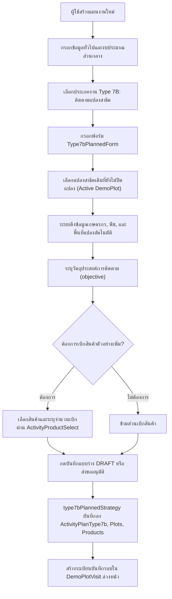
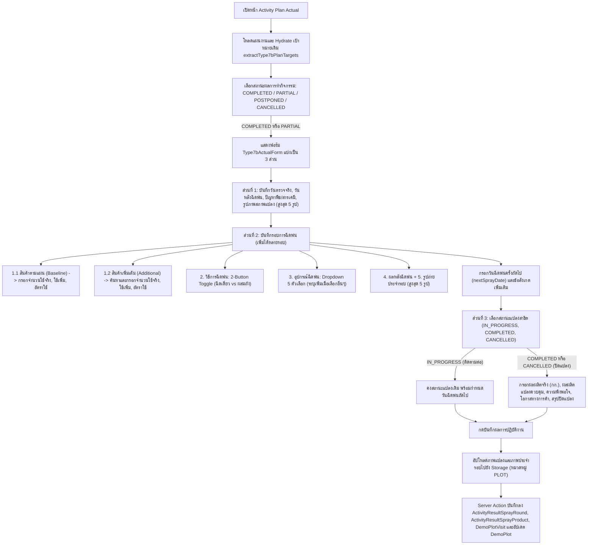
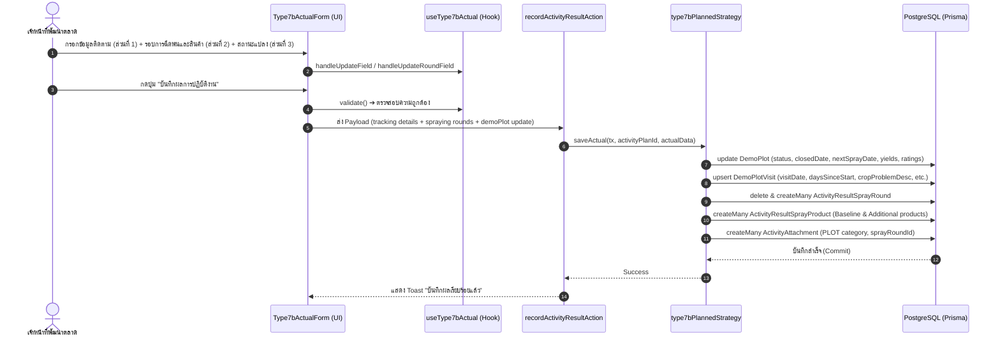

# Activity Type 7B — ติดตามแปลงสาธิต / Demo Plot Follow-up (README)

> **Feature Slice**: `modules/activity/features/type-7b`  
> **Standard Reference**: ออกแบบตามแนวทาง Vertical Slice Architecture อิงตามแม่แบบ Gold Standard Type 1  
> **Parent Module**: `modules/activity`  
> **Database Authority**: `prisma/schema.prisma` (`ActivityPlanType7b`, `ActivityPlanType7bPlot`, `ActivityPlanType7bProduct`, `DemoPlotVisit`, `DemoPlot`, `ActivityResultSprayRound`, `ActivityResultSprayProduct`, `ActivityResultSprayExternal`, `ActivityResultDemoItem`, `ActivityAttachment`)  
> **Status**: Production Ready / Active Reference (v2.2.0 — Updated 2026-10-24)

---

## 1. Overview

### 1.1 วัตถุประสงค์ของ Type 7B
**Type 7B (ติดตามแปลงสาธิต / Demo Plot Follow-up)** มีวัตถุประสงค์เพื่อรองรับการปฏิบัติงานของเจ้าหน้าที่พัฒนาตลาดและนักวิชาการเกษตร (Market Development Representatives / Technical Agronomists) ในการลงพื้นที่เข้าติดตามผลการเจริญเติบโต การประเมินผลการใช้สารเคมี และการบันทึกผลการทดลองในแปลงสาธิตเดิมที่เคยจัดตั้งไว้ใน Type 7A (จัดทำแปลงสาธิต):
1. **เลือกแปลงสาธิตเดิมที่ต้องการติดตาม:** ดึงจากแปลงสาธิตที่เปิดอยู่ทั้งหมดในระบบ (`status !== COMPLETED`, `status !== CANCELLED` และ `closedDate === null`) ทั้งแปลงที่มีแผนกิจกรรมต้นทาง (Grouped by Plan) และแปลงสาธิตเดี่ยว (Standalone Plots)
2. **วางแผนเบิกสินค้าตัวอย่างเพิ่มเติมสำหรับการพ่นสารรอบถัดไป:** วางแผนเบิกสินค้า (`withdrawnProducts` / `products`) ล่วงหน้าพร้อมส่งขออนุมัติตามสายงาน
3. **บันทึกผลการปฏิบัติงานจริงหน้างาน (Follow-up Evaluation & Multiple Spraying Rounds):**
   - **ส่วนที่ 1: ข้อมูลการติดตามแปลง (Tracking Details):**
     - วันที่ตรวจจริง (`visitDate`), จำนวนวันหลังฉีดพ่น (`daysAfterSpray` / `daysSinceStart`)
     - สภาพและปัญหาของพืช (`cropProblemDesc`), ปัญหาที่เกิดจากการใช้สินค้า (`productProblemDesc`)
     - ภาพถ่ายสภาพแปลงและการติดตามการเจริญเติบโต (หมวดหมู่ `PLOT`) สูงสุด 5 รูป
   - **ส่วนที่ 2: ข้อมูลการฉีดพ่นแต่ละรอบ (Multiple Spraying Rounds):**
     - รองรับการเพิ่มรอบการฉีดพ่นได้หลายรอบ (`sprayRounds: Type7bSprayRoundState[]`)
     - **1.1 รายการสินค้าตามแผนงาน (Planned Baseline Products):** แสดงรายการสินค้าที่เบิกตามแผนพร้อมจำนวนที่เบิก (`withdrawnQuantity`) พร้อมช่องบันทึก 3 คอลัมน์มาตรฐาน ได้แก่ จำนวนที่ใช้จริง (`actualQuantity`), ปริมาณที่ใช้เพิ่ม ซีซี/กรัม (`extraQuantity`), และอัตราการใช้ (`applicationRate`)
     - **1.2 สินค้าเพิ่มเติมในการปฏิบัติงาน (Additional Products):** รองรับการเพิ่มสินค้าที่ใช้นอกแผนหน้างาน ค้นหาผ่าน `ActivityProductSelect` เต็มความกว้าง พร้อมบันทึก 3 คอลัมน์มาตรฐานเช่นเดียวกับ Baseline
     - **2. วิธีการฉีดพ่น (Spray Method):** ปุ่มสลับ 2 ตัวเลือก (2-Button Pill Toggle) ระหว่าง "ฉีดเดี่ยว (Single)" และ "ผสมถัง (Tank-mixed)"
        - กรณีเลือก "ผสมถัง (Tank-mixed)": แสดง Checkbox "มียาใช้ภายนอก (ไม่บังคับ)" (`hasExternalChemicals`)
        - เมื่อติ๊กเลือก "มียาใช้ภายนอก": แสดงกล่องรายการยาภายนอกที่ใช้ร่วม พร้อมปุ่ม "+ เพิ่มยาภายนอก" และกริด 6 ฟิลด์มาตรฐานตามแบบ Type 7A (บริษัท, ชื่อสินค้า, สารออกฤทธิ์, สูตร SL/SC/EC/อื่นๆ, ระบุสูตรเพิ่มเติม, อัตราการใช้)
     - **3. อุปกรณ์ที่ใช้ฉีดพ่น (Spray Equipment):** เมนูดรอปดาวน์ `ActivitySelect` 5 ตัวเลือกมาตรฐาน (`SPRAY_EQUIPMENT_OPTIONS`) ได้แก่ เครื่องพ่นสะพายหลัง (เครื่องยนต์ / แบตเตอรี่), เครื่องพ่นปั๊มลากสาย, โดรนเพื่อการเกษตร, แอร์บัส / รถพ่นยา, และ อื่นๆ (ระบุ) (พร้อม input กรอกระบุอุปกรณ์เพิ่มเติม)
     - **4. ผลหลังการฉีดพ่นรอบนี้ (Spray Response):** พืชตอบสนองดี (เห็นผลตามเป้าหมาย), เกิดความเป็นพิษต่อพืช (Phytotoxicity), ไม่เห็นความแตกต่างอย่างมีนัยสำคัญ, อื่นๆ
     - **5. รูปถ่ายการฉีดพ่นประจำรอบ (Spray Round Images):** ภาพถ่ายการปฏิบัติงานและสภาพแปลงประจำรอบนั้นๆ สูงสุด 5 รูปต่อรอบ
     - **ข้อมูลท้ายส่วนที่ 2:** กำหนดวันฉีดพ่นครั้งถัดไป (`nextSprayDate`) และข้อสังเกตหรือข้อมูลเพิ่มเติม (`notes`)
   - **ส่วนที่ 3: สถานะแปลงสาธิตและการปิดแปลง (Demo Plot Status & Final Closure):**
     - สถานะแปลงสาธิตหลังตรวจรอบนี้: "อยู่ระหว่างการทดลอง (ยังคงติดตามต่อ)" (`IN_PROGRESS`), "เสร็จสิ้น/ปิดแปลงสาธิต" (`COMPLETED`), หรือ "ยกเลิก/ยุติแปลงสาธิต" (`CANCELLED`)
     - เมื่อเลือกปิดแปลง (`COMPLETED` หรือ `CANCELLED`): ระบบจะแสดงฟอร์มประเมินผลผลิต ได้แก่ ผลผลิตแปลงสาธิต (`demoYieldKg`), ผลผลิตแปลงควบคุม (`controlYieldKg`), คะแนนความพึงพอใจของเกษตรกร (`farmerSatisfaction`: 1-5), โอกาสทางการค้า (`commercialPotential`), วันที่เก็บเกี่ยวผลผลิต (`finalHarvestDate`), และสรุปผลสัมฤทธิ์และข้อเสนอแนะ (`finalSummaryNotes`)

### 1.2 ขอบเขตของ Type 7B
- **ความสัมพันธ์กับแปลงสาธิตและ Type 7A (Source Linkage):**
  - Type 7B เชื่อมโยงกับ Type 7A ผ่านฟิลด์ `sourceActivityPlanId` หรืออ้างอิง `demoPlotId` ใน Master Table `DemoPlot`
  - รองรับการเลือกแปลงสาธิตที่เปิดอยู่ทั้งหมดในระบบ (`status: { notIn: [CANCELLED, COMPLETED] }, closedDate: null`) ทั้งแปลงที่มีแผนกิจกรรมต้นทางและแปลงเดี่ยว ผ่าน `findFollowUpDemoPlots()` และ `findFollowUpActivityPlans()`
- **ระบบบันทึกประวัติการเข้าตรวจ (Demo Plot Visit Logging):**
  - ทุกครั้งที่มีการติดตาม ระบบจะบันทึกประวัติการลงพื้นที่เข้าสู่ตาราง `DemoPlotVisit` (`demo_plot_visits`) อัตโนมัติ โดยระบุรอบการเข้าตรวจ (`visitNumber`), วันที่ตรวจ (`visitDate`) และคำนวณจำนวนวันนับจากวันเริ่มแปลง (`daysSinceStart`)
- **ระบบจัดเก็บรอบการฉีดพ่นและสินค้า (Spray Rounds & Products):**
  - จัดเก็บรอบการฉีดพ่นลงในตาราง `ActivityResultSprayRound` (`activity_result_spray_rounds`)
  - จัดเก็บสินค้าในแต่ละรอบลงในตาราง `ActivityResultSprayProduct` (`activity_result_spray_products`) ทั้งสินค้าตามแผน (`baselineRate`, `isPlanned`) และสินค้าเพิ่มเติมหน้างาน
- **การจัดประเภทสภาพแปลงและการตอบสนอง (Evaluation Classifications):**
  - **อุปกรณ์ฉีดพ่น (`SPRAY_EQUIPMENT_OPTIONS`):** เครื่องพ่นสะพายหลัง (เครื่องยนต์ / แบตเตอรี่), เครื่องพ่นปั๊มลากสาย, โดรนเพื่อการเกษตร, แอร์บัส / รถพ่นยา, อื่นๆ (ระบุ)
  - **วิธีการฉีดพ่น (`SPRAY_METHOD_RADIO_OPTIONS`):** ฉีดเดี่ยว (Single), ผสมถัง (Tank-mixed)
  - **การตอบสนองต่อผลิตภัณฑ์ (`SPRAY_RESPONSE_OPTIONS`):** พืชตอบสนองดี (เห็นผลตามเป้าหมาย), ยังไม่เห็นผลชัดเจน, พบปัญหา / พืชมีอาการผิดปกติ
  - **โอกาสทางการค้า (`COMMERCIAL_POTENTIALS`):** สูงมาก (พร้อมขยายผลเชิงพาณิชย์), สูง (เกษตรกรสนใจมาก), ปานกลาง (ต้องติดตามผลเพิ่มเติม), น้อย (ยังไม่เห็นความแตกต่างชัดเจน)
  - **คะแนนความพึงพอใจ (`SATISFACTION_SCORES`):** 1 (ไม่พึงพอใจ) ถึง 5 (พึงพอใจมากที่สุด)
- **การจัดเก็บข้อมูลแบบ Dedicated & Dual Persistence:**
  - **Dedicated Plan Tables:** `ActivityPlanType7b` (`activity_plan_type_7b`), `ActivityPlanType7bPlot` (`activity_plan_type_7b_plots`), และ `ActivityPlanType7bProduct` (`activity_plan_type_7b_products`)
  - **Visit Tracking:** `DemoPlotVisit` (`demo_plot_visits`)
  - **Master Updates:** อัปเดตสถานะ, `closedDate`, `nextSprayDate`, ผลผลิต และคะแนนประเมินลงใน `DemoPlot` (`demo_plots`) *(หมายเหตุ: ตาราง `demo_plots` ไม่มีฟิลด์ `lastVisitDate` โดยวันที่ตรวจบันทึกลง `demo_plot_visits`)*
  - **Actual Spray Tables:** `ActivityResultSprayRound` (`activity_result_spray_rounds`) และ `ActivityResultSprayProduct` (`activity_result_spray_products`)
  - **Attachments:** `ActivityAttachment` (หมวดหมู่ `PLOT` ทั้งภาพติดตามและภาพประจำรอบที่ผูก `sprayRoundId`)

### 1.3 รูปแบบการทำงานที่รองรับ
1. **Planned (ในแผนงาน Trip Plan):** เลือกแปลงสาธิตเดิม พร้อมขอเบิกสินค้าตัวอย่างเพิ่มเติมล่วงหน้า ส่งขออนุมัติตามสายงาน
2. **Planned Actual (บันทึกผลงานตามแผน):** นำเป้าหมายที่ได้รับอนุมัติมารายงานผลการติดตามจริง แบ่งเป็น 3 ส่วน (ข้อมูลติดตามแปลง, การฉีดพ่นรอบต่างๆ พร้อม Baseline/Additional Products, และสถานะแปลงสาธิต/ปิดแปลง)
3. **Unplanned (กิจกรรมนอกแผน 2-in-1):** รองรับการลงพื้นที่ติดตามแปลงหน้างานโดยไม่ได้วางแผนล่วงหน้า สามารถเลือกแปลงสาธิตเดิม ประเมินสภาพพืช ถ่ายภาพ และประเมินผลปิดแปลงจบในฟอร์มเดียว พร้อมสร้างแผนงานสถานะ `COMPLETED` ทันที
4. **Detail View:** แสดงผลการติดตามแปลงสาธิตผ่าน `Type7bDetailView` ครบทั้ง 3 ส่วน พร้อมประวัติการเข้าตรวจย้อนหลัง ข้อมูลการฉีดพ่น และแกลเลอรีรูปภาพ
5. **Approval View:** การ์ดสำหรับผู้บังคับบัญชาพิจารณาอนุมัติผ่าน `Type7bApprovalCard` สรุปแปลงสาธิตและสินค้าที่ขอเบิกเพิ่มเติม

---

## 2. Business Flows

### 2.1 Planned (สร้างและแก้ไขแผนงาน)


### 2.2 Planned Actual (บันทึกผลการปฏิบัติงานตามแผน)


### 2.3 Unplanned (กิจกรรมนอกแผน 2-in-1)
- ผู้ใช้งานเข้าหน้า `/activity-plans/unplanned/new`
- ฟอร์ม `Type7bUnplannedForm` ผสานทั้งส่วนเลือกแปลงสาธิตเดิม (เลือกจากรายการแปลงสาธิตที่กำลังดำเนินการ) และส่วนบันทึกผลการติดตามจริง จบในฟอร์มเดียว
- เมื่อกดบันทึก ระบบตรวจสอบผ่าน `validateType7bUnplannedItems` และแปลง Payload ผ่าน `mapType7bUnplannedToPayload`
- `type7bUnplannedStrategy.savePlan()` จะบันทึกเป้าหมายแปลง บันทึกประวัติรอบการตรวจลง `DemoPlotVisit` และบันทึกผลงานลงฐานข้อมูลพร้อมกันใน `$transaction` เดียวกัน โดยแผนงานมีสถานะเสร็จสิ้นสมบูรณ์

### 2.4 Detail and Approval (ดูรายละเอียดและพิจารณาอนุมัติ)
- **Detail View:** `DetailWorkTypeList` เรียกใช้ `Type7bDetailView` เพื่อแสดงข้อมูลแปลงสาธิต ข้อมูลการติดตามแปลง (ส่วนที่ 1) รายการรอบการฉีดพ่นพร้อมสินค้า Baseline/Additional และอุปกรณ์พ่น (ส่วนที่ 2) สถานะแปลงสาธิตและผลสรุปปิดแปลง (ส่วนที่ 3) และแกลเลอรีรูปถ่าย
- **Approval View:** `ApprovalWorkTypeList` เรียกใช้ `Type7bApprovalCard` เพื่อให้หัวหน้างานพิจารณาอนุมัติการขอเข้าติดตามแปลงสาธิตและรายการสินค้าที่ขอเบิกเพิ่มเติม

---

## 3. Architecture

### 3.1 Folder Structure
```text
modules/activity/features/type-7b/
├── index.ts                                    # Unified Public API Contract (ส่งออกเฉพาะสิ่งที่ภายนอกต้องใช้)
├── README.md                                   # เอกสารคู่มือทางเทคนิค (ไฟล์นี้)
│
├── planned/                                    # Sub-slice: กิจกรรมในแผนงานและบันทึกผลตามแผน
│   ├── application/                            # Business Logic, Validation, Mappers
│   │   ├── actual-mapper.ts                    # แปลงผลงานจริง Form <-> DB/Payload (parseType7bActualResult)
│   │   ├── actual-validation.ts                # ตรวจสอบความถูกต้องของผลงานจริง (validateType7bActual)
│   │   ├── planned-mapper.ts                   # แปลงเป้าหมายในแผน Form <-> DB / Hydration (extractType7bPlanTargets, hydrateType7bPlannedData)
│   │   └── planned-validation.ts               # ตรวจสอบความถูกต้องของแผน (validateType7bFormItems)
│   ├── components/                             # UI Components ประจำ Type 7B ในแผน
│   │   ├── type7b-planned-form.tsx             # ฟอร์มเลือกแปลงสาธิตและเบิกสินค้าตามแผน
│   │   ├── type7b-actual-form.tsx              # ฟอร์มบันทึกผลติดตามจริง (3 ส่วน: ติดตาม + รอบฉีดพ่น + สถานะแปลง)
│   │   ├── type7b-plan-card.tsx                # การ์ดสรุปเป้าหมายติดตามแปลงตามแผนงาน
│   │   ├── type7b-detail-view.tsx              # คอมโพเนนต์แสดงผลเต็มรูปแบบในหน้ารายละเอียด (รองรับ Multi-round)
│   │   └── type7b-approval-card.tsx            # การ์ดสรุปสำหรับหน้าพิจารณาอนุมัติ
│   ├── hooks/                                  # Custom State Hooks
│   │   ├── use-type7b-planned-form.ts          # จัดการ State เลือกแปลงและสินค้าที่ขอเบิกตามแผน
│   │   └── use-type7b-actual.ts                # จัดการ State บันทึกผลติดตามจริง, รอบการฉีดพ่น, สินค้า และอัปโหลดภาพ
│   ├── infrastructure/                         # Database Strategies & Repositories
│   │   ├── type7b.repository.ts                # createType7bData, syncType7bData, findFollowUpDemoPlots, findFollowUpActivityPlans, findType7bByPlanId
│   │   └── type7b-planned.strategy.ts          # Strategy บันทึก/โหลดข้อมูล ActivityPlanType7b, DemoPlotVisit, Spray Rounds, DemoPlot
│   └── types/                                  # Type Definitions ในแผน
│       ├── planned.types.ts                    # Type7bPlanItem, Type7bTargetItem, Type7bPlanCardProps ฯลฯ
│       └── actual.types.ts                     # Type7bActualRecord, Type7bSprayRoundState, Type7bBaselineProductItem, Type7bAdditionalProductItem
│
├── unplanned/                                  # Sub-slice: กิจกรรมนอกแผน (2-in-1)
│   ├── application/                            # Logic และ Mappers กิจกรรมนอกแผน
│   │   ├── unplanned-mapper.ts                 # Hydration และ Data mapping นอกแผน
│   │   └── unplanned-validation.ts             # Validation กิจกรรมนอกแผน (validateType7bUnplannedItems)
│   ├── components/                             # UI Components กิจกรรมนอกแผน
│   │   └── type7b-unplanned-form.tsx           # ฟอร์ม 2-in-1 (เลือกแปลง + บันทึกผลติดตาม + ปิดแปลง + รูปถ่าย)
│   ├── hooks/                                  # Custom State Hooks
│   │   └── use-type7b-unplanned-form.ts        # จัดการ State ติดตามแปลงนอกแผน
│   ├── infrastructure/                         # Database Strategies นอกแผน
│   │   └── type7b-unplanned.strategy.ts        # บันทึกกิจกรรมนอกแผนลง Prisma ผสาน DemoPlotVisit และผลงานจริง
│   └── types/                                  # Type Definitions นอกแผน
│       └── unplanned.types.ts                  # Type7bUnplannedItem, Type7bUnplannedFormProps
│
└── shared/                                     # ชิ้นส่วนที่ใช้ร่วมกันภายใน Feature Type 7B
    ├── constants.ts                            # SPRAY_EQUIPMENT_OPTIONS, SPRAY_METHOD_RADIO_OPTIONS, SPRAY_RESPONSE_OPTIONS, DEMO_PLOT_STATUS_OPTIONS
    └── types.ts                                # Type7bWithdrawnProductLine, Type7bPlotInput, Type7bProductInput, Type7bDataInput, ImageFile
```

### 3.2 Type 7B vs Shared Activity
| ความรับผิดชอบ | จัดการที่ Type 7B Feature (`features/type-7b`) | จัดการที่ Activity ส่วนกลาง (`ui/`, `views/`) |
| :--- | :--- | :--- |
| **ข้อมูลทั่วไป** | - | ชื่องาน, วันที่เริ่ม-สิ้นสุด, วัตถุประสงค์หลัก, ผู้ร่วมเดินทาง |
| **พื้นที่ & ทีมงาน** | - | จังหวัด, อำเภอ, ตำบล, พนักงานร่วมเดินทาง |
| **งบประมาณ** | - | งบเบิกสินค้าตัวอย่างเพิ่มเติม, ค่าใช้จ่ายเดินทาง |
| **เป้าหมายติดตามแปลง** | เลือกแปลงเดิมที่ยังไม่ปิดแปลง, สินค้าที่ขอเบิกเพิ่ม | - |
| **ผลการติดตามจริง (3 ส่วน)** | ข้อมูลติดตามแปลง (ส่วนที่ 1), รอบการฉีดพ่นและสินค้า (ส่วนที่ 2), สถานะแปลงและผลผลิตปิดแปลง (ส่วนที่ 3) | ผลสรุปภาพรวมแผน (สำเร็จ/เลื่อน/ยกเลิก) |
| **Database Persistence** | `ActivityPlanType7b`, `ActivityPlanType7bPlot`, `ActivityPlanType7bProduct`, `DemoPlotVisit`, `ActivityResultSprayRound`, `ActivityResultSprayProduct`, อัปเดต `DemoPlot` | ตารางหลัก `ActivityPlan`, `ActivityPlanApprovalLog`, `ActivityAttachment` |

### 3.3 Dependency and Import Map
- **ทิศทางการเรียกใช้ (Allowed):**
  - `views/` ➔ เรียกใช้ ➔ `features/type-7b` (ผ่าน `index.ts` เท่านั้น)
  - `features/type-7b` ➔ เรียกใช้ ➔ `@/modules/activity/ui` (`ActivityInput`, `ActivityTextarea`, `ActivitySelect`, `ActivityCombobox`, `ActivityProductSelect`, `ActivityPhotoUpload`)
  - `features/type-7b` ➔ เรียกใช้ ➔ `@/modules/activity/constants`
  - `features/type-7b` ➔ เรียกใช้ ➔ `@/modules/activity/types/strategy.interface`
- **Server Actions & Database Flow:**
  - `views/` ➔ ส่งข้อมูลไปยัง ➔ Server Actions ใน `@/modules/activity/server/`:
    - `planned.actions.ts` (`createActivityPlanAction`, `updateActivityPlanAction`, `getActivityPlanAction`)
    - `unplanned.actions.ts` (`createUnplannedActivityAction`, `updateUnplannedActivityAction`, `getUnplannedActivityAction`)
    - `actual.actions.ts` (`recordActivityResultAction`)
  - Server Actions ➔ ทำงานร่วมกับ ➔ `@/modules/activity/infrastructure/strategy.registry` ➔ เรียกใช้ `type7bPlannedStrategy` / `type7bUnplannedStrategy` บันทึกลงตาราง Dedicated และอัปเดต Master Tables ภายใน `$transaction`
- **สิ่งต้องห้าม (Strictly Forbidden):**
  - ❌ ภายนอก Import เจาะลึกเข้าไปในโฟลเดอร์ย่อย เช่น `features/type-7b/planned/components/...`
  - ❌ `features/type-7b` เรียกใช้ข้อมูลข้ามไปยัง `features/type-1` ถึง `type-6`, `type-7a` หรือ `type-8` ถึง `type-14`
  - ❌ Import ย้อนกลับไปยังโมดูลเก่า `@/modules/activity-plans/...` โดยเด็ดขาด

### 3.4 Entry Points and Public Exports
ไฟล์ [modules/activity/features/type-7b/index.ts](file:///d:/code/crm-bank/modules/activity/features/type-7b/index.ts) ทำหน้าที่เป็น **Single Public API Contract** สำหรับฝั่ง UI / Application โดยส่งออกเฉพาะ:
- **Components:** `Type7bPlannedForm`, `Type7bPlanCard`, `Type7bActualForm`, `Type7bDetailView`, `Type7bApprovalCard`, `Type7bUnplannedForm`
- **Hooks:** `useType7bPlannedForm`, `useType7bActual`, `useType7bUnplannedForm`
- **Mappers & Hydrators:** `extractType7bPlanTargets`, `hydrateType7bPlannedData`, `mapType7bToSectionItems`, `parseType7bActualResult`, `hydrateType7bUnplannedData`, `mapType7bUnplannedToPayload`
- **Validators & Schemas:** `validateType7bFormItems`, `validateType7bActual`, `validateType7bUnplannedItems`
- **Constants & Types:** `WORK_TYPE_CODE`, `WORK_TYPE_NAME`, `SPRAY_EQUIPMENT_OPTIONS`, `SPRAY_METHOD_RADIO_OPTIONS`, `SPRAY_RESPONSE_OPTIONS`, `DEMO_PLOT_STATUS_OPTIONS`, `CROP_CONDITIONS`, `PRODUCT_RESPONSES`, `COMMERCIAL_POTENTIALS`, `SATISFACTION_SCORES`, `Type7bPlanItem`, `Type7bTargetItem`, `Type7bPlanCardTarget`, `Type7bPlanCardProps`, `Type7bPlannedFormProps`, `Type7bActualRecord`, `Type7bActualFormProps`, `Type7bDetailViewProps`, `Type7bApprovalCardProps`, `Type7bBaselineProductItem`, `Type7bAdditionalProductItem`, `Type7bSprayRoundState`, `DemoPlotVisitHistoryItem`, `Type7bUnplannedItem`, `Type7bUnplannedFormProps`

---

## 4. File Responsibilities

### 4.1 Planned & Actual
- **`use-type7b-planned-form.ts`:** จัดการ State การเลือกแปลงสาธิตต้นทาง (Array of `Type7bPlanItem`), รองรับการเลือกแผน Type 7A ต้นทาง (`selectedPlanId`), เลือกแปลงย่อย (`selectedPlotIds`), จัดการสินค้าที่ขอเบิกเพิ่ม (`withdrawnProducts`), และแปลง Payload สำหรับบันทึกแผนงาน (`mapType7bPayload`)
- **`type7b-planned-form.tsx`:** ฟอร์มสร้าง/แก้ไขแผนงาน แสดงตัวเลือกแปลงสาธิตที่เปิดอยู่ทั้งหมดในระบบ พร้อมตัวเลือกเบิกสินค้าตัวอย่างเพิ่มเติมผ่าน `ActivityProductSelect`
- **`type7b-plan-card.tsx`:** การ์ดสรุปเป้าหมายติดตามแปลงตามแผน แสดงชื่อแปลง เกษตรกร ชนิดพืช และสินค้าที่ขอเบิก
- **`type7b-actual-form.tsx`:** ฟอร์มบันทึกผลการติดตามจริงหน้างาน โครงสร้าง 3 ส่วน:
  - ส่วนที่ 1: ข้อมูลการติดตามแปลง (วันตรวจจริง, วันหลังฉีดพ่น, ปัญหาพืช/สารเคมี, รูปภาพสภาพแปลง)
  - ส่วนที่ 2: ข้อมูลการฉีดพ่นแต่ละรอบ (เพิ่ม/ลบรอบได้, Baseline Products, Additional Products, 2-Button Toggle วิธีการฉีดพ่น, Dropdown อุปกรณ์ฉีดพ่น 5 ตัวเลือก, ผลหลังการฉีดพ่น, รูปภาพประจำรอบ, กำหนดวันฉีดพ่นถัดไป และข้อสังเกตเพิ่มเติม)
  - ส่วนที่ 3: สถานะแปลงสาธิต (IN_PROGRESS, COMPLETED, CANCELLED พร้อมฟอร์มประเมินผลผลิตและปิดแปลงเมื่อจบการทดลอง)
- **`use-type7b-actual.ts`:** จัดการ State ผลการติดตามจริง, รองรับการจัดการรอบการฉีดพ่น (`handleAddRound`, `handleRemoveRound`, `handleUpdateRoundField`), การจัดการสินค้าเพิ่มเติม (`handleAddAdditionalProduct`, `handleRemoveAdditionalProduct`), การจัดการรูปภาพประจำรอบ (`handleUpdateRoundImages`), และการตรวจสอบความถูกต้อง (`validate`)
- **`type7b-detail-view.tsx`:** การ์ดแสดงผลในหน้ารายละเอียด แสดงผลข้อมูลครบทั้ง 3 ส่วน: ข้อมูลการติดตามแปลง, รายการรอบการฉีดพ่นและสินค้าที่ใช้จริง (3 คอลัมน์), สถานะแปลงสาธิต ผลผลิต และแกลเลอรีรูปภาพ
- **`type7b-approval-card.tsx`:** การ์ดสำหรับหน้าพิจารณาอนุมัติของหัวหน้างาน สรุปแปลงสาธิตและสินค้าที่ขอเบิก
- **`type7b.repository.ts`:** ฟังก์ชันระดับล่างสำหรับฐานข้อมูล (`createType7bData`, `syncType7bData`, `findFollowUpDemoPlots`, `findFollowUpActivityPlans`, `findType7bByPlanId`)
- **`type7b-planned.strategy.ts`:** Strategy บันทึกแผนงานและผลงานจริง:
  - `savePlan`: บันทึกข้อมูลลงตาราง `ActivityPlanType7b`, `ActivityPlanType7bPlot`, `ActivityPlanType7bProduct` และสร้างระเบียนรอบใน `DemoPlotVisit`
  - `saveActual`: บันทึกรอบการฉีดพ่นลง `ActivityResultSprayRound`, สินค้าที่ใช้ลง `ActivityResultSprayProduct`, ประวัติการเข้าตรวจลง `DemoPlotVisit`, อัปเดตสถานะและผลผลิตลง `DemoPlot` และบันทึกรูปภาพลง `ActivityAttachment`
  - `loadPlan`: โหลดข้อมูลเป้าหมายเดิม
- **`planned-mapper.ts` & `actual-mapper.ts`:** Mappers และ Hydrators สำหรับแปลงข้อมูล Form <-> DB Data Payload
- **`planned-validation.ts` & `actual-validation.ts`:** ตรวจสอบความถูกต้องของแผนงาน (`validateType7bFormItems`) และผลงานจริง (`validateType7bActual`)

### 4.2 Unplanned
- **`use-type7b-unplanned-form.ts`:** จัดการ State กิจกรรมนอกแผน 2-in-1 ที่รวมทั้งการเลือกแปลงสาธิตเดิม การประเมินสภาพพืช สินค้าที่เบิก รูปถ่าย และผลสรุปปิดแปลง
- **`type7b-unplanned-form.tsx`:** ฟอร์ม 2-in-1 สำหรับกิจกรรมนอกแผน แสดงตัวเลือกแปลงสาธิตเดิม ผลการประเมินสภาพพืช และกล้องถ่ายรูป
- **`unplanned-mapper.ts`:** Hydration และ Data mapping นอกแผน
- **`unplanned-validation.ts`:** ตรวจสอบความถูกต้องของรายการนอกแผน (`validateType7bUnplannedItems`)
- **`type7b-unplanned.strategy.ts`:** บันทึกกิจกรรมนอกแผนผ่าน Strategy

---

## 5. Data Flow



### 5.1 Save Actual (บันทึกผลการปฏิบัติงานจริง)
1. `activity-plan-actual-view.tsx` รันกระบวนการบันทึกผล
2. ตรวจสอบความถูกต้องด้วย `validateType7bActual(actualState)`:
   - ตรวจสอบ `sprayMethod`, `sprayEquipment` (หากเลือก "อื่นๆ (ระบุ)" ต้องกรอกข้อความระบุ)
   - ตรวจสอบ `problemDetail` (หากการตอบสนองพบปัญหา)
   - ตรวจสอบสินค้าเพิ่มเติมที่เพิ่มเข้ามา (ต้องเลือกสินค้า)
3. อัปโหลดภาพถ่ายการติดตามและภาพถ่ายประจำรอบการฉีดพ่นหมวดหมู่ `PLOT` ผ่าน `uploadActivityPlanImageGroup` ได้ Permanent URLs
4. ส่ง Payload เข้า `recordActivityResultAction(id, payload)`
5. `type7bPlannedStrategy.saveActual()` ทำงานใน `$transaction`:
   - อัปเดตสถานะและข้อมูลผลผลิตใน `demo_plots`: `status`, `closedDate`, `nextSprayDate`, `demoYieldKg`, `controlYieldKg`, `farmerSatisfaction`, `commercialPotential`, `finalSummaryNotes` *(ไม่มีฟิลด์ `lastVisitDate`)*
   - Upsert ระเบียนใน `demo_plot_visits`: `visitDate`, `daysSinceStart`, `cropProblemDesc`, `productProblemDesc`, `sprayMethod`, `sprayEquipment`, `otherEquipment`
   - ลบและสร้างใหม่ใน `activity_result_spray_rounds`: บันทึกข้อมูลแต่ละรอบการฉีดพ่น
   - สร้างระเบียนใน `activity_result_spray_products`: บันทึกสินค้า Baseline และ Additional ในแต่ละรอบ พร้อม `quantityUsed`, `extraQuantity`, `extraUnit`, `actualRate`
   - บันทึกภาพถ่ายลง `activity_attachments` โดยผูก `sprayRoundId` ตามรอบ

---

## 6. Data Models and Mapping

### 6.1 Database CRUD Matrix (สิทธิ์และการจัดการตารางในฐานข้อมูล)
| ตารางในฐานข้อมูล (`Prisma Model`) | Create (สร้าง) | Read (อ่าน/แสดงผล) | Update (แก้ไข) | Delete (ลบ) | หมายเหตุ |
| :--- | :--- | :--- | :--- | :--- | :--- |
| **`activity_plan_type_7b`**<br>(`ActivityPlanType7b`) | `createType7bData()` ใน `savePlan()` | โหลดรายละเอียดแผน Type 7B | อัปเดตข้อมูลแผนติดตาม | Cascade เมื่อลบ `ActivityPlan` | ตารางหลักแผนงานติดตามแปลงสาธิต |
| **`activity_plan_type_7b_plots`**<br>(`ActivityPlanType7bPlot`) | `createType7bData()` | รายการแปลงสาธิตที่เลือกติดตาม | ลบและสร้างใหม่ตามแผน | Cascade เมื่อลบ `ActivityPlanType7b` | ผูก `demoPlotId` กับแปลงหลัก |
| **`activity_plan_type_7b_products`**<br>(`ActivityPlanType7bProduct`) | `createType7bData()` | รายการสินค้าที่ขอเบิกเพิ่มเติม | ลบและสร้างใหม่ตามแผน | Cascade เมื่อลบ `ActivityPlanType7b` | เก็บสินค้าตัวอย่างที่ขอเบิกเพิ่ม |
| **`demo_plot_visits`**<br>(`DemoPlotVisit`) | `createType7bData()` / `saveActual()` | ประวัติการเข้าตรวจแปลง | อัปเดตผลตรวจและปัญหาพืช | Cascade เมื่อลบ `DemoPlot` | บันทึกประวัติรอบการลงพื้นที่จริง |
| **`activity_result_spray_rounds`**<br>(`ActivityResultSprayRound`) | `saveActual()` ใน Actual | โหลดรอบการฉีดพ่นใน Detail View | ลบและสร้างใหม่ใน `saveActual()` | Cascade เมื่อลบ `ActivityResult` | เก็บรอบการฉีดพ่น, วิธีการ, อุปกรณ์ และผลตอบสนอง |
| **`activity_result_spray_products`**<br>(`ActivityResultSprayProduct`) | `saveActual()` ใน Actual | โหลดสินค้าที่ใช้ในแต่ละรอบ | ลบและสร้างใหม่ใน `saveActual()` | Cascade เมื่อลบ `ActivityResultSprayRound` | เก็บสินค้าตามแผนและสินค้าเพิ่มเติม อัตราใช้ และจำนวน |
| **`demo_plots`**<br>(`DemoPlot`) | สร้างจาก Type 7A | ดึงข้อมูลแปลงสาธิตเดิม | อัปเดตสถานะ, วันฉีดถัดไป, ผลผลิตปิดแปลง | Cascade หรือ Soft-delete | Master Table แปลงสาธิต |
| **`activity_attachments`**<br>(`ActivityAttachment`) | Storage Upload + `saveActual()` | `plan.attachments` (หมวดหมู่ PLOT) | ลบรายการเก่าและสร้างใหม่ | Cascade เมื่อลบ `ActivityPlan` | เก็บล็อก URL ภาพถ่ายติดตามและภาพประจำรอบ (`sprayRoundId`) |

### 6.2 Complete Field-to-Database Mapping (ตารางจับคู่ฟิลด์ครบถ้วนทุกจุด)
ไล่จาก **Form Field ➔ Type Field ➔ Mapper ➔ Prisma Model ➔ DB Column Name ➔ Data Type**:

| Form Field (UI) | TypeScript Type Field | Mapper Function (Write/Read) | Prisma Model | DB Column Name | Data Type | Nullable? | Default |
| :--- | :--- | :--- | :--- | :--- | :--- | :---: | :--- |
| **แปลงสาธิตที่เลือก** | `demoPlotId` | `createType7bData` / `extractType7bPlanTargets` | `ActivityPlanType7bPlot` | `demo_plot_id` | `VARCHAR (FK)` | No | - |
| **แผนงานต้นทาง Type 7A** | `sourceActivityPlanId` | `createType7bData` | `ActivityPlanType7b` | `source_activity_plan_id` | `VARCHAR (FK)` | Yes | `null` |
| **วัตถุประสงค์การติดตาม** | `objective` | `createType7bData` | `ActivityPlanType7b` | `objective` | `TEXT` | Yes | `null` |
| **สินค้าที่ขอเบิกเพิ่ม (แผน)** | `products` / `withdrawnProducts` | `createType7bData` | `ActivityPlanType7bProduct` | `product_id`, `quantity` | `VARCHAR (FK)`, `DECIMAL` | No | - |
| **วันที่ตรวจจริง** | `t7VisitDate` | `saveActual` / `parseType7bActualResult` | `DemoPlotVisit` | `visit_date` | `TIMESTAMP` | No | `now()` |
| **จำนวนวันหลังฉีดพ่น** | `t7DaysAfterSpray` | `saveActual` / `parseType7bActualResult` | `DemoPlotVisit` | `days_since_start` | `INTEGER` | No | `0` |
| **สภาพและปัญหาของพืช** | `t7CropProblemDescription` | `saveActual` / `parseType7bActualResult` | `DemoPlotVisit` | `crop_problem_desc` | `TEXT` | Yes | `null` |
| **ปัญหาจากการใช้สินค้า** | `t7ProblemDescription` | `saveActual` / `parseType7bActualResult` | `DemoPlotVisit` | `product_problem_desc` | `TEXT` | Yes | `null` |
| **ภาพถ่ายสภาพแปลง** | `t7CropImages` | `saveActual` (หมวดหมู่ `PLOT`) | `ActivityAttachment` | `file_url`, `category: "PLOT"` | `TEXT` | No | - |
| **รอบการฉีดพ่น** | `sprayRounds[].roundNumber` | `saveActual` | `ActivityResultSprayRound` | `round_number` | `INTEGER` | No | `1` |
| **วิธีการฉีดพ่น** | `sprayRounds[].sprayMethod` | `saveActual` (2-button toggle) | `ActivityResultSprayRound` | `spray_method` | `VARCHAR` | No | `"SINGLE"` |
| **อุปกรณ์ที่ใช้ฉีดพ่น** | `sprayRounds[].sprayEquipment` | `saveActual` (dropdown 5 options) | `ActivityResultSprayRound` | `spray_equipment` | `VARCHAR` | No | `"เครื่องพ่นสะพายหลัง..."` |
| **อุปกรณ์อื่นๆ (ระบุ)** | `sprayRounds[].otherEquipment` | `saveActual` | `ActivityResultSprayRound` | `other_equipment` | `VARCHAR` | Yes | `null` |
| **ผลหลังการฉีดพ่นรอบนี้** | `sprayRounds[].productResponse` | `saveActual` | `ActivityResultSprayRound` | `product_response` | `VARCHAR` | No | `"พืชตอบสนองดี..."` |
| **รายละเอียดปัญหาการพ่น** | `sprayRounds[].problemDetail` | `saveActual` | `ActivityResultSprayRound` | `problem_detail` | `TEXT` | Yes | `null` |
| **ภาพถ่ายประจำรอบฉีดพ่น** | `sprayRounds[].roundImages` | `saveActual` (`sprayRoundId`) | `ActivityAttachment` | `file_url`, `spray_round_id` | `TEXT` | Yes | `null` |
| **สินค้า (Baseline / Add.)** | `productId`, `productName` | `saveActual` | `ActivityResultSprayProduct` | `product_id`, `product_name` | `VARCHAR (FK)`, `VARCHAR` | No | - |
| **จำนวนที่ใช้จริง** | `actualQuantity` / `quantityUsed` | `saveActual` | `ActivityResultSprayProduct` | `quantity_used` | `DECIMAL` | No | `1` |
| **ปริมาณที่ใช้เพิ่ม (ซีซี/กรัม)** | `extraQuantity` + `extraUnit` | `saveActual` (บันทึกลง detail) | `ActivityResultSprayProduct` | `detail` | `TEXT` | Yes | `null` |
| **อัตราการใช้** | `applicationRate` | `saveActual` | `ActivityResultSprayProduct` | `actual_rate` | `VARCHAR` | Yes | `null` |
| **กำหนดฉีดพ่นครั้งถัดไป** | `t7NextSprayDate` | `saveActual` | `DemoPlot` | `next_spray_date` | `TIMESTAMP` | Yes | `null` |
| **สถานะแปลงสาธิต** | `t7PlotStatus` | `saveActual` | `DemoPlot` | `status` | `ENUM (DemoPlotStatus)` | No | `"IN_PROGRESS"` |
| **ผลผลิตแปลงสาธิต (กก.)** | `t7FinalYieldKg` | `saveActual` (`new Prisma.Decimal()`) | `DemoPlot` | `demo_yield_kg` | `DECIMAL(12,2)` | Yes | `null` |
| **ผลผลิตแปลงควบคุม (กก.)** | `t7ControlYieldKg` | `saveActual` (`new Prisma.Decimal()`) | `DemoPlot` | `control_yield_kg` | `DECIMAL(12,2)` | Yes | `null` |
| **คะแนนความพึงพอใจ (1-5)** | `t7FarmerSatisfaction` | `saveActual` | `DemoPlot` | `farmer_satisfaction` | `INTEGER` | Yes | `null` |
| **โอกาสทางการค้า** | `t7CommercialPotential` | `saveActual` | `DemoPlot` | `commercial_potential` | `VARCHAR` | Yes | `null` |
| **สรุปผลสัมฤทธิ์และข้อเสนอแนะ**| `t7FinalSummaryNotes` | `saveActual` | `DemoPlot` | `final_summary_notes` | `TEXT` | Yes | `null` |

### 6.3 รายละเอียดตารางและความสัมพันธ์ (Prisma Schema Reference)

โครงสร้างฐานข้อมูลของ Type 7B แบ่งออกเป็น 2 ฝั่งตามวงจรการทำงาน (Plan vs Actual) ชัดเจน:

#### 1. ฝั่งแผนงาน (Planned Targets)
ใช้สำหรับบันทึกเป้าหมายแปลงที่จะไปติดตาม และรายการสินค้าที่ขอเบิกเพิ่มล่วงหน้าเพื่อส่งขออนุมัติ:

```prisma
// ตารางหลักแผนงานติดตามแปลงสาธิต (1:1 กับ ActivityPlan)
model ActivityPlanType7b {
  id                   String                      @id @default(cuid())
  activityPlanId       String                      @unique @map("activity_plan_id")
  sourceActivityPlanId String?                     @map("source_activity_plan_id") // อ้างอิงแผน 7A ต้นทาง
  hasProducts          Boolean                     @default(false) @map("has_products")
  objective            String?                     @map("objective") @db.Text // สิ่งที่ตั้งใจจะไปติดตามรอบนี้
  notes                String?                     @map("notes") @db.Text
  createdAt            DateTime                    @default(now()) @map("created_at")
  updatedAt            DateTime                    @updatedAt @map("updated_at")

  activityPlan         ActivityPlan                @relation(fields: [activityPlanId], references: [id], onDelete: Cascade)
  sourceActivityPlan   ActivityPlan?               @relation("Type7bSourcePlan", fields: [sourceActivityPlanId], references: [id], onDelete: SetNull)
  plots                ActivityPlanType7bPlot[]
  products             ActivityPlanType7bProduct[]

  @@index([activityPlanId])
  @@index([sourceActivityPlanId])
  @@map("activity_plan_type_7b")
}

// ตารางแปลงสาธิตที่เลือกติดตามตามแผน
model ActivityPlanType7bPlot {
  id         String             @id @default(cuid())
  type7bId   String             @map("type_7b_id")
  demoPlotId String             @map("demo_plot_id") // แปลงสาธิตที่เลือกติดตาม (Master DemoPlot)
  plotName   String?            @map("plot_name")
  cropName   String?            @map("crop_name")
  ownerName  String?            @map("owner_name")
  province   String?            @map("province")
  district   String?            @map("district")
  areaRai    Decimal?           @map("area_rai") @db.Decimal(10, 2)
  treeCount  Int?               @map("tree_count")
  dealerName String?            @map("dealer_name")
  createdAt  DateTime           @default(now()) @map("created_at")

  type7b     ActivityPlanType7b @relation(fields: [type7bId], references: [id], onDelete: Cascade)
  demoPlot   DemoPlot           @relation(fields: [demoPlotId], references: [id], onDelete: Restrict)

  @@index([type7bId])
  @@index([demoPlotId])
  @@map("activity_plan_type_7b_plots")
}

// ตารางสินค้าตัวอย่างที่ขอเบิกเพิ่มเติมตามแผน (Baseline Planned Products)
model ActivityPlanType7bProduct {
  id          String             @id @default(cuid())
  type7bId    String             @map("type_7b_id")
  productId   String             @map("product_id")
  productName String?            @map("product_name")
  quantity    Decimal            @default(1) @map("quantity") @db.Decimal(10, 2)
  unit        String?            @map("unit")
  sortOrder   Int                @default(0) @map("sort_order")
  createdAt   DateTime           @default(now()) @map("created_at")

  type7b      ActivityPlanType7b @relation(fields: [type7bId], references: [id], onDelete: Cascade)
  product     Product            @relation(fields: [productId], references: [id], onDelete: Restrict)

  @@index([type7bId])
  @@index([productId])
  @@map("activity_plan_type_7b_products")
}
```

#### 2. ฝั่งผลการปฏิบัติงานจริง (Actual Outcome)
ใช้สำหรับบันทึกผลการเข้าตรวจจริงในแปลง, รอบการฉีดพ่นสาร, สารเคมีที่ใช้จริง (ตามแผน/เพิ่มเติม/ยาภายนอก) และการปิดแปลง:

```prisma
// ตารางประวัติการเข้าตรวจแปลง (Visit Logging)
model DemoPlotVisit {
  id                 String    @id @default(cuid())
  demoPlotId         String    @map("demo_plot_id")
  activityPlanId     String?   @map("activity_plan_id")
  workTypeCode       String?   @map("work_type_code") // "TYPE_7B"
  visitNumber        Int       @map("visit_number")
  visitDate          DateTime  @default(now()) @map("visit_date")
  daysSinceStart     Int?      @map("days_since_start")
  cropCondition      String?   @map("crop_condition")
  growthStage        String?   @map("growth_stage")
  cropProblemDesc    String?   @map("crop_problem_desc")
  productResponse    String?   @map("product_response")
  productProblemDesc String?   @map("product_problem_desc")
  sprayMethod        String?   @map("spray_method")
  sprayEquipment     String?   @map("spray_equipment")
  otherEquipment     String?   @map("other_equipment")
  cropImageUrls      String[]  @default([]) @map("crop_image_urls")
  notes              String?   @map("notes")
  createdAt          DateTime  @default(now()) @map("created_at")

  demoPlot           DemoPlot  @relation(fields: [demoPlotId], references: [id], onDelete: Cascade)

  @@index([demoPlotId])
  @@index([activityPlanId])
  @@map("demo_plot_visits")
}

// ตารางรอบการฉีดพ่นประจำครั้งนี้ (Multiple Spraying Rounds)
model ActivityResultSprayRound {
  id               String                        @id @default(cuid())
  activityResultId String                        @map("activity_result_id")
  demoPlotId       String?                       @map("demo_plot_id")
  roundNumber      Int                           @default(1) @map("round_number")
  sprayDate        DateTime                      @map("spray_date")
  sprayMethod      String                        @default("SINGLE") @map("spray_method") // "SINGLE" | "TANK_MIXED"
  sprayEquipment   String                        @default("เครื่องพ่นสะพายหลัง (เครื่องยนต์ / แบตเตอรี่)") @map("spray_equipment")
  otherEquipment   String?                       @map("other_equipment")
  productResponse  String                        @default("พืชตอบสนองดี (เห็นผลตามเป้าหมาย)") @map("product_response")
  problemDetail    String?                       @map("problem_detail") @db.Text
  daysSinceStart   Int                           @default(0) @map("days_since_start")
  notes            String?                       @map("notes") @db.Text
  workTypeCode     String?                       @map("work_type_code") // "TYPE_7B"
  createdAt        DateTime                      @default(now()) @map("created_at")

  activityResult   ActivityResult                @relation(fields: [activityResultId], references: [id], onDelete: Cascade)
  products         ActivityResultSprayProduct[]
  externalProducts ActivityResultSprayExternal[]
  attachments      ActivityAttachment[]

  @@map("activity_result_spray_rounds")
}

// ตารางสินค้าในการฉีดพ่นแต่ละรอบ (ทั้ง 1.1 Baseline และ 1.2 Additional Products)
model ActivityResultSprayProduct {
  id               String                   @id @default(cuid())
  sprayRoundId     String                   @map("spray_round_id")
  productId        String                   @map("product_id")
  productName      String?                  @map("product_name")
  baselineRate     String?                  @map("baseline_rate") // มีค่า = สินค้าตามแผน (1.1), null = สินค้าเพิ่มเติมหน้างาน (1.2)
  actualRate       String                   @map("actual_rate")
  quantityUsed     Decimal                  @default(1) @map("quantity_used") @db.Decimal(10, 2)
  unit             String?                  @map("unit")
  detail           String?                  @map("detail") @db.Text // เก็บข้อความการใช้เพิ่ม เช่น "ใช้เพิ่ม 50 ซีซี"
  createdAt        DateTime                 @default(now()) @map("created_at")

  sprayRound       ActivityResultSprayRound @relation(fields: [sprayRoundId], references: [id], onDelete: Cascade)
  product          Product                  @relation(fields: [productId], references: [id], onDelete: Restrict)

  @@map("activity_result_spray_products")
}

// ตารางรายการยาภายนอกที่ใช้ร่วม กรณีผสมถัง (Tank-mixed External Chemicals)
model ActivityResultSprayExternal {
  id               String                   @id @default(cuid())
  sprayRoundId     String                   @map("spray_round_id")
  company          String                   @map("company")
  productName      String                   @map("product_name")
  activeIngredient String?                  @map("active_ingredient")
  formula          String                   @map("formula") // SL, SC, EC, อื่นๆ
  customFormula    String?                  @map("custom_formula")
  applicationRate  String                   @map("application_rate")

  sprayRound       ActivityResultSprayRound @relation(fields: [sprayRoundId], references: [id], onDelete: Cascade)

  @@map("activity_result_spray_externals")
}
```

---

## 7. Business Rules

### 7.1 Validation Rules
- **การวางแผนเป้าหมาย (`Type7bPlannedForm`):**
  - ต้องเลือกแปลงสาธิตที่ต้องการติดตามอย่างน้อย 1 แปลง (`demoPlotId` ห้ามว่าง)
- **การบันทึกผลงานจริง (`Type7bActualForm`):**
  - ต้องระบุวิธีการฉีดพ่น (`sprayMethod`: "SINGLE" หรือ "TANK_MIXED")
  - ต้องระบุอุปกรณ์ที่ใช้ฉีดพ่น (`sprayEquipment` ห้ามว่าง) หากเลือก "อื่นๆ (ระบุ)" ต้องระบุ `otherEquipment`
  - หากระบุผลการฉีดพ่นพบปัญหา ต้องระบุรายละเอียดปัญหา (`problemDetail`)
  - สินค้าเพิ่มเติม (Additional Products): หากกดเพิ่มสินค้าแล้ว ต้องเลือกสินค้า (`productId` ห้ามว่าง)
  - หากเลือกปิดแปลง (`t7PlotStatus === "COMPLETED"` หรือ `"CANCELLED"`): ควรระบุผลผลิตแปลงสาธิต (`t7FinalYieldKg`) และคะแนนความพึงพอใจ (`t7FarmerSatisfaction`)

### 7.2 Default Values
- `workTypeCode`: `"TYPE_7B"`
- `sprayMethod`: `"SINGLE"`
- `sprayEquipment`: `"เครื่องพ่นสะพายหลัง (เครื่องยนต์ / แบตเตอรี่)"`
- `productResponse`: `"พืชตอบสนองดี (เห็นผลตามเป้าหมาย)"`
- `plotStatus`: `"IN_PROGRESS"`
- `farmerSatisfaction`: `5` (พึงพอใจมากที่สุด)
- `commercialPotential`: `"สูง (เกษตรกรสนใจมาก)"`

### 7.3 Conditional Fields
- **การเลือกอุปกรณ์อื่นๆ:** เมื่อเลือก `sprayEquipment === "อื่นๆ (ระบุ)"` จะแสดงช่องกรอกข้อความระบุชื่ออุปกรณ์
- **การปิดแปลงสาธิต (`plotStatus === "COMPLETED"` หรือ `"CANCELLED"`):** แสดงกล่องกรอกผลผลิตจริง (กก.), ผลผลิตแปลงควบคุม (กก.), คะแนนความพึงพอใจ, โอกาสทางการค้า, วันที่เก็บเกี่ยว และสรุปผลปิดแปลง
- **สินค้าเพิ่มเติมหน้างาน:** กด `+ เพิ่มสินค้า` เพื่อเปิดการ์ดกรอกสินค้าใหม่ พร้อมปุ่มลบถังขยะสีแดง

---

## 8. Shared Dependencies

โมดูล Type 7B ทำงานร่วมกับชิ้นส่วนส่วนกลางต่อไปนี้:
1. **`@/modules/activity/ui`:**
   - `ActivityInput`: คอมโพเนนต์ Input มาตรฐาน
   - `ActivityTextarea`: คอมโพเนนต์กรอกข้อความหลายบรรทัด
   - `ActivitySelect`: คอมโพเนนต์ดรอปดาวน์สำหรับเลือกอุปกรณ์ฉีดพ่น, ผลการตอบสนอง และสถานะแปลง
   - `ActivityProductSelect`: คอมโพเนนต์ค้นหาและเลือกสินค้าตัวอย่าง (ทั้งแบบเบิกตามแผนและสินค้าเพิ่มเติมหน้างาน)
   - `ActivityPhotoUpload`: คอมโพเนนต์อัปโหลดรูปภาพติดตามแปลงและรูปภาพประจำรอบ
2. **`@/modules/activity/views`:**
   - `planned-activity-form.tsx`: ฟอร์มหลักสำหรับสร้าง/แก้ไขแผนงาน
   - `activity-plan-actual-view.tsx` & `actual-work-type-list.tsx`: ตัวกระจายฟอร์มผลการปฏิบัติงานจริง
   - `detail-work-type-list.tsx`: ตัวกระจายการ์ดแสดงผลในหน้ารายละเอียด
   - `approval-work-type-list.tsx`: ตัวกระจายการ์ดในหน้าพิจารณาอนุมัติ
3. **`@/modules/activity/constants`:**
   - `WORK_TYPE_CONFIG`: การตั้งค่าและรหัสประเภทงาน (`TYPE_7B`)
4. **`@/modules/activity/infrastructure/strategy.registry`:**
   - `WORK_TYPE_STRATEGY_REGISTRY.TYPE_7B`: ลงทะเบียน `type7bPlannedStrategy` และ `type7bUnplannedStrategy`

---

## 9. How to Modify Type 7B

### 9.1 การเพิ่มฟิลด์ใหม่บนฟอร์มผลจริง (Add an Actual Field)
1. เพิ่มฟิลด์ใน `Type7bActualRecord` หรือ `Type7bSprayRoundState` ใน `planned/types/actual.types.ts`
2. เพิ่มเงื่อนไขตรวจสอบใน `actual-validation.ts` (`validateType7bActual`)
3. เพิ่ม Input Field ใน `planned/components/type7b-actual-form.tsx` และแสดงผลใน `type7b-detail-view.tsx`
4. อัปเดต Mapper ใน `actual-mapper.ts` (`parseType7bActualResult`)
5. อัปเดต Strategy ใน `type7b-planned.strategy.ts` (`saveActual`) เพื่อบันทึกลงตารางที่เกี่ยวข้อง

---

## 10. Troubleshooting & Tracing Pipeline

### 10.1 Step-by-Step Tracing Pipeline (คู่มือการไล่โค้ดเมื่อพบปัญหา)

```text
[Step 1: UI Field] ➔ Type7bActualForm.tsx (ตรวจว่าช่องกรอกผูกกับ actualState / round ถูกต้องหรือไม่)
        ↓
[Step 2: Hook State] ➔ use-type7b-actual.ts (ตรวจว่า t7SprayingRounds หรือ actualState เก็บค่าครบถ้วน)
        ↓
[Step 3: Save Mapper] ➔ handleSubmit() (ตรวจว่า payload ส่ง t7SprayingRounds, t7PlotStatus ไปด้วยหรือไม่)
        ↓
[Step 4: Server Action] ➔ recordActivityResultAction ➔ recordActivityResultUseCase
        ↓
[Step 5: Strategy Write] ➔ type7b-planned.strategy.ts: saveActual()
                          (ตรวจว่าบันทึกลง ActivityResultSprayRound, SprayProduct, DemoPlotVisit และ DemoPlot)
        ↓
[Step 6: Prisma Table] ➔ activity_result_spray_rounds, demo_plots, demo_plot_visits
        ↓
[Step 7: Loader & Include] ➔ getActivityPlanAction (ตรวจว่า include result.sprayRounds, type7b หรือไม่)
        ↓
[Step 8: Load Hydrator] ➔ actual-mapper.ts: parseType7bActualResult()
```

### 10.2 ตารางวิเคราะห์ปัญหาที่พบบ่อย (Common Pitfalls)

| อาการ | จุดที่ต้องตรวจสอบ | ต้นตอและวิธีแก้ไข |
| :--- | :--- | :--- |
| **Runtime Error: Unknown argument lastVisitDate in tx.demoPlot.update()** | `type7b-planned.strategy.ts` ➔ `saveActual` | โมเดล `DemoPlot` ใน `prisma/schema.prisma` ไม่มีฟิลด์ `lastVisitDate` (วันที่ตรวจจะบันทึกในตาราง `DemoPlotVisit.visit_date` เท่านั้น) ห้ามส่ง `lastVisitDate` เข้าไปยัง `tx.demoPlot.update()` |
| **ไม่มีแปลงสาธิตให้เลือกในหน้าสร้างแผน 7B** | `type7b.repository.ts` ➔ `findFollowUpActivityPlans` | ระบบจะแสดงเฉพาะแปลงสาธิตที่สถานะยังไม่ปิดแปลง (`status !== COMPLETED`, `status !== CANCELLED` และ `closedDate === null`) |
| **รูปภาพประจำรอบการฉีดพ่นหายหลังบันทึก** | `activity-plan-actual-view.tsx` ➔ `handleSubmit` | ตรวจสอบว่ารูปภาพในแต่ละรอบ (`roundImages`) ถูกอัปโหลดผ่าน `uploadActivityPlanImageGroup` ก่อนส่ง Payload ไปยัง Server Action หรือไม่ |
| **สินค้าเพิ่มเติมหน้างานไม่ถูกบันทึก** | `type7b-planned.strategy.ts` ➔ `saveActual` | ตรวจสอบว่า `additionalProducts` มี `productId` ระบุไว้ชัดเจนหรือไม่ หากไม่ได้เลือกสินค้าจะไม่ถูก insert |
| **Foreign key constraint violated on `activity_plan_type_7b_products_product_id_fkey`** | `type7b-planned-form.tsx`, `type7b.repository.ts` | เกิดจาก `ActivityProductSelect` ในส่วนเบิกสินค้าตามแผนส่งคืนชื่อสินค้าแทนที่จะเป็น `productId` (ไม่ได้กำหนด `valueKey="id"`) ทำให้ค่าที่ส่งบันทึกลงฟิลด์ `productId` เป็นสตริงชื่อสินค้าแทนที่จะเป็น CUID/UUID จริงในตาราง `Product`<br>แก้ไขโดย: 1) ระบุ `valueKey="id"` ใน `ActivityProductSelect` 2) ใน `type7b.repository.ts` เพิ่มการค้นหา `Product` ทั้งจาก `id` และ `name` เป็นเกราะป้องกันสองชั้น (Fallback resolution) และกรองรายการที่ไม่พบในฐานข้อมูลทิ้งเพื่อป้องกัน Foreign Key Constraint Violation |
| **หน้าแก้ไขแผนงาน (Trip Plan Edit) ไม่พบข้อมูลที่สร้าง** | `planned/edit-view.tsx`, `planned-mapper.ts`, `use-type7b-planned-form.ts`, `type7b-planned-form.tsx` | ใน `PlannedEditView` ขาดการส่งต่อข้อมูล `type7b`, `type7bData`, `type7bPlots` ไปยัง `initialData` ส่งผลให้ตัว Mapper `hydrateType7bPlannedData` ได้ค่าว่างและฟอร์มถูกเรนเดอร์เป็นค่าเริ่มต้นที่ว่างเปล่า<br>แก้ไขโดย: 1) ใน `PlannedEditView` ส่ง `type7b`, `type7bData`, `type7bPlots`, `type7bProducts` และ spread `...plan` เข้า `initialData` 2) เสริมระบบ Fallback ใน `hydrateType7bPlannedData` 3) เพิ่ม `useEffect` re-sync ใน `useType7bPlannedForm` 4) เสริม Resilience ใน `effectiveFollowUpPlans` ของ `Type7bPlannedForm` ให้สังเคราะห์ตัวเลือกแผนและแปลงเดิมทันทีแม้ข้อมูลแผนต้นทางยังโหลดไม่เสร็จหรือถูกกรองออก |

---

## 11. Testing and Manual UAT

### แผนการทดสอบแบบครบวงจร (End-to-End Test Checklist):
- [ ] **TC-01 (Planned Create):** สร้างแผนติดตามแปลงสาธิต เลือกแปลงสาธิตเดิม ขอเบิกสินค้าตัวอย่างเพิ่ม บันทึกแบบร่าง (DRAFT) และส่งขออนุมัติได้สำเร็จ
- [ ] **TC-02 (Planned Edit):** เข้าหน้าแก้ไข ข้อมูลแปลงที่เลือกและสินค้าที่ขอเบิกต้องแสดงครบถ้วน แก้ไขข้อมูลแล้วบันทึกสำเร็จ
- [ ] **TC-03 (Actual - Multi-round Spraying):** บันทึกผลติดตามจริง กรอกข้อมูลติดตามในส่วนที่ 1, เพิ่มรอบการฉีดพ่น 2 รอบในส่วนที่ 2, กรอก Baseline Products และ Additional Products พร้อมทดสอบ 2-button toggle และ Dropdown อุปกรณ์ฉีดพ่น
- [ ] **TC-04 (Actual - Other Equipment):** เลือกระบุอุปกรณ์ฉีดพ่นเป็น "อื่นๆ (ระบุ)" ตรวจสอบว่าช่องกรอกแสดงขึ้นมาและบังคับกรอก
- [ ] **TC-05 (Actual - Ongoing Visit):** เลือกสถานะแปลง `IN_PROGRESS`, กำหนดวันฉีดพ่นครั้งถัดไป บันทึกแล้วตรวจสอบว่าสถานะใน `demo_plots` ยังคงเป็น `IN_PROGRESS`
- [ ] **TC-06 (Actual - Final Closure):** เลือกสถานะแปลง `COMPLETED`, กรอกผลผลิตจริง (Yield), ผลผลิตแปลงควบคุม และคะแนนความพึงพอใจ ตรวจสอบว่าสถานะใน `demo_plots` เปลี่ยนเป็น `COMPLETED` และ `closedDate` ถูกบันทึก
- [ ] **TC-07 (Detail View):** เข้าหน้ารายละเอียดหลังบันทึกผลจริง ข้อมูลทั้ง 3 ส่วน รอบการฉีดพ่น สินค้าที่ใช้จริง และรูปถ่ายต้องแสดงผลครบถ้วน
- [ ] **TC-08 (Approval View):** ผู้บังคับบัญชาเข้าหน้าอนุมัติ ข้อมูลเป้าหมายแปลงติดตามและสินค้าที่ขอเบิกต้องแสดงในการ์ดอนุมัติถูกต้อง

---

## 12. Known Limitations and Important Notes

1. **Prisma DemoPlot Schema Rules:**
   - โมเดล `DemoPlot` **ไม่มีคอลัมน์ `lastVisitDate`** การบันทึกวันที่ตรวจแปลงจริงจะถูกเก็บไว้ที่ `DemoPlotVisit.visit_date` เสมอ
   - ฟิลด์วันที่ใน `DemoPlot` มีเพียง `startDate`, `plantingDate`, `initialSprayDate`, `nextSprayDate`, `closedDate`, `finalHarvestDate`
2. **Multi-round Image Persistence:**
   - รูปภาพประจำรอบการฉีดพ่นจัดเก็บใน `ActivityAttachment` โดยระบุ `sprayRoundId` เชื่อมกับ `ActivityResultSprayRound`
3. **Decoupling Dependency:**
   - ต้องนำเข้าค่าคงที่และฟังก์ชันจาก `@/modules/activity/constants` และคอมโพเนนต์จาก `@/modules/activity/ui` เท่านั้น ห้ามนำเข้าจาก `@/modules/activity-plans` โดยเด็ดขาด

---

## 13. Change Log

| วันที่ | เวอร์ชัน | รายละเอียดการปรับปรุง | ผู้ดำเนินการ |
| :--- | :--- | :--- | :--- |
| **2026-10-16** | 1.0.0 | สร้างโมดูล Type 7B เป็น Vertical Slice Architecture สำหรับการติดตามแปลงสาธิต | Antigravity AI |
| **2026-10-18** | 1.1.0 | พัฒนาระบบดึงแปลงสาธิตที่เสร็จสิ้นจาก Type 7A (`findFollowUpDemoPlots`) ใน `type7b.repository.ts` | Antigravity AI |
| **2026-10-19** | 1.2.0 | ปลด Dependency เก่า สลับมาใช้ `@/modules/activity/ui` (`ActivityInput`, `ActivityTextarea`, `ActivityCombobox`, `ActivityProductSelect`, `ActivityPhotoUpload`) | Antigravity AI |
| **2026-10-20** | 1.3.0 | พัฒนา Sub-slice `unplanned/` (Type 7B Unplanned Form 2-in-1, Strategy, Mappers, Hooks) | Antigravity AI |
| **2026-10-21** | 1.4.0 | เชื่อมต่อเข้ากับ `strategy.registry.ts` และ Server Actions ใหม่ (`planned.actions.ts`, `unplanned.actions.ts`, `actual.actions.ts`) | Antigravity AI |
| **2026-10-21** | 1.5.0 | เพิ่มระบบประเมินผลปิดแปลงสาธิต (Yield, Satisfaction, Commercial Potential) และบันทึกลง `DemoPlot` | Antigravity AI |
| **2026-10-22** | 1.6.0 | ปรับปรุงเอกสารคู่มือทางเทคนิคฉบับสมบูรณ์ (`README.md`) ครบทั้ง 13 หัวข้อตามมาตรฐาน Gold Standard Type 1 | Antigravity AI |
| **2026-10-23** | 1.7.0 | ปรับปรุงระบบดึงแปลงสาธิต Type 7B ให้สามารถเลือกได้ทุกแปลงในระบบที่สถานะแปลงยังไม่ปิดแปลง (`findFollowUpActivityPlans`, `getFollowUpPlansAction`), เพิ่ม Self-healing และ Fallback ใน Form และรองรับ Standalone plots | Antigravity AI |
| **2026-10-24** | 2.0.0 | **อัปเกรดระบบบันทึกผลงานจริง (Trip Plan Actual) สู่ Multiple Spraying Rounds Architecture สมบูรณ์แบบ:**<br>1. ปรับปรุงฟอร์มบันทึกผลจริง `Type7bActualForm` เป็น 3 ส่วน: ส่วนที่ 1 ข้อมูลติดตามแปลง, ส่วนที่ 2 ข้อมูลการฉีดพ่นแต่ละรอบ (เพิ่ม/ลบได้หลายรอบ), ส่วนที่ 3 สถานะแปลงสาธิตและการปิดแปลง<br>2. ปรับมาตรฐาน 4 หัวข้อในรอบการฉีดพ่นตาม Type 7A: หัวข้อ 1.1 รายการสินค้าตามแผน (Planned Baseline Products), หัวข้อ 1.2 สินค้าเพิ่มเติมหน้างาน (Additional Products) พร้อม 3 คอลัมน์ (จำนวนใช้จริง, ปริมาณใช้เพิ่ม ซีซี/กรัม, อัตราการใช้), หัวข้อ 2 วิธีการฉีดพ่น 2-Button Toggle (ฉีดเดี่ยว Single vs ผสมถัง Tank-mixed), หัวข้อ 3 อุปกรณ์ที่ใช้ฉีดพ่น Dropdown 5 ตัวเลือกมาตรฐาน (`SPRAY_EQUIPMENT_OPTIONS`) พร้อมช่องระบุเพิ่มเติม<br>3. ขยาย Types และ Public API ใน `actual.types.ts` และ `index.ts` (`Type7bBaselineProductItem`, `Type7bAdditionalProductItem`, `Type7bSprayRoundState`, `SPRAY_EQUIPMENT_OPTIONS`)<br>4. บันทึกข้อมูลแบบ Dual-level ลงตาราง `ActivityResultSprayRound`, `ActivityResultSprayProduct`, `DemoPlotVisit` และอัปเดต `DemoPlot`<br>5. แก้ไข Runtime Error `Unknown argument lastVisitDate` ใน `tx.demoPlot.update()` โดยนำ `lastVisitDate` ออกและเก็บวันที่ตรวจใน `DemoPlotVisit.visit_date`<br>6. ปรับปรุง `Type7bDetailView` และ `activity-plan-actual-view.tsx` ให้รองรับการอัปโหลดและแสดงผลรูปภาพและข้อมูลรอบการฉีดพ่นแบบครบวงจร | Antigravity AI |
| **2026-10-24** | 2.1.0 | **แก้ไขระบบ Hydration และการกู้คืนข้อมูลผลงานจริงหลังบันทึก (Data Hydration Fix):**<br>1. ปรับปรุง `parseType7bActualResult` ใน `actual-mapper.ts` ให้กู้คืนข้อมูลรอบการฉีดพ่น `t7SprayingRounds`, รายการสินค้าเพิ่มเติม (1.2 Additional Products), สินค้าตามแผน (1.1 Baseline Products), รายละเอียดการใช้เพิ่ม, อัตราการใช้, ข้อมูลติดตามแปลง (ส่วนที่ 1) และสถานะแปลงสาธิต (ส่วนที่ 3) จากความสัมพันธ์ฐานข้อมูล `sprayRounds`, `demoPlot`, `demoPlotVisits` ได้อย่างสมบูรณ์ 100%<br>2. ปรับปรุง `type7bPlannedStrategy.saveActual` แยกการบันทึกรอบการฉีดพ่นให้ทำงานอิสระ และบันทึก `baselineRate` สำหรับสินค้าตามแผนเป็นค่าที่ไม่ใช่ null เพื่อแยกแยะสินค้า 1.1 กับ 1.2 ได้แม่นยำ<br>3. เชื่อมต่อ `parseType7bActualResult` เข้าสู่ `result-summary-parser.ts` ทำให้ `Type7bDetailView` แสดงผลสินค้าและรอบฉีดพ่นได้ครบถ้วน<br>4. เพิ่มชุดทดสอบอัตโนมัติ `tests/activity-plans/type-7b-actual-save-and-hydrate.test.ts` ครอบคลุมทั้งขา Save และขา Hydrate ผ่าน 100% | Antigravity AI |
| **2026-10-24** | 2.2.0 | **แก้ไขข้อผิดพลาด Foreign Key Constraint ในการเบิกสินค้าตามแผน Type 7B:**<br>1. แก้ไข `Type7bPlannedForm` ให้ระบุ `valueKey="id"` ใน `ActivityProductSelect` พร้อมรับ Full Product Object ใน `onChange` เพื่ออัปเดต `productId`, `productName`, และ `unit` ให้ถูกต้องตรงกับโมเดลในฐานข้อมูล<br>2. เพิ่มระบบ Self-healing ดึงรายการสินค้าผ่าน `listProductsAction` ใน `Type7bPlannedForm` และ `Type7bUnplannedForm` กรณี Parent View ยังโหลดไม่เสร็จ<br>3. ปรับปรุง `createType7bData` ใน `type7b.repository.ts` ให้ค้นหาและ Resolve สินค้าได้ทั้งจาก `id` และ `name` พร้อมคัดกรองเฉพาะสินค้าที่มีอยู่จริงในฐานข้อมูล ป้องกันข้อผิดพลาด `Foreign key constraint violated on activity_plan_type_7b_products_product_id_fkey`<br>4. เสริมความปลอดภัยใน `type7bPlannedStrategy.saveActual` ให้ตรวจสอบและ Resolve `productId` กับตารางสินค้าจริงเสมอ<br>5. ปรับปรุง `ActivityProductSelect` ให้ค้นหาตัวเลือกแมตช์ได้ทั้งจาก `id` และ `name` รองรับ Backward Compatibility ได้สมบูรณ์แบบ<br>6. เพิ่มชุดทดสอบอัตโนมัติ `tests/activity-plans/type-7b-product-fk-fix.test.ts` ทดสอบการ Resolve สินค้าและการป้องกัน FK Constraint ผ่าน 100% | Antigravity AI |
| **2026-10-24** | 2.3.0 | **แก้ไขปัญหาหน้าแก้ไข Trip Plan Type 7B ไม่พบข้อมูลที่สร้างไว้ (Edit Form Hydration Fix):**<br>1. แก้ไข `PlannedEditView` ใน `modules/activity/views/planned/edit-view.tsx` ให้ส่งต่อข้อมูล `type7b`, `type7bData`, `type7bPlots`, `type7bProducts` และกระจาย `...plan` เข้าสู่ `initialData`<br>2. ปรับปรุง `hydrateType7bPlannedData` ใน `planned-mapper.ts` ให้ดึงข้อมูลแผนต้นทาง, แปลงสาธิต, วัตถุประสงค์ และสินค้าที่เบิกได้ครบถ้วน พร้อม fallback relation demoPlot<br>3. ปรับปรุง `useType7bPlannedForm` เพิ่ม `useEffect` ซิงค์สถานะอัตโนมัติเมื่อ `initialItems` หรือ `initial` โหลดเสร็จสิ้น<br>4. เสริม Resilience ใน `effectiveFollowUpPlans` ของ `Type7bPlannedForm` ให้สังเคราะห์ตัวเลือกแผนและแปลงเดิมขึ้นมาทันที ทำให้ Combobox และ Checkbox แปลงเดิมแสดงผลได้ถูกต้อง 100% แม้รายการตัวเลือกยังไม่เสร็จสิ้น<br>5. เพิ่มชุดทดสอบอัตโนมัติ `tests/activity-plans/type-7b-edit-hydration.test.ts` ทดสอบการกู้คืนข้อมูลในหน้าแก้ไขแผนงานผ่าน 100% | Antigravity AI |
| **2026-10-24** | 2.3.0 | **แก้ไขปัญหาหน้าแก้ไข Trip Plan Type 7B ไม่พบข้อมูลที่สร้างไว้ (Edit Form Hydration Fix):**<br>1. แก้ไข `PlannedEditView` ใน `modules/activity/views/planned/edit-view.tsx` ให้ส่งต่อข้อมูล `type7b`, `type7bData`, `type7bPlots`, `type7bProducts` และกระจาย `...plan` เข้าสู่ `initialData`<br>2. ปรับปรุง `hydrateType7bPlannedData` ใน `planned-mapper.ts` ให้ดึงข้อมูลแผนต้นทาง, แปลงสาธิต, วัตถุประสงค์ และสินค้าที่เบิกได้ครบถ้วน พร้อม fallback relation demoPlot<br>3. ปรับปรุง `useType7bPlannedForm` เพิ่ม `useEffect` ซิงค์สถานะอัตโนมัติเมื่อ `initialItems` หรือ `initial` โหลดเสร็จสิ้น<br>4. เสริม Resilience ใน `effectiveFollowUpPlans` ของ `Type7bPlannedForm` ให้สังเคราะห์ตัวเลือกแผนและแปลงเดิมขึ้นมาทันที ทำให้ Combobox และ Checkbox แปลงเดิมแสดงผลได้ถูกต้อง 100% แม้รายการตัวเลือกยังไม่เสร็จสิ้น<br>5. เพิ่มชุดทดสอบอัตโนมัติ `tests/activity-plans/type-7b-edit-hydration.test.ts` ทดสอบการกู้คืนข้อมูลในหน้าแก้ไขแผนงานผ่าน 100% | Antigravity AI |
