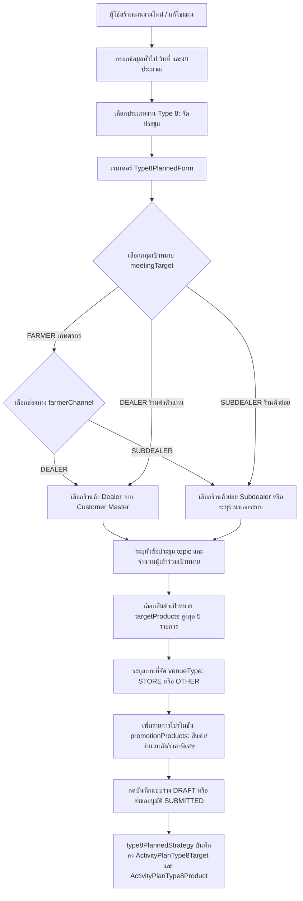
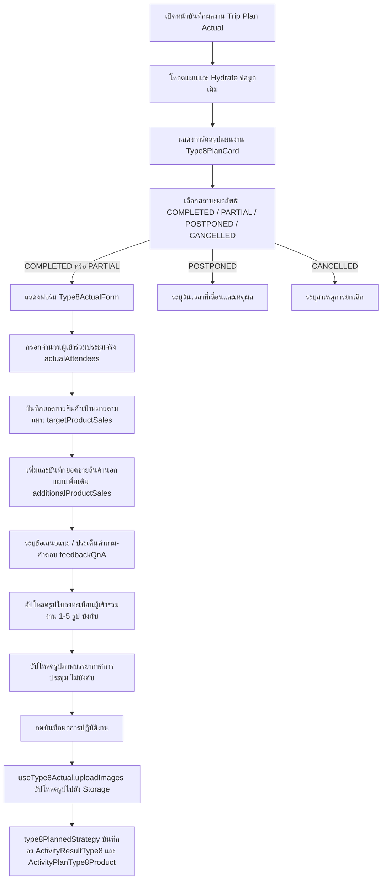
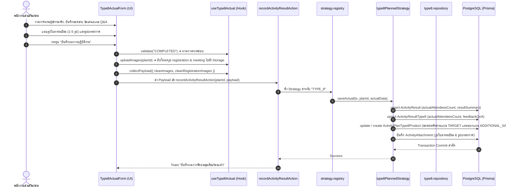

# Activity Type 8 — จัดประชุม (Meeting & Seminar) (README)

> **Feature Slice**: `modules/activity/features/type-8`  
> **Parent Module**: `modules/activity`  
> **Database Authority**: `prisma/schema.prisma` (`ActivityPlan`, `ActivityPlanType8Target`, `ActivityPlanType8Product`, `ActivityResultType8`, `ActivityAttachment`)  
> **Architecture Style**: Vertical Slice Architecture (Dual-Mode 100%: Planned + Unplanned)  
> **Status**: Production Ready / Active Reference

---

## 1. Overview

### 1.1 วัตถุประสงค์ของ Type 8
**Type 8 (จัดประชุม / Meeting & Seminar)** มีวัตถุประสงค์เพื่อสนับสนุนการปฏิบัติงานของทีมขายและส่งเสริมการตลาด (Sales Reps / Technical Commercial Teams) ในการจัดกิจกรรมประชุม สัมมนาเชิงปฏิบัติการ หรือการฝึกอบรมถ่ายทอดความรู้เกี่ยวกับผลิตภัณฑ์เคมีเกษตรและปุ๋ย โดยมีเป้าหมายหลักคือ:
1. ชี้แจงข้อมูลผลิตภัณฑ์ นวัตกรรม และเทคนิคการใช้ผลิตภัณฑ์อย่างมีประสิทธิภาพแก่เกษตรกรหรือร้านค้า
2. นำเสนอรายการส่งเสริมการขาย (Promotions) แพ็กเกจราคาพิเศษ และเงื่อนไขการค้า
3. ขยายฐานลูกค้าและกระตุ้นยอดสั่งซื้อสินค้าทั้งสินค้าเป้าหมายหลักและสินค้าร่วมรายการ
4. รับฟังความคิดเห็น ข้อเสนอแนะ ปัญหา และตอบข้อซักถาม (Q&A) จากผู้เข้าร่วมงาน
5. เก็บหลักฐานการจัดงานอย่างเป็นรูปธรรมผ่านใบลงทะเบียนผู้เข้าร่วมประชุมจริงและภาพถ่ายบรรยากาศ

### 1.2 ขอบเขตของ Type 8
- **กลุ่มเป้าหมายการประชุม (`meetingTarget`):**
  - **เกษตรกร (`FARMER`):** จัดประชุมเกษตรกร โดยเลือกช่องทางผ่านผู้แทนจำหน่าย (`farmerChannel` = `DEALER`) หรือผ่านร้านค้าย่อย (`farmerChannel` = `SUBDEALER`)
  - **ร้านค้าตัวแทนจำหน่ายหลัก (`DEALER`):** จัดประชุมผู้แทนจำหน่ายเพื่อนำเสนอสินค้าใหม่หรือแคมเปญพาณิชย์
  - **ร้านค้าตัวแทนจำหน่ายย่อย (`SUBDEALER`):** จัดประชุมร้านค้าย่อยในพื้นที่ รองรับทั้งร้านค้าที่มีใน Customer Master (`subdealerId`) และร้านค้าย่อยนอกระบบ (`isUnregisteredSubdealer = true` พร้อมระบุ `subDealerStore` และ `dealerId` สังกัด)
- **สถานที่จัดประชุม (`venueType`):**
  - **ร้านค้า (`STORE`):** จัดขึ้น ณ สถานที่ทำการของร้านค้าตัวแทนจำหน่ายหรือร้านค้าย่อย
  - **สถานที่ภายนอก / อื่นๆ (`OTHER`):** เช่น ศาลาประชาคมหมู่บ้าน โรงแรม อาคารอเนกประสงค์ หรือแปลงเกษตรกร
- **การจัดเก็บข้อมูลตามแผนงาน (Planned Targets):**
  - กำหนดหัวข้อการประชุม (`topic`), กลุ่มเป้าหมาย, ร้านค้าที่ร่วมจัด, สถานที่จัด, จำนวนผู้เข้าร่วมเป้าหมาย (`attendeesCount`), สินค้าเป้าหมายหลัก (สูงสุด 5 ชนิด), และรายการโปรโมชันพร้อมราคา/จำนวนเป้าหมาย
- **การจัดเก็บผลการปฏิบัติงานจริง (Actual Outcome):**
  - จำนวนผู้เข้าร่วมประชุมจริง (`actualAttendeesCount`), ข้อเสนอแนะและข้อซักถาม (`feedbackQnA`), บันทึกยอดขายจริงแยกรายการสินค้า (ทั้งสินค้าเป้าหมายตามแผนและสินค้านอกแผนเพิ่มเติม), แนบรูปภาพใบลงทะเบียนผู้เข้าร่วมงาน (บังคับ 1-5 รูปสำหรับงานที่เสร็จสิ้น), และรูปถ่ายบรรยากาศการประชุม

### 1.3 รูปแบบการทำงานที่รองรับ
| โหมดการทำงาน | คำอธิบาย | หน้าที่รับผิดชอบหลักใน Slice |
| :--- | :--- | :--- |
| **1. Planned** | สร้างและแก้ไขแผนงานจัดประชุมล่วงหน้า ระบุกลุ่มเป้าหมาย ร้านค้า หัวข้อ และโปรโมชัน | `Type8PlannedForm`, `useType8PlannedForm`, `type8PlannedStrategy` |
| **2. Planned Actual** | บันทึกผลการจัดงานจริง ยอดขายสินค้าเป้าหมายและสินค้าเพิ่มเติม แนบรูปใบลงทะเบียนและรูปบรรยากาศ | `Type8ActualForm`, `useType8Actual`, `type8PlannedStrategy` |
| **3. Unplanned (2-in-1)** | จัดประชุมกะทันหันหรือบันทึกย้อนหลัง บันทึกทั้งหัวข้อ ร้านค้า โปรโมชัน ยอดขาย และรูปภาพจบในขั้นตอนเดียว | `Type8UnplannedForm`, `useType8UnplannedForm`, `type8UnplannedStrategy` |
| **4. Detail View** | แสดงรายละเอียดเป้าหมายตามแผนงานและผลลัพธ์การจัดงานจริง พร้อมระบบ Lightbox ดูรูปภาพแยกหมวดหมู่ | `Type8PlanCard`, `Type8DetailView` |
| **5. Approval View** | สรุปข้อมูลการจัดประชุมและรายการโปรโมชันเพื่อให้หัวหน้างานพิจารณาอนุมัติแผนงาน | `Type8ApprovalCard`, `Type8PlanCard` |

---

## 2. Business Flows

### 2.1 Planned (สร้างและแก้ไขแผนงาน)


### 2.2 Planned Actual (บันทึกผลการปฏิบัติงานตามแผน)


### 2.3 Unplanned (กิจกรรมนอกแผน 2-in-1)
- ผู้ใช้งานเข้าหน้า `/activity-plans/unplanned/new` แล้วเลือกประเภทงาน **จัดประชุม (Type 8)**
- ฟอร์ม `Type8UnplannedForm` รวมขั้นตอนการกำหนดเป้าหมาย (หัวข้อ, กลุ่มเป้าหมาย, ร้านค้า Dealer/Subdealer, วันเวลา, สถานที่, โปรโมชัน) และการบันทึกผลสัมฤทธิ์จริง (ผู้เข้าร่วมจริง, ยอดขายสินค้า, Q&A, รูปถ่ายใบลงทะเบียน, รูปบรรยากาศ) เข้าไว้ในหน้าจอเดียว
- เมื่อกดบันทึก ระบบจะส่ง Payload ผ่าน `unplanned.actions.ts` ➔ รัน `type8UnplannedStrategy.savePlan()` ซึ่งจะทำการบันทึกข้อมูลแผน (`ActivityPlanType8Target`, `ActivityPlanType8Product`) และบันทึกผลงานจริง (`ActivityResultType8`, `ActivityPlanType8Product`, `ActivityAttachment`) พร้อมกันแบบ Atomic ภายใต้ Prisma Transaction เดียวกัน

### 2.4 Detail and Approval (ดูรายละเอียดและพิจารณาอนุมัติ)
- **Detail View:**
  - แสดง `Type8PlanCard` สรุปหัวข้อการประชุม, ร้านค้าผู้ร่วมจัด, จำนวนคนเป้าหมาย, สินค้าเป้าหมาย, และตารางโปรโมชันตามแผน
  - หากมีผลงานจริง (`hasActualData`) แสดง `Type8DetailView` สรุปจำนวนผู้เข้าร่วมจริง, สรุปยอดขายสินค้าตามแผนและนอกแผน, ข้อเสนอแนะ/Q&A, แกลเลอรีรูปถ่ายใบลงทะเบียน และแกลเลอรีรูปบรรยากาศการประชุมพร้อมระบบคลิกดูขยายภาพ (Lightbox Modal)
- **Approval View:**
  - แสดง `Type8ApprovalCard` เรนเดอร์การ์ดแผนการประชุม `Type8PlanCard` ครบทุกรายการที่วางแผนไว้ เพื่อให้ผู้อนุมัติสามารถตรวจสอบร้านค้า สินค้า และโปรโมชันก่อนอนุมัติหรือตีกลับ

---

## 3. Architecture

### 3.1 Folder Structure
```text
modules/activity/features/type-8/
├── index.ts                                # Vertical Slice Public Contract (จุดส่งออกเดียว)
├── README.md                               # เอกสารคู่มือทางเทคนิคฉบับสมบูรณ์ (ไฟล์นี้)
│
├── shared/                                 # ชิ้นส่วนที่ใช้ร่วมกันภายใน Type 8
│   ├── constants.ts                        # ค่าคงที่: รหัสงาน, กลุ่มเป้าหมาย, ช่องทาง, ประเภทสถานที่
│   ├── types.ts                            # อินเตอร์เฟซข้อมูล: Type8ImageFile, ProductSaleDetail, Options
│   └── notes.ts                            # Helper เข้ารหัส/ถอดรหัส JSON (สำหรับ Backward Compatibility)
│
├── planned/                                # Sub-slice: กิจกรรมในแผนและบันทึกผลตามแผน
│   ├── application/                        # Business Logic, Mappers, Validators
│   │   ├── planned-validation.ts           # ตรวจสอบความถูกต้องของแผน (validateType8FormItems)
│   │   ├── planned-mapper.ts               # แปลงและ Hydrate ข้อมูลแผน (extractType8PlanTargets, etc.)
│   │   ├── actual-validation.ts            # ตรวจสอบความถูกต้องของผลงานจริง (validateType8Actual)
│   │   └── actual-mapper.ts                # แกะข้อมูลผลงานจริงจาก Backend (parseType8ActualResult)
│   ├── components/                         # UI Components ฝั่งในแผน
│   │   ├── type8-planned-form.tsx          # ฟอร์มสร้าง/แก้ไขการจัดประชุมตามแผน
│   │   ├── type8-plan-card.tsx             # การ์ดแสดงข้อมูลสรุปตามแผนและตารางโปรโมชัน
│   │   ├── type8-actual-form.tsx           # ฟอร์มบันทึกผลจริง ยอดขายสินค้า และรูปภาพ
│   │   ├── type8-detail-view.tsx           # หน้ารายละเอียดแสดงผลลัพธ์จริงพร้อมระบบ Lightbox
│   │   └── type8-approval-card.tsx         # การ์ดสรุปสำหรับหน้าจอพิจารณาอนุมัติ
│   ├── hooks/                              # Custom React State Hooks
│   │   ├── use-type8-planned-form.ts       # จัดการ State รายการประชุมตามแผน (Type8MeetingItem[])
│   │   └── use-type8-actual.ts             # จัดการ State ผลจริง ผู้เข้าร่วม ยอดขาย รูปภาพ และ Upload
│   ├── infrastructure/                     # การเชื่อมต่อฐานข้อมูล
│   │   ├── type8.repository.ts             # Direct Prisma queries (findType8ByPlanId)
│   │   └── type8-planned.strategy.ts       # WorkTypeStrategy สำหรับ Type 8 ตามแผน
│   └── types/                              # ประเภทข้อมูลเฉพาะกิจกรรมในแผน
│       ├── planned.types.ts                # Type8MeetingItem, Type8PlanTarget, Form Props
│       └── actual.types.ts                 # Type8ActualRecord, Type8ActualValidationInput, Form Props
│
└── unplanned/                              # Sub-slice: กิจกรรมนอกแผน (2-in-1)
    ├── application/                        # Logic และ Mappers กิจกรรมนอกแผน
    │   ├── unplanned-validation.ts         # ตรวจสอบความถูกต้องของกิจกรรมนอกแผน
    │   └── unplanned-mapper.ts             # แปลงข้อมูล 2-in-1 และสร้างสรุปผลการจัดงาน
    ├── components/                         # UI Components กิจกรรมนอกแผน
    │   └── type8-unplanned-form.tsx        # ฟอร์ม 2-in-1 รวมวางแผนและบันทึกผลในหน้าเดียว
    ├── hooks/                              # Custom React State Hooks
    │   └── use-type8-unplanned-form.ts     # จัดการ State กิจกรรมนอกแผน
    ├── infrastructure/                     # Strategy กิจกรรมนอกแผน
    │   └── type8-unplanned.strategy.ts     # WorkTypeStrategy บันทึกกิจกรรมนอกแผน 2-in-1
    └── types/                              # ประเภทข้อมูลกิจกรรมนอกแผน
        └── unplanned.types.ts              # Type8UnplannedItem, Props, Validation Result
```

### 3.2 Type 8 vs Shared Activity Matrix
| ความรับผิดชอบ | จัดการที่ Type 8 Feature (`features/type-8`) | จัดการที่ Shared Activity ส่วนกลาง (`ui/`, `views/`) |
| :--- | :--- | :--- |
| **ข้อมูลทั่วไปของแผน** | - | ชื่องาน, วันที่เริ่ม-สิ้นสุด, วัตถุประสงค์หลักของทริป |
| **พื้นที่ & ทีมงาน** | - | จังหวัด, อำเภอ, ตำบล, พนักงานร่วมเดินทาง |
| **งบประมาณรวม** | - | งบเบิกสินค้าสาธิต, งบส่งเสริมการขาย, เบี้ยเลี้ยงเดินทาง |
| **ข้อมูลการประชุมตามแผน** | หัวข้อ, กลุ่มเป้าหมาย (Farmer/Dealer/Subdealer), ร้านค้า, สถานที่จัด, สินค้าเป้าหมาย (<=5), รายการโปรโมชัน | จำนวนผู้เข้าร่วมเป้าหมายรวม (`ActivityPlan.targetAttendeesCount`) |
| **ผลการจัดประชุมจริง** | ผู้เข้าร่วมจริง, ข้อเสนอแนะ/Q&A, ยอดขายสินค้าเป้าหมาย/เพิ่มเติม, รูปใบลงทะเบียน, รูปบรรยากาศ | ผลสรุปภาพรวมแผน (`resultStatus`: COMPLETED/PARTIAL/etc.) |
| **Database Persistence** | ตารางเฉพาะ `ActivityPlanType8Target`, `ActivityPlanType8Product`, `ActivityResultType8` | ตารางหลัก `ActivityPlan`, `ActivityResult`, `ActivityAttachment` |

### 3.3 Dependency and Import Map
- **ทิศทางการเรียกใช้ที่อนุญาต (Allowed Dependencies):**
  - `views/` ➔ เรียกใช้ ➔ `features/type-8` (ผ่าน `index.ts` เท่านั้น)
  - `features/type-8` ➔ เรียกใช้ ➔ `@/modules/activity/ui` (`ActivityInput`, `ActivityTextarea`, `ActivityProductSelect`, `ActivityCustomerSelect`, `ActivityPhotoUpload`)
  - `features/type-8` ➔ เรียกใช้ ➔ `@/modules/activity/types/strategy.interface`
  - `features/type-8` ➔ เรียกใช้ ➔ `@/modules/activity/application/media/image-uploader`
  - `features/type-8` ➔ เรียกใช้ ➔ `@/components/custom/image-lightbox-modal`
  - `features/type-8` ➔ เรียกใช้ ➔ `@/modules/products/server/actions` (`listProductsAction`)
- **Server Actions & Database Flow:**
  - `views/` ➔ ส่งข้อมูลไปยัง Server Actions ใน `@/modules/activity/server/`:
    - `planned.actions.ts` (`createActivityPlanAction`, `updateActivityPlanAction`, `getActivityPlanAction`)
    - `unplanned.actions.ts` (`createUnplannedActivityAction`, `updateUnplannedActivityAction`, `getUnplannedActivityAction`)
    - `actual.actions.ts` (`recordActivityResultAction`)
  - Server Actions ➔ ทำงานร่วมกับ `@/modules/activity/infrastructure/strategy.registry.ts` ➔ เรียกใช้ `type8PlannedStrategy` และ `type8UnplannedStrategy`
- **ข้อห้ามเด็ดขาด (Strict Rules):**
  - ❌ ห้าม Import จาก `@/modules/activity-plans/` ย้อนหลังโดยเด็ดขาด (Zero Legacy Imports)
  - ❌ ห้ามไฟล์ภายนอกข้ามเข้ามา Import ลึกใน `features/type-8/planned/...` โดยไม่ผ่าน `index.ts`
  - ❌ ห้ามเรียกใช้โค้ดข้ามไปยัง Feature Type อื่น (เช่น Type 1 - Type 7 หรือ Type 9 - Type 14)

### 3.4 Entry Points and Public Exports
ไฟล์ [modules/activity/features/type-8/index.ts](file:///d:/code/crm-bank/modules/activity/features/type-8/index.ts) ทำหน้าที่เป็น **Single Public API Contract** สำหรับโมดูล Type 8 โดยส่งออก:
- **Planned Components:** `Type8PlannedForm`, `Type8PlanCard`, `Type8PlanForm`, `Type8Meeting`
- **Actual Components:** `Type8ActualForm`, `ActualType8Meeting`, `Type8DetailView`, `DetailType8Meeting`, `Type8ApprovalCard`, `ApprovalType8Meeting`
- **Unplanned Components:** `Type8UnplannedForm`
- **Hooks:** `useType8PlannedForm`, `useType8Form`, `useType8Actual`, `useType8UnplannedForm`
- **Mappers & Hydrators:** `extractType8PlanTargets`, `hydrateType8PlannedData`, `mapType8ToSectionItems`, `parseType8ActualResult`, `hydrateType8UnplannedData`, `mapType8UnplannedToPayload`
- **Validators:** `validateType8FormItems`, `validateType8Actual`, `validateType8UnplannedItems`
- **Shared Constants & Utilities:** `WORK_TYPE_CODE`, `WORK_TYPE_NAME`, `WORK_TYPE_PROMOTION_CODE`, `MEETING_TARGET_OPTIONS`, `FARMER_CHANNEL_OPTIONS`, `VENUE_TYPE_OPTIONS`, `encodeType8StoreNotes`, `decodeType8StoreNotes`
- **TypeScript Types:** `Type8MeetingItem`, `Type8TargetItem`, `Type8PlanTarget`, `Type8ActualRecord`, `Type8ActualValidationInput`, `Type8UnplannedItem`, `Type8PromotionProductItem`, `Type8PromotionalProductLine`, `ProductSaleDetail`, `Type8CustomerOption`, `Type8ProductOption`, `Type8ImageFile`

---

## 4. File Responsibilities

### 4.1 Planned & Actual
- **`type8-planned-form.tsx`:** เรนเดอร์ฟอร์มวางแผนจัดประชุม รองรับการเพิ่มหลายรายการประชุม (`type8Items`), เลือกระดับเป้าหมาย (Farmer / Dealer / Subdealer), ค้นหาร้านค้าผ่าน `ActivityCustomerSelect`, เลือกสินค้าเป้าหมายผ่าน `ActivityProductSelect`, ระบุสถานที่ และเพิ่มแถวโปรโมชันสินค้า
- **`use-type8-planned-form.ts`:** จัดการ State ของรายการประชุมตามแผน แปลงข้อมูลเดิมจาก `ActivityPlanType8Target` และ `ActivityPlanType8Product` หรือ Payload JSON เข้าระบบ พร้อมฟังก์ชัน `addType8Row`, `updateType8Row`, `deleteType8Row`, `addPromotionProduct`, `updatePromotionProduct`, และ `deletePromotionProduct`
- **`type8-plan-card.tsx`:** การ์ดแสดงรายละเอียดแผนงานจัดประชุม ทั้งหัวข้อ, ร้านค้า/ตัวแทนจำหน่าย, จำนวนคนเป้าหมาย, สินค้าเป้าหมาย, และตารางโปรโมชันแสดงชื่อสินค้า จำนวนลัง ราคาต่อลัง และเงื่อนไข
- **`type8-actual-form.tsx`:** ฟอร์มบันทึกผลการจัดประชุมจริง แสดงยอดขายสินค้าเป้าหมายตามแผนอัตโนมัติ (Target Product Sales), เพิ่มสินค้านอกแผนเพิ่มเติม (Additional Product Sales), ระบุ Q&A/ข้อเสนอแนะ, อัปโหลดรูปใบลงทะเบียน (`registrationImages`), และอัปโหลดรูปบรรยากาศ (`images`)
- **`use-type8-actual.ts`:** จัดการ State ผลจริง ฟังก์ชัน `uploadImages` เพื่อแยกอัปโหลดหมวดหมู่ `"registration"` และ `"meeting"`, ฟังก์ชัน `collectPayload` รวบรวมข้อมูลผลงาน, และ `validate` ตรวจสอบเงื่อนไขรูปใบลงทะเบียน
- **`type8-detail-view.tsx`:** คอมโพเนนต์แสดงผลเต็มรูปแบบในหน้ารายละเอียด แสดงการ์ดแผน `Type8PlanCard`, สรุปผู้เข้าร่วมจริง, ตารางสรุปยอดขายสินค้า, กล่องข้อความ Q&A, และแกลเลอรีรูปภาพพร้อม Lightbox
- **`type8-approval-card.tsx`:** การ์ดสรุปสำหรับหน้าจอพิจารณาอนุมัติ เรนเดอร์ `Type8PlanCard` สำหรับทุกรายการประชุมที่มีในแผน
- **`planned-mapper.ts`:**
  - `extractType8PlanTargets`: แปลงระเบียน `ActivityPlanType8Target` และ `ActivityPlanType8Product` ออกมาเป็น `Type8TargetItem`
  - `hydrateType8PlannedData`: กู้คืนข้อมูลแผนเดิมเข้าฟอร์มแก้ไข
  - `mapType8ToSectionItems`: แปลงข้อมูลแผนเป็นหัวข้อและฟิลด์ย่อยสำหรับแสดงผลใน Section รวม
- **`actual-mapper.ts`:**
  - `parseType8ActualResult`: แปลงข้อมูลผลงานจาก `ActivityResultType8` และ `ActivityPlanType8Product` เพื่อ Hydrate ผลงานจริง
- **`planned-validation.ts` & `actual-validation.ts`:**
  - `validateType8FormItems`: ตรวจสอบความถูกต้องของร้านค้าตามกลุ่มเป้าหมาย, หัวข้อประชุม, จำนวนคนเป้าหมาย (>=1), จำนวนสินค้าเป้าหมาย (<=5 รายการ), และรายละเอียดโปรโมชัน
  - `validateType8Actual`: ตรวจสอบว่ามีรูปถ่ายใบลงทะเบียน 1-5 รูป เมื่อสถานะกิจกรรมเป็น `COMPLETED`
- **`type8.repository.ts` & `type8-planned.strategy.ts`:**
  - `findType8ByPlanId`: ค้นหาข้อมูลแผนและร้านค้า/สินค้า Type 8 จาก Dedicated Tables (`activity_type_8_targets`, `activity_type_8_products`, `activity_type_8_result`)
  - `type8PlannedStrategy`: ดำเนินการตรวจสอบและบันทึกข้อมูลลง Dedicated Tables ตามมาตรฐาน `WorkTypeStrategy` โดยไม่มีการเขียนลงตาราง Generic เก่า

### 4.2 Unplanned
- **`type8-unplanned-form.tsx`:** ฟอร์มกิจกรรมนอกแผน 2-in-1 แสดงอินพุตครบถ้วนทั้งหัวข้อ, เลือกร้านค้า Dealer/Subdealer, วันเวลา, สถานที่จัด, โปรโมชัน, จำนวนผู้เข้าร่วมจริง, บันทึกยอดขายสินค้า, Q&A, อัปโหลดใบลงทะเบียน และรูปบรรยากาศ
- **`use-type8-unplanned-form.ts`:** จัดการ State อาร์เรย์ `Type8UnplannedItem[]` รองรับการเพิ่ม แก้ไข ลบรายการประชุม และจัดการโปรโมชัน/ยอดขายสินค้า
- **`unplanned-validation.ts`:** ตรวจสอบความถูกต้องของกิจกรรมนอกแผน (หัวข้อ, กลุ่มเป้าหมาย, ร้านค้า, จำนวนผู้เข้าร่วมจริง, และรูปถ่ายใบลงทะเบียน)
- **`unplanned-mapper.ts`:** Hydrate ข้อมูลเดิม และ Map ข้อมูลฟอร์ม 2-in-1 ออกมาเป็น Payload แผนงาน (`stores`, `targets`, `type8Data`) และผลงานจริง (`actualOutcome`)
- **`type8-unplanned.strategy.ts`:** ดำเนินการบันทึกกิจกรรมนอกแผนผ่านการเรียก `type8PlannedStrategy.savePlan()` และ `type8PlannedStrategy.saveActual()` ร่วมกันใน Transaction เดียวกัน

### 4.3 Shared Types, Constants, and Notes
- **`constants.ts`:** กำหนดรหัสประเภทงาน (`TYPE_8`, `TYPE_8_PROMOTION`), ตัวเลือกกลุ่มเป้าหมาย (`MEETING_TARGET_OPTIONS`), ช่องทางจัดประชุม (`FARMER_CHANNEL_OPTIONS`), และประเภทสถานที่ (`VENUE_TYPE_OPTIONS`)
- **`types.ts`:** กำหนดโครงสร้าง TypeScript สำหรับสินค้าโปรโมชัน (`Type8PromotionProductItem`, `Type8PromotionalProductLine`), ยอดขายสินค้า (`ProductSaleDetail`), และตัวเลือก (`Type8CustomerOption`, `Type8ProductOption`)
- **`notes.ts`:** ฟังก์ชัน `encodeType8StoreNotes` และ `decodeType8StoreNotes` สำหรับรองรับ Backward Compatibility กับข้อมูลแผนงานเดิมที่เคยจัดเก็บในคอลัมน์ `notes` ในรูปแบบ JSON หรือ Plain Text เดิม

### 4.4 Shared UI and Views
- คอมโพเนนต์ `ActualWorkTypeList`, `DetailWorkTypeList`, และ `ApprovalWorkTypeList` ใน `modules/activity/views/` ทำหน้าที่เป็น Orchestrator สลับมาแสดงผลคอมโพเนนต์ของ Type 8 ตาม Work Type Code `"TYPE_8"`

---

## 5. Data Flow



### 5.1 Create Planned (สร้างแผนใหม่)
1. `create-view.tsx` เรียกใช้ `useType8PlannedForm()`
2. ผู้ใช้ระบุข้อมูลการประชุมผ่าน `Type8PlannedForm` (กลุ่มเป้าหมาย, ร้านค้า Dealer/Subdealer, หัวข้อ, จำนวนคนเป้าหมาย, สินค้าเป้าหมาย, และโปรโมชัน)
3. ระบบตรวจสอบความถูกต้องด้วย `validateType8FormItems()`
4. Form Orchestrator รวม Payload และส่งไปยัง `createActivityPlanAction`
5. `type8PlannedStrategy.savePlan()` บันทึกเป้าหมายการประชุมลงใน `ActivityPlanType8Target` และบันทึกสินค้าเป้าหมาย/โปรโมชันลงใน `ActivityPlanType8Product`
6. บันทึกจำนวนผู้เข้าร่วมเป้าหมายรวมลงใน `ActivityPlan.targetAttendeesCount`

### 5.2 Edit Planned (แก้ไขแผนงานเดิม)
1. `edit-view.tsx` โหลดข้อมูลแผนงานจากฐานข้อมูล
2. เรียก `hydrateType8PlannedData(plan)` ถอดรหัสข้อมูลร้านค้าและโปรโมชันออกมาเป็น `Type8MeetingItem[]`
3. ส่งข้อมูลเข้า `useType8PlannedForm({ initialItems })`
4. ฟอร์มแสดงข้อมูลเดิมครบถ้วนพร้อมให้แก้ไขและบันทึกกลับอย่างถูกต้อง

### 5.3 Save Actual (บันทึกผลการปฏิบัติงานจริง)
1. `activity-plan-actual-view.tsx` ดำเนินการตรวจสอบความถูกต้องผ่าน `type8Actual.validate(status)`
2. เรียก `type8Actual.uploadImages(planId)` เพื่ออัปโหลดไฟล์ภาพแยกเป็น 2 กลุ่ม:
   - หมวดหมู่ `registration`: รูปใบลงทะเบียนผู้เข้าร่วมงาน
   - หมวดหมู่ `meeting`: รูปถ่ายบรรยากาศการประชุม
3. เรียก `type8Actual.collectPayload()` เพื่อจัดกลุ่มข้อมูลผลงานและแนบ Clean URLs ของรูปภาพ
4. ส่ง Payload เข้า Server Action `recordActivityResultAction`
5. `type8PlannedStrategy.saveActual()` บันทึกผลลัพธ์ลงใน `ActivityResultType8`, บันทึกยอดขายสินค้าจริงลงใน `ActivityPlanType8Product` และอัปเดต `actualAttendeesCount` ใน `ActivityResult`

### 5.4 Load Actual (โหลดผลงานเดิมมาแสดงในหน้าบันทึกผล)
1. `useActualPlanLoader` ดึงข้อมูลแผนงานและผลงานเดิม
2. `extractType8PlanTargets(plan)` แกะข้อมูลร้านค้า สินค้าเป้าหมาย และโปรโมชันออกมาแสดงใน `Type8PlanCard`
3. `parseType8ActualResult(plan.result)` ดึงข้อมูลผู้เข้าร่วมจริง, ยอดขายสินค้าจาก `saleResults`, Q&A, และรูปภาพเดิม
4. เรียก `type8Actual.hydrate()` เติมข้อมูลลง State ของฟอร์มพร้อมให้แก้ไขเพิ่มเติม

### 5.5 Create/Edit Unplanned (กิจกรรมนอกแผน 2-in-1)
1. ผู้ใช้กรอกฟอร์ม `Type8UnplannedForm` ครบทั้งส่วนแผนและผลงานจริง
2. ตรวจสอบความถูกต้องด้วย `validateType8UnplannedItems(items)`
3. `mapType8UnplannedToPayload` แปลงข้อมูลออกมาเป็น `stores`, `targets`, `actualOutcome`, และ `type8Data`
4. `type8UnplannedStrategy.savePlan()` บันทึกข้อมูลแผนงานและผลงานจริงพร้อมกันแบบ Atomic

### 5.6 Detail and Approval (การแสดงผลหน้ารายละเอียดและพิจารณาอนุมัติ)
1. หน้า Detail / Approval โหลดข้อมูลแผนงานผ่าน Loader
2. เรนเดอร์ `Type8PlanCard` แสดงหัวข้อการประชุม, ร้านค้าผู้ร่วมจัด, จำนวนคนเป้าหมาย, สินค้าเป้าหมาย, และตารางโปรโมชัน
3. หากมีผลงานจริง เรนเดอร์ `Type8DetailView` แสดงผู้เข้าร่วมจริง, ยอดขายสินค้า, Q&A, และแกลเลอรีรูปภาพพร้อม Lightbox

---

## 6. Data Models and Mapping

### 6.1 Database CRUD Matrix (สิทธิ์และการจัดการตารางในฐานข้อมูล)
| ตารางในฐานข้อมูล (`Prisma Model`) | Create (สร้าง) | Read (อ่าน/แสดงผล) | Update (แก้ไข) | Delete (ลบ) | หมายเหตุ |
| :--- | :--- | :--- | :--- | :--- | :--- |
| **`activity_type_8_targets`**<br>(`ActivityPlanType8Target`) | `savePlan()` ใน Planned/Unplanned | `loadPlan()`, `extractType8PlanTargets` | `savePlan()` (Atomic recreation) | Cascade เมื่อลบแผน | เก็บหัวข้อประชุม, กลุ่มเป้าหมาย (Farmer/Dealer/Subdealer), ร้านค้า, สถานที่จัด, จำนวนคนเป้าหมาย |
| **`activity_type_8_products`**<br>(`ActivityPlanType8Product`) | `savePlan()` / `saveActual()` | `loadPlan()`, `loadActual()`, `extractType8PlanTargets` | `savePlan()`, `saveActual()` | Cascade เมื่อลบเป้าหมาย | เก็บสินค้าเป้าหมาย (`TARGET`), โปรโมชัน (`PROMOTION`), และยอดขายจริง (`ADDITIONAL_SALE`) |
| **`activity_type_8_result`**<br>(`ActivityResultType8`) | `saveActual()` ใน Actual/Unplanned | `loadActual()`, `parseType8ActualResult` | `upsert` ใน `saveActual()` | Cascade เมื่อลบเป้าหมาย | เก็บจำนวนผู้เข้าร่วมประชุมจริง (`actualAttendeesCount`), ข้อเสนอแนะ/Q&A |
| **`activity_plans`**<br>(`ActivityPlan`) | ตอนสร้างแผน | ในทุกมุมมอง | เมื่อแก้ไขแผน | Cascade Delete | เก็บ Header รวม, `targetAttendeesCount` |
| **`activity_attachments`**<br>(`ActivityAttachment`) | `uploadImages()` + Server Action | `plan.attachments` | สร้างใหม่/ลบรูปที่ไม่ได้ใช้ | Cascade เมื่อลบผลงาน | เก็บรูปใบลงทะเบียน (`REGISTRATION`) และบรรยากาศ (`ATMOSPHERE`) |

### 6.2 Complete Field-to-Database Mapping (ตารางจับคู่ฟิลด์ครบถ้วนทุกจุด)
| Form Field (UI) | TypeScript Type Field | Mapper Function (Write/Read) | Prisma Model | DB Column Name | Data Type | Nullable? | Default |
| :--- | :--- | :--- | :--- | :--- | :--- | :---: | :--- |
| **กลุ่มเป้าหมาย** | `meetingTarget` | `planned-mapper` / `unplanned-mapper` | `ActivityPlanType8Target` | `meeting_target` | `VARCHAR` | No | `"FARMER"` |
| **ช่องทางเกษตรกร** | `farmerChannel` | `planned-mapper` / `unplanned-mapper` | `ActivityPlanType8Target` | `farmer_channel` | `VARCHAR` | Yes | `"DEALER"` |
| **รหัสร้านค้า Dealer** | `dealerId` / `customerId` | `planned-mapper` / `useType8PlannedForm` | `ActivityPlanType8Target` | `dealer_id` | `VARCHAR (FK)` | Yes | `null` |
| **ชื่อร้านค้า Dealer** | `dealerName` / `customerName` | `planned-mapper` | `ActivityPlanType8Target` | `dealer_name` | `VARCHAR` | Yes | `null` |
| **รหัสร้านค้าย่อย Subdealer** | `subdealerId` | `planned-mapper` / `useType8PlannedForm` | `ActivityPlanType8Target` | `subdealer_id` | `VARCHAR (FK)` | Yes | `null` |
| **ชื่อร้านค้าย่อย Subdealer** | `subDealerStore` / `subdealerName` | `planned-mapper` | `ActivityPlanType8Target` | `sub_dealer_store` | `VARCHAR` | Yes | `null` |
| **ร้านค้าย่อยนอกระบบ** | `isUnregisteredSubdealer` / `isNewSubdealer` | `planned-mapper` / `unplanned-mapper` | `ActivityPlanType8Target` | `is_unregistered_subdealer` | `BOOLEAN` | No | `false` |
| **หัวข้อการประชุม** | `topic` | `planned-mapper` / `unplanned-mapper` | `ActivityPlanType8Target` | `topic` | `VARCHAR` | No | `"จัดประชุม"` |
| **ประเภทสถานที่** | `venueType` | `planned-mapper` / `unplanned-mapper` | `ActivityPlanType8Target` | `venue_type` | `VARCHAR` | No | `"STORE"` |
| **สถานที่จัด / ที่อยู่** | `location` | `planned-mapper` / `unplanned-mapper` | `ActivityPlanType8Target` | `location` | `VARCHAR` | Yes | `null` |
| **วันที่จัดประชุม** | `meetingDate` | `planned-mapper` / `unplanned-mapper` | `ActivityPlanType8Target` | `meeting_date` | `TIMESTAMP(3)` | Yes | `null` |
| **เวลาจัดประชุม** | `meetingTime` | `planned-mapper` / `unplanned-mapper` | `ActivityPlanType8Target` | `meeting_time` | `VARCHAR` | Yes | `null` |
| **ผู้เข้าร่วมเป้าหมาย** | `attendeesCount` / `expectedAttendees` | `planned-mapper` | `ActivityPlanType8Target` | `target_attendees_count` | `INTEGER` | No | `0` |
| **รายละเอียดเพิ่มเติม** | `detail` / `notes` | `planned-mapper` / `unplanned-mapper` | `ActivityPlanType8Target` | `detail` | `TEXT` | Yes | `null` |
| **สินค้าเป้าหมาย** | `targetProducts` | `planned-mapper` ➔ `type8Products` | `ActivityPlanType8Product` | `product_id`, `product_role = 'TARGET'` | `VARCHAR (FK)` | Yes | `null` |
| **สินค้าโปรโมชัน** | `promotionProducts` / `promotions` | `planned-mapper` ➔ `type8Products` | `ActivityPlanType8Product` | `product_id`, `product_role = 'PROMOTION'` | `VARCHAR (FK)` | Yes | `null` |
| **จำนวนลังโปรโมชัน** | `quantityCases` / `quantity` | `planned-mapper` | `ActivityPlanType8Product` | `target_quantity` | `DECIMAL(10,2)` | Yes | `null` |
| **ราคาต่อลังโปรโมชัน** | `pricePerCase` / `unitPrice` | `planned-mapper` | `ActivityPlanType8Product` | `target_unit_price` | `DECIMAL(15,2)` | Yes | `null` |
| **เงื่อนไขโปรโมชัน** | `notes` (ใน promotion) | `planned-mapper` | `ActivityPlanType8Product` | `promotion_notes` | `TEXT` | Yes | `null` |
| **ผู้เข้าร่วมประชุมจริง** | `actualAttendees` / `t8ActualAttendees` | `saveActual` / `parseType8ActualResult` | `ActivityResultType8` | `actual_attendees_count` | `INTEGER` | No | `0` |
| **ข้อเสนอแนะ / Q&A** | `feedbackQnA` / `t8FeedbackQnA` | `saveActual` / `parseType8ActualResult` | `ActivityResultType8` | `feedback_qna` | `TEXT` | Yes | `null` |
| **ยอดขายสินค้าจริง** | `actualQty` (ใน `productSalesDetails`) | `saveActual` / `parseType8ActualResult` | `ActivityPlanType8Product` | `actual_quantity` | `DECIMAL(10,2)` | Yes | `null` |
| **ราคาขายจริงต่อหน่วย** | `unitPrice` (ใน `productSalesDetails`) | `saveActual` / `parseType8ActualResult` | `ActivityPlanType8Product` | `actual_unit_price` | `DECIMAL(15,2)` | Yes | `null` |
| **ยอดขายจริงรวม** | `actualSales` (ใน `productSalesDetails`) | `saveActual` / `parseType8ActualResult` | `ActivityPlanType8Product` | `actual_total` | `DECIMAL(15,2)` | Yes | `null` |
| **หมายเหตุยอดขาย** | `notes` (ใน `productSalesDetails`) | `saveActual` / `parseType8ActualResult` | `ActivityPlanType8Product` | `actual_notes` | `TEXT` | Yes | `null` |
| **รูปใบลงทะเบียน** | `registrationImages` | `uploadImages("registration")` ➔ `attachments` | `ActivityAttachment` | `file_url`, `group = 'REGISTRATION'` | `TEXT` | No | - |
| **รูปบรรยากาศการประชุม** | `images` | `uploadImages("meeting")` ➔ `attachments` | `ActivityAttachment` | `file_url`, `group = 'ATMOSPHERE'` | `TEXT` | No | - |

### 6.3 รายละเอียดตารางสินค้า รูปภาพ และความสัมพันธ์ (Relations & Schema)

```prisma
// =============================================================================
// TYPE 8: จัดประชุม (Meeting & Seminar - Dedicated Relational Storage)
// =============================================================================

/// 1. ตารางเก็บข้อมูลเป้าหมายการจัดประชุม (สร้างแผนงาน)
model ActivityPlanType8Target {
  id                      String   @id @default(cuid())
  activityPlanId          String   @map("activity_plan_id")
  meetingTarget           String   @default("FARMER") @map("meeting_target") // "FARMER" | "DEALER" | "SUBDEALER"
  farmerChannel           String?  @map("farmer_channel") // "DEALER" | "SUBDEALER"
  dealerId                String?  @map("dealer_id")
  dealerName              String?  @map("dealer_name")
  subdealerId             String?  @map("subdealer_id")
  subDealerStore          String?  @map("sub_dealer_store") // กรณีร้านค้าย่อยนอกระบบ
  isUnregisteredSubdealer Boolean  @default(false) @map("is_unregistered_subdealer")
  topic                   String   @map("topic") // หัวข้อการประชุม
  venueType               String   @default("STORE") @map("venue_type") // "STORE" | "OTHER"
  location                String?  @map("location") // สถานที่จัดงาน / ที่อยู่
  meetingDate             DateTime? @map("meeting_date")
  meetingTime             String?  @map("meeting_time")
  targetAttendeesCount    Int      @default(0) @map("target_attendees_count")
  detail                  String?  @map("detail") @db.Text // รายละเอียดเพิ่มเติม

  createdAt               DateTime @default(now()) @map("created_at")
  updatedAt               DateTime @updatedAt @map("updated_at")

  activityPlan            ActivityPlan               @relation(fields: [activityPlanId], references: [id], onDelete: Cascade)
  dealer                  Customer?                  @relation("Type8DealerStore", fields: [dealerId], references: [id], onDelete: SetNull)
  subdealer               Customer?                  @relation("Type8SubdealerStore", fields: [subdealerId], references: [id], onDelete: SetNull)
  products                ActivityPlanType8Product[]
  result                  ActivityResultType8?

  @@index([activityPlanId])
  @@index([dealerId])
  @@index([subdealerId])
  @@map("activity_type_8_targets")
}

/// 2. ตารางเก็บสินค้าเป้าหมาย โปรโมชัน และยอดขายจริง
model ActivityPlanType8Product {
  id              String   @id @default(cuid())
  activityPlanId  String   @map("activity_plan_id")
  targetId        String   @map("target_id")
  productId       String?  @map("product_id")
  productName     String?  @map("product_name")
  productRole     String   @default("TARGET") @map("product_role") // "TARGET" | "PROMOTION" | "ADDITIONAL_SALE"
  
  // Planned fields
  targetQuantity  Decimal? @map("target_quantity") @db.Decimal(10, 2)
  targetUnitPrice Decimal? @map("target_unit_price") @db.Decimal(15, 2)
  targetAmount    Decimal? @map("target_amount") @db.Decimal(15, 2)
  promotionNotes  String?  @map("promotion_notes")

  // Actual fields
  actualQuantity  Decimal? @map("actual_quantity") @db.Decimal(10, 2)
  actualUnitPrice Decimal? @map("actual_unit_price") @db.Decimal(15, 2)
  actualTotal     Decimal? @map("actual_total") @db.Decimal(15, 2)
  actualNotes     String?  @map("actual_notes")

  createdAt       DateTime @default(now()) @map("created_at")
  updatedAt       DateTime @updatedAt @map("updated_at")

  activityPlan    ActivityPlan            @relation(fields: [activityPlanId], references: [id], onDelete: Cascade)
  target          ActivityPlanType8Target @relation(fields: [targetId], references: [id], onDelete: Cascade)
  product         Product?                @relation(fields: [productId], references: [id], onDelete: Restrict)

  @@index([activityPlanId])
  @@index([targetId])
  @@index([productId])
  @@map("activity_type_8_products")
}

/// 3. ตารางเก็บผลลัพธ์การจัดประชุมจริง
model ActivityResultType8 {
  id                   String   @id @default(cuid())
  activityPlanId       String   @map("activity_plan_id")
  targetId             String   @unique @map("target_id")
  actualAttendeesCount Int      @default(0) @map("actual_attendees_count") // จำนวนผู้เข้าร่วมประชุมจริง
  feedbackQnA          String?  @map("feedback_qna") @db.Text // ข้อเสนอแนะ / ประเด็น Q&A
  summary              String?  @map("summary") @db.Text // สรุปภาพรวม

  createdAt            DateTime @default(now()) @map("created_at")
  updatedAt            DateTime @updatedAt @map("updated_at")

  activityPlan         ActivityPlan            @relation(fields: [activityPlanId], references: [id], onDelete: Cascade)
  target               ActivityPlanType8Target @relation(fields: [targetId], references: [id], onDelete: Cascade)

  @@index([activityPlanId])
  @@index([targetId])
  @@map("activity_type_8_result")
}
```

### 6.4 Transaction & Persistence Strategy (ขาเขียนและขาอ่าน)
- **การจัดการ Transaction (Atomic Execution):**
  - ทุกการบันทึกของ Type 8 ทำงานภายใต้ Prisma Transaction (`tx`) แบบ Atomic
  - ใน Planned: `savePlan()` จะบันทึก `activity_type_8_targets` และ `activity_type_8_products` เมื่อกดส่งแผน และ `saveActual()` จะบันทึก `activity_type_8_result` พร้อมอัปเดตยอดขายลง `activity_type_8_products`
  - ใน Unplanned (2-in-1): `savePlan()` และ `saveActual()` จะบันทึกลงทั้ง 3 ตารางพร้อมรูปภาพใน Transaction เดียวกัน หากมีข้อผิดพลาดระบบจะ Rollback ทันที
- **โครงสร้างข้อมูลแบบ Dedicated (ไม่ต้องใช้ JSON Notes):**
  - ข้อมูลหัวข้อการประชุม, กลุ่มเป้าหมาย, ร้านค้า, สถานที่, และโปรโมชัน ถูกแยกเก็บในคอลัมน์ของตารางเฉพาะโดยตรง ไม่ต้องผ่าน JSON Stringify/Parse ทำให้รองรับการทำ BI/Analytics และสร้าง Indexing ได้อย่างมีประสิทธิภาพ
- **ขาเขียนยอดขายจริง (Sales Persistence):**
  - ยอดขายสินค้าเป้าหมายจะถูกอัปเดตลงในแถวสินค้าเดิม (`productRole = "TARGET"`) ทำให้เปรียบเทียบยอดตามแผน vs ยอดจริงได้ทันที
  - หากมีสินค้านอกแผนขายได้จริง ระบบจะเพิ่มแถวใหม่เป็น `productRole = "ADDITIONAL_SALE"`
  - การจัดเก็บใช้ตารางเฉพาะ `activity_type_8_products` 100% โดยตัดการ sync ไปยัง generic tables ที่ถูก drop ออกไปแล้ว
- **Cascade Delete Policy:**
  - เมื่อลบแผนงาน `ActivityPlan` ระเบียนที่เกี่ยวข้องใน `activity_type_8_targets`, `activity_type_8_products`, `activity_type_8_result`, และ `activity_attachments` จะถูกลบออกแบบ Cascade ทั้งหมดอย่างปลอดภัย

---

## 7. Business Rules

### 7.1 Validation Rules
1. **การตรวจสอบกลุ่มเป้าหมาย (Target Audience):**
   - หาก `meetingTarget = "DEALER"`: ต้องเลือกร้านค้า Dealer จาก Customer Master (`dealerId` ห้ามว่าง)
   - หาก `meetingTarget = "SUBDEALER"`:
     - หากเป็น Subdealer ในระบบ: ต้องระบุ `subdealerId` จาก Customer Master
     - หากเป็น Subdealer นอกระบบ (`isUnregisteredSubdealer = true`): ต้องกรอกชื่อร้าน `subDealerStore` และต้องเลือก `dealerId` ต้นสังกัด
   - หาก `meetingTarget = "FARMER"`:
     - หากเลือกช่องทาง `farmerChannel = "DEALER"`: ต้องเลือก `dealerId`
     - หากเลือกช่องทาง `farmerChannel = "SUBDEALER"`: ต้องระบุ `subdealerId` หรือกรอก `subDealerStore` พร้อมเลือก `dealerId` ต้นสังกัด
2. **หัวข้อการประชุม (`topic`):** ต้องกรอกข้อความหัวข้อการประชุม ห้ามเป็นค่าว่าง
3. **จำนวนผู้เข้าร่วมเป้าหมาย (`attendeesCount`):** ต้องระบุตัวเลขอย่างน้อย 1 คนขึ้นไป
4. **จำกัดจำนวนสินค้าเป้าหมาย:** กำหนดได้ไม่เกิน 5 รายการต่อหนึ่งการประชุม
5. **รายละเอียดโปรโมชัน:** หากมีการเพิ่มรายการโปรโมชัน ต้องระบุรายละเอียดหรือชื่อสินค้าในช่องโปรโมชัน ห้ามปล่อยว่าง
6. **กฎการบันทึกผลงานจริง (Actual Validation):**
   - เมื่อสถานะผลงานเป็น `COMPLETED`: **จำเป็นต้องแนบรูปใบลงทะเบียนผู้เข้าร่วมงานอย่างน้อย 1 รูป และไม่เกิน 5 รูป** (`validateType8Actual`)
   - ในกิจกรรมนอกแผน (`Type8UnplannedForm`): บังคับกรอกจำนวนผู้เข้าร่วมจริง และแนบรูปใบลงทะเบียนอย่างน้อย 1 รูปเช่นกัน

### 7.2 Default Values
- `meetingTarget`: ค่าเริ่มต้นเป็น `"FARMER"` (ประชุมเกษตรกร)
- `farmerChannel`: ค่าเริ่มต้นเป็น `"DEALER"`
- `venueType`: ค่าเริ่มต้นเป็น `"STORE"` (ในแผน) หรือ `"OTHER"` (นอกแผน)
- `attendeesCount`: ค่าเริ่มต้นเป็น `10` คน
- `activityResultStatus`: ค่าเริ่มต้นเป็น `"COMPLETED"`

### 7.3 Conditional Fields
- **การสลับอินพุตร้านค้า:** UI จะเปลี่ยนช่องเลือกร้านค้าตามการตั้งค่า `meetingTarget` และ `farmerChannel` อัตโนมัติ พร้อมสลับระหว่าง `ActivityCustomerSelect` กับ Input ข้อความธรรมดาตามการติ๊กเลือกร้านค้านอกระบบ
- **การบันทึกยอดขายสินค้าจริง:**
  - สินค้าเป้าหมายตามแผนจะถูกนำมาสร้างแถวให้อัตโนมัติ ผู้ใช้เพียงกรอกจำนวนขายและหมายเหตุ
  - ผู้ใช้สามารถกดปุ่ม "เพิ่มสินค้านอกแผน" เพื่อเลือกสินค้าเพิ่มเติมจากคลังสินค้า Master Data ผ่าน `ActivityProductSelect`
- **ระบบ Lightbox:** ในหน้า `Type8DetailView` แกลเลอรีรูปภาพจะแยกเป็น 2 ส่วน (ใบลงทะเบียน และ ภาพบรรยากาศ) โดยเมื่อคลิกจะเปิด Modal ขยายภาพพร้อมปุ่มเลื่อนดูภาพถัดไปได้

### 7.4 Status and Approval Rules
- แผนงานจะสามารถบันทึกผลการปฏิบัติงานจริง (Actual) ได้ก็ต่อเมื่อแผนได้รับการอนุมัติ (`status = "APPROVED"`) แล้วเท่านั้น
- เฉพาะเจ้าของแผนงาน (Creator) และ Administrator เท่านั้นที่มีสิทธิ์บันทึกผลการจัดประชุมจริง
- หากมีการตีกลับแผนงาน (REJECTED) ข้อมูลสินค้าและโปรโมชันจะคงอยู่เพื่อให้ผู้สร้างสามารถแก้ไขและส่งขออนุมัติใหม่ได้ทันที

---

## 8. Shared Dependencies

โมดูล Type 8 ทำงานร่วมกับโมดูลและคอมโพเนนต์ส่วนกลางดังนี้:
1. **`@/modules/activity/ui`:**
   - `ActivityInput`: กล่องกรอกข้อความและตัวเลขมาตรฐาน
   - `ActivityTextarea`: กล่องข้อความหลายบรรทัดสำหรับหัวข้อและ Q&A
   - `ActivityCustomerSelect`: ค้นหาและเลือกร้านค้า Dealer/Subdealer
   - `ActivityProductSelect`: ค้นหาและเลือกสินค้าเป้าหมายและสินค้ายอดขาย
   - `ActivityPhotoUpload`: คอมโพเนนต์อัปโหลดรูปภาพพร้อมบีบอัดไฟล์
2. **`@/modules/activity/views`:**
   - `ActualWorkTypeList`, `DetailWorkTypeList`, `ApprovalWorkTypeList` ทำหน้าที่เป็น View Orchestrator เรียกคอมโพเนนต์ Type 8
3. **`@/modules/activity/constants`:**
   - `WORK_TYPE_CONFIG`: ตั้งค่ารหัสประเภทงานและสีธีม (Indigo)
   - `ACTIVITY_RESULT_STATUS_LABELS`: ป้ายแสดงสถานะผลกิจกรรม
4. **`@/modules/activity/infrastructure/strategy.registry`:**
   - ลงทะเบียน `type8PlannedStrategy` และ `type8UnplannedStrategy` สำหรับจัดเก็บข้อมูลแบบ Polymorphic
5. **Server Actions ที่ใช้งาน:**
   - `createActivityPlanAction`, `updateActivityPlanAction`, `getActivityPlanAction` ใน `@/modules/activity/server/planned.actions`
   - `createUnplannedActivityAction`, `updateUnplannedActivityAction`, `getUnplannedActivityAction` ใน `@/modules/activity/server/unplanned.actions`
   - `recordActivityResultAction` ใน `@/modules/activity/server/actual.actions`
   - `listProductsAction` ใน `@/modules/products/server/actions` (ใช้ในการค้นหาสินค้าเพิ่มเติม)
6. **Lightbox Component:**
   - `ImageLightboxModal` ใน `@/components/custom/image-lightbox-modal`

---

## 9. How to Modify Type 8

### 9.1 การเพิ่มฟิลด์ใหม่บนฟอร์ม (Add a Form Field)
1. เพิ่มฟิลด์ใน Type Definitions:
   - ฟอร์มแผน: `planned/types/planned.types.ts` (`Type8MeetingItem`)
   - ฟอร์มผลจริง: `planned/types/actual.types.ts` (`Type8ActualRecord`)
   - ฟอร์มนอกแผน: `unplanned/types/unplanned.types.ts` (`Type8UnplannedItem`)
2. เพิ่มเงื่อนไขตรวจสอบความถูกต้องใน `planned-validation.ts` หรือ `actual-validation.ts`
3. เพิ่ม UI Input ในคอมโพเนนต์ฟอร์ม (`type8-planned-form.tsx`, `type8-actual-form.tsx`, หรือ `type8-unplanned-form.tsx`) โดยใช้ `@/modules/activity/ui`
4. ปรับ Mapper ใน `planned-mapper.ts`, `actual-mapper.ts`, หรือ `unplanned-mapper.ts`
5. อัปเดตการบันทึกใน `type8-planned.strategy.ts` หรือ `type8.repository.ts`

### 9.2 การปรับแก้ Validation (Change Validation)
- แก้ไขที่ไฟล์ `planned/application/planned-validation.ts`, `planned/application/actual-validation.ts` หรือ `unplanned/application/unplanned-validation.ts` ตามเงื่อนไขทางธุรกิจที่ต้องการปรับปรุง

### 9.3 การปรับ Database Mapping (Change Database Mapping)
- หากมีการเปลี่ยนแปลง Schema ใน `prisma/schema.prisma` ให้แก้ไขการบันทึกใน `type8.repository.ts` หรือ `type8-planned.strategy.ts` โดยคงการทำงานแบบ Transaction เสมอ

### 9.4 การปรับแก้ Actual Loading or Hydration
- ตรวจสอบฟังก์ชัน `hydrateType8PlannedData`, `extractType8PlanTargets` ใน `planned-mapper.ts` และ `parseType8ActualResult` ใน `actual-mapper.ts` เพื่อให้รองรับคีย์ข้อมูลเดิมและการแปลงสตริงเป็นตัวเลขอย่างปลอดภัย

### 9.5 การแก้ไข Shared Components อย่างปลอดภัย
- เมื่อต้องแก้ไขคอมโพเนนต์ใน `@/modules/activity/ui` ต้องคำนึงถึงประเภทงานอื่นเสมอ และไม่เปลี่ยนแปลง Props Interface เดิมที่ใช้งานร่วมกัน

---

## 10. Troubleshooting & Tracing Pipeline

### 10.1 Step-by-Step Tracing Pipeline (คู่มือการไล่โค้ดเมื่อพบปัญหา)

เมื่อพบว่าข้อมูลบางจุดไม่แสดงผล (เช่น ยอดขายสินค้าในการประชุมไม่ถูกบันทึก หรือรูปใบลงทะเบียนไม่ขึ้น) ให้ไล่ตรวจสอบตาม 8 ขั้นตอนนี้ตามลำดับ:

```text
[Step 1: UI Field] ➔ Type8ActualForm.tsx (ตรวจว่า state productSalesDetails หรือ registrationImages มีค่าถูกต้องหรือไม่)
        ↓
[Step 2: Hook State] ➔ use-type8-actual.ts (ตรวจ uploadImages แยกกลุ่ม "registration" และ "meeting" ถูกต้องหรือไม่)
        ↓
[Step 3: Save Mapper] ➔ collectPayload() (ตรวจว่าได้ Clean URLs ของรูปภาพและ ProductSaleDetail[] ครบถ้วนหรือไม่)
        ↓
[Step 4: Server Action] ➔ recordActivityResultAction ➔ recordActivityResultUseCase
        ↓
[Step 5: Strategy Write] ➔ type8-planned.strategy.ts: saveActual() ➔ บันทึก ActivityResultType8 & ActivityPlanType8Product
        ↓
[Step 6: Prisma Table] ➔ ตรวจสอบตาราง activity_type_8_products และ activity_type_8_result ใน DB ว่ามีระเบียนถูกสร้าง/อัปเดตจริงหรือไม่
        ↓
[Step 7: Loader & Include] ➔ getActivityPlanAction (ตรวจว่า include type8Targets.products และ attachments ครบถ้วนหรือไม่)
        ↓
[Step 8: Load Hydrator] ➔ actual-mapper.ts: parseType8ActualResult() ➔ useType8Actual.hydrate()
```

### 10.2 ตารางวิเคราะห์ปัญหาที่พบบ่อย (Common Pitfalls)

| อาการ | จุดที่ต้องตรวจสอบ | สาเหตุและแนวทางแก้ไข |
| :--- | :--- | :--- |
| **กดบันทึกผลงานแล้วแจ้งเตือนว่าต้องแนบรูปใบลงทะเบียน ทั้งที่เลือกรูปแล้ว** | `use-type8-actual.ts` ➔ `validate` | รูปภาพยังอยู่ในสถานะ Object ไฟล์ชั่วคราวและยังไม่ได้เรียก `uploadImages` หรือ State `t8RegistrationImages` ว่างเปล่า ให้ตรวจสอบว่า `setRegistrationImages` ทำงานถูกต้อง |
| **บันทึกผลสำเร็จแต่ยอดขายสินค้าไม่ลงตาราง `activity_type_8_products`** | `type8-planned.strategy.ts` ➔ `saveActual` | รายการสินค้าใน `productSalesDetails` ขาดฟิลด์ `productId` ตรวจสอบว่าคอมโพเนนต์ `ActivityProductSelect` ส่ง Product Object ที่มี `id` มาครบถ้วน |
| **รายการโปรโมชันที่วางแผนไว้หายไปหลังบันทึกแผนงาน** | `shared/notes.ts` ➔ `encodeType8StoreNotes` | ฟังก์ชันเข้ารหัส JSON ใน `notes` ทำงานไม่ถูกต้อง หรือ `ActivityPlanStore.notes` ถูกเขียนทับด้วยข้อความธรรมดา ให้ตรวจสอบการทำงานของ `encodeType8StoreNotes` |
| **รูปภาพบรรยากาศกับรูปใบลงทะเบียนปนกันในหน้าแสดงผล** | `use-type8-actual.ts` ➔ `uploadImages` | ตรวจสอบว่าพารามิเตอร์ `group` ใน `uploadActivityPlanImageGroup` ถูกส่งแยกเป็น `"registration"` และ `"meeting"` อย่างชัดเจนหรือไม่ |
| **หน้าแก้ไขกิจกรรมนอกแผนไม่ดึงร้านค้า Subdealer ที่เคยกรอกไว้** | `unplanned-mapper.ts` ➔ `hydrateType8UnplannedData` | ตรวจสอบว่าฟังก์ชัน Hydrate ได้อ่านฟิลด์ `subdealerId`, `subdealerName` และ `isNewSubdealer` ครบถ้วนหรือไม่ |
| **เลือกสินค้าเป้าหมายเกิน 5 รายการแล้วฟอร์มยอมให้บันทึก** | `planned-validation.ts` ➔ `validateType8FormItems` | ตรวจสอบการตรวจสอบ `item.targetProducts.length > 5` ใน `validateType8FormItems` |

---

## 11. Testing and Manual UAT

### แผนการทดสอบแบบครบวงจร (End-to-End Test Checklist):
- [ ] **TC-01 (Planned Create - Farmer Meeting with Dealer):** สร้างแผนจัดประชุมเกษตรกรโดยผ่านตัวแทนจำหน่าย Dealer ระบุหัวข้อ สินค้าเป้าหมาย 3 รายการ และโปรโมชัน 2 รายการ บันทึกแบบร่างและส่งขออนุมัติได้สำเร็จ
- [ ] **TC-02 (Planned Create - Subdealer Meeting):** สร้างแผนจัดประชุมร้านค้าย่อย Subdealer ทั้งแบบมีในระบบและแบบกรอกร้านนอกระบบพร้อมระบุ Dealer ต้นสังกัด ตรวจสอบการบันทึกลงฐานข้อมูล
- [ ] **TC-03 (Planned Validation Check):** ทดสอบไม่ระบุหัวข้อประชุม, ระบุผู้เข้าร่วมเป็น 0 คน, หรือเลือกสินค้าเป้าหมายเกิน 5 รายการ ระบบต้องแสดงข้อความปฏิเสธอย่างถูกต้อง
- [ ] **TC-04 (Planned Edit):** เปิดหน้าแก้ไขแผนงาน (`/activity-plans/[id]/edit`) ตรวจสอบว่าข้อมูลร้านค้า สินค้าเป้าหมาย และรายการโปรโมชันถูก Hydrate ขึ้นมาครบถ้วน แก้ไขข้อมูลแล้วบันทึกสำเร็จ
- [ ] **TC-05 (Detail & Approval View):** ตรวจสอบการแสดงผลการ์ด `Type8PlanCard` ในหน้ารายละเอียดและหน้าพิจารณาอนุมัติ ข้อมูลสินค้าและโปรโมชันต้องแสดงในตารางอย่างสวยงาม
- [ ] **TC-06 (Actual - Completed with Registration Sheet):** บันทึกผลการประชุมจริงแบบ COMPLETED พร้อมกรอกผู้เข้าร่วมจริง, ยอดขายสินค้าเป้าหมาย, ยอดขายสินค้านอกแผนเพิ่มเติม, แนบรูปใบลงทะเบียน 2 รูป และรูปบรรยากาศ 3 รูป บันทึกสำเร็จ
- [ ] **TC-07 (Actual - Mandatory Photo Enforcement):** บันทึกผลแบบ COMPLETED โดยไม่แนบรูปใบลงทะเบียน ระบบต้องแจ้งเตือนปฏิเสธและไม่อนุญาตให้ส่งผลงาน
- [ ] **TC-08 (Actual - Partial / Postponed):** ทดสอบบันทึกผลแบบ PARTIAL หรือ POSTPONED ตรวจสอบว่าระบบบันทึกสถานะและเหตุผลได้อย่างถูกต้อง
- [ ] **TC-09 (Unplanned 2-in-1):** สร้างกิจกรรมจัดประชุมนอกแผน กรอกหัวข้อ ร้านค้า โปรโมชัน ยอดขาย และรูปถ่ายใบลงทะเบียนจบในขั้นตอนเดียว บันทึกแล้วเปิดดูผลงานซ้ำ ข้อมูลทุกส่วนต้องครบ 100%
- [ ] **TC-10 (Lightbox Modal Check):** ในหน้า `Type8DetailView` คลิกดูรูปภาพใบลงทะเบียนและรูปบรรยากาศ หน้าจอ Lightbox ต้องแสดงภาพขยายพร้อมปุ่มเลื่อนภาพและปุ่มปิดได้อย่างสมบูรณ์

---

## 12. Known Limitations and Important Notes

1. **การจัดเก็บข้อมูลแบบ Dedicated Relational Storage (3 ตารางเฉพาะ):**
   - โมดูล Type 8 ได้รับการยกระดับโครงสร้างฐานข้อมูลจากตารางกลางมาใช้ตารางเฉพาะ 3 ตาราง ได้แก่ `activity_type_8_targets`, `activity_type_8_products`, และ `activity_type_8_result` ทำให้ไม่ต้องอาศัยการจัดเก็บ JSON ใน notes อีกต่อไป และมี Foreign Keys พร้อม Indexing ที่สมบูรณ์
2. **การบังคับแนบรูปใบลงทะเบียน:**
   - การแนบรูปใบลงทะเบียนเป็นเงื่อนไขบังคับสำหรับกิจกรรมที่เสร็จสิ้นสมบูรณ์ (`COMPLETED`) เพื่อป้องกันการรายงานผลเท็จ โดยระบบจะจำกัดให้อัปโหลดได้ระหว่าง 1 ถึง 5 รูป
3. **การแยกหมวดหมู่รูปภาพใน Storage:**
   - รูปภาพใบลงทะเบียนจะถูกจัดเก็บในหมวดหมู่ `registration` ส่วนรูปภาพบรรยากาศจะถูกจัดเก็บในหมวดหมู่ `meeting` ภายใต้ไดเรกทอรีของแผนงานนั้นๆ
4. **ความเข้ากันได้ย้อนหลัง (Backward Compatibility):**
   - มีการส่งออก Alias เก่า เช่น `Type8Meeting`, `Type8PlanForm`, `ActualType8Meeting`, `DetailType8Meeting`, `ApprovalType8Meeting`, และ `useType8Form` เพื่อให้โค้ดส่วนอื่นของระบบที่เคยเรียกใช้ชื่อเดิมยังคงทำงานได้โดยไม่พัง

---

## 13. Change Log

| วันที่ | เวอร์ชัน | รายละเอียดการปรับปรุง | ผู้ดำเนินการ |
| :--- | :--- | :--- | :--- |
| **2026-10-15** | 1.0.0 | สร้างโมดูล Type 8 จัดประชุม (Meeting) ตามสถาปัตยกรรม Vertical Slice Dual-Mode | Antigravity AI |
| **2026-10-16** | 1.1.0 | เพิ่มระบบเข้ารหัสและถอดรหัส JSON ใน `ActivityPlanStore.notes` สำหรับเก็บรายการโปรโมชัน | Antigravity AI |
| **2026-10-17** | 1.2.0 | ปรับปรุง `Type8ActualForm` ให้รองรับการบันทึกยอดขายสินค้าเป้าหมายตามแผนและสินค้านอกแผนเพิ่มเติม | Antigravity AI |
| **2026-10-19** | 1.3.0 | เพิ่มเงื่อนไขตรวจสอบรูปใบลงทะเบียนบังคับ 1-5 รูปใน `validateType8Actual` เมื่อสถานะเป็น COMPLETED | Antigravity AI |
| **2026-10-20** | 1.4.0 | เพิ่มระบบ Image Lightbox Modal ใน `Type8DetailView` แยกดูรูปใบลงทะเบียนและรูปบรรยากาศการประชุม | Antigravity AI |
| **2026-10-21** | 1.5.0 | อัปเดตการทำงานกิจกรรมนอกแผน `Type8UnplannedForm` แบบ 2-in-1 และเชื่อมต่อ Server Actions แบบแยกไฟล์ | Antigravity AI |
| **2026-10-22** | 1.6.0 | ปรับปรุงเอกสาร `README.md` ฉบับสมบูรณ์ครบทั้ง 13 หัวข้อตามมาตรฐาน Gold Standard ของ Type 1 ครบถ้วนทุกมิติ | Antigravity AI |
| **2026-10-24** | 1.7.0 | แก้ไขปัญหาข้อมูลที่กรอกใน `Type8PlannedForm` ไม่ถูกนำกลับมาใส่ช่องเมื่อกลับเข้ามาดู/แก้ไข | Antigravity AI |
| **2026-10-24** | 2.0.0 | **ยกเครื่องระบบจัดเก็บข้อมูล Type 8 เป็น Dedicated Relational Storage (3 ตารางเฉพาะ):**<br>1. สร้างตาราง `activity_type_8_targets`, `activity_type_8_products`, `activity_type_8_result` ใน Prisma Schema<br>2. รองรับทั้ง Planned และ Unplanned แบบ Dual-Mode 100%<br>3. ตาราง Products รวมการจัดเก็บสินค้าเป้าหมาย (`TARGET`), โปรโมชัน (`PROMOTION`), และยอดขายจริง (`ADDITIONAL_SALE`) ในแถวเดียวกัน<br>4. อัปเดต `type8PlannedStrategy`, `type8UnplannedStrategy`, `type8.repository`, และ Mappers ครบถ้วน | Antigravity AI |
| **2026-10-25** | 2.1.0 | **Batch E Standardization & Legacy Generic Tables Cleanup:**<br>1. ยกเลิก dual-write / mirror writes ไปยังตาราง Generic ทั้งหมดอย่างถาวร<br>2. ลบ `saveType8ActualSales` และการ sync ตาราง `activity_result_sale_items`<br>3. ยืนยันการตัดขาดตาราง generic และการทำงานบนตารางเฉพาะ `activity_type_8_*` 100% | Antigravity AI |
