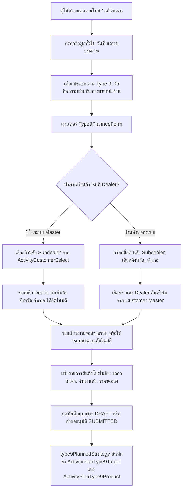
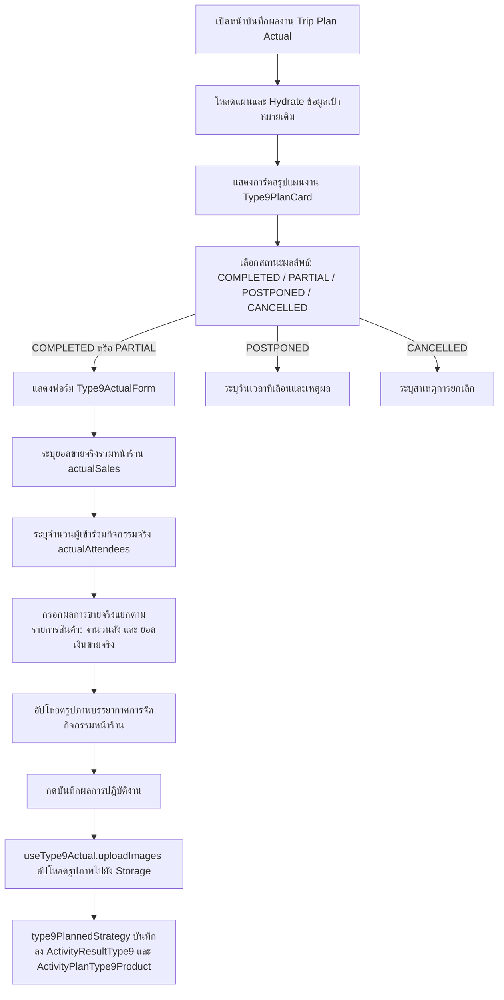
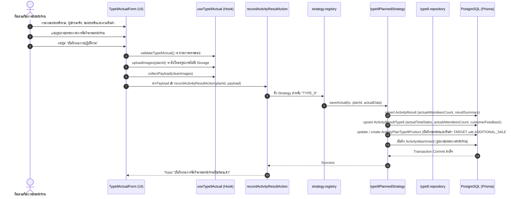

# Activity Type 9 — จัดกิจกรรมส่งเสริมการขายหน้าร้าน (Store Event / Sales Promotion) (README)

> **Feature Slice**: `modules/activity/features/type-9`  
> **Parent Module**: `modules/activity`  
> **Database Authority**: `prisma/schema.prisma` (`ActivityPlan`, `activity_type_9_targets`, `activity_type_9_products`, `activity_type_9_result`, `ActivityAttachment`)  
> **Architecture Style**: Vertical Slice Architecture (Dual-Mode 100%: Planned + Unplanned)  
> **Status**: Production Ready / Active Reference

---

## 1. Overview

### 1.1 วัตถุประสงค์ของ Type 9
**Type 9 (จัดกิจกรรมส่งเสริมการขายหน้าร้าน / Store Event & Sales Promotion)** มีวัตถุประสงค์เพื่อสนับสนุนการดำเนินกิจกรรมการตลาดเชิงรุก ณ จุดขาย (Point of Sale Activation) ของทีมงานสนาม (Sales Promoters / Technical Reps / Event Teams) ร่วมกับร้านค้าตัวแทนจำหน่ายหลัก (Dealer) และร้านค้าตัวแทนจำหน่ายย่อย (Subdealer) เพื่อ:
1. กระตุ้นยอดขายหน้าร้านในพื้นที่เป้าหมาย ผ่านการจัดกิจกรรม Roadshow, งานเปิดตัวสินค้า หรือบูธโปรโมชันลดแลกแจกแถม
2. สร้างการรับรู้และการทดลองใช้ผลิตภัณฑ์เคมีเกษตรและปุ๋ยแก่เกษตรกรในชุมชนรอบร้านค้า
3. เสริมสร้างความสัมพันธ์ทางการค้าระหว่างบริษัท ผู้แทนจำหน่ายหลัก (Dealer) และร้านค้าย่อย (Subdealer)
4. ติดตามและบันทึกยอดขายจริง ณ หน้าร้าน ทั้งยอดขายรวมและยอดขายแยกตามรายการสินค้า พร้อมเก็บสถิติจำนวนผู้เข้าร่วมงาน
5. บันทึกภาพถ่ายบรรยากาศการจัดกิจกรรมหน้าร้านเพื่อเป็นหลักฐานความโปร่งใสและการเบิกจ่ายงบประมาณ

### 1.2 ขอบเขตของ Type 9
- **การจัดการร้านค้าเป้าหมาย (Subdealer Management):**
  - **ร้านค้า Subdealer ในระบบ Customer Master:** เลือกร้านค้าที่มีประเภทเป็น `SUBDEALER` จากฐานข้อมูล โดยระบบจะดึงชื่อร้าน จังหวัด อำเภอ และผู้แทนจำหน่ายหลักต้นสังกัด (`parentDealer`) ให้อัตโนมัติ
  - **ร้านค้า Subdealer นอกระบบ (`isUnregisteredSubdealer = true`):** รองรับร้านค้าย่อยที่ยังไม่ได้ลงทะเบียนในระบบ โดยผู้ใช้สามารถระบุชื่อร้าน (`subDealerStore`), เลือกจังหวัด (`province`), เลือกอำเภอ (`district`), และเลือก Dealer ต้นสังกัด (`parentDealerId`) จาก Customer Master
- **เป้าหมายตามแผนงาน (Planned Targets):**
  - กำหนดร้านค้าผู้จัดกิจกรรม, เป้าหมายยอดขายรวมหน้าร้าน (`type9Sales` / `targetAmount`), และรายการสินค้าโปรโมชันเป้าหมาย (`type9ProductItems`: ชื่อสินค้า, จำนวนลัง, ราคาต่อลัง และยอดขายเป้าหมายรวม)
- **การบันทึกผลงานจริง (Actual Outcome):**
  - บันทึกยอดขายจริงรวมหน้าร้าน (`actualSales`), จำนวนผู้เข้าร่วมกิจกรรมจริง (`actualAttendees`), ผลยอดขายจริงแยกตามรายการสินค้าตามแผน (`productSalesDetails`: จำนวนลังที่ขายได้ และยอดเงินจริง), และรูปถ่ายบรรยากาศหน้าร้าน (`images`)

### 1.3 รูปแบบการทำงานที่รองรับ
| โหมดการทำงาน | คำอธิบาย | หน้าที่รับผิดชอบหลักใน Slice |
| :--- | :--- | :--- |
| **1. Planned** | สร้างและแก้ไขแผนจัดกิจกรรมหน้าร้าน ระบุร้านค้า Subdealer/Dealer, เป้าหมายยอดขาย และสินค้าโปรโมชัน | `Type9PlannedForm`, `useType9PlannedForm`, `type9PlannedStrategy` |
| **2. Planned Actual** | บันทึกผลการจัดกิจกรรมจริง ยอดขายรวมหน้าร้าน ยอดขายแยกตามสินค้า ผู้เข้าร่วม และรูปถ่ายบรรยากาศ | `Type9ActualForm`, `useType9Actual`, `type9PlannedStrategy` |
| **3. Unplanned (2-in-1)** | จัดกิจกรรมหน้าร้านกะทันหัน บันทึกทั้งข้อมูลร้านค้า สินค้าโปรโมชัน ผลยอดขายจริง และรูปภาพในขั้นตอนเดียว | `Type9UnplannedForm`, `useType9UnplannedForm`, `type9UnplannedStrategy` |
| **4. Detail View** | แสดงรายละเอียดแผนงานเป้าหมาย (`Type9PlanCard`) และผลลัพธ์การจัดกิจกรรมจริง พร้อมระบบ Lightbox ดูภาพ | `Type9PlanCard`, `Type9DetailView` |
| **5. Approval View** | สรุปร้านค้า ยอดขายเป้าหมาย และรายการสินค้า เพื่อให้หัวหน้างานพิจารณาอนุมัติแผนงาน | `Type9ApprovalCard`, `Type9PlanCard` |

---

## 2. Business Flows

### 2.1 Planned (สร้างและแก้ไขแผนงาน)


### 2.2 Planned Actual (บันทึกผลการปฏิบัติงานตามแผน)


### 2.3 Unplanned (กิจกรรมนอกแผน 2-in-1)
- ผู้ใช้งานเข้าหน้า `/activity-plans/unplanned/new` และเลือกประเภทงาน **จัดกิจกรรมส่งเสริมการขายหน้าร้าน (Type 9)**
- ฟอร์ม `Type9UnplannedForm` รวมขั้นตอนการระบุข้อมูลร้านค้า (Subdealer ในระบบ หรือระบุชื่อร้านนอกระบบ พร้อม Dealer ต้นสังกัด), สินค้าโปรโมชันเป้าหมาย, ยอดขายจริงรวม, ยอดขายจริงแยกตามสินค้า, จำนวนผู้เข้าร่วม และรูปภาพบรรยากาศหน้าร้านไว้ในหน้าจอเดียว
- รองรับการจัดกิจกรรมหลายจุดพร้อมกันในทริปเดียว (`items: Type9UnplannedItem[]`)
- เมื่อกดบันทึก ข้อมูลทั้งหมดจะถูกส่งผ่าน `unplanned.actions.ts` ➔ รัน `type9UnplannedStrategy.savePlan()` บันทึกทั้งข้อมูลเป้าหมายหน้าร้าน (`ActivityPlanType9Target`), สินค้าเป้าหมายและยอดขาย (`ActivityPlanType9Product`), ผลงานจริง (`ActivityResultType9`) และรูปภาพ (`ActivityAttachment`) พร้อมกันแบบ Atomic ภายใต้ Prisma Transaction เดียวกัน

### 2.4 Detail and Approval (ดูรายละเอียดและพิจารณาอนุมัติ)
- **Detail View:**
  - แสดง `Type9PlanCard` สรุปร้านค้าที่จัดกิจกรรม, Dealer ต้นสังกัด, สินค้าเป้าหมาย, ยอดขายเป้าหมาย และตารางสินค้า
  - หากมีผลงานจริง (`hasActualData`) แสดง `Type9DetailView` สรุปยอดขายจริงหน้าร้าน, ผู้เข้าร่วมจริง, ตารางผลยอดขายจริงเทียบตามรายการสินค้า, และแกลเลอรีรูปถ่ายบรรยากาศพร้อม Lightbox Modal
- **Approval View:**
  - แสดง `Type9ApprovalCard` เรนเดอร์การ์ดแผนการจัดกิจกรรม `Type9PlanCard` ให้ผู้อนุมัติตรวจสอบร้านค้าและยอดขายเป้าหมายก่อนอนุมัติหรือส่งกลับแก้ไข

---

## 3. Architecture

### 3.1 Folder Structure
```text
modules/activity/features/type-9/
├── index.ts                                # Vertical Slice Public Contract (จุดส่งออกเดียว)
├── README.md                               # เอกสารคู่มือทางเทคนิคฉบับสมบูรณ์ (ไฟล์นี้)
│
├── shared/                                 # ชิ้นส่วนที่ใช้ร่วมกันภายใน Type 9
│   ├── constants.ts                        # ค่าคงที่: WORK_TYPE_CODE, WORK_TYPE_NAME, DEFAULT_PRODUCT_ITEM
│   ├── types.ts                            # อินเตอร์เฟซข้อมูล: Type9ProductItem, Type9CustomerOption, etc.
│   └── notes.ts                            # Helper เข้ารหัส/ถอดรหัส JSON ใน ActivityPlanStore.notes
│
├── planned/                                # Sub-slice: กิจกรรมในแผนและบันทึกผลตามแผน
│   ├── application/                        # Business Logic, Mappers, Validators
│   │   ├── planned-validation.ts           # ตรวจสอบความถูกต้องของแผน (validateType9FormItems)
│   │   ├── planned-mapper.ts               # แปลงและ Hydrate ข้อมูลแผน (extractType9PlanTargets, etc.)
│   │   ├── actual-validation.ts            # ตรวจสอบความถูกต้องของผลงานจริง (validateType9Actual)
│   │   └── actual-mapper.ts                # แกะข้อมูลผลงานจริงจาก Backend (parseType9ActualResult)
│   ├── components/                         # UI Components ฝั่งในแผน
│   │   ├── type9-planned-form.tsx          # ฟอร์มสร้าง/แก้ไขกิจกรรมหน้าร้านตามแผน
│   │   ├── type9-plan-card.tsx             # การ์ดแสดงข้อมูลสรุปตามแผนและตารางสินค้า
│   │   ├── type9-actual-form.tsx           # ฟอร์มบันทึกผลจริง ยอดขายรวม ยอดขายแยกสินค้า และรูปถ่าย
│   │   ├── type9-detail-view.tsx           # หน้ารายละเอียดแสดงผลลัพธ์จริงพร้อมระบบ Lightbox
│   │   └── type9-approval-card.tsx         # การ์ดสรุปสำหรับหน้าจอพิจารณาอนุมัติ
│   ├── hooks/                              # Custom React State Hooks
│   │   ├── use-type9-planned-form.ts       # จัดการ State กิจกรรมหน้าร้านตามแผน
│   │   └── use-type9-actual.ts             # จัดการ State ผลจริง ยอดขาย ผู้เข้าร่วม รูปภาพ และ Upload
│   ├── infrastructure/                     # การเชื่อมต่อฐานข้อมูล
│   │   ├── type9.repository.ts             # Direct Prisma queries (findType9ByPlanId)
│   │   └── type9-planned.strategy.ts       # WorkTypeStrategy สำหรับ Type 9 ตามแผน
│   └── types/                              # ประเภทข้อมูลเฉพาะกิจกรรมในแผน
│       ├── planned.types.ts                # Type9TargetItem, Type9PlanTarget, Form Props
│       └── actual.types.ts                 # Type9ActualRecord, Type9ActualValidationInput, Form Props
│
└── unplanned/                              # Sub-slice: กิจกรรมนอกแผน (2-in-1)
    ├── application/                        # Logic และ Mappers กิจกรรมนอกแผน
    │   ├── unplanned-validation.ts         # ตรวจสอบความถูกต้องของกิจกรรมนอกแผน
    │   └── unplanned-mapper.ts             # แปลงข้อมูล 2-in-1 และสร้างสรุปผลการจัดงาน
    ├── components/                         # UI Components กิจกรรมนอกแผน
    │   └── type9-unplanned-form.tsx        # ฟอร์ม 2-in-1 รวมวางแผนและบันทึกผลในหน้าเดียว
    ├── hooks/                              # Custom React State Hooks
    │   └── use-type9-unplanned-form.ts     # จัดการ State กิจกรรมนอกแผน (รองรับหลายจุดจัดงาน)
    ├── infrastructure/                     # Strategy กิจกรรมนอกแผน
    │   └── type9-unplanned.strategy.ts     # WorkTypeStrategy บันทึกกิจกรรมนอกแผน 2-in-1
    └── types/                              # ประเภทข้อมูลกิจกรรมนอกแผน
        └── unplanned.types.ts              # Type9UnplannedItem, Props, Validation Result
```

### 3.2 Type 9 vs Shared Activity Matrix
| ความรับผิดชอบ | จัดการที่ Type 9 Feature (`features/type-9`) | จัดการที่ Shared Activity ส่วนกลาง (`ui/`, `views/`) |
| :--- | :--- | :--- |
| **ข้อมูลทั่วไปของแผน** | - | ชื่องาน, วันที่เริ่ม-สิ้นสุด, วัตถุประสงค์หลักของทริป |
| **พื้นที่ & ทีมงาน** | จังหวัด และ อำเภอ ของร้านค้า Subdealer ที่จัดงาน | จังหวัดหลักของทริป, พนักงานร่วมเดินทาง |
| **งบประมาณรวม** | - | งบเบิกสินค้าสาธิต, ของแถมโปรโมชัน, เบี้ยเลี้ยงเดินทาง |
| **ข้อมูลกิจกรรมตามแผน** | ร้านค้า Subdealer (ใน/นอกระบบ), Dealer ต้นสังกัด, รายการสินค้าโปรโมชัน, เป้าหมายยอดขายหน้าร้าน | จำนวนผู้เข้าร่วมเป้าหมายรวม (`ActivityPlan.targetAttendeesCount`) |
| **ผลการจัดกิจกรรมจริง** | ยอดขายจริงรวมหน้าร้าน, ผู้เข้าร่วมจริง, ยอดขายจริงแยกตามสินค้า, รูปภาพบรรยากาศหน้าร้าน | ผลสรุปภาพรวมแผน (`resultStatus`: COMPLETED/PARTIAL/etc.) |
| **Database Persistence** | ตารางเฉพาะ `ActivityPlanType9Target`, `ActivityPlanType9Product`, `ActivityResultType9` | ตารางหลัก `ActivityPlan`, `ActivityResult`, `ActivityAttachment` |

### 3.3 Dependency and Import Map
- **ทิศทางการเรียกใช้ที่อนุญาต (Allowed Dependencies):**
  - `views/` ➔ เรียกใช้ ➔ `features/type-9` (ผ่าน `index.ts` เท่านั้น)
  - `features/type-9` ➔ เรียกใช้ ➔ `@/modules/activity/ui` (`ActivityCustomerSelect`, `ActivityProductSelect`, `ActivityAddressSelect`, `ActivityInput`, `ActivityPhotoUpload`)
  - `features/type-9` ➔ เรียกใช้ ➔ `@/modules/activity/types/strategy.interface`
  - `features/type-9` ➔ เรียกใช้ ➔ `@/modules/activity/application/media/image-uploader`
  - `features/type-9` ➔ เรียกใช้ ➔ `@/components/custom/image-lightbox-modal`
- **Server Actions & Database Flow:**
  - `views/` ➔ ส่งข้อมูลไปยัง Server Actions ใน `@/modules/activity/server/`:
    - `planned.actions.ts` (`createActivityPlanAction`, `updateActivityPlanAction`, `getActivityPlanAction`)
    - `unplanned.actions.ts` (`createUnplannedActivityAction`, `updateUnplannedActivityAction`, `getUnplannedActivityAction`)
    - `actual.actions.ts` (`recordActivityResultAction`)
  - Server Actions ➔ ทำงานร่วมกับ `@/modules/activity/infrastructure/strategy.registry.ts` ➔ เรียกใช้ `type9PlannedStrategy` และ `type9UnplannedStrategy`
- **ข้อห้ามเด็ดขาด (Strict Rules):**
  - ❌ ห้าม Import จาก `@/modules/activity-plans/` ย้อนหลังโดยเด็ดขาด (Zero Legacy Imports)
  - ❌ ห้ามไฟล์ภายนอกข้ามเข้ามา Import ลึกใน `features/type-9/planned/...` โดยไม่ผ่าน `index.ts`
  - ❌ ห้ามเรียกใช้โค้ดข้ามไปยัง Feature Type อื่น

### 3.4 Entry Points and Public Exports
ไฟล์ [modules/activity/features/type-9/index.ts](file:///d:/code/crm-bank/modules/activity/features/type-9/index.ts) ทำหน้าที่เป็น **Single Public API Contract** สำหรับโมดูล Type 9 โดยส่งออก:
- **Planned Components:** `Type9PlannedForm`, `Type9PlanCard`, `Type9PlanForm`, `Type9Store`
- **Actual Components:** `Type9ActualForm`, `ActualType9Store`, `Type9DetailView`, `DetailType9Store`, `Type9ApprovalCard`, `ApprovalType9Store`
- **Unplanned Components:** `Type9UnplannedForm`
- **Hooks:** `useType9PlannedForm`, `useType9Form`, `useType9Actual`, `useType9UnplannedForm`
- **Mappers & Hydrators:** `extractType9PlanTargets`, `hydrateType9PlannedData`, `mapType9ToSectionItems`, `parseType9ActualResult`, `hydrateType9UnplannedData`, `mapType9UnplannedToPayload`
- **Validators:** `validateType9FormItems`, `validateType9Actual`, `validateType9UnplannedItems`
- **Shared Constants & Utilities:** `WORK_TYPE_CODE`, `WORK_TYPE_NAME`, `DEFAULT_PRODUCT_ITEM`, `encodeType9StoreNotes`, `decodeType9StoreNotes`
- **TypeScript Types:** `Type9PlanItem`, `Type9TargetItem`, `Type9PlanTarget`, `Type9ActualRecord`, `Type9ActualValidationInput`, `Type9UnplannedItem`, `Type9ProductItem`, `Type9TargetProductItem`, `Type9ProductSaleDetail`, `Type9CustomerOption`, `Type9ProductOption`, `Type9ImageFile`

---

## 4. File Responsibilities

### 4.1 Planned & Actual
- **`type9-planned-form.tsx`:** เรนเดอร์ฟอร์มสร้าง/แก้ไขแผนจัดกิจกรรมหน้าร้าน รองรับการสลับระหว่าง Subdealer ในระบบ Customer Master กับการระบุชื่อร้านค้านอกระบบ พร้อมเลือก Dealer ต้นสังกัด, เลือกจังหวัด/อำเภอ, ระบุเป้ายอดขายรวม, และตารางรายการสินค้าโปรโมชัน
- **`use-type9-planned-form.ts`:** จัดการ State ทั้งหมดของฟอร์มในแผน (Subdealer, Dealer ต้นสังกัด, จังหวัด, อำเภอ, ยอดขายเป้าหมาย, และรายการสินค้าโปรโมชัน `Type9ProductItem[]`) พร้อมระบบ Auto-resolve ดึง Dealer ต้นสังกัดจากข้อมูลร้านค้า Subdealer
- **`type9-plan-card.tsx`:** การ์ดแสดงข้อมูลสรุปตามแผนงาน แสดงชื่อร้านค้าที่จัดกิจกรรม, Dealer ต้นสังกัด, เป้ายอดขายรวม, และตารางรายการสินค้าโปรโมชันพร้อมจำนวนลังและราคา
- **`type9-actual-form.tsx`:** ฟอร์มบันทึกผลการจัดกิจกรรมจริง แสดงยอดขายรวมหน้าร้าน, ผู้เข้าร่วมจริง, ตารางกรอกผลยอดขายจริงแยกตามรายการสินค้า (จำนวนลังที่ขายได้ และยอดขายจริง), และอัปโหลดรูปภาพบรรยากาศหน้าร้าน
- **`use-type9-actual.ts`:** จัดการ State ผลงานจริง ฟังก์ชัน `uploadImages` เพื่ออัปโหลดรูปภาพหน้าร้านไปยังโฟลเดอร์ `"store"` / `"general"`, ฟังก์ชัน `collectPayload` รวบรวมข้อมูลยอดขายและ Clean URLs ของรูปภาพ, และ `validateType9Actual`
- **`type9-detail-view.tsx`:** คอมโพเนนต์แสดงผลเต็มรูปแบบในหน้ารายละเอียด แสดงการ์ดแผน `Type9PlanCard`, ยอดขายรวมจริง, ผู้เข้าร่วมจริง, ตารางสรุปผลยอดขายจริงเทียบตามรายการสินค้า, และแกลเลอรีรูปถ่ายบรรยากาศพร้อม Lightbox
- **`type9-approval-card.tsx`:** การ์ดสรุปสำหรับหน้าจอพิจารณาอนุมัติ เรนเดอร์ `Type9PlanCard` ให้หัวหน้างานพิจารณา
- **`planned-mapper.ts`:**
  - `extractType9PlanTargets`: ดึงข้อมูลร้านค้าและสินค้าโปรโมชันจากแผน แปลงเป็น `Type9TargetItem` พร้อมคำนวณยอดขายรวม
  - `hydrateType9PlannedData`: กู้คืนข้อมูลแผนเดิมเข้าฟอร์มแก้ไข
  - `mapType9ToSectionItems`: แปลงข้อมูลแผนเป็นหัวข้อและฟิลด์ย่อยสำหรับแสดงผลใน Section รวม
- **`actual-mapper.ts`:**
  - `parseType9ActualResult`: แปลงข้อมูลผลงานจริงจาก `ActivityResult` และ `saleResults` (`ActivityResultSaleItem`) รวมถึง Regex fallback จาก `resultSummary`
- **`planned-validation.ts` & `actual-validation.ts`:**
  - `validateType9FormItems`: ตรวจสอบว่าเลือกร้านค้า Subdealer ในระบบ หรือระบุชื่อร้านนอกระบบพร้อมจังหวัด/อำเภอครบถ้วน
  - `validateType9Actual`: ตรวจสอบความถูกต้องของตัวเลขยอดขายจริงและผู้เข้าร่วมจริง
- **`type9.repository.ts` & `type9-planned.strategy.ts`:**
  - `findType9ByPlanId`: ค้นหาข้อมูลร้านค้าและสินค้า Type 9 จาก Dedicated Tables (`activity_type_9_targets`, `activity_type_9_products`, `activity_type_9_result`)
  - `type9PlannedStrategy`: ดำเนินการตรวจสอบและบันทึกข้อมูลตามมาตรฐาน `WorkTypeStrategy` ลงตารางเฉพาะ Type 9 โดยตรง 100%

### 4.2 Unplanned
- **`type9-unplanned-form.tsx`:** ฟอร์มกิจกรรมหน้าร้านนอกแผน 2-in-1 แสดงอินพุตครบถ้วนทั้งข้อมูลร้านค้า Subdealer, Dealer ต้นสังกัด, สินค้าโปรโมชัน, ผลยอดขายรวมจริง, ผู้เข้าร่วมจริง, ยอดขายจริงแยกสินค้า และรูปถ่ายบรรยากาศ
- **`use-type9-unplanned-form.ts`:** จัดการ State อาร์เรย์ `Type9UnplannedItem[]` รองรับการเพิ่ม ลบ แก้ไขจุดจัดกิจกรรมหน้าร้านหลายจุดในทริปเดียวกัน
- **`unplanned-validation.ts`:** ตรวจสอบความถูกต้องของกิจกรรมนอกแผน (ร้านค้า, จังหวัด, อำเภอ, ยอดขายจริง และผู้เข้าร่วมจริง)
- **`unplanned-mapper.ts`:** Hydrate ข้อมูลเดิม และ Map ข้อมูลฟอร์ม 2-in-1 ออกมาเป็น Payload แผนงาน (`planStores`, `planProducts`) และผลงานจริง (`actualOutcome`) พร้อมสร้างข้อความสรุปผลงาน
- **`type9-unplanned.strategy.ts`:** ดำเนินการบันทึกกิจกรรมนอกแผนผ่านการเรียก `type9PlannedStrategy.savePlan()` และ `type9PlannedStrategy.saveActual()` ภายใต้ Transaction เดียวกัน

### 4.3 Shared Types, Constants, and Notes
- **`constants.ts`:** กำหนด `WORK_TYPE_CODE = "TYPE_9"`, `WORK_TYPE_NAME`, และ `DEFAULT_PRODUCT_ITEM`
- **`types.ts`:** กำหนดโครงสร้าง TypeScript สำหรับสินค้าโปรโมชัน (`Type9ProductItem`), รายการสินค้าในเป้าหมาย (`Type9TargetProductItem`), ยอดขายจริงแยกสินค้า (`Type9ProductSaleDetail`), และตัวเลือกร้านค้า/สินค้า
- **`notes.ts`:** ฟังก์ชัน `encodeType9StoreNotes` และ `decodeType9StoreNotes` สำหรับจัดเก็บข้อมูลรายละเอียดและโปรโมชันร่วมกันในคอลัมน์ `notes` ของตาราง `ActivityPlanStore`

### 4.4 Shared UI and Views
- คอมโพเนนต์ `ActualWorkTypeList`, `DetailWorkTypeList`, และ `ApprovalWorkTypeList` ใน `modules/activity/views/` ทำหน้าที่เป็น Orchestrator ตรวจจับรหัสงาน `"TYPE_9"` แล้วสลับมาเรนเดอร์คอมโพเนนต์ของ Type 9

---

## 5. Data Flow



### 5.1 Create Planned (สร้างแผนใหม่)
1. `create-view.tsx` เรียกใช้ `useType9PlannedForm()`
2. ผู้ใช้ระบุข้อมูลร้านค้า Subdealer (ในระบบหรือนอกระบบ), Dealer ต้นสังกัด, จังหวัด/อำเภอ, เป้ายอดขายรวม, และรายการสินค้าโปรโมชัน
3. ระบบตรวจสอบความถูกต้องด้วย `validateType9FormItems()`
4. Form Orchestrator รวม Payload และส่งไปยัง Server Action `createActivityPlanAction`
5. `type9PlannedStrategy.savePlan()` บันทึกข้อมูลร้านค้าลงใน `ActivityPlanType9Target` (`subDealerStore`, `subdealerId`, `targetSales`, `province`, `district`) และบันทึกสินค้าโปรโมชันลงใน `ActivityPlanType9Product` (`productRole = "TARGET"`)

### 5.2 Edit Planned (แก้ไขแผนงานเดิม)
1. `edit-view.tsx` โหลดข้อมูลแผนงานจากฐานข้อมูล
2. เรียก `hydrateType9PlannedData(plan)` แปลงข้อมูลร้านค้าและสินค้าเดิมออกมา
3. ส่งข้อมูลเข้า `useType9PlannedForm()` เพื่อเติมลงใน State ของฟอร์ม
4. ผู้ใช้แก้ไขข้อมูลและกดบันทึกกลับได้อย่างถูกต้อง

### 5.3 Save Actual (บันทึกผลการปฏิบัติงานจริง)
1. `activity-plan-actual-view.tsx` ตรวจสอบความถูกต้องผ่าน `validateType9Actual(input)`
2. เรียก `type9Actual.uploadImages(planId)` เพื่ออัปโหลดไฟล์ภาพบรรยากาศไปยัง Storage
3. เรียก `type9Actual.collectPayload(cleanImages)` จัดกลุ่มข้อมูลยอดขายรวม, ผู้เข้าร่วม, ยอดขายแยกสินค้า, และ Clean URLs
4. ส่ง Payload เข้า Server Action `recordActivityResultAction`
5. `type9PlannedStrategy.saveActual()` อัปเดต `ActivityResultType9` และอัปเดตยอดขายแยกสินค้าลงใน `ActivityPlanType9Product` โดยตรง (ไม่มีการ sync generic tables อีกต่อไป)

### 5.4 Load Actual (โหลดผลงานเดิมมาแสดงในหน้าบันทึกผล)
1. `useActualPlanLoader` ดึงข้อมูลแผนงานและผลงานเดิม
2. `extractType9PlanTargets(plan)` แกะข้อมูลร้านค้าและสินค้าเป้าหมายออกมาแสดงในการ์ด `Type9PlanCard`
3. `parseType9ActualResult(plan.result)` ดึงข้อมูลยอดขายรวม, ผู้เข้าร่วม, ยอดขายแยกสินค้าจาก `saleResults`, และรูปภาพเดิม
4. เรียก `type9Actual.hydrate()` เติมข้อมูลลง State ของฟอร์มพร้อมให้แก้ไขเพิ่มเติม

### 5.5 Create/Edit Unplanned (กิจกรรมนอกแผน 2-in-1)
1. ผู้ใช้กรอกฟอร์ม `Type9UnplannedForm` ครบทั้งส่วนร้านค้า สินค้าโปรโมชัน ผลยอดขายจริง และรูปภาพ
2. ตรวจสอบความถูกต้องด้วย `validateType9UnplannedItems(items)`
3. `mapType9UnplannedToPayload` แปลงข้อมูลออกมาเป็น `planStores`, `planProducts`, `targets`, และ `actualOutcome`
4. `type9UnplannedStrategy.savePlan()` บันทึกข้อมูลแผนงานและผลงานจริงพร้อมกันแบบ Atomic

### 5.6 Detail and Approval (การแสดงผลหน้ารายละเอียดและพิจารณาอนุมัติ)
1. หน้า Detail / Approval โหลดข้อมูลแผนงานผ่าน Loader
2. เรนเดอร์ `Type9PlanCard` แสดงร้านค้า, Dealer ต้นสังกัด, เป้ายอดขาย, และตารางสินค้าโปรโมชัน
3. หากมีผลงานจริง เรนเดอร์ `Type9DetailView` แสดงยอดขายจริงรวม, ผู้เข้าร่วมจริง, ตารางยอดขายจริงรายสินค้า, และแกลเลอรีรูปถ่ายบรรยากาศพร้อม Lightbox

---

## 6. Data Models and Mapping

### 6.1 Database CRUD Matrix (สิทธิ์และการจัดการตารางในฐานข้อมูล)
| ตารางในฐานข้อมูล (`Prisma Model`) | Create (สร้าง) | Read (อ่าน/แสดงผล) | Update (แก้ไข) | Delete (ลบ) | หมายเหตุ |
| :--- | :--- | :--- | :--- | :--- | :--- |
| **`activity_type_9_targets`**<br>(`ActivityPlanType9Target`) | `savePlan()` ใน Planned/Unplanned | `loadPlan()`, `extractType9PlanTargets` | `savePlan()` (Atomic recreation) | Cascade เมื่อลบแผน | ข้อมูลร้านค้า Subdealer, Dealer ต้นสังกัด, ที่ตั้ง, เป้ายอดขายรวม, ผู้เข้าร่วม |
| **`activity_type_9_products`**<br>(`ActivityPlanType9Product`) | `savePlan()` / `saveActual()` | `loadPlan()`, `loadActual()`, `extractType9PlanTargets` | `savePlan()`, `saveActual()` | Cascade เมื่อลบเป้า | สินค้าตามแผน (`TARGET`), ยอดขายจริง และสินค้าขายเพิ่มหน้างาน (`ADDITIONAL_SALE`) |
| **`activity_type_9_result`**<br>(`ActivityResultType9`) | `saveActual()` ใน Actual/Unplanned | `loadActual()`, `parseType9ActualResult` | `upsert` ใน `saveActual()` | Cascade เมื่อลบเป้า | ผู้เข้าร่วมจริง (`actualAttendeesCount`), ยอดขายจริงรวม, ผลตอบรับลูกค้า/ร้าน |
| **`activity_plans`**<br>(`ActivityPlan`) | ตอนสร้างแผน | ในทุกมุมมอง | เมื่อแก้ไขแผน | Cascade Delete | ตาราง Header หลัก |
| **`activity_attachments`**<br>(`ActivityAttachment`) | `uploadImages()` + Server Action | `plan.attachments` | สร้างใหม่/ลบรูปที่ไม่ได้ใช้ | Cascade เมื่อลบผลงาน | รูปถ่ายบรรยากาศหน้าร้านและป้ายโปรโมชัน |

### 6.2 Complete Field-to-Database Mapping (ตารางจับคู่ฟิลด์ครบถ้วนทุกจุด)
| Form Field (UI) | TypeScript Type Field | Mapper Function (Write/Read) | Prisma Model | DB Column Name | Data Type | Nullable? | Default |
| :--- | :--- | :--- | :--- | :--- | :--- | :---: | :--- |
| **ร้านค้า Subdealer นอกระบบ** | `isUnregisteredSubdealer` | `planned-mapper` / `unplanned-mapper` | `ActivityPlanType9Target` | `is_unregistered_subdealer` | `BOOLEAN` | No | `false` |
| **รหัสร้านค้า Subdealer ในระบบ** | `subdealerId` | `planned-mapper` ➔ `type9Targets` | `ActivityPlanType9Target` | `subdealer_id` | `VARCHAR (FK)` | Yes | `null` |
| **ชื่อร้านค้า Subdealer ในระบบ** | `subdealerName` | `planned-mapper` ➔ `type9Targets` | `ActivityPlanType9Target` | `subdealer_name` | `VARCHAR` | Yes | `null` |
| **ชื่อร้านค้า Subdealer นอกระบบ**| `subDealerStore` | `planned-mapper` ➔ `type9Targets` | `ActivityPlanType9Target` | `sub_dealer_store` | `VARCHAR` | Yes | `null` |
| **จังหวัดของร้านค้า** | `province` / `subDealerProvince` | `planned-mapper` ➔ `type9Targets` | `ActivityPlanType9Target` | `province` | `VARCHAR` | Yes | `null` |
| **อำเภอของร้านค้า** | `district` / `subDealerDistrict` | `planned-mapper` ➔ `type9Targets` | `ActivityPlanType9Target` | `district` | `VARCHAR` | Yes | `null` |
| **รหัส Dealer ต้นสังกัด** | `parentDealerId` / `dealerId` | `planned-mapper` ➔ `type9Targets` | `ActivityPlanType9Target` | `dealer_id` | `VARCHAR (FK)` | Yes | `null` |
| **ชื่อ Dealer ต้นสังกัด** | `parentDealerName` / `dealerName` | `planned-mapper` ➔ `type9Targets` | `ActivityPlanType9Target` | `dealer_name` | `VARCHAR` | Yes | `null` |
| **เป้ายอดขายรวมหน้าร้าน** | `type9Sales` / `targetSales` | `planned-mapper` ➔ `type9Targets` | `ActivityPlanType9Target` | `target_sales` | `DECIMAL(15,2)` | Yes | `null` |
| **สัดส่วนต่อยอดขาย** | `salesRatio` | `planned-mapper` ➔ `type9Targets` | `ActivityPlanType9Target` | `sales_ratio` | `DECIMAL(8,2)` | Yes | `null` |
| **รายการสินค้าโปรโมชัน** | `type9ProductItems` | `planned-mapper` ➔ `type9Products` | `ActivityPlanType9Product` | `product_id`, `product_name` | `VARCHAR` | No | - |
| **บทบาทสินค้า** | `productRole` | Strategy | `ActivityPlanType9Product` | `product_role` | `VARCHAR` | No | `'TARGET'` |
| **จำนวนลังเป้าหมาย** | `quantityCases` | `planned-mapper` ➔ `type9Products` | `ActivityPlanType9Product` | `target_quantity` | `DECIMAL(10,2)` | Yes | `0` |
| **ราคาต่อลังเป้าหมาย** | `pricePerCase` | `planned-mapper` ➔ `type9Products` | `ActivityPlanType9Product` | `target_unit_price` | `DECIMAL(15,2)` | Yes | `0` |
| **ยอดขายรวมเป้าหมายสินค้านั้น**| `totalAmount` | `planned-mapper` ➔ `type9Products` | `ActivityPlanType9Product` | `target_amount` | `DECIMAL(15,2)` | Yes | `0` |
| **จำนวนลังขายได้จริง** | `actualQuantityCases` | `actual-mapper` ➔ `type9Products` | `ActivityPlanType9Product` | `actual_quantity` | `DECIMAL(10,2)` | Yes | `null` |
| **ราคาขายจริงต่อลัง** | `pricePerCase` (actual) | `actual-mapper` ➔ `type9Products` | `ActivityPlanType9Product` | `actual_unit_price` | `DECIMAL(15,2)` | Yes | `null` |
| **ยอดขายจริงสินค้านั้น** | `actualSales` (per product) | `actual-mapper` ➔ `type9Products` | `ActivityPlanType9Product` | `actual_total` | `DECIMAL(15,2)` | Yes | `null` |
| **ยอดขายจริงรวมหน้าร้าน** | `actualSales` / `t9ActualSales` | `actual-mapper` / `saveActual` | `ActivityResultType9` | `actual_total_sales` | `DECIMAL(15,2)` | Yes | `null` |
| **ผู้เข้าร่วมกิจกรรมจริง** | `actualAttendees` / `t9ActualAttendees` | `actual-mapper` / `saveActual` | `ActivityResultType9` | `actual_attendees_count` | `INTEGER` | Yes | `0` |
| **ผลตอบรับลูกค้า / ร้านค้า** | `customerFeedback` | `actual-mapper` / `saveActual` | `ActivityResultType9` | `customer_feedback` | `TEXT` | Yes | `null` |
| **รูปถ่ายบรรยากาศหน้าร้าน** | `images` / `t9Images` | `uploadImages()` ➔ `attachments` | `ActivityAttachment` | `file_url`, `work_type_code = 'TYPE_9'` | `TEXT` | No | - |

### 6.3 รายละเอียดตารางเฉพาะ (Dedicated Tables Schema)

```prisma
// 1. ตารางเป้าหมายกิจกรรมหน้าร้าน
model ActivityPlanType9Target {
  id                      String   @id @default(cuid())
  activityPlanId          String   @map("activity_plan_id")
  subdealerId             String?  @map("subdealer_id")
  subdealerName           String?  @map("subdealer_name")
  isUnregisteredSubdealer Boolean  @default(false) @map("is_unregistered_subdealer")
  subDealerStore          String?  @map("sub_dealer_store")
  province                String?  @map("province")
  district                String?  @map("district")
  dealerId                String?  @map("dealer_id")
  dealerName              String?  @map("dealer_name")
  targetSales             Decimal? @map("target_sales") @db.Decimal(15, 2)
  salesRatio              Decimal? @map("sales_ratio") @db.Decimal(8, 2)
  targetAttendeesCount    Int?     @default(0) @map("target_attendees_count")
  notes                   String?  @map("notes") @db.Text

  createdAt               DateTime @default(now()) @map("created_at")
  updatedAt               DateTime @updatedAt @map("updated_at")

  activityPlan            ActivityPlan               @relation(fields: [activityPlanId], references: [id], onDelete: Cascade)
  subdealer               Customer?                  @relation("Type9SubdealerStore", fields: [subdealerId], references: [id], onDelete: SetNull)
  dealer                  Customer?                  @relation("Type9DealerStore", fields: [dealerId], references: [id], onDelete: SetNull)
  products                ActivityPlanType9Product[]
  result                  ActivityResultType9?

  @@index([activityPlanId])
  @@index([subdealerId])
  @@index([dealerId])
  @@map("activity_type_9_targets")
}

// 2. ตารางสินค้าเป้าหมายและยอดขายจริง
model ActivityPlanType9Product {
  id              String   @id @default(cuid())
  activityPlanId  String   @map("activity_plan_id")
  targetId        String   @map("target_id")
  productId       String?  @map("product_id")
  productName     String?  @map("product_name")
  productRole     String   @default("TARGET") @map("product_role") // "TARGET" | "ADDITIONAL_SALE"

  // Planned fields
  targetQuantity  Decimal? @map("target_quantity") @db.Decimal(10, 2)
  targetUnitPrice Decimal? @map("target_unit_price") @db.Decimal(15, 2)
  targetAmount    Decimal? @map("target_amount") @db.Decimal(15, 2)

  // Actual fields
  actualQuantity  Decimal? @map("actual_quantity") @db.Decimal(10, 2)
  actualUnitPrice Decimal? @map("actual_unit_price") @db.Decimal(15, 2)
  actualTotal     Decimal? @map("actual_total") @db.Decimal(15, 2)
  actualNotes     String?  @map("actual_notes")

  createdAt       DateTime @default(now()) @map("created_at")
  updatedAt       DateTime @updatedAt @map("updated_at")

  activityPlan    ActivityPlan            @relation(fields: [activityPlanId], references: [id], onDelete: Cascade)
  target          ActivityPlanType9Target @relation(fields: [targetId], references: [id], onDelete: Cascade)
  product         Product?                @relation(fields: [productId], references: [id], onDelete: Restrict)

  @@index([activityPlanId])
  @@index([targetId])
  @@index([productId])
  @@map("activity_type_9_products")
}

// 3. ตารางผลสรุปกิจกรรมหน้าร้าน
model ActivityResultType9 {
  id                   String   @id @default(cuid())
  activityPlanId       String   @map("activity_plan_id")
  targetId             String   @unique @map("target_id")
  actualAttendeesCount Int      @default(0) @map("actual_attendees_count")
  actualTotalSales     Decimal? @map("actual_total_sales") @db.Decimal(15, 2)
  customerFeedback     String?  @map("customer_feedback") @db.Text

  createdAt            DateTime @default(now()) @map("created_at")
  updatedAt            DateTime @updatedAt @map("updated_at")

  activityPlan         ActivityPlan            @relation(fields: [activityPlanId], references: [id], onDelete: Cascade)
  target               ActivityPlanType9Target @relation(fields: [targetId], references: [id], onDelete: Cascade)

  @@index([activityPlanId])
  @@index([targetId])
  @@map("activity_type_9_result")
}
```

### 6.4 Transaction & Persistence Strategy (ขาเขียนและขาอ่าน)
- **การจัดการ Transaction (Atomic Execution):**
  - ทุกการบันทึกของ Type 9 ดำเนินการภายใต้ Prisma Transaction (`tx`) แบบ Atomic
  - ใน Planned: `savePlan()` จะบันทึก `activity_type_9_targets` และ `activity_type_9_products` ในตอนสร้างแผน และ `saveActual()` จะบันทึก `activity_type_9_result` และอัปเดตยอดจริงลง `activity_type_9_products`
  - ใน Unplanned (2-in-1): `savePlan()` จะบันทึกข้อมูลลงทั้ง 3 ตารางพร้อมกันใน Transaction เดียว หากมีข้อผิดพลาดระบบจะ Rollback ทันที
- **โครงสร้างแบบ Dedicated (ไม่มี JSON Notes ปะปน):**
  - ข้อมูลร้านค้า Subdealer, Dealer ต้นสังกัด, ที่ตั้ง, เป้ายอดขาย, ผลการขายจริงรายสินค้า และผู้เข้าร่วม ถูกแยกเก็บในคอลัมน์ของตารางเฉพาะตรงๆ รองรับการทำ BI/Analytics และมี Indexing ครบถ้วน
- **การเก็บบันทึกยอดขายจริง (Sales Persistence):**
  - ยอดขายตามแผนจะถูกอัปเดตลงสินค้าตามแผน (`productRole = "TARGET"`) เพื่อเปรียบเทียบยอดตามแผน vs ยอดจริงได้ทันที
  - สินค้าที่ขายได้เพิ่มเติมหน้างานจะถูกบันทึกเป็นรายการใหม่ด้วย `productRole = "ADDITIONAL_SALE"`
  - บันทึกลงตารางเฉพาะ `activity_type_9_products` 100% โดยตัดขาดจากการ sync ตาราง generic tables เดิม
- **Cascade Delete Policy:**
  - เมื่อลบแผนงาน `ActivityPlan` ระเบียนที่เกี่ยวข้องใน `activity_type_9_targets`, `activity_type_9_products`, `activity_type_9_result`, และ `activity_attachments` จะถูกลบออกแบบ Cascade ทั้งหมด

---

## 7. Business Rules

### 7.1 Validation Rules
1. **การตรวจสอบร้านค้า Subdealer:**
   - หากเป็นร้านค้าในระบบ Customer Master: ต้องเลือก `subdealerId` จากระบบ
   - หากเป็นร้านค้านอกระบบ (`isUnregisteredSubdealer = true`):
     - ต้องระบุชื่อร้านค้า Subdealer (`subDealerStore` ห้ามว่าง)
     - ต้องเลือกจังหวัด (`subDealerProvince` ห้ามว่าง)
     - ต้องเลือกอำเภอ (`subDealerDistrict` ห้ามว่าง)
     - ต้องเลือกร้านค้า Dealer ต้นสังกัด (`parentDealerId` ห้ามว่าง)
2. **การตรวจสอบผลงานจริง (Actual Validation):**
   - ยอดขายจริงรวม (`actualSales`): หากระบุ ต้องเป็นตัวเลขที่มีค่า $\ge 0$
   - จำนวนผู้เข้าร่วมจริง (`actualAttendees`): หากระบุ ต้องเป็นตัวเลขที่มีค่า $\ge 0$
3. **การตรวจสอบกิจกรรมนอกแผน (`validateType9UnplannedItems`):**
   - ต้องมีรายการกิจกรรมหน้าร้านอย่างน้อย 1 รายการ
   - ทุกรายการต้องผ่านการตรวจสอบร้านค้า จังหวัด และอำเภอตามเงื่อนไขข้อ 1

### 7.2 Default Values
- `isUnregisteredSubdealer`: ค่าเริ่มต้นเป็น `false`
- `type9Sales`: ค่าเริ่มต้นเป็น `0` บาท
- `type9ProductItems`: เริ่มต้นด้วยแถวว่าง 1 รายการ (`DEFAULT_PRODUCT_ITEM`)
- `activityResultStatus`: ค่าเริ่มต้นเมื่อเปิดหน้าบันทึกผลเป็น `"COMPLETED"`

### 7.3 Conditional Fields
- **การสลับอินพุตร้านค้า:** เมื่อผู้ใช้ติ๊กเลือก "ร้านค้าไม่มีในระบบ / ระบุเอง" ช่องเลือกร้านค้า Subdealer จาก Customer Master จะถูกเปลี่ยนเป็นช่องกรอกข้อความธรรมดา พร้อมแสดงตัวเลือกจังหวัด อำเภอ และตัวเลือกเลือกร้านค้า Dealer ต้นสังกัดขึ้นมาโดยอัตโนมัติ
- **การคำนวณเป้ายอดขายรวม:** หากผู้ใช้เพิ่มรายการสินค้าโปรโมชัน ระบบจะคำนวณผลรวม `quantityCases * pricePerCase` เป็นเป้ายอดขายรวมหน้าร้านให้อัตโนมัติ (แต่ผู้ใช้ยังสามารถแก้ไขตัวเลขเป้ายอดขายรวมได้ตามต้องการ)
- **ระบบ Lightbox:** ในหน้า `Type9DetailView` แกลเลอรีรูปภาพบรรยากาศจะรองรับการคลิกดูขยายภาพ พร้อมปุ่มเลื่อนดูภาพถัดไป/ก่อนหน้า

### 7.4 Status and Approval Rules
- แผนงานจะสามารถบันทึกผลการจัดกิจกรรมจริง (Actual) ได้เฉพาะเมื่อแผนมีสถานะเป็น `APPROVED` เท่านั้น
- เฉพาะเจ้าของแผนงาน (Creator) และ Administrator เท่านั้นที่มีสิทธิ์บันทึกผลการปฏิบัติงานจริง
- การพิจารณาอนุมัติของหัวหน้างานจะเห็นข้อมูลร้านค้า Subdealer, Dealer ต้นสังกัด, เป้ายอดขายรวม และรายการสินค้าโปรโมชันทั้งหมดในการ์ด `Type9ApprovalCard`

---

## 8. Shared Dependencies

โมดูล Type 9 ทำงานร่วมกับโมดูลและคอมโพเนนต์ส่วนกลางดังนี้:
1. **`@/modules/activity/ui`:**
   - `ActivityCustomerSelect`: ค้นหาและเลือกร้านค้า Subdealer / Dealer จาก Customer Master
   - `ActivityProductSelect`: ค้นหาและเลือกสินค้าโปรโมชันจาก Product Catalog
   - `ActivityAddressSelect`: คอมโพเนนต์เลือกจังหวัดและอำเภอ
   - `ActivityInput`: กล่องกรอกข้อความและตัวเลขมาตรฐาน
   - `ActivityPhotoUpload`: คอมโพเนนต์อัปโหลดรูปภาพพร้อมบีบอัดไฟล์
2. **`@/modules/activity/views`:**
   - `ActualWorkTypeList`, `DetailWorkTypeList`, `ApprovalWorkTypeList` ทำหน้าที่เป็น View Orchestrator สลับมาแสดงผลคอมโพเนนต์ของ Type 9 ตามเงื่อนไขประเภทงาน
3. **`@/modules/activity/constants`:**
   - `WORK_TYPE_CONFIG`: ตั้งค่ารหัสประเภทงานและสีธีม (Teal)
   - `ACTIVITY_RESULT_STATUS_LABELS`: ป้ายแสดงสถานะผลกิจกรรม
4. **`@/modules/activity/infrastructure/strategy.registry`:**
   - ลงทะเบียน `type9PlannedStrategy` และ `type9UnplannedStrategy` สำหรับจัดเก็บข้อมูลแบบ Polymorphic
5. **Server Actions ที่ใช้งาน:**
   - `createActivityPlanAction`, `updateActivityPlanAction`, `getActivityPlanAction` ใน `@/modules/activity/server/planned.actions`
   - `createUnplannedActivityAction`, `updateUnplannedActivityAction`, `getUnplannedActivityAction` ใน `@/modules/activity/server/unplanned.actions`
   - `recordActivityResultAction` ใน `@/modules/activity/server/actual.actions`
6. **Lightbox Component:**
   - `ImageLightboxModal` ใน `@/components/custom/image-lightbox-modal`

---

## 9. How to Modify Type 9

### 9.1 การเพิ่มฟิลด์ใหม่บนฟอร์ม (Add a Form Field)
1. เพิ่มฟิลด์ใน Type Definitions:
   - ฟอร์มแผน: `planned/types/planned.types.ts` (`Type9PlannedFormProps`, `Type9TargetItem`)
   - ฟอร์มผลจริง: `planned/types/actual.types.ts` (`Type9ActualRecord`, `Type9ActualFormProps`)
   - ฟอร์มนอกแผน: `unplanned/types/unplanned.types.ts` (`Type9UnplannedItem`)
2. เพิ่มเงื่อนไขตรวจสอบความถูกต้องใน `planned-validation.ts`, `actual-validation.ts`, หรือ `unplanned-validation.ts`
3. เพิ่ม UI Input ในคอมโพเนนต์ฟอร์ม (`type9-planned-form.tsx`, `type9-actual-form.tsx`, หรือ `type9-unplanned-form.tsx`) โดยใช้ `@/modules/activity/ui`
4. ปรับ Mapper ใน `planned-mapper.ts`, `actual-mapper.ts`, หรือ `unplanned-mapper.ts`
5. อัปเดตการบันทึกใน `type9-planned.strategy.ts` หรือ `type9.repository.ts`

### 9.2 การปรับแก้ Validation (Change Validation)
- แก้ไขที่ไฟล์ `planned/application/planned-validation.ts`, `planned/application/actual-validation.ts` หรือ `unplanned/application/unplanned-validation.ts` ตามเงื่อนไขทางธุรกิจที่ต้องการปรับปรุง

### 9.3 การปรับ Database Mapping (Change Database Mapping)
- หากมีการเปลี่ยนแปลง Schema ใน `prisma/schema.prisma` ให้แก้ไขการบันทึกใน `type9.repository.ts` หรือ `type9-planned.strategy.ts` โดยคงการทำงานแบบ Transaction เสมอ

### 9.4 การปรับแก้ Actual Loading or Hydration
- ตรวจสอบฟังก์ชัน `hydrateType9PlannedData`, `extractType9PlanTargets` ใน `planned-mapper.ts` และ `parseType9ActualResult` ใน `actual-mapper.ts` เพื่อให้รองรับคีย์ข้อมูลเดิมและการแปลงสตริงเป็นตัวเลขอย่างปลอดภัย

### 9.5 การแก้ไข Shared Components อย่างปลอดภัย
- เมื่อต้องแก้ไขคอมโพเนนต์ใน `@/modules/activity/ui` ต้องคำนึงถึงประเภทงานอื่นเสมอ และไม่เปลี่ยนแปลง Props Interface เดิมที่ใช้งานร่วมกัน

---

## 10. Troubleshooting & Tracing Pipeline

### 10.1 Step-by-Step Tracing Pipeline (คู่มือการไล่โค้ดเมื่อพบปัญหา)

เมื่อพบว่าข้อมูลบางจุดไม่แสดงผล (เช่น ยอดขายแยกตามสินค้าไม่ถูกบันทึก หรือร้านค้า Subdealer นอกระบบไม่แสดงตอนโหลดซ้ำ) ให้ไล่ตรวจสอบตาม 8 ขั้นตอนนี้ตามลำดับ:

```text
[Step 1: UI Field] ➔ Type9ActualForm.tsx (ตรวจว่า state productSalesDetails มีค่าครบถ้วนหรือไม่)
        ↓
[Step 2: Hook State] ➔ use-type9-actual.ts (ตรวจ collectPayload ว่าแนบ t9ProductSalesDetails หรือไม่)
        ↓
[Step 3: Save Mapper] ➔ collectPayload() (ตรวจว่าได้ Clean URLs ของรูปภาพ และ Array ของ ProductSalesDetails)
        ↓
[Step 4: Server Action] ➔ recordActivityResultAction ➔ recordActivityResultUseCase
        ↓
[Step 5: Strategy Write] ➔ type9-planned.strategy.ts: saveActual() ➔ บันทึก ActivityResultType9 & ActivityPlanType9Product
        ↓
[Step 6: Prisma Table] ➔ ตรวจสอบตาราง activity_type_9_products และ activity_type_9_result ใน DB ว่ามีระเบียนถูกสร้าง/อัปเดตหรือไม่
        ↓
[Step 7: Loader & Include] ➔ getActivityPlanAction (ตรวจว่า include type9Targets.products และ attachments ครบถ้วนหรือไม่)
        ↓
[Step 8: Load Hydrator] ➔ actual-mapper.ts: parseType9ActualResult() ➔ useType9Actual.hydrate()
```

### 10.2 ตารางวิเคราะห์ปัญหาที่พบบ่อย (Common Pitfalls)

| อาการ | จุดที่ต้องตรวจสอบ | สาเหตุและแนวทางแก้ไข |
| :--- | :--- | :--- |
| **บันทึกผลสำเร็จแต่ยอดขายแยกสินค้าไม่ลงตาราง `activity_type_9_products`** | `type9-planned.strategy.ts` ➔ `saveActual` | รายการสินค้าใน `productSalesDetails` ขาดฟิลด์ `productId` หรือ `actualQuantityCases` มีค่าเป็น 0 หรือว่าง ให้ตรวจสอบว่าคอมโพเนนต์แปลงตัวเลขถูกต้อง |
| **ร้านค้า Subdealer นอกระบบที่เคยกรอกไว้หายไปหลังบันทึกแผน** | `use-type9-planned-form.ts` ➔ `mapType9Payload` | เมื่อเป็นร้านนอกระบบ ต้องนำ `subDealerStore` ไปเก็บในคอลัมน์ `subDealerStore` ของ `ActivityPlanType9Target` และนำ `parentDealerId` ไปเก็บใน `dealerId` |
| **จังหวัดและอำเภอของร้านค้านอกระบบไม่แสดงเมื่อเปิดแก้ไข** | `planned-mapper.ts` ➔ `hydrateType9PlannedData` | ตรวจสอบว่าฟังก์ชัน Hydrate อ่านฟิลด์ `province` จาก `type9Targets` ครบถ้วนหรือไม่ |
| **รูปถ่ายบรรยากาศหน้าร้านหายหลัง Reload หน้าจอ** | `use-type9-actual.ts` ➔ `uploadImages` | ตรวจสอบว่า `uploadActivityPlanImageGroup` ทำงานสำเร็จและส่ง Clean URLs กลับมาบันทึกลง `attachments` หรือไม่ |
| **ผลรวมเป้ายอดขายไม่ตรงกับจำนวนลังและราคาที่กรอก** | `use-type9-planned-form.ts` | ตรวจสอบฟังก์ชันคำนวณ `type9Sales` ว่าได้รวม `quantityCases * pricePerCase` ของทุกแถวสินค้าอย่างถูกต้องหรือไม่ |

---

## 11. Testing and Manual UAT

### แผนการทดสอบแบบครบวงจร (End-to-End Test Checklist):
- [ ] **TC-01 (Planned Create - Registered Subdealer):** สร้างแผนจัดกิจกรรมหน้าร้าน เลือกร้านค้า Subdealer จาก Customer Master ระบบต้องดึง Dealer ต้นสังกัด จังหวัด และอำเภอขึ้นมาให้อัตโนมัติ ระบุสินค้าโปรโมชัน 2 รายการ บันทึกแบบร่างและส่งขออนุมัติได้สำเร็จ
- [ ] **TC-02 (Planned Create - Unregistered Subdealer):** สร้างแผนโดยติ๊กเลือกร้านค้านอกระบบ กรอกชื่อร้านค้า เลือกจังหวัด อำเภอ และเลือกร้านค้า Dealer ต้นสังกัด บันทึกแล้วตรวจสอบความถูกต้องในตาราง `activity_type_9_targets`
- [ ] **TC-03 (Planned Validation Check):** ทดสอบเลือกร้านค้านอกระบบแต่ไม่กรอกชื่อร้าน ไม่เลือกจังหวัด หรือไม่เลือกอำเภอ ระบบต้องปฏิเสธและแสดงข้อความแจ้งเตือนอย่างถูกต้อง
- [ ] **TC-04 (Planned Edit):** เปิดหน้าแก้ไขแผนงาน (`/activity-plans/[id]/edit`) ตรวจสอบว่าข้อมูลร้านค้า Subdealer, Dealer ต้นสังกัด, จังหวัด, อำเภอ, เป้ายอดขาย และรายการสินค้าโปรโมชันถูก Hydrate ขึ้นมาครบถ้วน
- [ ] **TC-05 (Detail & Approval View):** ตรวจสอบการแสดงผลการ์ด `Type9PlanCard` ในหน้ารายละเอียดและหน้าพิจารณาอนุมัติ ข้อมูลร้านค้าและตารางสินค้าต้องแสดงผลอย่างสวยงาม
- [ ] **TC-06 (Actual - Completed with Sales Breakdown):** บันทึกผลการจัดกิจกรรมจริงแบบ COMPLETED พร้อมกรอกยอดขายรวมหน้าร้าน, ผู้เข้าร่วมจริง, ยอดขายแยกตามสินค้าโปรโมชัน, และอัปโหลดรูปภาพบรรยากาศ 3 รูป บันทึกสำเร็จ
- [ ] **TC-07 (Actual - Partial / Postponed):** ทดสอบบันทึกผลแบบ PARTIAL หรือ POSTPONED ตรวจสอบว่าระบบบันทึกสถานะและเหตุผลได้อย่างถูกต้อง
- [ ] **TC-08 (Unplanned 2-in-1):** สร้างกิจกรรมจัดกิจกรรมหน้าร้านนอกแผน กรอกข้อมูลร้านค้า สินค้าโปรโมชัน ผลยอดขายจริง และรูปถ่ายในขั้นตอนเดียว บันทึกแล้วเปิดดูผลงานซ้ำ ข้อมูลทุกส่วนต้องครบ 100%
- [ ] **TC-09 (Unplanned Multiple Stores):** ทดสอบสร้างกิจกรรมนอกแผนที่มีร้านค้าจัดกิจกรรมมากกว่า 1 ร้านในทริปเดียวกัน ตรวจสอบว่าระบบบันทึกแยกจุดจัดงานและคำนวณยอดขายรวมถูกต้อง
- [ ] **TC-10 (Lightbox Modal Check):** ในหน้า `Type9DetailView` คลิกดูรูปภาพบรรยากาศหน้าร้าน หน้าจอ Lightbox ต้องแสดงภาพขยายพร้อมปุ่มเลื่อนภาพและปุ่มปิดได้อย่างสมบูรณ์

---

## 12. Known Limitations and Important Notes

1. **การผูกโยง Subdealer นอกระบบกับ Dealer ต้นสังกัด:**
   - ในตาราง `ActivityPlanStore` ของระบบ คอลัมน์ `storeId` เป็น Foreign Key ที่อ้างอิงไปยังตาราง `Customer` ดังนั้นสำหรับร้านค้า Subdealer นอกระบบ ระบบจึงนำ `parentDealerId` (ซึ่งเป็น Dealer ใน Customer Master) มาเก็บในฟิลด์ `storeId` เพื่อรักษาความสัมพันธ์ทางฐานข้อมูล และเก็บชื่อร้านค้าจริงไว้ในคอลัมน์ `subDealerStore`
2. **การคำนวณยอดขายรวมแบบยืดหยุ่น (Flexible Sales Total):**
   - ระบบคำนวณเป้ายอดขายรวมจากรายการสินค้าโปรโมชันให้อัตโนมัติเพื่อความสะดวก แต่เปิดให้ผู้ใช้สามารถแก้ไขตัวเลขเป้ายอดขายรวมได้โดยอิสระ สำหรับกรณีที่มีการตั้งเป้ายอดขายสินค้ารายการอื่นหน้าร้านเพิ่มเติม
3. **การจัดเก็บรูปภาพใน Storage:**
   - รูปภาพบรรยากาศหน้าร้านจะถูกจัดเก็บในโฟลเดอร์ `"store"` / `"general"` ภายใต้ไดเรกทอรีของแผนงานนั้นๆ
4. **ความเข้ากันได้ย้อนหลัง (Backward Compatibility):**
   - มีการส่งออก Alias เก่า เช่น `Type9Store`, `Type9PlanForm`, `ActualType9Store`, `DetailType9Store`, `ApprovalType9Store`, และ `useType9Form` เพื่อให้โค้ดส่วนอื่นของระบบที่เคยเรียกใช้ชื่อเดิมยังคงทำงานได้โดยไม่พัง

---

## 13. Change Log

| วันที่ | เวอร์ชัน | รายละเอียดการปรับปรุง | ผู้ดำเนินการ |
| :--- | :--- | :--- | :--- |
| **2026-10-15** | 1.0.0 | สร้างโมดูล Type 9 กิจกรรมหน้าร้าน (Store Event) ตามสถาปัตยกรรม Vertical Slice Dual-Mode | Antigravity AI |
| **2026-10-16** | 1.1.0 | เพิ่มระบบ Auto-resolve ดึง Dealer ต้นสังกัด จังหวัด และอำเภอ จากข้อมูล Customer Master ของ Subdealer | Antigravity AI |
| **2026-10-17** | 1.2.0 | ปรับปรุง `Type9ActualForm` ให้รองรับการบันทึกยอดขายแยกตามรายการสินค้าลงตาราง `activity_result_sale_items` | Antigravity AI |
| **2026-10-19** | 1.3.0 | ปรับปรุง Validation ให้บังคับกรอกจังหวัดและอำเภอสำหรับร้านค้า Subdealer นอกระบบ | Antigravity AI |
| **2026-10-20** | 1.4.0 | เพิ่มระบบ Image Lightbox Modal ใน `Type9DetailView` สำหรับดูภาพถ่ายบรรยากาศหน้าร้าน | Antigravity AI |
| **2026-10-21** | 1.5.0 | อัปเดตกิจกรรมนอกแผน `Type9UnplannedForm` ให้รองรับการจัดกิจกรรมหลายจุดในทริปเดียวแบบ 2-in-1 | Antigravity AI |
| **2026-10-22** | 1.6.0 | ปรับปรุงเอกสาร `README.md` ฉบับสมบูรณ์ครบทั้ง 13 หัวข้อตามมาตรฐาน Gold Standard ของ Type 1 ครบถ้วนทุกมิติ | Antigravity AI |
| **2026-10-24** | 2.0.0 | **ยกระดับระบบจัดเก็บข้อมูล Type 9 เป็น Dedicated Relational Storage (3 ตารางเฉพาะ):**<br>1. สร้างตาราง `activity_type_9_targets`, `activity_type_9_products`, `activity_type_9_result` ใน Prisma Schema<br>2. รองรับทั้ง Planned และ Unplanned แบบ Dual-Mode 100%<br>3. ตาราง Products จัดเก็บทั้งเป้าตามแผน (`TARGET`) และยอดขายจริงรวมถึงสินค้าขายนอกแผน (`ADDITIONAL_SALE`) ในตารางเดียว<br>4. อัปเดต `type9PlannedStrategy`, `type9UnplannedStrategy`, `type9.repository`, และ Mappers ครบถ้วน พร้อม Mirroring ตารางเดิมเพื่อความเข้ากันได้ย้อนหลัง | Antigravity AI |
| **2026-10-25** | 2.1.0 | **Batch E Standardization & Legacy Generic Tables Cleanup:**<br>1. ยกเลิก dual-write / mirror writes ไปยัง generic tables ทุกตัวอย่างถาวร<br>2. ลบ `saveType9ActualSales` และการ sync ตาราง `activity_result_sale_items`<br>3. ตารางเฉพาะ Type 9 (`activity_type_9_*`) เป็น single source of truth 100% | Antigravity AI |
| **2026-10-26** | 2.2.0 | **ปรับปรุงฟิลด์ตารางเฉพาะ Type 9:**<br>1. ลบคอลัมน์ `summary` ออกจากตาราง `activity_type_9_result`<br>2. ยืนยันการจัดเก็บผู้เข้าร่วมจริงลง `actual_attendees_count` ใน `activity_type_9_result`<br>3. ยืนยันการจัดเก็บยอดขายจริงลง `actual_total_sales` ใน `activity_type_9_result`<br>4. เพิ่มคอลัมน์ `sales_ratio` (สัดส่วนต่อยอดขาย) ในตาราง `activity_type_9_targets` | Antigravity AI |
